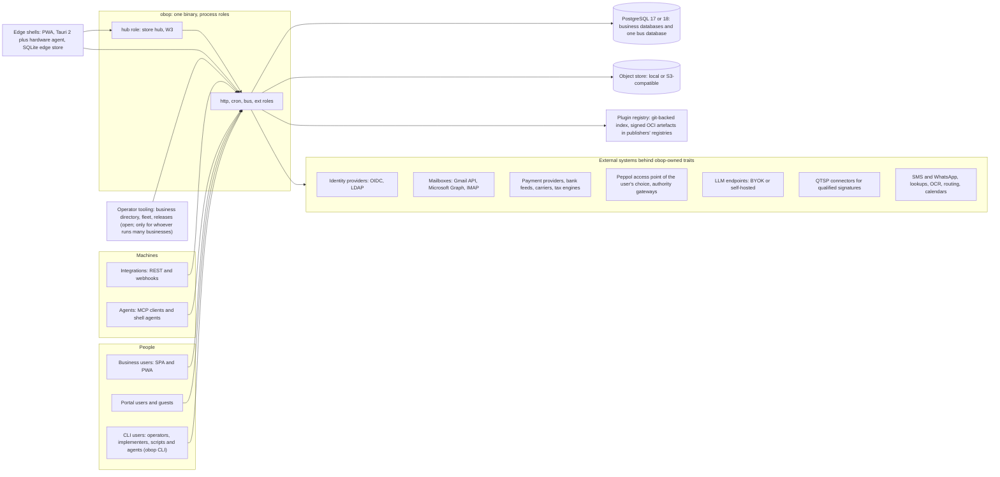
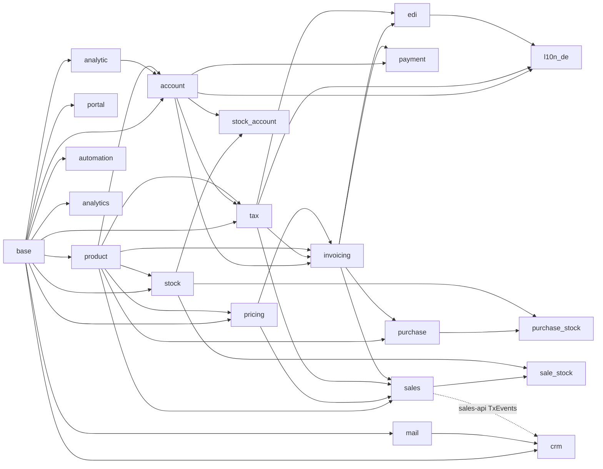
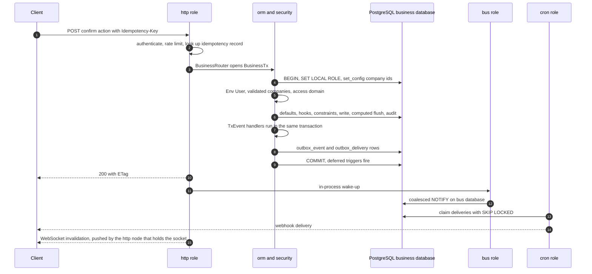
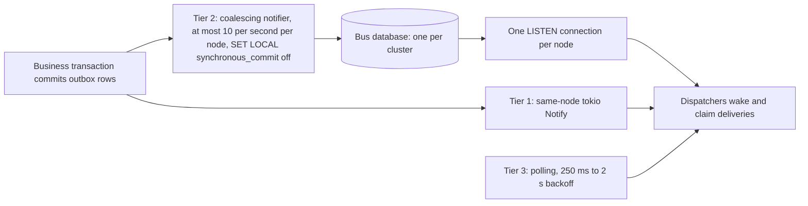
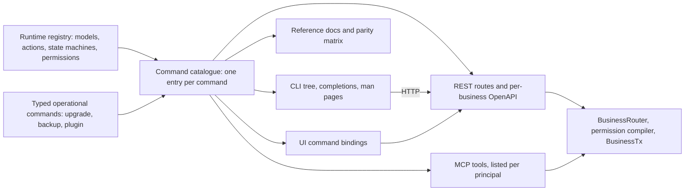

# Architecture: reconciled system design and technology stack

- **Status:** Draft 0.1
- **Date:** 2026-10-01
- **Scope:** The reconciled system design and technology stack of obop: runtime, layers, data layer, APIs and the command catalogue behind the CLI, REST and MCP, extension platform and plugin registry, frontend, operations and repository layout. Conformed to the owner rulings of 2026-10-01 (OR-1 to OR-21).

**How to read.** [DECISIONS.md](DECISIONS.md) is binding and wins over the research wherever they differ; decisions are cited by ID (for example D6) and the owner rulings of 2026-10-01 by number (OR-1 to OR-21, all RATIFIED; see "Owner rulings" in DECISIONS). The rulings fix the base of this document: the whole project is Apache-2.0 and completely free, with no proprietary layer, no `ee` tree and no paid list (OR-1, OR-2; D1, D2); it is agentic first, with the CLI, the REST API and MCP generated from one command catalogue and the web UI a client of the same commands, at literal parity with them before the first stable release (OR-4, OR-16; D80); the plugin registry lists only plugins with an OSI-approved licence (OR-17; D81); SpaceCorps hosts nothing for others today, apart from the free sample-data sandbox (OR-11, OR-20; D83); the pin policy, exactly two exceptions to "vp only" and the rest of Q10 (I-1, the D24 renames, the X and L prefixes) are ratified (OR-8, OR-9, OR-14; D23, D24); the support promise is a 12-month deprecation window and an N-1 upgrade path before 1.0, then a 2-year security-fix window (OR-12; D85); the wave windows, the German pack date and the 1.0 target are kept and W1 is cut to the smallest honest loop, which the owner confirmed (OR-13, OR-15; D26, D86). "Proposed (Dn)" still marks what the owner has not ratified: the T0 app list and the individual wave placements (D25, the slip order and the landing waves of D86), the 0.x release dates, the release cadence and the deprecation window after 1.0 (D85, Q28), the staging and the remaining admission details of the plugin registry (D81), the sandbox details (D83, Q34 to Q36), the details of the CLI grammar (D80, Q22) and the owner's approval of each exemption-list entry (D80, OR-16), so a wave or a date below is Proposed unless D26 ratifies it. Whether obop publishes anything to the npm registry is not ruled: it is decided at W2, and until then the default is no publication (OR-19, Q32). "(target)" is a design target and "(estimate)" a model output; neither is a measurement, and most of what this document describes is not built yet (early code exists; CLAUDE.md has the code map). Versions are as of 2026-10-01. Product scope is in [PRODUCT.md](PRODUCT.md), delivery in [ROADMAP.md](ROADMAP.md), the command line, agent and plugin-registry spec in [spec/cli.md](spec/cli.md), module detail in the `spec/` documents (for example [spec/platform.md](spec/platform.md)). [CONVENTIONS.md](CONVENTIONS.md) fixes the spelling of names that cross documents (events, permission groups, data classes, states, ports) and outranks this document on them; its rename map lists the retired spellings. Nothing here is legal advice; items that need counsel are marked.

## 1. Goals, constraints and non-goals

### 1.1 Goals

| # | Goal | Architectural answer | Decisions |
|---|---|---|---|
| G1 | One business, one platform on one data model | Modular monolith on one registry; integration by ports and events, not glue modules | D27, D29 |
| G2 | Books that cannot be wrong | Balance, immutability, lock dates, numbering and hash chain enforced by PostgreSQL; exact money | D9, D30 |
| G3 | Operable by one person | One binary with process roles plus PostgreSQL; embedded PostgreSQL for solo installs | D37 |
| G4 | Customisation and integration as data | Built-in behaviour is metadata; REST, OpenAPI, MCP, the CLI, webhooks, import/export and docs derive from one registry and one command catalogue; customisations export as packages | D29, D31, D32, D80 |
| G5 | Upgrades are a product | Expand/contract, N/N+1 compatibility, an N-1 upgrade path before 1.0, destructive changes only at the first release of a series (Proposed), fleet fan-out for operators | D36, D85 |
| G6 | Third-party code outside the trust domain; compliance as data | Wasm, remote apps, sandboxed UI; signed, effective-dated country packs | D11, D17, D34 |
| G7 | Accessible and international by construction | WCAG 2.2 AA release gate, logical CSS, PO plus ICU MessageFormat 1 | D34, D35 |
| G8 | Agentic first, CLI for everything | Every capability is a typed command in one catalogue generated from the registry; the CLI, REST and MCP are equal generated surfaces; the web UI is a client of the same commands and reaches literal parity before 1.0 (exemption list aside) | D80, D29, D31 (OR-4, OR-16) |

### 1.2 Fixed constraints and what they force

| ID | Constraint | Consequence |
|---|---|---|
| F1 | Backend exclusively the latest stable Rust, edition 2024 | All server code obop authors is Rust. PostgreSQL, PgBouncer, pgBackRest, OCR engines and validators (KoSIT, Mustang, phase4) are dependencies, not authored code; off-the-shelf sidecars stay optional (I-1, RATIFIED, OR-14) |
| F2 | Frontend and tooling exclusively Vite+ (`vite-plus`); pnpm only | Every JS/TS build, test, lint, format, task and environment command is `vp` (I-2, RATIFIED), with exactly two named exceptions (OR-9): the nightly exit drill and `pnpm sbom` (section 10.1); `pnpm-lock.yaml` is the only JavaScript lockfile committed (the Rust `Cargo.lock` is committed too, section 15); no Node on customer servers |
| F3 | Clean-room relative to Odoo | Behaviour from public docs and Community source read for understanding; Odoo may run only as a black-box differential oracle |
| F4 | Open source | The whole project is OSI-approved open source, under Apache-2.0 (F5, D1). SpaceCorps is the publisher, copyright holder and trademark holder (OR-10) |
| F5 | Licence and price (OR-1, OR-2) | Code, SDKs, WIT worlds, UI SDK, templates and documentation are Apache-2.0 and completely free to use and to self-host. There is no proprietary layer: no `ee` tree, no open-core, no paid list, no plans or prices, no marketplace commission, and nothing is withheld. Contributions carry a DCO sign-off; there is no CLA (D82) |
| F6 | Agentic first, CLI for everything (OR-4) | Every capability is a typed command reachable through the `obop` CLI, the REST API and MCP; the web UI is a client of the same commands; a feature is not done until it exists in all three (D80, sections 8.6 and 8.7) |

"Latest" means the pin policy (D23): a Rust release is eligible at x.y.1, or at x.y.0 after 14 days without an open stable-to-stable regression. Today (2026-10-27) the pin is 1.99.0 in `rust-toolchain.toml` (rule RATIFIED, D23, OR-8; 1.98.1 was the pin until 1.99.0 became eligible on 2026-10-15, and 1.98.0 was skipped for a vtable miscompilation). Rust 1.99.0 was published on 2026-10-01 (the release post is dated that day and `channel-rust-stable.toml` serves it, with a manifest `Last-Modified` of 12:38 UTC after a 404 at about 10:10 UTC). The pin stayed 1.98.1 until the D23 rule allowed 1.99.0 (x.y.0 plus 14 days is 2026-10-15), not because the channel lacked it, so 1.99.0 was adopted after that date and not immediately as R06 MUST 1 proposed [R06 s1.1]. The toolchain therefore intentionally runs up to about three weeks behind the newest release (OR-8, I-3). `vite-plus` 1.0.0 (2026-09-28, MIT) becomes eligible on 2026-10-05 under the 7-day rule (RATIFIED, D23, OR-8). `rust-toolchain.toml` carries an exact `channel = "x.y.z"`, builds use `--locked`, and release builds set `overflow-checks = true`.

### 1.3 Technology stack at a glance

Pins are the verified versions of [R00 s3]; Proposed rows wait for the owner.

| Area | Choice | Pin as of 2026-10-01 | Status |
|---|---|---|---|
| Language | Rust stable, edition 2024, resolver 3 | 1.99.0 (`rust-toolchain.toml`, 2026-10-27; released 2026-10-01, adopted after the D23 waiting period) | FIXED F1; pin policy D23 (RATIFIED, OR-8) |
| Runtime, HTTP | tokio only; axum behind one crate `obop-http` | tokio 1.53.1; axum 0.8.9 (0.9 pending) | D29 |
| Data access | In-house ORM on sqlx and sea-query; SeaORM only for fixed system tables | sqlx 0.9.0; sea-query 1.0.2; SeaORM 2.0.4 | D29 |
| Database | PostgreSQL 17 and 18 (18 reference), CI also on 19 from RC; PgBouncer 1.26+; pgBackRest | 18.6, 17.11 (19 in Beta 4); 1.26.0; 2.59.2 | D8, D37 |
| Core types | utoipa OpenAPI; `Money` over rust_decimal; jiff for time zones; UUIDv7 keys | 6.0.0; 1.43.0; 0.2.37 (chrono 0.4.45 at the sqlx edge); uuid 1.26.1 | D9, D29 |
| Expressions | CEL for everything stored except domains | `cel` 0.14.5 (no documented cost limit) | D11; split Proposed (D12) |
| Extensions | Wasm components (X3, W3) on a pinned wasmtime LTS behind `obop-wasm-host` | v48 LTS (48.0.3; latest 49.0.1) for the internal spike only; X3 starts on the then-current LTS, v60 about 2027-08-20 (estimate) | D11, D86; an ADR amends D11 when X3 starts |
| Reports, AI | Typst behind `obop-report` with minijinja templates; MCP through `rmcp`, BYOK | typst 0.15.1; minijinja 2.24.0; rmcp 3.5.0 (MCP 2026-07-28) | Proposed (D20); D18 |
| Command surface | One command catalogue generated from the registry drives the `obop` CLI (crate `obop-cli*`), the REST API and MCP; the web UI is a client of the same commands | The CLI contract is Proposed (grammar `obop <subject> <action>`, Q22); MCP through `rmcp` | D80 (OR-4, OR-16, RATIFIED); [spec/cli.md](spec/cli.md) |
| Licence, contributions | Apache-2.0 for the whole project; DCO sign-off (the owner signs off every commit, agents are recorded by a `Co-Authored-By` trailer; counsel is still asked to confirm that this satisfies the DCO), no CLA; source files carry an SPDX identifier | `LICENSE` and `NOTICE` at the repository root ("Copyright 2026 SpaceCorps contributors") | D1, D82 (OR-1, OR-18, RATIFIED) |
| Mail, collaboration | `mail-parser`, `mail-builder`, `mail-auth`, `lettre`, `async-imap` (never the AGPL Stalwart server); Yjs with `yrs`, pinned together | 0.11.9, 1.0.0, 0.13.3, 0.11.23, 0.12.0; 13.6.33 with 0.28.0 | D39 |
| Edge | rusqlite edge store; Tauri 2 shells | 0.40.2; 2.12.1 | D37 |
| Frontend toolchain | Vite+ via `vp`, exact pin, one config factory | 1.0.0 bundling Vite 8.3.1, Rolldown 1.2.11, Vitest 5.0.1, Oxlint 1.85.0, Oxfmt 0.70.0, tsdown 0.23.0 | D15, D23; the nightly exit drill and its exception to `vp` only are RATIFIED (I-4, OR-9, section 10.1) |
| Package manager, Node | pnpm only, one exact version pinned with `vp env pin pnpm@<x.y.z> --target package-manager`; Node 24 LTS, Node 26 (LTS from 2026-10-28) by 0.2 | pnpm registry tags, read 2026-10-01 14:07 UTC: `latest` and `latest-12` 12.8.1 (pnpm 12 is the Rust port and the current major), `next-12` 12.8.2, `latest-11` 11.28.2, `next-11` 11.28.3 (pnpm 11 is the JS line). Newest version eligible under the 7-day rule: 12.6.0 or 11.27.1; 12.8.1 and 11.28.2 become eligible on 2026-10-05. The section 10.1 settings are read without warning by pnpm 12.8.1; their behaviour is verified on 11.x only | FIXED F2; pin policy D23 (RATIFIED, OR-8); which major is open (Q15) |
| UI | React 19 and TypeScript 7, TSX only, React Compiler via `@rolldown/plugin-babel`; TanStack Query, Router, Table, Virtual; React Aria Components; Tailwind; Lingui | React 19.3.0; Table 9.2.4; RAC 1.21.1; Tailwind 4.3.3; Lingui 6.8 | D15, D34 |
| Docs | VitePress 2 inside Vite+, plain Markdown; a Starlight (Astro) fallback would need an owner waiver of F2 and is not assumed | 2.0.0-alpha.20 | D38; the waiver is open (Proposed, Q14) |

### 1.4 Non-goals

- No microservices (D27); pool-mode multi-tenancy is not built (D6).
- No `NOTIFY` in business transactions (D7); SQLite is never the domain database of a deployment (D37; D44 allows it for local development and solo use only).
- No in-process third-party Rust, no Rhai in W1 and W2; CEL is the only expression language stored in data, and minijinja and Typst templates are bounded render-time templates that never hold conditions, modifiers, formulas, validation or policies (D11; the template clause is Proposed with D14 and D20).
- No XML-RPC and no GraphQL in W1 (D31); a `/json/2/` endpoint is DEFERRED (D22).
- No Electric, PowerSync or Zero, and no CRDT for transactional data (D13, D37).
- No Node in production (Proposed, D14); no browser-based PDF renderer (Proposed, D20).
- No inference inside the server process [R16 s11]; no statutory payroll filing in core (D19); no performance multiple over Odoo before the harness exists (D21).
- No proprietary layer, `ee` tree, paid list, plan, price or marketplace commission (OR-1, OR-2, OR-3); no hosted obop operated by SpaceCorps for other people, apart from the free, ephemeral hosted sandbox with sample data only that opens at the public beta (OR-11, OR-20, D83); no payments of any kind in the plugin registry (D81).
- No feature that exists on one surface only: no UI-only capability, no business logic in the browser, no second, hand-written API for agents (D80). The CLI has no direct-database mode and is not distributed through the npm registry (no publication until the owner rules at W2, OR-19; Q32).

### 1.5 Resolved conflicts

> **Resolved conflicts.** Where research files disagree, this document follows [DECISIONS.md](DECISIONS.md). Later notes outrank earlier ones (R23, R24, R26 highest), and DECISIONS.md outranks all of them. The owner rulings of 2026-10-01 outrank the research: the licensing, pricing, funding, team, support and open/paid material of R17, R24 s8-s11, R25 B7, R26 and R27 C is historical.
>
> | Topic | Research said | Used here | Authority |
> |---|---|---|---|
> | Realtime bus | R02, R06, R08, R15, R18: LISTEN/NOTIFY as bus, wake-up and registry signal | Outbox, coalescing notifier on one bus database, one LISTEN per node | D7 |
> | Tenancy | R08 database per tenant plus RLS; R18 silo and pool | One database per business, cells of at most 250, no pool mode | D6 |
> | PostgreSQL floor | R02 16+; R08, R22 18 only; R18 16/17/18 | 17 and 18; `requires_pg = 18` | D8 |
> | Authorization | R08, R18 default-allow `ir.rule` | Odoo-20 algebra, default-deny, RLS backstop only | D10 |
> | Scripting in data | R05, R15 Rhai | CEL only; code is Wasm | D11 |
> | Modifier storage | R19 JSON AST; R24 CEL | Domains JSON AST, the rest CEL plus compiled form | Proposed (D12) |
> | Wasmtime | R21 "no LTS policy" | v48 LTS for the internal spike; X3 (W3) starts on the then-current LTS (v60) | D11, D86 |
> | UI extension | R07 s3.12 third-party ESM in the main realm | UI tier F1 for trusted code only; registry plugins are UI tiers F2 or F3 | D11, D81 |
> | Edge store | R12 SQLite everywhere; R18 SQLite local mode | PostgreSQL server; fixed-schema SQLite edge store; embedded PostgreSQL for solo | D37 |
> | Storefront, PDF | R07 separate Astro app with Node SSR left open, R12 Node sidecar for app-like flows; R15 Chromium pool | Rust blocks plus Vite islands; Typst only | Proposed (D14, D20) |
> | Labels | R24 T1-T5; R23 "T0 (21), T1 (19)"; R01, R25, R26 T-sets | X1-X5; T0-T3 with waves (the X and L prefixes are RATIFIED, OR-14; the T0-T3 labels are Proposed) | D24, D25 |
> | Names | `TenantTx`, `TenantRouter`, `tenant_release_state`; `module.toml`, `obop.app.toml` | `BusinessTx`, `BusinessRouter`, `business_release_state`; one `obop.toml` (renames RATIFIED, OR-14) | D24, D32 |
> | Deprecation | R26, R27: 12 months; R24, R27 C: a 24-month floor | 12 months before 1.0 (RATIFIED); after 1.0 the same window unless the owner rules otherwise (Proposed); the 24-month floor is withdrawn | D85, OR-12 |
> | Exit drill | R07 quarterly | Nightly plus quarterly review, as the first of exactly two ratified exceptions to `vp` only (the other is `pnpm sbom`, section 10.1) | D15, D23, I-4, OR-9 |
> | Performance | R20, R22: 5-10x targets | No multiple before the harness | D21 |
> | Offline | R02, R12, R19, R22: read-only, 2 GB | Odoo 20 queues writes; 1.0 targets Odoo-19 parity | Proposed (D13) |
> | Licence | R17, R24 s8, R26: AGPL core with an Application Exception, Apache-2.0 SDKs, `ee` | Apache-2.0 for everything; no `ee`, no Application Exception, no CLA | D1, D82 (OR-1) |
> | Open or paid | R25 B7, R26: a closed paid list, plans, prices, operated services | Nothing is paid; every capability is open and free | D2 (OR-2) |
> | Build order | Older documents: the API follows the screens (UI equals API) | Command first; CLI, REST and MCP generated; UI last and at parity before 1.0 | D80 (OR-4) |
> | Support | R27 C: a 5-year LTS on every fourth release, a monthly patch train | A 2-year security-fix window from 1.0; N-1 upgrades and 12-month deprecation before it; no LTS label, no patch train | D85 (OR-12) |
> | Hosting | R18, R26: hosted cells, a paid cloud, Data Act switching terms | SpaceCorps hosts nothing for others today, except the free, ephemeral sample-data sandbox from the public beta (section 3.2); cells are an operator sizing rule | D83 (OR-11, OR-20) |
>
> One naming rule follows from D24 (RATIFIED, OR-14): it reserves L1-L3 for localisation pack maintenance tiers, so R08's layer labels L0-L8 are written "Layer 0" to "Layer 8" here (section 4.1) and never as a bare "L4".

## 2. System context



Every external system is reached through a trait owned by obop, so a provider is replaceable and testable [R21 Implications 8]:

| External system | Trait or port | Wave (Proposed, D25) |
|---|---|---|
| Payment providers | `PaymentProvider` (`Transaction`, `Token`, `Refund`, `Payout`, `Dispute`), first-party X5 crate | W2 (W1 has manual payment registration only; SEPA files and Stripe plus one are slip-order item 9, D86) |
| Bank feeds | `BankFeed`: file import first (camt.053, MT940), then BYO-credential aggregators as X3 or X4 | File import W1, aggregators W3 |
| E-invoicing | `DocFormat { build, parse, validate }` and `EDocTransport { send, poll, receive, cancel }` [R09]; EN 16931 syntaxes in X5; in W1 e-invoices travel by email or file, the Peppol transport adapter (a certified access point the user chooses, bring-your-own credentials; SpaceCorps operates none, D83) is W2 (D86), access-point and authority adapters are X5 or X4 (no Wasm host before W3, see [LOCALIZATION.md](LOCALIZATION.md)), and X3 from W3 | W1 (email, file); Peppol W2 |
| Tax, carriers | `TaxProvider`, `CarrierProvider`; built-in rules engine is the default | W1, W3 |
| Mail | `MailProvider` [R21 MUST 8] with one `MailAccount` per connected mailbox (Gmail API, Graph, IMAP with XOAUTH2) [R15 s4]; OAuth only, no EWS, no basic SMTP AUTH (D39); crate `obop-mail` | W1 outbound (the operator's SMTP relay or a provider API); mailbox connectors W2 (D86) |
| LLMs | `LlmProvider` over OpenAI-compatible, Anthropic and Gemini wire formats [R16] | W3 |
| Payroll providers | `PayrollProvider`: import pay runs and journals, push employees and deductions, pull payslips; no statutory filing in core (D19) | W3 |
| POS terminals, fiscal devices | `TerminalDriver`; fiscal adapter `LocalDevice`, `CloudSigner`, `ChainedSoftware` [R12] | W3 |
| SMS, WhatsApp | `SmsProvider` (send, status webhook, inbound, opt-out) with the business's own provider keys and no credit wall; WhatsApp as an X3 or X4 connector package [spec/retail-commerce-marketing.md](spec/retail-commerce-marketing.md) | SMS W3, WhatsApp W4 |
| Lookups: VAT id, registry, address, lead enrichment | `VatIdValidator` (VIES, a pack validator plus a connector); registry, address and enrichment lookups are connectors with the business's own keys, off by default. No trait name beyond `VatIdValidator` is fixed in the specs; `LookupProvider` is a working name (Proposed) | VIES W1, registry W2, enrichment W3 |
| OCR | `OcrEngine` over an optional OCRmyPDF plus Tesseract sidecar (optional, never default, I-1); Rust-native OCR is a Latin-only preview [R15 s6] | W3 (`documents`) |
| Routing, maps | `RoutingProvider`, no bundled vendor; OSRM, Valhalla or VROOM are optional sidecars outside the default install; the tile source is a setting [spec/services.md](spec/services.md) | W3 (field service) |
| Calendars | Google Calendar and Microsoft Graph sync through connectors, one `calendar_sync_link` per provider account; push is a hint and polling stays the correctness mechanism. The specs fix no trait name (`CalendarProvider` is a working name, Proposed) [spec/platform.md](spec/platform.md) | W3 (with `calendar`, D25) |

Trust boundaries: browser to API; CLI and agent to API (an ordinary authenticated client of `/api/v1`; the CLI has no direct-database mode, section 8.6); API to PostgreSQL (`BusinessTx` only) and the object store; API to every outbound network through one SSRF-hardened egress client; `ext` role to host functions; the report renderer to everything [R18 s1].

## 3. Runtime topology

### 3.1 One binary, process roles

`obop` is one static musl binary (musl 1.2.5 is bundled since Rust 1.93) with the built frontend embedded (`rust-embed`), started with `obop serve --roles ...` [D37, R06 s3.15]. The same binary is the CLI (section 8.6): `obop serve` runs the roles and every other `obop <subject> <action>` calls a running server. The role names are D37's. The responsibility split below is a Proposal, because the research names the roles but does not define them.

| Role | Runs | Scaling | Notes |
|---|---|---|---|
| `http` | axum: REST, `$batch`, OAuth 2.1 provider, MCP, WebSocket and SSE, embedded assets, inbound webhooks | Horizontal, stateless | Every request enters through `BusinessRouter` |
| `cron` | Job runner (`SKIP LOCKED` claims, leases), leaderless schedule firing, outbox dispatcher, webhook and mail delivery, retention and erasure jobs | Horizontal | No `pg_cron`, no leader election [R22 s6] |
| `bus` | `obop-bus-notifier`: coalescing notifier, the node's one LISTEN connection on the bus database, wake-up fan-out to local tasks | One per node running `http` or `cron` (in-process in `all`) | The only code allowed to call NOTIFY (CI-enforced, D7) |
| `ext` | `obop-wasm-host` (X3), under cgroups and seccomp or Landlock; isolated report rendering (Proposed, section 11) | Horizontal | Split exists from day one, even if the first X3 release (W3, D86) runs it in-process [R24 s3.3] |
| `hub` | Store hub on rusqlite: LAN authority for tablets and kitchen screens | One per store | W3; not part of `all` (Proposed) |
| `all` | `http`, `cron`, `bus`, `ext` in one process | Solo, single node | |

Operator work is not a role. `obop migrate`, `obop upgrade`, `obop backup ...` and `obop plugin ...` are commands of the same binary and entries of the same typed catalogue (D80, [spec/cli.md](spec/cli.md) 3.1); the bootstrap ones (`init`, `up`, `down`, `serve`, `migrate`, `upgrade`) link the server crates and run in process without a running server (Proposed).

### 3.2 Deployment profiles

| Profile | Shape | PostgreSQL | Blobs | Businesses |
|---|---|---|---|---|
| Solo / demo | `obop serve --roles=all`, one process, or `obop up` for a managed solo stack; `obop dev up` starts a seeded local demo | Embedded PostgreSQL as a child process (`postgresql_embedded` 0.21.0) | Local filesystem | One |
| Single node | `all`, or `http,cron,bus,ext` on one host; optional PgBouncer; pgBackRest to object storage | System package or container, 17 or 18 | Local filesystem or S3-compatible | One to a few |
| Cell | PostgreSQL cluster with at most 250 business databases plus one bus database; PgBouncer per cell; stateless app nodes | 17 or 18, one primary plus standby and read replicas | S3-compatible with a per-business prefix | Up to 250 |
| Fleet (whoever hosts many businesses) | Many cells, a business-to-cell directory, ring rollout as operator guidance (section 13.3) | As cell | As cell | Fleet |
| Sandbox (SpaceCorps-run, from the 0.5 public beta; Proposed, Q35, Q36) | The ordinary single binary (roles `http` and `cron`, or `all`) on one small server, with default-deny egress (the D33 SSRF-hardened client with an empty allow-list), outbound mail to a log-only sink, per-address rate limits and quotas at the edge and a kill switch; no new role, no new product component and no SpaceCorps-only code path. Isolated from CI runners, signing keys and the repository | PostgreSQL 18 behind PgBouncer on the same server; one database per visitor session, cloned from a seeded template database (D6, D36 template-database harness) and dropped at its time to live, plus a nightly full reset | Local filesystem, discarded with the session; small upload limits | One short-lived business per visitor session, sample data only |

The multi-business control plane (the business-to-cell directory, fleet migration and release tooling) is open operator tooling under Apache-2.0 like everything else; it is not part of a single-business install. There is one edition and nothing in it is paid (OR-1, OR-2). SpaceCorps operates no hosted obop for other people today and sells no hosting yet, apart from the free, ephemeral sandbox with sample data only that it runs from the public beta (0.5; OR-11, OR-20; the duties it creates are the list in D83, [DECISIONS.md](DECISIONS.md#d83-hosting-posture-and-a-free-sandbox-at-the-public-beta)): a cell is a sizing rule for whoever operates many businesses, be it a self-hoster, a company, a partner or a third-party host, who then carries a host's duties. **Sandbox topology note.** The sandbox is the ordinary product run by SpaceCorps, not a product component of its own. Its businesses are ephemeral and hold sample data only, never personal or production data (its terms of use forbid both), and no customer contracts exist, so it creates no Data Act switching duty and no SLA; it has no backups, no export promise and no availability target. What it does create (terms of use, privacy notice, abuse and rate controls, egress and outbound-mail blocking, auto-reset, sanctions screening, a named running cost, on-call burden, counsel review) is the duties list of D83, and section 13.5 records how the architecture meets it. The details are Proposed (Q34 to Q36): the sandbox opens with 0.5 only if those duties are in place and otherwise later, the public beta does not wait for it, and it can be closed at any time. An optional local demo (`obop dev up`, the same seeded sample data) covers evaluation on the user's own machine. NATS JetStream stays DEFERRED until measured bus-database wake-up lag or polling-fallback rate exceeds the threshold set at the D7 pgbench spike readout (2026-11-27), at the reference cell size; node count alone is not a trigger, because a cell always has several app nodes (D7, DECISIONS section 2.3).

### 3.3 Connection, memory and start-up

- Application traffic goes through PgBouncer in transaction mode with `max_prepared_statements`; `pool_idle_timeout` (off by default) is enabled so idle businesses hold no pools [R22 s5, s10]. Migrations, LISTEN, session advisory locks and replication use direct connections [D37].
- Context is transaction-local only: `SET LOCAL ROLE` and `set_config(name, value, true)`; session-level `SET` is forbidden behind a pooler [R18 s4].
- Each node builds per-business sqlx pools lazily (small maximum, idle eviction) and loads each `Arc<Registry>` lazily with LRU eviction, as Odoo does per database [R08 s2.1]; sizes are Proposed and S2 sizes them. An in-process cache (moka) holds the registry, compiled access domains and hot reference data; there is no shared cache in the baseline [R22 s8].
- Start-up asserts registry equals manifest (linker registration can silently drop an unreferenced crate) and checks each database's `requires_pg` capability and schema epoch. Readiness waits for the bus database; shutdown drains commands and releases leases [R06 s3.13, R18 s9.1].

## 4. Layered architecture and the modular monolith

### 4.1 Layers 0 to 8

Dependencies point down only. The layer model is R08's s13, updated for D6-D10. Layers are numbered in words ("Layer 4"), not "L4" (section 1.5).

| Layer | Responsibility | Crates | Rule |
|---|---|---|---|
| Layer 8 Clients | SPA, PWA, Tauri shells, the `obop` CLI, integrations, agents | `web/` packages, `obop-cli*` | Talk to Layer 7 only; the bootstrap CLI commands (`init`, `serve`, `migrate`, `upgrade`) link server crates and run in process (section 8.6). The UI is a client of the typed commands and holds no business logic (D80) |
| Layer 7 API surface | Generic REST, `$batch`, OAuth and OIDC, MCP, webhooks, WebSocket, OpenAPI, the published command catalogue | `obop-http`, `obop-mcp*` | Only `obop-http` depends on axum; dispatches through registry-resolved commands; REST, MCP and CLI bindings are generated from the same catalogue (section 8.6) |
| Layer 6 Application | Module services and commands, automation and approvals, jobs, outbox dispatch, reports, Wasm host, packages, importers | module implementation crates, `obop-jobs`, `obop-bus-notifier`, `obop-report`, `obop-wasm-host`, `obop-pkg`, `obop-importers`, `obop-compat` | May call Layer 5 and other modules' ports only |
| Layer 5 Model runtime | `Env`, unit of work, CRUD pipeline, access algebra, sequences, `row_version`, retries, TxEvents and outbox writes | `obop-orm`, `obop-security`, `obop-events`, `obop-i18n`, `obop-telemetry` (cross-cutting) | The only layer that holds a database pool |
| Layer 4 Query layer | Domain AST, CEL evaluation, type-check, optimise, compile to SQL, grouping and semantic queries | `obop-domain`, `obop-cel`, compiler in `obop-orm` | Bound parameters only; identifiers from the registry only |
| Layer 3 Registry | `ModelDef`, `FieldDef`, command definitions and the command catalogue (Proposed), hook chains, state machines, module graph, `Arc<Registry>` per business | `obop-registry` | Single source of truth for Layers 4 to 7 and for the CLI |
| Layer 2 Schema manager | Diff registry against `pg_catalog`, classified DDL plan, runner, migration ledger, fleet fan-out | `obop-schema` | Only crate that issues DDL |
| Layer 1 Storage | PostgreSQL (business and bus databases), object store trait, the operator's business-to-cell directory (open operator tooling, absent from a single-business install); edge store `obop-edge` is a separate leaf | `obop-storage` | Edge store never shares schema with the server |
| Layer 0 Kernel | `Id<M>`, `Money`, `Value`, errors, derive macros, pure business arithmetic, test kit | `obop-types`, `obop-macros`, `obop-calc`, `obop-testkit` | No I/O |

Crates marked `*` in section 15 are Proposals; the others are named in DECISIONS section 5.1.

### 4.2 Modules

A module is a first-party unit with a manifest, an `*-api` crate and an implementation crate, installed per business [D24]. Cargo packages carry the `obop-` prefix (`obop-mail`, `obop-stock-api`; Proposed); this document uses the short form. API crates hold types, traits and event types (TxEvent and durable event) only, with no sqlx and no logic. The manifest is `obop.toml` (kind `native`) with dependencies (written `depends` in this document and the specs; the TOML table is `[dependencies]`), `auto_install` and migrations [D32]; the key table is in section 9.3. Install state lives in `module_state` per business. All crates are linked into the release binary (slim builds via Cargo features); handlers and migrations register only for installed modules when a business's `Arc<Registry>` is built [R23 D.2 R7].

### 4.3 The integration contract (D27)

Mechanisms in order of preference:

| # | Mechanism | Use when | Shape |
|---|---|---|---|
| 1 | Port call | Synchronous request/response between modules | `Arc<dyn Port>` from the owner's `*-api` crate; optional ports are `Option<Arc<...>>` and need no bridge |
| 2 | TxEvent | An atomic invariant across modules | Past-tense, runs in the publisher's transaction in deterministic order (module depth, then priority); an `Err` aborts the command |
| 3 | Extension point | A mutable pre-step such as `BeforeInvoicePost` | A port with a chain of implementers |
| 4 | Durable event | Anything after commit: external I/O, mirrors, webhooks, indexing | `outbox_event` written in the transaction; one `outbox_delivery` row per subscriber, claimed with `SKIP LOCKED` and a lease |

Rules R1-R6 [R23 D.2] (R7, per-business `auto_install`, is in 4.2):

| Rule | Statement |
|---|---|
| R1 | One command, one database transaction, one `BusinessTx`; only durable-event handlers open their own |
| R2 | Ordering per (subscriber, aggregate) only: a delivery is claimable when no earlier one for that pair is incomplete; durable events carry `aggregate_version` |
| R3 | At-least-once delivery; `inbox_processed(subscriber, event_id)` is unique; handlers use natural keys; API commands take `Idempotency-Key` |
| R4 | Rollback inside a business; after commit, a reversal document. Sagas (`process_instance`) only across businesses or external systems; no two-phase commit |
| R5 | Dependency law, checked by `xtask` over `cargo metadata`: an implementation crate depends only on kernel crates and the `*-api` crates of its own module and its manifest `depends`. No implementation-to-implementation edges |
| R6 | Handler traits are owned by `obop-events` and bridges implement them on their own unit structs (orphan rule); async ports use boxed futures (`async-trait` or `dynosaur`) until native `dyn` async stabilises (rust-lang/rust#133119 open) |

Hub ports keep bridges linear instead of quadratic. The Called-by column names module ids as in [CONVENTIONS.md](CONVENTIONS.md#71-hub-ports-d27) 7.1: a bridge or module calls the port, not the app it belongs to, so `sales` has no edge to `stock-api` (R5).

| Hub port | Called by | Implemented by |
|---|---|---|
| `DemandPort` | `sale_stock`, `pos_stock`, `mrp`, `repair`, `planning` (van stock) (raise demand) | `stock` |
| `QtyContributionPort` | `sale_stock`, `purchase_stock`, `sale_timesheet`, `sale_project` (milestones), `service_contract` (allowance split) | `sales` for sale lines; `purchase` for purchase lines (Proposed, [spec/supply-chain.md](spec/supply-chain.md) 4.2); unique on `(line, source)` |
| `PostingPort` | `stock_account`, `mrp_account`, `payroll`, `pos_account`, `rental` (deposit role); request entries by account role, not account id | `account` |
| `InvoiceableSource` | `invoicing` | `sales`, `subscriptions` |

Billable time reaches invoicing only through the sale line: `sale_timesheet` feeds `QtyContributionPort` and `sales` is the `InvoiceableSource`, so `timesheet` is not an implementer and there is no time-only invoice without an order (R23 D.4; [spec/services.md](spec/services.md) and [spec/finance.md](spec/finance.md) agree). Whether to add time-only invoicing is open (section 16.3). R23 names no `InvoiceableSource` implementers; the purchase (vendor bills), POS and expense (`expenses_sales`) specs propose to implement it as well, and they join the implementer column when those specs confirm the direction (Proposed; [CONVENTIONS.md](CONVENTIONS.md#71-hub-ports-d27)).

Beyond R5, `xtask` and CI enforce these architecture lints: `NOTIFY` only in `obop-bus-notifier` (D7); axum only in `obop-http` and sqlx pools only in `obop-orm` (D29, R18); `AssertSqlSafe` and compile-time `query!` only in named crates [R06 s3.3]; floats banned in money and quantity paths through `clippy::disallowed_types` [R23 DR-5]; tokio only, async-std banned by `cargo-deny`; a licence allow-list for crates and JS packages (permissive and MPL-2.0 licences; GPL, AGPL, SSPL, BUSL, ELv2 and other non-OSI licences excluded from anything shipped; Proposed detail of D1); no raw pool access outside `BusinessRouter`; a required DCO sign-off check on every commit (D82); every REST route, MCP tool and CLI command must be an entry of the command catalogue, and every shipped command has a CLI, REST and MCP binding or an exemption-list entry approved by the owner (OR-16; parity test, section 8.7).

**Event names (Proposed).** Event types are PascalCase and past tense (`SaleOrderConfirmed`, `InvoicePosted`) and are defined in the publishing module's `*-api` crate. Webhook and MCP event types derive from the same definition as dotted lowercase, following Standard Webhooks (for example `sale_order.confirmed`). The event catalogue is therefore generated from the `*-api` crates and the state machines' `emits` (reference pages come from the registry, D38) and is not hand-listed here beyond the interim table below; the module specs under `spec/` give working names, and [CONVENTIONS.md](CONVENTIONS.md#34-cross-document-events) 3.4 is the interim registry of the names that cross documents, with delivery kind, emitter, consumers and wave. One kernel event is defined in this document: `RegistryVersionChanged` (section 5.1), which the specs consume to invalidate tool lists, views and OpenAPI documents.

**Cross-spec names (interim, Proposed).** The registry does generate the REST, MCP and CLI surfaces of the models that exist, but no complete generated catalogue of the specified surface exists, and several specs defer disputed names to this document. Until the catalogue is generated, the rulings below apply and each owning spec adopts them when next edited; the generated catalogue then replaces this table.

| Name | Kind | Emitted by | Consumed by | Owning spec | Ruling |
|---|---|---|---|---|---|
| `PermissionChanged` (payload `kind`: `membership`, `permission_group` or `access`) | Durable | `base` authorization | `ai` (tool lists), `knowledge`, the UI (re-resolve views), access-cache invalidation | [spec/security-privacy.md](spec/security-privacy.md) 4.2 | The majority name, read by [spec/ux.md](spec/ux.md); the retired spelling is in the [rename map](CONVENTIONS.md#8-rename-map) |
| `PrincipalInvited`, `PrincipalDeactivated`, `PrincipalSuspended` | Durable | `base` principal management | `ai` (delegations end), `people`, approvals, notifications, `knowledge`, sessions and share grants | security-privacy 4.1; [spec/platform.md](spec/platform.md) 4.4 shares the names | Adopted as written |
| `PartyErased` | Durable | The erasure job, after anonymise in place | `search`, `mail`, `documents`, `ai`, `calendar`, chatter, `sales`, `crm`, `subscriptions`, `people`, `services`, website, marketing and every app holding a contact snapshot | security-privacy 4.6 | Adopted. `PartyMerged` (platform 4.2) stays a separate event |
| `ConsentRecorded`, `ConsentWithdrawn` | Durable | The consent ledger behind `ConsentPort` in `base-api`, never a website or marketing module | `mail` and marketing (suppression, on withdrawal) | security-privacy 4.6 | Adopted; the website spec consumes and does not emit |
| `import_run`, `ImportRunCommitted`, `ImportRunRolledBack` | Entity; durable | The `base` import engine | Party duplicate scan, the UI, foreign importers | platform 4.16 | `import_run` is the majority name and the term of D22 and section 8.5, and [spec/integrations.md](spec/integrations.md) 4.8 follows it; the retired spellings are in the [rename map](CONVENTIONS.md#8-rename-map). The run states are fixed in [CONVENTIONS.md](CONVENTIONS.md#6-shared-entity-registry-and-state-machines) 6, and platform open question 13 closes on that set |
| `TaxRuleChanged` | Durable | `tax`, when a tax, repartition or fiscal-position version is created or changes | The `pos` snapshot builder | [spec/finance.md](spec/finance.md) 4.4 (to add) | Proposed. The alternative, reading tax tables by `row_version`, is [spec/retail-commerce-marketing.md](spec/retail-commerce-marketing.md) open question 17 |
| `PaymentTransactionDone`, `PaymentTransactionFailed` | Durable | `payment` | `sales` (prepayment), `subscriptions`; `PaymentTransactionDone` also `ecommerce` (confirms the web order) and `appointments` (deposit) | finance 4.5 | Adopted. Whether `sale_payment` is a bridge or `payment` publishes a hub port stays open ([spec/sales-crm.md](spec/sales-crm.md) open question 6) |

### 4.4 The module graph and where modules land

Odoo's 400 auto-install bridges create gravity wells: `account` has 398 transitive dependents and `mail` 592 [R23 D.1]. The graph below is the dependency law for the W1 loop (arrows run from a dependency to its dependents; Cargo edges go to `*-api` crates). Tiers and waves come from D25 (the T0 list is Proposed), D26 (the wave windows are RATIFIED) and the W1 cut of D86 (the in and out calls are RATIFIED, OR-15; the slip order and the landing waves of displaced items are Proposed); R23's "T0 (21) and T1 (19)" split is retired by D24. The graph is the dependency law, not the delivery list: it draws `purchase`, `purchase_stock`, `portal`, `automation`, `analytic` and `analytics` because the law covers them, although the W1 cut ships them later.



| Module | Tier and wave (D25) | Note |
|---|---|---|
| `base` (Contacts app: party, principal, company, currency, sequences, external ids, audit, attachments, properties, import/export) | T0, W0 | Nothing ships before it |
| `product`, `mail` (reduced to chatter, activities, followers and outbound email), `pricing` (list price and line discount) | T0, W1 | Foundations and engines of the D86 loop |
| `portal`, `automation` (with the approvals engine), `pricing` rules, `mail` inbound gateway | T0, W2 | Displaced from W1 (D86, slip order) |
| `analytic`, `analytics` | T0, W3 | Displaced from W1 (D86, slip-order items 2 and 3). The graph above still draws `analytic` as a dependency of `account` (R23); D86 assumes `account` does not need it in W1, which is unverified (section 16.3, item 8) |
| `account`, `tax`, `invoicing`, `payment` (manual registration only), `edi`, `l10n_de`, `bank` (statement import), `crm`, `sales`, `stock`, `sale_stock`, `stock_account` | T1, W1 | The smallest honest loop (OR-13, OR-15, D86). `bank` is absent from R23's graph; its edge to `account` is a Proposal. `crm` subscribes to `sales-api` TxEvents with no bridge; `stock_account` posts through `PostingPort` |
| `purchase`, `purchase_stock`, multi-company, `l10n_fr` | T1, W2 | Displaced from W1; vendor bills stay in W1 `account`; purchase orders are the first item back (D86) |
| Later: the services variant `project`, `timesheet`, `sale_project`, `sale_timesheet` with the `hr` employee core, `calendar`, `discuss` (W3); `hr`, `expenses`, `documents`, `delivery`, `l10n_pl` (W3); `mrp`, `pos`, `website`, `ecommerce`, `helpdesk`, `subscriptions`, `sign`, `knowledge`, `ai` and others | T1 and T2, W3-W4 | See D25 and D86; T2 apps follow demand order and each needs a design partner |

W1 ships one company with `company_id NOT NULL`, composite foreign keys and a dormant `branch`; multi-company follows in W2, intercompany in W3, consolidation in W4 (D28).

### 4.5 One command, end to end



The sequence is the same whichever surface issued the command: `obop sale_order confirm <id>`, `POST /api/v1/sale_order/{id}/confirm` and the MCP tool `sale_order.confirm` are three bindings of one catalogue entry (D80, section 8.6), and only the client differs; the web UI calls the same REST binding.

The worked quote-to-cash loop [R23 D.4] shows how the mechanisms compose; each step is its own transaction.

- **Confirm.** `sale_stock` calls `DemandPort::raise` so `stock` creates and reserves moves; `crm` marks the opportunity won; durable events feed webhooks, email and indexes.
- **Deliver.** `ValidateTransfer` updates quants with `INSERT ... ON CONFLICT`; `sale_stock` calls `QtyContributionPort::set`; `stock_account` posts valuation through `PostingPort`.
- **Invoice.** `CreateInvoice` reads `InvoiceableSource`; `PostInvoice` runs `BeforeInvoicePost` (cost lines), checks lock dates, extends the hash chain, assigns the legal number late in the transaction and lets the deferred balance trigger fire. E-invoice transmission is a durable event with retries.
- **Pay.** `RegisterPayment` or a provider webhook; `PaymentReconciled` updates `payment_state`.

A locked period rolls the whole posting transaction back; that coupling is intended.

## 5. The registry and the dynamic model layer

### 5.1 One registry, two sources

The runtime registry drives the ORM, API, OpenAPI, MCP, views, access, webhooks, imports, docs and the semantic layer [D29]. It merges two sources when a business starts:

- **Typed Rust core.** `#[derive(Model)]` emits a `ModelDef` (table, fields, nullability, indexes, relations, compute names, access flags). Each module crate exposes a `Module` descriptor; the binary crate holds a generated explicit module list, `inventory` is used only inside crates, and a startup assertion compares registry with manifest [R06 MUST 7].
- **Business rows.** `meta_model`, `meta_field`, `meta_selection` and related rows with `origin` in {module, business, user}, merged into the same `Arc<Registry>` [R08 s6].

Each business has a monotonically increasing `registry_version`. After a schema change the new registry is swapped atomically. Peers learn of a bump the way every other wake-up travels (section 6.6): a durable `RegistryVersionChanged` event, the in-process and coalesced wake-ups, and a cheap poll of the version row at 250 ms to 2 s backoff. R08 planned NOTIFY for this; D7 forbids it, and the exact table is a Proposal.

Loading is explicit (nested field specifications like Odoo's `web_read`, DataLoader-style batching, typed projections) with no implicit lazy I/O [R02 s2.5]. Dynamic records are `Record { model, values: SmallVec<(FieldId, Value)> }` with `Value` in {Null, Bool, Int, Numeric, Text, Date, Timestamp, Json, Ref, Many}. Hot paths (posting, stock moves, pricing) use typed structs with `TryFrom<Record>` or set-based SQL, because dynamic records cost allocation and dispatch [R08 s6].

### 5.2 Three-tier field storage

| Tier | Storage | Declared by | What it supports |
|---|---|---|---|
| 1. Typed column | Real column from a module migration | Module author | NOT NULL, CHECK, FK, UNIQUE, indexes, stored compute, money |
| 2. Promoted custom column | Real column `x_<slug>` created by the schema manager, with a stable immutable field id | Business administrator | The same as tier 1 |
| 3. JSONB properties | One `jsonb` column on the row; definitions live on a container record | Business administrator | Sparse, no DDL; app-validated; no FK or unique; a "promote to column" migration exists from day one |

There is no EAV: Odoo itself folded `ir.translation` and `ir.property` into in-row JSONB [R08 s2.1]. Module columns added to another module's model are namespaced `<module_id>__<field>` [R24 s5.1]; names over 63 bytes get a hash suffix (Proposed). A table holds at most 1,600 columns and dropped columns still count. Translatable fields are `jsonb {lang: value}` per column. Company-dependent data lives in side tables (`party_profile`, `product_profile`), not jsonb maps [R23 C.3].

### 5.3 Domain AST to SQL

Domains are a JSON AST (Proposed, D12); Odoo's prefix-list syntax is accepted as a front end (D22).

1. **AST.** `Domain { True, False, Not, And, Or, Cond{path, op, value} }`, immutable, hashable. Operators cover Odoo's set plus `any`, `not any`, `child_of`, `parent_of` (via a materialised `parent_path`), dynamic dates and an `access`-style cross-model permission operator [R02 MUST 2].
2. **Type-check** against the registry: resolve path segments, coerce values, reject unknown fields. Relation paths become `Any(rel, subdomain)` (EXISTS); `props.key` resolves through the container definition.
3. **Optimise** to a fixed point with a data-driven pass list: NULL-safe negation pushdown, flatten and merge `in`, `=` to `in`, date to range, `child_of` expansion.
4. **Inject security:** AND the access domain of (principal, model, operation) before SQL generation. The `any!`-style bypass is a separate operator that cannot be constructed from external input.
5. **Reject** filter, sort and group on fields the principal cannot read (closes the inference channel, D10).
6. **Emit** with sea-query: values always bound, identifiers only from the registry. Budgets on node count, path depth and `in` list size; beyond 65,535 parameters bind one `= ANY($1::uuid[])`.
7. **Non-stored computed fields** supply `search(op, value) -> Domain`, otherwise they are unsearchable. Plans are cached by evaluating `user`, `company_ids` and `now` into bind values first, so SQL text is stable per (model, rules, domain shape).

### 5.4 Computed fields and onchange

At registry build, each computed field's `depends` paths are inverted into a trigger tree per source field (node: fields to recompute; edge: inverse relation), with cycle detection unless the field is `recursive` [R08 s9]. The unit of work tracks a dirty set per (model, field); at flush it walks the tree, computes in topological order in batches inside the same transaction, and writes back with one `UPDATE ... FROM (VALUES ...)` per field. Compute functions take batches; a `sql` escape allows set-based aggregates, which also makes computed fields groupable and sortable. Database invariants are stated on base columns only, since stored computed fields can lag inside a transaction. Kernel DDL uses no PostgreSQL 18 virtual generated columns; only modules declaring `requires_pg = 18` may [D8].

**Related and inverse fields (Proposed).** A computed field may be declared `related = "path"`. Stored, it joins the trigger tree through the path and is indexable and groupable; not stored, it is read through the path and searchable through the same path. A computed field may also carry an `inverse`, which turns a write to the field into writes on its source fields. The inverse runs inside the same command through the normal write path, so access rules, hooks and audit still apply [R02 s2.3].

Onchange is a pure function `onchange(model, values, changed, spec) -> {value, warning, domain}` over a `RecordView` trait shared by stored and virtual records, run as a bounded fixed-point loop (about 10 iterations) and returned as a snapshot diff. Simple expressions may later compile to the client to avoid round trips [R08 s9].

### 5.5 Custom-field DDL: the schema manager

`obop-schema` diffs registry against `pg_catalog` into a typed plan whose steps are classified `Instant`, `Rewrite`, `Blocking` or `Concurrent` [R08 s4].

| Class | Examples on PostgreSQL 17 and 18 | Policy |
|---|---|---|
| Instant | `ADD COLUMN` with no or non-volatile default; `DROP COLUMN` | Run with `SET LOCAL lock_timeout` and retry |
| Concurrent | `CREATE INDEX CONCURRENTLY` (outside a transaction; may leave an INVALID index) | Separate step, verify validity |
| Blocking | `SET NOT NULL` scan; adding an FK | `CHECK ... NOT VALID` then `VALIDATE`; FK as `NOT VALID` then validate; on 18 use `NOT NULL ... NOT VALID` behind `requires_pg = 18` |
| Rewrite | `ALTER COLUMN TYPE`, volatile defaults, stored generated columns | Refused on large tables except as expand, batched backfill, contract jobs |

Further rules: each field has a stable immutable id separate from its label; drops are two-phase (rename to `_dropped_<id>`, hard drop later); a `DDL_LOCKED` flag blocks custom DDL during upgrades; an append-only `meta_migration_log` records every step.

### 5.6 Versioned metadata and layers

Three data layers exist: module-owned (immutable at runtime), business overlay (`origin = business`) and user-personal [D32]. `external_id(module, name, record_ref, origin, module_version, content_hash)` replaces Odoo's `noupdate`: an upgrade re-applies only records whose `content_hash` still matches, so a customised record is never clobbered [R23 B.1]. Stored JSON (views, packs, overrides) carries `schema = N` with loader-side upgraders [R24 s5.3]. The per-business OpenAPI document includes custom fields and installed packages and is cached by `registry_version` (D31); a business customisation exports as a package (D32). State machines are registry data (`StateMachine{states, transitions[{from, to, command, guards, emits}]}`) run only by command handlers (D28).

### 5.7 Kernel entity model (D28)

The registry's built-in models follow one ownership map. Table and column names are R23's working names [R23 B-C]; the structure is D28.

| Concept | Rule |
|---|---|
| Party | `party` (person or organisation) with typed `party_address`, `party_identifier` and `party_bank_account`. Customer and vendor are roles in a per-company `party_profile` (receivable and payable account, terms, pricelist, credit limit, fiscal position), not separate tables |
| Principal | User, portal user, guest, API client, agent and system are `principal` rows (`party_id` optional), with credentials, `principal_company` grants, `agent_delegation` and `share_grant` capability tokens. A principal is never a party subtype |
| Company and branch | `company` is flat and tied to one legal-entity party (`party_id` unique, not null); `branch` is a separate table with no books; `company_id` is on every company-owned row (NULL only on business-wide masters) |
| Company groups | Holdings are `ownership_interest(parent_company, child_company, pct_bp, method, valid_during)` edges and VAT groups are `fiscal_unit` rows; intercompany mirrors are durable events tracked in `interco_link` (W3) and eliminations post to a separate consolidation ledger (W4) |
| Masters | Accounts, journals, taxes, fiscal positions, sequences and lock dates are per company (composite FK `(company_id, id)`); parties, products and pricelists are business-wide with an optional `company_id`; company-dependent values sit in side tables (`party_profile`, `product_profile`), not jsonb maps |
| Documents | Header-line pattern with a three-value kernel lifecycle (draft, confirmed, cancelled) and module progress fields (`invoice_status`, `delivery_status`, `payment_state`) computed from link tables and never user-written; posted or done documents are corrected only by reversal documents |

### 5.8 Record primitives: duplicate, display name, dialogs, defaults

Odoo's ORM has four record-level primitives that neither the typed core nor the capability flags of [spec/platform.md](spec/platform.md) 4.1 cover. The obop counterparts below are registry metadata, Proposed, and reproduce the behaviour, not the code (F3) [R02 s2].

| Need | obop counterpart | Odoo primitive |
|---|---|---|
| Duplicate a record | A per-field `copy` policy in the registry (`copy`, `skip`, `reset_to_default`; `deep` for the lines of a header). Fields that carry identity or history are `skip` by construction: `id`, `row_version`, external ids, legal number, hash-chain fields, lifecycle state (a copy is a draft), audit stamps and `command_id`. A registry command `duplicate` with `dry_run` returns the draft diff, so the CLI, REST, MCP and the UI share it, and it runs through the normal create path, so access, defaults and hooks apply | `copy` option, `copy_data`, `copy()` |
| Readable name, name search | A `display_name` expression per model (CEL over its own fields; default the `name` field) and a `name_search` list of paths with ranking. Both feed relation pickers, the command palette, the `label` of a reference in API and MCP results, mentions and breadcrumbs. `name_search` compiles to a Domain through the normal access path, never a second query path | `display_name`, `_rec_name`, `_rec_names_search` |
| Multi-step dialog with typed input | A command declares an argument schema (Rust types, JSON Schema 2020-12; section 8.4) and the UI renders the dialog from it. Nothing is stored for the dialog, so there is no transient table and no vacuum job. A multi-step flow calls the command with `dry_run=true` for each preview and commits on the last call | Transient models (wizards) |
| Initial values | A defaults provider resolves a field's initial value by scope: the user's own default, then company, then business (the `setting` entity, [spec/platform.md](spec/platform.md) 4.18), then the declared default. It runs in the create path before hooks (the defaults step in section 4.5); personal defaults belong to one principal and are never shared | `ir.default`, user defaults |

## 6. Data layer

### 6.1 PostgreSQL policy

PostgreSQL 17 and 18 are supported at 1.0 and 18 is the reference; CI runs 17, 18 and 19 from RC. Kernel DDL uses 17-level features. 18-only features (temporal foreign keys, virtual columns, the native `uuidv7()` default, `RETURNING OLD/NEW`, `NOT NULL ... NOT VALID`) sit behind `requires_pg = 18`. Overlap guarantees use `EXCLUDE ... USING gist` on 17 (`btree_gist` supports `uuid`). The floor rises to 18 when 17 is 12 months from EOL (2029-11-08, so 2028-11) or when Debian stable and Supabase ship 18 (D8). Append-heavy tables (audit, outbox, move and journal history at scale) use time or HASH partitioning automated by pg_partman [R22 s1.2].

### 6.2 Database per business, cells

One PostgreSQL database per business is the only mode (D6). Rules: `company_id` on every company-owned row, a `BusinessRouter` trait, no cross-business SQL. Cells hold at most 250 business databases with PgBouncer and a business-to-cell directory; a cell is a sizing rule for whoever operates many businesses (a self-hoster, a company, a partner or another third-party host), since SpaceCorps hosts none for others today, apart from the sample-data sandbox (D83), which runs the same model with one short-lived business per visitor session (section 3.2). A cell is about 190k tables (600 to 900 per business, estimate), so migrations are fleet jobs. There is no Free tier and no plan (OR-2). If the S2 spike fails its fan-out or idle-memory threshold, the cell size shrinks and the owner decides whether a pooled mode for operators is ever built (DEFERRED, D6).

### 6.3 Keys and money (D9)

Every model has an application-generated UUIDv7 primary key, `Id<M>`, with a SQL polyfill default on 17 and `uuidv7()` on 18. ISO catalogues use natural codes; module records carry external ids `module.name`; mutating commands carry a unique `command_id`; `created_at` is explicit. A per-model `IdType` flag lets ledger, stock-move and log tables switch to `bigint` plus a public uuid if S3 fails (section 16). UUIDv7 ids are never capabilities [R18 s3.2]. The key freeze waits for the spike readout on 2026-11-27.

| Family | Storage | Rule |
|---|---|---|
| Ledger lines, payments, tax lines | `bigint` minor units plus `currency_code`; exponent from the currency row as data | `debit >= 0 AND credit >= 0 AND debit * credit = 0`; never read minor units without the currency |
| Document totals, valuation | `bigint` minor (`value_minor`) | Rounded once per the company profile; equal to the postings |
| Unit prices, costs | `NUMERIC(24,8)` | Line net rounds to the currency when persisted |
| Quantities | `NUMERIC(24,6)` in base UoM, entry quantity and UoM kept | UoM rounding at entry |
| FX rates | `NUMERIC(28,14)` with `rate_type` and source | The applied rate is stored per foreign line; history is never re-derived |
| Tax rates | `NUMERIC(12,8)` and `NUMERIC(9,6)`; fixed per-unit taxes `NUMERIC(24,8)` | |

Rounding is per company: `per_line` or `per_group`; `per_group` is mandatory for EN 16931 output and the serializer asserts BR-CO-10 to BR-CO-16 before emit [R23 DR-5]. Floats are banned [D9].

### 6.4 Integrity in the database, legal numbering, audit

PostgreSQL enforces [D30, R08 s11]:

- A deferred constraint trigger on the entry header (`AFTER INSERT OR UPDATE OF state ... DEFERRABLE INITIALLY DEFERRED`) sums integers and requires debit = credit when posted. It fires once per posting, not once per line.
- An immediate immutability trigger on lines: no change once the parent entry is posted or period-locked; `REVOKE UPDATE, DELETE` from the runtime role; transitions limited to draft, posted, reversed; corrections are reversal documents.
- Lock dates: soft global, tax, sales and purchase dates, an irreversible hard lock date, and expiring per-user exceptions [R09].
- A unique quant key with `ON CONFLICT DO UPDATE` and immutable done stock moves. Stock valuation serialises per company and product.
- A per-journal hash chain: `hash = SHA-256(prev_hash || canonical(fields))`, versioned prefix, append-only, with a verifier job [R09].

**Legal numbers** come from a row-locked counter updated in the posting transaction, as late as possible before commit: `UPDATE document_sequence SET next_value = next_value + 1 WHERE id = $1 RETURNING next_value - 1`, with `lock_timeout` so callers queue instead of failing, a unique backstop on (journal, prefix, number) and a nightly gap detector. Gaplessness is a per-journal flag, on by default for sales journals. PostgreSQL sequences serve internal references only. Throughput per counter is bounded by commit latency (hundreds of postings per second on NVMe, estimate) [R22 s6].

**Audit and history.** `audit_change` (field diffs, opt-in per field, partitioned); an append-only `security_event` log; triggers for history of non-ORM writes; actors are pseudonymous ids resolvable through a deletable mapping, so erasure does not break the chain [R18 s6]. The audit log is hash-chained with periodic Ed25519-signed checkpoints and ships in the one edition with UI and export (13-month default, Proposed); WORM or object-lock publication, SIEM streaming, legal hold and multi-year tiering are open backlog items, not promised and not withheld (DECISIONS section 6).

### 6.5 Concurrency and isolation

| Situation | Pattern |
|---|---|
| Default command | READ COMMITTED with atomic single-statement updates; retry on SQLSTATE 40001, 40P01, 55P03 |
| Stock quantities | `INSERT ... ON CONFLICT DO UPDATE SET qty = qty + EXCLUDED.qty`; reservation as a guarded `UPDATE ... RETURNING`; the move ledger is the source of truth |
| Multi-row invariants (period close, allocations) | `SERIALIZABLE`, flagged per command in the registry, bounded jittered retry |
| User edits | `row_version bigint` with `UPDATE ... WHERE id = $1 AND row_version = $2`; surfaced as ETag and `If-Match`, 409 or 412 on conflict |
| Exports and reports | `REPEATABLE READ READ ONLY` or `SERIALIZABLE READ ONLY DEFERRABLE` |

### 6.6 Outbox, bus database and wake-ups (D7)

Durable events are `outbox_event(event_id, company_id, aggregate_type, aggregate_id, aggregate_version, type, schema_ver, occurred_at, trace_id, command_id, data, xid8)` (every column but `xid8` is the event envelope of [CONVENTIONS.md](CONVENTIONS.md#33-envelope) 3.3; `command_id`, the causing command, is Proposed) plus `outbox_delivery(event_id, subscriber, state, attempts, lease_until, next_run_at)`, with `inbox_processed(subscriber, event_id)` for dedupe [R23 B.1]. Dispatchers claim with `FOR UPDATE SKIP LOCKED` and a lease. `NOTIFY` is forbidden in business transactions because the commit takes a cluster-wide exclusive lock (`PreCommit_Notify` locks database 0) and LISTEN is per database [R22 s1.4]. The ladder:



Cluster NOTIFY commits are then capped at nodes x 10 per second whatever the load, and the lock is held for microseconds (estimate [R23 DR-1]; the S1 spike measures it). A `WakeBus` trait hides the transport; single-business installs use the same path with the bus database equal to the business database. Spike S1 may relax the ban to SHOULD, never the one-LISTEN-per-node rule.

### 6.7 Jobs, blobs and search

Jobs are an in-house queue of roughly 1 kLOC (estimate): `job(id uuidv7, queue, run_at, lease_until, attempts, idempotency_key, payload)`, unique on (queue, idempotency_key), enqueued inside the business transaction, claimed with `SKIP LOCKED`, lease and heartbeat, dead-lettered after N attempts. Schedules are leaderless: each node inserts `schedule_fire(job_key, fire_time) ON CONFLICT DO NOTHING` and one insert wins per tick [R22 s6]. Delivery is at-least-once with idempotent handlers.

Blobs sit behind an `object_store` trait: local filesystem, or S3-compatible stores such as Garage, SeaweedFS or RustFS after soak (not MinIO, whose repository is archived). They are content-addressed by SHA-256 under a per-business prefix, `pending` until committed with timeout garbage collection, authorised through the parent record and served to bulk clients by signed URLs [R23 B.1, R08 s10].

Search is capability-detected (D34): PostgreSQL FTS with `pg_trgm`, `unaccent` and ICU collations, PGroonga for CJK, and a `SearchBackend` trait for tantivy or Meilisearch later (ParadeDB `pg_search` is AGPL and avoided). Candidates are re-checked through the normal access path; pgvector results (`ai_chunk` with RLS on `company_id`) over-fetch and re-check parents [R23 DR-4]. Extension availability on managed PostgreSQL is unverified (D34).

### 6.8 RLS as a backstop

RLS is a fixed, row-local backstop and never the rule engine (D10): `FORCE ROW LEVEL SECURITY`; a non-owner, non-BYPASSRLS runtime role; a RESTRICTIVE policy `company_id = ANY(nullif(current_setting('obop.company_ids', true), '')::uuid[]) OR company_id IS NULL` written in the `(select current_setting(...))` InitPlan form, plus a PERMISSIVE `true` policy (a restrictive-only table shows no rows); `set_config(..., true)` per transaction. Policy columns are indexed. HR manager-hierarchy visibility stays in the application because subselect policies are slow and racy under READ COMMITTED [R23 DR-4].

### 6.9 Bulk import

`COPY FROM` is rejected on RLS tables, and a BYPASSRLS importer widens the blast radius. So bulk import stages: `COPY` into an unlogged schema without RLS, validate set-based, then `INSERT ... SELECT` under `BusinessTx`. The client API (sqlx `copy_in_raw`, present in 0.9.0, or tokio-postgres `binary_copy`) is confirmed in the import spike [R22 s8].

## 7. Authorization and security architecture

### 7.1 Principals and authentication

Principals are user, portal, guest, API client, agent and system; they are not parties [D28]. Authentication: Argon2id (OWASP minimum m=19456 KiB, t=2, p=1) under a NIST SP 800-63B-4 policy; TOTP; passkeys (`webauthn-rs` 0.5.5 is MPL-2.0 and goes on the licence allow-list explicitly); OIDC; LDAP bind. Sessions are opaque, server-side and revocable; API keys are prefix-identifiable, hashed, scoped and expiring (created by a person after step-up, not by an agent); sensitive actions need step-up. Native SAML (multi-IdP, JIT) and full SCIM are open backlog items, not promised and not withheld (DECISIONS section 6), while a SCIM subset precedes the first public release (D33); SAML runs isolated if built (`samael` 0.0.22 is pre-1.0 and C-linked) [R18 s2]. The CLI authenticates as any other client: loopback PKCE for people, the device grant on headless hosts (Proposed), scoped API keys from a file and client credentials for scripts, CI and agents ([spec/cli.md](spec/cli.md) 2.11). Database connections use SCRAM and `verify-full` TLS.

### 7.2 The algebra (D10)

Odoo 20's algebra: the effective access domain is `OR(permission rows) AND AND(restriction rows)`, compiled from the Domain AST to SQL, cached per (model, operation, permission-group set, company set). The same path serves list, by-id, export, webhook payload and AI tool reads, so an insecure direct object reference cannot exist as a separate code path. Default-deny applies at model, field and action level; every permission row declares a scope (`all`, `own`, `company`, `domain`) and an implicit TRUE is a lint error; restriction rows only narrow (company, soft-delete, embargo, residency). Elevation is a typed, audited `Env<Elevated>`. `Env.companies` is an explicit, grant-validated set: reads span it plus shared rows, writes need exactly one active company [R23 C.3].

Field security is enforced in the registry projection (API, export, report, AI output) and in the query compiler. Sensitive classes (`confidential_hr`, `special_category`, `financial`) also live in separate tables or columns granted only to fixed database roles `obop_cls_*`, selected per request by `SET LOCAL ROLE` inside `BusinessTx`. Agents are principals whose permissions are the intersection of the delegating user (or service permission group) and token scopes (D18). A registry-generated IDOR matrix (model, operation, role, relation) gates any multi-business deployment (D36).

### 7.3 Security invariants as design law (D33)

| Invariant | Mechanism and where it lives |
|---|---|
| Business-scoped transaction handle | `BusinessTx` is the only way to get a database handle: it begins a transaction, drops to the restricted role and sets context (`obop-orm` visibility plus xtask lint) |
| One query path, default-deny; typed elevation | Section 7.2 (`obop-security`, `obop-domain`) |
| Append-only hash-chained audit log | Section 6.4 (`base` tables and triggers, as in [spec/security-privacy.md](spec/security-privacy.md)) |
| Argon2id, TOTP, passkeys, revocable sessions | Section 7.1 (`obop-security`) |
| One SSRF-hardened egress client; isolated report renderer | Resolve A and AAAA, require every address public, no redirects, pin the resolved IP, HTTP(S) only (`obop-http` egress module); the renderer has no network or files (`obop-report`) |
| Integer money, `overflow-checks` | Sections 1.2 and 6.3 (release profile, clippy) |
| Personal-data flags drive erasure | Registry field flags and a retention class per model and country pack; erasure is anonymise-in-place with an erasure ledger replayed after any restore (`obop-registry`, `cron` jobs) |
| Expand/contract migrations; cargo-deny, cargo-audit, frozen pnpm lockfile | Section 13.3 and CI, from the first commit |

Also: field-level envelope encryption for a short catalogue (AES-256-GCM, AAD = business, table, column, row id; HMAC blind indexes for lookups; local sealed key or OpenBao; cloud-KMS and HSM connectors and customer-managed keys are open backlog items, not promised, DECISIONS section 6); `panic = "unwind"` caught at the HTTP layer; request and field size caps (RUSTSEC-2024-0363); no `rsa` on network paths (RUSTSEC-2023-0071) and no `evalexpr` (AGPL) [R18 s5, R06 s3.12].

### 7.4 Supply chain and CRA

`cargo-deny`, `cargo-audit`, `--locked` and the pinned toolchain gate every PR; Renovate cooldowns are 7 days for crates and JS packages and 3 days for SHA-pinned Actions (D23); release binaries embed `cargo-auditable` data; SBOMs are CycloneDX (`cargo-cyclonedx` 0.5.9 emits at most 1.5; the JavaScript SBOM is `pnpm sbom --sbom-format cyclonedx --sbom-spec-version 1.5`, run through the vp-managed pnpm as `vp env exec pnpm sbom ...` or inside a `vp run` task); checked against vite-plus v1.0.0 (source and the installed `vp`, 2026-10-01), `vp pm` is a typed command set and not raw forwarding: `vp pm audit`, `approve-builds`, `publish` (including `--provenance`) and `stage` forward to pnpm, `vp pm sbom` and `vp pm licenses` do not exist, and `vp pm audit signatures` is rejected and must be written `vp pm audit -- signatures`. Running `pnpm sbom` that way is the second of exactly two ratified exceptions to "vp only" (OR-9, I-2); it lapses when `vp` gains an SBOM wrapper, which is checked at each `vite-plus` upgrade. `pnpm licenses list` is not covered by it (Q33; [ENGINEERING.md](ENGINEERING.md#23-vite-and-pnpm-driven-by-vp)). Source files carry an SPDX identifier (`Apache-2.0`) and a required CI check rejects commits without a DCO sign-off (D82). Releases are signed with cosign keyless plus GitHub artifact attestations (SLSA v1.0 Build L2, L3 via a reusable workflow) [R18 s7, R27 B6]. The vulnerability-handling runbook (24 h, 72 h, 14 days) is prepared as if SpaceCorps were the CRA manufacturer and drilled by 2027-06-01, before the public beta (Proposed, D17); security fixes and advisories are never gated, tiered or withheld (DECISIONS section 6, D38). SpaceCorps is the publisher, copyright holder and trademark holder (OR-10); whether that makes it a CRA manufacturer, an open-source steward or neither, for a free project with the sample-data sandbox and the planned hosting service in view (D83, OR-22, Q5) and with no revenue so far, is a question for counsel (Q5).

## 8. API layer

### 8.1 Surface

The API is generated from the registry (D31) and is the HTTP binding of the command catalogue (section 8.6). It is free and ungated: there are no plans, tiers or paid API (OR-2).

| Surface | Form | Notes |
|---|---|---|
| Resources | `GET/POST /api/v1/{model}`, `GET/PATCH/DELETE /api/v1/{model}/{id}` | One generic axum router dispatching through the registry: no per-model routes, so a new custom model needs no restart [R08 s12] |
| Actions | `POST /api/v1/{model}/{id}/{action}` and `POST /api/v1/{model}/{action}` | Business-level commands, never field-level sequences, are the default agent tools |
| Batch | `POST /api/v1/$batch` with `atomic: true` | Changeset semantics; fixes Odoo JSON-2's single-call transaction limit [R21 s3] |
| OpenAPI | Per-business document, OpenAPI 3.1, 3.2 later | utoipa 6.0.0 emits 3.1.0 by default and 3.2.0 on opt-in (`OpenApiBuilder::openapi(OpenApiVersion::Version32)` or `#[openapi(version = "3.2.0")]`); it never writes 3.2.1 (checked 2026-10-01, which settles the R06 versus R21 drift). obop emits 3.1 until the generator chain (`openapi-typescript`, Scalar) is checked against 3.2; the `QUERY` method and `additionalOperations` are available in utoipa when that switch is made |
| MCP | `/mcp`, MCP 2026-07-28, stateless Streamable HTTP | `rmcp` 3.5.0; tools are catalogue entries, listed per principal; OAuth with Client ID Metadata Documents, not a static key |
| Command catalogue | `GET /api/v1/catalogue` (Proposed) | The published catalogue of typed commands; the CLI builds its command tree from it at run time (section 8.6) |
| OAuth 2.1 | Authorization code with PKCE S256, client credentials for service accounts, refresh rotation with reuse detection, exact redirects | OAuth 2.1 is still an Internet-Draft (`draft-ietf-oauth-v2-1-16`); build to it |
| Realtime | WebSocket, SSE fallback | Section 12 |

Conventions: RFC 9457 problem details with stable machine codes and a `retryable` member; cursor pagination with `updated_since` and tombstones; reads take a nested field specification; decimals and `bigint` minor-unit amounts travel as JSON strings, never JSON numbers, because a JavaScript number is a double and cannot hold a 64-bit integer exactly (Proposed; [spec/ux.md](spec/ux.md) relies on it); URL major `/api/v1` plus a date-versioned `Obop-Version` header; stable endpoints are never removed within a major, and deprecations last at least 12 months (RATIFIED before 1.0, D85; the same window after 1.0 unless the owner rules otherwise, Proposed, Q28) with `Deprecation` and `Sunset` headers; rate-limit headers plus `Retry-After`. `/api/v1/$batch` is the path form of D31's `POST /$batch` (Proposed).

### 8.2 Idempotency

Mutating endpoints accept `Idempotency-Key` (up to 255 characters). The first result, including a server error, is stored with a request fingerprint and replayed; the same key with a different payload returns 422; a duplicate arriving while the first is in flight returns 409; keys are kept at least 24 hours. The IETF draft expired at -07, so obop defines the contract itself [R16 s5, R21 s5]. Outbound provider calls derive the provider's idempotency key from an obop operation id stored before the call (outbox).

### 8.3 Webhooks

Outbound webhooks follow Standard Webhooks: `webhook-id` stable across retries, `webhook-timestamp`, a space-separated `webhook-signature` for zero-downtime rotation, HMAC `v1` or ed25519 `v1a`, jittered multi-day retries, 410 disables the endpoint. Payloads are thin by default, the event schema version is pinned per endpoint, a delivery log keeps 30 days with replay, and delivery runs from the outbox through the egress client [R21 s4]. Inbound provider webhooks verify the raw body, dedupe by provider event id, re-fetch current state instead of trusting the payload, and are backed by scheduled reconciliation.

### 8.4 One command surface for humans, machines and agents

Each business operation is defined once as Rust types, as one entry of the command catalogue (section 8.6); JSON Schema 2020-12 (schemars) generates the REST binding, the MCP tool and the CLI command, with operation metadata `effect`, `idempotent`, `risk`, `approval`, `dry_run` and `cost_class` (Proposed; [spec/ai.md](spec/ai.md) 4.3). `effect` is one of `read`, `draft`, `commit`, `external`, `money_and_payee` and `destructive` (Proposed). MCP annotations are advertised, never trusted for enforcement. Agents follow propose, validate, approve, commit: `dry_run=true` returns the diff, validation errors, risk tier, required approvals and a signed `plan_id` that is digest-bound, principal-bound, time-limited and single-use. Agents create drafts and never post or pay without human approval; the approval policy engine (auto, confirm, approve-by-role) is a W2 deliverable and an agent can never approve its own proposal (D18, [R16 s5]). Business questions go through the governed semantic layer (`SemanticQuery{measures, dimensions, filters, grain, target_currency, rate_type, company_scope}`) compiled through the Domain AST plus the caller's access domain [R23 B.3]. Raw text-to-SQL is not offered (D18; [spec/ai.md](spec/ai.md) 4.4): RLS is only a backstop and cannot express the access algebra, so a read-only SQL role would see more than the caller may (D10).

### 8.5 Portability and Odoo compatibility

Full export ships in every install and is never gated (D38; the commands are `obop business export|verify|import` and `obop data export`, [spec/cli.md](spec/cli.md) 3.2 and 3.4): NDJSON per model with stable ids and relations, a schema document, attachments with checksums, audit log and configuration; resumable; no egress fees; CI round trip (export, wipe, import, deep diff empty) on every release [R21 s10]. The importer takes Odoo's domain syntax, `module.name` external ids, an identity ledger `external_ref(system, model, source_id, xml_module, xml_name, obop_id, hash, imported_at)`, dry-run inside a transaction, saved mappings and rollback by import run (D22, [R21 s9]). Import is an `obop-importers` crate (Proposed) behind `obop data import`; CSV lands at 0.3 and the Odoo importer at 0.6 in W1, QuickBooks follows in W2 and Xero and ERPNext in W3 (D26, D86; Proposed).

### 8.6 Command catalogue: one source for REST, MCP and the CLI (D80, OR-4)

The owner's ruling OR-4 is "AGENTIC FIRST EVERYTHING CLI FOR EVERYTHING". Architecturally it means one definition per capability. Every capability is a typed command: one entry in a command catalogue generated from the runtime registry (D29, D80). The `obop` CLI, the REST API and MCP are three equal, generated bindings of that entry, and the web UI is a client of the same commands that holds no business logic (D15, D35). Nothing is defined on a surface by hand, so a surface cannot drift from the others. The grammar, flags, output and exit contracts, the full command tables and the agent protocol are in [spec/cli.md](spec/cli.md); this section records what the architecture must provide. The CLI contract is Proposed until the owner answers Q22, and is frozen before 0.3 (to be confirmed).



An entry has three sources: generated CRUD per registry model (`list`, `get`, `create`, `update`, `delete`, `aggregate`); generated actions from state machines and declared registry actions (`sale_order.confirm`, `invoice.post`); and typed operational commands, hand-written but defined with the same macro in the same catalogue (`backup.create`, `upgrade.apply`, `plugin.install`). An entry carries its wire id `<subject>.<action>` (CONVENTIONS 2.1), input and output JSON Schema 2020-12, the operation metadata of section 8.4, the permission rows of D10, the error codes it can return and its bindings:

| Surface | Form for `invoice.post` | Notes |
|---|---|---|
| CLI | `obop invoice post <id>` | `--dry-run`, `--plan`, `--json`, exit codes; generated |
| REST | `POST /api/v1/invoice/{id}/post` | Section 8.1; the per-business OpenAPI document lists it |
| MCP | tool `invoice.post` | Listed per principal; the same permission compiler filters the catalogue |
| UI | A view action bound to `invoice.post` | Through `ui-bindings.json`, emitted by a `vp run` task (Proposed) |
| Reference docs | A generated page | D38 |

The catalogue is published at `GET /api/v1/catalogue` (Proposed) and refreshed when `RegistryVersionChanged` moves the registry version; the CLI builds its command tree from it at run time, cached per profile, so custom fields, custom models and installed plugins appear in the CLI without upgrading the binary, as they do in OpenAPI (D31). A built-in snapshot of the platform commands lets `obop init` and `obop --help` work with no server.

**The CLI crate (`obop-cli*`, Proposed).** A thin typed client of the catalogue, compiled into the one `obop` binary (D37). Every business command is an HTTP call to `/api/v1`, so authentication, rate limits, idempotency, the permission compiler and the audit trail are identical for every caller; there is no direct-database mode, which would be a second path around D10 and D33. The bootstrap commands (`init`, `serve`, `up`, `down`, `migrate`, `upgrade`) link the server crates and run in process. The CLI is not a wrapper of the frontend toolchain: it never calls `npm`, `npx`, `yarn` or `bun`, frontend work stays `vp` with pnpm, and a plugin UI build delegates to `vp`. It has no `sql` command (D10, D18) and embeds no model.

**Catalogue by area.** The main commands; waves are Proposed placements (D25, D86) and can move along the slip order of DECISIONS 5.3. [spec/cli.md](spec/cli.md) 3 owns the waves and this table mirrors it: W1 is the smallest honest loop (OR-13), so operator and authoring conveniences that DECISIONS 5.3 does not name sit in W2 (Proposed) and the owner confirms the placements with the 5.3 calls (Q8; cli.md open question 12). The full tables are [spec/cli.md](spec/cli.md) 3 and 4.

| Area | Main commands | Wave |
|---|---|---|
| Installation lifecycle | `obop init`, `serve`, `up`, `down`, `status`, `version`, `backup create\|verify\|list\|restore`, `migrate`, `upgrade` | W0 to W1 (`migrate` for one business in W0, `upgrade --dry-run` at 0.3); `init` and `upgrade --dry-run` run the host checks they need |
| Operator conveniences | `doctor`, `diag`, `telemetry`, `self update\|verify`, `migrate --fleet` | W2 (Proposed), outside the W1 cut |
| Businesses | `business create\|list\|get\|export\|verify\|import\|delete`, `business clone` | W1; `clone` W2 (Proposed) |
| Packs | `pack list\|status\|install\|update\|verify` | W1 |
| Data | `<model> list\|get\|create\|update\|delete\|aggregate\|<action>`, `data export\|import` | W1 (CSV at 0.3, Odoo importer at 0.6) |
| Accounting operations | `invoice create_draft\|post\|reverse`, `payment register`, `bank_statement import`, `journal_entry post\|reverse`, `lock_date`, `tax_return compute`, `audit_file export`, `e_document validate\|send`, `ledger verify` | W1 |
| Customisation | `custom_field`, `customize export` (W1); `automation_rule` (W2); `view_override`, `custom_model` (W3) | W1 to W3 |
| Security | `principal`, `permission_group`, `access check`, `api_key`, `audit tail\|verify` | W1 |
| Events and jobs | `outbox tail`, `webhook_endpoint`, `job` | W1 |
| Agents | `agent create\|list\|suspend\|revoke\|guide`, `plan list\|show\|commit\|reject\|wait`, `mcp tools`; `approval` and `mcp bridge` (W2) | W1 to W2 |
| Plugin registry | `plugin search\|info\|install\|copy\|fork\|update\|remove\|verify\|audit\|diff\|publish\|publisher`, `plugin new\|lint\|test\|package\|dev` | W2 (Proposed), with the registry; sideloading a pack is W1, and the repository's CI checks the first-party packs until `plugin new\|lint\|test\|package` arrive |
| Development | `dev up\|down\|reset\|logs\|parity`, `dev new module` | W1; `dev new module` W2 (Proposed) |

**Contract summary** (Proposed until Q22 is answered; [spec/cli.md](spec/cli.md) 2):

- Grammar: `obop <subject> <action> [<id>] [options]`. The subject is the model id verbatim (snake_case), the action is the registry action. The first word of every command that no model backs (`init`, `upgrade`, `backup`, `business`, `pack`, `plugin`, `agent`, `data`, `dev`, `self` and the rest) is reserved, and the registry refuses a model id that collides (an `xtask` lint checks it).
- Global flags: `--profile`, `--business`, `--company`, `--format table|json|ndjson|csv` (`--json`), `--fields`, `--dry-run`, `--plan`, `--yes`, `--no-input`, `--idempotency-key`, `--wait`, `--api-version` (sent as `Obop-Version`).
- Output: standard output carries data only; in JSON mode one envelope with sorted keys, `{command, data, meta, ok, warnings}` plus `error` and `exit` on failure, where `data` is the server body verbatim and money is `*_minor` strings plus `currency_code`.
- Exit codes (Proposed, cli 2.4): 0 ok, 1 internal, 2 usage, 6 conflict, 7 refused, 9 unreachable, 10 approval needed, 11 partial, 12 auth, 13 denied, 14 invalid, 75 busy, 130 interrupted; 3, 4 and 5 are already the built statuses of backup and restore, and 75 the built status of a refused store. The error `code` is the RFC 9457 slug, unchanged.
- Mutations: `--dry-run` runs the handler in a rolled-back transaction and returns a plan with a digest-bound, single-use `plan_id`; `--plan` commits it; an `Idempotency-Key` is always sent. `--yes` answers a local prompt and never satisfies a server-side approval, which exits 10.
- Environment and files: `OBOP_CLI_<FLAG>` and `OBOP_AUTH_*` variables with `_FILE` for secrets (CONVENTIONS 2.1), `config.toml` for profiles, `obop.lock` for installed plugins (section 9.4). Secrets are never accepted as argument values. The CLI sends no telemetry and makes no background network call.

### 8.7 Definition of done, parity test and distribution (D80, D36)

**Definition of done.** A feature is not done until its command exists in the CLI, the API and MCP with the same input and output schemas, the D10 permission check, a dry-run with a digest-bound `plan_id` and an idempotency key for mutating commands, an audit entry, reference documentation generated from the registry and a passing parity test (D80, D36). The build order is command first (registry metadata, permission rows, dry-run behaviour), then the generated CLI, REST and MCP, then views. The UI is not part of the per-feature definition of done, but 1.0 does not ship until the UI parity test is green. UI parity is literal (OR-16): every command of every shipped module gets a UI, and the only exceptions are owner-approved exemption-list entries.

**Exemption list (RATIFIED mechanism, OR-16; the entries of [spec/cli.md](spec/cli.md) 1.1 are proposals until approved).** The only exceptions to literal UI parity are operator-only commands (for example `backup`, `doctor`, `upgrade`, `pack verify`) that the owner approves as CLI-only, each with a written reason; the approved entries form the exemption list (D80). An entry records the command, the reason and the surfaces it lacks: at least the UI and, for a command that no server can serve, REST and MCP too (OR-16 says "CLI-only"; the register reads that as "no UI" unless the entry also records the missing REST and MCP surfaces, D80). The proposed entries are enumerated once, in [spec/cli.md](spec/cli.md) 1.1, in three groups, bootstrap commands (which must work before or without a running server, or replace it), local commands (which act on the user's machine, files or credential store with no server data) and operator-only commands (the examples OR-16 itself names, such as `backup`, `doctor` and `pack verify`, which keep REST and MCP and lack only the UI); this document does not restate a subset. The owner approves them one by one (Proposed timing: the initial list before the UI parity work starts in W2, 2027-10-01), and until then "exempt" means a proposed entry. The browser-only act class, a UI-only step, is not adopted: OR-4 bars UI-only features, so a step that only a person can perform (a browser consent, a signer's own act) stays part of a catalogue command that exists on all three surfaces, and human acts are modelled as commands on all three surfaces (the command starts the step, the person performs it in the UI, a status command reads the result). A command outside the list has all three surfaces and a UI, and a command added to the list needs its own written reason and the owner's approval.

**Parity test.** `obop dev parity` and a CI artefact (`parity.json`, rendered as a reference page) list every wire id against CLI, REST, MCP and UI. The gate: every shipped module is 100% CLI, REST and MCP or has an approved exemption, and a route, tool or command absent from the catalogue fails the build. Contract tests: a catalogue diff tool, beside `oasdiff`, flags breaking changes; generated minimal input through the CLI, REST and MCP must return identical `data` for each wire id; the D10 permission property test (spike S5) also runs through the CLI; plan replay, `plan_stale`, single-use plans and `approval_required` are tested for an agent and for a human; every `--json` output validates against the catalogue's output schema; golden transcripts replay recorded sessions against a seeded business with a fixed clock. The test starts with the first commands in W0 and is green for every shipped module at the German pack stable date (a W1 exit criterion, DECISIONS 5.2); the UI column is complete, bar approved exemption-list entries, before 1.0 (OR-16). The CI side of the gate is ENGINEERING 1.11.

**Agents.** Agents are principals and use the same commands as people (D18): through MCP, or through the CLI, which is agent-safe by construction (non-interactive off a terminal, sorted-key schema-described JSON, stable error codes, `obop schema`, `obop access check`, `obop agent guide`). An agent's write at `commit` effect or above produces a plan, never an effect, and a human commits it; no surface gives an agent a path around the permission compiler.

**Distribution.** One static binary (Linux musl, macOS, Windows) built with `dist`; GitHub Releases is the source of truth, with crates.io for `cargo install`, container images on GHCR and package-manager channels as demand appears. Releases are signed with cosign keyless, GitHub attestations, a CycloneDX SBOM and two reproducible builds compared by hash (D33, D36). No package is published to the npm registry until the owner rules at W2 (OR-19, Q32), there is no shim and no `npx` entry point, and nothing the CLI needs requires Node on a customer machine (F2, D37). Package names wait for name clearance (OR-5, D3).

**Waves.** W0: the catalogue skeleton and CLI grammar, the first commands, the parity test started. W1: each shipped module's commands as it ships, with the parity test green for every one; `upgrade --dry-run` and the CSV importer at 0.3. W2: the registry stage 1 commands, `approval`, `mcp bridge`, the operator and authoring conveniences kept out of the W1 cut (`doctor`, `diag`, `telemetry`, `self`, `business clone`, `dev new module`, `plugin new|lint|test|package`; [spec/cli.md](spec/cli.md) 9) and the UI parity work. 1.0: CLI, API, MCP and UI parity green (D80, OR-4).

## 9. Extension platform

### 9.1 Code tiers (D11) and UI tiers

| Tier | What | Runtime and trust | In-transaction | Wave |
|---|---|---|---|---|
| X1 declarative pack | Fields, models, view patches, automations, templates, dashboards, import mappings, themes | Data validated against the registry | Yes (declared actions) | W1 for custom fields, templates, import mappings and country packs; automations W2; view patches, custom models and themes W3 (D86) |
| X2 CEL | Conditions, formulas, visibility, validation, defaults, rollup filters | Pure, total, metered; Rust on server, Wasm build on client | Yes | W1 if the S4 limits spike passes, else declarative actions only (D86; Q9) |
| X3 Wasm component | Hooks, computed fields, validators, connectors | wasmtime LTS, capability manifest, `ext` role | Sync hooks yes with a hard budget; async no | W3 (D86); internal connector spike in months 10 to 12 (S10) |
| X4 remote app | Any language or infrastructure | OAuth 2.1, webhooks, REST, MCP; zero trust in vendor code | No | The app model (consent UX, connected-apps inventory) W3 (D86); the OAuth, REST, webhook and MCP surfaces a remote app uses exist from W1 |
| X5 native crate | Posting, tax, payments, protocol adapters | In-process Rust, Apache-2.0, reviewed like core; first-party only (third-party native code is unsupported for security reasons, not licence reasons, D11) | Yes | W0 on |

| UI tier | Mechanism | Who may ship | Isolation | Wave |
|---|---|---|---|---|
| F0 | Declarative view patches, slots, built-in widgets | Anyone | n/a | Built-in slots and widgets W1; third-party view patches W3 (D86) |
| F1 | Prebuilt ESM via `import()` and one import map against the versioned UI SDK | First-party and business-own code only | None: main realm | first-party W1, business-own W3 with the UI SDK (Proposed) |
| F2 | remote-dom tree built in a Worker, mirrored by host-owned custom elements | Registry plugins (community, verified) | Opaque-origin sandboxed iframe plus Worker | W3 (D86) |
| F3 | Sandboxed iframe, arbitrary HTML, postMessage, aligned to MCP Apps | Registry plugins, remote apps | Separate-origin sandbox proxy, CSP from the manifest | W3 |

Third-party UI never enters the main realm. CEL is the only expression language stored in data for conditions, modifiers, formulas, validation and policies (minijinja and Typst templates are a separate, bounded render-time category, section 11; Proposed with D14 and D20); Rhai is not shipped in W1 or W2 (a signed-pack-only Rhai is DEFERRED until measured W3 demand). `cel` documents no cost limit, so a W1 spike adds save-time limits (4 KB source, AST depth 32), a step budget and a wall-clock deadline, and permits only host-registered functions (`today()`, `company()`, `user()`) [D11, R24 s3.2].

### 9.2 The Wasm host

`obop-wasm-host` wraps wasmtime so the LTS-to-LTS bump touches one crate. Policy (D11): pin an LTS major. D86 moves X3 to W3, so X3 should start on the then-current LTS (v60, about 2027-08-20, estimate) and D11's v48 pin (48.0.3; latest is 49.0.1) then covers only the internal connector spike (S10), because v48 support ends about 2028-08; an ADR amends D11 when X3 starts (D86). Patch within 7 days, and within 24 hours for High advisories (one landed on 2026-08-20); never rely on fuel alone (fuel-accounting bypasses were advised on 2026-09-24), so layer fuel, epoch deadlines, `StoreLimits`, per-business concurrency caps and the `ext` role under cgroups and seccomp or Landlock. obop's 2-year security-fix window (D85) is no longer than wasmtime's 24-month LTS, but a release series that starts late in a wasmtime LTS can outlive it, and such a series rebases onto the next wasmtime LTS (Proposed); guests see only `obop:ext@1.x` [R24 s3.3].

Capability is structural. Worlds: `sync-hook` (imports `records`, `kv`, `log`, `clock`; no `http`, no `secrets`; runs inside the transaction), `async-hook` (adds `http`, `secrets`, `queue`; runs from the job queue after commit) and `connector` (allow-listed SSRF-filtered `http`, `secrets`, `kv`; exports `spec`, `check`, `discover`, `read`, `write`, `handle-webhook`). Host functions are `obop:ext/*@1`; record access is the triggering user's permissions intersected with the app's. There is no WASI filesystem or sockets. Rust guests come first and TypeScript is a preview (`componentize-js` calls itself experimental). Worlds avoid `async func` until `wasm32-wasip3` reaches stable in Rust 1.100 (about 2026-11-12, estimate).

### 9.3 Packages, trust and compatibility

One `obop.toml` serves every kind (`pack`, `wasm`, `remote`, `native`, `theme`) [D32]. Illustrative (R24 s5.1 example; model names follow the snake_case tables of the module specs, for example `sale_order` in [spec/sales-crm.md](spec/sales-crm.md), not R24's dotted names, and the limits are examples, not recommendations):

```toml
[package]
id      = "acme.loyalty"              # publisher.name; "obop.*" is reserved
version = "1.2.0"
kind    = ["pack", "wasm"]
[compat]
obop = ">=1.4, <2"
wit  = "obop:ext@1"
[dependencies]
"obop.sales" = "^1"
[auto_install]
when = ["obop.sales", "obop.pos"]     # bridge: install when all are installed
[data]
files = ["packs/models.json"]
ownership = "module"                  # immutable at runtime; business edits are overlays
[migrations]
dir = "migrations"                    # each step tagged expand, backfill or contract
[uninstall]
data = "archive"                      # archive | drop_after_days | keep
[capabilities]
records.read  = ["sale_order", "sale_order_line"]
records.write = ["loyalty_ledger"]
hooks         = [{ on = "sale_order:after_confirm", mode = "sync" }]
egress        = []                    # each host needs a purpose string
[limits]
fuel = 20_000_000
wall_ms = 50
memory_mb = 32
```

The keys, with the Odoo manifest key each replaces [R24 s5.1, R02 s1]. Keys marked Proposed are not in R24's example.

| `obop.toml` key | Meaning | Odoo counterpart |
|---|---|---|
| `[package]` `id`, `version`, `kind`, `license`, `security_contact`, `a11y_statement` | Identity, kind and publisher contacts; `license` is an SPDX expression (listing in the registry requires an OSI-approved one, RATIFIED, OR-17); the accessibility statement is required for any F2 or F3 UI | `version`, `license` |
| `[package]` `category`, `application` (Proposed) | Grouping in the apps list; `application = true` makes the package an installable app with a menu root | `category`, `application` |
| `[package]` `installable` (Proposed) | `false` hides the package from installation without deleting it | `installable` |
| `[compat]` | Supported core range, WIT world and, in R24, a dated REST baseline | None (Odoo versions by branch) |
| `[dependencies]` | Semver dependencies on other packages; install resolves the graph, and Cargo edges go to `*-api` crates (R5) | `depends` |
| `[auto_install]` `when` | Bridge installed when all listed packages are installed | `auto_install` |
| `countries` (Proposed) | Country codes for which a pack installs itself when a company's country matches | `countries` |
| `conflicts` (Proposed) | Packages that cannot be installed together | Module exclusions |
| `[data]` `files`, `ownership`, `updatable`, `demo` (Proposed) | Data files loaded with external ids; module-owned records re-apply on upgrade only while their `content_hash` matches (section 5.6); demo data is off by default | `data`, `demo`, `noupdate` |
| `[migrations]` `dir` | Steps keyed by semver and tagged `expand`, `backfill` or `contract` (section 13.3); third-party packages use the safe vocabulary, raw SQL is for `native` only | `migrations/<version>/pre, post, end` |
| `[hooks]` `install`, `uninstall` (Proposed) | A named job or migration step run after install or before uninstall; `wasm` and `native` kinds only, since a `pack` holds data | `post_init_hook`, `pre_init_hook`, `uninstall_hook` |
| `[uninstall]` `data` | What happens to the package's data: `archive`, `drop_after_days` or `keep`, after a confirmed export (ownership rules: [spec/platform.md](spec/platform.md) 4.18) | `ondelete(at_uninstall)` conventions |
| `[external]` (Proposed) | Non-Rust dependencies the package needs, such as an optional sidecar; shown at install, never installed implicitly (I-1) | `external_dependencies` |
| `[package]` `source_repository` (Proposed) | Where the source lives; required for the `verified` tier, so that copy mode has source (section 9.4) | None |
| `[agent]` `agents_md`, `skills` (Proposed) | An `AGENTS.md` and a `skills/` directory the plugin ships for agents, rendered by `obop agent guide` beside the catalogue ([spec/cli.md](spec/cli.md) 5.4) | None |
| `[upstream]` (Proposed) | Written by `obop plugin fork`: id, version, digest and source of the plugin a derivative was copied from | None |
| `[capabilities]` (including `egress`), `[limits]` | Scopes, allow-listed hosts with purpose strings, fuel, time and memory budgets | None (Odoo modules run with full trust) |

Artefacts are OCI with publisher ed25519 plus cosign keyless signatures, a CycloneDX SBOM (required for `wasm`, `native` and UI kinds) and a capability manifest diffed on every upgrade (a new scope or host forces re-consent). No price, licence-key or entitlement key exists in the schema (OR-2, OR-3). Trust levels: `private`, `community`, `verified` and `core` (D32 as amended by OR-3 and D81: `reviewed` merged into `verified` and `partner` is retired); the registry tiers are `community` and `verified` (section 9.4). Sideloading is always allowed; a registry kill switch (a revocation list that the CLI checks) exists. Third-party migrations use a safe vocabulary (add, rename, backfill job, drop); raw SQL is for `native` only. `obop-compat` (W3, with the extension platform) runs nightly and on each RC: it validates pack schemas against the new registry, instantiates components with stub imports, type-checks UI bundles, runs publishers' suites in a sandbox business and publishes pass, fail or untested per core version; 30 days failing warns, 90 days holds installs [R24 s5.3]. Deprecation windows for the public contracts (pack schema, WIT, REST, MCP, the CLI command catalogue, `obop.toml` and the UI SDK) are 12 months before 1.0 (RATIFIED, D85, OR-12); after 1.0 the same window applies unless the owner rules otherwise (Proposed, Q28), and the 24-month floor of the earlier drafts is withdrawn. Contract removals land only at the first release of a series (Proposed, D85). Each such release also ships codemods for extension authors as an `obop plugin migrate` command (name Proposed; it is not yet in [spec/cli.md](spec/cli.md), which renames `obop ext` to `obop plugin`), and `obop-compat` tries the pending codemods on failing packages (ENGINEERING 4.4 and 4.7, [R24 s5.3]).

**Licence.** Everything is Apache-2.0 (OR-1, D1): the core, first-party modules, SDKs, WIT worlds, the UI SDK and templates alike, so the extension boundary is no longer a licence question. There is no Application Exception, no separate SDK licence and no counsel gate on the Wasm boundary (R24 s8 is superseded). In-process third-party Rust stays unsupported for security reasons only (D11). A plugin may use any OSI-approved licence (listing requires one, RATIFIED, OR-17). Apache-2.0 grants no trademark rights, so the names `obop` and `obop.*` are governed by a trademark policy and not by the licence (Q26).

### 9.4 The plugin registry and the install and copy modes (OR-3, D81)

OR-3 gives obop a free, open registry of plugins. "Plugin" is the owner's word for a package in the registry; it is used in CLI commands and user-facing copy, while this document and the data model say "package" (D24). There are no fees, no paid listings, no payouts, no take rate and no payments of any kind, and SpaceCorps handles no money (OR-2, OR-3). The CLI is the primary client, and the UI shows the same commands (D80): `obop plugin search|info|install|copy|fork|update|remove|verify|audit|diff|publish` ([spec/cli.md](spec/cli.md) 4.3) are typed catalogue commands; `install` is canonical and `add` an alias.

| Mode | What you get | Updates and provenance | Trust level afterwards |
|---|---|---|---|
| `install` | A signed, version-pinned package fetched by digest; the exact version and digest are recorded in `obop.lock` | Explicit: `obop plugin update` shows the capability diff; the publisher maintains the package | The listed tier (`verified` or `community`) |
| `copy` | The plugin's source tree in the business's own extension directory, registered as business-own code; `obop plugin fork` re-identifies a copy so that a derivative can be published | No automatic updates; `obop plugin diff` shows local drift; provenance (source, version, digest, SPDX licence, signature check at copy time, date) is recorded | `private`. Copy adds no privilege: capabilities, egress hosts and UI tier (F2 or F3) stay as the source manifest declared, and raising them, or moving the UI to tier F1, is a separate audited action (Q25) |

**Trust tiers.** `community` (automated gates only, labelled unreviewed, hidden from default search), `verified` (verified = a verified publisher plus automated gates: signatures, SBOM and the capability manifest; RATIFIED, OR-17. How a publisher is verified, for example by domain or GitHub-organisation proof, and the full gate list are Proposed detail of D81, and manual security review is best effort and never promised) and the two levels outside the registry, `private` (business-own, copied or sideloaded) and `core` (first-party). Per version the automated gates are manifest lint, licence check, SBOM and OSV scan, capability diff, secret scan, name reservation (`obop.*` is reserved) and size caps (Proposed, D81); compatibility runs (`obop-compat`) are W3. Listing requires an OSI-approved SPDX licence in either tier (RATIFIED, OR-17): a closed plugin can be sideloaded but not listed, and copy mode needs source. `plugin.install` is a high-risk `commit` effect, so an agent gets a plan and a human confirms it.

**Verification at install (Proposed).** The digest equals the index entry; the publisher's ed25519 signature verifies against the key in the index; the Sigstore (cosign keyless) signature matches the identity the publisher registered; a provenance attestation names the source repository and commit; the version is not revoked. All material travels in the artefact, so a mirror or an air-gapped site verifies offline, and installing runs no script on the user's machine. Consent is the install plan: it lists the capabilities (record scopes, hooks, egress hosts with purpose strings, limits, UI tier) and a `capability_digest`, and an update that adds a scope or a host needs a new plan (D32).

**`obop.lock`.** The consumer-side, diffable record of what one business has installed or copied, one entry per plugin (id, mode, requested range, version, digest, tier, capability digest, signature identities). The database (`package_install`, [spec/platform.md](spec/platform.md) 4.18) is authoritative at run time; `obop plugin lock export|sync` with `--locked` or `--frozen` reproduces the file, and `--frozen` fails on any difference, the analogue of `vp install --frozen-lockfile`. It is a plugin lock and is unrelated to the JavaScript lockfile rules of section 10.1.

**Kill switch.** A revocation entry (id, versions, reason class, date, advisory link) in the index is the only enforcement SpaceCorps has, because artefacts live in publishers' registries. The CLI refuses a revoked version and `obop plugin audit` flags installed ones; a running server reads the list on a schedule and can disable a version (D32). No service level is promised.

**Staged delivery (PROPOSED, D81).** Stage 1, in W2: a public git repository, separate from this one and under the SpaceCorps GitHub organisation (its name is not fixed), holds one manifest per plugin version, publisher records, tiers and revocations. CI runs the gates on every pull request and publishes a signed snapshot as static files, and `obop plugin publish` opens the pull request. Artefacts stay in publishers' OCI registries, referenced by digest; SpaceCorps serves only the index and runs no artefact store. The client supports several indexes, so a company or an operator can run a private index without SpaceCorps. Stage 1 lists only `pack` plugins, and the `wasm`, `remote` and `theme` kinds arrive with the extension platform in W3. A public index announces the name, so it waits for the G0 checklist (OR-5, D26). Stage 2, in W3 or W4 and only on demand: a registry service with API, search, publishing and review tooling. It would be a hosted service for other people, which OR-11 rules out for SpaceCorps, so it needs an owner decision that amends D83 (Q24). The real costs of stage 1 are moderation labour on a team of one human plus agents (D84), custody of the index signing key, abuse and typosquatting, and an unanswered legal question about an index operator's duties for third-party content (Q5, Q24). Mitigations: end-to-end verification, so that an index compromise cannot forge artefacts; digests pinned in `obop.lock`; signed snapshots with an expiry; no payments and no accounts. Admission (an OSI-approved licence) and the meaning of verified are ruled (OR-17); the open questions are who operates what (Q24) and copy-mode provenance (Q25).

**Crates.** `obop-pkg*` (Proposed) holds the index client, resolver, verifier and lock writer; both the server (for `package_install`) and the CLI use it.

## 10. Frontend architecture

### 10.1 Toolchain under `vp` and pnpm

Everything JS/TS runs through `vp` (F2, I-2 RATIFIED), with exactly two named exceptions (OR-9): the nightly exit drill and `pnpm sbom`. `vite-plus` is a project-local dependency at an exact version; the exact pnpm (an exact `x.y.z`, never a range or dist-tag; which major is Q15) is pinned with `vp env pin pnpm@<x.y.z> --target package-manager`, which writes the top-level `packageManager` field (without `--target`, Vite+ 1.0 writes `devEngines.packageManager` instead); Node is set in `.node-version` (24 LTS now, 26 by 0.2 and before the 1.0 branch is cut). CI uses `voidzero-dev/setup-vp` at an exact release or SHA, never `v1`, with `vp install --frozen-lockfile`, and fails if any JavaScript lockfile other than `pnpm-lock.yaml` appears (for example `package-lock.json`, `npm-shrinkwrap.json`, `yarn.lock`, `bun.lock` or `bun.lockb`). `pnpm-workspace.yaml` sets `minimumReleaseAge` of at least 7 days (10080 minutes, strict), `trustPolicy: no-downgrade`, `blockExoticSubdeps` and `strictDepBuilds` with an `allowBuilds` list; the lockfile scanner must read both YAML documents of `pnpm-lock.yaml` [D23, R07 s3.13].

| Task | Command |
|---|---|
| Develop, build, preview | `vp dev`, `vp build`, `vp preview` |
| Format, lint, types in one pass | `vp check` (also `vp lint`, `vp fmt`) |
| Unit and browser tests | `vp test` (Vitest 5; imports from the test re-export module) |
| Contract generation, e2e, dependencies | `vp run gen`, `vp run e2e`; `vp install`, `vp add`, `vp why`, `vp pm audit` |
| JavaScript SBOM (exception 2 of 2, OR-9) | `vp env exec pnpm sbom ...`, or inside a `vp run` task, until `vp` gains an SBOM wrapper |

Vite+ 1.0 is days old and the alias layer is the risk [R07 s2]. Controls (D15): one config factory and one test re-export module hold every `vite-plus` import; one Renovate group moves `vite-plus`, the `vite` alias to `@voidzero-dev/vite-plus-core` and the `vitest` pin together; CI checks that `vp why` shows exactly one Vite and one Vitest; `vp run` caching is opt-in for codegen and release (cache bugs #2635, #2636); a nightly exit drill builds a throwaway copy with plain Vite 8, Vitest 5, Oxlint and Oxfmt, with a quarterly human review (D15, D23; a RATIFIED exception, I-4, OR-9); a named owner of Vite+ triage (the owner or an agent assigned to it) handles Vite+ issues. The drill is the first of exactly two ratified exceptions to "vp only" (the other is `pnpm sbom`, above): a rehearsal on a throwaway copy of the tree that never ships and is never an obop build path, and the one place where upstream Vite, Vitest, Oxlint and Oxfmt run without `vp`. Shipped builds, CI gates and developer commands always use `vp`. [ENGINEERING.md](ENGINEERING.md#24-exit-drill) keeps the drill's install and run behind `vp` where it can; whether the global `vp` works on a tree without `vite-plus` is unverified, and whether the drill's install step stays on `vp` or uses plain pnpm scripts is an implementation detail inside the exception (ENGINEERING Q-E2 (a) and (c)); no third exception exists (section 16.3, item 3). The `pnpm sbom` exception lapses when `vp` gains an SBOM wrapper.

### 10.2 Stack and workspace

React 19 and TypeScript 7, TSX only, React Compiler through `@rolldown/plugin-babel`, no `baseUrl`, no `.vue` or `.svelte` in core (D15). Data: TanStack Query (normalised cache keyed by model, id and field set), Router (the URL carries action, view type, domain, group-by and breadcrumbs), Table 9 and Virtual, Form for the schema-driven renderer; Zustand for small UI stores; TanStack Start stays out until it leaves RC. Primitives: React Aria Components, Tailwind 4 with logical utilities, ECharts, Tiptap core, FullCalendar core, `@dnd-kit/react` behind a facade pinned to an exact 0.x. A CI licence allow-list excludes AG Grid Enterprise, Handsontable, FullCalendar Premium, Univer Pro, Tiptap cloud features, BlockNote XL and HyperFormula [R07 s3.3].

Metadata layers stay framework-neutral (no React import): `@obop/meta`, `@obop/rpc`, `@obop/domain`, `@obop/i18n-core`; only `@obop/ui-*` import React (section 15). The workspace package scope is `@obop/*`. obop publishes nothing to the npm registry until the owner rules at W2 (OR-19, Q32; the default stays no publication): the name `obop` is taken there, which is a clearance fact only (D3), and the extension-facing SDKs ship as versioned release tarballs on GitHub Releases and as OCI artefacts, installed with `vp add <url>` ([spec/cli.md](spec/cli.md) 3.10).

### 10.3 Metadata-driven UI

Views are versioned JSON ASTs with named slots, stored in the database, validated in Rust, and resolved per request into an effective view: base view, module patches (addressed by slot or node id, never XPath), business and permission-group overrides, user layer. The resolver caches per (view, groups, lang) and old overrides migrate forward through `schema` versions. Four saved-view scopes exist (personal, shared, system, locked), each URL-addressable and resettable (D35). A trimmed example of the form shape [R19 s5.2, with the model, state and action names of the module specs; the view id is an external id `module.name`, here module `sales`, name `order_form`]:

```jsonc
{ "id": "sales.order_form", "schema": 1, "model": "sale_order", "type": "form",
  "slots": ["header", "smart_buttons", "sheet.main", "sheet.lines", "side"],
  "header": { "actions": [{ "action": "sale_order.confirm", "visible": "state == 'draft'" }] },
  "sheet": { "lines": [{ "field": "line_ids", "view": { "type": "list", "editable": "bottom" } }] },
  "side": { "chatter": { "features": ["messages","activities","followers","attachments"] } } }
```

Registries are keyed by view type and by (field type, widget). A field renderer implements `read`, `edit`, `cell`, `filter`, `aggregate`, `format`, `parse`, `importParse` and an accessible name; a type without `cell` and `filter` cannot appear in lists or search. The v1 catalogue includes views Odoo gates: report viewer with drill-through, reconciliation split view, approvals inbox (D35). Expressions follow Proposed (D12): domains are the JSON AST; modifiers, visibility and conditions store CEL source plus a type-checked compiled form; one Rust evaluator serves the server and, compiled to Wasm, the client (`@obop/domain`), held in lockstep by conformance tests. Views are clients of the typed commands (D80): a view shows and does only what the command catalogue exposes, its actions are bound to wire ids (`sale_order.confirm` in the example above), computed fields and onchange stay on the server behind commands, and the UI parity test (section 8.7) gates 1.0.

### 10.4 Contracts from Rust

Rust owns contracts (D15): OpenAPI 3.1 from utoipa feeds generated TypeScript types (`openapi-typescript` with `openapi-fetch`; Hey API generators are pre-1.0 and would be pinned exactly); meta-model types (view AST, field descriptors, domain AST, actions, errors) come from ts-rs 12.0.1 (specta 2 is still an RC) and JSON Schema from schemars. Everything lands in a committed `generated/` directory and CI fails on `git diff`. Business record types stay dynamic, typed at runtime by the registry. Generation runs as `vp run gen` with explicit input globs; whether `vp` task caching tracks across cargo is spike S8.

### 10.5 Shells, offline, i18n, accessibility

- **Shells.** PWA baseline (`vite-plugin-pwa`, Workbox), online-first; Tauri 2 plus a Rust hardware agent for POS and desktop (W3). Nothing depends on browser hardware APIs: Safari has no WebUSB, Web Serial or WebHID [R12 s3.4].
- **i18n.** Lingui, PO catalogs, an ICU MessageFormat 1 subset; PO parser and `icu` in Rust; Weblate; 12 target locales at first pack stable; machine translation is a suggestion and banned for statutory labels; RTL and CJK fixtures in CI (D34). Inputs accept `.` and `,` as decimal separators, key handling is IME-safe (`isComposing` plus a keyCode 229 guard), and totals use the shared Rust decimal crate compiled to Wasm so client and server agree (spike S4).
- **Accessibility.** WCAG 2.2 AA is a release gate: React Aria, Oxlint `jsx-a11y`, axe in Playwright, manual screen-reader passes on five flows, every drag with a non-drag path, remappable single-key shortcuts. Logical CSS only (CI bans physical margins); DTCG 2025.10 tokens compile to runtime CSS custom properties with `data-theme` and `data-density`, no per-theme bundles (D35).
- **Storefront** (Proposed, D14). Pages are versioned block JSON compiled into immutable snapshots, rendered in Rust with minijinja (also built to Wasm for editor preview) plus Vite islands hydrated through the Vite manifest; cart, account and checkout are uncached islands; checkout uses hosted payment fields, a script allow-list and CSP [R12 s7]. No Node in production; Astro, Leptos or Dioxus would each need an explicit owner waiver of the Vite+ rule (D14; Q14).

## 11. Reports, PDF and documents

**Typst only in W1 and W2** (Proposed, D20): `obop-report` wraps the Typst library (PDF/A-3b for Factur-X and ZUGFeRD attachments, PDF/UA-1, tagged PDF). The library API is not advertised as stable, which is why it sits behind one crate. User-designed templates are minijinja (autoescape, `set_fuel`, recursion limit) feeding Typst; there is no wkhtmltopdf and no browser renderer. If a browser renderer is ever added it runs only in an isolated worker with no network or file access.

Proposal: rendering uses a closed in-memory Typst `World` (embedded fonts, no filesystem, no package fetching) inside a child process of the `ext` role with network and file access denied, fed a template-and-data bundle over a pipe. This satisfies "isolated, network-less, file-less worker" [R18 s10] without a second renderer.

Documents (`documents`, W3) are folders, files, versions and content-addressed blobs on the object store trait, linked to records so chatter attachments appear without copying, with retention rules, legal hold and an optional OCR sidecar (OCRmyPDF with Tesseract; never default, I-1). Collaborative documents (`knowledge`, W3) keep metadata, tree and permissions in PostgreSQL and the body as a Yjs document (binary snapshots plus append-only updates, derived HTML for search and export). Yjs 13.6.x and `yrs` 0.28 are pinned together with a cross-implementation CI test (open issue y-crdt#632); the y-protocol WebSocket handler is written in-house because the Rust sync servers are stale, with permissions enforced at the handshake [R15 s7]. E-signature is honest SES with QTSP connectors for qualified signatures; approvals are one generic engine inside `automation` (W2) with CEL conditions (D39).

## 12. Realtime, offline and sync

**Browser realtime** is one multiplexed WebSocket per tab, subscribing by (model, id or domain hash). The socket lives on an `http` node, so that node is woken by the same ladder (section 6.6) and reads the outbox from its own resume cursor (Proposed; the research says only that the outbox dispatcher feeds WebSocket fan-out [R22 s6]). The resume cursor is `(xid8, event_id)` restricted to `xid < pg_snapshot_xmin(pg_current_snapshot())`, because UUIDv7 ids and bigserials are not commit-ordered (D7). Proposal: pushes are `RecordChanged` frames that carry invalidations (model, ids, `row_version`), not record bodies, and the client re-reads through the normal access path, so the push channel needs no second authorization implementation. `RecordChanged` and `JobProgressed` (job runner progress; its shape is not yet defined, Proposed) are realtime frames, not outbox events ([CONVENTIONS.md](CONVENTIONS.md#36-extension-points-commands-and-other-non-events) 3.6).

**Offline scope** (Proposed, D13): 1.0 targets Odoo-19 parity for the apps that ship by then: a read cache of visited views and records (IndexedDB or OPFS with LRU purge) and a published degraded-feature list. POS order capture with invoicing after reconnect ships with `pos` and `obop-edge` in W3, after 1.0, unless the owner pulls a POS-capture slice into W2 (Q11, open). Queued writes for allow-listed models come in W3 or later. Pending changes are always visible; background sync APIs are not used because they are not Baseline.

**Edge store** (D37): `obop-edge` is SQLite with a fixed schema of at most 15 tables (catalog, price and tax snapshots, open orders, the edge command outbox `command_outbox`, device state) and `PRAGMA user_version` migrations; it has no registry, ORM or dynamic DDL and is not a projection of the server schema. The store hub is the same binary on rusqlite; browser-only mode uses sqlite-wasm with `opfs-sahpool` in a SharedWorker; Tauri 2 shells embed a Rust hardware agent. Pricing, tax, promotion and rounding are pure Rust with no SQL (`obop-calc`), compiled native and to Wasm, so edge, cart and server compute identical totals. The wire contract is the `pos-api` command and snapshot schema with UUIDv7 command ids, replayed server-side through normal domain services, with `unique(command_id)` giving exactly-once effects. Conflicts are business rules (stock, price change, closed session), so no CRDT is needed.

Explicit offline contract for POS [R12 s3.2]: cash and other tenders, printing, scales, scanners, kitchen tickets and cached loyalty and gift-card balances work offline; cloud terminals, cloud fiscal signing, online orders, central stock and gift-card issuance do not. The fiscal layer is a trait with `LocalDevice`, `CloudSigner` and `ChainedSoftware` implementations. D13 places POS order capture with `pos` in W3 (D25), after 1.0, unless the owner pulls a slice into W2 (Q11, open; section 16.3).

## 13. Deployment and operations

Topologies (solo, single node, cell, fleet) are in section 3.2; this section covers what keeps them running. It is operator guidance for whoever runs obop, SpaceCorps included for its own instances and for its sample-data sandbox (section 13.5); SpaceCorps operates no hosted obop for others today apart from that sandbox (OR-11, OR-20; D83). Each operation is a typed command (`obop backup`, `obop upgrade`, `obop doctor`, `obop migrate`; section 8.6).

### 13.1 Backup and restore

pgBackRest (parallel, incremental, encrypted, S3 object lock) provides base backups plus continuous WAL archiving to object storage; PostgreSQL 17 incremental backup is available [R18 s9.2]. Point-in-time recovery restores a whole cluster, so the per-business unit is a logical dump (`pg_dump` per database) alongside PITR; restoring one business (PITR to a scratch instance, then dump and restore that database) is a design the drill must exercise. A monthly automated restore-and-verify drill (`obop backup verify`, which restores to a scratch database) checks checksums, replays the erasure ledger and re-verifies the journal hash chains, logging the achieved RTO.

### 13.2 Observability

`tracing` in code; OpenTelemetry is Beta and pre-1.0 (crates 0.33), so it sits behind an `obop-telemetry` facade with the OTLP exporter at the edge; W3C `traceparent` propagates to webhooks, remote apps and MCP. Resource attributes carry an opaque business id, never names or emails; query strings and bodies are scrubbed; the audit log is kept separate from telemetry (different retention and integrity).

### 13.3 Migrations and upgrades

Every migration is tagged `expand`, `backfill` or `contract`. CI rejects a contract in the release of its expand, and contract steps and API removals happen only at the first release of a series, `N.0` (Proposed, D85). Version N and N+1 must run concurrently against the schema. The migration ledger (`module`, `id`, `kind`, `checksum`, `applied_at`, `app_version`) is append-only, started at 0.1 preview (2026-12-01) and never squashed inside a release series (D36). Data migrations are SQL or a sealed SDK with no dependency on domain crates. Lock discipline follows section 5.5.

| Mechanism | Rule |
|---|---|
| Fleet fan-out | Bounded concurrency per cell primary (32 in CI, target); resumable per-business state in `business_release_state(business_id, cell, app_version, schema_epoch, phase, last_error, pinned_until)`; per-business `lock_timeout`; halt a ring above 2% failures [R27 C7]; Proposed |
| Rings (operator guidance) | For an operator with many businesses: ring 0 the operator's own businesses, ring 1 one canary cell, ring 2 a quarter of cells, ring 3 the rest, with bake times of 24, 48 and 72 hours (Proposed). SpaceCorps runs no fleet and promises no rings (D83, D85) |
| Supported upgrade paths | Before 1.0 (RATIFIED, D85): N-1, so any 0.N upgrades to 0.N+1, proven by the chain test from 0.3. After 1.0 (Proposed, D85, Q28): patch to patch inside a series and a series to the next one, with the first release of a series (`N.0`) a required stop |
| CI chain tests | N-1 from 0.3; N-2 plus a 1,000-business fan-out from 0.5; N-1's API suite against the N schema after expand |
| Self-host UX | `obop upgrade --dry-run` prints path, migrations, lock estimates, disk headroom and compatibility; a backup gate refuses without a verified recent backup; a signature gate verifies attestation; `--rehearse` runs the chain on a restored copy; `--phase=pre`, then `--phase=post` |
| Rollback, downtime (target) | Before contract run the previous binary, after contract restore the gate's backup; patch under 10 s drain, minor under 60 s, `N.0` with contract under 5 min p95 for a 20 GB business |

There is no patch-train promise (OR-12, D85): patch releases ship as needed, pre-1.0 minors land on first Tuesdays (Proposed, D26) and each release ships `compat.json` (Proposed). Usage telemetry is opt-in and off by default, with a payload preview (`obop telemetry preview|enable|disable|status`; Proposed, D85). The update and advisory check is a separate server setting, off by default like telemetry, so that no instance makes an outbound call its operator did not ask for: when switched on, the server reads the published advisory feed from the release host and sends at most the running version. D85 registers only the telemetry; the check, its payload and its default are Proposed in this document, not ruled (ENGINEERING 4.7 and cli.md 2.13 mention the same check and are to carry the same default). The CLI itself sends no telemetry and makes no background network call (section 8.6). A Kubernetes profile (Helm chart, CloudNativePG or managed PostgreSQL, one Deployment per role, default-deny egress) is a SHOULD [R18 s9.1]. Secrets come from `_FILE` paths, Kubernetes secrets, OpenBao or cloud secret managers, with two active key-encryption keys for overlap rotation. Region is a business attribute pinned at provisioning; which cell and object-store region a business lands in is the operator's choice.

### 13.4 Support promise and release lines (D85, OR-12)

The promise is scaled to the capacity of a team of one human plus agents (D84). **Before 1.0:** an N-1 upgrade path (any 0.N upgrades to 0.N+1 with `obop upgrade --dry-run`, proven by the chain test from 0.3) and a 12-month deprecation window for the public contracts (section 9.3). **From the first stable release (1.0, target 2028-04-18):** a 2-year security-fix window, to be extended toward 5 years only as users and funding appear (OR-12). Nothing beyond that is promised: no SLA, no response times, no "LTS" label, no patch train, no hosted fleet and no paid support. Security fixes land on `main` and are backported inside each series' window; fixes and advisories are never withheld or tiered (D2, D38). A release branch inside its window keeps a per-branch toolchain in a digest-pinned builder image and changes it only for a compiler or standard-library advisory (D23). Proposed, not ruled (D85, Q28): one stable series a year on the third Tuesday of April, so that at most two lines are live, each with 2 years of security fixes from its release date, and destructive migrations and API removals only at a series' first release. Whether the CRA's five-year minimum support period reaches a free project with SpaceCorps as publisher, with the sample-data sandbox and the planned hosting service in view (D83, OR-22, Q5), is a counsel question (Q5); if it does, the window lengthens by law, not by this document.

### 13.5 Sandbox operation (Proposed)

The free sandbox (OR-20, D83) is an operating duty of SpaceCorps, not a product module, and its details are Proposed (Q34 to Q36). The topology is in section 3.2. It holds sample data only and no customer contracts, so it creates no Data Act switching duty and no SLA. The duties it does create are the single list in D83 ([DECISIONS.md](DECISIONS.md#d83-hosting-posture-and-a-free-sandbox-at-the-public-beta)); this section records only how the architecture meets them.

- **Provisioning.** Installed from a signed release of the ordinary binary (signature and attestation checked as in section 7.4) and PostgreSQL 18 behind PgBouncer, with the same install and migration commands as any operator (section 8.6). A seeded template database is built from the sample-data set shared with the local demo (`obop dev up`) and rebuilt for each release. There is no SpaceCorps-only code path.
- **Session lifecycle.** A visitor session creates a business by cloning the template database (D6, D36). A `cron` job drops it at its time to live (Proposed: 2 hours idle or 24 hours at most) and a nightly job runs a full reset; the numbers are a proposal (Q36).
- **Containment.** Default-deny egress through the D33 egress client with an empty allow-list, with webhooks and URL imports off; outbound mail to a log-only sink; per-address and per-session rate limits and quotas at the edge; no plugin install or sideloading; small upload limits; separation from CI runners, signing keys and the repository (Q35, Q36).
- **Kill switch.** One command stops new sessions and drops every session business, and one person can operate it; the sandbox can be closed at any time.
- **Monitoring.** Health, session count, resource use, rate-limit and egress-denial counters and cost reach the owner as alerts, with no promised response time and no visitor content in telemetry (section 13.2). The on-call burden is one human plus agents, which is why the kill switch exists.
- **No durability.** No backups and no point-in-time recovery, because nothing in the sandbox is worth restoring and recovery is a rebuild from the seed; no export promise and no availability target.
- **Cost.** A monthly report of actual spend against the ceiling (Proposed: EUR 100 per month all-in, paid by the owner, an estimate and not a quote; Q35). Exceeding it is a trigger for the owner to shrink or close the sandbox.
- **Opening rule.** The sandbox opens with the public beta (0.5) only if the duties of D83 are in place (go/no-go 2027-06-01, Proposed); otherwise it opens later, and the public beta does not wait for it.

## 14. Performance and capacity

**Position (D21, BINDING).** Publish no multiple over Odoo until the Odoo-versus-obop harness runs on fixed hardware. The only citable Odoo figure is its documented worker rule: workers = 2 x CPU + 1, about 6 concurrent users per worker [R22 s3.1]. The research reasons that end-to-end gains are 3x to 10x per box (estimate, inferred from a database-bound argument); that is not a claim.

**Harness first.** One Rust driver runs the same scripted day against Odoo 20 and obop: order, delivery, invoice, payment, reconciliation; 10 POS terminals; a 10,000-row list; an aged receivable; 100 concurrent users; p50, p95, p99, throughput, RSS and PostgreSQL CPU on fixed hardware. It runs monthly from M9 and publishes driver and results [D21, R27 A7].

Hypotheses to test, none measured (cell size, notification throughput and key size are spikes S1 to S3 in section 16):

| # | Hypothesis | Figure | Test |
|---|---|---|---|
| H1 | A 2 vCPU, 4 GB VPS with app and PostgreSQL together serves 100+ concurrent active users | p95 under 150 ms reads, under 400 ms posting, app RSS under 300 MB (target) | Harness on the exact VPS shape |
| H2 | A simple business operation needs 3 to 10 SQL statements (Odoo's own test pins 34 to create one empty sale order) | Statement count asserted in tests (target) | Query-count assertion in `obop-testkit` |
| H3 | 1,000 businesses fit 4 cells of 250 | Per cell: one 16-vCPU primary, two standbys, three app nodes (a sizing rule for whoever operates many businesses, D6, D83). The EUR cost-to-serve figures of R26 B1 are historical: SpaceCorps hosts no customer businesses today (OR-11; the sandbox of OR-20 holds sample data only) | Rehearsal on rented hardware after S2 (self-funded, so the cost counts, OR-6) |

Front-end budgets (all targets, [R19 s12]): shell JavaScript at most 250 kB gzip to interactive; a view definition at most 20 kB; a list renders at most 100 DOM rows and scrolls 100k rows at 60 fps; cell-edit echo at most 50 ms; server round trip p95 at most 300 ms; side-panel open at most 150 ms from cache; INP at most 200 ms, LCP at most 2.5 s, CLS at most 0.1 at p75. Build budgets (targets, [R27 B4]): cold `cargo check --workspace` at most 6 min on 8 vCPU; warm PR build at most 5 min with an sccache hit rate of at least 85%; release LTO build at most 40 min; a crate over 60 s self-time triggers a split review.

## 15. Repository layout

One repository: a Cargo workspace plus a pnpm workspace whose packages live under `web/` (the pnpm files sit at the repository root; names Proposed, as in [ENGINEERING.md](ENGINEERING.md)). Every directory is Apache-2.0 (OR-1, D1): there is no `ee` tree, no separately licensed SDK and no commercial artefact. `LICENSE` and `NOTICE` sit at the repository root and source files carry an SPDX identifier. A `*` marks a crate name that is a Proposal; all other kernel names come from DECISIONS section 5.1.

```
obop/
  Cargo.toml  Cargo.lock  # workspace: edition 2024, resolver 3, [workspace.dependencies], [workspace.lints]
  rust-toolchain.toml     # exact channel (1.99.0 on 2026-10-27)
  deny.toml  clippy.toml  .cargo/config.toml
  SECURITY.md  CONTRIBUTING.md  LICENSE  NOTICE   # LICENSE (Apache-2.0) and NOTICE exist (OR-1); SECURITY.md before the first public release (D33)
  CLAUDE.md  AGENTS.md*   # instructions for agents that contribute (AGENTS.md Proposed, spec/cli.md 5.4)
  .github/                # workflows (required DCO sign-off check, D82), CODEOWNERS, PR template with the clean-room attestation (Proposed)
  crates/
    kernel/               # W0
      obop-types  obop-macros*  obop-calc*  obop-testkit
      obop-registry  obop-domain*  obop-schema*  obop-cel*
      obop-orm  obop-security  obop-events  obop-jobs  obop-i18n  obop-storage  obop-telemetry*
      obop-http  obop-mcp*  obop-cli*  obop-bus-notifier
    modules/              # first-party X5 modules: <m>-api and <m> per module
      base  product  mail  pricing                                                # W0-W1
      account  tax  invoicing  payment  bank  edi  l10n  l10n_de  crm  sales  stock   # W1 (D86)
      sale_stock  stock_account                                                   # W1 bridges
      portal  automation  purchase  purchase_stock                                # W2
      analytic  analytics  project  timesheet  ...  (W3 and later per DECISIONS section 5.1)
    platform/
      obop-report  obop-wasm-host  obop-ext-sdk  obop-pkg*  obop-compat  obop-edge  obop-importers*
    obop/                 # the binary: roles, the CLI entry point, generated module list
    xtask/                # dependency law, architecture lints, codegen drivers
  wit/obop-ext/           # WIT worlds (W3)
  packs/l10n-de/          # signed data pack: obop.toml, data, golden cases (more per wave)
  pnpm-workspace.yaml  pnpm-lock.yaml  .node-version  package.json (packageManager pin)   # repo root, as in R07 s3.13 and ENGINEERING.md
  web/                    # the only Vite+ root (vp default package target)
    vite.config.ts  config/   # config factory and test re-export: the only files importing vite-plus
    apps/
      backoffice/         # React 19 SPA
      storefront/         # Vite islands plus Rust-rendered blocks (Proposed, D14)
      pos-shell/          # Tauri 2 shell (W3)
      docs/               # VitePress 2, plain Markdown, pages generated from the registry
    packages/
      meta  rpc  domain  i18n-core            # framework-neutral TypeScript
      ui-kit  ui-views  ui-widgets            # React
      ui-sdk  ext-sdk  vite-plugin-ext        # extension-facing; released as tarballs, no npm-registry publication until the owner rules at W2 (OR-19, Q32)
      e2e                                      # Playwright suites
    generated/            # openapi.json, meta/*.ts: committed, diff-gated
  docs/                   # documentation and research corpus
  examples/               # compiled documentation examples, embedded by VitePress (ENGINEERING.md 2.1)
  rfcs/                   # RFCs: NNNN-title.md (ENGINEERING.md 2.1)
```

| Group | Contents | Kind | Wave |
|---|---|---|---|
| Kernel | The eleven kernel crates of DECISIONS section 5.1 plus the additions marked `*` (Proposed), among them `obop-cli*`, the CLI client (W0) | First-party; `obop-domain` and `obop-calc` also compile to Wasm | W0-W1 |
| Modules | `<m>-api` (types, traits, events) and `<m>` per module; bridges implement handler traits | First-party X5; `-api` crates carry semver (`cargo-semver-checks`) and are what extensions compile against | per DECISIONS section 5.1 |
| Platform | `obop-report`, `obop-importers*` (W1); `obop-pkg*`, the plugin registry client (W2); `obop-wasm-host`, `obop-ext-sdk`, `obop-compat` (W3); `obop-edge` (W3) | First-party; `obop-ext-sdk` is extension-facing | W1-W3 |
| Packs | `packs/l10n-*`: X1 data, optional X3 code, signed; law-defined content is open | Pack | `l10n-de` W1 (its code side is the first-party `l10n_de` module crate under `crates/modules/` until the Wasm host arrives in W3; [LOCALIZATION.md](LOCALIZATION.md)), `l10n-fr` W2, `l10n-pl` W3 |
| Web | First-party: `apps/*`, `meta`, `rpc`, `domain`, `i18n-core`, `ui-kit`, `ui-views`, `ui-widgets`. Extension-facing: `@obop/ui-sdk`, `@obop/ext-sdk`, `@obop/vite-plugin-ext`, distributed as versioned release tarballs on GitHub Releases and as OCI artefacts and installed with `vp add <url>`; obop publishes nothing to the npm registry until the owner rules at W2 (OR-19, Q32; the `vp pm publish` plan of R24 s6 is not adopted) | First-party unpublished | W1 on; SDKs W3 (D86, slip-order item 1) |
| Operator tooling | The business-to-cell directory, fleet migration and release tooling for whoever runs many businesses; the crate layout is not yet fixed (ENGINEERING 1.5) | Open and Apache-2.0 like the rest; not part of a single-business install | Fleet mode of `obop migrate` W2 (Proposed; [spec/cli.md](spec/cli.md) 3.1) |

Workspace size is the main compile-time risk (D29): R23's 40-module graph at two crates each plus the kernel is a 100-plus crate workspace (estimate). Controls: a strict crate DAG with `*-api` contracts, one `obop` binary selecting modules by Cargo feature, `cargo-hakari`, sccache on an S3-compatible backend, `line-tables-only` debug info, lld on Linux, `cargo build --timings` archived per release [R06 s4].

## 16. Month-one spikes and architecture risks

### 16.1 Spikes

S1 to S3, S6 to S8 and S12 are month-one work (Proposed scheduling); S4, S5 and S9 to S11 are scheduled with the feature they gate. Readout of S1 to S3 is 2026-11-27 and freezes D6, D7 and D9 (W0 exit, D26). Pass thresholds for S1 to S3 come from R23 (DR-1, DR-2, DR-6) and are design targets, not measurements. The spike numbering is this document's.

| # | Spike | What is measured | Pass (target) | Decides |
|---|---|---|---|---|
| S1 | NOTIFY contention | 32 databases `t00..t31`, 32 pgbench processes (`-c2 -j1 -T60`): plain inserts, inserts plus `pg_notify`, and coalesced via a bus database; PG 18 then 19 RC | Coalesced at least 90% of plain | D7: may relax the NOTIFY ban to SHOULD, never the one-LISTEN rule |
| S2 | 250-database cell | 250 databases of 800 tables from registry DDL on PG 18: create time, catalog size, idle memory, autovacuum lag, `pg_dump`, fan-out migration, PgBouncer pools | Fan-out under 30 min, idle memory under 4 GB | D6 cell size (Q6); pool and cache sizes |
| S3 | UUID size | 300M synthetic `journal_line` rows with `bigint` and UUIDv7 keys; size, insert TPS, buffer-hit ratio on partner-ledger and product-move queries | At most +25% size and 15% slowdown | D9 `IdType` default and key freeze (Q6) |
| S4 | CEL limits and Wasm evaluator | Add save-time limits, a step budget and a deadline to `cel` 0.14.5; server versus Wasm evaluator conformance; bundle size and init cost of the shared evaluator and decimal crate in a Worker | Limits enforced; conformance green; size set in the brief | D11, D12 (Q9) |
| S5 | Authorization equivalence | List, by-id, export and RLS-enabled connection agree (property test); restrictive policy on 10M ledger rows | Identical answers | D10 |
| S6 | Test-database strategy | Migrate-per-test, `WAL_LOG` template and `FILE_COPY` with `file_copy_method=clone` on the real runner | Clone at about 0.3 s (assumption) | D36 harness |
| S7 | Compile baseline | `cargo build --timings`, cold and warm, sccache hit rate | Section 14 budgets | Crate DAG shape |
| S8 | `vp` caching around cargo | Whether input tracking is reliable for codegen tasks | Explicit globs or `--no-cache` | D15 tasks |
| S9 | Vite+ alias and plugin peers | Whether a `vite ^8` peer of `@obop/vite-plugin-ext` resolves under the alias | Resolves | W3 plugin |
| S10 | Wasm host | Internal connector: per-call overhead, invocation log, replay (months 10 to 12) | Set in the spike brief | D11 and D86 (X3 starts in W3) |
| S11 | Edge store | Two tablets plus a hub, one hour offline, 10k orders, `kill -9` mid-sync | Exactly-once on `unique(command_id)` | D37, before `pos` |
| S12 | Catalogue to three surfaces | One catalogue entry each for a generated CRUD command (`party.create`), a state-machine action (`invoice.post`) and an operational command (`backup.create`) generating the CLI command, the REST route and the MCP tool; contract tests 2 and 5 of [spec/cli.md](spec/cli.md) 6 (identical `data`, output schema validation); the mapping of RFC 9457 codes to exit codes | Identical `data` on all three surfaces; schemas validate; exit codes map (Proposed) | D80 (Q22): the generator shape, before the CLI grammar freezes |

### 16.2 Architecture risks

| ID | Risk | Mitigation | Trigger |
|---|---|---|---|
| AR1 | The in-house ORM and registry slip or sprawl (D29 is a one-way door) | Typed facades for hot paths; SeaORM 2.0 as fallback for fixed tables; strict crate scope | S5 or the first-posting milestone misses |
| AR2 | Compile times in a 100-plus crate workspace | Section 15 controls; budgets in CI | Warm PR build over 8 min |
| AR3 | Database per business does not scale to 250 per cell | S2; shrink the cell size; a pooled mode for operators stays DEFERRED behind `BusinessRouter` and is the owner's call (D6) | S2 fails its fan-out or idle-memory threshold |
| AR4 | NOTIFY and LISTEN assumptions wrong, or changed in PostgreSQL 19 | S1; `WakeBus` hides the transport; retest when 19 is released | S1 result |
| AR5 | Vite+ 1.0 immaturity or vendor change | Section 10.1 controls; tripwires: licence or NOTICE change, paid remote cache, broken 1.x contract, plan issue #2405 slipping a quarter | A tripwire reopens the risk, not the constraint |
| AR6 | `cel` lacks cost limits; two evaluators diverge | S4; conformance tests; CEL kept out of domains | S4 fails |
| AR7 | wasmtime advisory load; wasmtime's 24-month LTS against the 2-year security-fix window of D85 | Single wrapper crate; 7-day and 24-hour patch rules; X3 starts on the then-current LTS (D86); a series that outlives its wasmtime LTS rebases onto the next (Proposed) | Any High advisory |
| AR9 | UUIDv7 ledger keys cost more than +25% | `IdType` flag switches ledger, stock-move and log tables | S3 |
| AR10 | Young Rust e-invoicing crates (`en16931`, `ksef`, `verifactu`, `zugferd`) | Accelerators behind `DocFormat`; oracles (KoSIT, CEN artefacts) gate packs | Oracle failure |
| AR11 | Dynamic records too slow in bulk paths; boxed-future ports add cost | Typed structs and set-based SQL for posting, stock and MRP; coarse ports | H2 statement budgets exceeded |
| AR12 | The catalogue generator slips or is too rigid, so surfaces are written by hand and drift apart (D80) | S12 in W0; the parity test from the first commands; the exemption list (D80, OR-16; its entries are proposed in [spec/cli.md](spec/cli.md) 1.1 until the owner approves them); no feature merges on one surface only | S12 fails, or a parity gap stays open for a release |
| AR13 | Plugin index abuse or compromise: typosquatting, a malicious plugin, a stolen signing key, a revoked plugin that stays live | End-to-end verification (digest, publisher signature, Sigstore identity, provenance), so an index compromise cannot forge artefacts; digests pinned in `obop.lock`; signed snapshots with an expiry; two or more key custodians (ENGINEERING 5.2); manual review best effort and never promised (D81) | A report, a revocation or a key-custody gap |
| AR14 | The architecture is broader than one human plus agents can deliver by the kept dates: a 100-plus crate workspace, three generated surfaces, database-enforced integrity (D84 names schedule feasibility as a risk) | The slip order of D86; generation instead of hand-written surfaces; the AR2 controls; the throughput review at the W0 exit (D84, Proposed) | The W0 review, or the 0.3 and 0.4 checkpoints, miss plan |
| AR15 | Public sandbox attack surface and resource exhaustion: SSRF and outbound-mail abuse from a free public service, cross-session data leakage, and a running cost above the ceiling (D83; Proposed, Q35, Q36) | The one SSRF-hardened egress client of D33 with an empty allow-list; outbound mail to a log-only sink; the generated IDOR matrix (D36) run against the sandbox; per-address and per-session quotas and rate limits at the edge; session time to live and a nightly full reset; isolation from CI runners, signing keys and the repository; a kill switch; a monthly cost report against the ceiling (section 13.5) | An egress-denial or quota alert, any cross-session read in the IDOR matrix, or spend above the ceiling |

AR8 (the Wasm/AGPL boundary) was withdrawn with OR-1; identifiers are not renumbered.

### 16.3 Open questions

1. **Sync hooks across the process boundary.** D11 runs X3 in the `ext` role, but sync hooks run inside the caller's transaction. R24 allows in-process execution for the first X3 release (W3, D86); the long-term design is open.
2. **POS at 1.0.** D13 places POS order capture with `pos` and `obop-edge` in W3 (D25), after 1.0 (2028-04-18), so 1.0 makes no POS offline promise, unless the owner pulls a POS-capture slice into W2. Owner to answer Q11.
3. **Exit drill mechanics (I-2, I-4).** The exception itself is RATIFIED (OR-9: the nightly exit drill is the first of exactly two exceptions to "vp only"; the second is `pnpm sbom`). What remains is an implementation detail inside it: [ENGINEERING.md](ENGINEERING.md#24-exit-drill) drives the drill through `vp install` and `vp exec` where it can, and whether the global `vp` works on a tree without `vite-plus` is unverified (ENGINEERING Q-E2 (a) and (c)). No third exception exists.
4. **Plugin registry staging.** D81 (OR-3, OR-17) rules that the registry is free and open, with install and copy modes, the `community` and `verified` tiers, an OSI-approved licence as the admission rule and the meaning of verified; Q19 and Q23 are closed. The staging is Proposed: stage 1 is a git-backed static index plus the CLI (W2), stage 2 a registry service only on demand (W3 or W4), which would be a hosted service for others and so needs an amendment of D83 (OR-11). Open with the owner: who operates what (Q24) and copy-mode provenance and trust (Q25).
5. **Bulk-import client API.** `sqlx` 0.9.0 has `PgConnection::copy_in_raw` (docs.rs, checked 2026-10-01), but whether raw copy-in suffices or tokio-postgres `binary_copy` is needed for the binary format is left to the import spike (R22 s8).
6. **`bank` dependency edge.** R23's graph predates `bank`; confirm it depends on `account` only.
7. **Time-only invoicing.** Billable time reaches invoicing only through the sale line (R23 D.4), so an agency cannot bill hours without a sales order, and `timesheet` is not an `InvoiceableSource` implementer (section 4.3). [spec/services.md](spec/services.md) open question 14 asks to confirm or specify time-only invoicing. Owner to decide with Q8 (ICP and app list) whether it is in scope for W2.
8. **The `analytic` edge of `account`.** R23's graph (section 4.4) has `analytic` as a dependency of `account`, while D86 moves `analytic` to W3 on the assumption that `account` does not depend on it in W1 (to be verified against R23 D.1). If the edge is real, make it an optional port (section 4.3) or remove it; otherwise `analytic` cannot slip.
9. **CLI grammar and exemption entries (Q22).** The grammar `obop <subject> <action>` and the noun spelling (model id verbatim, with a hyphen alias on input) are Proposed ([spec/cli.md](spec/cli.md) 11, item 1). UI parity is literal and the exemption-list mechanism is ratified (OR-16; Q30 is closed), but the entries proposed in [spec/cli.md](spec/cli.md) 1.1 (bootstrap, local and operator-only commands) stay proposals until the owner approves them one by one, before the UI parity work starts in W2 ([spec/cli.md](spec/cli.md) 11, item 2). Owner to answer Q22 by 2026-12-31.
10. **npm registry (Q32).** The CLI and the extension-facing SDKs are distributed through GitHub Releases, crates.io and OCI artefacts; the default stays that obop publishes nothing to the npm registry, which CLAUDE.md neither requires nor forbids. Owner to decide at W2 (2027-10-01 to 2028-06-30); no publication until the owner rules (OR-19).
11. **Sandbox topology and abuse approach (Q35, Q36).** The free hosted sandbox of D83 is ruled (OR-20); where it runs, its monthly cost ceiling, its place in the schedule, the session time to live, the egress and rate-limit numbers and the sanctions-screening approach are Proposed (Q34 to Q36, section 3.2 and section 13.5). Owner to answer Q35 by 2027-03-31 and Q34 and Q36 by 2027-05-04; counsel reviews the terms, the privacy notice and the screening approach before it opens, and says whether the sandbox changes the CRA analysis of Q5.

## 17. Sources

All paths are relative to this file. Tags cite research notes by number and, where useful, section (`s3`) or decision record (`DR-1`).

| Tag | File |
|---|---|
| R00 | [research/README.md](research/README.md) |
| R01 | [research/01-odoo-app-catalog.md](research/01-odoo-app-catalog.md) |
| R02 | [research/02-odoo-architecture.md](research/02-odoo-architecture.md) |
| R05 | [research/05-competitive-landscape.md](research/05-competitive-landscape.md) |
| R06 | [research/06-rust-stack.md](research/06-rust-stack.md) |
| R07 | [research/07-vite-plus-frontend.md](research/07-vite-plus-frontend.md) |
| R08 | [research/08-metadata-platforms-dynamic-orm.md](research/08-metadata-platforms-dynamic-orm.md) |
| R09 | [research/09-accounting-finance-compliance.md](research/09-accounting-finance-compliance.md) |
| R12 | [research/12-retail-pos-ecommerce-marketing.md](research/12-retail-pos-ecommerce-marketing.md) |
| R15 | [research/15-platform-collaboration-documents.md](research/15-platform-collaboration-documents.md) |
| R16 | [research/16-ai-native-erp.md](research/16-ai-native-erp.md) |
| R18 | [research/18-security-compliance-deployment-ops.md](research/18-security-compliance-deployment-ops.md) |
| R19 | [research/19-ux-design-system.md](research/19-ux-design-system.md) |
| R20 | [research/20-market-personas-mvp-gtm.md](research/20-market-personas-mvp-gtm.md) |
| R21 | [research/21-integrations-interoperability-api.md](research/21-integrations-interoperability-api.md) |
| R22 | [research/22-data-layer-sync-realtime-performance.md](research/22-data-layer-sync-realtime-performance.md) |
| R23 | [research/23-kernel-model-architecture-decisions.md](research/23-kernel-model-architecture-decisions.md) |
| R24 | [research/24-extension-platform-sdk.md](research/24-extension-platform-sdk.md) |
| R25 | [research/25-localization-operating-model.md](research/25-localization-operating-model.md) |
| R26 | [research/26-business-model-pricing-risk.md](research/26-business-model-pricing-risk.md) |
| R27 | [research/27-quality-release-engineering.md](research/27-quality-release-engineering.md) |
| Rulings | OR-1 to OR-21, "Owner rulings (2026-10-01)" in [DECISIONS.md](DECISIONS.md); they outrank every research note |
| CLI | [spec/cli.md](spec/cli.md) (the command catalogue, the CLI contract and the plugin registry client) |
| Licence files | [../LICENSE](../LICENSE) (Apache-2.0), [../NOTICE](../NOTICE) |

Binding register and related documents: [DECISIONS.md](DECISIONS.md), [PRODUCT.md](PRODUCT.md), [ROADMAP.md](ROADMAP.md), [ENGINEERING.md](ENGINEERING.md), [LOCALIZATION.md](LOCALIZATION.md), [BUSINESS.md](BUSINESS.md), [spec/platform.md](spec/platform.md), [spec/security-privacy.md](spec/security-privacy.md), [spec/sales-crm.md](spec/sales-crm.md), [spec/ux.md](spec/ux.md), [spec/finance.md](spec/finance.md), [spec/services.md](spec/services.md), [spec/supply-chain.md](spec/supply-chain.md), [spec/integrations.md](spec/integrations.md), [spec/ai.md](spec/ai.md), [spec/retail-commerce-marketing.md](spec/retail-commerce-marketing.md), [spec/cli.md](spec/cli.md), [CONVENTIONS.md](CONVENTIONS.md), [CLAUDE.md](../CLAUDE.md), [LICENSE](../LICENSE), [NOTICE](../NOTICE).
