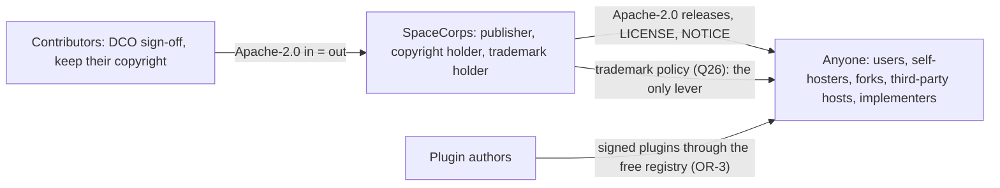

# Positioning, governance, ecosystem and risk: market, licence and publisher, what is free, capacity, the plugin registry, adoption and the risk register

> **Licence and price are settled.** The owner ruled on 2026-10-01 that the whole project is Apache-2.0 and completely free: no AGPL, Application Exception, CLA, `ee` tree, paid list, plans or prices (D1, D2; [DECISIONS.md](DECISIONS.md#owner-rulings)), and on 2026-10-27 that the one planned paid thing is a hosting service of SpaceCorps on dedicated Sliplane servers at about three times Sliplane's price, extra storage extra, not yet offered ([OR-22](DECISIONS.md#owner-rulings-2)). Where this document describes the old plans (Free, Team, Growth, Scale), prices, an `ee` list or a paid list, the rulings win and the text is history.

- **Status:** Draft 0.1
- **Date:** 2026-10-01 (month 0, "M0")
- **Scope:** Why obop exists and for whom (market, ICP, positioning); how it is licensed and governed (Apache-2.0, DCO, SpaceCorps as publisher); what is free; what a self-funded team of one owner plus AI agents can and cannot deliver; the free plugin registry and the community; adoption-led go-to-market; the risk register (the hosted sandbox included); the legal items for counsel. This file began as a business plan. The owner's rulings of 2026-10-01 removed the revenue model, so it is now the licensing, governance, sustainability and risk document (the filename stays because other documents link to it). Superseded material is listed in section 9.4 and in [DECISIONS.md](DECISIONS.md) section 7.

**How to read.** The binding rules are in [DECISIONS.md](DECISIONS.md) and are cited by ID (D1, D2 ...). "OR-n" is an owner ruling of 2026-10-01 (OR-1 to OR-21, RATIFIED; OR-1 to OR-13 were given first and OR-14 to OR-21 later the same day): it is written as fact and cited by number. What the owner has not ruled is written "Proposed (Dn)" or "Proposed (Qn)" and stays open. Other labels: *(estimate)* is a model or author output, *(target)* a design goal, *(derived)* arithmetic on sourced inputs, *(proposal)* this document's own suggestion, *(guess)* a research author's unsupported figure, *(unverified)* a claim no primary source confirmed. Research is cited as [R26 A3]; the Sources section maps tags to files. R17, R20, R24 and R26 are historical for licensing, pricing, funding, team, support and the open/paid line; their market and competitor facts are kept, their recommendations are not. Money is EUR ex VAT; "M9" means nine months after 2026-10-01. Nothing here is legal advice. Related: [PRODUCT.md](PRODUCT.md), [ROADMAP.md](ROADMAP.md), [LOCALIZATION.md](LOCALIZATION.md), [ENGINEERING.md](ENGINEERING.md), [ARCHITECTURE.md](ARCHITECTURE.md), [CONVENTIONS.md](CONVENTIONS.md), [spec/cli.md](spec/cli.md), [spec/security-privacy.md](spec/security-privacy.md), [spec/integrations.md](spec/integrations.md), [GLOSSARY.md](GLOSSARY.md), [../LICENSE](../LICENSE), [../NOTICE](../NOTICE).

**Bottom line.**

1. The opening is the delivery contract, not the language. Odoo's worst grievances (paid upgrades, a moving open/paid line, a gated API, surprise pricing) are business-model choices that a Rust rewrite would reproduce [R04 s1, R00 s4]. obop removes the model: the whole project is Apache-2.0 and completely free to use and to self-host, with no proprietary layer, no plans and no price list for the software (OR-1, OR-2). Upgrades are a product feature, with a local dry-run (`obop upgrade --dry-run` is Proposed; `obop migrate plan|rehearse` exist today).
2. Agentic first: every capability is a typed command reachable through the `obop` CLI, the REST API and MCP; the web UI is a client of the same commands and reaches literal parity with them before 1.0 (OR-4, OR-16, D80, [spec/cli.md](spec/cli.md)). A free, open plugin registry lets the CLI search, install (version-pinned) or copy plugin source into the user's own instance; obop handles no payments (OR-3, D81).
3. Entry is a compliant e-invoicing on-ramp into the smallest honest loop: kernel, invoicing, accounting, German e-invoicing, CRM and sales, basic stock (RATIFIED, OR-13, OR-15; D86). Germany first (OR-7; pack stable 2027-09-30), for 5 to 50 person services and light-trade firms (ICP Proposed, D4).
4. There is no revenue model for the software and no funding plan. The project is self-funded and the team is the owner plus AI agents (OR-6, D84). The one planned source of income is a paid hosting service on dedicated Sliplane servers (OR-22; planned, not offered or charged, and not a funding plan). Apart from that SpaceCorps hosts nothing for others except a free sandbox with sample data only, opened at the public beta and paid by the owner (OR-11, OR-20, D83). The dates are kept and the scope shrinks (OR-13). Whether a team this small can meet them is the first-ranked risk (section 9).
5. Trust rests on the licence, the DCO, SpaceCorps as publisher (OR-10), counsel's clearance of the name (OR-5; the repository itself was opened early, on 2026-10-26) and nothing being gated (OR-2). Apache-2.0 lets anyone fork or host obop, so the trademark is the only lever (Q26). The CRA role of SpaceCorps goes to counsel (Q5).
6. The top risks are schedule feasibility, the key person, accounting correctness, German compliance dependencies, agent-generated code quality, name clearance, the unknown CRA role and runtime customisation (section 9).

## 1. Market and personas

### 1.1 Sourced market facts

| Fact | Value | Source |
|---|---|---|
| EU firms with 10+ staff using ERP (Eurostat 2025) | 46.45% overall; 41.08% of 10-49 staff; 69.93% of 50-249; 88.71% of 250+. So about 59% of small firms report no ERP (by subtraction) | [R20 s1.2] |
| Micro firms (under 10 staff) | 94.4% of about 34M EU enterprises (2024); ERP adoption not measured | [R20 s1.2] |
| Germany, firms with 10-249 staff | 480,442; ERP use 37.5% (10-49) and 67.7% (50-249); about 281k without ERP (derived). Next largest gaps (derived): IT about 121k, FR about 90k, ES about 77k, PL about 68k | [R25 A1] |
| ERP market size | Mordor USD 78.15B (2026), internally inconsistent; Fortune BI USD 92.6B (2025); no primary analyst figure readable | [R20 s1.1] |
| Odoo's base | EUR 620M 2025 revenue (company-stated); 170,000+ paying customers; about EUR 3.6k per paying customer (derived); 88,510 identified companies, 77% under 50 staff (technographic crawl) | [R03 s7, R20 s2.2] |
| Implementation risk | Gartner via TechTarget: over 70% of recent ERP initiatives fail to fully meet goals | [R20 s1.3] |

The numbers support a large population of 10-49 staff firms without ERP, biggest by count in Germany, and an Odoo customer who is a 1 to 50 person firm, not the mid-market. They do not support a TAM: analyst totals disagree by about 30%, micro firms are unmeasured and no verified SMB SaaS-sprawl figure exists [R20 s3.2]. This document therefore states no TAM or SAM; adoption is counted in organisations and design partners (section 8.2).

### 1.2 ICP and personas (Proposed, D4)

**ICP:** owner-led firms with 5 to 50 people in services and light trade, one company, one country at a time (Germany first, RATIFIED, OR-7; the ICP itself is Proposed). The owner-manager decides, the accountant influences (QuickBooks bundles two to three accountant seats), and for 20 to 100 users a consultant runs the project [R20 s3.3]. Nothing is bought: "adoption path" replaces the old "buying motion".

| Persona | Jobs to be done | Fit with the W1 loop | Wave | Adoption path |
|---|---|---|---|---|
| Solo founder, freelancer (1-4) | Send compliant invoices, see cash, file VAT | Medium: invoicing and the German pack are the on-ramp | W1 | Self-serve (signed binary, docs; try first in the free hosted sandbox from the public beta, or in the optional local demo `obop dev up`); accountant word of mouth |
| Agency, professional services (5-20) | Lead to quote to project to timesheet to invoice; margin per project | Medium in W1 (CRM, quote, invoice); high once `project` and `timesheet` arrive with the services variant | W1, then W3 (OR-15, D86) | Self-serve plus accountant; days |
| Light-trade distributor (10-50) | Purchase to receive to sell to invoice; correct cost | Medium in W1 (basic stock, sales, invoicing); high when purchase orders return | W1, then W2 (`purchase`, D86) | Implementer-led, 2 to 6 months |
| Manufacturer (20-100) | BoM, manufacturing orders, lots | Medium | W3 (`mrp`) | Implementer-led |
| Retail (1-10 stores); e-commerce brand (3-30) | POS to stock to accounting; order sync, cross-channel stock | Low; medium-high if connector-first | W3 (`pos`, `ecommerce`) | Implementers; self-serve |
| Nonprofit; local government | Members and donors; budget accounting | Medium; low | Opportunistic; W4+ | Volunteers; tenders of 12 to 24 months |
| Accountant, bookkeeper (outreach channel, no programme) | Hand over clean books, DATEV-style export | Enabler | W1 (EN 16931 and DATEV EXTF export) | Word of mouth; no programme, seats or commission exist (OR-2) |
| Implementer, developer (channel) | Customise without compiling Rust | Enabler | W1 (X1, X2 if the D11 limits spike passes), W2 (registry stage 1), W3 (X3, X4) | Docs, the CLI and the free registry (section 7) |
| Agent-assisted operator (self-hoster who drives obop with the CLI or an AI agent) (proposal) | Install, operate, upgrade and automate from a shell | Enabler and early adopter | W0 onward (CLI first, D80) | Repository, docs, `AGENTS.md` and skills ([spec/cli.md](spec/cli.md) 5.4) |

Sources: [R20 s3.1, s3.3]; the last row is this document's proposal. Nonprofit and government willingness to adopt is inferred, not sourced.

### 1.3 Jobs to be done for the ICP

| # | Job | Trigger | Apps | Wave |
|---|---|---|---|---|
| J1 | Issue a compliant invoice and get paid | DE: receive since 2025-01-01, issue from 2027-01-01 above EUR 800k turnover, all issuers from 2028-01-01 [R25 A2] | `invoicing`, `edi`, `payment` (manual registration); `portal` is W2 | W1 |
| J2 | Turn a lead into quote, order, delivery, invoice | Re-keying across tools | `crm`, `sales`, `stock`; `purchase` is W2 | W1 (purchase orders W2) |
| J3 | Know stock and cost | Overselling, wrong COGS | `stock`, `stock_account` | W1 |
| J4 | Close the month and hand books to the accountant | Month-end pain | `account`, `tax`, `l10n_de` | W1 (pack stable 2027-09-30) |
| J5 | See margin per project | No margin view | `project`, `timesheet` | W3 (services variant, OR-15, D86) |
| J6 | Leave a tool without losing data | Upgrade or price shock | importers and `obop business export` | W1 (CSV 0.3; Odoo 0.6); QuickBooks W2; Xero, ERPNext W3 |
| J7 | Delegate routine work to an agent safely (proposal) | Repetitive bookkeeping and admin | Typed commands with `--dry-run`, plans and approvals ([spec/cli.md](spec/cli.md) 5) | W1 |

- **On-ramp.** Given a German freelancer with no ERP who has tried the free hosted sandbox (from the public beta; sample data only, D83) and installed obop (`obop init`, or `obop dev up` for an optional local demo), when she issues her first invoice to a business customer, then obop produces an EN 16931 invoice (XRechnung or ZUGFeRD) that passes the pack's oracles and can be sent by email or file, and the time from a signed binary to the first compliant invoice is under 30 minutes at M6, 15 at M12 and 10 at M24 (target, adapted from R20 s12, which measured sign-up) [D4]. Peppol through a certified access point of her choice is W2 and optional (DECISIONS 5.3).
- **Switcher.** Given an Odoo user on 17.0 or older (outside the three covered versions since 20.0 shipped; the 25% old-version fee could apply from about March 2027, an inference in [R04 s4.1]), when the user runs the Odoo importer in dry-run (`obop data import odoo --from-export <dir> --dry-run`), then a report lists mapped, skipped and failed records and writes nothing; a confirmed run keeps an identity ledger of external ids (D22).
- **Leaver.** Given any obop user, when they run `obop business export`, then they receive a full archive (NDJSON per model, attachments by SHA-256, audit log, configuration package, manifest) and need nobody's permission or payment to do so (D38, [spec/cli.md](spec/cli.md) 3.2 and 8.5).

**Sequencing tension.** The best-fit services persona needs `project` and `timesheet`, which D86 moved to W3 (the services variant), and the light-trade persona needs purchase orders, which return in W2. In W1 the fit is strongest for B2B invoicing and small sales-to-stock flows. The owner-side question is whether the ICP stays "services and light trade" (Q8); the earlier question of pulling the services variant into W1 was closed by OR-13 and OR-15 (the owner pulled nothing back into W1).

## 2. Positioning and competitive landscape

### 2.1 Positioning statement (Proposed)

For owner-led businesses with 5 to 50 people that run on subscriptions and spreadsheets, obop is the free, open-source (Apache-2.0) business platform that runs sales, stock, invoicing, accounting and payment registration on one shared data model, so there is one record of every customer, product and euro. It is completely free to use and to self-host: no plans, no per-seat or per-organisation price, nothing gated and no proprietary layer (OR-2). E-invoicing (EN 16931) is built in, Germany first. It is agentic first: every capability is a typed command in the CLI, the REST API and MCP, the API is free and ungated (D31), and agents use the same permissioned command surface as people (D18, D80). Rust is positioned on correctness and operations; no speed multiple over Odoo is claimed until the harness exists (D21).

Three changes from [R20 s8]: the headcount band "5-250" becomes "5 to 50", the ICP of D4 (the 10-249 staff market data in section 1.1 show where the ERP gap is measured, not who the first customer is); "100% of first-party apps under the same open licence" becomes a plain statement about the licence, "the whole project is Apache-2.0" (section 8.8 explains why "100% open" is still not said); and "fast" leaves the tagline until measured (BQ7).

### 2.2 Competitive landscape (as of 2026-10-01)

| Competitor | Licence and model | Scale | Price points | obop angle |
|---|---|---|---|---|
| Odoo | LGPL-3 Community; proprietary Enterprise since 9.0; licence-grant CLA [R03 s3.1] | 20.0 ("September 2026, release commit 2026-09-17"); 54.8k stars; about 7,500 staff; partner directory about 4,455 vs "21,000+" claimed [R03 s1, R20 s4] | Per user-month, yearly billing: list 24.90 and 44.90 (19.90 and 35.90 are 12-month introductory prices); monthly list 31.10 and 56.90; Light User 7.90 (unit unverified); One App Free [DECISIONS s3 ruling 21] | Nothing gated: accounting, payroll engine and API are open and free; upgrades are a product feature; no price at all |
| ERPNext / Frappe | GPL-3.0, no paid feature tier; monetises hosting | v16.37.0, v15.121.6 (2026-09-30); 39.7k stars; 200+ partners | Sites from USD 5 per month; servers from USD 20 or 125 on the ERPNext pricing page, USD 40 on the Frappe Cloud page (re-checked 2026-10-01) [R26 A1, R04 s5.1] | Heavy multi-service operations, dated UX, thin EU e-invoicing [R05 s2.1]; obop is one binary plus PostgreSQL and permissive |
| Dolibarr; Tryton | GPL-3.0-or-later; association; Belgian private foundation | Dolibarr 24.0.1 (2026-09-07), 7.7k stars; trytond 8.0.10 (2026-09-16), 221 modules, 226 stars (mirror) | Free, partner-hosted | Dolibarr: dated UI, simple accounting. Tryton: correctness alone did not bring mindshare [R05 s2.1] |
| Twenty | AGPL-3.0, `@license Enterprise` files, MIT SDKs, Application Exception | v2.44.0 (2026-10-01); 57.8k stars | Pro USD 9, Organization USD 19 per seat-month; Enterprise from USD 50k per year | Nearest structural analogue; CRM only. obop takes none of its licence structure: one Apache-2.0 licence, no enterprise files |
| SaaS stacks (Xero, QuickBooks, Holded, Teamleader) | Proprietary | Holded claims 900,000+ users | Xero USD 27-97; QuickBooks USD 38-340; Holded EUR 15-199 (HR, inventory, POS paid add-ons) [R26 A1] | One data model, ownership, no integration tax, no subscription |
| ERP suites, AI-native ERPs, Rust ERPs | Proprietary; VC-funded; mixed | Business Central USD 80 and 110 per user-month; NetSuite and SAP quote-only; Rillet at USD 1B (headline); best Rust ERP repos 40, 23, 16 stars [R26 A1, R20 s2.3, R05 s3.2] | n/a | Free and self-hostable; no credible Rust incumbent and no proof one is wanted |

Flectra is the warning about distribution, not licensing: an Odoo Community fork since 2018 that copied the open-core model has 252 GitLab stars against Odoo's 54.8k on GitHub. A copy without distribution yields a small project [R03 s9]; obop's answer is the delivery contract, importers, docs and a usable CLI, not a licence trick.

### 2.3 Where Odoo gates what obop opens

| Capability | Odoo | obop |
|---|---|---|
| Full accounting (reconciliation, budgets) | Enterprise; Community `account` is "Invoicing" [R20 s2.1] | Open and free: ledger and reconciliation W1; assets, deferrals, budgets W3 |
| Periodic returns, audit-file exports (DE, FR, ES) | Enterprise; Community ships e-invoice connectors but no VAT-return or DATEV module [R25 B7] | Open as law-defined pack content, "as is" (D17) |
| Payroll | Left Community in 13.0 [R03 s3.4] | Engine open and free, W3 or later; rule content without warranty; no payroll service (D19, OR-2) |
| Helpdesk, planning, documents, sign, knowledge | Enterprise [R03 s3.2] | Open, W3 |
| External API | Custom plan only; RPC services removed from Odoo 22 (fall 2028) [R03 s3.3] | Free and ungated; there are no plans; one command catalogue for CLI, REST and MCP (D31, D80) |
| AI | All features need purchased IAP credits [R03 s3.3] | BYOK, no credit wall (D18) |
| Upgrades | Database upload, 25% old-version fee, custom code only after porting [R03 s4.2, s5] | Local `obop upgrade --dry-run` from 0.3; N-1 upgrade path and 12-month deprecation window before 1.0; 2-year security-fix window from 1.0 (D26, D85) |
| Security advisories | Enterprise customers get at least two weeks' head start [R28 D.4] | One publication moment for everyone (D38) |
| Contract levers | 7% renewal uplift, 25% old-version fee, 300% breach fee, per-100-lines custom-code fee, usage beacon [R03 s4.2] | None: there is no contract and nothing to sell (OR-2) |

### 2.4 White space and honest limits

White space [R05 s5.1]: open accounting, inventory and CRM in one low-operations product; EU compliance as a core; one binary plus PostgreSQL (D37); edge-capable POS and warehouse; agent-safe business actions; and a licence that is hard to pull. Cal.com closed its source on 2026-04-14, Akaunting is BSL and Invoice Ninja is ELv2. Apache-2.0 for every released version, with no CLA, means a closed relicence of the whole would need every contributor's consent (D82).

Limits:

- A suite does not win for simple needs just by being free; it wins when a firm needs more than about four functional domains, inventory-to-accounting consistency or multi-company [R05 s6.3]. At 15 users the licence delta against a SaaS stack is small, so lead with consolidation, ownership and compliance [R20 s3.2]. Free software is not free of effort: the adopter, or an implementer, runs PostgreSQL, backups and upgrades, and SpaceCorps offers no hosted alternative for real work yet (the hosting service of OR-22 is planned, not offered); the sandbox is a try-out with sample data only (D83; BR-38).
- Moats are customisation, localisation and the ecosystem, not transaction code. "Written in Rust" is not a buying criterion [R05 s1, s7, R26 C6].
- Odoo can open accounting or bundle AI (BR-11); SaaS bundlers keep adding depth (BR-12).
- Realistic trajectory: a narrow EU SMB product in 12 to 18 months, ERPNext-2015 breadth in 3 to 5 years [R05 s7]. That estimate assumed a funded team; for one human plus agents it is unverified (D84, BR-32).
- Trust in "nothing is gated" rests on the ruling (OR-2), on D2's amendment rule and on the practical difficulty of relicensing; no pledge, steward veto or investor covenant exists any more (section 3.4).

## 3. Licensing and governance (RATIFIED: OR-1, OR-10, OR-18; policy Proposed)

Licence, contributor terms and publisher are RATIFIED (OR-1, OR-10, OR-18; D1, D82). They are one-way doors once the repository is public, and the owner opened it on 2026-10-26, so the gate G0 of D26 (the name cleared or a fallback adopted, the licence and publisher matters settled, the DCO check required in CI, the D33 P1 files present: `SECURITY.md`, signed releases, SBOM) is overtaken and stays as the checklist before the 0.3 public alpha. What counsel must cover is Q16 (section 10).

### 3.1 Structure

| Component | Licence or form | Rationale |
|---|---|---|
| Whole project: core, first-party apps, CLI, SDKs, WIT worlds, UI SDK, templates, documentation | Apache-2.0; `LICENSE` and `NOTICE` at the repository root ("Copyright 2026 SpaceCorps contributors") | OR-1: permissive, OSI-approved, express patent grant; the plainest statement of "completely free to use, you can self host" |
| Proprietary layer | None: no open-core, no `ee` tree, no dual licence, no paid list | OR-2 |
| Extension boundary | Not a licence question; a security decision only | In-process third-party Rust stays unsupported for security reasons (D11); section 3.3 |
| Contributor terms | DCO sign-off, no CLA, inbound equals outbound | D82; section 3.4 |
| Publisher | SpaceCorps: publisher, copyright holder and trademark holder; counsel can move it to a foundation later | OR-10; section 3.5 |
| Trademark | Held by SpaceCorps; Apache-2.0 grants no trademark rights | D3; section 3.6, policy Proposed (Q26) |
| Dependencies | Permissive and MPL-2.0 licences allowed; GPL, AGPL, SSPL, BUSL, ELv2 and other non-OSI licences excluded from anything shipped | D1 (Proposed detail); GPLv2-only and LGPL cases go to counsel (CN-08) |

### 3.2 Why Apache-2.0, and what it does not do

**Why.** The owner's ruling is "completely free to use, you can self host" with no proprietary layer (OR-1, OR-2). A permissive licence says that plainly and removes the extension-boundary, CLA and dual-licence questions a copyleft core would have raised (D1). Apache-2.0 adds an express patent licence from contributors (s3) and is acceptable to corporate open-source policies that bar AGPL [R17 s2.2]. **Rejected** for the core: FSL, BUSL, SSPL and ELv2 (not OSI-approved, not free in the owner's sense). **Superseded alternative:** an AGPL-3.0-or-later core with an s7 Application Exception, Apache-2.0 SDKs, an `ee` tree and a licence-grant CLA (former D1; R17 s11, R24 s8, R26 C2-C4).

**Accepted consequences** (D1, D82, D83):

- Anyone may fork obop, host it for others, sell services around it or embed it in a proprietary product. There is no copyleft lever: a host can run stock obop, give nothing back and owe nothing. The only lever against a confusing fork or host is the trademark (section 3.6, Q26).
- No CLA, pledge, steward veto or investor covenant exists. What protects users is that released versions stay Apache-2.0, that contributors keep their copyright (a relicence of the whole would need every contributor's consent, D82) and that anyone may fork.
- Apache-2.0 grants no trademark rights (s6) and provides the software as is, without warranty (s7, s8). obop gives no compliance warranty of any kind (D38).
- The licence no longer supports an argument for CRA free-software treatment; the role of SpaceCorps is a counsel question (section 3.5, Q5).

### 3.3 Extension boundary (no longer a licence question)

Under Apache-2.0 the boundary between obop and third-party extensions is not a licence matter (OR-1): the AGPL Application Exception and the counsel item on Wasm are gone. A plugin's licence is its author's choice; the registry's admission rule is in section 7.2. In-process third-party Rust stays unsupported for security reasons only (D11). Tiers (the X labels are RATIFIED, OR-14) and placement (D11, D86):

| Tier | Form | Status and wave |
|---|---|---|
| X1 | Declarative pack | W1 (sideload); listed in the registry index from W2 (stage 1 lists only `pack` plugins, [spec/cli.md](spec/cli.md) 4.1) |
| X2 | CEL in data | W1 if the D11 limits spike passes (Q9); otherwise declarative actions only |
| X3 | Wasm component | W3 (first in the slip order, D86); the wasmtime pin is amended by ADR when it starts |
| X4 | Remote app | W3 (app model, D86) |
| X5 | First-party native crate | First-party only. A business may compile its own crate into its own build, or copy a plugin's source (D81); that is its own code, not a supported third-party tier |
| UI F0, F2, F3 | Declarative patches, remote-dom, sandboxed iframe | W3 for third parties (D86) |
| UI F1 | Trusted ESM | First-party and business-own code only, by design |

### 3.4 Contributor terms: DCO, no CLA (D82)

- **Rule.** Every commit carries a DCO sign-off (`Signed-off-by`); a required CI check rejects commits without it. There is no CLA and no copyright assignment. Contributors license their work to the project under Apache-2.0, inbound equals outbound (Apache-2.0 s5). Source files carry SPDX identifiers; `NOTICE` holds the attribution. The clean-room attestation (F3) stays in the PR template.
- **Contributor experience (Proposed).** `git commit -s` and a clear CI message are the whole process: no sign-in step, no signature ledger, no bot that stores signatures. Odoo blocks merge until a signature PR lands [R28 C.2]; obop does not.
- **Agent-authored commits (RATIFIED, OR-18).** Because the team is largely AI agents, the owner signs off every commit (`git commit -s`), agent-authored ones included; agents are recorded by a `Co-Authored-By` trailer and never provide a sign-off. Counsel is asked to confirm that this satisfies the DCO (CN-02, a counsel item, not an owner question). Reading of OR-18 (an interpretation, D82): the owner reviews each agent-authored commit before signing it.
- **Superseded:** a licence-grant CLA with a patent licence and an irrevocable "OSI licence forever" pledge, a steward veto over leaving OSI licences and an investor covenant before a priced round (former D1, D2, D5; R17 s4-s5, R26 C3).

### 3.5 Publisher, foundation option and the CRA role (OR-10)

- **SpaceCorps** is the publisher, copyright holder and trademark holder: the owner's existing GitHub organisation and brand. It operates no hosted obop for others today, apart from the free sample-data sandbox (D83, OR-20); it sells no software (OR-2) and plans one paid service, hosting on dedicated Sliplane servers (OR-22, not offered yet); it has no hiring plan (D84). Which legal entity stands behind SpaceCorps, and where it is incorporated, is open (Q20).
- **Accounts and keys.** The GitHub organisation, the crates.io owner list, the GHCR path, the domains and the release-signing identities should each have at least two independent administrators (proposal; bus-factor mitigation, BR-33).
- **Foundation option.** "Steward" is reserved for a foundation that may one day replace SpaceCorps as publisher; counsel can move the publisher role and the marks then (OR-10, CN-05). No foundation, board, veto or steward budget exists or is planned. The earlier company plus EU non-profit steward with a veto and a EUR 150-300k budget formula is superseded (former D1; R26 C2).
- **CRA.** Art. 14 reporting has applied since 2026-09-11 (24 hours, 72 hours, 14 days); the main obligations apply from 2027-12-11. Security updates must be free (Annex I Part II(8)) and obop never gates them. Whether SpaceCorps is a manufacturer, an "open-source software steward" in the CRA's sense, or neither, for a free project with the sandbox and the planned hosting service in view (Q5) and so far no commercial activity, is open: "commercial activity" is the hinge; the five-year minimum support period may reach the project and would then override the 2-year window of D85 by law; and Art. 64(10) derogates from paragraphs 3 to 9 only, so it does not literally reach the EUR 15M or 2.5% fine tier [R17 s7, R26 L3] (CN-04, Q5). Until counsel advises, the vulnerability-handling runbook is prepared as if SpaceCorps were the manufacturer (Proposed, D17; drilled by 2027-06-01). The technical-file and sign-off dates (2027-11-30, 2027-12-10) apply only if counsel finds SpaceCorps a manufacturer (D26). The registry index operator's role belongs to the same question (Q24, CN-14).
- **Hosts.** Anyone who hosts obop for others carries a host's duties (Data Act switching terms, GDPR Art. 28, service levels); SpaceCorps does not (D83). The sandbox holds no customer data and no customer contracts, so none of these reach it; its own duties are listed in section 4.1.

### 3.6 Trademark and name (RATIFIED, OR-5, D3; policy Proposed, Q26)

"obop" is the working name. Clearance comes first: no announcement, spend or filing until counsel completes EUIPO, UKIPO, WIPO, DPMA and INPI searches in classes 9, 35, 42 (and 41, 45) and opines on OBOPP (pending, class 35) and OBOL (two live registrations, classes 9 and 42). The opinion is due 2026-12-15, else a screened fallback is adopted. OBOP is also a Polish pollster, USPTO shows no OBOP record, and the npm registry name `obop` is taken (a clearance fact only; obop reserves no npm scope, and whether it ever publishes to the npm registry is decided at W2: Q32, OR-19, default no publication). Reserve the crate, PyPI, GitHub organisation variant, GHCR and Matrix handles now (by 2026-10-15, Q2); screened fallbacks are kernelbiz, monobiz, mercora. SpaceCorps files and holds the marks (OR-10); a US intent-to-use mark cannot be assigned early, which matters if the marks later move to a foundation. Official fees for classes 9, 35, 42 in the EU, UK and US are about EUR 2.3-2.5k (estimate, exchange rates unchecked), paid by the owner (D84). The owner opened the repository `SpaceCorps/obop` on 2026-10-26, before the opinion, so a rename now touches public artefacts. Rating: medium, clearance incomplete [R28 A.1-A.7].

Apache-2.0 grants no trademark rights (s6), so a permissive project still needs a policy, and the policy is the only lever against a confusing fork or host. Draft (Proposed, Q26), after Frappe, Mozilla and the Rust Foundation [R28 A.6]; the longer draft for counsel is in [ENGINEERING.md](ENGINEERING.md) 10.3, which must drop its partner, certification and white-label clauses:

| Rule | Content |
|---|---|
| Protected | "obop" and the logo; not the tagline or module names |
| Free use (nominative) | "works with obop", "obop consulting", "hosting for obop"; `obop-<thing>` packages if marked unofficial; "<Name> for obop" for plugins |
| Never | obop as the start or whole of a company, product or domain name; keyword ads; implied endorsement; "obop <Name>" |
| Modified builds and forks | A fork or host that changes more than packaging, porting, security backports or configuration drops the marks and renames |
| Enforcement | 30-day cure and published criteria; no restriction on code use (Apache-2.0 already allows it) |

### 3.7 Contributor governance, scaled (Proposed)

Today the owner is the only maintainer and decides; agents author and review under the owner's sign-off (D82, OR-18); decisions are recorded in [DECISIONS.md](DECISIONS.md) by ADR (next free D-ID, the old record marked superseded). When outside contributors appear (proposal): a scaled-down Kubernetes ladder (contributor, reviewer, approver) plus module and localisation maintainers, the latter a practising accountant or payroll specialist, and no single company holding a majority of approver seats. Contributor Covenant 3.0 with a non-employee on the enforcement committee once a committee exists. RFCs in `rfcs/NNNN-title.md` after Vite+'s repository [R28 C.2, B.3]. Governance changes are published amendments in the repository.

## 4. What is free (RATIFIED, OR-1, OR-2)

obop has one codebase, one edition and one licence. There is no "Community" or "Enterprise" edition in Odoo's sense (D24), no `ee` tree and no paid layer. Everything is Apache-2.0 and completely free to use and to self-host. The authoritative list is [DECISIONS.md](DECISIONS.md#6-open-boundary) section 6; this section states only what matters for governance.

### 4.1 What exists, and what does not

| Thing | Status |
|---|---|
| The software: kernel, every first-party app as it is built, CLI, REST API, webhooks, MCP, OpenAPI, importers, full-fidelity export, SDKs, templates, documentation | Free, Apache-2.0, self-hosted; one install path |
| Security fixes, advisories, SBOMs, signed releases | Free; never withheld, delayed or tiered (D2, D38) |
| Law-defined pack content (charts, taxes, VAT-return and audit-file exports, e-invoice syntaxes, validators) | Free, "as is", no warranty, no legal-change service (D17) |
| The plugin registry (client and index) | Free and open; no payments (OR-3, D81) |
| Community support | Best effort through public channels; no service level (D85) |
| Plans, prices, tiers, per-seat or per-organisation pricing, a paid partner programme, a marketplace commission, a white-label licence | Do not exist (OR-2) |
| Hosting for others' real data on the sandbox, obop Cloud, an SLA plan, Assurance and payroll services, hosted AI credits, hosted Peppol, KSeF or Veri*Factu gateways, certification | Do not exist (OR-2, OR-11, D17). The hosting service of OR-22 is the one planned paid service: not offered or charged yet |
| A free hosted sandbox with sample data only | Exists from the public beta (0.5, 2027-07-06): free, ephemeral, run by SpaceCorps (OR-20, D83); `obop dev up` remains an optional local demo |

**The hosted sandbox and its duties (RATIFIED, OR-20; details Proposed, Q34 to Q36).** SpaceCorps runs one free, ephemeral sandbox with sample data only, opened at the public beta (0.5, 2027-07-06, a Proposed date under D26, so the sandbox moves if 0.5 moves). It is not a hosting offer: it holds no real data and no customer contracts, carries no service level, persistence or support, and can be closed at any time. It opens only if its duties are in place at the go/no-go of 2027-06-01 (Proposed); otherwise it opens later, and the public beta does not wait for it. The duties (D83 is the single statement; cost in section 5.1, risks BR-39 and BR-40, counsel items CN-20 to CN-22): (1) terms of use that forbid personal and production data; (2) a privacy notice for the connection data and server logs that are processed anyway; (3) abuse and rate controls and a kill switch; (4) egress blocking and outbound-mail blocking; (5) an auto-reset time to live for every session business, plus a scheduled full reset; (6) sanctions screening (CN-20); (7) a named small running cost, paid by the owner (Proposed ceiling EUR 100 a month all-in, an estimate, Q35); (8) the on-call burden of a public service run by one human plus agents; (9) counsel review of the terms, the notice and the screening approach, including whether the sandbox changes the CRA analysis (Q5). Because it holds no customer data and no customer contracts, it creates no Data Act switching duty and no SLA.

### 4.2 The open boundary

Nothing is withheld. Capabilities the earlier drafts put on a paid list (native multi-IdP SAML, full SCIM, WORM audit publication, SIEM streaming, legal hold and multi-year audit tiering, auditor evidence packs, cloud-KMS and HSM connectors, customer-managed keys, fleet disaster recovery, a supported air-gap bundle) are ordinary backlog items: not withheld and not promised (DECISIONS 2.3 and section 6). Authentication, RBAC, the hash-chained audit log, envelope encryption, multi-company, custom fields and models, sideloading and BYOK AI are open and free.

### 4.3 Guard rails and what is not promised

- **Never gated, because nothing is:** security fixes, data export, the API, the CLI and MCP, multi-company, ledger integrity, the audit log.
- **Not promised:** hosting or any operated service beyond the free sample-data sandbox, which carries no service level and no support (D83); support beyond the D85 promise; a service level or response time; a compliance warranty (D38); a legal-change service for country packs; certification; a payroll service; delivery dates beyond DECISIONS section 5; that any backlog item is built.
- **Services, if ever.** Any future service (support, hosting, certification) would be separate from the software and must never restrict it: no feature gating, no withheld or delayed fixes or advisories, no usage beacon, no contract lever on free use. Introducing one needs a published amendment to D2 and DECISIONS section 6 (Proposed).
- **Replaced:** the paid list, the ratchet, the `ee` conversion after 24 months, the operated-service lines and the licence-grant pledge of the earlier draft (OR-1, OR-2; [DECISIONS.md](DECISIONS.md) section 7).

## 5. Costs and funding posture (RATIFIED, OR-6, OR-21, D84)

### 5.1 What costs money, and who pays

Nothing in the plan depends on revenue; the owner pays (D84).

| Cost | Who pays | Figure or status |
|---|---|---|
| Counsel: name clearance, CRA role, publisher and trademark, DCO wording, dependency licences, sandbox terms and privacy notice (section 10) | The owner | No quote exists. R26's EUR 120k year-1 counsel-and-compliance line assumed a hosted commercial company and is historical |
| Trademark filing fees, classes 9, 35, 42 in the EU, UK and US | The owner | About EUR 2.3-2.5k official fees (estimate, exchange rates unchecked) [R28 A.1-A.7]; filing waits for clearance |
| CI runners | The owner | The repository is public since 2026-10-26 and CI runs on GitHub-hosted runners, free for a public repository (a budget of USD 300-800 a month for larger runners is an estimate, D36). The Hetzner CCX43 proposal of Q17 (EUR 275.99 a month at list from 2026-06-15 [R26 B1]) was written for the private period |
| Domains and handles | The owner | Small; reserve now (Q2) |
| AI agent and developer tooling | The owner | Not estimated anywhere in the corpus; it is the largest unpriced cost of an agent-built project (proposal) |
| Hosting the sandbox | The owner | A small running cost, Proposed ceiling EUR 100 a month all-in (Q35, estimate), plus counsel review of the terms of use and the privacy notice (D83, CN-22) |

### 5.2 Funding posture

Self-funded for now (OR-6, D84): the team is the owner plus AI agents. There are no investors, no hiring plan, no headcount cap, no ARR gate, no covenants and no grant dependency. No financial model governs the plan because the software has no revenue model (D2) and the planned hosting service (OR-22) is not a funding plan; the R26 model (peak funding, break-even, ARPA, hiring curves, exit comparables) and R20's headcount bands are historical and are not to be quoted as forecasts. Grants remain an optional idea only: there is no NLnet Restack application now, and the question returns when a self-contained reusable crate exists (OR-21, Q31 closed). NLnet's terms require generative-AI assistance to be disclosed with a prompt log and say purely AI-generated output cannot be paid for [R26 C1], which may fit an agent-built code base badly; the funder-terms counsel item (CN-09) is dormant until then. Donations and sponsorship are neither ruled in nor out, and none is planned. Superseded: the EUR 3M seed and EUR 5M gated round, the 17-FTE cap, the 6-FTE cut, the EUR 1M ARR gate, the pledge-veto-covenant sequence and the investor case (former D5; R26 B5-B7, C1-C3, C6).

### 5.3 No price list

There are no plans, prices, price tests, ARPA targets, per-seat or per-organisation units, partner fees, commissions or quotas for the software (OR-2). The one planned paid service is hosting (OR-22): SpaceCorps would run a dedicated Sliplane server for a business that asks, at three times Sliplane's list price rounded up to a price ending in 9, extra storage at three times the block price. It is planned, not offered or charged: no billing, terms of use, processing agreement or sub-processor disclosure exist, and OR-22 lists what counsel and the owner must settle first (a data-processor role, the Data Act switching duties, the CRA role, VAT and invoicing, a payment provider, abuse and sanctions, on-call burden, Sliplane's terms). The prices are one table, `web/apps/site/data/hosting.ts`. Odoo's prices appear only as competitor facts (DECISIONS section 3, ruling 21). If the API has rate limits they protect a server; no plan gates them (D31). Superseded: the Free, Team, Growth and Scale plans, the service price list and the price-test plan of R26 A3 (former D2).

## 6. Capacity: what a very small team can and cannot deliver (D84)

### 6.1 Infrastructure cost reference for operators (estimate)

This is not an obop cost today: SpaceCorps hosts nothing for others (D83) apart from the free sandbox, which is an obop cost, but a small one (Q35; section 5.1); the planned hosting service of OR-22 would run dedicated servers, not cells. It is the sizing number for self-hosters with many businesses and for third-party hosts, and it is the figure [ARCHITECTURE.md](ARCHITECTURE.md) quotes. One cell of 250 business databases: 3 x CCX43 (EUR 275.99) + 3 x CPX42 (EUR 69.49) = EUR 1,036 a month at Hetzner list prices from 2026-06-15, which is about EUR 4 per business per month before a disaster-recovery uplift and about EUR 6.2 with a 1.5x uplift (derived). Storage, backups, egress and monitoring add about EUR 1.6 per business per month (estimate) [R26 B1]. A solo install needs one binary and PostgreSQL (D37).

### 6.2 What the kept dates assume

The dates were set when the research assumed 4 to 17 people (R20 s10, R26 B4-B6). ROADMAP's capacity check found W1 already oversubscribed at 6 to 10 FTE: about 72 person-months of W1 capacity (65 usable), against the DE pack at 14.5 (plus or minus 40%), the shared pack SDK, harness, signing and data pipelines at 10 to 14, and the extension platform cut at 26 to 34, which alone take about 78% to 96% of it (estimate; [R25 A8], [R24 s11]; [ROADMAP.md](ROADMAP.md) section 4.5). OR-13, OR-15 and D86 took the extension cut out of W1. The rest of W1 (ledger, tax, invoicing, CRM, sales, stock, importers, generated CLI, API and MCP, the thin UI, docs) has no person-month estimate, and accounting models are 5 to 6 times the size of sales [R20 s9.1]. None of this was estimated for one human plus agents, so there is no basis to say the cut W1 fits. Treat it as unverified until the W0 throughput review (section 6.4).

### 6.3 What the team can and cannot do (assessment, proposal)

This is the author's assessment, not research.

| Where the plan is plausible | Where it is not, or not alone |
|---|---|
| Surfaces are generated from one registry: CLI, REST, OpenAPI and MCP cost grows with the catalogue, not per feature (D29, D80; DECISIONS 5.3 row 10) | Review bandwidth: one human signs off every commit (OR-18) and, on the register's reading of OR-18, reviews every agent-authored one, so human attention is the throughput ceiling |
| Executable oracles give agents a machine-checkable definition of done: ledger property tests, golden cases, KoSIT and CEN artefacts, chain tests, the parity test (D30, D36) | Judgement that cannot be generated: a recorded German accountant sign-off, counsel opinions, DATEV and SKR licence confirmation |
| Boilerplate, importers, tests, generated reference docs, porting of well-specified rules | Plausible but wrong accounting or tax logic that no oracle covers yet; the pack stays beta instead |
| CLI-first, scriptable operation that an agent can also use ([spec/cli.md](spec/cli.md) 5) | Design partners, outreach, community moderation, incident response (24 h, 72 h, 14 days under CRA Art. 14) and the sandbox's abuse handling and on-call (BR-40) all need the one human's time |
| Clean-room discipline enforced by review and attestation (F3) | An agent that reproduces Odoo code from memory is a provenance risk no tool fully removes (BR-20) |

### 6.4 Throughput review, checkpoints and the slip order

- **W0 exit review (2026-12-31, Proposed, D84):** how much of the ROADMAP kernel milestones K1 and K2 landed against plan. The result sets the owner's expectation for W1.
- **Checkpoints (Proposed, DECISIONS 5.3):** at 0.3 (2027-04-06) and 0.4 (2027-05-04) the owner decides how many items to cut from the slip list.
- **Sandbox opening (Proposed, D83, Q35):** the 0.4 checkpoint (2027-05-04) also decides whether the sandbox opens with 0.5 (2027-07-06) or later, and the go/no-go is 2027-06-01, once Q34 to Q36 are answered and counsel has reviewed the terms of use and the privacy notice. The sandbox is an operating duty outside the protected core; the public beta does not wait for it and it can be closed at any time.
- **Scope moves, dates do not (D26, D86).** The W1 cut itself is RATIFIED (OR-13, OR-15); the slip order is Proposed. The first items out are the extension surfaces beyond X1 and X2 (X3, the X4 app model, F0 patches, F2, theme packs, SDKs beyond the OpenAPI document), then `analytics`, `analytic`, the Xero and ERPNext importers, pivot, graph and calendar views, and so on down to the Odoo importer and the `customize` admin screen; the full table is DECISIONS 5.3. Protected and never slipped inside W1: the kernel, `base` and `product`, D30 integrity and the D33 P0 and P1 items, `invoicing`, `account`, `tax`, `edi` and `l10n_de` with their oracles, `crm`, `sales`, one-warehouse `stock`, the command catalogue with CLI, API, MCP and the parity test, the thin UI, the upgrade dry-run and the N-1 chain test, and the vulnerability-handling runbook.
- **Correctness is not traded for the date.** If the oracles, golden cases or sign-off are not there on 2027-09-30, the DE pack stays beta (DECISIONS 5.2). The only hard external driver is the 2028-01-01 all-issuer mandate.

## 7. Ecosystem: implementers, accountants, the free plugin registry (OR-2, OR-3)

### 7.1 Who the ecosystem is

"Partner" means a third party that implements, hosts or localises obop (D24); there is no partner programme, fee, commission or revenue share (OR-2). Outreach order (proposal): accountants first (word of mouth, DATEV-style export; no seats and no plan exist, so there is nothing to give), then implementers, then third-party hosts, who need nothing from SpaceCorps because Apache-2.0 already permits hosting. Localisation packs follow the maintenance tiers of DECISIONS section 4 (the L labels are RATIFIED, OR-14): L1 is the core team's pack (DE first; AT and CH follow in W3, derived from the DE pack), L2 third-party maintainers (the BE, NL, ES, IT and Nordic packs in W4), L3 community packs. Nobody is paid by SpaceCorps, and who carries local declarations and liability for a third-party pack is a counsel question (CN-16) [R25 B2, D26].

Competitor fact: Odoo charges partners EUR 590 (Learning) or EUR 2,950 (Ready, Silver, Gold) a year, pays up to 20% commission on Enterprise subscriptions (10-20% by tier) and reportedly 82% on extra-module maintenance (unverified: the public partner page text shows only "up to 20%" and the EUR 150 Odoo.sh cap), and takes 0% of services. Commission is at most EUR 60-108 per user-year while one 200-hour project is about EUR 20k, so services dominate by about an order of magnitude (estimate) [R03 s6.1, R20 s4]. The lesson kept: implementation must be profitable for the implementer. obop asks nothing of implementers; they keep all of their services income.

### 7.2 The free plugin registry (RATIFIED, OR-3, OR-17, D81; staging Proposed)

obop has a free, open registry of plugins (in architecture text: packages of kind pack, wasm, remote or theme, D32). There are no fees, no paid listings, no payouts, no take rate and no payments of any kind; the manifest schema has no price, licence-key or entitlement field, and SpaceCorps handles no money. The CLI has two modes: **install** fetches a signed, version-pinned package into the instance and records exact version and digest, so updates are explicit; **copy** puts the plugin's source into the user's own instance, where it becomes the business's own code with recorded provenance and no automatic updates. Full design: [spec/cli.md](spec/cli.md) section 4.

**CLI, API and MCP surface.** These are typed catalogue commands (D80). The commands that work on local files and the index (`fork`, `diff`, `publish`, `publisher`) are CLI-only exemptions proposed in [spec/cli.md](spec/cli.md) 1.1 (the owner approves each entry, OR-16); the rest also exist as REST and MCP. Stage 1 of the index is a W2 deliverable; a local path or URL can be sideloaded in W1.

| Command | What it does |
|---|---|
| `obop plugin search <q>`, `obop plugin info <id>` | Query the local index snapshot (no server); default tier filter `verified`; show manifest, versions, tier, signers, SBOM summary, capabilities, SPDX licence, revocation |
| `obop plugin install <id>[@range]` | Resolve, fetch by digest, verify, show the capability diff as the plan, apply on commit, write `obop.lock` |
| `obop plugin copy <id>[@v] --to <dir>` | Fetch and verify the source, register it as business-own (`private`) with provenance; no updates |
| `obop plugin fork`, `obop plugin diff` | Re-identify a copy under your namespace to publish a derivative; show local changes against the recorded upstream |
| `obop plugin update`, `obop plugin remove` | Plan then apply; honour the manifest's uninstall policy after a confirmed export |
| `obop plugin publish`, `obop plugin publisher init\|verify` | Sign the artefact and open a pull request against the index; prove publisher identity for `verified` |
| `obop plugin verify`, `obop plugin audit` | Check digest, signatures, provenance, SBOM, licence, capabilities and revocation; check installed and copied plugins against revocations and advisories |

**Trust tiers.** `community` (automated gates only, labelled unreviewed, hidden from default search) and `verified` (a verified publisher plus the automated gates: signatures, SBOM and the capability manifest; OR-17) are the registry tiers. `private` (business-own, never listed) and `core` (first-party) are the non-registry levels. Sideloading is always allowed; a kill switch (a revocation list in the index) stays (D32, D81). Copy mode never raises the trust tier by itself (Q25).

**Admission (RATIFIED, OR-17).** Only plugins with an OSI-approved SPDX licence are listed, in either tier (a closed plugin can be sideloaded, not listed, and copy mode needs source, so copy mode stays legally clean); `verified` means a verified publisher plus the automated gates (signatures, SBOM, capability manifest). **Staging and operator (Proposed, Q24).** How a publisher is verified (domain or GitHub-organisation proof, good standing) and the full gate list are Proposed detail of D81; manual security review is best effort and promised nowhere. Stage 1 (W2) is a git-backed static index in a public repository under the SpaceCorps GitHub organisation: one manifest per plugin version, digests, signatures, tiers and revocations. Artefacts stay in publishers' OCI registries and are referenced by digest, so SpaceCorps runs no artefact store or service. Stage 2, a registry service, comes only on demand (W3 or W4); it would be a hosted service for others, so it needs an owner decision that amends D83 ([spec/cli.md](spec/cli.md) 4.9).

**Cost and risk, even at stage 1.** Hosting and CI minutes are near zero. The real costs are moderation labour on a one-human team, an index signing key that needs two or more independent custodians, abuse and typosquatting, an unanswered question about an index operator's duties for third-party content (Q5, Q24, CN-14), and a revoked plugin staying live because a self-hoster does not poll (BR-36). A public index announces the name, so it waits for the G0 checklist (OR-5).

### 7.3 Hosts, forks and localisation maintainers

- **Hosts.** Third parties may host obop for others under Apache-2.0, including for a fee, and carry a host's duties (D83). SpaceCorps grants no hosting licence, needs none and takes no share. "Hosting for obop" is nominative use under the trademark policy (section 3.6).
- **Forks.** Allowed by the licence; they follow the trademark policy (BR-37).
- **Superseded:** partner tiers and fees, the 20% commission, the partner-hosting licence (EUR 6 per hosted business), certification tracks and exam fees, the white-label licence, paid listings, payouts and the marketplace take rate (R24 s9-s11, R26 A3; OR-2, OR-3).

## 8. Go-to-market: adoption-led, no revenue

### 8.1 Strategy (Proposed, D4)

A free, self-hosted compliant-invoicing on-ramp into the W1 loop of D86 (Contacts and Products, CRM, Sales, basic Stock, Invoicing plus Accounting with the German pack, PDF and email documents and attachments; the `documents` DMS app is W3), one company, ICP 5 to 50 person services and light trade. Germany first (RATIFIED, OR-7; pack stable 2027-09-30), France second (2028-03), Poland third (2028-08), re-scored in 2027-Q2 (Proposed). Out of the first delivery: POS, payroll, manufacturing, multi-country tax, and the items OR-15 and D86 move out (purchase orders, portal, the services variant). Rule: no new app without a design partner [D4, D25, R26 S1]. The agentic-first surface is part of the pitch: an agent with a shell can install, configure and operate obop (golden paths in [spec/cli.md](spec/cli.md) section 8).

### 8.2 Funnel and signals

| Stage | Mechanism | Signal (target unless noted) |
|---|---|---|
| Discover | Public repository (open since 2026-10-26), docs, 5 to 10 recipes (for example "a compliant XRechnung invoice from an empty machine in 15 minutes"), an honest cost-of-running page with visible assumptions | Design partners live, release downloads, external contributors with DCO sign-off and plugins in the index by tier: measured and published, no numeric target, never a gate (ROADMAP 8.1, DECISIONS 5.2). No star metric is tracked or targeted; R20's 1k / 5k / 15k star figures assumed a funded launch and are not carried (OR-6, D84). the repository was opened on 2026-10-26, so count from that date (proposal) |
| Try | The free hosted sandbox from the public beta (sample data only, Q34 to Q36) or the optional local demo (`obop dev up`) | No target and never a gate; the sandbox keeps no analytics beyond what abuse control needs (Proposed, Q34) |
| Activate | Install or `obop dev up`, importers, the German pack | First compliant invoice under 30 / 15 / 10 minutes from a signed binary (target, section 1.3) |
| Expand | CRM and sales, then stock, from the same install | Design partners completing quote to invoice to reconciled payment (north star, measured where partners report or telemetry is opted in) |
| Retain | Export always available; `obop upgrade --dry-run`; N-1 path; no promotional cliff because there is no price | Design partners still using obop after the 1.0 upgrade (W2 exit criterion, DECISIONS 5.2) |
| Correct | Oracles, golden cases, ledger properties, chain tests, the CLI/API/MCP parity test | Green or not; a hard gate independent of adoption (DECISIONS 5.2) |
| Extend | Plugins in the registry from W2 | Published plugins by outside authors (no target set) |

**Measurement is limited.** The project has no server-side view of self-hosted use. Signals come from design partners, opt-in telemetry (default off, Proposed; [spec/cli.md](spec/cli.md) 2.13) and public traces such as release downloads, index entries and issues.

**Scale targets.** Three to five design partners are agreed in W0; at least three issue real invoices with obop by the W1 exit; SpaceCorps' own invoicing runs on it (jurisdiction: Q20) (DECISIONS 5.2). R20's production-organisation bands (5 / 50 / 500 at M6 / M12 / M24) and R26's paying-organisation targets assumed a funded launch and are not targets (D84).

### 8.3 Germany-first wedge

**Why Germany (RATIFIED, OR-7; scored in D4, weighted 84 of 100).** About 281k firms with 10 to 249 staff and no ERP, the largest gap in the EU and more than twice any other country (derived). Receiving EN 16931 e-invoices has been mandatory since 2025-01-01; issuing from 2027-01-01 above EUR 800k turnover and for all from 2028-01-01. Odoo is thinly represented: 102 directory partners, about 2.1 per 10k firms, against 40.2 in Belgium [R25 A1, A5, A7]. Odoo's DE VAT return, ELSTER and DATEV modules are Enterprise; obop's are open pack content [R25 A3, B1, B7]. Micro-accounting is a commodity (Lexware EUR 7.90-32.90, sevdesk free to EUR 34.90 a month), so obop competes in the 10-249 band against Odoo, SAP B1, Business Central and weclapp-style ERPs; it meets Lexware-class users only as an on-ramp [R25 A4].

| Date | Milestone (D26: the German pack date is RATIFIED; the others Proposed) |
|---|---|
| 2027-03-31 | DE pack alpha (chart, taxes, XRechnung and ZUGFeRD create and validate) |
| 2027-04-06 | 0.3 public alpha: the G0 checklist closed, `obop upgrade --dry-run`, CSV importer |
| 2027-06-30 | DE beta (UStVA, DATEV EXTF export) |
| 2027-07-06 | 0.5 public beta: no commercial offer; the free hosted sandbox opens with it if the go/no-go passes (D83, OR-20) |
| 2027-09-30 | **DE pack stable** (RATIFIED): oracles (CEN artefacts, KoSIT), golden cases, recorded accountant sign-off; at least 3 design partners issue real invoices. Otherwise the pack stays beta |
| 2028-01-01 | German all-issuer mandate (the one hard external driver) |
| 2028-03 / 2028-08 | FR pack stable / PL pack stable (Proposed; first to slip) |

**Preconditions (D4, R25).** (1) Written confirmation of SKR03/04 licence terms and DATEV developer-programme access; if refused, ship the charts as data packs the licensee downloads. Never publish BAS (Swedish) data in the public repository: it costs SEK 4,000 and clause 4.5 bars copying. (2) Peppol, if a user wants it, goes through a certified access point of the user's choice with bring-your-own credentials; SpaceCorps operates none (D4, D17, D83), and the adapter is W2 (DECISIONS 5.3). (3) Counsel before any pack claims conformance: Germany's producer fine is up to EUR 25,000 and Spain's EUR 150,000 per year per system type (CN-16). **Flip rule:** swap France and Poland if no French compliance lead or PA partner by 2027-03-31. Pack cost (estimate, assuming a staffed team, D84): DE 14.5, FR 14.25, PL 13.5 person-months [R25 A8]. Detail: [LOCALIZATION.md](LOCALIZATION.md).

### 8.4 Channels

| Channel | Role | Start |
|---|---|---|
| Self-serve with docs and recipes | Freelancers, small firms; the free hosted sandbox for a first look from 0.5 | 0.3 public alpha (2027-04-06) |
| Agents and coding assistants | Operate obop through the CLI or MCP; `obop agent guide`, `AGENTS.md` and skills; the golden paths of [spec/cli.md](spec/cli.md) section 8 | W1 |
| Accountants and Steuerberater | Influencer and referrer; DATEV-style export; no programme, seats or commission | 0.5 public beta (2027-07-06) |
| Switchers from Odoo, QuickBooks, Xero, ERPNext | Importers (CSV 0.3; Odoo 0.6; QuickBooks W2; Xero, ERPNext W3; D22, D86). Hooks: Odoo 17.0 and older outside covered versions, RPC removal in Odoo 22 (fall 2028), OpenUpgrade 20.0 still empty [R03 s5, R04 s4.1] | 0.6 (2027-09-07) |
| Implementers and third-party hosts | Reach and capacity for deals with 20+ users; no programme or certification | W2 (registry stage 1) |

A JSON-2-compatible endpoint stays deferred until three design partners ask or Odoo's RPC removal creates demand (D22).

### 8.5 Developer and implementer channel

Implementers must never need to compile Rust. The non-Rust path is declarative packs (X1) and CEL (X2, if the D11 spike passes) in W1, the free plugin registry in W2, and Wasm (X3), the remote-app model (X4) and generated SDKs in W3 (D86 slip order, item 1). The earlier W1 extension cut of 26 to 34 person-months (estimate) [R24 s11] does not fit a team of one plus agents. Implementation must be profitable for the implementer: fast go-live, strong docs, low-code customisation (`obop custom_field`, `obop customize export`, `obop plugin new`, `lint`, `test`, `package`). The kit ships generated reference, compiled examples and a first successful API call under 15 minutes (target) [R28 B.3, B.5].

### 8.6 Docs, community, support

- **Docs:** VitePress 2 inside Vite+, plain Markdown, built with `vp` and pnpm only; reference generated from the registry; CI fails if any model, field, action or error code lacks a description; every example compiled or replayed [D38, R28 B.2, B.5]. Written by the owner and agents; no docs staffing is planned (D84).
- **Contributors and users:** GitHub Issues and Discussions as the single public channel until outside contributors appear (proposal; R28 suggested Zulip and Discourse at scale). R28's targets (first response under 2 business days, median first-PR merge under 5 days, p75 under 14) are aspirations for a one-human team, best effort and not a service level [R28 C.3]. Weblate; `en` and `de` are the W1 commitment, other locales count as supported when a community translation reaches 80% reviewed (D86).
- **Support:** community only, best effort, no SLA, no response times, no support tiers and no support cost model (OR-2, D85). Security reports go through `SECURITY.md`; advisories reach everyone at once (D38), and only a public, free-to-join packager and host list gets a short embargo (proposal).
- **Events:** none planned; no events budget exists (D84).

### 8.7 Launch sequence

| Date | Event |
|---|---|
| 2026-10-15 | Handles reserved (Q2 default) |
| 2026-11-13 | Owner answers Q8 (ICP, T0 list, remaining Proposed dates) |
| 2026-11-27 | Spike readout (D6, D7, D9) |
| 2026-12-01 | 0.1 preview (no stability promise) |
| 2026-12-15 | Counsel opinion on the name, else a fallback name (OR-5, Q2) |
| 2026-12-31 | W0 exit: throughput review (D84, Proposed); CLI grammar answered (Q22) |
| 2027-03-15 | Written counsel advice on the Q16 list (section 10), before the 0.3 public alpha (Q5, Q16) |
| 2027-04-06 | 0.3 public alpha (the repository is public since 2026-10-26): the G0 checklist closed (name cleared or fallback adopted; licence and publisher matters settled; DCO check required in CI; D33 P1 files present) |
| 2027-05-04 | 0.4 checkpoint: slip-list decision; whether the sandbox opens with 0.5 or later (D83, Proposed); Q34 and Q36 due |
| 2027-06-01 | CRA Art. 14 runbook drilled (prepared as if SpaceCorps were a manufacturer, Q5); sandbox go/no-go (D83, Proposed) |
| 2027-07-06 | 0.5 public beta: no commercial offer; the free hosted sandbox opens with it if the go/no-go passes (D83, OR-20) |
| 2027-09-30 | DE pack stable (RATIFIED) |
| 2028-04-18 | 1.0, the first stable release, carrying the D85 support window |

The 0.3 public alpha is an announcement, so it waits for the G0 checklist. Full timeline: [ROADMAP.md](ROADMAP.md); open owner questions: [DECISIONS.md](DECISIONS.md) section 8.

### 8.8 Messaging rules

Three words carry the message: **free** (no price, no paid tier, nothing gated), **open** (Apache-2.0) and **agentic** (every capability is a typed command in CLI, API and MCP, OR-4). Rules:

- Publish no speed multiple over Odoo (D21); cite only Odoo's documented worker formula of about 6 users per worker. Publish the Odoo-versus-obop harness and its driver before claiming anything.
- Say "the whole project is Apache-2.0 and free to use and to self-host", not "100% open" or "free forever": third-party dependencies and plugins carry their own licences, and a future service needs a published amendment rather than a promise (section 4.3).
- Say "agent-operable" only for what passes the parity test (D80). Do not claim the web UI has parity before it does.
- Claim no support, service level, hosting for real work, certification, or compliance warranty (D38, D83, D85). The free sandbox is a try-out: sample data only, no persistence, no service level, no support (D83). Do not call the registry a marketplace with commerce; it handles no payments.
- Lead with free, open and agentic; back it with consolidation, ownership, compliance and operability. Never imply a paid tier or a future price (OR-2). Do not promise mandate-driven dates, which slip (Poland's KSeF penalties are in force from 2027-01-01 under current law; on 2026-09-16 the Ministry of Finance announced a deferral to 2027-12-31, so penalties from 2028-01-01, which needs a statute not enacted by 2026-10-01 (gov.pl, primary; legislation pending). Spain's B2B date is contradictory in the sources) [R20 s6.1].

## 9. Consolidated risk register

L is likelihood and I is impact (H, M, L). Ratings and triggers are R26's unless marked (proposal); the risks that OR-6, OR-11, OR-13 and OR-20 created are this document's proposals. IDs are BR-nn and stay stable: retired IDs are listed in 9.4 and never reused. "Origin" keeps the R26 id or the decision the risk comes from (these are not module tiers). The team is one human plus agents (D84), so the project owner holds every risk; "Needs" names the outside expert where one is required. R26 risk T7 ("post-commit notify") is superseded by D7. This register keeps the legal, organisational and adoption risks; R26's engineering risks (for example T3 compile time, T8 unproven performance, T11 cross-business leak, T13 AI-driven vulnerability discovery) are handled in [ENGINEERING.md](ENGINEERING.md), [ROADMAP.md](ROADMAP.md) and [spec/security-privacy.md](spec/security-privacy.md); R26 L2 (CLA against trust) is moot since there is no CLA (D82), and L8 is covered by CN-08.

### 9.1 Top eight

| ID | Risk | L / I | Trigger | Mitigation | Needs | Origin |
|---|---|---|---|---|---|---|
| BR-32 | Schedule feasibility: the kept dates (DE pack 2027-09-30, 1.0 2028-04-18) rest on estimates for 4 to 17 people; the team is one human plus agents | H / H | The W0 throughput review (2026-12-31) shows K1 and K2 well behind plan; the protected core is behind at the 0.4 checkpoint (2027-05-04) (proposal) | Scope moves, dates do not (D26, D86): cut along the slip order, extension surfaces first; the DE pack stays beta until oracles, golden cases and accountant sign-off are in; surfaces generated from one registry (D29, D80); no app without a design partner | Owner | D84, D86 |
| BR-33 | Key person: one human owner; a loss of attention, health or availability stops the project. No second maintainer and no second holder of keys and accounts | M / H (proposal) | The owner is unavailable for four weeks or more (proposal); a release or advisory is blocked | A second administrator on the GitHub organisation, crates.io, the domain registrar and the signing identities (section 3.5); runbooks, release process and decisions kept in the repository so an agent or a successor can continue; the foundation option if the project grows | Owner | D84 |
| BR-02 | Accounting correctness burden (`account` about 1.9 MB of model code; 229 `l10n_*` in Odoo): a wrong ledger, tax or posting rule costs users money and ends trust | H / H | First audit of the German pack fails; ledger invariant bug; trial-balance error reported by a design partner | DB-enforced integrity (D30); ledger property tests and golden cases; oracle-gated pack ladder (D34); recorded accountant sign-off before `stable`; one country first; payroll engine and packs W3 or later, reference country decided 2029-04-01 (D19) | Owner, accountant | S2 |
| BR-10 | German compliance dependencies the team cannot generate: written SKR03/04 and DATEV developer-programme confirmation, an accountant for sign-off, the oracles (CEN artefacts, KoSIT) and their release dates, the mandate dates | M / H (proposal) | No written SKR/DATEV confirmation by 2027-03-31 (proposal); no accountant found by the DE beta on 2027-06-30 (proposal); CEN code lists change 2026-11-16, 2027-05-17, 2027-11-15 | Charts as data packs the licensee downloads; flip FR and PL per D4; Peppol stays optional and email or file delivery is enough; re-score 2027-Q2 | Owner, accountant, counsel | D4 |
| BR-34 | Agent-generated code quality and provenance: plausible but wrong accounting logic, security holes, code nobody understands, code that reproduces Odoo | M / H (proposal) | A defect in merged agent code that tests did not catch; a provenance match found in review | The owner signs off every commit and agents are recorded by a `Co-Authored-By` trailer (OR-18); on the register's reading of OR-18 the owner reviews each agent-authored commit before signing; ledger property tests, oracles and golden cases are the acceptance test, not the author (D30, D36); clean-room rules and PR attestation (F3); cargo-deny and cargo-audit; the parity test | Owner | D84 |
| BR-17 | Name or trademark conflict: clearance incomplete; OBOPP pending in class 35, OBOL live in classes 9 and 42 | M / H (proposal) | Counsel's opinion due 2026-12-15 is adverse or late; a conflict in classes 9, 35, 42 | No announcement, spend or filing before clearance (OR-5; the repository was opened on 2026-10-26 regardless); screened fallbacks (kernelbiz, monobiz, mercora); file in SpaceCorps' name; a rename gets costlier with every public artefact | Counsel | L5 |
| BR-35 | CRA role of SpaceCorps unknown: manufacturer, open-source steward or neither; whether CE marking, the technical file and the five-year support period reach a free project with the sandbox and the planned hosting service in view (Q5) | M / H | Counsel's advice is not in by 2027-03-15 (Q5); the advice says manufacturer | Prepare the vulnerability-handling runbook as if manufacturer (24 h, 72 h, 14 days; drilled by 2027-06-01); SBOM and signed releases from the first public release; technical-file dates apply only if manufacturer; the support window may lengthen by law, not by D85 | Counsel, owner | L3, L4 |
| BR-03 | Runtime customisation without recompiling is the hardest architecture piece | M / H | A design partner needs recompilation for ordinary customisation | Metadata-first registry (D29); X1 and X2 in W1, X3 and the X4 app model in W3 (D86); `customize` custom fields; copy mode for plugin source | Owner | T9 |

### 9.2 Other risks

| ID | Risk | L / I | Trigger | Mitigation | Needs | Origin |
|---|---|---|---|---|---|---|
| BR-04 | Implementer and accountant channel underdelivers (recast from "partner channel"): services dwarf any commission, and there is none; Odoo sells direct too | M / M (proposal) | No outside implementer or accountant has run a client on obop by the W2 exit, 2028-06-30 (proposal) | Make implementation profitable for the implementer: fast go-live, docs, CLI, free registry; accountant outreach first; design partners (section 7) | Owner | M6, M8 |
| BR-05 | Extension security boundary fails (recast: a security question now, not a licence question): a Wasm or remote plugin escapes its capabilities, or copy mode launders trust | M / H | The X3 host relies on fuel alone; a capability-diff bypass; copied code gains F1 or wider capabilities | No in-process third-party Rust (D11); X3 and X4 only, from W3; capability manifest and consent per plan; copy adds no privilege and promotion to F1 needs an explicit operator action (Q25); `ext` role isolation | Owner | L1 |
| BR-07 | Database-per-business at scale (about 190k tables per cell of 250); matters to self-hosters with many businesses and to third-party hosts | M / H | Spike fails (fan-out 30 minutes or more, idle memory 4 GB or more); later fan-out over 1 hour, autovacuum lag | Cells of at most 250 (an operator sizing rule); resumable fleet migrations; router seam to pool mode (D6) | Owner | T6 |
| BR-11 | Odoo responds: opens accounting, cuts prices, bundles AI | M / H | Odoo opens accounting in its Community edition or cuts prices | Compete on what cannot be copied quickly: nothing gated, portability, an agent-operable CLI, API and MCP, the German pack | Owner | M1 |
| BR-12 | SaaS bundlers and AI-native ERPs close the gap | H / M | Xero or Holded ship inventory and CRM depth | Integration depth, ownership, importers, self-hosting | Owner | M3 |
| BR-16 | Mandate dates slip | H / M | Official date changes | Do not time adoption to one date; the on-ramp is continuous; correctness is never traded for a date | Owner | M2 |
| BR-18 | Art. 14 operations (recast): 24 h, 72 h and 14-day reporting with one human; a vulnerability lands on a weekend | M / H | A drill misses a deadline; an advisory backlog builds | Runbook drilled by 2027-06-01; `SECURITY.md` and private advisories; backports inside the D85 window; no patch SLA or support tier is sold or promised, and fixes are never withheld | Owner | O2 |
| BR-19 | Liability for a free product that computes taxes and e-invoices (recast): a user relies on a wrong result | M / H | First incorrect-calculation claim; a conformance claim in marketing | Apache-2.0 as-is and no compliance warranty of any kind (D38); rule-pack version and inputs stored on every computed line; no pack claims conformance before counsel (CN-16); Spain gated; Product Liability Directive position confirmed (CN-18) | Owner, counsel | L6 |
| BR-20 | Clean-room contamination, raised by agent authorship: a model reproduces Odoo Community or Enterprise code | M / H | PRs mirroring Odoo structure or comments; a reviewer recognises Odoo code | Provenance policy; PR clean-room attestation (F3); charts from official sources; Odoo only as a black-box oracle; agents are never given Enterprise code or assets | Owner | L7 |
| BR-21 | Vite+ 1.0.0 (published 2026-09-28, MIT, as of 2026-10-01) is days old; the licence went MIT, BUSL-1.1 (2025-10-27), MIT (2026-02-27); VoidZero joining Cloudflare (announced 2026-06-04) | M / M to H | D23 tripwires: licence or NOTICE change; features behind a paid service; a breaking 1.x minor; plan issue 2405 slipping a quarter | One config factory; nightly exit drill; triage by the owner or an assigned agent (D15) | Owner | T1, T2 |
| BR-22 | Supply-chain compromise | M / H | Malicious release; scanner gaps on the pnpm lockfile | cargo-deny, cargo-audit; pnpm cooldown, `trustPolicy: no-downgrade`, `blockExoticSubdeps`, `allowBuilds`; `vp install --frozen-lockfile` | Owner | T12 |
| BR-23 | Accounting-expert and reviewer availability (recast from hiring and bus factor): no accountant or payroll expert reviews ledger and pack work | H / M to H | No expert review on ledger PRs; no accountant for the sign-off | Oracles and golden cases cover part of it; a recorded accountant sign-off before `stable`; accountant outreach (section 7.1); hiring is not a mitigation (D84) | Owner, accountant | P1-P3 |
| BR-24 | Scope explosion | H / H | Any app beyond the D86 loop started before W1 exit without a design partner; slipped items pulled back early | Cut lines and slip order (DECISIONS 5.3); no app without a design partner; wave gates | Owner | S1 |
| BR-25 | Community load above capacity (recast from support cost): issues, questions and PRs outrun one human | M / M | First response takes more than 10 business days for a month (proposal) | Narrow scope; issue templates; `obop diag` writes a local bundle; reference docs generated from the registry; best effort and no SLA stated openly; agent triage drafts under human review (proposal) | Owner | O6 |
| BR-26 | Peppol access-point dependence (recast): users depend on a certified access point of their choice; SpaceCorps operates none | L / M (proposal) | A chosen access point raises prices or has an outage | Email or file delivery works without Peppol; adapters for more than one certified access point with bring-your-own credentials | Owner | O4 |
| BR-36 | Registry abuse: typosquatting, malicious or abandoned plugins, name squatting, licence violations, takedown disputes; moderation needs human time | M / M (proposal) | A first malicious or impersonating listing; takedown requests the owner cannot process in days (proposal) | OSI-licence rule and automated gates (OR-17, D81); name reservation (`obop.*`); capability diff and consent as the install plan; revocation list; digests pinned in `obop.lock`; signed snapshots with an expiry; manual review best effort and promised nowhere; stage 2 only on demand | Owner, counsel | D81 |
| BR-37 | Fork or host without contribution, or a confusing fork: a third party runs or rebrands stock obop, gives nothing back and uses the name | M / M (proposal) | A host or fork uses "obop" as a product or company name; users confuse a fork's defects with obop's | Trademark policy and nominative-use rules (Q26); open plugin and pack interfaces; a clearly marked reference release; advisories reach everyone at once (D38) | Owner, counsel | M5 |
| BR-38 | Self-hosting barrier: the ICP (owner-led, no IT staff) cannot run a server, and SpaceCorps hosts no production instances for others yet (the hosting service of OR-22 is planned) | M / H (proposal) | Design partners ask for hosting; installs stall at PostgreSQL or backups | One static binary with embedded PostgreSQL for solo installs, `obop init`, `obop doctor`, `obop upgrade --dry-run` (D37, [spec/cli.md](spec/cli.md) 3.1); implementers and third-party hosts fill the gap; the free hosted sandbox lets prospects try obop first (OR-20, D83) and the optional local demo `obop dev up` remains | Owner | D83 |
| BR-39 | Sandbox abuse and exposure (proposal): the public sandbox is used for spam, scanning or attacks, or as free compute; personal data is typed in despite the terms; sanctions or export exposure; the running cost exceeds its ceiling | M / M (proposal) | The first abuse incident; personal data found in a session; the monthly cost over the ceiling (Proposed EUR 100, Q35) (proposal) | The duties of D83: terms of use that forbid personal and production data, privacy notice, per-address and per-session rate limits and quotas, auto-reset time to live (Proposed: 2 hours idle, 24 hours at most, a nightly full reset; Q36), default-deny egress and outbound mail to a sink, no plugin install or sideloading, a sanctions approach (CN-20), a kill switch; it can be closed at any time and the public beta does not wait for it | Owner, counsel | D83, OR-20 |
| BR-40 | On-call and attention load of a public service on a one-human team (proposal): abuse handling, outages, resets and complaints come on top of Art. 14 operations (BR-18) and community load (BR-25) and compete with the protected W1 core for the one human's time | M / M (proposal) | A sandbox incident or outage pulls the owner off a protected-core item more than once in a month; the sandbox is down for days unnoticed (proposal) | No availability promise in the terms; a kill switch and the right to close it at any time; opening decided at the 0.4 checkpoint and the go/no-go of 2027-06-01; outside the protected core of DECISIONS 5.3; automated reset, alerts and quotas; the ordinary binary with no SpaceCorps-only code path; agent triage drafts under human review | Owner | D83, D84 |

### 9.3 Cadence

The owner reviews all triggers monthly (proposal). Dated checks: 2026-11-27 spike readout; 2026-12-15 counsel opinion on the name; 2026-12-31 W0 throughput review; 2027-03-15 written counsel advice; 2027-03-31 Germany preconditions; 2027-04-06 and 2027-05-04 slip-list checkpoints (2027-05-04 also decides whether the sandbox opens with 0.5); 2027-06-01 CRA drill and sandbox go/no-go; 2027-09-30 DE pack stable.

### 9.4 Retired and recast

Retired by the rulings (IDs are not reused):

| ID | Was | Why retired |
|---|---|---|
| BR-01 | Funding gap | No funding plan, model or ARR gate (OR-6); the live risks are BR-32 and BR-33 |
| BR-06 | Investor-driven relicensing or exit against the pledge | No investors, pledge or covenant (OR-1, OR-6, D82) |
| BR-08 | ARPA shortfall | No price (OR-2) |
| BR-09 | Paid-cloud launch slips | No paid cloud or paid beta (OR-2, OR-11); the schedule risk is BR-32 |
| BR-13 | Hosting competitor runs stock obop cheaper | Hosting by others is allowed under Apache-2.0; what remains is BR-37 |
| BR-14 | Free tier costs more than it converts | No Free tier and no conversion (OR-2, OR-11) |
| BR-15 | Accountant and integrator inertia | Folded into BR-04 as an adoption-channel risk |
| BR-27 | Steward withdrawal or capture | No steward (OR-10); a foundation only if counsel later proposes one |
| BR-28 | Legal pack not ready at the first commercial offer | No commercial offer (OR-2); replaced by the Q16 counsel list (section 10) |
| BR-29 | Financial model wrong or unreproducible | No financial model (OR-6) |
| BR-30 | Sanctions scope for hosted ERP | No hosted ERP for others (OR-11) apart from the planned hosting service of OR-22, whose sanctions approach is open. Recast, not revived: CN-20 now applies to the sandbox (OR-20, D83), and its risk is BR-39 |
| BR-31 | Revenue concentrated in a few deals | No revenue today; revisit if the hosting service of OR-22 is ever offered |

Recast: BR-04 (partner channel to implementer and accountant channel), BR-05 (AGPL extension boundary to extension security boundary), BR-18 (CRA role and patch-SLA pressure to Art. 14 operations; the role itself is BR-35), BR-19 (liability of a paid Assurance service to liability of a free product), BR-23 (hiring to expert availability), BR-25 (paid support load to community load), BR-26 (own access point to user-chosen access points), BR-30 (sanctions scope for hosted ERP to the sanctions duty of the sandbox, CN-20, inside BR-39). New: BR-32 to BR-40 (BR-39 and BR-40 from OR-20). Kept, with edits for the rulings: BR-02, BR-03, BR-07, BR-10, BR-11, BR-12, BR-16, BR-17, BR-20 to BR-22, BR-24.

## 10. Legal and regulatory items for counsel

Nothing here is legal advice. For the G0 checklist (before the 0.3 public alpha; the repository is already public), counsel must cover what Q16 lists: the name (CN-06), the CRA role (CN-04), the publisher and trademark matters (CN-05, CN-06), the DCO wording (CN-02) and dependency-licence compatibility with Apache-2.0 (CN-08). The proposed timing is written advice by 2027-03-15, before the 0.3 public alpha of 2027-04-06 (Q5, Q16, Proposed); the name opinion is due earlier, 2026-12-15. The earlier date conflict between D1 and Q5 (BQ13) is resolved because Q5 now carries the 2027-03-15 date. The remaining items gate the sandbox (CN-20 to CN-22), the hosting service of OR-22, packs, the registry or later waves, not the repository.

**Removed with the rulings:** CN-01 (AGPL plus Application Exception), CN-03 (mixed-licence repository), CN-07 (patents: Apache-2.0 s3 carries the licence and there is no pledge), CN-10 (investor covenant), CN-11 (terms of a paid hosted service; the sandbox terms are the new CN-22), CN-12 (Data Act terms of a hosted service; a duty of whoever hosts, D83; the sandbox holds no customer data and no customer contracts, so no switching duty arises for it) and CN-13 (Assurance and insurance). **Reopened by OR-22 (2026-10-27):** CN-11 and CN-12 come back for the planned hosting service, together with a processing agreement, the disclosure of Sliplane as sub-processor, a privacy notice for hosted instances, VAT and invoicing, a payment provider and the sanctions approach; the list is in OR-22 and no number is assigned yet. CN-02 is now the DCO wording.

| ID | Item | What counsel must settle | Needed by |
|---|---|---|---|
| CN-02 | DCO wording | Whether the DCO sign-off text suffices as the only contributor term; inbound equals outbound (Apache-2.0 s5); copyright ownership and the NOTICE line "Copyright 2026 SpaceCorps contributors" when much of the code is agent-authored; whether the sign-off rule of OR-18 (the owner signs off every commit; agents are recorded by a `Co-Authored-By` trailer) satisfies the DCO (D82): OR-18 rules the sign-off rule, counsel confirms it | Before the 0.3 public alpha (G0 checklist) |
| CN-04 | CRA role of SpaceCorps | Manufacturer, open-source steward or neither for a free project with the sandbox and the planned hosting service in view (whether they change the analysis, CN-22); what "commercial activity" means with no revenue; whether the five-year minimum support period reaches it (D85); conformity route if a manufacturer (Module A); identity components (Annex III); Art. 64(10) wording; Art. 24(3) timing [R17 s7, R26 L3] | Written advice by 2027-03-15 (Q5, Q16); runbook drilled by 2027-06-01 |
| CN-05 | Publisher form and foundation option | Which legal entity stands behind SpaceCorps and where (Q20); the liability of a publisher of free software; whether and when to move to a foundation, and the marks with it (a US intent-to-use mark cannot be assigned early) | Ask by 2026-10-23 (Q20); advice before the 0.3 public alpha (G0 checklist) |
| CN-06 | Trademark | Searches in EUIPO, UKIPO, WIPO, DPMA, INPI; OBOPP and OBOL opinions; filing in SpaceCorps' name; the use policy (Q26); domains | Opinion by 2026-12-15 |
| CN-08 | Dependency licences, export | Apache-2.0 compatibility of dependencies (GPLv2-only components are incompatible; LGPL and MPL cases); the allow-list of D1; EAR 742.15(b) for public crypto source | Before the 0.3 public alpha (G0 checklist) |
| CN-09 | Funder terms (dormant: no application now, OR-21) | NLnet, STF and EU calls' IP and commercial-use conditions; NLnet's AI-disclosure policy given an agent-built code base | Not needed now; revisit before any application, once a self-contained reusable crate exists (OR-21, Q31) |
| CN-14 | Registry terms | Takedown and notice handling; the index operator's liability and CRA role for third-party content (Q24); short publisher terms (free, no payments); licence conformance of listings (OR-17); revocation; copy-mode provenance (Q25) | Before registry stage 1 goes public (W2) |
| CN-15 | Docs licence | Documentation is Apache-2.0 like the rest (D1, D38); counsel confirms the trademark and image rules for docs | Before docs launch |
| CN-16 | Producer liability by country | Spain EUR 150,000 per year per system type (does gratis distribution count); Germany up to EUR 25,000; France anti-fraud regime (penalty unverified); who carries local declarations for a third-party pack [R25 A6] | Before any pack claims conformance |
| CN-17 | Localisation data licences | SKR03/04 (DATEV, written), BAS (SEK 4,000; cl. 4.5), RGS, PCG; DATEV developer programme [R25 A3] | Before 2027-03-31 |
| CN-18 | Product Liability Directive | Software is a product for products placed after 2026-12-09; FOSS outside commercial activity excluded; liability cannot be limited by contract (Art. 15); whether the free hosted sandbox run by SpaceCorps (D83) changes the position [R28 E.7] | Before 2027-07-06, the 0.5 public beta, when the sandbox opens (proposal) |
| CN-19 | Consumer law, accessibility | Withdrawal function (applies since 2026-06-19), price history, returns; EAA for storefront, checkout, portal, POS [R28 E.5, E.7] | Before W3 commerce |
| CN-20 | Sanctions and export (the sandbox) | OFAC prohibition on IT services to persons in Russia (effective 2024-09-12); EU Regulation 833/2014 provision not located [R28 E.6]; whether a free sample-data sandbox with no accounts needs screening at all and, if so, the approach, for example blocking at the edge the jurisdictions counsel names (Q36). Applies to the sandbox (OR-20, D83) | Before it opens (go/no-go 2027-06-01) |
| CN-21 | GDPR and AI Act | The sandbox privacy notice (SpaceCorps is controller for connection data and server logs only; the terms bar personal data; provider identification depends on Q20; Q34); HR data (Art. 9); data-processing templates are for operators and hosts (D83); AI Act obligations for Annex III high-risk systems (recruitment, CV sorting, worker management, creditworthiness) apply from 2027-12-02, and for Annex I product-embedded systems from 2028-08-02, under Regulation (EU) 2026/1744 of 8 July 2026 (the Digital Omnibus on AI; OJ L, 2026/1744, 24.7.2026; in force 2026-07-27), which replaced Art. 113(c) of Regulation (EU) 2024/1689 [R13 s9.1, R16 s12]. It is not the separate Digital Omnibus proposal COM(2025) 837 on GDPR, ePrivacy and the Data Act (status not checked). A corrigendum of 2026-09-29 was not read, so counsel confirms the consolidated text on EUR-Lex before any claim | Sandbox notice: before the sandbox opens (go/no-go 2027-06-01); the rest: before W3 HR and payroll |
| CN-22 | Sandbox terms and privacy | Terms of use (no personal or production data; no service level, persistence or support; SpaceCorps may reset, throttle or close the sandbox at any time), the privacy notice (with CN-21), provider identification where the law requires it (Q20), a liability disclaimer, and whether the sandbox changes the CRA analysis (CN-04) or raises any Data Act question (D83 finds none: no customer data, no customer contracts) (Q5, Q34) | By 2027-06-01, before the sandbox opens |

## 11. Open decisions for the owner

The owner's single question list is [DECISIONS.md](DECISIONS.md) section 8 (Q1 to Q36); this document no longer keeps a parallel table. The questions that bear on this document are Q2 (name), Q5 (CRA role, with the sandbox in view), Q8 (ICP, T0 list, slip order, remaining Proposed dates), Q16 (what counsel covers; the repository is already public), Q20 (legal entity behind SpaceCorps), Q24 and Q25 (registry operator and copy-mode provenance), Q26 (trademark policy), Q28 (release cadence after 1.0), Q32 (npm-registry publication: decided at W2, no publication until then, OR-19) and Q34 to Q36 (sandbox terms and privacy notice; where it runs and its cost ceiling; abuse, egress and sanctions approach). Closed by the rulings of 2026-10-01 and cited here by OR number: Q23 (OR-17), Q27 (OR-20), Q29 (OR-18), Q30 (OR-16) and Q31 (OR-21). Their recommended defaults and dates live there.

This document's own earlier questions (BQ) are closed, moot or kept:

| ID | Status | Note |
|---|---|---|
| BQ1 | Moot | Plan names and company counts: no plans (OR-2) |
| BQ2 | Closed | Additions to a closed paid list: no paid list (Q19 closed, OR-2) |
| BQ3 | Moot | Partner commission and renewal cap: no commission or renewals (OR-2) |
| BQ4 | Moot | Support scope on a plan: community support only (D85) |
| BQ5 | Moot | Steward funding formula: no steward budget (OR-10) |
| BQ6 | Moot | Open financial model: no financial model (OR-6) |
| BQ7 | **Open** | Drop "fast" from the tagline until the harness runs (D21). Two-way door. Recommended default: drop. Answer before the 0.3 public alpha |
| BQ8 | Closed | `project` and `timesheet` in W1: the services variant is W3 (OR-13, OR-15, D86) |
| BQ9 | Moot | Revenue share for L2 localisation partners: none; L2 maintainers are unpaid third parties (OR-2) |
| BQ10 | Moot | Certified-partner target: no partner programme (OR-2) |
| BQ11 | Closed | Open code and paid operation for the registry: the registry is free (Q19 closed, D81); who operates the index is Q24 |
| BQ12 | Closed | Bridge between seed and ARR gate: no funding plan (Q4 closed, OR-6) |
| BQ13 | Closed | D1 against Q5 dates: reduced to Q16, with Q5 now dated 2027-03-15 |

## 12. Sources

All paths are relative to this file. D-IDs, OR-IDs and Q-IDs refer to [DECISIONS.md](DECISIONS.md). R17, R20, R24 and R26 are historical for licensing, pricing, funding, team, support and the open/paid line (OR-1 to OR-21); the market, competitor and regulatory facts cited from them stand.

| Tag | File |
|---|---|
| R00 | [research/README.md](research/README.md) |
| R03 | [research/03-odoo-business-model.md](research/03-odoo-business-model.md) |
| R04 | [research/04-odoo-voice-of-customer.md](research/04-odoo-voice-of-customer.md) |
| R05 | [research/05-competitive-landscape.md](research/05-competitive-landscape.md) |
| R13 | [research/13-hr-payroll.md](research/13-hr-payroll.md) |
| R16 | [research/16-ai-native-erp.md](research/16-ai-native-erp.md) |
| R17 | [research/17-oss-licensing-business-models.md](research/17-oss-licensing-business-models.md) |
| R20 | [research/20-market-personas-mvp-gtm.md](research/20-market-personas-mvp-gtm.md) |
| R24 | [research/24-extension-platform-sdk.md](research/24-extension-platform-sdk.md) |
| R25 | [research/25-localization-operating-model.md](research/25-localization-operating-model.md) |
| R26 | [research/26-business-model-pricing-risk.md](research/26-business-model-pricing-risk.md) |
| R28 | [research/28-docs-community-support-brand.md](research/28-docs-community-support-brand.md) |
| Rulings | OR-1 to OR-21, "Owner rulings (2026-10-01)" in [DECISIONS.md](DECISIONS.md) |
| Licence files | [../LICENSE](../LICENSE) (Apache-2.0) and [../NOTICE](../NOTICE) |
| CLI | [spec/cli.md](spec/cli.md) (the agentic command surface and the plugin registry client) |
| Names | [CONVENTIONS.md](CONVENTIONS.md) |
