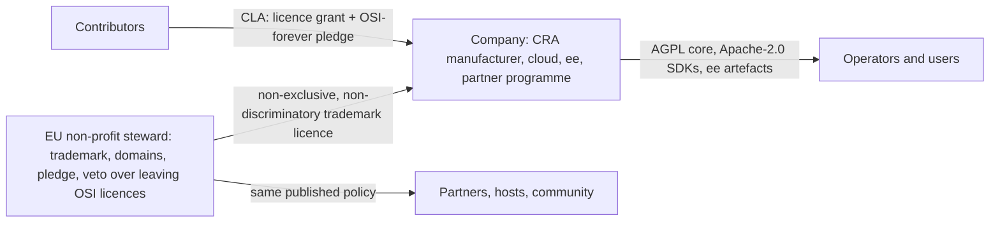
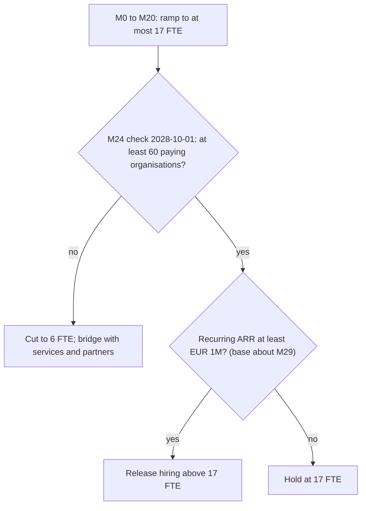

# Business: licensing, governance, editions and pricing, economics, go-to-market, risk register

- **Status:** Draft 0.1
- **Date:** 2026-10-01 (month 0, "M0")
- **Scope:** How obop earns trust and money: market and ICP, positioning, licence and governance, the open/paid boundary, pricing hypotheses, economics and funding gates, partners, go-to-market, risks and counsel items.

**How to read.** The binding rules are in [DECISIONS.md](DECISIONS.md) and are cited by ID (D1, D2 ...). Almost every commercial decision there is still PROPOSED, so this document writes "Proposed (Dn)". Other labels: *(estimate)* is a model or author output, *(target)* a design goal, *(hypothesis)* a price to be tested, *(derived)* arithmetic on sourced inputs, *(proposal)* this document's own suggestion, *(guess)* a research author's unsupported figure, *(unverified)* a claim no primary source confirmed. Research is cited as [R26 A3]; the Sources section maps tags to files. Money is EUR ex VAT; "M9" means nine months after 2026-10-01. Nothing here is legal advice. Related: [PRODUCT.md](PRODUCT.md), [ROADMAP.md](ROADMAP.md), [LOCALIZATION.md](LOCALIZATION.md), [ENGINEERING.md](ENGINEERING.md), [ARCHITECTURE.md](ARCHITECTURE.md), [spec/security-privacy.md](spec/security-privacy.md), [spec/integrations.md](spec/integrations.md), [GLOSSARY.md](GLOSSARY.md).

**Bottom line.**

1. The opening is the delivery contract, not the language. Odoo's worst grievances (paid upgrades, a moving open/paid line, a gated API, surprise pricing) are business-model choices that a Rust rewrite would reproduce [R04 s1, R00 s4]. obop wins by opening every first-party app, shipping the API free, making upgrades a product feature and publishing its rules.
2. Entry is a free compliant-invoicing on-ramp into a seven-app loop, Germany first, for 5 to 50 person services and light-trade firms (Proposed, D4).
3. Trust is the product: AGPL core, Application Exception, Apache-2.0 SDKs, a licence-grant CLA with an OSI-forever pledge, a company plus an EU non-profit steward, and a published, closed, ratcheting paid list (Proposed, D1, D2). These are one-way doors; the owner's answers are due 2026-10-20.
4. The money is long. The gated plan needs about EUR 8M and at most 17 FTE before EUR 1M ARR (Proposed, D5). The model behind it could not be independently reproduced (section 6.6).
5. The top risks are funding, the accounting and localisation burden, runtime customisation, the partner channel, the AGPL boundary, investor pressure against the pledge, database-per-business scale and ARPA (section 9).

## 1. Market and personas

### 1.1 Sourced market facts

| Fact | Value | Source |
|---|---|---|
| EU firms with 10+ staff using ERP (Eurostat 2025) | 46.45% overall; 41.08% of 10-49 staff; 69.93% of 50-249; 88.71% of 250+. So about 59% of small firms report no ERP (by subtraction) | [R20 s1.2] |
| Micro firms (under 10 staff) | 94.4% of about 34M EU enterprises (2024); ERP adoption not measured | [R20 s1.2] |
| Germany, firms with 10-249 staff | 480,442; ERP use 37.5% (10-49) and 67.7% (50-249); about 281k without ERP (derived). Next largest gaps (derived): IT about 121k, FR about 90k, ES about 77k, PL about 68k | [R25 A1] |
| ERP market size | Mordor USD 78.15B (2026), internally inconsistent; Fortune BI USD 92.6B (2025); no primary analyst figure readable | [R20 s1.1] |
| Odoo's base | EUR 620M 2025 revenue (company-stated); 170,000+ paying customers; about EUR 3.6k per paying customer (derived); 88,510 identified companies, 77% under 50 staff (technographic crawl) | [R03 s7, R20 s2.2] |
| Implementation risk | Gartner via TechTarget: over 70% of recent ERP initiatives fail to fully meet goals | [R20 s1.3] |

The numbers support a large population of 10-49 staff firms without ERP, biggest by count in Germany, and an Odoo customer who is a 1 to 50 person firm, not the mid-market. They do not support a TAM: analyst totals disagree by about 30%, micro firms are unmeasured and no verified SMB SaaS-sprawl figure exists [R20 s3.2]. This document therefore states no TAM or SAM; targets are counted in organisations.

### 1.2 ICP and personas (Proposed, D4)

**ICP:** owner-led firms with 5 to 50 people in services and light trade, one company, one country at a time (Germany first). The owner-manager decides, the accountant influences (QuickBooks bundles two to three accountant seats), and for 20 to 100 users a consultant runs the project [R20 s3.3].

| Persona | Jobs to be done | Fit with the W1 loop | Wave | Buying motion |
|---|---|---|---|---|
| Solo founder, freelancer (1-4) | Send compliant invoices, see cash, file VAT | Medium: invoicing only, the on-ramp | W1 | Self-serve, accountant referral |
| Agency, professional services (5-20) | Lead to quote to project to timesheet to invoice; margin per project | High, but `project` and `timesheet` arrive in W2 | W1, then W2 | Self-serve plus accountant; days |
| Light-trade distributor (10-50) | Purchase to receive to sell to invoice; correct cost | High (`stock`, `purchase` are W1) | W1 | Partner or consultant, 2 to 6 months |
| Manufacturer (20-100) | BoM, manufacturing orders, lots | Medium | W3 (`mrp`) | Partner-led |
| Retail (1-10 stores); e-commerce brand (3-30) | POS to stock to accounting; order sync, cross-channel stock | Low; medium-high if connector-first | W3 (`pos`, `ecommerce`) | Resellers; self-serve |
| Nonprofit; local government | Members and donors; budget accounting | Medium; low | Opportunistic; W4+ | Volunteers; tenders of 12 to 24 months |
| Accountant, bookkeeper (channel) | Hand over clean books, DATEV-style export | Enabler | W1 (free seats) | Programme, section 7 |
| Implementer, developer (channel) | Customise without compiling Rust | Enabler | W1 (X1, X2, X4) | Certification, section 7 |

Sources: [R20 s3.1, s3.3]. Nonprofit and government willingness to pay is inferred, not sourced.

### 1.3 Jobs to be done for the ICP

| # | Job | Trigger | Apps | Wave |
|---|---|---|---|---|
| J1 | Issue a compliant invoice and get paid | DE: receive since 2025-01-01, issue from 2027-01-01 above EUR 800k turnover, all issuers from 2028-01-01 [R25 A2] | `invoicing`, `payment`, `portal` | W1 |
| J2 | Turn a lead into quote, order, delivery, invoice | Re-keying across tools | `crm`, `sales`, `stock`, `purchase` | W1 |
| J3 | Know stock and cost | Overselling, wrong COGS | `stock`, `stock_account` | W1 |
| J4 | Close the month and hand books to the accountant | Month-end pain | `account`, `tax`, `l10n_de` | W1 (pack stable 2027-09-30) |
| J5 | See margin per project | No margin view | `project`, `timesheet` | W2 |
| J6 | Leave a tool without losing data | Upgrade or price shock | importers | W1 (CSV 0.3; Odoo, QuickBooks 0.6) |

- **On-ramp.** Given a German freelancer with no ERP and a verified Free organisation, when she issues her first invoice to a business customer, then obop produces an EN 16931 invoice (XRechnung or ZUGFeRD) that passes the pack's oracles and can be sent over Peppol through the partner access point, and sign-up to first compliant invoice takes under 30 minutes at M6, 15 at M12 and 10 at M24 (target) [R20 s12, D4].
- **Switcher.** Given an Odoo user on 17.0 or older (outside the three covered versions since 20.0 shipped; the 25% old-version fee could apply from about March 2027, an inference in [R04 s4.1]), when the user runs the Odoo importer in dry-run, then a report lists mapped, skipped and failed records and writes nothing; a confirmed run keeps an identity ledger of external ids (D22).

**Sequencing tension.** The best-fit services persona needs `project` and `timesheet`, which D25 places in W2 (W1 only if the loop is on schedule at 0.5). In W1 the fit is strongest for light trade. The owner may pull the services variant forward or accept the order (BQ8).

## 2. Positioning and competitive landscape

### 2.1 Positioning statement (Proposed)

For owner-led businesses with 5 to 50 people that run on subscriptions and spreadsheets, obop is the open-source business platform that runs sales, stock, invoicing, accounting and payments on one shared data model, so there is one record of every customer, product and euro. Every first-party app and every security outcome is open; what is paid is operation and assurance (D2). You pay per organisation, not per app or per seat. E-invoicing (EN 16931, Peppol) is built in, the API is free on every plan (D31) and agents use the same permissioned command surface as people (D18). Rust is positioned on correctness and operations; no speed multiple over Odoo is claimed until the harness exists (D21).

Three changes from [R20 s8]: the headcount band "5-250" becomes "5 to 50", the ICP of D4 (the 10-249 staff market data in section 1.1 show where the ERP gap is measured, not who the first customer is); "100% of first-party apps under the same open licence" becomes "every first-party app is open" (a published paid list exists); and "fast" leaves the tagline until measured (BQ7).

### 2.2 Competitive landscape (as of 2026-10-01)

| Competitor | Licence and model | Scale | Price points | obop angle |
|---|---|---|---|---|
| Odoo | LGPL-3 Community; proprietary Enterprise since 9.0; licence-grant CLA [R03 s3.1] | 20.0 ("September 2026, release commit 2026-09-17"); 54.8k stars; about 7,500 staff; partner directory about 4,455 vs "21,000+" claimed [R03 s1, R20 s4] | Per user-month, yearly billing: list 24.90 and 44.90 (19.90 and 35.90 are 12-month introductory prices); monthly list 31.10 and 56.90; Light User 7.90 (unit unverified); One App Free [DECISIONS s3 ruling 21] | Open accounting and payroll engine, ungated API, per-organisation pricing, upgrades as a feature |
| ERPNext / Frappe | GPL-3.0, no paid feature tier; monetises hosting | v16.37.0, v15.121.6 (2026-09-30); 39.7k stars; 200+ partners | Sites from USD 5 per month; servers from USD 20 or 125 on the ERPNext pricing page, USD 40 on the Frappe Cloud page (re-checked 2026-10-01) [R26 A1, R04 s5.1] | Heavy multi-service operations, dated UX, thin EU e-invoicing [R05 s2.1] |
| Dolibarr; Tryton | GPL-3.0-or-later; association; Belgian private foundation | Dolibarr 24.0.1 (2026-09-07), 7.7k stars; trytond 8.0.10 (2026-09-16), 221 modules, 226 stars (mirror) | Free, partner-hosted | Dolibarr: dated UI, simple accounting. Tryton: correctness alone did not bring mindshare [R05 s2.1] |
| Twenty | AGPL-3.0, `@license Enterprise` files, MIT SDKs, Application Exception | v2.44.0 (2026-10-01); 57.8k stars | Pro USD 9, Organization USD 19 per seat-month; Enterprise from USD 50k per year | Nearest structural analogue; CRM only. obop copies the exception and SDK structure, not the per-file marker |
| SaaS stacks (Xero, QuickBooks, Holded, Teamleader) | Proprietary | Holded claims 900,000+ users | Xero USD 27-97; QuickBooks USD 38-340; Holded EUR 15-199 (HR, inventory, POS paid add-ons) [R26 A1] | One data model, ownership, no integration tax |
| ERP suites, AI-native ERPs, Rust ERPs | Proprietary; VC-funded; mixed | Business Central USD 80 and 110 per user-month; NetSuite and SAP quote-only; Rillet at USD 1B (headline); best Rust ERP repos 40, 23, 16 stars [R26 A1, R20 s2.3, R05 s3.2] | n/a | Price and partner fees; open and self-hostable; no credible Rust incumbent and no proof one is wanted |

Flectra is the warning: an Odoo Community fork since 2018 that copied the open-core model has 252 GitLab stars against Odoo's 54.8k on GitHub. Copying the model without the distribution yields a small vendor [R03 s9].

### 2.3 Where Odoo gates what obop opens

| Capability | Odoo | obop |
|---|---|---|
| Full accounting (reconciliation, budgets) | Enterprise; Community `account` is "Invoicing" [R20 s2.1] | Open: ledger and reconciliation W1; assets, deferrals, budgets W3 |
| Periodic returns, audit-file exports (DE, FR, ES) | Enterprise; Community ships e-invoice connectors but no VAT-return or DATEV module [R25 B7] | Open as law-defined pack content (D17) |
| Payroll | Left Community in 13.0 [R03 s3.4] | Engine open; warranted payroll service paid (D19) |
| Helpdesk, planning, documents, sign, knowledge | Enterprise [R03 s3.2] | Open, W3 |
| External API | Custom plan only; RPC services removed from Odoo 22 (fall 2028) [R03 s3.3] | Free on every plan (D31) |
| AI | All features need purchased IAP credits [R03 s3.3] | BYOK, no credit wall (D18) |
| Upgrades | Database upload, 25% old-version fee, custom code only after porting [R03 s4.2, s5] | Two series a year, local `obop upgrade --dry-run` from 0.3 (D16, D26) |
| Security advisories | Enterprise customers get at least two weeks' head start [R28 D.4] | One publication moment for everyone (D38) |

### 2.4 White space and honest limits

White space [R05 s5.1]: open accounting, inventory and CRM in one low-operations product; EU compliance as a core; one binary plus PostgreSQL (D37); edge-capable POS and warehouse; agent-safe business actions; and a licence that cannot be pulled (Cal.com closed its source on 2026-04-14; Akaunting is BSL; Invoice Ninja is ELv2).

Limits:

- A suite does not win on list price for simple needs; it wins when a firm needs more than about four functional domains, inventory-to-accounting consistency or multi-company [R05 s6.3]. At 15 users the licence delta against a SaaS stack is small, so lead with consolidation, ownership and compliance [R20 s3.2].
- Moats are customisation, localisation and partners, not transaction code. "Written in Rust" is not a buying criterion [R05 s1, s7, R26 C6].
- Odoo can reprice, open accounting or bundle AI (BR-11); SaaS bundlers keep adding depth (BR-12).
- Realistic trajectory: a narrow EU SMB product in 12 to 18 months, ERPNext-2015 breadth in 3 to 5 years [R05 s7].

## 3. Licensing and governance (Proposed, D1)

Everything here is a one-way door and PROPOSED. Nothing goes public until counsel has covered CN-01 to CN-09 (section 10) [D1]; the dates of CN-04 and CN-05 currently fall after the latest public flip (section 10; Q16, BQ13). The owner ratifies by 2026-10-20 (Q1).

### 3.1 Structure

| Component | Licence or form | Rationale |
|---|---|---|
| Core and first-party apps | AGPL-3.0-or-later (counsel may choose `-only`) | OSI-approved, so it passes NLnet, Sovereign Tech Fund and public-sector gates; stops proprietary forks; keeps CRA free-software treatment [R17 s11, D1] |
| Extension boundary | AGPL s7 Application Exception, modelled on Twenty's | Third-party apps may carry any licence if they touch only documented interfaces [R17 s2.2, R24 s8] |
| SDKs, WIT worlds, UI SDK, templates | Apache-2.0 | Express patent grant; extension authors never touch AGPL [R17 s5.1] |
| `ee` tree | Commercial, separate artefacts, converts to open 24 months after release | The closed paid list only (section 4) |
| Contributor terms | CLA as licence grant, patent licence, irrevocable "OSI licence forever" pledge | No assignment; the pledge answers the rug-pull reading [R26 C3] |
| Governance | Company (CRA manufacturer, cloud, `ee`) plus EU non-profit steward (trademark, domains, pledge, veto) | Fits the CRA manufacturer/steward split [R17 s7.2, s9] |

### 3.2 Why AGPL, and what it does not do

Rejected for the core: FSL, BUSL, SSPL and ELv2 (not OSI; they fail NLnet, Sovereign Tech Fund and openCoDE/ZenDiS gates, put the CRA free-software treatment in doubt, and FSL's competing-use ban would block partner hosting, our channel); Odoo-style LGPL plus a proprietary layer (weak protection, the source of the open-core backlash); a permissive core; DCO only; an assignment CLA [R17 s11.1, R26 C5, D1].

Costs accepted: Google's own policy bars AGPL code inside Google, and large adopters may follow; a modest cost for an SMB product [R17 s2.2]. AGPL s13 binds only modified versions, so **it does not stop a host running stock obop**. The answers are trademark policy, the partner-hosting licence, service levels and the Assurance service, never a relicence [R17 s6, D2]. Dual-licence exceptions for buyers who cannot accept AGPL are planned at zero in the base case, at most 5% of revenue, and only as extra permissions [R26 C4].

### 3.3 Application Exception and extension boundary

In-process third-party Rust would make every extension an AGPL derivative, so it is unsupported (D1, D11). Tier names follow D24.

| Tier | Form | Treatment under the exception | Status |
|---|---|---|---|
| X1, X2 | Declarative pack; CEL in data | Any licence (configuration format) | Clear |
| X3 | Wasm component | Covered as the host ABI | **Most novel case; counsel must confirm** (CN-01) |
| X4 | Remote app | Any licence (separate program over HTTP) | Clear |
| X5 | First-party native crate | AGPL; third-party native builds unsupported | Clear |
| UI F0, F2, F3 | Declarative, remote-dom, sandboxed iframe | Any licence; SDK and tokens Apache-2.0 | Clear |
| UI F1 | Trusted ESM, first-party and business-own only | Not covered | By design |

Source: [R24 s8, D11]. The registry follows in W2, marketplace commerce in W4 (section 7).

### 3.4 CLA, pledge and investor covenant

The CLA grants rights and does not assign copyright (several EU jurisdictions restrict assignment). It includes a patent licence equal to Apache-2.0 s3 and a public pledge that contributed code stays under an OSI-approved licence; an FSFE-style reversion is a further option [R17 s4, s5.1]. R05 advised against a relicensing CLA; R17 and R26 resolve this as licence grant plus pledge plus steward veto plus investor covenant, which D1 adopts [R00 s5 #12].

Contributor experience (Proposed): GitHub sign-in, one "I agree" comment, a public signature ledger, domain-verified click-through for companies, a bot reply in seconds, DCO sign-off for docs fixes. Odoo blocks merge until a signature PR lands [R28 C.2]. The bot is part of gate G0 (D26).

| Investor term | Threat to the pledge | Mitigation, before any priced round [R26 C3] |
|---|---|---|
| Liquidation preference, exit pressure | A sale to an acquirer that closes future versions (HashiCorp relicensed itself in 2023, then sold to IBM; Cal.com closed in 2026) | Charter plus exit covenant: an acquirer honours the pledge or the steward gets a licence-back |
| Protective provisions over IP | Investors veto or force a licence change | Statutory purpose and steward veto in the articles before the term sheet |
| Growth at any cost | Paywall drift (Odoo's 2015 pivot, a 2019 founder retrospective, unverified) | Published closed paid list with ratchet |

### 3.5 Company and steward

- **Company:** CRA manufacturer; runs obop Cloud, `ee`, the partner programme and the Art. 14 runbook; earns all revenue.
- **Steward:** holds trademark, domains, the GitHub, crates.io and package registry namespaces (two or more independent admins) and the pledge. Its board has independent and community seats and a veto over moving the core off OSI licences (MinIO and Cal.com show the withdrawal risk) [R28 A.7, R26 C2].
- **No revenue share from hosts.** The company holds the same non-exclusive, non-discriminatory trademark licence as everyone else (the WP Engine lesson) [R26 C2, R17 s5.2].
- **Steward budget:** about EUR 150-300k a year by year 3 (estimate), funded by the higher of 2% of company revenue or USD 2,000 per developer plus members, sponsors and grants [R26 C2]. On base year-3 revenue of EUR 1.28M the 2% leg gives about EUR 26k, and the USD 2,000 per developer leg roughly EUR 35-60k for 20 to 35 developers (derived, at the 1.16 USD per EUR implied in [R20]), so most of the budget must come from members, sponsors and grants (BQ5).
- **CRA.** Art. 14 reporting has applied since 2026-09-11 (24 hours, 72 hours, 14 days); main obligations apply from 2027-12-11; the five-year minimum support period drives the LTS policy (D16). Security updates must be free (Annex I Part II(8)), so support tiers sell response time, never fixes. The company is a manufacturer from the first commercial offer (2027-07-06, D26). Whether the steward is fine-exempt is unsettled: Art. 64(10) derogates from paragraphs 3 to 9 only, so it does not literally reach the EUR 15M or 2.5% tier [R17 s7, R26 L3] (CN-04). The steward's form (Belgium, the Netherlands, Germany and Switzerland all have precedents) is for counsel (Q5, 2027-06-01).

### 3.6 Trademark and name (Proposed, D3)

"obop" is a working name. No announcement, spend or filing until counsel completes EUIPO, UKIPO, WIPO, DPMA and INPI searches in classes 9, 35, 42 (and 41, 45) and opines on OBOPP (pending, class 35) and OBOL (two live registrations, classes 9 and 42). OBOP is also a Polish pollster, USPTO shows no OBOP record, and the npm registry name `obop` is taken (publish `@obop/*`). Reserve the crate, PyPI, GitHub organisation variant, GHCR and Matrix handles now; screened fallbacks are kernelbiz, monobiz, mercora. File in the steward's name: a US intent-to-use mark cannot be assigned early. Official fees for classes 9, 35, 42 in the EU, UK and US are about EUR 2.3-2.5k (estimate, exchange rates unchecked). Rating: medium, clearance incomplete [R28 A.1-A.7].

Policy draft (Proposed), after Frappe, Mozilla and the Rust Foundation [R28 A.6]:

| Rule | Content |
|---|---|
| Protected | "obop", logo, "obop Cloud", "obop Certified"; not the tagline or module names |
| Free use | "works with obop", "obop consulting", "hosting for obop"; `obop-<thing>` packages if marked unofficial |
| Never | obop as the start or whole of a company, product or domain name; keyword ads; implied endorsement; "obop <Name>" (use "<Name> for obop") |
| Modified builds | Drop the marks unless the change is packaging, porting, security backports or configuration |
| Enforcement | 30-day cure, published criteria, annual transparency report, no revenue-share demands on hosts; no restriction on code use |

### 3.7 Contributor governance (Proposed)

A scaled-down Kubernetes ladder (member, reviewer, approver) plus module and localisation maintainers, the latter a practising accountant or payroll specialist; no company holds a majority of core approver seats. Contributor Covenant 3.0 with a non-employee on the enforcement committee. RFCs in `rfcs/NNNN-title.md` after Vite+'s repository [R28 C.2, B.3].

## 4. Editions, the free-forever list, the paid list and the ratchet (Proposed, D2)

### 4.1 Offers

obop has one codebase and no "Community" or "Enterprise" edition in Odoo's sense (D24). The open edition is everything under AGPL; `ee` is the closed paid list; everything else sold is an operated or warranted service.

| Offer | What it is | Price (hypothesis) |
|---|---|---|
| Open edition, self-hosted | All first-party apps, API, importers, export; single-business install | EUR 0; community support |
| obop Cloud | Hosted, per organisation: Free, Team, Growth, Scale | Section 5 |
| Support subscription, self-hosted | Response commitments on bug reports (the fixes themselves ship in the open edition), diagnostics triage, published OS and PostgreSQL matrix | EUR 2,400 or 6,000 per year |
| `ee` subscription, self-hosted | Paid-list capabilities plus 24x5 support; Plus adds 24x7, 1-hour P1, air-gap | From EUR 12,000; Plus from EUR 36,000 per year |
| Services | Assurance per country, payroll service, hosted gateways, hosted AI credits, certification exams | Section 5.3 |

### 4.2 The boundary

This restates D2 and section 6 of [DECISIONS.md](DECISIONS.md); D2 is Proposed and awaits the owner (Q3), and the operated-service row is a Proposed addition (Q19). The rationale is from [R26 A2].

| Capability | Free forever (open edition) | Paid (closed list) |
|---|---|---|
| First-party apps | Accounting, inventory, manufacturing, CRM, HR, payroll engine, POS, helpdesk, documents | None (Odoo withholds accounting, payroll, helpdesk; this is the wedge) |
| Integration | REST, webhooks, MCP, OpenAPI, importers, full-fidelity export on every plan; no switching or egress charges from 2027-01-12 | None (Data Act; Odoo gates its API) |
| Extensibility | Multi-company, custom fields and models, Wasm extensions, registry client, sideloading | None |
| Identity | Password, TOTP, passkeys, OIDC, LDAP bind, RBAC, permission and restriction rows (D10), field permissions; SCIM subset; a documented SAML bridge (Keycloak or Authentik) [R26 A2] | Native SAML (multi-IdP, JIT); full SCIM (Bulk, advanced filters, group-to-role) |
| Audit | Hash-chained log with UI and export (13-month default) | WORM or object-lock checkpoints, SIEM streaming, legal hold on audit tiers (the register says only "legal hold"; a record-level retention hold stays open, see [spec/security-privacy.md](spec/security-privacy.md)), multi-year tiering, auditor evidence packs |
| Encryption | Envelope encryption, local or OpenBao keys | Cloud-KMS and HSM connectors, customer-managed keys, region pinning (hosted Scale) |
| Continuity, fleet, air-gap | Backup and PITR recipe, single-business install, source and signed artefacts | Fleet DR and cross-region failover; multi-business control plane (partner-hosting licence); supported air-gap bundle |
| Branding | Business branding, templates, portal and website themes, portal custom domain | Partner white-label: trademark licence plus reseller console |
| AI | BYOK, MCP server, usage ledger, budget caps | Hosted AI credits at cost plus 20% (D18) |
| Security | Fixes, SBOMs, signed releases, CRA reporting | Never |
| Compliance content | Charts, taxes, fiscal positions, VAT-return and audit-file exports, e-invoice syntaxes, validators | Assurance service (legal-change SLA, filing connectors, capped warranty), payroll service, hosted gateways (Peppol, KSeF, Veri*Factu) |
| Operated services over open code (Proposed, Q19) | The code of the package registry server, the mail OAuth broker, bank-feed, SMS and sending-relay adapters, and routing and tile adapters, with bring-your-own credentials | The hosted package registry, hosted OAuth broker for mailbox providers such as Gmail, hosted bank-feed broker, hosted sending relay and managed IP reputation, SMS credits, hosted routing and tiles (an operated service, never closed code) |
| Operations | Support from forum and Discussions | Hosting, support and SLAs, certification exam fees |

### 4.3 Guard rails and the ratchet

- **Never gate** security fixes, data export, the API, multi-company, ledger integrity or the existence of an audit log. Every security outcome is reachable in the open edition.
- **Published and closed.** The list is published before the first public commit (gate G0) and moves only from paid to open.
- **Time lock.** `ee` code converts to open 24 months after release. Illustration (derived): a connector first shipped in `ee` on 2028-04-18 opens no later than 2030-04-18.
- **Protection.** The CLA pledge, steward veto and investor covenant guard the ratchet (section 3). A hosting competitor is answered with trademark policy, partners and service levels, never a relicence.
- **No Odoo contract levers:** no 7% renewal uplift, 25% old-version fee, 300% breach fee, per-100-lines custom-code fee or usage beacon [R03 s4.2].

`ee` is a credibility and completeness device, not the revenue engine: the model counts 2 to 8 self-hosted `ee` customers at EUR 12k by M36, at most about EUR 96k a year (derived from R26 B6). Revenue depends on hosted subscriptions and compliance attach, which is why the hosting-competitor risk (BR-13) matters.

**Where the research was overruled.** R17 s11.2 would gate SSO, SCIM, audit, control plane, air-gap and white-label as written; R03 SHOULD 7 proposed one per-user price; R05 advised against a relicensing CLA. D1 and D2 supersede all three [R00 s5 #11-13].

## 5. Pricing hypotheses (Proposed, D2)

All prices are hypotheses to test, not commitments. Unit: **per organisation** (one business), banded by full users. A full user creates or edits transactional records. Portal users, up to three accountant seats and light users (time off, expenses, timesheets, payslips, kiosk and POS operators, barcode; fair use up to 5x full users) are free [R26 A3].

### 5.1 Plans (yearly billing)

R26 calls the EUR 249 plan "Business", which collides with the D24 term for the isolation unit; this document uses **Growth** (Proposed, BQ1).

| Plan | Price per month | Includes (hypothesis) |
|---|---|---|
| Free | EUR 0 | Invoicing bundle (contacts, products, quotes, invoices, payments, EN 16931 and Peppol), unlimited users, 1 GB, 100 documents per month, API 50 requests per minute, Peppol sends prepaid at cost plus 50%, community support, 90-day inactivity archival with full export kept |
| Team | EUR 49 (59 monthly billing) | 5 full users (EUR 9 per extra up to 15), all loop apps, 10 GB, 14-day backups, EU region, email support |
| Growth | EUR 249 (299 monthly billing) | 25 full users (EUR 6 per extra), all apps, 100 GB, PITR 35 days, staging, Wasm extensions, one bank connection per company, 1-business-day support |
| Scale | From EUR 899 | 100+ users, dedicated cell (R26 said "dedicated DB", but every business has its own database under D6), region pinning, customer-managed keys, native SAML and SCIM, advanced audit, 99.9% SLA, 24x5 |

Notes. (1) R26 lists "5 entities" on Growth; multi-company ships in W2 and is free forever, so plan tables say "entities" only from W2 and company count is a fair-use band, never a feature gate (BQ1). (2) Free-plan rate limits, and the Wasm extension slot that R26 lists only from Growth, are hosted capacity controls; the API and Wasm extensions are free on every plan and in the open edition (D31, D2 section 6). (3) Archival must not become a barrier to switching, including after a free tier (Data Act Art. 23) [R28 E.4]. (4) Monthly billing costs about 20% more (derived from 59/49 and 299/249). (5) Per included full user, Team is EUR 9.80 and Growth EUR 9.96 (derived), against Odoo Standard list EUR 24.90.

### 5.2 Price check and benchmarks

For a 15-user agency, per month, currencies not converted [R26 A3, R20 s3.2]:

| Option | Monthly |
|---|---|
| obop Growth (hypothesis) | EUR 249 |
| Odoo Standard list / 12-month introductory | EUR 373.50 / 298.50 |
| Odoo Custom list (API, multi-company, Studio) | EUR 673.50 |
| SaaS stack (QuickBooks Plus, HubSpot, project tool, glue) | about USD 540 (estimate) |
| Business Central Essentials / Zoho One flexible (basis unstated) | USD 1,200 / USD 1,350 |

Other anchors: Xero has no per-user fee (USD 27-97); Holded is EUR 15-199 with HR, inventory and POS as paid add-ons; Frappe Cloud is resource-based; Twenty prices per user (USD 9 and 19 a month) but caps no seats; Metabase Enterprise is Pro plus SLA, procurement and air-gap from USD 20k a year; Odoo Custom rose about 20% in September 2026 [R26 A1].

Planned ARPA is EUR 200 a month, about EUR 2.4k a year: plan mix 55/37/8 (Team, Growth, Scale) gives EUR 191, plus a 5% usage margin [R26 B5-B6]. Odoo's revenue per paying customer is about EUR 3.6k (derived); not like for like, but obop plans for about two thirds of it.

### 5.3 Self-host and service prices (hypothesis)

| Item | Price | Comparator [R26 A3] |
|---|---|---|
| Support Standard / Extended (R26: "Business", renamed for the same D24 reason as the plan; names provisional) | EUR 2,400 / 6,000 per year | Frappe Product Warranty (bug fixes only) |
| `ee` subscription / Plus | From EUR 12,000 / 36,000 per year | Metabase USD 20k, Grafana USD 25k, Twenty USD 50k |
| Assurance service, per country | EUR 19 (Team) or 39 (Growth) per month | Holded SII from EUR 30; Stripe Tax from EUR 80 |
| Payroll service | EUR 4 per employee per month | Holded EUR 5; Xero UK GBP 1.50 |
| Partner-hosting licence | EUR 6 per hosted business per month, EUR 300 minimum | Odoo pays partners up to 50% on Odoo.sh (per-tier share unverified on the public page), capped at EUR 150 per month (confirmed) [R03 s6.1, R26 Verification log] |
| Hosted AI credits; SMS and Peppol beyond prepaid | Cost plus 20% (D18); cost plus 50% | Odoo IAP credits; Twilio Germany USD 0.112 per segment |

R26 called the Assurance and payroll items "packs"; D24 reserves "pack" for the data package. The Assurance DE service opens 2027-10-01 (D26).

### 5.4 Price-test plan (Proposed)

| Question | Test | Decision rule |
|---|---|---|
| Growth level | Cohorts at EUR 199, 249, 299 from the paid beta (2027-07-06) | Keep the best payback; R26 suggests this range [R26 Implications 12] |
| Team as funnel | Marginal CAC at or below EUR 400 (self-serve, accountants); at a fully loaded EUR 1,600 Team's LTV/CAC is 1.0x [R26 B2] | Above EUR 400, cap Team acquisition spend |
| Conversion | Free to paid at 5% (assumption) | Under 2% triggers the D6 pooled-Free review (BR-14) |
| ARPA | Plan EUR 200 | Under EUR 150 at M24 (2028-10-01) triggers BR-08 |
| Support | Plan 0.75 hours per business per month | Over 1.0 triggers BR-25 |

Standing rules (Proposed): list price is the price, with no 12-month introductory step-up (the cliff that erodes trust [R04 s4.2, MUST 12]); the monthly premium is explicit; exit is never priced (Data Act). The renewal-increase cap is open (BQ3).

## 6. Unit economics, cost model and funding plan with hiring gates

**Status of the numbers.** Sections 6.1 to 6.5 are the author's model in [R26] with inputs marked (estimate). An independent rebuild could not reproduce the headline peak funding or break-even month (section 6.6; [R00 s7]). Use the model to rank levers, not to quote a forecast.

### 6.1 Cost to serve per paying business, steady state (estimate) [R26 B1]

| Component | Value | Basis |
|---|---|---|
| Compute and database | About EUR 6.2 per business per month | One cell of 250: 3 x CCX43 (EUR 275.99) + 3 x CPX42 (EUR 69.49) = EUR 1,036, x 1.5 for DR, / 250 (derived); Hetzner list from 2026-06-15 |
| Storage, backups, egress, monitoring | EUR 1.6 | Estimate |
| Free-tier tail | EUR 0.30 per free organisation | Estimate; the cell sum assumes all 250 are paying |
| Peppol | 60 documents a month at EUR 0.20 (third-party AP), EUR 0.06 with an own AP | Own AP about EUR 4.4k in year one [R25 B4]; break-even near 250 businesses at EUR 25k operations; D17 defers it to about 250 businesses or M31 |
| AI; payments; bank feeds | EUR 1.0 (BYOK); 2.0% of revenue; EUR 1.5 per connection | Estimates |
| Support | 0.75 hours per business per month; 1 FTE per 180 businesses (EUR 66k loaded) | Estimate |
| Assurance | SOC 2 Type I EUR 50k at M18; Type II plus ISO EUR 80k at M30; pen test EUR 40k a year | Vendor ranges; ISO price unverified |

**Support sensitivity (derived).** R26 implies about EUR 31 per business per month (EUR 66k / 180 / 12). R28's support model gives EUR 130, 52 and 31 at 50, 500 and 5,000 businesses (about EUR 215, 105 and 88 per ticket) [R28 D.5, a model]. At 500 businesses that is about 70% above R26, and more than the price of a EUR 49 Team plan. R26 does not show support allocation by plan (BR-25, BQ4).

### 6.2 Margin and payback by plan (estimate) [R26 B2, B3]

| Plan | Gross margin (own AP / third-party AP) | Life | LTV/CAC (assumed CAC) | Payback |
|---|---|---|---|---|
| Team EUR 49 | 64% / 58% | 50 months at 2.0% churn | 3.9x (EUR 400) | 13 months |
| Growth EUR 249 | 78% / 75% | 60 months at 1.1% | 7.8x (EUR 1,500) | 8 months |
| Scale (list from EUR 899; modelled at EUR 900) | 73% / 68% | 60 months at 0.6% | 6.5x (EUR 6,000) | 9 months |

Blended gross margin is negative in year 1, 54% in year 2 and 79% in year 3 including support staff. References: Xero's organic gross margin 89%, CAC payback 14.4 months, LTV/CAC 5.9x; GitLab's GAAP gross margin 84% and net retention 117%. No public churn exists for Odoo, Frappe, Twenty, Metabase, n8n, Akaunting, Invoice Ninja or Holded, so planning churn (monthly logo 2.0%, 1.1%, 0.6%, blend 1.6%; expansion 8% a year) is an estimate. Base CAC payback is about 11 months on revenue but about 14 gross-margin-adjusted, slightly outside the SMB target of under 12.

### 6.3 Scenarios (estimate) [R26 B5]

| | Conservative (lean, 25% capacity on services) | Base (ungated) | Upside | Base, gated |
|---|---|---|---|---|
| Headcount M12 / M24 / M36 | 6 / 8 / 10 | 10 / 22 / 37 | 14 / 32 / 50 | 17 ceiling until EUR 1M ARR |
| Paying organisations M12 / M24 / M36 | 1 / 37 / 188 | 10 / 146 / 637 | 22 / 327 / 1,442 | not separately modelled |
| Recurring ARR at M36 | EUR 0.38M | EUR 2.16M | EUR 6.95M | not separately modelled |
| EBITDA year 1 / 2 / 3 (EUR M) | -0.70 / -0.88 / -1.04 | -1.13 / -2.20 / -3.29 | -1.53 / -2.96 / -2.52 | cumulative -4.27 at M36 |
| Peak funding | About EUR 4.7M by M72, still falling | EUR 10.8M at M62 | EUR 6.6M at M39 | EUR 7.1M |
| First break-even month | Not reached in 72 | M64 | M40 | M62 |
| Runway on EUR 3M / 5M / 8M | M44 / beyond 72 / beyond 72 | M24 / M32 / M43 | M20 / M27 / not reached | n/a |

Calendar (derived): M12 is 2027-10, M24 is 2028-10-01, M36 is 2029-10-01, M64 is 2032-02; base EUR 1M ARR at M29 is about 2029-03 and 150 paying organisations at M25. The gated case moves W3-scale hiring 9 months later and releases it only at EUR 1M ARR; it models revenue as independent of hiring, which flatters it.

### 6.4 Sensitivity (base, estimate) [R26 B7]

| Change | Peak funding | Break-even |
|---|---|---|
| Base | EUR 10.8M | M64 |
| ARPA -25% / +25% | 14.2M / 8.6M | M72 / M57 |
| Gross adds x0.7 / x1.3 | 14.7M / 8.4M | none in 72 / M56 |
| Expansion 0% / 15% a year | 15.1M / 8.5M | none / M55 |
| Loaded cost +15% / -15% | 13.4M / 8.4M | M67 / M61 |
| Paid cloud delayed six months | 16.5M | none |
| Hiring -25% | 6.6M | M57 |
| Infrastructure x2 | 11.3M | M65 |

Reading: adds, ARPA with expansion, and hiring pace matter; infrastructure (about 6% of year-3 revenue) and Peppol cost do not. A six-month paid-cloud slip (+EUR 5.7M) costs more than a 25% ARPA miss (+EUR 3.4M), so launch date and conversion are the first metrics to instrument. This is why D26 compresses W1 rather than moving dates.

### 6.5 Loaded cost and small revenue lines

Planning cost is EUR 105k loaded per FTE plus EUR 9k tools and EUR 12k per hire [R26 B4]. At the 17-FTE ceiling that is about EUR 1.9M a year, at the 6-FTE fallback about EUR 0.7M (derived). Counsel and compliance are EUR 120k, 70k and 60k in years 1 to 3. Certified-partner fees (40 x EUR 1.5k at M36), partner-hosting licences (600 x EUR 6 x 12) and `ee` subscriptions (up to EUR 96k) together come to about EUR 0.2M, about 9% of the modelled EUR 2.16M ARR (derived). Not modelled: annual-prepay cash (favourable), payments take-rate, marketplace, payroll service and services revenue in the base case [R26 B6].

### 6.6 Reproducibility (required disclosure)

The base model's peak funding (EUR 10.8M) and break-even (M64) **could not be independently reproduced**. A rebuild from the model's own parameters matched paying organisations at M24 (146) and within 3% at M36 (655 against 637), and cumulative cash within about EUR 0.3M at M12, M24 and M36. It gave M36 ARR of EUR 1.89M (13% below the model's 2.16M), a peak near EUR 12.7M and break-even near M71. The parameter list omits post-M36 enterprise, partner and partner-hosted ramps, so the outputs cannot be rebuilt from the file alone [R26 B5, R00 s7]. D5 therefore says the ungated peak is "about EUR 10.8M (raised as about EUR 12M)". Rebuild the model as an open spreadsheet with every parameter before investor conversations (BR-29, BQ6).

### 6.7 Funding plan and hiring gates (Proposed, D5)

**Plan.** About EUR 3M seed for 24 months, then about EUR 5M against EUR 1M ARR, about EUR 8M in total. The ungated alternative is EUR 3M plus about EUR 9M at M20-24 (about EUR 12M); a lean services-funded path is the fallback. The pledge, steward veto and investor covenant precede any priced round [D5, R26 B5]. Open gap: ungated cash on EUR 3M lasts to M24 and the Series A window is M27 to M30 (base EUR 1M ARR about M29), and the research does not report the gated runway on EUR 3M, so the seed may need to stretch or be extended before the ARR gate is met (BQ12; ROADMAP risk SR7; R26 names the EIC and a seed extension as the bridge).

| Source | Verified terms | Role |
|---|---|---|
| NLnet Restack | First grants EUR 5,000-50,000; about EUR 7M through 2030; **deadline 2026-11-03 12:00 CET**; open licences, European dimension; generative-AI assistance must be disclosed with a prompt log and purely AI-generated output cannot be paid for; AI-related projects out of scope unless over 1M active human users [R26 C1] | 3 to 5 grants of EUR 30-50k for reusable crates (UBL/EN 16931, ledger engine, hash-chained audit, business-scoped query layer) |
| Sovereign Tech Fund | Work over EUR 50,000; OSI or FSF licence; user-facing applications not sought; about 6 months to contract; no double funding | Foundational crates; Resilience programme (relaunched 2026-09-28) for CRA help |
| EIC Accelerator; EU Open Source Strategy | Grant under EUR 2.5M plus EUR 1-10M equity, needs a GO first, company not steward; the Strategy (2026-06-03) names no amounts on the Commission page (secondary press reports about EUR 2B over 7 years for the wider package, unverified [R20 s6.2]) | Long shot; monitor |
| Sponsors | Open Source Pledge yardstick USD 2,000 per developer | EUR 10-50k a year |

Grants and sponsors cover about 6% of base burn, about EUR 0.4M of EUR 6.6M through M36 (estimate; R26 writes "under 6%", but 0.4 of 6.6 is 6.1% on its rounded inputs). They validate; they do not fund.

| Gate | When | Condition | If missed |
|---|---|---|---|
| Ceiling | Always | At most 17 FTE before EUR 1M recurring ARR | No hire above the ceiling |
| M24 check | 2028-10-01 | At least 60 paying organisations (target 150) | Cut to 6 FTE; services and partner bridge |
| Covenant | Before any priced round | Pledge, veto and investor covenant signed | No round |
| Launch instrumentation | First paid organisation (paid beta 2027-07-06) | Conversion, Peppol documents, support hours, ARPA, logo churn tracked | Fix before scaling acquisition |

Proposed definitions so the gates are testable: *recurring ARR* is 12 times monthly recurring revenue from hosted subscriptions, `ee` subscriptions, Assurance and payroll services, excluding one-off services, usage overage and pass-through; a *paying organisation* has paid at least one invoice on a non-Free plan and is not a partner's internal or test business. Model ramp (ungated): 4 FTE at M0, 6 at M3, 10 at M12, 17 at M20, 33 at M32 [R26 B6]. W3 breadth is paced by ARR, not the calendar (D5). Core skills by W2: 3 to 4 senior Rust engineers, 2 TypeScript engineers, 1 to 2 accounting experts, a designer, a platform engineer, a docs lead, a security and compliance owner [R20 s10]; D15 and D36 add a named Vite+ triage engineer and a 0.5 to 1 FTE quality-platform engineer.

### 6.8 Investor case, briefly

Defensibility rests on ledger correctness, country packs and certifications, trust (closed paid list, steward veto), importers and an extension ecosystem reachable without Rust. **None is proven today.** Why now: Odoo's September 2026 repricing and IAP-metered AI, e-invoicing mandates, the CRA, the EU Open Source Strategy and the 2026 licence reversals. Exit comparables (secondary): Visma bought Holded for about EUR 120M in 2021; SAP took about 1.3% of n8n at about USD 5.2B in 2026; Odoo's valuations are 11-16x revenue, the EUR 10B self-declared and not a transaction. A pledge lowers the price of a closing-the-code exit [R26 C6].

## 7. Partners and marketplace terms

### 7.1 Partner types and comparator

"Partner" means a channel, implementation, hosting or localisation partner (D24). Order: the accountant programme first (free seats, co-branded onboarding), then certified implementation partners, then hosting partners under the partner-hosting licence. Localisation partners run L2 packs (AT and CH in W3, derived from the DE pack; BE, NL, ES, IT, Nordics in W4) under a revenue-share agreement, holding the local declaration and insurance [R25 B2, D26].

Odoo charges EUR 590 (Learning) or EUR 2,950 (Ready, Silver, Gold) a year, pays up to 20% commission on Enterprise subscriptions (10-20% by tier) and reportedly 82% on extra-module maintenance (unverified: the public partner page text shows only "up to 20%" and the EUR 150 Odoo.sh cap), and takes 0% of services. Commission is at most EUR 60-108 per user-year while one 200-hour project is about EUR 20k, so services dominate by about an order of magnitude (estimate) [R03 s6.1, R20 s4]. Implementation must be profitable, not just commissioned.

### 7.2 obop partner terms (Proposed; price points are hypotheses) [R26 A3]

| Term | Proposal |
|---|---|
| Listing and tiers | Free after certification; Certified EUR 1,500 a year; Gold EUR 4,500 a year (25+ live businesses) |
| Commission | 20% recurring on hosted subscriptions. R26 A3 says 24 months but its CAC model assumes first-year only (BQ3). A Growth business is EUR 598 a year of commission against EUR 4-10k of services (derived) |
| Services | 0% share; partners set their own rates |
| Restrictions | No exclusivity, no non-solicit penalty (Odoo's is EUR 30,000), no ban on serving customers without a subscription |
| Naming | "<Name> for obop"; obop never in a partner's company, product or domain name |
| Hosting | Partner-hosting licence EUR 6 per hosted business per month, EUR 300 minimum, with the multi-business control plane (`ee`) |
| White-label | Paid: trademark licence plus reseller console (W3); business branding stays open. Counsel: can the open edition require an obop notice under AGPL s7(b) while a commercial licence lifts it (CN-14) |
| Certification | Functional, Accountant, Developer, Operator tracks; exam EUR 150-300 (guess), content free, validity tied to a major release; start at 50 production organisations [R28 C.4] |

Timeline: accountant and certified-partner programmes 2027-10 to 2028-06 (W2); white-label W3 (D26). Targets: 5 certified partners at M12 and 30 at M24 (target) [R20 s12]; fewer than 5 at M24 is risk trigger BR-04. The financial model carries only 2, 8 and 40 partners at M18, M24 and M36 [R26 B6], so the 30 at M24 target is far above what the economics assume; which is the plan is open (BQ10).

### 7.3 Marketplace terms (Proposed, D2, Q13)

| Term | Proposal | Comparators [R26 A3, R24 s9] |
|---|---|---|
| Take rate | 0% at launch; cap 15%; any rate announced 12 months ahead; never on free packages or sideloads; never demanded from hosts. Decided only after a year of verified paid-listing actuals | Odoo Apps 30% (25% in-app purchase, EUR 400 payout threshold, price parity); Shopify 0% on the first USD 1M then 15%; Microsoft 3% |
| Threshold | 0% on the first EUR 50k lifetime per developer, 15% above (R26 hypothesis, not in D2) | Shopify's model |
| Trust levels | private, community (automated gates), reviewed (manual, target 5 business days), partner, core (D32) | Grafana, Twenty, Stripe |
| Sideloading, publishers | Always allowed; on shared cloud limited to X1 to X4. Verified publisher: domain proof plus 6 months of good standing | VS Code |
| Lifecycle | `unmaintained` after 12 months without release plus 2 failed compatibility runs; registry kill switch; signed OCI artefacts, SBOM, capability diff per upgrade | n/a |

Sequence (the registry server code is free and the hosted registry paid under D2 section 6's Proposed addition, still open until Q19 is ratified; see BQ11): registry alpha in W2; paid-listing billing, payouts and tax in W4 (10 to 15 person-months, estimate) [R24 s11]. Marketplace revenue is negligible in three years; the goal is ecosystem [R26 A3]. For counsel: developer agreement, takedown liability, the registry operator's CRA role, licence conformance of listings (CN-14).

## 8. Go-to-market playbook

### 8.1 Strategy (Proposed, D4)

A free compliant-invoicing on-ramp with unlimited users, expanding into the seven-app loop (Contacts and Products, CRM, Sales, Inventory plus Purchase, Invoicing plus Accounting, Payments, and Portal with document output and attachments; the `documents` DMS app is W3 [D4, DECISIONS s5.1, R20 s9.2]), one company, ICP 5 to 50 person services and light trade. Germany first (pack stable 2027-09-30), France second (2028-03), Poland third (2028-08), re-scored in 2027-Q2. Out of the first delivery: POS, payroll, manufacturing, multi-country tax. Rule: no new app without a design partner [D4, R20 s9, R26 S1].

### 8.2 Funnel and metrics

| Stage | Mechanism | Metric (target unless noted) |
|---|---|---|
| Discover | Public repository, docs, 5 to 10 recipes (for example "Peppol-compliant invoicing in 15 minutes"), TCO calculator with visible assumptions | Stars 1k / 5k / 15k at M6 / M12 / M24 [R20 s12]; R20 assumed a public repository from day one, but D26 keeps it private until gate G0 (at the latest 2027-04-06, M6), so count from the public flip (proposal, as in ROADMAP) |
| Activate | Free compliant invoicing, importers | First compliant invoice under 30 / 15 / 10 minutes |
| Expand | CRM and sales, then stock and purchase | Weekly active organisations completing quote to invoice to reconciled payment (north star) |
| Convert | Free to Team or Growth; Assurance attach | Free to paid 5% (assumption); floor 2% |
| Retain | Export always available; no promotional cliff | Gross retention at least 90% at M12, 95% at M24 [R20 s12]. The model's planning churn (blend 1.6% a month, about 82% annual logo retention, section 6.2) is weaker than this target, so treat the target as ambitious or as a revenue-retention figure (unresolved) |

Scale targets [R20 s12, D26]: design partners or production organisations 5 / 50 / 500 at M6 / M12 / M24; paying organisations 0 / 10 / 150; at least 40 paying by 2028-06-30 (W2 exit). Under 60 paying at M24 triggers the D5 cut.

### 8.3 Germany-first wedge

**Why Germany (Proposed, D4; weighted score 84 of 100).** About 281k firms with 10 to 249 staff and no ERP, the largest gap in the EU and more than twice any other country (derived). Receiving EN 16931 e-invoices has been mandatory since 2025-01-01; issuing from 2027-01-01 above EUR 800k turnover and for all from 2028-01-01. Odoo is thinly represented: 102 directory partners, about 2.1 per 10k firms, against 40.2 in Belgium [R25 A1, A5, A7]. Odoo's DE VAT return, ELSTER and DATEV modules are Enterprise; obop's are open pack content [R25 A3, B1, B7]. Micro-accounting is a commodity (Lexware EUR 7.90-32.90, sevdesk free to EUR 34.90 a month), so obop competes in the 10-249 band against Odoo, SAP B1, Business Central and weclapp-style ERPs; the Free plan meets Lexware-class users only as an on-ramp [R25 A4].

| Date | Milestone (Proposed, D26) |
|---|---|
| 2027-03-31 | DE pack alpha (chart, taxes, XRechnung and ZUGFeRD create and validate) |
| 2027-06-30 | DE beta (UStVA, DATEV EXTF export, Peppol via partner AP) |
| 2027-09-30 | **DE pack stable**: oracles (CEN artefacts, KoSIT), golden cases, accountant sign-off; at least 10 paying and 50 production organisations |
| 2027-10-01 | SLA plan and Assurance DE service |
| 2028-01-01 | German all-issuer mandate |
| 2028-03 / 2028-08 | FR pack stable / PL pack stable |

**Preconditions (D4, R25).** (1) Written confirmation of SKR03/04 licence terms and DATEV developer-programme access; if refused, ship the charts as data packs the licensee downloads. Never publish BAS (Swedish) data in the public repository: it costs SEK 4,000 and clause 4.5 bars copying. (2) A certified partner access point for Peppol; an own access point only near 250 businesses. (3) Counsel before any pack claims conformance: Germany's producer fine is up to EUR 25,000 and Spain's EUR 150,000 per year per system type. **Flip rule:** swap France and Poland if no French compliance lead or PA partner by 2027-03-31. Pack cost (estimate): DE 14.5, FR 14.25, PL 13.5 person-months [R25 A8]. Detail: [LOCALIZATION.md](LOCALIZATION.md).

### 8.4 Channels

| Channel | Role | Start |
|---|---|---|
| Self-serve with docs and recipes | Freelancers, small firms | 0.3 public alpha (2027-04-06) |
| Accountants and Steuerberater | Influencer and referrer; up to 3 free seats, DATEV-style export | Paid beta (2027-07-06); programme W2 |
| Switchers from Odoo, QuickBooks, Xero, ERPNext | Importers (CSV 0.3; Odoo, QuickBooks 0.6; Xero, ERPNext W2; D22). Hooks: Odoo 17.0 and older outside covered versions, RPC removal in Odoo 22 (fall 2028), OpenUpgrade 20.0 still empty [R03 s5, R04 s4.1] | 0.6 (2027-09-07) |
| Certified implementers; hosting partners | Deals with 20+ users; reach and capacity | 50 production organisations; W2 |

A JSON-2-compatible endpoint stays deferred until three design partners ask or Odoo's RPC removal creates demand (D22).

### 8.5 Developer and implementer channel

Implementers must never need to compile Rust. The non-Rust path is declarative packs (X1), CEL (X2) and remote apps (X4) in W1, Wasm (X3) in W2, plus generated SDKs and a UI builder; the W1 extension cut is 26 to 34 person-months (estimate) [R24 s11]. Implementation must be profitable: fast go-live, strong docs, low-code customisation. The kit ships generated reference, compiled examples and a first successful API call under 15 minutes (target) [R28 B.3, B.5]. Three to five design partners are signed in W0 (D26).

### 8.6 Docs, community, support

- **Docs:** VitePress 2 inside Vite+, plain Markdown, built with `vp` and pnpm only; reference generated from the registry; CI fails if any model, field, action or error code lacks a description; every example compiled or replayed. Staffing: one lead writer plus 0.5 docs engineer until 50 organisations, EUR 120-150k a year (guess) [D38, R28 B.2, B.5].
- **Contributors and users:** GitHub Discussions, Zulip for contributors, self-hosted Discourse for users and implementers. Targets: first response under 2 business days, median first-PR merge under 5 days, p75 under 14 [R28 C.3]. Weblate, 12 locales, 80% reviewed to count as supported.
- **Support (proposal):** free community tier; Cloud Standard (platform incidents and first-party bugs; P1 first response in 1 hour on 24/5); Cloud Priority; `ee`; self-hosted subscription. R28's tiers are not yet mapped to the plans: R26 gives Team email support, Growth one-business-day support and Scale 24x5 (BQ4). obop owns hosted infrastructure; partners own customisation and functional help [R28 D.2]. Security advisories reach everyone at once (D38); only a public, free-to-join packager and host list gets a short embargo.
- **Events:** year 1 virtual plus FOSDEM (EUR 15-25k, guess); year 2 a sponsor-funded one-day event; cap 5 to 8% of revenue [R28 C.4].

### 8.7 Launch sequence

| Date | Event |
|---|---|
| 2026-10-20 / 2026-10-23 / 2026-11-13 | Owner answers: Q1 to Q3 (licence, name, paid list) / Q4 (funding) / Q8 (Germany, ICP, calendar) |
| 2026-11-03 | NLnet Restack deadline |
| 2026-11-27 | Spike readout (D6, D7, D9) |
| 2026-12-15 | Counsel opinion on the name, else a fallback name |
| 2027-04-06 | 0.3 public alpha: repository public at the latest, gate G0 passed (D1 to D3 ratified or cleared, CLA bot live, paid list published) |
| 2027-06-01 | CRA Art. 14 runbook drilled; steward form settled (Q5; this date is after the latest public flip of 2027-04-06, which D1 does not allow, so the order is open until Q16 is answered, BQ13) |
| 2027-07-06 | 0.5 public beta and paid beta plans; CRA duties start with the first commercial offer and the hosted contract carries the Data Act terms |
| 2027-10-01 | SLA plan and Assurance DE service |
| 2028-04-18 | 1.0 LTS |

The public flip is an announcement, so it waits for G0. Full timeline: [ROADMAP.md](ROADMAP.md).

### 8.8 Messaging rules

Publish no speed multiple over Odoo (D21); cite only Odoo's documented worker formula of about 6 users per worker. Say "every first-party app and every security outcome is open", not "100% open". Do not lead with price; do not promise mandate-driven dates, which slip (Poland's KSeF penalties are in force from 2027-01-01 under current law; on 2026-09-16 the Ministry of Finance announced a deferral to 2027-12-31, so penalties from 2028-01-01, which needs a statute not enacted by 2026-10-01 (gov.pl, primary; legislation pending). Spain's B2B date is contradictory in the sources) [R20 s6.1]. Publish the Odoo-versus-obop harness and its driver before claiming anything.

## 9. Consolidated risk register

L is likelihood and I is impact (H, M, L). Ratings and triggers are R26's unless marked (proposal). IDs are BR-nn; the last column keeps the R26 id (these are not module tiers). Owners are roles; until a role is hired it is held by a named founder (Proposed). R26 risks T4 ("12-month deprecation") and T7 ("post-commit notify") are superseded by D16 (24 months) and D7 (outbox, no NOTIFY). This register keeps the commercial, legal and organisational risks. R26's engineering risks (T3 compile time, T4 dependency churn, T8 unproven performance, T10 SAML, T11 cross-business leak, T13 AI-driven vulnerability discovery, O1, O3, O5) are handled in [ENGINEERING.md](ENGINEERING.md), [ROADMAP.md](ROADMAP.md) and [spec/security-privacy.md](spec/security-privacy.md); L2 (CLA against trust) is covered by section 3.4 and BR-06, and L8 by CN-08 and CN-09.

### 9.1 Top eight

| ID | Risk | L / I | Trigger | Mitigation | Owner | R26 |
|---|---|---|---|---|---|---|
| BR-01 | Funding gap: base peak EUR 10.8M (unreproducible), small grant pool | H / H | Recurring ARR under EUR 1M at M30; under 60 paying organisations at M24 | D5 gates, 6-FTE fallback, services bridge, NLnet, STF, EIC, seed extension | CFO | F1 |
| BR-02 | Accounting, localisation and payroll burden (`account` about 1.9 MB of model code; 229 `l10n_*` in Odoo) | H / H | First-country audit fails; ledger invariant bug; payroll packs demanded before M30 | One country first with a founding accountant; two maintainers per L1 pack; DB-enforced integrity (D30); oracle-gated ladder; payroll engine plus connectors, reference country decided 2029-04-01 (D19) | Head of Accounting | S2 |
| BR-03 | Runtime customisation without recompiling is the hardest architecture piece | M / H | A design partner needs recompilation for ordinary customisation | Metadata-first registry (D29); X1, X2, X4 in W1, X3 in W2; UI builder | CTO | T9 |
| BR-04 | Partner channel underdelivers; services dwarf commissions; Odoo sells direct too | M / H | Fewer than 5 certified partners at M24 (target 30) | Profitable implementation; 0% on services; accountant programme first | Head of Partnerships | M6 |
| BR-05 | AGPL extension boundary untested in court | M / H | Extension authors ask for cover; counsel cannot opine | No in-process third-party Rust; X3/X4 only; s7 exception plus Apache-2.0 SDKs; opinion before soliciting third parties | Counsel | L1 |
| BR-06 | Investor-driven relicensing or exit against the pledge | M / H | Term sheet without licence covenant | Pledge, veto, covenant before any priced round; statutory purpose in the articles | CEO | F2 |
| BR-07 | Database-per-business at scale (about 190k tables per cell of 250) | M / H | Spike fails (fan-out 30 minutes or more, idle memory 4 GB or more); later fan-out over 1 hour, autovacuum lag | Cells of at most 250; resumable fleet migrations; router seam to pool mode (D6) | Head of Platform | T6 |
| BR-08 | ARPA shortfall: per-organisation price too low | M / H | ARPA under EUR 150 at M24 | Price tests; Scale tier; usage add-ons; Assurance attach. A 25% miss adds EUR 3.4M to peak funding | CFO | M9 |

### 9.2 Other risks

| ID | Risk | L / I | Trigger | Mitigation | Owner | R26 |
|---|---|---|---|---|---|---|
| BR-09 | Paid-cloud launch slips (+EUR 5.7M per six months) | M / H (proposal) | Paid beta not open on 2027-07-06 | Compress W1 scope, not dates (D26); instrument launch first | CEO | B7 |
| BR-10 | Germany preconditions fail: no written SKR03/04 or DATEV confirmation; no Peppol partner | M / H (proposal) | No written confirmation by 2027-03-31 (proposal) | Charts as licensee-downloaded data packs; flip FR and PL per D4; re-score 2027-Q2 | Head of Compliance | D4 |
| BR-11 | Odoo responds: reprices, opens accounting, bundles AI | M / H | Odoo opens accounting in its Community edition or cuts prices | Compete on openness, portability, per-organisation pricing | CEO | M1 |
| BR-12 | SaaS bundlers and AI-native ERPs close the gap | H / M | Xero or Holded ship inventory and CRM depth | Integration depth, ownership, importers, self-hosting | Head of Product | M3 |
| BR-13 | Hosting competitor runs stock obop cheaper | H / M | Third-party hosts over 20% of installs (proposal) | Trademark, partner-hosting licence, Assurance; never relicense | CEO | M5 |
| BR-14 | Free tier costs more than it converts | M / M | Conversion under 2% or Free over 10% of COGS (D6) | Caps, archival with export, prepaid Peppol; pooled Free tier (deferred) | Head of Growth | M7 |
| BR-15 | Accountant and integrator inertia | H / M | Fewer than 20 accountant pilots at M18 (proposal) | Free seats, 20% share, co-branded onboarding | Head of Growth | M8 |
| BR-16 | Mandate dates slip | H / M | Official date changes | Do not time launch to one date; the free funnel is continuous | Head of Product | M2 |
| BR-17 | Name or trademark conflict | M / M (proposal) | Conflict in classes 9, 35, 42; OBOPP registers broadly | No announcement before clearance; fallbacks; file in the steward's name | Counsel | L5 |
| BR-18 | CRA role and Art. 14 operations; pressure to sell patch SLAs | M / H | Drill misses a deadline; sales proposes "patch SLA" as paid | Manufacturer and steward split; runbook drilled by 2027-06-01; sell response time, never fixes | Security Lead | L3, L4, O2 |
| BR-19 | Tax, payroll, e-invoice liability | M / H | First incorrect-calculation claim | Default disclaimer; rule-pack version and inputs stored (D38); capped warranty only on Assurance and payroll service; E&O cover; Spain gated | Counsel | L6 |
| BR-20 | Clean-room contamination | M / H | PRs mirroring Odoo structure or comments | Provenance policy; clean-room reviewers; charts from official sources; Odoo only as black-box oracle (F3) | Head of Engineering | L7 |
| BR-21 | Vite+ 1.0.0 (published 2026-09-28, MIT, as of 2026-10-01) is days old; licence went MIT, BUSL-1.1 (2025-10-27), MIT (2026-02-27); VoidZero joining Cloudflare (announced 2026-06-04) | M / M to H | D23 tripwires: licence or NOTICE change; paid-service features; breaking 1.x minor; plan issue 2405 slipping a quarter | One config factory; nightly exit drill; named triage engineer (D15) | Head of Frontend | T1, T2 |
| BR-22 | Supply-chain compromise | M / H | Malicious release; scanner gaps on the pnpm lockfile | cargo-deny, cargo-audit; pnpm cooldown, `trustPolicy: no-downgrade`, `blockExoticSubdeps`, `allowBuilds`; `vp install --frozen-lockfile` | Security Lead | T12 |
| BR-23 | Rust hiring, accounting-expert loss, bus factor | H / M to H | Time-to-fill over 90 days (proposal); no expert review on ledger PRs | Generalists plus training; two accounting experts; stipends via the steward | Head of Engineering | P1-P3 |
| BR-24 | Scope explosion | H / H | More than 7 apps planned before design partners are live | Cut lines; no app without a design partner; wave gates | Head of Product | S1 |
| BR-25 | Support load above model | M / M | Over 1.0 hour per business per month; R28's model is about 70% above R26 at 500 businesses | Narrow scope, partner routing, deflection, paid Priority | Head of Support | O6 |
| BR-26 | Peppol access-point dependence | M / M | AP price up 50% or an outage | Two third-party APs; own AP near 250 businesses | Head of Compliance | O4 |
| BR-27 | Steward withdrawal or capture | L / H | Board drift; unilateral trademark demands | Licence-back, escrow, independent seats | Steward Lead | F3 |
| BR-28 | Legal pack not ready at the first commercial offer (Data Act terms, DPA, SLA, insurance) | M / H (proposal) | Not reviewed by 2027-06-01 | Section 10; D26 alignment rule | Counsel | D26 |
| BR-29 | Financial model wrong or unreproducible (section 6.6) | M / H (proposal) | Rebuild deviates over 10% on peak funding; investor diligence | Open spreadsheet with all parameters by 2026-12-31; plan on ranges | CFO | R00 s7 |
| BR-30 | Sanctions scope for hosted ERP and support | L / M (proposal) | Paid hosting opens globally without an opinion | Screening, geo-blocking, contract terms | Counsel | E.6 |
| BR-31 | Revenue concentrated in a few Scale or `ee` deals | M / M | Top 3 accounts over 25% of ARR (proposal) | Mix targets, partner-led volume | CFO | F4 |

### 9.3 Cadence

Monthly review of all triggers; owners report red triggers to the project owner within five business days (proposal). Dated checks: 2026-11-27 spike readout, 2027-03-31 Germany preconditions, 2027-06-01 CRA drill and legal pack, 2027-07-06 launch instrumentation, 2028-10-01 M24 check.

## 10. Legal and regulatory items for counsel

Nothing here is legal advice. D1 (consequences) requires counsel to cover CN-01 to CN-09 before anything goes public. Seven of them are dated at or before gate G0 (CN-01 to CN-03 and CN-06 to CN-09; the latest public flip is 2027-04-06). CN-04 (CRA roles) and CN-05 (steward form) are dated 2027-06-01 or "before the paid beta" in Q5 and [ENGINEERING.md](ENGINEERING.md) C3, after that flip; D1 and Q5 therefore conflict, and the choice is the owner's (Q16, BQ13; [ROADMAP.md](ROADMAP.md) section 9.3 item 5). CN-10 to CN-21 gate the commercial launch or later waves, not the repository.

| ID | Item | What counsel must settle | Needed by |
|---|---|---|---|
| CN-01 | AGPL plus Application Exception | Separate-work treatment for Wasm (X3) and out-of-process extensions (X4); exception drafting; `-only` or `-or-later`; how the exception binds redistributors [R17 s12, R24 s8] | Before G0 and before soliciting third parties |
| CN-02 | CLA text under EU law | Licence versus assignment, moral rights, employer contributions, patent grant, pledge or reversion mechanism, and who the licensee is (company, steward or both; section 3.1 assumes the company) | Before G0 |
| CN-03 | Mixed-licence repository | `ee` tree and artefact structure; AGPL s7 and "further restriction" (Neo4j v. PureThink) | Before G0 |
| CN-04 | CRA roles | Manufacturer or steward per legal entity; hosted cloud as remote data processing or NIS2; conformity route (Module A); identity components (Annex III); Art. 64(10) wording; Art. 24(3) timing [R17 s7, R26 L3] | Before G0 per D1, but Q5 and ENGINEERING C3 date the opinion 2027-06-01 (Q16, BQ13); runbook drilled by 2027-06-01 |
| CN-05 | Steward form | Jurisdiction, licence-back, veto, tax status | Before G0 per D1, but Q5 says opinion before the paid beta, 2027-06-01 (Q16, BQ13) |
| CN-06 | Trademark | Searches in EUIPO, UKIPO, WIPO, DPMA, INPI; OBOPP and OBOL opinions; filing in the steward's name; policy; domains | Opinion by 2026-12-15 |
| CN-07 | Patents | Contributor grants, defensive termination, any pledge | Before G0 |
| CN-08 | Dependency licences, export | Apache-2.0 versus GPLv2-only dependencies; EAR 742.15(b) for public crypto source | Before G0 |
| CN-09 | Funder terms | NLnet, STF and EU calls' IP and commercial-use conditions; NLnet AI-disclosure policy | Before 2026-11-03 |
| CN-10 | Investor covenant | Pledge, veto and protective provisions in articles and term sheet | Before any priced round |
| CN-11 | Hosted terms | ToS, DPA (GDPR Art. 28), SLA; caps per market (Odoo caps at 50% of 12-month fees); uncappable items; German standard-terms review [R28 E.1] | Before 2027-07-06 |
| CN-12 | Data Act | Art. 25 terms (2 months' notice, 30-day transition, 30-day retrieval, erasure); no switching charges from 2027-01-12; Art. 23 after a free tier [R28 E.4] | Before the first paid plan |
| CN-13 | Assurance and insurance | Remedy and cap for the Assurance and payroll services; E&O, cyber, D&O quotes (no verified premiums) [R28 E.3] | Before 2027-10-01 |
| CN-14 | Partner and marketplace agreements | Tiers, trademark licence, white-label s7(b) notice, local declarations and indemnities (L2), developer agreement, takedown liability, registry operator's CRA role | W2 programmes; marketplace by 2028-03-31 |
| CN-15 | Docs licence | Prose under CC-BY-SA-4.0 with Apache-2.0 samples; share-alike effect on partner training [R28 B.5] | Before docs launch |
| CN-16 | Producer liability by country | Spain EUR 150,000 per year per system type (does gratis distribution count); Germany up to EUR 25,000; France anti-fraud regime (penalty unverified) [R25 A6] | Before any pack claims conformance |
| CN-17 | Localisation data licences | SKR03/04 (DATEV, written), BAS (SEK 4,000; cl. 4.5), RGS, PCG; DATEV developer programme [R25 A3] | Before 2027-03-31 |
| CN-18 | Product Liability Directive | Software is a product for products placed after 2026-12-09; FOSS outside commercial activity excluded; liability cannot be limited by contract (Art. 15) [R28 E.7] | Before 2027-07-06 |
| CN-19 | Consumer law, accessibility | Withdrawal function (applies since 2026-06-19), price history, returns; EAA for storefront, checkout, portal, POS [R28 E.5, E.7] | Before W3 commerce |
| CN-20 | Sanctions and export | OFAC prohibition on IT services to persons in Russia (effective 2024-09-12); EU Regulation 833/2014 provision not located [R28 E.6] | Before global paid hosting |
| CN-21 | GDPR and AI Act | HR data (Art. 9), DPA templates; AI Act obligations for Annex III high-risk systems (recruitment, CV sorting, worker management, creditworthiness) apply from 2027-12-02, and for Annex I product-embedded systems from 2028-08-02, under Regulation (EU) 2026/1744 of 8 July 2026 (the Digital Omnibus on AI; OJ L, 2026/1744, 24.7.2026; in force 2026-07-27), which replaced Art. 113(c) of Regulation (EU) 2024/1689 [R13 s9.1, R16 s12]. It is not the separate Digital Omnibus proposal COM(2025) 837 on GDPR, ePrivacy and the Data Act (status not checked). A corrigendum of 2026-09-29 was not read, so counsel confirms the consolidated text on EUR-Lex before any claim | Before W3 HR and payroll |

## 11. Open decisions for the owner

Register questions that matter commercially come first, ranked by irreversibility, and follow [DECISIONS.md](DECISIONS.md) section 8. BQ items are this document's own questions. The register has since absorbed BQ2 and BQ11 (as Q19), BQ12 (into Q4) and BQ13 (as Q16); its wording governs and the rows below carry the detail. BQ1 and BQ3 to BQ10 are two-way details that stay here.

| ID | Question | Door | Recommended default | Answer by |
|---|---|---|---|---|
| Q1 | Licence suffix, CLA grant and pledge, company plus steward (D1) | One-way | AGPL-3.0-or-later, s7 exception, licence-grant CLA with pledge, counsel instructed | 2026-10-20 |
| Q2 | Keep "obop"; when may the repository go public (D3, G0) | One-way | Working name; reserve handles by 2026-10-15; counsel opinion by 2026-12-15; else a fallback name | 2026-10-20 |
| Q3 | Ratify the free and paid lists and the ratchet, including the operated-service lines (D2, section 6, Q19) | One-way | Ratify as written | 2026-10-20 |
| Q4 | Funding path, hiring gate, covenant, NLnet application, and the bridge between the seed and the ARR-gated round (D5; BQ12) | One-way | Gated plan; apply to NLnet; bridge per BQ12 | 2026-10-23 |
| Q5 | Steward legal form and CRA roles (D1, D17) | One-way | Counsel opinion before the paid beta; the part that gates the public flip is Q16 | 2027-06-01 |
| Q6 | Spike readout: Free-tier economics and key type (D6, D9) | One-way once data exists | Keep database per business; UUIDv7 if thresholds pass | 2026-11-27 |
| Q7 | Release, LTS and 24-month deprecation commitments, with months counted as release months (D16; ENGINEERING Q-E3) | One-way once public | Ratify; `N.0` removals only; count release months | 2027-03-31 |
| Q8 | Germany first, ICP, T0 app list (including `customize` and `resource`), calendar (D4, D25, D26) | Costly | Confirm all | 2026-11-13 |
| Q13 | Marketplace terms and white-label licence (D2) | Two-way | 0% at launch, cap 15% | 2028-03-31 |
| BQ1 | Rename "Business" to "Growth"; company counts (R26 "entities") as a fair-use band, not a gate; "dedicated cell" on Scale | Two-way | Yes to all three | 2027-03-31 |
| BQ2 | May new capabilities be added to the closed paid list after publication? (Register Q19) | One-way | Only by a published amendment with steward-board consent and 12 months' notice, for capabilities never shipped open | 2026-10-20 (with Q3) |
| BQ3 | Partner commission length; renewal-increase cap | Two-way | 20% for 24 months for certified partners (costs more than the model's first-year assumption, section 7.2); publish a renewal cap below Odoo's 7% | 2027-09-30 |
| BQ4 | Support scope on Team | Two-way | Community support plus best-effort email; paid Priority | 2027-06-01 |
| BQ5 | Steward funding formula versus the EUR 150-300k budget | Two-way | Keep the formula as a floor; fund the rest from members, sponsors, grants | 2027-06-01 |
| BQ6 | Rebuild the financial model as an open spreadsheet | Two-way | Yes, before investor conversations | 2026-12-31 |
| BQ7 | Drop "fast" from the tagline until the harness runs | Two-way | Drop | Before the public flip |
| BQ8 | Pull `project` and `timesheet` into W1 for the services ICP, or accept W2 | Costly | Accept W2 unless 0.5 is on schedule | 2026-11-13 (with Q8) |
| BQ9 | Revenue-share and declaration terms for L2 localisation partners | Two-way | Decide before W4 packs | 2028-03-31 |
| BQ10 | Certified-partner target: 30 at M24 (R20) or the model's 8 | Two-way | Plan costs on the model's 8 and keep 30 as a stretch target | 2027-09-30 (with BQ3) |
| BQ11 | Ratify or reject the open-code / paid-operation split for the package registry service (Register Q19). D2 section 6 (Proposed addition) lists the registry server code as free and the hosted registry as paid; the client and sideloading are already free | One-way once the list is published | Ratify: open code; the company operates the hosted registry as a paid service | 2026-10-20 (with Q3) |
| BQ12 | How is the gap between the end of a EUR 3M seed and the ARR-gated round bridged? (Register Q4) | One-way for covenants | Model the gated runway in the open spreadsheet (BQ6); plan a seed extension or EIC rather than hiring against the gap | 2026-10-23 (with Q4); runway model 2026-12-31 (with BQ6) |
| BQ13 | D1 says nothing goes public until counsel covers all nine items, including CRA roles (CN-04) and steward form (CN-05), but Q5 and ENGINEERING C3 date those opinions 2027-06-01, after the latest public flip (2027-04-06). Which governs? (Register Q16) | One-way | The register's recommended default, still open: "covers" means written counsel advice, not formed entities, so written advice on all nine items (including CN-04 and CN-05) by 2027-03-15 gates the flip; formed entities, E&O cover and signed CRA roles gate the paid beta (Q5), and the Art. 14 drill stays at 2027-06-01. The alternative is to move Q5 earlier or amend D1 so these two gate the first commercial offer instead | 2026-12-15 (Q16) |

## 12. Sources

All paths are relative to this file. D-IDs and Q-IDs refer to [DECISIONS.md](DECISIONS.md).

| Tag | File |
|---|---|
| R00 | [research/README.md](research/README.md) |
| R03 | [research/03-odoo-business-model.md](research/03-odoo-business-model.md) |
| R04 | [research/04-odoo-voice-of-customer.md](research/04-odoo-voice-of-customer.md) |
| R05 | [research/05-competitive-landscape.md](research/05-competitive-landscape.md) |
| R13 | [research/13-hr-payroll.md](research/13-hr-payroll.md) |
| R16 | [research/16-ai-native-erp.md](research/16-ai-native-erp.md) |
| R17 | [research/17-oss-licensing-business-models.md](research/17-oss-licensing-business-models.md) |
| R20 | [research/20-market-personas-mvp-gtm.md](research/20-market-personas-mvp-gtm.md) |
| R24 | [research/24-extension-platform-sdk.md](research/24-extension-platform-sdk.md) |
| R25 | [research/25-localization-operating-model.md](research/25-localization-operating-model.md) |
| R26 | [research/26-business-model-pricing-risk.md](research/26-business-model-pricing-risk.md) |
| R28 | [research/28-docs-community-support-brand.md](research/28-docs-community-support-brand.md) |
