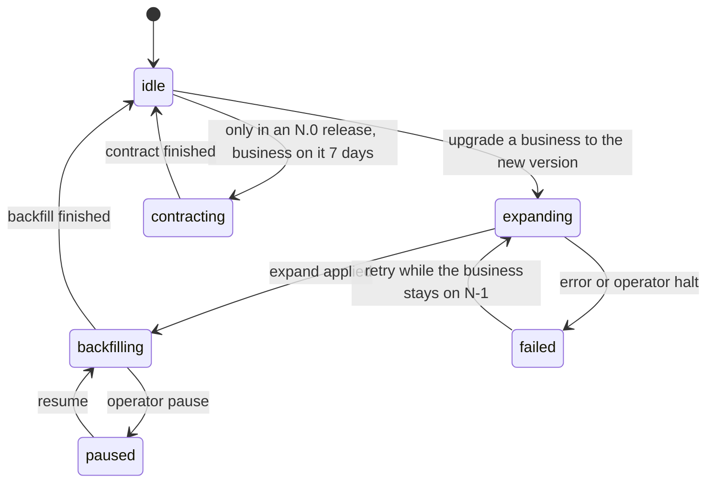

# Engineering practice: quality, CI/CD, release, documentation, community, support, brand and legal pack

- **Status:** Draft 0.1
- **Date:** 2026-10-01
- **Scope:** How obop is tested, built, released, documented, supported, branded and legally packaged by a self-funded project (the owner plus AI agents, OR-6, D84), from M0 (2026-10-01) to the first stable release (1.0, target 2028-04-18) and its security-fix window, including how SpaceCorps operates the free sample-data sandbox at the public beta (9.3; D83, OR-20). Everything here is Apache-2.0 and free (OR-1, OR-2). Early code exists (CLAUDE.md has the code map), but this document is design unless a sentence says Today; nothing here is legal advice.

## 0. How to read this document

This document applies the binding register ([DECISIONS.md](DECISIONS.md)) and the owner rulings OR-1 to OR-21 of 2026-10-01 (RATIFIED; they override every Proposed position here and in the research) to engineering practice, in D24 vocabulary (business, cell, pack, module, plugin, X1-X5, W0-W4; the renames and the X and L prefixes are RATIFIED, OR-14). BINDING and RATIFIED decisions are stated as fact; anything resting on a PROPOSED one is written "Proposed (Dn)". "(target)" is a design target and "(estimate)" a model output, never a measurement: little is built and nothing is benchmarked (D21). Versions are "as of 2026-10-01". Two consequences of the rulings run through every section. **Capacity:** the team is the owner plus AI agents, with no hiring plan (OR-6, D84), so practice that the research sized for a 4-12 person team is written as a capacity note or a priority order, and schedule feasibility is a named risk, not an assumption. **Agentic first (OR-4, D80):** every operation this document names is a typed command of the `obop` CLI, also reachable through the REST API and MCP ([spec/cli.md](spec/cli.md)), except the bootstrap and local commands that spec proposes for the exemption list (OR-16, 1.11); a feature is not done until it exists in CLI, API and MCP, and the web UI is a client that reaches literal parity before 1.0 (OR-16). Companions: [CONVENTIONS.md](CONVENTIONS.md) (naming authority), [ARCHITECTURE.md](ARCHITECTURE.md), [ROADMAP.md](ROADMAP.md), [BUSINESS.md](BUSINESS.md) (licensing, governance, sustainability and risk), [LOCALIZATION.md](LOCALIZATION.md), [spec/cli.md](spec/cli.md), [spec/security-privacy.md](spec/security-privacy.md), [spec/ux.md](spec/ux.md).

Binding decisions relied on most: D7, D8, D15 (its nightly exit-drill exception is RATIFIED, I-4, OR-9), D21, D30, D33, D35, D36, D38. Ratified by the owner on 2026-10-01: D1, D2, D3, D17, D23, D26 (wave windows, German pack date, 1.0 target), D80 to D86 and interpretations I-1 to I-4. The second batch of rulings (OR-14 to OR-21) added: I-1, the D24 renames and the X and L tier prefixes (OR-14); the W1 cut of DECISIONS 5.3 (OR-15); literal UI parity with an owner-approved exemption list (OR-16); the OSI-approved-licence rule for registry listing (OR-17); the owner's sign-off on every commit, with agents recorded by trailer (OR-18); a hosted free sample-data sandbox at the public beta (OR-20); and no NLnet application now (OR-21). Still Proposed: D12, D25, the dates of D26 that OR-13 does not fix, the staging and the publisher-verification and gate details of D81, the W1 slip order of D86, each entry of the exemption list until the owner approves it (D80), the sandbox details (Q34 to Q36), the release cadence and post-1.0 deprecation window of D85 (Q28), and every mechanic this document marks "Proposed". Open with a date: Q32 (whether obop publishes to the npm registry), decided at W2 (OR-19), default no publication. Where this document departs from the research (the register wins):

| Research | Here | Why |
|---|---|---|
| [R27 C1-C8] a 5-year LTS on every fourth release, 9-month regular series, a monthly patch train, hosted-fleet rings | a 2-year security-fix window from the first stable release, no "LTS" label, no patch train, no hosted fleet, at most two live lines (4.2, 4.6) | OR-12, D85 |
| [R27 C4] deprecate for 12 months; D16's 24-month floor | 12 months before 1.0 (R27's figure is back in force) and the same after 1.0 unless the owner rules otherwise; the 24-month floor and its counting rule are withdrawn (4.4) | OR-12, D85, Q28 |
| [R24 s6], [R27 B6] `vp pm sbom`; [R00 s3.3] says `sbom` has no `vp pm` subcommand | [R00 s3.3] is right. Checked against vite-plus v1.0.0 (source and the installed `vp`, 2026-10-01): `vp pm sbom` and `vp pm licenses` do not exist. The JS SBOM runs as `pnpm sbom` through the vp-managed pnpm, invoked as `vp env exec pnpm ...` or in a `vp run` task; that is the ratified exception 2 to "vp only", valid until `vp` supports it (2.3). `pnpm licenses list` is not an exception (Q33) | F2, I-2, OR-9, [R00 s3.3] |
| [R24 s6], [R27 B6] `pnpm publish`, `pnpm stage`, `pnpm audit signatures` | `vp pm publish` and `vp pm stage` exist and forward to pnpm; `vp pm audit signatures` is rejected and is written `vp pm audit -- signatures`: `vp` is the entry point wherever it has a wrapper | I-2 |
| [R27] public repository on free runners | holds: the repository has been public since 2026-10-26 and CI runs on GitHub-hosted runners; the runner plan of 3.2 was written for the private period and is paid by the owner | D26, OR-5, OR-6 |
| [R27 A2, C3] PostgreSQL 16/17/18 nightly matrix; "1.0 must support PG 17-20" | 17, 18 and 19 from RC; 1.0 supports 17 and 18 and adds newer majors as they pass CI | D8 |
| [R27 B1] Odoo-vs-obop weekly | monthly from M9 | D21 |
| [R27 C9, C10] "verified on" badge from 0.4 (2027-05-04) | the public badge programme starts with the compatibility runs (`obop-compat`, W3); registry stage 1 is W2 (4.7) | D25, D81 |
| [R28 D.4] public pre-notification list | held for the owner (Q-E5) | D38 |
| [R28 C.2] licence-grant CLA, "OSI licence forever" pledge, a signature bot | DCO sign-off, no CLA (8) | OR-1, D82 |
| [R28 D.2-D.5] support tiers ("Enterprise", "Cloud standard", "Priority"), SLA and availability credits, status page, cost per ticket | community support only, best effort, no SLA, no support cost model (9) | OR-2, OR-11, D85 |
| [R27 A7], [R28 B.5] team-size ladders (4-12 people, docs staffing by business count) | capacity notes and a priority order for the owner plus agents (1.10, 7.3) | OR-6, D84 |

## 1. Quality strategy

The owner plus AI agents (D84) must sustain this for a 2-year security-fix window per stable series (D85; a longer CRA period applies only if counsel finds that it reaches SpaceCorps, Q5). The research sized the same practice for a 4-12 person team [R27 A7]; 1.10 turns that into a priority order. Because much of the code is agent-written, the controls are mechanical rather than review-dependent: the database enforces what must never happen and tests attack those guards with raw SQL (D30); tests are generated from the registry wherever it generates behaviour (D29), and the three surfaces of a command are checked against each other (1.11); external validators and regulator worked examples decide compliance correctness, with Odoo at most a black-box oracle (F3); nothing is a claim until measured (D21). Fixtures hold no real personal data: design-partner data stays private and is pseudonymised with fakes that still pass IBAN and VAT-id checksums [R27 A5].

### 1.1 The test pyramid

The base is wide and runs on every push; the middle is narrower; the top is thin on PRs (Playwright smoke) and full only nightly [R27 A2].

| Layer and tooling (as of 2026-10-01) | Runs | Budget (target) |
|---|---|---|
| Unit and property: cargo-nextest 0.9.146, insta 1.48.0, proptest 1.11.0 (seeds committed), `rdeps()` for affected crates | every push; properties 256 cases on PR, 20,000+ nightly | PR p50 under 4 min |
| Database: sqlx 0.9.0 plus the template harness (1.2) | PR, 4 shards | under 6 min |
| API contract: utoipa 6.0.0, oasdiff 1.32.1, schemathesis 4.28.0 | diff on PR; fuzz nightly | diff under 1 min |
| Structural suite (1.4) | PR | under 2 min |
| CLI, API and MCP parity (1.11): parity matrix, golden transcripts, contract tests, catalogue diff | PR for every shipped module; transcripts on Linux, macOS and Windows | set in sprint one |
| Localisation: KoSIT validator 1.6.3, CEN artefacts, golden cases (1.7) | PR for touched packs; nightly all | 5 min |
| Fuzz: cargo-fuzz 0.13.2 on UBL/CII XML, MT940/CAMT, MIME, CSV import, Factur-X XML, the domain parser; it builds with a nightly compiler and sanitizers, on Unix x86-64 and aarch64 only [R27 A2] (Q-E11, open and outside the rulings: 2.2) | 60 s PR; 10 min nightly; 1 h weekly | corpus kept |
| UI: Vitest 5 Browser Mode, Playwright 1.63.0, @axe-core/playwright 4.13.0 | PR smoke; nightly full | smoke under 8 min |
| Migration chains (1.5), IDOR matrix (1.6), restore drill (pgBackRest to scratch, checksums, hash-chain verify [R18 s9.2]) | PR, merge queue, nightly; drill monthly | see sections |
| Performance and Odoo-vs-obop (1.9); failure injection (shuttle 0.9.4, loom 0.7.2); AI evals (weekly live run under USD 50, guess; paid by the owner) | nightly; harness monthly | alarm at plus or minus 10% |

### 1.2 Database tests and template databases

A business is one PostgreSQL database of roughly 600-900 tables [R22 s10], so `#[sqlx::test]` (fresh database, migrations per test) is too slow for thousands of tests: about 1.5-4 s per test against about 0.3 s for a template clone (estimate, unmeasured) [R27 A3]. D36 fixes template databases; sprint one benchmarks migrate-per-test, `CREATE DATABASE ... TEMPLATE` with `WAL_LOG`, and `FILE_COPY` with PostgreSQL 18 `file_copy_method=clone` on the real runner. Two modes (names Proposed): `#[obop::test(tx)]`, the default, runs in a rolled-back transaction; `#[obop::test(db)]` runs on a clone of a per-shard migrated template, for commits, jobs, outbox, the bus notifier, advisory locks and RLS role switches. PostgreSQL 18 is the reference; 17, 18 and 19 from RC run nightly (D8), and a lint rejects 18-only SQL outside migrations gated by `requires_pg = 18`.

### 1.3 Invariant and property tests

| Area | Properties |
|---|---|
| Ledger, database guards (D30) | posted moves balance per currency and are immutable; the hash chain verifies; raw SQL that unbalances an entry, edits a posted row or posts before a lock date is rejected; concurrent posting yields gapless numbers; duplicate quants merge through `ON CONFLICT`; done stock moves are immutable |
| Stock, pricing, workflow | on-hand plus reserved never negative; quantity conserved along move chains; valuation equals the inventory account; price resolution deterministic; no unreachable state or illegal transition |
| Tax and money (D9) | tax-included and -excluded round trips agree within one minor unit; per-line and per-group rounding reconcile with EN 16931 arithmetic; Rust totals equal SQL sums; a 10M-line replay compares both modes |
| Authorization (D10) | list, by-id, export and RLS-enabled paths agree for random (principal, record, operation) triples; the restrictive policy is benchmarked on 10M ledger lines |
| Expressions, catalogues (D11, D12, D34, D39) | server and Wasm CEL evaluators agree (one shared evaluator is Proposed, D12) and hold the save-time limits (4 KB, depth 32), step budget and deadline (D11); golden fixtures agree across 10+ locales in Rust and TypeScript; Yjs 13.6 and yrs 0.28 interoperate |

A ledger, tax, pricing or stock crate does not leave alpha without its properties [R27 A2, MUST 5] [R23 DR-5].

### 1.4 Structural suite and CI lints

Tryton's `ModuleTestCase` gives every module 26 generic tests [R27 A1]. obop ships an equivalent inherited by every module and plugin package, so plugin authors run it in their own repository (`obop plugin test`, spec/cli.md 3.10) and the registry gates (D81) and the compatibility badge (4.7) can rely on it [R27 MUST 4]. Proposed checks: views validate against the registry; the computed-field graph is acyclic; every model has permission rows with a declared scope (an implicit TRUE scope is an error, D10); states are reachable and transitions guarded; `obop.toml` and `auto_install` graphs are valid; every model, field, action and error code has a description [R28 B.2]; every personal-data field has a flag and retention class [R18 s12]; every migration is tagged expand, backfill or contract; every command and field has a data class (or explicit non-personal marker), a permission group and a description, and appears in the generated REST, MCP and CLI surfaces, with declared network destinations in `obop.toml` (Proposed, D41); every catalogue command exists on CLI, REST and MCP or is an owner-approved exemption-list entry (D80, OR-16, 1.11).

CI lints fail the build on: NOTIFY outside `obop-bus-notifier` (D7); an `xtask` dependency law, so implementation crates depend only on kernel and `*-api` crates (D27); a database handle not from `BusinessTx` (D33); floats in money crates (D9, mechanism Proposed); `AssertSqlSafe` outside the one SQL-emitting crate [R06 s4]; release builds without `overflow-checks` (D23, D33); physical margins in CSS (D35); `baseUrl` or `.vue` and `.svelte` in core (D15); stale generated OpenAPI or ts-rs files (D15); a runtime dependency outside the Apache-2.0-compatible licence allow-list (D1; commercial and copyleft-only components such as AG Grid Enterprise or HyperFormula, D15, D39); a commit without a DCO sign-off (D82); a route, tool or command absent from the command catalogue (D80, 1.11); a command with no UI binding that is not on the exemption list, enforced as the 1.0 gate (OR-16, 1.11); and any non-pnpm lockfile (F2).

### 1.5 Migration chain tests

- The append-only migration ledger starts with the first schema (0.1, 2026-12-01) and is never squashed inside a line; a squash happens only at the first release of a series (N.0), into a baseline that is a required stop (D36, [R27 C2]).
- Fixtures are built, not hand-made: each release pipeline publishes `fixture-<series>-<profile>.dump.zst` from the released binary and the seed generator, from 50 parties to 10M move lines (sizes Proposed) [R27 A4].
- Chains run N-1, N-2 and the oldest series still inside its security-fix window (D85) to HEAD. PR: N-1 tiny; merge queue: N-1 and N-2 medium; nightly: all plus fan-out. D36 starts N-1 at 0.3 (2027-04-06) and N-2 plus the 1,000-business fan-out at 0.5 (2027-07-06). A pass means the old API suite passes on the migrated schema and the trial balance equals the recorded one ("no known trial-balance bug" is a W1 exit criterion, D26).
- After the expand step, N-1's API suite runs against the N schema; contract runs only in the "every business on N" test; CI lints `lock_timeout`, concurrent indexes and `NOT VALID` plus `VALIDATE CONSTRAINT` [R27 A4].
- Fan-out clones 1,000 business databases from the N-1 template, as four clusters of 250 (a cell holds at most 250, D6, and the cell spike covers 250 databases of about 800 tables; a single 1,000-database cluster would need its own gate on the spike readout), and runs `obop migrate --fleet` at concurrency 32, asserting zero failures, p95 duration and no `ACCESS EXCLUSIVE` lock held over 1 s. This is operator tooling tested for whoever runs many businesses; SpaceCorps operates no fleet (D83), and the test runs nightly only from 0.5 on the runner plan of 3.2 (D36). About 190k relations per 250-business cell make this a fan-out problem [R22 s10]. Data migrations are plain SQL or a sealed SDK with no domain-crate dependency, so any chain runs at any later version.

### 1.6 Registry-generated IDOR matrix

The matrix is generated from the registry: model x operation x permission group x relation (own, same company, other company, other business). Expected outcomes come from permission and restriction metadata, and a denied by-id read returns a non-leaking 404. Size estimate: 300 models x 5 operations x 6 permission groups x 2 businesses is about 18,000 cases, sampled on PR and full nightly [R27 A2]. It must exist before any multi-business deployment (D36); until then every obop installation, including the owner's own books, is one business (ROADMAP K3, by 0.4). Companions: a whole-suite run as business A asserting zero rows of business B, a mass-assignment fuzz, an SSRF corpus and an ASVS 5.0 self-assessment [R18 s4, s12].

- **Scenario.** Given a portal user of business A and an invoice id from business B (UUIDv7 ids are partly guessable and never capabilities [R18 s3.2]), when the user requests it by id, through export and through webhook replay, then every path returns the same 404 body as for a non-existent id.

### 1.7 Golden-case suites and oracles

Oracles are off-the-shelf programs that run only in CI images (the KoSIT validator is Java); obop authors no Java (I-1, RATIFIED, OR-14) [R25 B3, R09].

| Area | Oracle |
|---|---|
| EN 16931, XRechnung, Peppol, Factur-X | CEN artefacts 1.3.16 (next cycle effective 2026-11-16, then 2027-05-17 and 2027-11-15); KoSIT validator 1.6.3 with testsuite 2026-08-31; Peppol BIS Billing 3.0.21; phase4 4.8.0; Mustang 2.26.0 |
| KSeF, VIES | official TEST and DEMO environments (FA(3)); VIES REST API |
| DATEV, ELSTER, AEAT, SDI, PA | no reachable sandbox when checked (unverified, [R25 B3]): regulator worked examples plus recorded accountant sign-off |
| Payroll | regulator worked examples (IRS Pub. 15-T, HMRC test service, DSN conformance) [R13]; reference country decided 2029-04-01 (D19) |

- **Gate ladder (D34).** `draft` (compiles, schema-valid), `preview` (passes oracles on regulator examples), `stable` (golden cases including edge cases, differential tests, local accountant or counsel sign-off recorded in the release, signed release), `certified` (external certificate where one exists). A pack without golden cases cannot reach `stable` (D19).
- **Sign-off dependency.** The accountant or counsel sign-off is an external expert the project cannot buy on a schedule (a named risk, D84). If it is missing on 2027-09-30 the DE pack stays beta: correctness is not traded for the date (DECISIONS 5.2, D86).
- **Refresh.** A bot opens a PR on every oracle or code-list release and reruns the oracles; KoSIT goldens are refreshed by 2026-11-09, a week before the CEN cycle [R27 C10]. Rust e-invoicing crates are weeks to months old and serve as accelerators, not foundations [R09]. Differential tests run Odoo as a black box only (F3, D22).
- **Scenario.** Given a DE pack with golden cases for standard, reverse-charge, credit-note and mixed-rate invoices, when CI generates XRechnung and ZUGFeRD files, then KoSIT 1.6.3 and Mustang 2.26.0 accept them, totals equal the expected minor-unit values, and the pack version and inputs are stored on each computed line (D38).

### 1.8 Accessibility and UI gates

WCAG 2.2 AA is a release gate (D35); design detail is in [spec/ux.md](spec/ux.md). Automated: Oxlint `jsx-a11y`, axe in Playwright, React Aria primitives. Manual: NVDA and VoiceOver passes on five core flows (login, list, form, grid entry, reconciliation) before every release, since automation covers only part of the criteria [R19]. Structural: every drag has a single-pointer non-drag path (SC 2.5.7); single-key shortcuts can be disabled or remapped (SC 2.1.4); logical CSS only; RTL and CJK fixtures; a 100k-row list budget (D34, D35). Visual regression waits for capacity (the research deferred it to a team of about 12 [R27 A2]) and, once run, uses baselines from one pinned container only. The UI is a client of the typed commands and holds no business logic (D80), so these gates test presentation, accessibility and command bindings, not business rules. UI tier F3 packages ship a WCAG 2.2 AA statement [R24 s4]; storefront, checkout, portal and POS ship WCAG 2.2 AA and the consumer withdrawal function, covered by an end-to-end test (D38).

### 1.9 Odoo-vs-obop scenario harness

One Rust driver runs the same scripted day against Odoo 20 (through JSON-2; Odoo 19 as a second baseline) and obop: order to delivery to invoice to payment to reconciliation, 10 POS terminals, a 10k-row list, an aged-receivable report and 100 concurrent users, reporting p50, p95 and p99, throughput, RSS and PostgreSQL CPU on fixed hardware (Hetzner CCX33, EUR 138.49 a month, list, excl. VAT and IPv4, Germany/Finland) [R27 A7]. It runs monthly from M9 (2027-07) on a rented box the owner pays for (OR-6) and publishes driver and results (D21). Until then the only citable Odoo figure is its documented formula (workers = 2 x CPU + 1, about 6 concurrent users per worker) [R22 s3.1], and the capacity figures in [R22 s10] stay design targets.

### 1.10 Flakes, mutation, coverage and capacity

- **Flakes.** nextest `--retries 1` marks a pass-on-retry FLAKY; nightly runs set `flaky-result = "fail"`. Two flakes in 7 days quarantine a test and open an issue for its CODEOWNERS owner with a 14-day fix-or-delete clock; at most 20 quarantined tests (Proposed, [R27 A6]).
- **Mutation and coverage.** cargo-mutants 27.1.0 on about 15 core crates (ledger, tax, pricing, stock, permissions, migration runner): `--in-diff` nightly, full weekly in 16 shards, score at least 80% (target); about USD 22 per full run on a GitHub 8-core runner (estimate), paid by the owner. No global coverage percentage; diff coverage at least 80% on core crates (target).
- **Capacity (a priority order, not a headcount).** R27 sized the quality work by team: 4-5 people keep the ledger and tax properties, the template harness, the structural suite, the N-1 chain, Playwright smoke plus axe and the nightly PostgreSQL matrix; 8 add the nightly IDOR matrix, N-2 and fan-out, KoSIT goldens and weekly mutants; 12 add visual regression, failure injection and live AI evals; one quality-platform engineer at 0.5-1 FTE owns CI, the flake ledger and fixtures (D36, [R27 A7]). There is no team to size (OR-6, D84); quality-platform work is a standing duty of the owner and the agents, and the ladder is read as a priority order (Proposed). First the base group plus the parity test (1.11). Then the second group, which cannot wait: the IDOR matrix gates any multi-business deployment (D36), and the N-2 chain, KoSIT goldens and oracle reruns are W1 exit criteria (DECISIONS 5.2), so only the weekly mutants are deferrable inside it. Last the third group. If the throughput review at the W0 exit (2026-12-31, D84) shows the base group alone running late, the slip order of DECISIONS 5.3 applies to features, never to the D30 and D33 controls (D86).

### 1.11 CLI, API and MCP parity gate (OR-4, D80)

A feature is not done until its command exists in CLI, API and MCP with the same input and output schemas, the D10 permission check, a dry-run with a digest-bound `plan_id` and an idempotency key for mutating commands, an audit entry, generated reference documentation and a passing parity test (D80, D36). The UI is a client of the same commands and holds no business logic; it is outside the per-feature definition of done but reaches parity before the first stable release, so 1.0 does not ship until the UI parity test is green for every command that is not on the exemption list (D35, D80). UI parity is literal (OR-16): every command of every shipped module gets a UI before the first stable release, except operator-only commands that the owner approves as CLI-only with a written reason. CI implements the gate as follows (spec/cli.md section 6).

- **Parity matrix.** `obop dev parity` and a CI artefact (`parity.json`, rendered as a page) list every wire id against CLI, REST, MCP and UI. CLI and REST entries come from the generated command tree and OpenAPI operations, MCP from `tools/list` for a test principal holding every permission, UI from `ui-bindings.json`, which the web build emits through a `vp run` task (Proposed). Every shipped module must be 100% CLI, REST and MCP unless a command is an owner-approved exemption-list entry (OR-16); a route, tool or command absent from the catalogue fails the build.
- **Exemption list (mechanism RATIFIED, OR-16; entries Proposed until approved).** The parity test fails on any command without a UI binding that is not on the list. The list lives in the repository, in a file that CODEOWNERS assigns to the owner (path Proposed), so no entry is added without the owner's review; each entry records the command, a written reason and the surfaces it lacks (at least the UI; for a bootstrap or local command also REST and MCP, D80). OR-16's examples of operator-only commands are backup, doctor, upgrade and pack verify; the entries proposed in spec/cli.md 1.1 are proposals until the owner approves them one by one. The browser-only act class is not adopted: a step only a person can perform stays inside a catalogue command that exists on all three surfaces (D80).
- **Golden transcripts and help snapshots.** Each golden path of spec/cli.md section 8 is a recorded transcript (command, standard input, exit code, standard output, standard error) replayed against a seeded business with a fixed clock and a seeded UUIDv7 generator, on Linux, macOS and Windows. `obop help --format json` and the man pages are snapshotted on every change, so a snapshot diff is a catalogue diff.
- **Contract tests.** A catalogue diff tool flags breaking changes (a removed or renamed wire id, a newly required input, a narrowed enum, a changed exit or error code) beside `oasdiff` for OpenAPI (1.1); for each wire id, generated minimal input through CLI, REST and MCP must return identical `data`; the D10 permission property test also runs through the CLI; replay, `plan_stale`, single-use plans and `approval_required` are tested for an agent and for a human; every `--json` output validates against the output schema of the catalogue.
- **When.** The parity test starts with the first commands in W0 (D36), is green for every shipped module as a W1 exit criterion (DECISIONS 5.2), and the UI column, with the initial exemption list (Proposed before the UI parity work starts in W2, 2027-10-01, D80), is a 1.0 gate.

Typed commands this document relies on (spec/cli.md section 3; each is also a REST operation and an MCP tool unless that spec lists it as a bootstrap or local command):

| Practice | Section | Commands |
|---|---|---|
| Upgrade, migration, backup | 1.5, 4.5 | `obop upgrade --dry-run`, `--plan`, `--rehearse`, `--phase`; `obop migrate --fleet`; `obop backup create`, `verify`, `restore` |
| Status, diagnostics, telemetry | 4.7, 9.2 | `obop status`, `obop doctor`, `obop diag`, `obop telemetry preview`, `enable`, `disable`, `status` |
| Plugin quality and lifecycle | 1.4, 4.7, 5.2 | `obop plugin lint`, `test`, `package`, `verify`, `audit`, `publish`; `obop plugin migrate` (Proposed, 4.4) |
| Export and portability | 11.3 | `obop business export`, `verify`, `import`; `obop data export` |
| Parity and catalogue | 1.11 | `obop dev parity`, `obop schema --all`, `obop catalogue list` |
| Client updates | 5.2 | `obop self update`, `obop self verify` |

## 2. Repository and toolchain policy

### 2.1 Layout

One repository holds a Cargo workspace and a pnpm workspace (after [R07 s3.13]; names Proposed; the full tree is in [ARCHITECTURE.md](ARCHITECTURE.md) section 15, which governs):

```text
LICENSE  NOTICE  SECURITY.md  CONTRIBUTING.md  AGENTS.md   # Apache-2.0 text and attribution (OR-1); policies; agent instructions (Proposed, spec/cli.md 5.4)
Cargo.toml  rust-toolchain.toml  deny.toml   # workspace, exact toolchain, supply-chain policy
crates/      # kernel, module (*-api plus implementation), platform crates including the CLI and the plugin-registry client (names: ARCHITECTURE section 15); xtask/ (dependency law, migration-tag lint, generated-file checks)
pnpm-workspace.yaml  pnpm-lock.yaml  .node-version   # the only JS lockfile is pnpm-lock.yaml
web/         # vite.config.ts; config/ (the only vite-plus importers: config factory and test re-export); apps/docs is the VitePress site
docs/  examples/  rfcs/   # specs and research; compiled examples; RFCs
```

### 2.2 Rust: Cargo workspace and pinned toolchain

- **Exact pin.** `rust-toolchain.toml` carries `channel = "x.y.z"` on every branch, with rustfmt and clippy; builds use `--locked`; release builds set `overflow-checks = true` (D23, D33) and unwind rather than abort, so one request's panic cannot kill a multi-business worker (Proposed; [R18 s5]). Edition 2024, resolver 3, versions only in `[workspace.dependencies]`, one `[workspace.lints]`, `build.warnings` instead of `-Dwarnings` [R06 s1.2].
- **Fuzz toolchain (Proposed exception, open: Q-E11; Q10 (OR-8, OR-9, OR-14) was closed without it).** cargo-fuzz drives libFuzzer with sanitizers and builds only with a nightly compiler [R27 A2]. F1 says "exclusively the latest stable Rust" and the exact pin above is a stable channel on every branch; neither I-1 to I-4 nor OR-9 (which names exactly two exceptions to "vp only", both about JavaScript tooling) records a nightly Rust exception, so this one is not decided and stays open outside the rulings. Proposal: fuzz targets live in a separate, non-shipping `fuzz/` workspace outside the main Cargo workspace (path Proposed), with its own `rust-toolchain.toml` pinning an exact dated nightly, used only by the fuzz jobs (3.1). The shipped build, the release pipeline, developer commands and every other job stay on the stable pin; the nightly compiles only the fuzz binaries, which are never shipped. Committed crash inputs and corpus entries are replayed as ordinary tests on the stable toolchain in the required suite. The alternative is to drop cargo-fuzz for stable-only tests (the seeded properties of 1.3), at the cost of coverage-guided depth. Until the owner rules, the fuzz jobs are a documented departure from F1, not a settled exception.
- **Eligibility and the current pin (RATIFIED, D23, OR-8, I-3).** What "latest" means (the cooldown, the x.y.1 shortcut, the adoption window, the skip list and today's pin with its dated facts) is kept only in [DECISIONS.md section 1.1](DECISIONS.md#11-pin-policy-what-latest-means-d23); this section does not restate it, so the two cannot drift. The engineering mechanics are: a weekly Renovate toolchain group holds the bump until the release is eligible under that rule, and merges it only once debug and release-mode CI pass; never pin a version the dist channel does not serve; a compiler or std advisory overrides the wait on every branch; release branches inside their security-fix window (D85) keep a per-branch toolchain in a digest-pinned builder image, changed only for such an advisory. Re-check through the weekly Renovate group, a nightly beta canary and the six-week release Thursday.
- **Crate graph.** A strict DAG with `*-api` crates holding types, traits and events only (D27); `unsafe_code` forbidden except in allow-listed crates (Proposed, after Hyperswitch [R06 s3.16]).

### 2.3 Vite+ and pnpm, driven by `vp`

**Pin policy (RATIFIED, D23, OR-8).** The rule for what "latest" means, and the dated facts under it (today's `vite-plus` and its bundled Vite, Rolldown, Vitest, Oxlint and Oxfmt versions, the Node line, the pnpm registry state and eligibility dates), are kept only in [DECISIONS.md section 1.1](DECISIONS.md#11-pin-policy-what-latest-means-d23); this section states the mechanics that enforce them and does not restate them. `vite-plus` is a project-local dependency at an exact version. pnpm is pinned to one exact version, never a range or dist-tag, with `vp env pin pnpm@<x.y.z> --target package-manager`, which writes the top-level `packageManager` field (without `--target`, Vite+ 1.0 writes `devEngines.packageManager` instead); Node in `.node-version`; only `pnpm-lock.yaml` is committed. CI runs `vp install --frozen-lockfile` with `voidzero-dev/setup-vp` at an exact release or SHA (never `v1`), or a digest-pinned image. A `vite-plus` bump merges only when it is eligible under the register's rule and passes the exit drill, a LICENSE/NOTICE diff, exactly one Vite and one Vitest copy (`vp why`), and the test suite. One Renovate group moves `vite-plus`, the `vite` alias to `@voidzero-dev/vite-plus-core` and the `vitest` pin in lockstep; the bundle is not overridden piecemeal, except by a logged, temporary override for an advisory as the register allows.

- **Node and pnpm versions.** `.node-version` and the `packageManager` field carry exact versions (the pnpm one under the same age rule as `vite-plus`). Which pnpm major to pin is the owner's call (Q-E6, folded into Q15); a new major is adopted only after the six workspace keys below are verified on it (the register records what has been verified so far).
- **Guardrails (Proposed unless cited).** `vp` is the entry point for every JS and TypeScript command; `vp install`, `add`, `remove` and `pm` reach pnpm; direct `pnpm` only where `vp` has no wrapper. Checked against vite-plus v1.0.0 (source and the installed `vp`, 2026-10-01): `vp pm` is a typed command set, not raw forwarding. `vp pm audit`, `approve-builds`, `publish` (including `--provenance`) and `stage` forward to pnpm; `vp pm sbom` and `vp pm licenses` do not exist; `vp pm audit signatures` is rejected and must be written `vp pm audit -- signatures` (accepted and passed to pnpm; the exact pnpm argv is inferred from the source, not observed). The JavaScript SBOM therefore runs as `pnpm sbom --sbom-format cyclonedx --sbom-spec-version 1.5` through the vp-managed pnpm, invoked as `vp env exec pnpm sbom ...` or inside a `vp run` task, and the owner ruled that this is the second of exactly two exceptions to "vp only" (OR-9, below). OR-9 names `pnpm sbom` only, so `pnpm licenses list` is not an exception (Q33): the JavaScript licence check against the allow-list of D1 reads the licence fields of the CycloneDX output of `pnpm sbom`, or goes through `vp` if a wrapper appears (Proposed reading). A W0 smoke test (Proposed) runs `vp pm approve-builds`, `vp pm audit -- signatures` and `vp env exec pnpm sbom` on Windows, where `vp env exec --package-manager <pin> pnpm ...` failed with "program not found" on 2026-10-01 while the same command without `--package-manager` worked; `vp pm publish --dry-run` and `vp pm stage` join it only if the owner rules at W2 that obop publishes to the npm registry (Q32, OR-19). `vp dlx` never runs in CI (I-2). CI fails on a non-pnpm lockfile or a missing `packageManager`, and a linter rejects invocations of the banned package managers in workflows and docs (F2). All `vite-plus` imports pass through the config factory and the test re-export module (D15). Use `--no-cache` for code generation and release tasks and explicit `cache.input` globs for cargo-driven tasks (fspy around `cargo` is unverified). A named owner (the owner or an assigned agent) triages Vite+ issues such as #2635 and #2636 (task-cache correctness) (D15, [R07 s2]).

**Exceptions to "vp only" in this pipeline (RATIFIED, OR-9, I-2, I-4; exactly two, no others).** (1) The nightly exit drill (2.4), which runs the upstream tools under test without the bundled toolchain in a throwaway copy that never ships. (2) `pnpm sbom`, run through `vp env exec` or a `vp run` task, until `vp` supports it: the exception lapses when `vp` gains an SBOM wrapper, so each `vite-plus` upgrade checks whether `vp pm` has grown one and the direct call is dropped the same day. `pnpm licenses list` is not an exception (Q33). Q-E2, the question of recording these exceptions, is closed by OR-9.

```sh
vp install --frozen-lockfile     # the only install in CI
vp run gen                       # cargo -> openapi.json -> TypeScript types; diff-gated
vp check                         # format, lint and type-check in one pass
vp test                          # Vitest 5: unit tests and Browser Mode
vp build                         # production bundle, embedded into the Rust binary
vp run e2e                       # Playwright suite as a task
vp pm audit                      # registry advisories through pnpm
vp env exec pnpm sbom --sbom-format cyclonedx --sbom-spec-version 1.5   # ratified exception 2 (OR-9): no `vp pm sbom` in vite-plus 1.0.0; lapses when `vp` has one
```

```yaml
# pnpm-workspace.yaml: D23 values; which pnpm majors have been checked against these keys is recorded in DECISIONS.md 1.1 [R07 s3.13, R27 B8]
minimumReleaseAge: 10080        # minutes = 7 days
minimumReleaseAgeStrict: true
trustPolicy: no-downgrade
blockExoticSubdeps: true
strictDepBuilds: true
allowBuilds: {}                 # reviewed entries only
```

### 2.4 Exit drill

A nightly job (about USD 0.12 a night, estimate) copies the tree, rewrites `vite-plus` imports to upstream `vite`, `vitest` and `@vitest/*`, installs the upstream pins that match the bundle of record ([DECISIONS.md section 1.1](DECISIONS.md#11-pin-policy-what-latest-means-d23)) with `vp install`, and runs lint, format check, tests and build with `vp exec` (or `vp run` for scripts) on the upstream binaries `vite`, `vitest`, `oxlint` and `oxfmt`; the owner reviews it each quarter. It proves code portability, not Vite Task configuration [R27 B9]. The drill is the first of exactly two RATIFIED exceptions to "vp only" (I-4, OR-9; the second is `pnpm sbom`, 2.3): the upstream tools under test run without the bundled Vite+ toolchain, in a throwaway copy that never ships and is never an obop build path (shipped builds, CI gates and developer commands always use `vp`). Because the exception is recorded, D15 and D23 bind the drill and its tools (plain Vite 8, Vitest 5, Oxlint, Oxfmt). I-4 words the run as pnpm scripts; the entry point above (`vp install`, then `vp exec` or `vp run`) is this document's narrower proposal, an implementation detail inside the exception, so it creates no third exception. Unverified: that the global `vp` operates on a tree without a local `vite-plus`; if it does not, the fallback is plain pnpm scripts, which is how I-4 words the exception (Q-E2 (a) and (c), closed as implementation detail). **Tripwires that reopen the Vite+ risk** (not the constraint): a licence or NOTICE change; remote cache or core `vp` features behind a paid service; a 1.x minor that breaks a CLI flag or config key; plan issue #2405 slipping a quarter (D23).

### 2.5 Dependency updates

Renovate (44.127.1) cooldowns (RATIFIED, D23): crates 7 days, JS packages 7 days on top of pnpm's `minimumReleaseAge`, GitHub Actions pinned by SHA 3 days; security updates skip the cooldown and are reviewed by hand [R27 B8]. One group each for the toolchain, `vite-plus`, and wasmtime, which is pinned to an LTS major (v48 now, next v60 about 2027-08-20) and patched within 7 days, 24 hours for High advisories (D11). X3 moved to W3 (D86), so the Wasm host should start on the wasmtime LTS then current (v60) instead of v48, whose support ends about 2028-08; v48 covers only the internal connector spike, and an ADR amends D11 when X3 starts. No automerge for request-path crates; pre-1.0 vendor crates are pinned exactly; cargo-deny blocks PRs.

## 3. CI/CD topology and cost

### 3.1 Pipeline

| Stage | Content | Target (p50 unless stated) |
|---|---|---|
| 0 Fast gate | fmt; clippy on affected crates and reverse dependencies; cargo-deny; `vp check`; OpenAPI drift; migration and structural lints; DCO sign-off check; catalogue and parity-matrix drift | 10 min maximum, free 4-vCPU runners |
| 1 Required | rust-test x4 (nextest archive, PostgreSQL service, template database); web (`vp install --frozen-lockfile`, `vp test`); contract (OpenAPI diff, catalogue diff, CLI/API/MCP parity, registry and view validation); migrate smoke N-1; e2e smoke (Playwright plus axe). A `ci:full` label adds fuzz on changed targets and mutants in diff | 20 min |
| 2 Merge queue | stage 1 on the merged result; release-mode smoke; N-1 and N-2 medium migrations; IDOR sampled; l10n goldens | 30 min maximum |
| 3 Nightly | PostgreSQL 17, 18, 19 from RC; release mode; full Playwright, visual and axe; fuzz 10 min a target; full IDOR; fan-out over 1,000 businesses; oracle reruns; bare-metal performance; mutants in diff; exit drill; cargo-audit and cargo-vet; rustc beta canary | n/a |
| 4 Weekly | core mutants in 16 shards; 1 h fuzz; ecosystem compatibility on the registry's plugins (the top 100 once that many exist) | n/a |
| 5 Monthly | restore drill; fleet upgrade rehearsal; Odoo-vs-obop from M9 | n/a |
| Release | x86_64 and aarch64 static musl builds, plus CLI archives for macOS and Windows with completions and man pages (spec/cli.md 7); two builds compared by hash; SBOM; cosign and attestation; upgrade matrix from every supported source; publish to GitHub Releases (and crates.io, 5.2); `compat.json`; advisory feed | n/a |

`main` builds a nightly edge release, which the owner's own installation (the dogfood books, ROADMAP) runs first; SpaceCorps hosts no fleet to roll it to today (the hosting service of OR-22 is planned, not offered), and the sandbox (D83) and any hosted customer instance run a signed release, not `main` (9.3). **Today (D59):** `.github/workflows/ci.yml` runs `fmt`, `clippy`, `cargo test` (with a PostgreSQL service, including the multi-process tests and the restore drill `deploy/restore-drill.sh`), the install gate, the web checks and the Playwright suite; `.github/workflows/image.yml` builds the root Dockerfile for linux/amd64 on pushes to `main` and `deploy` and publishes `ghcr.io/spacecorps/obop:<sha>` with BuildKit cache and provenance and SBOM attestations. The release rows above (musl builds, reproducibility, cosign) are not built. Each stage ends in one aggregator job, so branch protection names a single check [R27 B1]. The table is the full-scale target: parts wait for capacity (visual regression, mutants, failure injection; 1.8 and 1.10), the ecosystem run needs the plugin registry (stage 1 is W2) and `obop-compat` (W3) (4.7), and "free 4-vCPU runners" holds only for a public repository (the repository is public since 2026-10-26 and CI uses GitHub-hosted runners; 3.2).

### 3.2 Runners and cost

The owner pays for CI (OR-6, D84), so cost counts and the plan is Proposed (Q17, which absorbs Q-E1). Today (2026-10-27) the repository is public and `ci.yml` and `image.yml` run on `ubuntu-latest`, standard GitHub-hosted runners, so option B below is in use and options A, C and D are alternatives that apply only if builds outgrow it. Facts [R27 B2]: standard GitHub-hosted runners are free for public repositories and larger runners always bill; the binding limits are the 10 GB cache per repository, the 14 GB disk and 20 (Free), 40 (Pro) or 60 (Team) concurrent jobs. Private included minutes (2,000 Free; 3,000 Pro and Team) cannot be spent on larger runners. The research model assumes 8 engineers, 220 merged PRs a month at 3 runs each, 240 merge-queue runs and warm caches (about 658k vCPU-minutes), scaling roughly linearly with PR volume. With the owner plus agents the real volume is unknown (agents can open many small PRs), so the first W0 measurement is the runner-minutes actually used, before any option is bought (estimates, unmeasured):

| Option | Monthly (estimate) |
|---|---|
| A. All GitHub larger runners, private repository | about USD 1,850, zero operations work; the most expensive option for a self-funded project |
| B. Public repository, free standard runners | about USD 0-100; wall-clock about 1.6-1.8x; disk pressure |
| C. RunsOn on own AWS spot | about USD 260-350; spot interruptions |
| D. Hetzner 2 x CCX43 (each 16 dedicated AMD vCPU, 64 GB, 360 GB NVMe: Hetzner general-purpose page, checked 2026-10-01 [R22 s10]) | EUR 552 flat for two (EUR 275.99 each; list, excl. VAT and excl. IPv4, Germany/Finland, in force since 2026-06-15; was EUR 124.99 each); you run autoscaling and patching |

- **Public repository (since 2026-10-26).** Use B while PR wall-clock stays under 20 min, then a hybrid: lint, web and contract stay free; Rust build and test move to C or D; performance on a dedicated CCX33. Target USD 300-800 a month (D36; paid by the owner). Self-hosted runners never run fork PRs; `merge_group` and maintainer-labelled PRs use ephemeral runners without secrets.
- **For the private period (superseded in fact: the repository went public on 2026-10-26; kept as the fallback if it were made private again).** The free-runner assumption fails while the repository is private (D26): larger runners bill, and a merge queue needs Enterprise Cloud on private repositories [R27 B5]. Proposal then: one Hetzner CCX43 (EUR 275.99 a month, list, excl. VAT and excl. IPv4, Germany/Finland) for Rust build and test, GitHub standard runners within the included minutes for Stage 0, and "require branches up to date" instead of a queue; six months of the box is about EUR 1,656 (computed). Add `merge_group` triggers so a merge queue is configuration only (Q-E1 = Q17). A required DCO check runs on every PR from the first commit (D26, D82).
- Never cache `target/` from a job that holds secrets: Miri stores environment variables there [R06 s1.5].
- **Sandbox host (Proposed, Q35).** The free sandbox (D83, OR-20; 9.3) does not run on these runners. It has its own small server, separate from the CI runners and their secrets and from the signing keys, and its cost is reported against its own ceiling (Q35), not against the CI budget above.

### 3.3 Caching and build-time budgets

- **sccache** 0.18.0 on an S3-compatible backend from day one, to escape the 10 GB cache cap; Swatinem/rust-cache for `~/.cargo`; nextest builds one archive and shards it. The Vite+ task cache is local only (no remote cache documented) [R27 B3].
- **Budgets (targets).** Cold `cargo check --workspace` on 8 vCPU at most 6 min; cold dev build at most 15 min; warm PR build (sccache hit rate at least 85%) at most 5 min, failing at 8; release LTO binary at most 40 min on 16 vCPU; CPU-time regression warns at +10% and fails at +25%; any crate over 60 s self-time triggers a split review. `cargo build --timings` writes HTML only, so gate on wall-clock on a fixed runner [R27 B4]. The merge queue starts at group size 1-3 and concurrency 2 and carries the heavy tier [R27 B5].

## 4. Release model

The promise is RATIFIED (OR-12, D85): before 1.0, an N-1 upgrade path and a 12-month deprecation window; from the first stable release (1.0, target 2028-04-18), a 2-year security-fix window, to be extended toward 5 years only as users and funding appear. Nothing beyond it is promised: no SLA, no response times, no "LTS" label, no monthly patch train, no hosted fleet, no paid support. The mechanics below (cadence, numbering, where destructive changes may land, badges) are Proposed (D85; the cadence is Q28), and once the repository is public they are one-way commitments to users. The database-enforced rules (D30, D36) are binding. A series is a release line `N.M`; "LTS" is retired as a term.

### 4.1 Calendar and engineering gates

Pre-1.0 releases fall on first Tuesdays (D26). Dates are D26's unless marked; the wave windows, the German pack date and the 1.0 target are RATIFIED (OR-13), the other dates are Proposed placements.

| Date | Release or gate | Engineering content |
|---|---|---|
| 2026-11-27 | spikes read out | NOTIFY contention, 250-database cell, UUID size; D6, D7, D9 frozen |
| 2026-12-01 | 0.1 preview | migration ledger starts; no stability promise; the DCO check and CI baseline; security policy and vulnerability-handling runbook v0; command catalogue skeleton and CLI grammar (Q22) |
| 2027-04-06 | 0.3 public alpha | N-1 guarantee, N-1 chain test, `obop upgrade --dry-run`; the G0 checklist (8) is closed by now at the latest (the repository itself has been public since 2026-10-26) |
| 2027-07-06 | 0.5 public beta | a public pre-release with no commercial offer (OR-2, D26); N-2 chain, 1,000-business fan-out; `obop business export` and `import`; Odoo-vs-obop monthly from M9; the free hosted sandbox opens with it only if its go/no-go of 2027-06-01 passes (D83, OR-20, 9.3; Proposed, Q35) |
| 2027-09-30 | DE pack stable (RATIFIED) | oracles, golden cases, accountant sign-off; if any is missing the pack stays beta (D86) |
| 2027-11-02 | 0.7 | CRA technical file 2027-11-30 and internal sign-off by 2027-12-10, only if counsel finds SpaceCorps a manufacturer (Q5); CRA main obligations 2027-12-11, whether they reach a free project being Q5 |
| 2028-03-07 | cut `release/1.0` | RC1 2028-03-21, RC2 2028-04-04 |
| **2028-04-18** | **1.0, the first stable release (RATIFIED target)** | 2-year security-fix window to 2030-04-18 (computed); CLI, API, MCP and UI parity test green for every command not on the exemption list (OR-4, OR-16, D80); 1.0.1 on 2028-05-02 |
| after 1.0 | later series | cadence Proposed (Q28), below |

**Later series (Proposed, Q28).** The register recommends one stable series a year on the third Tuesday of April, each with 2 years of security fixes from its release date (2029-04-17 and 2030-04-16, computed), so at most two lines are live. The earlier draft had two series a year (1.1 on 2028-10-17, 1.2 on 2029-04-17, 1.3 on 2029-10-16 and 2.0 on 2030-04-16); with a 2-year window that means four live lines, which one human plus agents cannot keep. Neither cadence is promised; D26 fixes dates only up to 1.0.

Every series: cut `release/N.M` 6 weeks before release, RC1 at 4 weeks, RC2 at 2 weeks. By that rule a series released on 2029-04-17 is cut on 2029-03-06 and one released on 2030-04-16 on 2030-03-05 (computed) [R27 C3].

<a id="42-series-support-and-the-patch-train"></a>

### 4.2 Series and the security-fix window

| Track | Lifetime | Content |
|---|---|---|
| edge (`main`) | none | nightly builds |
| Series `N.M` (releases `N.M.x`) | 2 years of security fixes from its release date: RATIFIED for 1.0 (OR-12); the same window for later series is Proposed (D85, Q28) | security fixes; Proposed scope of a backport: CVSS 7 and above and data-integrity fixes, lower severities land on `main` and the newest series |

For 1.0: security fixes until 2030-04-18 (computed), to be extended toward 5 years (about 2033-04) only as users and funding appear, which is the owner's decision when it happens (OR-12). Country-pack content ships on the signed pack channel (D34) independently of the series; whether a pack fix is also backported is not promised. Whether the CRA's five-year minimum support period (Art. 13(8)) reaches a free, non-hosted project (with the sample-data sandbox in view, D83) with SpaceCorps as publisher is a counsel question (Q5, D85); if it does, the window lengthens by law, not by this document, and the 10-year retention of security updates and technical documentation (Art. 13(9), 13(13); D36) comes with it [R27 C3].

- **Fix flow (replaces the patch train).** Fixes land on `main` and are backported inside each series' window (D85). There is no monthly patch train: a patch release ships when a fix is ready, and a fix lands on every supported series in one release wave. Agents prepare the backport pull requests (the ERPNext `backport.yml` pattern [R27 C3, B7]) and the owner reviews them. The research's fix targets (exploited or critical 7 days, high 30 days, medium at the next release) are internal targets, not a service level (6.3, D85).
- **Live lines.** At most two (Proposed, Q28). **Tripwire (Proposed; the 20% figure is the research's, from D16 as drafted):** if backport work exceeds about a fifth of total effort for two quarters, release a series less often or narrow what is backported.

### 4.3 Destructive changes only at N.0



Every migration is tagged expand, backfill or contract; CI rejects a contract in the release of its expand (D36). Contract migrations and API removals ship only in the first release of a series (`N.0`; Proposed, D85); every other release of the series is expand-only. A batched background migration started in one series is finalised at the next required stop before its old path is deleted [R27 C5]. Every DDL runs under `lock_timeout`, with concurrent index builds and `NOT VALID` then `VALIDATE CONSTRAINT` [R18 s9.3].

<a id="44-deprecation-floor"></a>

### 4.4 Deprecation window

Public contracts (REST and MCP under `Obop-Version`, the CLI command catalogue with its exit and error codes (D80), WIT worlds, `obop.toml` and pack schema, UI SDK tiers F2 and F3) are deprecated for at least 12 months before removal: RATIFIED before 1.0 (OR-12, D85), and after 1.0 the same 12 months unless the owner rules otherwise (Proposed, Q28). The 24-month floor, its 12-month exception for UI tier F1 and its release-month counting rule are withdrawn (D16 is superseded). Removal lands only in the first release of a series (`N.0`) at or after the end of the window (Proposed, D85). Use emits `Deprecation` and `Sunset` headers (RFC numbers not verified in the research), a `warnings[]` entry in CLI and API output with `code`, `since`, `remove_in` and successor (spec/cli.md 6), an audit-log entry and a `deprecations.json` entry; `--strict` turns a deprecation warning into a failure for CI.

- **Codemods for plugin authors (Proposed).** Odoo ships source codemods for custom modules on breaking releases, and the research recommends the same, "machine checks plus codemods" [R24 s5.3]. Each `N.0` that removes a deprecated contract ships codemods for plugin authors as an `obop plugin migrate` subcommand (name Proposed; spec/cli.md renames the former `obop ext` family to `obop plugin` (N8) and lists no migrate command yet, so it is added to the catalogue there): X1 packs and X2 rules first, then X3 and X4 package schemas, SDK calls and UI tier F2 and F3 SDK usage as those tiers ship (W3). Each `deprecations.json` entry names its codemod or states that none is possible, and the codemods are versioned with the deprecation list and run in the `obop-compat` job (4.7).
- **Example.** Deprecated in 1.0.1 (2028-05-02): the 12 months end 2029-05-02. On the yearly cadence of Q28 the next first release of a series is 2029-04-17, which is too early, so removal waits for 2030-04-16, about 23 months after the deprecation (computed). The effective window is 12 to 24 months.
- **Edge case, Proposed clarification (residue of Q-E3, folded into Q28).** Deprecated at 1.0 (2028-04-18), the next first release of a series is 2029-04-17: 364 days, one day short of 12 calendar months. Proposal: count release months (April 2028 to April 2029 is 12), so that release qualifies.

### 4.5 Upgrade paths and the self-hoster experience

The promise is N-1 (RATIFIED, OR-12, D85): before 1.0, any 0.N upgrades to 0.N+1, with `obop upgrade --dry-run` and a chain test from 0.3. Beyond it the supported paths are Proposed: any release of a series to a later release of it; a series to the next one; two series ahead with the intermediate first release as the recommended stop; longer jumps stop at the first release of each intermediate series, which are the required baselines (D36). The chain from the oldest series still inside its window to HEAD proves it nightly, and the target is zero manual steps [R27 C5].

`obop upgrade` is a typed, plan-first command (D80; spec/cli.md 3.1 and 2.7) (Proposed, [R27 C6]). It is a bootstrap command that must run without the server it replaces, so spec/cli.md 1.1 proposes it as a CLI-only exemption-list entry (OR-16; it is on the list only once the owner approves it). `--dry-run` prints the path, migrations by kind with duration and lock estimates, disk headroom, compatibility and manual steps (MVP at 0.3, D26) and exits 0 when the plan is feasible and 7 when it is blocked, so CI can gate on it (spec/cli.md 8.3). `--plan <file>` applies a reviewed plan file bound to the binary digest, the migration head and a verified backup id. A backup gate refuses to run without a verified recent backup (`obop backup verify`); a signature gate verifies the attestation and cosign signature; `--rehearse` restores the latest backup to a scratch database and runs the chain there. Upgrades run in two steps as Mastodon does: `--phase pre` (expand, old app running), then `--phase post` (backfills as jobs; contract only at `N.0`). Rollback: before contract run the previous binary; after contract restore the gate's backup. `obop status` prints the series, the end of its security-fix window, pending advisories and revoked plugins. **Today (D59, D73):** `obop migrate status|verify|plan|run|rehearse|rollback` and `obop backup`/`restore`/`drill` exist; a migration is recorded step by step in a checksummed ledger, `migrate run` is gated (a verified backup under 24 hours old, a stored plan, room on the disk, a signed rehearsal receipt, a restore point; strict on PostgreSQL), `migrate rehearse` restores a backup into a scratch database and runs the plan there, and `migrate rollback` is a restore with a recorded reason; a server refuses a newer schema, migrations are forward-only and the way back is the verified backup; `obop upgrade` itself (path planning, signatures, two-phase `--phase=pre|post`) is not built.

<a id="46-hosted-fleet-rings"></a>

### 4.6 Fleet rollout rings: operator guidance

SpaceCorps operates no hosted fleet (OR-11, D83), so rings are not a release promise. For whoever runs many businesses (an accountant, a partner, a third-party host, a self-hoster), a staged rollout is recommended operator guidance (Proposed, [R27 C7]; the numbers are the research's). A cell holds at most 250 businesses (D6). Ring 0, the operator's own or test businesses, 24 h bake; ring 1, one canary cell of opt-in businesses, 48 h; ring 2, 25% of cells, 72 h; ring 3, the rest. The control-plane row is `business_release_state` (business, cell, app version, schema epoch, migration state, last error, pinned-until), renamed from the research's `tenant_release_state` (D24, RATIFIED, OR-14). Contract only after all of the operator's businesses have run the new version for the 7-day rollback window; halt a ring above 2% business failures; failed businesses stay on N-1; a business may pin for up to 60 days inside the same series. SLO (target for the tooling): 95% of businesses migrated in under 5 min. The tooling (`obop migrate --fleet`, `business_release_state`, `obop upgrade`) is open code for operators (DECISIONS 6), and the fan-out test of 1.5 keeps it honest. SpaceCorps' own use is one business until the IDOR matrix exists (1.6).

### 4.7 Compatibility artefacts, telemetry and plugin badges

- **`compat.json` per release**, also rendered as a page: tested PostgreSQL versions, OS, browsers, upgrade sources, API versions and deprecations with removal series. The changelog is Markdown plus JSON with typed entries, and a per-series upgrade-notes file feeds `--dry-run` [R27 C8]. Usage telemetry is opt-in and default off, managed with `obop telemetry preview`, `enable`, `disable` and `status`; the update and advisory check is separate, switchable, and sends only the version (D85). The CLI itself sends no usage data and makes no background network call (spec/cli.md 2.13).
- **Plugin compatibility.** Plugins are packages of the free registry (D81, spec/cli.md 4), listed only under an OSI-approved licence (OR-17), with semver and `[compat] obop` ranges. `obop-compat` runs nightly and on each release candidate, and also tries the pending codemods (4.4) on each failing package and reports whether they migrate it, without changing the result recorded for the unmodified package; failing 30 days on a stable core earns a warning and 90 days holds the package from installation on that version [R24 s5.3]. The trust tiers of the registry (`community`, `verified`; `private` and `core` are not listed) say who vouches for a plugin and are independent of compatibility; `verified` means a verified publisher plus the automated gates of signatures, SBOM and capability manifest (OR-17).
- **Badges follow the registry stages (Proposed).** The "verified on vX" badge is a signed attestation that lapses when a new series ships and means compatible and sandbox-clean, not audited [R27 C9]; it is a compatibility claim and is distinct from the `verified` trust tier (D81). R27 starts it with 20 extensions at 0.4 (2027-05-04), but the registry ships in stages (D81): stage 1 (W2) is a git-backed index with CLI search, install and copy and the automated gates, and `obop-compat` is a W3 deliverable (D25). So before W3 compatibility is checked by a script over first-party and design-partner X1 and X2 packs and reported in `compat.json`; stage 1 lists each version with its tier and the result of the automated gates; the public badge programme starts with the compatibility runs in W3; stage 2, a registry service, comes only on demand (W3 or W4) and with an owner decision that amends D83.

### 4.8 Dependency lifetimes against a 2-year window

- Node 24 ends 2028-04-30, so 1.0 builds on Node 26 (ends 2029-04-30) [R27 C3]. Rust has no LTS: a series is rebuilt with a newer compiler only for a compiler or std advisory (D23). X3, the Wasm host, is W3, after 1.0 (D86), so 1.0 carries no wasmtime dependency; the first series that does starts on the wasmtime LTS then current (v60, about 2027-08-20) and, if its window outlives wasmtime's 24-month LTS support, rebases onto the next wasmtime LTS mid-life [R24 s3.3].
- Node 26 ends 2029-04-30, about a year into the 2-year window of 1.0 (2028-04-18 to 2030-04-18, computed). Node is build-time only because the bundle is embedded (D37), so its end of life never reaches a running business; it ends security fixes for the machine that builds a branch. Proposed: every series builds in a digest-pinned image that holds Node, pnpm and the frozen lockfile (as for Rust, D23); 1.0 is either rebased onto the then-current Node LTS before 2029-04-30 as ordinary maintenance that must pass the web suite, or keeps its last image and rebuilds the embedded frontend from it on an isolated builder without secrets, changing Node only for an advisory that is exploitable in a build context (Q-E10).
- PostgreSQL: 1.0 supports 17 and 18 (D8); 17 ends 2029-11-08, inside 1.0's window (which ends 2030-04-18, computed), and 18 ends 2030-11-14, after it. So 1.0 adds newer majors to its matrix as they pass CI, and operators upgrade PostgreSQL inside the series. D8's floor rise to 18 (2028-11) is read here as applying from the first series released after it (the one of 2029-04-17 on the yearly cadence of Q28), not inside 1.0 (Proposed; Q-E4).

## 5. Supply-chain security

D33 makes `cargo-deny`, `cargo-audit` and a frozen pnpm lockfile P0 from the first commit; signed releases, SBOMs and `SECURITY.md` P1 before the first public release; `cargo-vet`, audit checkpoints and a pentest P2 before audits.

### 5.1 Controls

| Control | Setting or fact | Tier |
|---|---|---|
| cargo-deny 0.20.2 | advisories, bans, licences, sources; blocks PRs | P0 |
| cargo-audit 0.22.2 | nightly on RustSec; feeds the vulnerability-handling clock (6.3) | P0 |
| `--locked`, exact toolchain, committed `Cargo.lock`; Actions pinned by SHA (3-day cooldown) | | P0 |
| pnpm | the 2.3 settings; `vp install --frozen-lockfile`; `vp pm audit`; `vp pm audit -- signatures` (pnpm 11.1 and later; `vp pm audit signatures` is rejected by `vp`, the pass-through form is covered by the W0 smoke test in 2.3) | P0 |
| lockfile scanner | must read both YAML documents of `pnpm-lock.yaml`; a first-document-only scanner reports zero dependencies without error | P0 |
| cargo-auditable 0.7.6 | embeds dependency data so `cargo audit bin` scans deployed binaries | P1 |
| SBOM, signing, attestations | 5.2 | P1 |
| cargo-vet 0.10.2 | request-path crates only, about 1-2 person-days a month (estimate); last release 2026-01-13, so watch for stagnation | P2 |

RustSec holds 317 advisory files for 2026 so far against 172 for 2025, so triage time is budgeted [R27 B8]. **Bans:** async-std ([R06 MUST 2]); any runtime dependency outside the licence allow-list of D1 (permissive licences and MPL-2.0 pass; GPL, AGPL, SSPL, BUSL, ELv2 and other non-OSI licences are excluded from anything shipped; a Proposed detail, with the GPLv2-only and LGPL cases going to counsel, CN-08), which includes the commercial and copyleft-only components AG Grid Enterprise, Handsontable, FullCalendar Premium, Univer Pro, BlockNote XL and HyperFormula (D15, D39) [R00 s3.3]. Rust licences are checked by cargo-deny; JavaScript licences by the licence fields of the `pnpm sbom` output (2.3; Q33). Proposed additions to `deny.toml`: `evalexpr` (AGPL-3.0-only since 12.0.0; R06 flags it for licence-policy review and D11 makes CEL the only expression language, so nothing needs it) [R06 s3.12]; `rsa` on any network-observable path (RUSTSEC-2023-0071 open as of 2026-09-12) [R18 s5].

### 5.2 Signing, attestation, SBOM, reproducibility

- **Attestations.** The published container image carries BuildKit provenance (`mode=max`) and an SBOM as attestations (`image.yml`, D59). GitHub artifact attestations give SLSA v1.0 Build L2 (L3 via a reusable workflow) on public-good Sigstore; they are useless unless `gh attestation verify` runs. Sign releases, not test builds [R27 B6]; releases are also signed with cosign keyless [R18 s7.1].
- **SBOM.** CycloneDX. `cargo-cyclonedx` 0.5.9 emits at most 1.5 (the spec is at 1.7), so emit 1.5 for Rust and `pnpm sbom --sbom-format cyclonedx --sbom-spec-version 1.5` for JS, run as `vp env exec pnpm sbom ...` or in a `vp run` task. That call is the second of the two ratified exceptions to "vp only" (OR-9), valid until `vp` has an SBOM wrapper (`vp pm sbom` does not exist in vite-plus 1.0.0; 2.3). Merge the two, and embed `cargo-auditable` data; CRA Annex I requires at least the top-level dependencies [R27 B6], and the SBOM is a release artefact either way (D33). Wasm, native and UI plugin packages ship their own SBOM (D32), which the registry gates scan with OSV (D81).
- **Publishing (Proposed, spec/cli.md 7).** The CLI and server binaries go to GitHub Releases (the source of truth) and crates.io, and container images to GHCR (spec/cli.md 7); crates.io through OIDC trusted publishing only [R18 s7.1]. Package and image names wait for name clearance (OR-5, D3). **Nothing is published to the npm registry (Proposed default; Q32 is open and decided at W2, OR-19):** CLAUDE.md bars the npm CLI and lets pnpm install from the registry but does not say whether obop may publish there, and the register's default is no. The TypeScript SDKs and the UI SDK then ship as versioned tarballs on GitHub Releases and as OCI artefacts, installed by URL with `vp add <url>` (spec/cli.md 3.10), so the `@obop/*` scope is not reserved. Only if the owner rules otherwise does a CI publish path apply: `vp pm publish --provenance` (it maps to `pnpm publish`; W0 smoke test in 2.3), optionally staged (`vp pm stage`, pnpm 11.3 and later). pnpm.io documents only `--provenance`; OIDC trusted publishing is pnpm behaviour (`vp` just runs pnpm) and is verified in pnpm source and issues only, so test it first and never fall back to a long-lived token [R18 s7.2, R24 s6].
- **Packs and retention.** Packs are signed, effective-dated bundles on a TUF-secured channel with their own signing keys, separate from core-release keys [R25 B5]. Artefacts, SBOMs and attestations are kept 10 years (Proposed, pending the CRA role, Q5; D36), in object storage with a retention lock (mechanism Proposed).
- **Reproducible builds.** Pinned toolchain, `--locked`, `--remap-path-prefix`, `SOURCE_DATE_EPOCH` from the tag commit, a digest-pinned builder image, and two builds compared by hash per release. A mismatch blocks a stable release and warns on edge builds (D36, [R27 B6]). The binary embeds the Vite build output (D37) and Rolldown output behaviour "may still change" [R07 s1.3], so the first double builds show whether the bundle is deterministic (Q-E7).
- **Accounts and keys.** The GitHub organisation, crate, GHCR and domain accounts belong to SpaceCorps as publisher (D1, OR-10) and, where the service allows, have two or more independent admins [R28 A.7], since 2026 campaigns target crate owners [R06 s1.5]. With one human owner this is the key-person risk of D84: the recovery routes for the organisation, crates.io and the signing keys are written down and held offline (Proposed).
- **Plugin index signing (Proposed, D81, Q24).** Stage 1 of the plugin registry is a public git repository under the SpaceCorps organisation that publishes signed snapshots with an expiry; artefacts stay in publishers' registries, referenced by digest, and verification is end to end, so an index compromise cannot forge artefacts (spec/cli.md 4.6, 4.9). The index signing key needs two or more independent custodians; the default is to reuse the TUF metadata of the pack channel so that one verifier serves packs and plugins (spec/cli.md open question 5). With one human owner the second custodian is an open practical gap (D84), to be closed before the index is public.

## 6. CRA Art. 14 runbook summary

### 6.1 Facts and roles

Art. 14 reporting has applied since 2026-09-11, when ENISA's Single Reporting Platform went live; main obligations apply from 2027-12-11; the support period is at least five years; security updates must be free to business users except for tailor-made products (Annex I Part II(8)); fines reach EUR 15M or 2.5% of worldwide turnover for Annex I and Arts. 13-14 [R17 s7, R18 s7.3]. So never gate security fixes (register section 6): nothing is paid in obop, so nothing is gated.

**Roles are Proposed and go to counsel (D17, Q5).** SpaceCorps is the publisher (OR-10). Whether it is a CRA manufacturer, an open-source steward (Art. 24; its Art. 24(3) reporting starts 2027-12-11) or neither, for a free project that hosts nothing for others today except the sample-data sandbox (D83), plans a hosting service (OR-22) and so far has no revenue, is for counsel; the earlier split of a company as manufacturer and a non-profit as steward is gone. Until counsel advises, the runbook is prepared as if SpaceCorps were the manufacturer (Proposed, D17): live before the first public release and drilled by 2027-06-01 (D26). The CRA dates in this document (technical file 2027-11-30, sign-off 2027-12-10, main obligations 2027-12-11) apply only if counsel finds that the CRA reaches SpaceCorps. The earlier trigger "duties apply from the first commercial offer, 2027-07-06" is void: there is no commercial offer (OR-2) and 0.5 is a public beta.

**What counsel must confirm (Q5; detail in 11.4).** (1) SpaceCorps' role as publisher of a free, non-hosted project with the sample-data sandbox in view, and whether the sandbox and the planned hosting service change the analysis (D83, OR-22); (2) what "commercial activity" means with no revenue so far; (3) whether the five-year minimum support period reaches it, against the 2-year window of D85; (4) the product classification (the default category, or Annex III Class I for an identity-provider or privileged-access component); (5) whether the operator of the plugin index has CRA or takedown duties for third-party content (Q24); (6) substantial modification under Art. 69(2) for 1.0.

### 6.2 The clock

H0 is the moment of awareness. The runbook is written for a team of one human plus agents: agents draft the filings and the owner approves.

| Clock | Action | Function (named by W1; the owner holds several until a second person exists, D84) |
|---|---|---|
| H0: an actively exploited vulnerability or a severe incident | open the incident, start the timer, name a commander | security lead |
| H0 + 24 h | early warning on the ENISA platform | security lead |
| H0 + 72 h | notification: nature, affected versions, mitigations | security lead and counsel |
| corrective measure available + 14 days | final report (exploited vulnerability) | security lead |
| 72 h notification + 1 month | final report (severe incident) | incident commander |
| continuous | patch every supported series; advisory and SBOM delta; credit the reporter | release manager |

### 6.3 Wiring (Proposed, [R27 B7], [R28 D.4])

- **Intake:** GitHub private advisories, `security@`, nightly cargo-audit and cargo-deny, OSV. Each item opens a ticket in a private repository whose Action stamps H0 and schedules reminders at H0 + 12 h, 24 h, 60 h, 72 h and fix + 10 days.
- **Fix targets (internal, not an SLA, D85):** exploited or critical 7 days, high 30 days, medium at the next release. Every fix ships an OSV/CSAF advisory and lands on all supported series in one release wave.
- **Publication:** GitHub Security Advisories (GitHub is a CNA; CVE requests are usually reviewed within 72 hours), RustSec for crates, npm-registry advisories (what `vp pm audit` reads). Everyone sees an advisory at the same moment (D38); SpaceCorps hosts no customer businesses that could be patched first (D83; the sandbox holds sample data only). Operators learn of advisories through `obop status` and `obop plugin audit` (spec/cli.md 3.1, 4.3). [R28] also proposes a public packager and host pre-notification list with a short fixed embargo; D38 says "no customer-tiered embargo", so the list waits for the owner's reading (Q-E5).
- **People and drills:** the research asks for two trained people on a rota including weekends, because the clocks ignore weekends. With one human owner plus agents the honest position is that the 24 h early warning cannot be met on a weekend unless agents prepare the filing and the owner can approve it from anywhere, or a second trained person is named; the gap belongs to the key-person risk (D84) and to the counsel question of what the duty means for a free project (Q5). An SRP account is verified before the first public release, with an "actively exploited" decision tree and pre-approved templates. Drills monthly until the runbook is drilled by 2027-06-01 (D26), then a quarterly tabletop (Proposed; [R28] asks for monthly, [R27] and [R26] for quarterly).
- **Scenario.** Given a Friday 23:10 report that an authentication bypass in a supported release is being exploited, when exploitation is confirmed at 23:40, then H0 is 23:40 (Proposed reading; if counsel reads awareness as receipt of a credible report, H0 is 23:10), the early warning is due Saturday 23:40, the notification Monday 23:40, the fix ships on every supported series in an out-of-band release, and the final report is due 14 days after the fix is available.

## 7. Documentation plan

### 7.1 Stack (D38)

- **Generator.** VitePress 2 inside Vite+, driven by `vp`, pinned. 2.0.0-alpha.20 (2026-09-04, Vite ^8.2.1) is current while the npm registry `latest` is still 1.6.4. Content stays plain Markdown so Starlight (0.42.5) could replace it, but only with an explicit owner waiver of the Vite+ rule (F2), as for Astro in D14: Starlight is an Astro framework with its own CLI that `vp` does not drive, so it is not an assumed fallback (open, Q14; VitePress stays the generator until the owner rules). Do not depend on `@voidzero-dev/vitepress-theme` (UNLICENSED on the npm registry). Docusaurus (webpack) and Nextra (Next.js) break "exclusively Vite+" [R28 B.1].
- **Search** is local plus Pagefind 1.5.2 (MIT), so air-gapped installs work. **Versioning:** each supported branch builds to `/docs/<version>/` with a `/docs/current/` alias; end-of-life versions become immutable snapshots. **Languages:** locale folders, RTL through `dir`, strings in Weblate (D34).
- **Reference** is generated: registry to OpenAPI 3.1 to Scalar (`@scalar/api-reference` 1.72.3, MIT) or `vitepress-openapi` 0.2.5 (MIT), plus generated per-model Markdown and rustdoc. CI fails if any model, field, action or error code lacks a description. The command catalogue (D80) also generates the CLI reference (`--help --format json`, man pages), the MCP tool list and the parity matrix page, so the three surfaces are documented from one source (spec/cli.md 2.9, 6).

### 7.2 Structure and docs as code

Diataxis: tutorials ("First business in 30 minutes", extension hello-world), how-to (per module and per country), reference (generated), explanation (data model, posting engine, security, upgrade policy). A module's `docs/` directory is OWNERS-controlled and a module cannot be marked stable without all four types. Country docs under `/l10n/<country>/` carry dated legal citations, a "last verified" date, a named local maintainer and a staleness alert at 6 months [R28 B.2].

- Examples are real files in `examples/`, embedded with VitePress `<<< @/examples/...#region`, which fails the build on a missing file or region. CI also runs `cargo test --doc`, Vitest, a job replaying each `curl` and `obop` snippet against a seeded business (the golden transcripts of spec/cli.md section 8 are the tested examples), Vale, typos and lychee; Playwright regenerates screenshots per release [R28 B.3].
- Every field and action carries a registry `help` string; "?" opens the page for the installed version; `llms.txt` and a docs MCP server (Proposed); air-gapped installs bundle the search index.
- RFCs live in `rfcs/NNNN-title.md`: Draft, 10-day Final Comment Period, Accepted, Implemented. The architecture register is DECISIONS.md: a new ADR takes the next free D-ID and the old record is marked "Superseded by". The documentation is Apache-2.0 like the rest of the project (D1, D38); the earlier proposal of CC-BY-SA-4.0 prose is superseded (OR-1).

### 7.3 Capacity and metrics

The research sized docs staffing by business count: 1.5 people to 50 businesses, 3-4 at about 500, 8-12 plus a translation vendor at about 5,000 (guess, [R28 B.5]). None of that applies: the owner and the agents write and maintain the docs, generated wherever the registry allows (7.1), with community translations on Weblate and country docs kept by local maintainers where they exist. Review is the scarce resource, so the generated reference and the docs-as-code checks of 7.2 do the work a docs team would. Targets (R28 guesses, not benchmarks): 100% of registry entities documented; 100% of examples compile; zero broken links; first successful API call in under 15 minutes; search zero-result rate under 8%; a supported locale is at least 80% reviewed. Machine translation is only a labelled suggestion and never used for statutory labels (D34). The 12 target locales at first pack stable (D34) are proposed as de, fr, pl, en, nl, es, it, pt, sv, da, nb and fi [R25 C1], the list used in [LOCALIZATION.md](LOCALIZATION.md) section 5.2; en and de are the W1 commitment, and the other ten arrive as community translations that pass review (Proposed, D86). R28 C.4 names a different launch set (en, de, fr, es, nl, pl, it, pt-BR, then ja, ko, zh and ar); reconciling the two, and `pt` versus `pt-BR`, is LOCALIZATION open question 8 (section 7.3). None of the 12 is RTL or CJK, so ja, ko, zh, ar, he and fa stay CI fixtures (1.8).

## 8. Community and contribution process

**Visibility and gate G0.** The owner made the repository `SpaceCorps/obop` public with its full history on 2026-10-26, which overtook the gate G0 (OR-5, D26). The conditions of that gate stay as a checklist before the 0.3 public alpha (2027-04-06, Proposed, D26): the name cleared or a screened fallback adopted, the licence and publisher matters settled, the DCO check a required CI check, and the D33 P1 files (`SECURITY.md`, signed releases, SBOM) present. A public repository is an announcement, so the name opinion (D3) is now urgent. What counsel must cover is Q16 (recommended: written advice by 2027-03-15 on the name, the CRA role, the publisher and trademark matters, the DCO wording and dependency licence compatibility); the checklist has no settled date until the owner answers. Still to do (Proposed): a secrets and licence audit of the full history, `SECURITY.md`, CODEOWNERS, the code of conduct, `CONTRIBUTING` with the DCO instructions and the provenance rule, SPDX `Apache-2.0` headers, and the vulnerability-handling runbook v0 (a W0 exit criterion).

**Contributor terms (RATIFIED, OR-1, OR-18, D82): DCO, no CLA.** Every commit carries a DCO sign-off (`Signed-off-by`, the Developer Certificate of Origin), and a required CI check rejects commits without it; it is a workflow job and stores nothing, so there is no signature bot or ledger. There is no CLA and no copyright assignment: contributors keep their copyright and license it to the project under Apache-2.0, inbound equals outbound (Apache-2.0 section 5), with the patent licence of section 3. Source files carry SPDX identifiers (`Apache-2.0`) and NOTICE holds the attribution ("Copyright 2026 SpaceCorps contributors"). With no CLA a later relicence would need every contributor's consent, so none is planned. The former design (a licence-grant CLA with an "OSI licence forever" pledge, a signature ledger, a domain-verified corporate click-through, the choice between CLA Assistant and EasyCLA) is superseded, and Q-E8 is moot. Apache-2.0 does not license trademarks (section 6), so the policy of 10.3 is separate.

**Agent-authored commits (RATIFIED, OR-18, D82).** The team is largely AI agents (D84). The owner signs off every commit that the owner and the agents make, with `git commit -s`, including every agent-authored one; outside contributors sign off their own commits as above. Agents are recorded with a `Co-Authored-By` trailer that names the agent; an agent never adds a `Signed-off-by` line, so that line is always a person's. CI checks the sign-off (the required DCO check above). Reading of OR-18 (an interpretation, not the owner's words): because a sign-off certifies the Developer Certificate of Origin, the owner reviews each agent-authored commit before signing it; the review routine (what is read, and how provenance against the clean-room rule below is checked) is Proposed engineering detail, not an owner question. Counsel is still asked to confirm that this satisfies the DCO: that is a counsel item (C1; BUSINESS CN-02, inside the Q16 list), not an owner question. Agents follow `AGENTS.md` (Proposed, spec/cli.md 5.4), including the clean-room rule below: an agent given Odoo Enterprise material is a provenance breach like any other.

**Clean-room provenance (F3).** `CONTRIBUTING` and the PR template carry an attestation: no Odoo Enterprise code, screenshots or assets; no copied Odoo Community code, views, translations or assets; no OCA code; behaviour from public documentation; charts and rules from official sources [R11 MUST 1, R26 L7]. Reviewers flag PRs that mirror Odoo structure.

**Governance (Proposed, scaled to a tiny team).** Today the owner is the sole maintainer and decides; SpaceCorps is the publisher and counsel can move it to a foundation later (D1, OR-10). There is no steward veto, pledge or investor covenant (OR-1, OR-6). The research's ladder after Kubernetes [R28 C.2] (Member with two sponsors from different companies and one merged PR, Reviewer, Approver, subproject owner; inactive members removed reversibly after twelve months) is a shape to grow into, not a day-one structure: it starts when outside contributors exist, with thresholds scaled down in a short charter. The first roles to add are the module maintainer (OWNERS file) and the localisation maintainer (a practising accountant or payroll specialist), and, once two exist, two named maintainers per pack, avoiding the 82% top-author share R25 measured in the OCA French and Dutch packs. Code of conduct: Contributor Covenant 3.0, text pinned; enforcement by the owner with an outside reviewer named for conflicts, growing into a committee of three including a non-employee, with recusal and annual transparency numbers. Decisions are recorded in DECISIONS.md and RFCs (7.2).

**Channels and funnel.** GitHub Discussions and Issues serve developer Q&A, support and RFC feedback. Zulip for contributor chat and a self-hosted Discourse for end users, accountants and implementers [R28 C.1] are later additions if volume justifies them, since every channel is an obligation for a team of one. Health metrics to watch, not promises (D85): first response within 2 business days, median first-PR merge under 5 days, p75 under 14 (paid-maintainer repositories merge successful first PRs in 1-2 days; volunteer OCA/web takes a median of 4.7 days [R28 C.3]). A mentored "good first issue" programme (named mentor, 48-hour response) is cheap differentiation but needs a named human mentor, so it waits for a second maintainer.

**Advisories, translation, plugin registry.** Advisories are equal-time (D38); Odoo gives Enterprise self-hosters the advisory at least two weeks early by contract [R28 D.4]. Translation runs on Weblate (D34); 80% reviewed means "supported" [R28 B.5], with en and de the W1 commitment (D86). The plugin registry (D81) is free and open with `community` and `verified` tiers; reports go to the index repository, manual review is best effort, and takedown is a revocation entry in the index (spec/cli.md 4.7). Listing requires an OSI-approved licence; `verified` means a verified publisher plus automated gates (OR-17); a closed plugin can be sideloaded but is never listed. The index repository CI enforces the licence gate: it rejects a plugin version whose declared SPDX licence is not on the OSI-approved list, beside the signature, SBOM and capability-manifest gates (D81; the full gate list is Proposed). An `obop-community` organisation starts at 20 or more third-party plugins in the registry (Proposed, [R28 C.4]). There is no certification programme and no exam fee: certification was a paid-service idea and does not exist (OR-2, D17); if it is ever offered it would be a separate service that never restricts the software (DECISIONS 6).

<a id="9-support-model-and-cost-per-ticket"></a>

## 9. Support model

### 9.1 What support is (D85)

Support is community support only, best effort, with no service level (OR-2, OR-11, D85). SpaceCorps sells no support and runs no hosted service for customers to support today (the free sandbox has no customers and no support, 9.3; the hosting service planned by OR-22 is not offered, and its support terms are open), so the tier menu of [R28 D.2] (Community, Cloud standard, Priority, a top plan, a self-hosted subscription), its response targets, its 99.9% availability target with credits, and the per-country Assurance service are deleted. What exists:

- **Community channels.** GitHub Discussions and Issues (8) and the docs (7). The owner, the agents and the community answer on a best-effort basis; no response time is promised.
- **The security-fix window (D85).** Security fixes are backported inside each series' window (4.2) and advisories reach everyone at once (6.3); fixes are never withheld or tiered (D2, D38).
- **Triage scope.** The project triages reports against unmodified first-party modules on the published operating-system, PostgreSQL and version matrix (`compat.json`, 4.7), with a bundle from `obop diag` (9.2). Customisation, third-party plugins and how-to questions are outside triage. Implementers and third parties may offer paid help on their own terms; obop has no partner programme, endorses none and takes no revenue share (OR-2; DECISIONS section 4, "partner").
- **Severity labels (Proposed).** Issue labels sev1 (down, data loss, security) to sev4 (question) order triage for the owner and the agents; they carry no time and no obligation.

### 9.2 Diagnostics and the interim ticket tool (Proposed, [R28 D.3])

- `obop diag` (a typed local command, D80; spec/cli.md 3.1) writes a redacted allow-list diagnostics bundle to a local file for the user to attach to an issue: versions, module list, redacted config keys, migration state, PostgreSQL settings, slow-query fingerprints with parameters stripped, a scrubbed log tail, queue metrics, SBOM; never row data, secrets, tokens or mail bodies. The user previews the JSON. Nothing is uploaded: the signed upload link and 30-day deletion of [R28 D.3] need a support service that does not exist (OR-11; spec/cli.md open question 11).
- The status page, acknowledgement and update times, post-mortem deadlines and follow-the-sun hours of [R28 D.5] are deleted: there is no hosted service for customers and no SLA. The project's announcements are release notes and security advisories (6.3), and `obop status` shows advisories and the end of the running series' security-fix window (spec/cli.md 3.1). The sandbox carries no service level (D83, 9.3).
- **Sequencing gap, moot.** The research proposes dogfooding obop Helpdesk, but `helpdesk` ships in W3 (Proposed, D25). Until then GitHub Issues and Discussions are the ticket tool, so Q-E9 is moot (no paid beta, no support service); the owner may dogfood `helpdesk` when it ships. Keep an independent `security@` email address for vulnerability reports (6.3).

### 9.3 Operating the sandbox (D83, OR-20)

SpaceCorps runs one hosted service: a free sandbox for people who want to try obop, opened at the public beta (0.5, 2027-07-06; the date moves if 0.5 moves). It is ephemeral, holds sample data only, and carries no service level and no support (D83). The nine duties it creates are listed once in [DECISIONS.md D83](DECISIONS.md#d83-hosting-posture-and-a-free-sandbox-at-the-public-beta); this section says how each is operated. The ruling (OR-20) fixes that the sandbox is hosted, ephemeral and sample-data only, with abuse controls and auto-reset; everything below is Proposed engineering detail (Q34 to Q36) and every number is a proposal, not a measurement. The sandbox is an operating duty, not a W1 module: it is outside the protected core of DECISIONS 5.3, the public beta does not wait for it, and it opens only if duties 1 to 9 are in place at the go/no-go of 2027-06-01 (Q35). It can be closed at any time.

- **Form.** The ordinary release binary and PostgreSQL (D37), with no SpaceCorps-only code path. Each visitor session is a short-lived business cloned from a seeded template database (D6, 1.2) and dropped at its time to live. The seed set is the one shared with the local demo and holds fake data only, under the fixture rule of section 1.
- **Provisioning from a signed release.** The host runs a signed release, never `main`. It is rebuilt from a script rather than patched in place, after the cosign signature and the attestation are verified (5.2), and a release reaches it only after a sandbox smoke test passes: egress is denied, mail reaches the sink and a session drops at its time to live. The host pulls public release artefacts, so CI holds no deploy credential for it.
- **Session time to live and reset.** A session business is dropped after 2 hours idle or 24 hours at most, and a full reset runs every night (Q36). Nothing is backed up and nothing is restored: there is no data worth keeping.
- **Rate limits and quotas.** Per-address and per-session rate limits; per-session quotas on database size, rows and requests; small upload limits; no plugin install or sideloading; webhooks and URL imports off (Q36).
- **Egress and mail.** Default-deny egress: the one SSRF-hardened client of D33 runs with an empty allow-list and the host firewall drops other outbound traffic. Outbound mail goes to a log-only sink (Q36).
- **Kill switch.** A host-level switch (a proxy flag or a firewall rule, not a product feature) stops new sessions, drops running ones and serves a static closed page.
- **Logs and personal data.** Only connection data and server logs for abuse control are kept, for a short retention in days (Proposed: 7, fixed by the privacy notice, Q34). There is no sign-up, no email address and no analytics beyond abuse control. SpaceCorps is controller of that connection data only and acts as no processor (11.6).
- **Abuse and takedown contact.** An `abuse@` address (name Proposed), published in the terms and the privacy notice beside `security@` (6.3). A report leads to a block or a session drop; the terms let SpaceCorps reset, throttle or close the sandbox at any time.
- **Alerts and on-call.** Alerts go to the owner: rate-limit or quota breaches, a failed nightly reset, egress or mail-sink hits, disk or memory pressure, and cost at 80% of the ceiling. On-call is best effort: the owner and the agents respond when they can, and the usual answer to a page is the kill switch. There is no SLA, no uptime target and no status page promise (9.2); the sandbox page says only that it may be reset, throttled or closed at any time. This is the on-call burden of one human plus agents (D84), and the reason the switch exists.
- **Cost.** A monthly report sets the provider invoice against the ceiling (Proposed: EUR 100 a month all-in, an estimate, not a quote; paid by the owner, Q35). Over the ceiling, the proposal is tighter quotas or closing the sandbox, not more spend; raising the ceiling is the owner's call.
- **Secrets and separation.** The host sits in its own provider project, apart from the CI runners (3.2), the signing keys and the repository (5.2). It holds no CI secret, no signing key, no production data and no customer data, and CI trusts nothing that comes from it.
- **If personal data is found.** The terms forbid it, so it is misuse of the sandbox, not a supported use. Drop the session business, remove log lines that quote the data, record the date, the kind of data and how long it stayed in a private incident note, block the source if it repeats, and send whatever notice counsel's template requires (counsel confirms, C4).
- **Before it opens.** Counsel has reviewed the terms of use, the privacy notice and the screening approach (C4, C6), and has given a view on whether the sandbox changes the CRA analysis (C3). The sandbox adds no Data Act switching duty and no SLA, because it holds no customer data and no customer contracts (D83).
- **Scenario.** Given a visitor who pastes a customer list into a session despite the terms, when a report reaches the abuse address, then the owner or an agent drops that session business, purges the matching log lines, records the incident and blocks the address if it repeats; the nightly reset would have removed the data anyway.

### 9.4 Cost per ticket (deleted)

The cost-per-ticket model of [R28 D.5] (loaded support-engineer cost, tickets per business-month, EUR 88-215 a ticket) priced bundled human support against a paid plan. There is no paid support and no plan (OR-2), so the model is deleted. The capacity reading is that the owner's time is the constraint (D84) and support is best effort (9.1).

## 10. Brand, naming and trademark clearance

### 10.1 Facts: clearance is incomplete

| Item | Finding on 2026-10-01 [R28 A.1-A.4] |
|---|---|
| USPTO, "OBOP" | no record, live or dead |
| OBOPP (serial 98648290) | Leadcraft, Inc.; intent-to-use filed 2024-07-15, classes 35 and 41, published for opposition 2025-02-25, extension to file a statement of use granted. Aurally identical, one letter apart, class 35 overlap; it can register once a statement of use is accepted |
| OBOL | two live registrations: The Obol Association (Reg. 7973449, 2025-10-07, classes 36 and 42) and The Obol Corporation (Reg. 6028386, 2020-04-07, class 9 messaging software) |
| Other uses | OBOPAY (five dead records; common-law rights possible); OBOP is also the Polish public-opinion research centre (Ośrodek Badania Opinii Publicznej) |
| Not searched | EUIPO, TMview, WIPO, UKIPO, DPMA and INPI (bot-gated registers) |
| Tagline | "one business, one platform" has no USPTO record (nearest: ONE BUSINESS SOFTWARE, class 42, live). It is descriptive: use it as copy, keep it out of the protected list |
| Rating | medium risk |

Capitals above name third-party records; the only form of the name is lowercase "obop" (D24). **Namespaces** (point-in-time): the crates `obop`, `obop-core`, `obop-sdk`, `obop-server`, PyPI and several GitHub organisation variants are free; the npm-registry name `obop`, the GitHub user `obop` and Docker Hub `obop` are taken. The npm-registry name is a clearance fact only: obop reserves no npm scope and publishes nothing to the npm registry unless the owner rules otherwise at W2 (Q32, OR-19). `obop.org` expires 2026-10-10 and `obop.com` on 2027-04-12, both redirecting to resale listings.

### 10.2 Process (RATIFIED in substance, D3, OR-5; the steps are Proposed)

1. **By 2026-10-15** (Q2 default): reserve the crates, PyPI name, one GitHub organisation variant, GHCR path, Matrix room and social handles; watch `obop.org`. No `@obop` npm scope is reserved unless Q32 is answered otherwise.
2. **Naming sprint:** screen about 50 candidates mechanically (packages, GitHub user, domains, USPTO prefix) and send three to counsel. Screened, not cleared, fallbacks: kernelbiz, monobiz, mercora [R28 A.5].
3. **By 2026-12-15** (Q2 default): a counsel opinion covering EUIPO, UKIPO, WIPO, DPMA and INPI searches in classes 9, 35 and 42 (and 41, 45); OBOPP and OBOL; a Polish legacy search; passing off; native-language review (zh, ar, hi, id, tr, pt-BR, ja, ko).
4. **Owner decision** to keep or rename before any public artefact. The owner opened the repository `SpaceCorps/obop` on 2026-10-26, before clearance (OR-5, G0 overtaken). Until clearance no announcement, spend or filing. The name is a cheap two-way door only until the first public artefact (repository, site, package); afterwards it is one-way (D3).
5. **File in SpaceCorps' name**, as publisher and trademark holder (OR-10), never in an individual's: a US intent-to-use application cannot be assigned before use is alleged, except to a successor to the ongoing business (15 U.S.C. 1060(a)(1); counsel to confirm), which matters if the marks later move to a foundation. Official fees for classes 9, 35 and 42 across EU, UK and US are about EUR 2.3-2.5k (estimate; exchange rates not checked).
6. **Publish the trademark policy** (10.3) with the first public artefact. No research covers logo, visual identity or voice; that work starts after the name clears.

### 10.3 Trademark policy draft, for counsel (Q26) [R28 A.6]

Apache-2.0 grants no trademark rights (section 6), so this policy is the only lever against a confusing fork or host (D1). It is a draft for counsel; the partner, certification and white-label clauses of the research draft are deleted because none of those programmes exists (OR-2, Q26).

- **Protected:** the word "obop" and the logo; not the tagline or module names.
- **Free without permission (nominative use):** "works with obop", "obop consulting", "hosting for obop"; unmodified screenshots; packages named `obop-<thing>` if the README says unofficial. **Never:** obop as the start or whole of a company, product or domain name; TLD use; the logo inside another logo; keyword ads; implied endorsement.
- **Modified builds and forks** drop the marks unless the change is packaging, porting, security backports or configuration, and must not imply endorsement. Plugin names in the registry are "<Name> for obop", never "obop <Name>"; `obop.*` is a reserved publisher namespace for first-party packages (D32, D81).
- **Enforcement:** 30-day cure and published criteria; no fee or revenue-share demand on any host or fork (the WP Engine lesson). **Governance:** SpaceCorps owns the marks (OR-10); the policy is published and applied equally to everyone; it adds no restriction on code use, which Apache-2.0 governs. If a foundation later becomes the publisher, the marks move with it (counsel).

## 11. Legal pack items for counsel

Nothing in this section is legal advice; every conclusion needs a qualified lawyer per jurisdiction. Entries cite [R28 Part E] unless marked. The list is re-scoped to a free, Apache-2.0, non-hosted project with SpaceCorps as publisher that hosts only the sample-data sandbox (OR-1, OR-2, OR-10, OR-11, OR-20). The owner pays for counsel (OR-6), so the register of 11.8 is ordered by what blocks the 0.3 public alpha and keeps the rest optional.

### 11.1 Hosted contract set (not applicable to customers; the sandbox excepted)

SpaceCorps operates no hosted obop for other people (OR-11, D83) apart from the free sample-data sandbox (OR-20), so for customers there is no terms of service, order form, DPA, SLA annex or hosted-service warranty to draft; the hosted-contract benchmarks of [R28 Part E] (Odoo caps liability at 50% of 12-month fees; Supabase at 1x) are historical. What remains:

- The Apache-2.0 warranty disclaimer and limitation of liability apply to the software "as is" (D38), with no compliance warranty of any kind. Liability that cannot be excluded by contract (intent, gross negligence, death and personal injury, product-liability claims by injured persons, PLD Art. 15) is a counsel point for a free project (11.4).
- Anyone who hosts obop for others carries a host's duties (terms, a GDPR Art. 28 DPA, a service level, Data Act switching, 11.3) under the Apache-2.0 grant; the project neither supplies nor endorses those contracts.
- The free sandbox (OR-20) is the one hosted service and carries the duties listed once in D83: sandbox terms of use that forbid personal and production data and disclaim any service level, and a privacy notice for connection data and server logs (Q34); abuse and rate controls; egress and outbound-mail blocking; an auto-reset time to live; sanctions screening (11.7, C6); a named small running cost (Proposed ceiling EUR 100 a month, Q35); the on-call burden of one human plus agents; and counsel review before it opens (C4). It is operated as 9.3 says. It needs no DPA, SLA annex or Data Act switching terms, because it holds no customer data and no customer contracts (D83). A local demo, `obop dev up` (spec/cli.md 3.10), may still exist and hosts nothing.

### 11.2 Computations and warranty

Tax, payroll and e-invoicing output is "as computed from your data and the published rules"; filing stays with the user. The pack version and inputs are stored on every computed line (D38). There is no Assurance service, no legal-change SLA and no capped warranty (OR-2, D17): packs are "as is" under Apache-2.0 and earn trust through golden cases and oracles, not a contract. Flow down e-invoicing network providers' liability terms (the user's own access-point contract) and flag where software needs certification: France NF525, Spain Veri*Factu self-declaration (EUR 150,000-per-year exposure; Spain stays gated behind counsel, D17), Germany TSE for POS [R25 B4].

<a id="113-data-act-switching-terms-d38"></a>

### 11.3 Data Act switching terms (D38)

Not applicable to SpaceCorps (OR-11, D83). The switching duties of Regulation (EU) 2023/2854 (applicable since 2025-09-12; no switching charges from 2027-01-12, Art. 29) fall on providers of data-processing services, and SpaceCorps provides none (the sandbox holds no customer data and no customer contracts, D83); anyone who hosts obop for others carries them. What the project ships, for every user and for any host, is full export in every install, never gated (D38): JSON and CSV, attachments, the audit trail and a documented schema, with per-business `pg_dump` as the export and restore unit [R22 s10]. It is a set of typed commands (`obop business export`, `verify` and `import`, `obop data export`; spec/cli.md 3.2, 3.4, 8.5) backed by a published CI round trip (export, wipe, import, empty diff). Counsel confirms that publishing self-hostable software with these commands puts no Data Act duty on the publisher (C3).

### 11.4 CRA, product liability, NIS2

- **CRA** [R17 s7, s12]: SpaceCorps' role as publisher of a free, non-hosted project with the sample-data sandbox in view (manufacturer, open-source steward or neither; whether the sandbox and the planned hosting service change the analysis, D83, OR-22); what "commercial activity" means with no revenue so far; whether the five-year support period reaches it (D85); the Art. 64(10) wording does not literally reach the EUR 15M tier; ERP is presumably in the default category (Annexes III and IV do not list it) but an identity-provider or privileged-access component could be Annex III Class I; whether the operator of the plugin index has CRA or takedown duties for third-party content (Q24); Art. 69(2) substantial modification (1.0 falls after 2027-12-11; whether it is subject depends on the role). All of this is Q5.
- **PLD (EU) 2024/2853:** software is a product for products placed on the market after 2026-12-09; FOSS outside a commercial activity is excluded; liability cannot be limited by contract (Art. 15); covered damage is to natural persons. A free, non-commercial release is presumably outside (counsel to confirm, C8); there is no commercial edition and no hosted component beyond the free sample-data sandbox (OR-2, OR-11, OR-20). **NIS2:** not applicable to SpaceCorps as a publisher that hosts only the sample-data sandbox (counsel to confirm); operators who host may be in scope.

### 11.5 Licensing, DCO, publisher (D1, D82)

Of the counsel items of R17 s12, the Application Exception, CLA text, mixed-licence structure and patent-pledge items fall away (OR-1). What remains: dependency licence compatibility with Apache-2.0, including the GPLv2-only and LGPL cases of the allow-list (CN-08); whether the owner's DCO sign-off suffices for AI-assisted output (OR-18; counsel confirms, C1); SpaceCorps as copyright and trademark holder, the legal entity behind it and its jurisdiction (Q20); a foundation form only if one is ever wanted (Q5). Grant terms are dormant (OR-21, Q31): the owner makes no NLnet Restack application now, so its deadline of 2026-11-03 passes, and revisits grants only when a self-contained reusable crate exists; the item matters only if the owner then applies [R17 s12, R24 s8].

### 11.6 Accessibility, consumer law, payments, privacy

- **European Accessibility Act** (Directive 2019/882): services provided to consumers after 2025-06-28, including e-commerce; microenterprise services exempt (Art. 4(5)); national penalties (Art. 30); earlier service contracts may run unaltered up to five years (Art. 32(1)). A pure business back office is largely outside; storefront, checkout, portal, website builder and POS front end are inside when merchants sell to consumers, so defaults meet EN 301 549 and WCAG 2.2 AA (1.8).
- **Consumer law:** the withdrawal function (Directive 2023/2673, CRD Art. 11a) has applied since 2026-06-19; also the Omnibus price and review rules and Directives 2019/770 and 771. Responsibility between the project, which ships defaults "as is", and the merchants who sell with them is a counsel point (C7).
- **Payments and privacy:** keep card numbers out of scope (tokens, hosted fields, P2PE). Whoever hosts obop for others is a processor (SpaceCorps hosts none for others, OR-11; for the sample-data sandbox it is controller of connection data and server logs only and acts as no processor, OR-20); erasure is anonymise-in-place driven by personal-data flags; retention classes per country (HGB 10, 8 and 6 years; UK 6; US 3-7); the EU-US transfer framework's stability is unverified [R18 s8].

### 11.7 Sanctions, export, insurance

OFAC's 2024-06-12 determination (effective 2024-09-12) prohibits IT consultancy and design services, and IT support and cloud services for enterprise management software, to persons in Russia; a comparable EU restriction in Regulation 833/2014 was not located. Both may reach hosted ERP and paid support even when the code is open source; neither exists here (OR-2, OR-11), except that the free sandbox is a hosted service (OR-20) and sanctions screening applies to it (BUSINESS CN-20). Counsel confirms that publishing open-source code and giving community support are outside them, and defines the screening and geo-blocking approach for the sandbox, or confirms that none is needed for a free sample-data sandbox with no accounts (Q36). Publicly available encryption source is not subject to the US EAR under 15 CFR 742.15(b), so use standard algorithms through well-known crates; EU dual-use crypto rules go to counsel.

Insurance is optional and the owner's call (OR-6). No premium figures were verified. The research's suggestion (tech E&O expressly covering tax, payroll and e-invoicing software, cyber, and D&O for the steward, with no exclusion for distributing open-source code) assumed a company selling services; for a free project with no revenue so far cover may be unobtainable or unnecessary. Ask a broker only if the owner wants cover; regulatory fines are largely uninsurable (guess).

### 11.8 Counsel register

Numbers are stable because other documents cite them.

| # | Item | Needed by |
|---|---|---|
| C1 | dependency licence compatibility with Apache-2.0 (allow-list, GPLv2-only and LGPL cases, CN-08) and the DCO wording including AI-assisted commits (D1, D82; OR-18 confirmation); reduced from the licence suffix, exception, CLA text, pledge and mixed-licence structure | 2027-03-15 (Q16) |
| C2 | name clearance opinion, OBOPP and OBOL (D3) | 2026-12-15 |
| C3 | SpaceCorps' legal entity and jurisdiction (Q20), its CRA role as publisher of a free, non-hosted project with the sample-data sandbox in view, including whether the sandbox changes the analysis (Q5, D17, D83), the trademark policy (Q26, 10.3) and the Data Act position of a self-hostable release (11.3); foundation form only if ever wanted | 2027-03-15 (Q5), before the 0.3 public alpha, 2027-04-06 |
| C4 | sandbox terms of use and privacy notice (D83, OR-20, Q34, 9.3): no personal or production data, no service level, reset, throttle or close at any time, connection data and server logs; still dropped for customers: hosted ToS, DPA, SLA annex, caps per market, Data Act terms (OR-11), which return only if SpaceCorps ever hosts for others, by an amendment of D83 | 2027-06-01, before the sandbox opens (go/no-go, Q35) |
| C5 | dropped: Assurance service, warranty remedy, insurance for a service (OR-2, D17) | n/a |
| C6 | sanctions screening scope for the sandbox (OR-20, Q36, BUSINESS CN-20): whether a free sample-data sandbox with no accounts needs screening or geo-blocking, and for which jurisdictions; the planned hosting service of OR-22 has its own sanctions approach, still open | 2027-06-01, before the sandbox opens (go/no-go, Q35) |
| C7 | EAA scope and consumer-law allocation between the project and merchants for the default storefront, checkout, portal and POS | before the storefront ships (W3) |
| C8 | PLD position of a free, non-commercial release | before the first public release (the PLD applies from 2026-12-09) |
| C9 | plugin-index operator: CRA and takedown role for third-party content, publisher terms (D81, Q5, Q24) | before registry stage 1 (W2) |

## 12. Open questions

For the owner, in addition to the register's Q1-Q36 (DECISIONS.md section 8). The register folds Q-E1 and Q-E6 into Q17 and Q15; the rulings of 2026-10-01 closed or made moot Q-E2, Q-E3, Q-E8 and Q-E9; Q-E11 is also an F1/D23 question that the closure of Q10 (OR-8, OR-9, OR-14) did not cover. Q-E4, Q-E5, Q-E7, Q-E10 and Q-E11 live only here. Other documents cite these numbers, so they stay.

| # | Question | Status | Where |
|---|---|---|---|
| Q-E1 | Runner plan: the repository is public and CI runs on GitHub-hosted runners; a Hetzner CCX43 with standard runners and no merge queue, or paid runners or Enterprise Cloud, only if builds outgrow them. The owner pays (OR-6) | folded into Q17; REDUCED | 3.2 |
| Q-E2 | Record the named exceptions to "vp only" | CLOSED by OR-9: exactly two, the nightly exit drill and `pnpm sbom`. Only an implementation detail remains inside exception 1: the drill's install step stays on `vp`, or falls back to plain pnpm scripts if the global `vp` cannot run on a tree without `vite-plus` (I-4) | 2.3, 2.4 |
| Q-E3 | Count the deprecation window in release months | MOOT as asked (the 24-month floor is withdrawn, Q7 closed). The one-day residue of the 12-month window at a yearly cadence is folded into Q28 | 4.4 |
| Q-E4 | How does a series inside its security-fix window treat an upstream PostgreSQL end of life (17 ends 2029-11-08, before the window of 1.0 ends on 2030-04-18)? | open | 4.8 |
| Q-E5 | Is an open, free-to-join packager pre-notification list compatible with D38? | open | 6.3 |
| Q-E6 | Pin pnpm 11.x or 12.x? The dated registry state, the versions eligible under the 7-day rule and what has been verified against the six D23 workspace keys are kept only in DECISIONS.md section 1.1 (Q15). Always an exact version | folded into Q15; PROPOSED | 2.3 |
| Q-E7 | Is the embedded frontend bundle byte-reproducible? | open | 5.2 |
| Q-E8 | CLA tool | MOOT: DCO, no CLA (OR-1, D82) | 8 |
| Q-E9 | Interim ticket tool until `helpdesk` ships in W3 | MOOT: no paid beta and no support service; GitHub Issues and Discussions | 9.2 |
| Q-E10 | How does a series treat the end of life of Node, its build-time frontend toolchain: rebase once inside the window or keep the last image and change Node only for an advisory exploitable in a build context (the 4.8 proposal), or rebase at every Node end of life? | open | 4.8 |
| Q-E11 | cargo-fuzz needs a nightly compiler, but F1 says exclusively the latest stable Rust and D23 pins a stable channel on every branch. Record a named exception, fuzz targets in a separate non-shipping workspace on their own exact dated nightly and never used for shipped builds (the 2.2 proposal), or replace cargo-fuzz with a stable-only approach? OR-9 covers `vp` only and no ruling records a nightly Rust exception, so this is not decided | open, outside the rulings (OR-8, OR-9, OR-14) | 1.1, 2.2 |

## 13. Sources

All links are relative to this file. Outside the research, the only facts are computed dates (third-Tuesday rule, 6-week, 42-day and 2-year arithmetic, 6 x EUR 275.99), marked "computed", and points re-checked on 2026-10-01 against primary sources: the pnpm `sbom` page (CycloneDX 1.5 to 1.7, from pnpm 11.1); the Vite+ v1.0.0 source and the installed `vp` (`vp pm` is a typed command set; `vp pm sbom` and `vp pm licenses` do not exist; `vp pm audit -- signatures` reaches pnpm; `vp env exec`; `vp env pin --target package-manager`; `vp dlx`); the npm registry dist-tags of `pnpm` (14:07 UTC); the Commission's CRA reporting page (24 h, 72 h, 14 days, one month; Art. 24(3) from 2027-12-11); the Rust stable channel manifest (1.99.0, dated 2026-10-01; 1.98.1 of 2026-09-03 was the previous stable); and the Hetzner general-purpose and price-adjustment pages (CCX43 hardware and price).

| Tag | File |
|---|---|
| Naming authority | [CONVENTIONS.md](CONVENTIONS.md) |
| D-IDs, OR-1 to OR-21, F1-F6, I-1 to I-4, Q-numbers | [DECISIONS.md](DECISIONS.md) |
| CLI, agent and plugin-registry spec | [spec/cli.md](spec/cli.md) |
| Licence and attribution | [../LICENSE](../LICENSE) (Apache-2.0), [../NOTICE](../NOTICE) |
| R00 | [research/README.md](research/README.md) |
| R06 | [research/06-rust-stack.md](research/06-rust-stack.md) |
| R07 | [research/07-vite-plus-frontend.md](research/07-vite-plus-frontend.md) |
| R09 | [research/09-accounting-finance-compliance.md](research/09-accounting-finance-compliance.md) |
| R11 | [research/11-crm-sales-subscriptions.md](research/11-crm-sales-subscriptions.md) |
| R13 | [research/13-hr-payroll.md](research/13-hr-payroll.md) |
| R17 | [research/17-oss-licensing-business-models.md](research/17-oss-licensing-business-models.md) |
| R18 | [research/18-security-compliance-deployment-ops.md](research/18-security-compliance-deployment-ops.md) |
| R19 | [research/19-ux-design-system.md](research/19-ux-design-system.md) |
| R22 | [research/22-data-layer-sync-realtime-performance.md](research/22-data-layer-sync-realtime-performance.md) |
| R23 | [research/23-kernel-model-architecture-decisions.md](research/23-kernel-model-architecture-decisions.md) |
| R24 | [research/24-extension-platform-sdk.md](research/24-extension-platform-sdk.md) |
| R25 | [research/25-localization-operating-model.md](research/25-localization-operating-model.md) |
| R26 | [research/26-business-model-pricing-risk.md](research/26-business-model-pricing-risk.md) |
| R27 | [research/27-quality-release-engineering.md](research/27-quality-release-engineering.md) |
| R28 | [research/28-docs-community-support-brand.md](research/28-docs-community-support-brand.md) |
