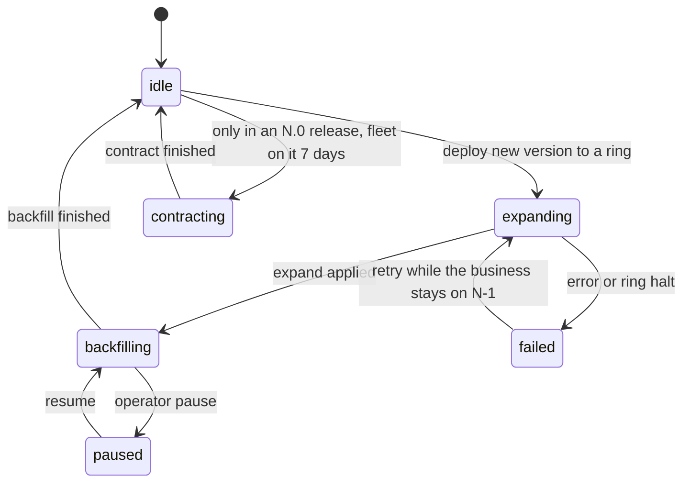

# Engineering practice: quality, CI/CD, release, documentation, community, support, brand and legal pack

- **Status:** Draft 0.1
- **Date:** 2026-10-01
- **Scope:** How obop is tested, built, released, documented, supported and legally packaged, from M0 (2026-10-01) to the first LTS lines. Nothing is built yet; nothing here is legal advice.

## 0. How to read this document

This document applies the binding register ([DECISIONS.md](DECISIONS.md)) to engineering practice, in D24 vocabulary (business, cell, pack, module, X1-X5, W0-W4). BINDING decisions are stated as fact; anything resting on a PROPOSED one is written "Proposed (Dn)". "(target)" is a design target and "(estimate)" a model output, never a measurement: nothing is built or benchmarked (D21). Versions are "as of 2026-10-01". Companions: [CONVENTIONS.md](CONVENTIONS.md) (naming authority), [ARCHITECTURE.md](ARCHITECTURE.md), [ROADMAP.md](ROADMAP.md), [BUSINESS.md](BUSINESS.md) (licences, prices, risk register), [LOCALIZATION.md](LOCALIZATION.md), [spec/security-privacy.md](spec/security-privacy.md), [spec/ux.md](spec/ux.md).

Binding decisions relied on most: D7, D8, D15 (except its exit-drill clause), D21, D30, D33, D35, D36, D38. Proposed ones: D1, D2, D3, D12, D16, D17, D23, D25, D26 and interpretations I-1 to I-4 (D23 is applied provisionally, Q10). Where this document departs from the research (the register wins):

| Research | Here | Why |
|---|---|---|
| [R27 C4] deprecate for 12 months | at least 24 months, removal at the first N.0 after | D16 |
| [R24 s6], [R27 B6] `vp pm sbom`; [R00 s3.3] says `sbom` has no `vp pm` subcommand | [R00 s3.3] is right. Checked against vite-plus v1.0.0 (source and the installed `vp`, 2026-10-01): `vp pm sbom` and `vp pm licenses` do not exist. JS SBOMs and licence scans run as `pnpm sbom` and `pnpm licenses list` through the vp-managed pnpm, invoked as `vp env exec pnpm ...` or in a `vp run` task; whether that is "vp only" is the owner's ruling (2.3, Q-E2) | F2, I-2, [R00 s3.3] |
| [R24 s6], [R27 B6] `pnpm publish`, `pnpm stage`, `pnpm audit signatures` | `vp pm publish` and `vp pm stage` exist and forward to pnpm; `vp pm audit signatures` is rejected and is written `vp pm audit -- signatures`: `vp` is the entry point wherever it has a wrapper | I-2 |
| [R27] public repository on free runners | private until G0, so W0 needs its own runner plan (3.2) | D26 |
| [R27 A2, C3] PostgreSQL 16/17/18 nightly matrix; "1.0 must support PG 17-20" | 17, 18 and 19 from RC; 1.0 supports 17 and 18 and adds newer majors as they pass CI | D8 |
| [R27 B1] Odoo-vs-obop weekly | monthly from M9 | D21 |
| [R27 C9, C10] "verified on" badge from 0.4 (2027-05-04) | `obop-compat` and the package registry are W2, so the public badge programme starts then (4.7) | D25 |
| [R28 D.4] public pre-notification list | held for the owner (Q-E5) | D38 |
| [R28 D.2] "Enterprise" support tier, "single-tenant" | "Top plan", dedicated cell | D24 |

## 1. Quality strategy

A 4-12 person team must sustain this for a five-year CRA support period [R27 A7]. The database enforces what must never happen and tests attack those guards with raw SQL (D30); tests are generated from the registry wherever it generates behaviour (D29); external validators and regulator worked examples decide compliance correctness, with Odoo at most a black-box oracle (F3); nothing is a claim until measured (D21). Fixtures hold no real personal data: design-partner data stays private and is pseudonymised with fakes that still pass IBAN and VAT-id checksums [R27 A5].

### 1.1 The test pyramid

The base is wide and runs on every push; the middle is narrower; the top is thin on PRs (Playwright smoke) and full only nightly [R27 A2].

| Layer and tooling (as of 2026-10-01) | Runs | Budget (target) |
|---|---|---|
| Unit and property: cargo-nextest 0.9.146, insta 1.48.0, proptest 1.11.0 (seeds committed), `rdeps()` for affected crates | every push; properties 256 cases on PR, 20,000+ nightly | PR p50 under 4 min |
| Database: sqlx 0.9.0 plus the template harness (1.2) | PR, 4 shards | under 6 min |
| API contract: utoipa 6.0.0, oasdiff 1.32.1, schemathesis 4.28.0 | diff on PR; fuzz nightly | diff under 1 min |
| Structural suite (1.4) | PR | under 2 min |
| Localisation: KoSIT validator 1.6.3, CEN artefacts, golden cases (1.7) | PR for touched packs; nightly all | 5 min |
| Fuzz: cargo-fuzz 0.13.2 on UBL/CII XML, MT940/CAMT, MIME, CSV import, Factur-X XML, the domain parser; it builds with a nightly compiler and sanitizers, on Unix x86-64 and aarch64 only [R27 A2] (Proposed exception, 2.2, Q-E11) | 60 s PR; 10 min nightly; 1 h weekly | corpus kept |
| UI: Vitest 5 Browser Mode, Playwright 1.63.0, @axe-core/playwright 4.13.0 | PR smoke; nightly full | smoke under 8 min |
| Migration chains (1.5), IDOR matrix (1.6), restore drill (pgBackRest to scratch, checksums, hash-chain verify [R18 s9.2]) | PR, merge queue, nightly; drill monthly | see sections |
| Performance and Odoo-vs-obop (1.9); failure injection (shuttle 0.9.4, loom 0.7.2); AI evals (weekly live run under USD 50, guess) | nightly; harness monthly | alarm at plus or minus 10% |

### 1.2 Database tests and template databases

A business is one PostgreSQL database of roughly 600-900 tables [R22 s10], so `#[sqlx::test]` (fresh database, migrations per test) is too slow for thousands of tests: about 1.5-4 s per test against about 0.3 s for a template clone (estimate, unmeasured) [R27 A3]. D36 fixes template databases; sprint one benchmarks migrate-per-test, `CREATE DATABASE ... TEMPLATE` with `WAL_LOG`, and `FILE_COPY` with PostgreSQL 18 `file_copy_method=clone` on the real runner. Two modes (names Proposed): `#[obop::test(tx)]`, the default, runs in a rolled-back transaction; `#[obop::test(db)]` runs on a clone of a per-shard migrated template, for commits, jobs, outbox, the bus notifier, advisory locks and RLS role switches. PostgreSQL 18 is the reference; 17, 18 and 19 from RC run nightly (D8), and a lint rejects 18-only SQL outside migrations gated by `requires_pg = 18`.

### 1.3 Invariant and property tests

| Area | Properties |
|---|---|
| Ledger, database guards (D30) | posted moves balance per currency and are immutable; the hash chain verifies; raw SQL that unbalances an entry, edits a posted row or posts before a lock date is rejected; concurrent posting yields gapless numbers; duplicate quants merge through `ON CONFLICT`; done stock moves are immutable |
| Stock, pricing, workflow | on-hand plus reserved never negative; quantity conserved along move chains; valuation equals the inventory account; price resolution deterministic; no unreachable state or illegal transition |
| Tax and money (D9) | tax-included and -excluded round trips agree within one minor unit; per-line and per-group rounding reconcile with EN 16931 arithmetic; Rust totals equal SQL sums; a 10M-line replay compares both modes |
| Authorization (D10) | list, by-id, export and RLS-enabled paths agree for random (principal, record, operation) triples; the restrictive policy is benchmarked on 10M ledger lines |
| Expressions, catalogues (D11, D12, D34, D39) | server and Wasm CEL evaluators agree (one shared evaluator is Proposed, D12) and hold the save-time limits (4 KB, depth 32), step budget and deadline (D11); golden fixtures agree across 10+ locales in Rust and TypeScript; Yjs 13.6 and yrs 0.28 interoperate |

A ledger, tax, pricing or stock crate does not leave alpha without its properties [R27 A2, MUST 5] [R23 DR-5].

### 1.4 Structural suite and CI lints

Tryton's `ModuleTestCase` gives every module 26 generic tests [R27 A1]. obop ships an equivalent inherited by every module and extension package, so third parties get it free and the "verified on" badge (4.7) can rely on it [R27 MUST 4]. Proposed checks: views validate against the registry; the computed-field graph is acyclic; every model has permission rows with a declared scope (an implicit TRUE scope is an error, D10); states are reachable and transitions guarded; `obop.toml` and `auto_install` graphs are valid; every model, field, action and error code has a description [R28 B.2]; every personal-data field has a flag and retention class [R18 s12]; every migration is tagged expand, backfill or contract; every command and field has a data class (or explicit non-personal marker), a permission group and a description, and appears in the generated REST, MCP and CLI surfaces, with declared network destinations in `obop.toml` (Proposed, D41).

CI lints fail the build on: NOTIFY outside `obop-bus-notifier` (D7); an `xtask` dependency law, so implementation crates depend only on kernel and `*-api` crates (D27); a database handle not from `BusinessTx` (D33); floats in money crates (D9, mechanism Proposed); `AssertSqlSafe` outside the one SQL-emitting crate [R06 s4]; release builds without `overflow-checks` (Proposed, D23); physical margins in CSS (D35); `baseUrl` or `.vue` and `.svelte` in core (D15); stale generated OpenAPI or ts-rs files (D15); a commercial or copyleft-only runtime dependency in core (D15, D39); and any non-pnpm lockfile (F2).

### 1.5 Migration chain tests

- The append-only migration ledger starts with the first schema (0.1, 2026-12-01) and is never squashed inside a line; a squash happens only at an N.0, into a baseline that is a required stop (D36, [R27 C2]).
- Fixtures are built, not hand-made: each release pipeline publishes `fixture-<series>-<profile>.dump.zst` from the released binary and the seed generator, from 50 parties to 10M move lines (sizes Proposed) [R27 A4].
- Chains run N-1, N-2, the previous LTS and the oldest supported LTS to HEAD. PR: N-1 tiny; merge queue: N-1 and N-2 medium; nightly: all plus fan-out. D36 starts N-1 at 0.3 (2027-04-06) and N-2 plus the 1,000-business fan-out at 0.5 (2027-07-06). A pass means the old API suite passes on the migrated schema and the trial balance equals the recorded one ("no known trial-balance bug" is a W1 exit criterion, D26).
- After the expand step, N-1's API suite runs against the N schema; contract runs only in the "fleet fully on N" test; CI lints `lock_timeout`, concurrent indexes and `NOT VALID` plus `VALIDATE CONSTRAINT` [R27 A4].
- Fan-out clones 1,000 business databases from the N-1 template, as four clusters of 250 (a cell holds at most 250, D6, and the cell spike covers 250 databases of about 800 tables; a single 1,000-database cluster would need its own gate on the spike readout), and runs `obop migrate --fleet` at concurrency 32, asserting zero failures, p95 duration and no `ACCESS EXCLUSIVE` lock held over 1 s. About 190k relations per 250-business cell make this a fan-out problem [R22 s10]. Data migrations are plain SQL or a sealed SDK with no domain-crate dependency, so any chain runs at any later version.

### 1.6 Registry-generated IDOR matrix

The matrix is generated from the registry: model x operation x permission group x relation (own, same company, other company, other business). Expected outcomes come from permission and restriction metadata, and a denied by-id read returns a non-leaking 404. Size estimate: 300 models x 5 operations x 6 permission groups x 2 businesses is about 18,000 cases, sampled on PR and full nightly [R27 A2]. It must exist before any multi-business deployment (D36); until then ring 0 is one business (ROADMAP K3, by 0.4). Companions: a whole-suite run as business A asserting zero rows of business B, a mass-assignment fuzz, an SSRF corpus and an ASVS 5.0 self-assessment [R18 s4, s12].

- **Scenario.** Given a portal user of business A and an invoice id from business B (UUIDv7 ids are partly guessable and never capabilities [R18 s3.2]), when the user requests it by id, through export and through webhook replay, then every path returns the same 404 body as for a non-existent id.

### 1.7 Golden-case suites and oracles

Oracles are off-the-shelf programs that run only in CI images (the KoSIT validator is Java); obop authors no Java (I-1, Proposed) [R25 B3, R09].

| Area | Oracle |
|---|---|
| EN 16931, XRechnung, Peppol, Factur-X | CEN artefacts 1.3.16 (next cycle effective 2026-11-16, then 2027-05-17 and 2027-11-15); KoSIT validator 1.6.3 with testsuite 2026-08-31; Peppol BIS Billing 3.0.21; phase4 4.8.0; Mustang 2.26.0 |
| KSeF, VIES | official TEST and DEMO environments (FA(3)); VIES REST API |
| DATEV, ELSTER, AEAT, SDI, PA | no reachable sandbox when checked (unverified, [R25 B3]): regulator worked examples plus recorded accountant sign-off |
| Payroll | regulator worked examples (IRS Pub. 15-T, HMRC test service, DSN conformance) [R13]; reference country decided 2029-04-01 (D19) |

- **Gate ladder (D34).** `draft` (compiles, schema-valid), `preview` (passes oracles on regulator examples), `stable` (golden cases including edge cases, differential tests, local accountant or counsel sign-off recorded in the release, signed release), `certified` (external certificate where one exists). A pack without golden cases cannot reach `stable` (D19).
- **Refresh.** A bot opens a PR on every oracle or code-list release and reruns the oracles; KoSIT goldens are refreshed by 2026-11-09, a week before the CEN cycle [R27 C10]. Rust e-invoicing crates are weeks to months old and serve as accelerators, not foundations [R09]. Differential tests run Odoo as a black box only (F3, D22).
- **Scenario.** Given a DE pack with golden cases for standard, reverse-charge, credit-note and mixed-rate invoices, when CI generates XRechnung and ZUGFeRD files, then KoSIT 1.6.3 and Mustang 2.26.0 accept them, totals equal the expected minor-unit values, and the pack version and inputs are stored on each computed line (D38).

### 1.8 Accessibility and UI gates

WCAG 2.2 AA is a release gate (D35); design detail is in [spec/ux.md](spec/ux.md). Automated: Oxlint `jsx-a11y`, axe in Playwright, React Aria primitives. Manual: NVDA and VoiceOver passes on five core flows (login, list, form, grid entry, reconciliation) before every release, since automation covers only part of the criteria [R19]. Structural: every drag has a single-pointer non-drag path (SC 2.5.7); single-key shortcuts can be disabled or remapped (SC 2.1.4); logical CSS only; RTL and CJK fixtures; a 100k-row list budget (D34, D35). Visual regression waits until the team reaches about 12, with baselines from one pinned container only [R27 A2]. UI tier F3 packages ship a WCAG 2.2 AA statement [R24 s4]; storefront, checkout, portal and POS ship WCAG 2.2 AA and the consumer withdrawal function, covered by an end-to-end test (D38).

### 1.9 Odoo-vs-obop scenario harness

One Rust driver runs the same scripted day against Odoo 20 (through JSON-2; Odoo 19 as a second baseline) and obop: order to delivery to invoice to payment to reconciliation, 10 POS terminals, a 10k-row list, an aged-receivable report and 100 concurrent users, reporting p50, p95 and p99, throughput, RSS and PostgreSQL CPU on fixed hardware (Hetzner CCX33, EUR 138.49 a month, list, excl. VAT and IPv4, Germany/Finland) [R27 A7]. It runs monthly from M9 (2027-07) and publishes driver and results (D21). Until then the only citable Odoo figure is its documented formula (workers = 2 x CPU + 1, about 6 concurrent users per worker) [R22 s3.1], and the capacity figures in [R22 s10] stay design targets.

### 1.10 Flakes, mutation, coverage and team size

- **Flakes.** nextest `--retries 1` marks a pass-on-retry FLAKY; nightly runs set `flaky-result = "fail"`. Two flakes in 7 days quarantine a test and open an issue for its CODEOWNERS owner with a 14-day fix-or-delete clock; at most 20 quarantined tests (Proposed, [R27 A6]).
- **Mutation and coverage.** cargo-mutants 27.1.0 on about 15 core crates (ledger, tax, pricing, stock, permissions, migration runner): `--in-diff` nightly, full weekly in 16 shards, score at least 80% (target); about USD 22 per full run on a GitHub 8-core runner (estimate). No global coverage percentage; diff coverage at least 80% on core crates (target).
- **Team size.** A 4-5 person team keeps the ledger and tax properties, the template harness, the structural suite, the N-1 chain, Playwright smoke plus axe and the nightly PostgreSQL matrix; 8 adds the nightly IDOR matrix, N-2 and fan-out, KoSIT goldens and weekly mutants; 12 adds visual regression, failure injection and live AI evals. One quality-platform engineer at 0.5-1 FTE owns CI, the flake ledger and fixtures (D36, [R27 A7]).

## 2. Repository and toolchain policy

### 2.1 Layout

One repository holds a Cargo workspace and a pnpm workspace (after [R07 s3.13]; names Proposed; the full tree is in [ARCHITECTURE.md](ARCHITECTURE.md) section 15, which governs):

```text
Cargo.toml  rust-toolchain.toml  deny.toml   # workspace, exact toolchain, supply-chain policy
crates/      # kernel, module (*-api plus implementation), platform crates; xtask/ (dependency law, migration-tag lint, generated-file checks)
pnpm-workspace.yaml  pnpm-lock.yaml  .node-version   # the only JS lockfile is pnpm-lock.yaml
web/         # vite.config.ts; config/ (the only vite-plus importers: config factory and test re-export); apps/docs is the VitePress site
docs/  examples/  rfcs/   # specs and research; compiled examples; RFCs
```

### 2.2 Rust: Cargo workspace and pinned toolchain

- **Exact pin.** `rust-toolchain.toml` carries `channel = "x.y.z"` on every branch, with rustfmt and clippy; builds use `--locked`; release builds set `overflow-checks = true` and unwind rather than abort, so one request's panic cannot kill a multi-business worker (Proposed, D23; [R18 s5]). Edition 2024, resolver 3, versions only in `[workspace.dependencies]`, one `[workspace.lints]`, `build.warnings` instead of `-Dwarnings` [R06 s1.2].
- **Fuzz toolchain (Proposed exception, open: Q-E11, with Q10).** cargo-fuzz drives libFuzzer with sanitizers and builds only with a nightly compiler [R27 A2]. F1 says "exclusively the latest stable Rust" and the exact pin above is a stable channel on every branch; neither I-1 to I-4 nor Q-E2 records a nightly exception, so this one is not decided. Proposal: fuzz targets live in a separate, non-shipping `fuzz/` workspace outside the main Cargo workspace (path Proposed), with its own `rust-toolchain.toml` pinning an exact dated nightly, used only by the fuzz jobs (3.1). The shipped build, the release pipeline, developer commands and every other job stay on the stable pin; the nightly compiles only the fuzz binaries, which are never shipped. Committed crash inputs and corpus entries are replayed as ordinary tests on the stable toolchain in the required suite. The alternative is to drop cargo-fuzz for stable-only tests (the seeded properties of 1.3), at the cost of coverage-guided depth. Until the owner rules, the fuzz jobs are a documented departure from F1, not a settled exception.
- **Eligibility (Proposed, D23).** A release is eligible at x.y.1, or at x.y.0 once 14 days old with no open stable-to-stable regression; adopt within 7 days. A compiler or std advisory overrides the wait on every branch; never pin a version the dist channel does not serve. LTS branches keep a per-branch toolchain in a digest-pinned builder image. Re-check through a weekly Renovate toolchain group, a nightly beta canary and the six-week release Thursday.
- **Crate graph.** A strict DAG with `*-api` crates holding types, traits and events only (D27); `unsafe_code` forbidden except in allow-listed crates (Proposed, after Hyperswitch [R06 s3.16]).
- **Today (Proposed, D23; Q10).** Pin 1.98.1 (2026-09-03); skip 1.98.0 (vtable regression, rust-lang/rust#161441). Rust 1.99.0 was published on 2026-10-01 (blog post dated that day; `channel-rust-stable.toml` serves it, manifest Last-Modified 12:38 UTC after a 404 at about 10:10 UTC). The pin stays 1.98.1 because of the D23 rule (1.99.0 plus 14 days is 2026-10-15), not because the channel lacks it, so Renovate holds the bump: adopt 1.99.x between 2026-10-15 and 2026-10-22, or at 1.99.1 if sooner, once debug and release-mode CI pass (1.99 turns incremental compilation off when `CI` is set). Expect 1.100.0 about 2026-11-12 (eligible 2026-11-26), which brings `wasm32-wasip3` to stable (Tier 3 in 1.99.0; promoted to Tier 2 by rust#161940, milestone 1.100.0).

### 2.3 Vite+ and pnpm, driven by `vp`

**Pin policy (Proposed, D23; Q10).** `vite-plus` is a project-local dependency at an exact version. pnpm is pinned to one exact version, never a range or dist-tag, with `vp env pin pnpm@<x.y.z> --target package-manager`, which writes the top-level `packageManager` field (without `--target`, Vite+ 1.0 writes `devEngines.packageManager` instead); Node in `.node-version`; only `pnpm-lock.yaml` is committed. CI runs `vp install --frozen-lockfile` with `voidzero-dev/setup-vp` at an exact release or SHA (never `v1`), or a digest-pinned image. "Latest Vite+" means the newest `vite-plus` at least 7 days old that passes the exit drill, a LICENSE/NOTICE diff, exactly one Vite and one Vitest copy (`vp why`), and the test suite. One Renovate group moves `vite-plus`, the `vite` alias to `@voidzero-dev/vite-plus-core` and the `vitest` pin in lockstep.

- **Today (Proposed, D23; Q10).** `vite-plus` 1.0.0 (2026-09-28, MIT), eligible 2026-10-05. Bundle: Vite 8.3.1, Rolldown 1.2.11, Vitest 5.0.1, Oxlint 1.85.0, oxlint-tsgolint 7.0.2003, Oxfmt 0.70.0, tsdown 0.23.0. Upstream is already newer (for example Vite 8.3.2, Vitest 5.0.3, Oxlint 1.86.0); the lag is accepted and the bundle is not overridden piecemeal, except by a logged, temporary override for an advisory in a bundled component with no Vite+ release within 7 days.
- **Node** 24 LTS now; Node 26 (LTS from 2026-10-28) by 0.2 (2027-02-02) and before any LTS branch is cut; Node 24 ends 2028-04-30.
- **pnpm (registry state 2026-10-01 14:07 UTC).** `latest` and `latest-12` are 12.8.1, `next-12` is 12.8.2, `latest-11` is 11.28.2 and `next-11` is 11.28.3. pnpm 12 is the Rust port and the current major; pnpm 11 is the JS line and is still released. The six D23 workspace keys below are read without warning by pnpm 12.8.1 (checked 2026-10-01); behavioural verification is still on 11.x only. Under the 7-day rule the newest eligible version today is 12.6.0 or 11.27.1; 12.8.1 and 11.28.2 become eligible on 2026-10-05. Which major is the owner's call (Q-E6, folded into Q15).
- **Guardrails (Proposed unless cited).** `vp` is the entry point for every JS and TypeScript command; `vp install`, `add`, `remove` and `pm` reach pnpm; direct `pnpm` only where `vp` has no wrapper. Checked against vite-plus v1.0.0 (source and the installed `vp`, 2026-10-01): `vp pm` is a typed command set, not raw forwarding. `vp pm audit`, `approve-builds`, `publish` (including `--provenance`) and `stage` forward to pnpm; `vp pm sbom` and `vp pm licenses` do not exist; `vp pm audit signatures` is rejected and must be written `vp pm audit -- signatures` (accepted and passed to pnpm; the exact pnpm argv is inferred from the source, not observed). JavaScript SBOMs and licence scans therefore run as `pnpm sbom --sbom-format cyclonedx --sbom-spec-version 1.5` and `pnpm licenses list --recursive` through the vp-managed pnpm, invoked as `vp env exec pnpm sbom ...` or inside a `vp run` task. Whether that counts as "vp only" is the owner's ruling (Q10, Q-E2). A W0 smoke test (Proposed) runs `vp pm publish --dry-run`, `vp pm stage`, `vp pm approve-builds` and `vp pm audit -- signatures`, and `vp env exec pnpm sbom` on Windows, where `vp env exec --package-manager <pin> pnpm ...` failed with "program not found" on 2026-10-01 while the same command without `--package-manager` worked. `vp dlx` never runs in CI (I-2). CI fails on a non-pnpm lockfile or a missing `packageManager`, and a linter rejects invocations of the banned package managers in workflows and docs (F2). All `vite-plus` imports pass through the config factory and the test re-export module (D15). Use `--no-cache` for code generation and release tasks and explicit `cache.input` globs for cargo-driven tasks (fspy around `cargo` is unverified). A named engineer triages Vite+ issues such as #2635 and #2636 (task-cache correctness) (D15, [R07 s2]).

**Exceptions to "vp only" in this pipeline (Q-E2, pending the owner's ruling on I-2 and I-4):** the JS SBOM and licence scan (`pnpm sbom`, `pnpm licenses list`), which have no `vp pm` wrapper and run through `vp env exec` or a `vp run` task; and the exit drill's upstream tools (2.4). Neither is recorded by the owner yet, and no others are added.

```sh
vp install --frozen-lockfile     # the only install in CI
vp run gen                       # cargo -> openapi.json -> TypeScript types; diff-gated
vp check                         # format, lint and type-check in one pass
vp test                          # Vitest 5: unit tests and Browser Mode
vp build                         # production bundle, embedded into the Rust binary
vp run e2e                       # Playwright suite as a task
vp pm audit                      # registry advisories through pnpm
vp env exec pnpm sbom --sbom-format cyclonedx --sbom-spec-version 1.5   # no `vp pm sbom` in vite-plus 1.0.0; "vp only" ruling pending (Q-E2)
```

```yaml
# pnpm-workspace.yaml: D23 values; keys read without warning by pnpm 12.8.1 (2026-10-01), behaviour verified on 11.x only [R07 s3.13, R27 B8]
minimumReleaseAge: 10080        # minutes = 7 days
minimumReleaseAgeStrict: true
trustPolicy: no-downgrade
blockExoticSubdeps: true
strictDepBuilds: true
allowBuilds: {}                 # reviewed entries only
```

### 2.4 Exit drill

A nightly job (about USD 0.12 a night, estimate) copies the tree, rewrites `vite-plus` imports to upstream `vite`, `vitest` and `@vitest/*`, installs the 1.0.0 upstream pins with `vp install`, and runs lint, format check, tests and build with `vp exec` (or `vp run` for scripts) on the upstream binaries `vite`, `vitest`, `oxlint` and `oxfmt`; a human reviews it each quarter. It proves code portability, not Vite Task configuration [R27 B9]. The drill is a Proposed clause of D15 and D23 (I-4; Q10): once the owner records it, the register binds the drill and its tools (plain Vite 8, Vitest 5, Oxlint, Oxfmt). I-4 words the run as pnpm scripts; the entry point above (`vp install`, then `vp exec` or `vp run`) is this document's narrower proposal. It keeps `vp` as the entry point, which leaves one exception to "vp only" (constraint F2, I-2, I-4): the upstream tools under test run without the bundled Vite+ toolchain, in a throwaway copy (shipped builds always use `vp`). R27 B9 raises that for the owner, who should record it as the named exception when ratifying I-4 (Q10, Q-E2). Unverified: that the global `vp` operates on a tree without a local `vite-plus`; if it does not, the fallback is plain pnpm scripts, which is how I-4 words the exception (Q-E2). **Tripwires that reopen the Vite+ risk** (not the constraint): a licence or NOTICE change; remote cache or core `vp` features behind a paid service; a 1.x minor that breaks a CLI flag or config key; plan issue #2405 slipping a quarter (D23).

### 2.5 Dependency updates

Renovate (44.127.1) cooldowns (Proposed, D23): crates 7 days, JS packages 7 days on top of pnpm's `minimumReleaseAge`, GitHub Actions pinned by SHA 3 days; security updates skip the cooldown and are reviewed by hand [R27 B8]. One group each for the toolchain, `vite-plus`, and wasmtime, which is pinned to an LTS major (v48 now, next v60 about 2027-08-20) and patched within 7 days, 24 hours for High advisories (D11). No automerge for request-path crates; pre-1.0 vendor crates are pinned exactly; cargo-deny blocks PRs.

## 3. CI/CD topology and cost

### 3.1 Pipeline

| Stage | Content | Target (p50 unless stated) |
|---|---|---|
| 0 Fast gate | fmt; clippy on affected crates and reverse dependencies; cargo-deny; `vp check`; OpenAPI drift; migration and structural lints | 10 min maximum, free 4-vCPU runners |
| 1 Required | rust-test x4 (nextest archive, PostgreSQL service, template database); web (`vp install --frozen-lockfile`, `vp test`); contract (OpenAPI diff, registry and view validation); migrate smoke N-1; e2e smoke (Playwright plus axe). A `ci:full` label adds fuzz on changed targets and mutants in diff | 20 min |
| 2 Merge queue | stage 1 on the merged result; release-mode smoke; N-1 and N-2 medium migrations; IDOR sampled; l10n goldens | 30 min maximum |
| 3 Nightly | PostgreSQL 17, 18, 19 from RC; release mode; full Playwright, visual and axe; fuzz 10 min a target; full IDOR; fan-out over 1,000 businesses; oracle reruns; bare-metal performance; mutants in diff; exit drill; cargo-audit and cargo-vet; rustc beta canary | n/a |
| 4 Weekly | core mutants in 16 shards; 1 h fuzz; ecosystem compatibility on the top-100 extensions | n/a |
| 5 Monthly | restore drill; fleet upgrade rehearsal; Odoo-vs-obop from M9 | n/a |
| Release | x86_64 and aarch64 static musl builds; two builds compared by hash; SBOM; cosign and attestation; upgrade matrix from every supported source; publish; `compat.json`; advisory feed | n/a |

`main` builds an edge release to hosted ring 0. Each stage ends in one aggregator job, so branch protection names a single check [R27 B1]. The table is the full-scale target: parts wait for team size (visual regression, mutants, failure injection; 1.8 and 1.10), the ecosystem run needs the W2 registry (4.7), and "free 4-vCPU runners" holds only for a public repository (3.2 covers the private period).

### 3.2 Runners and cost

Facts [R27 B2]: standard GitHub-hosted runners are free for public repositories and larger runners always bill; the binding limits are the 10 GB cache per repository, the 14 GB disk and 20 (Free), 40 (Pro) or 60 (Team) concurrent jobs. Private included minutes (2,000 Free; 3,000 Pro and Team) cannot be spent on larger runners. The model assumes 8 engineers, 220 merged PRs a month at 3 runs each, 240 merge-queue runs and warm caches (about 658k vCPU-minutes), scaling roughly linearly with PR volume (estimates, unmeasured):

| Option | Monthly (estimate) |
|---|---|
| A. All GitHub larger runners, private repository | about USD 1,850, zero operations work |
| B. Public repository, free standard runners | about USD 0-100; wall-clock about 1.6-1.8x; disk pressure |
| C. RunsOn on own AWS spot | about USD 260-350; spot interruptions |
| D. Hetzner 2 x CCX43 (each 16 dedicated AMD vCPU, 64 GB, 360 GB NVMe: Hetzner general-purpose page, checked 2026-10-01 [R22 s10]) | EUR 552 flat for two (EUR 275.99 each; list, excl. VAT and excl. IPv4, Germany/Finland, in force since 2026-06-15; was EUR 124.99 each); you run autoscaling and patching |

- **After G0 (public).** Use B while PR wall-clock stays under 20 min, then a hybrid: lint, web and contract stay free; Rust build and test move to C or D; performance on a dedicated CCX33. Target USD 300-800 a month (D36). Self-hosted runners never run fork PRs; `merge_group` and maintainer-labelled PRs use ephemeral runners without secrets.
- **Before G0 (M0 to at latest 2027-04-06), Proposed.** The free-runner assumption fails while the repository is private (D26): larger runners bill, and a merge queue needs Enterprise Cloud on private repositories [R27 B5]. Proposal: one Hetzner CCX43 (EUR 275.99 a month, list, excl. VAT and excl. IPv4, Germany/Finland) for Rust build and test, GitHub standard runners within the included minutes for Stage 0, and "require branches up to date" instead of a queue; six months of the box is about EUR 1,656 (computed). Add `merge_group` triggers from the first commit so the public flip is configuration only (Q-E1).
- Never cache `target/` from a job that holds secrets: Miri stores environment variables there [R06 s1.5].

### 3.3 Caching and build-time budgets

- **sccache** 0.18.0 on an S3-compatible backend from day one, to escape the 10 GB cache cap; Swatinem/rust-cache for `~/.cargo`; nextest builds one archive and shards it. The Vite+ task cache is local only (no remote cache documented) [R27 B3].
- **Budgets (targets).** Cold `cargo check --workspace` on 8 vCPU at most 6 min; cold dev build at most 15 min; warm PR build (sccache hit rate at least 85%) at most 5 min, failing at 8; release LTO binary at most 40 min on 16 vCPU; CPU-time regression warns at +10% and fails at +25%; any crate over 60 s self-time triggers a split review. `cargo build --timings` writes HTML only, so gate on wall-clock on a fixed runner [R27 B4]. The merge queue starts at group size 1-3 and concurrency 2 and carries the heavy tier [R27 B5].

## 4. Release model

Proposed (D16, D26); D16 awaits ratification by 2027-03-31 (Q7), and once the repository is public these are one-way commitments. The database-enforced rules (D30, D36) are binding.

### 4.1 Calendar and engineering gates

Pre-1.0 releases fall on first Tuesdays, stable series on the third Tuesday of April and October (D16). Dates are D26's unless marked.

| Date | Release or gate | Engineering content |
|---|---|---|
| 2026-11-27 | spikes read out | NOTIFY contention, 250-database cell, UUID size; D6, D7, D9 frozen |
| 2026-12-01 | 0.1 preview | migration ledger starts; no stability promise; security policy and CRA runbook v0 |
| 2027-04-06 | 0.3 public alpha (latest public flip) | N-1 guarantee, N-1 chain test, `obop upgrade --dry-run` |
| 2027-07-06 | 0.5 public beta, paid beta | first commercial offer, so CRA duties apply; N-2 chain, 1,000-business fan-out; Odoo-vs-obop monthly from M9 |
| 2027-09-30 | DE pack stable | oracles, golden cases, accountant sign-off; SLA plan and DE Assurance service follow on 2027-10-01 |
| 2027-11-02 | 0.7 | CRA technical file due 2027-11-30; internal sign-off by 2027-12-10; CRA main obligations 2027-12-11 |
| 2028-03-07 | cut `release/1.0` | RC1 2028-03-21, RC2 2028-04-04 |
| **2028-04-18** | **1.0 LTS** | support to 2033-04; 1.0.1 on 2028-05-02 |
| 2028-10-17, 2029-04-17, 2029-10-16 | 1.1, 1.2, 1.3 | regular series; 2.0 LTS on 2030-04-16 |

Every series: cut `release/N.M` 6 weeks before release, RC1 at 4 weeks, RC2 at 2 weeks. By that rule 1.1 is cut 2028-09-05, 1.2 on 2029-03-06, 1.3 on 2029-09-04 and 2.0 on 2030-03-05 (computed) [R27 C3].

### 4.2 Series, support and the patch train

| Track | Lifetime | Content |
|---|---|---|
| edge (`main`) | none | nightly builds |
| Regular N.1-N.3 | 9 months (3 after the next series) | fixes, security, compliance data; API-, module-API- and schema-compatible (expand-only) |
| **LTS N.0** | **5 years:** years 0-2 full; years 2-5 security and legal-critical only | CRA Art. 13(8); security updates stay available 10 years and technical documentation is kept 10 years (Art. 13(9), 13(13)) [R27 C3] |

For 1.0: full support until about 2030-04, then security and legal-critical fixes until 2033-04.

- **Patch train.** Fixes land on `main` and are bot-backported (ERPNext `backport.yml`). First Tuesday monthly for branches in full support; security-only LTS branches roll up quarterly plus out-of-band for CVE SLAs (exploited or critical 7 days, high 30 days, medium at the next train; Proposed). A fix lands on every supported branch in one train [R27 C3, B7].
- **Live lines.** Two to three LTS lines plus one or two regular: four to six live branches; the security-only window takes CVSS 7 and above, data-integrity and legal-critical fixes. Upkeep is estimated at 0.3-0.5 FTE (guess). **Tripwire (D16):** if LTS upkeep exceeds 20% of engineering for two quarters, stretch LTS spacing to 2.5 years.

### 4.3 Destructive changes only at N.0



Every migration is tagged expand, backfill or contract; CI rejects a contract in the release of its expand (D36). Contract migrations and API removals ship only at N.0; N.1-N.3 are expand-only. A batched background migration started in one series is finalised at the next required stop before its old path is deleted [R27 C5]. Every DDL runs under `lock_timeout`, with concurrent index builds and `NOT VALID` then `VALIDATE CONSTRAINT` [R18 s9.3].

### 4.4 Deprecation floor

Public contracts (REST and MCP under `Obop-Version`, WIT worlds, `obop.toml` and pack schema, UI SDK tiers F2 and F3) are deprecated for at least 24 months and removed at the first N.0 after that, an effective window of 24-48 months; UI tier F1 gets 12 months (D16, [R24 s5.3]). Use emits `Deprecation` and `Sunset` headers (RFC numbers not verified in the research), an audit-log entry and a `deprecations.json` entry.

- **Codemods for extension authors (Proposed).** Odoo ships source codemods for custom modules on breaking releases, and the research recommends the same, "machine checks plus codemods" [R24 s5.3]. Each N.0 that removes a deprecated contract ships codemods for extension authors as an `obop ext migrate` subcommand (name Proposed): X1 and X3 package schemas, X4 and SDK calls, and UI tier F2 and F3 SDK usage. Each `deprecations.json` entry names its codemod or states that none is possible, and the codemods are versioned with the deprecation list and run in the nightly `obop-compat` job (4.7).

- **Example.** Deprecated at 1.1 (2028-10-17): the floor ends 2030-10-17, so removal waits for 3.0, which the third-Tuesday rule puts at 2032-04-20 (computed; D26 fixes dates only to 2.0): about 42 months.
- **Edge case, Proposed clarification.** Deprecated at 1.0 (2028-04-18), the next N.0 is 2.0 on 2030-04-16: 728 days, two days short if months are counted in days. Proposal: count release months (April 2028 to April 2030 is 24), so 2.0 qualifies (Q-E3, folded into Q7).

### 4.5 Upgrade paths and the self-hoster experience

Supported paths (Proposed): any N.x to a later N.y; N.x to (N+1).0; N.0 to (N+2).0 with the (N+1).0 stop recommended; longer jumps stop at an intermediate N.0 (hosted fleets require stops at N.0, D16). The oldest-LTS-to-HEAD chain proves it nightly, and the target is zero manual steps [R27 C5].

`obop upgrade` (Proposed, [R27 C6]): `--dry-run` prints the path, migrations by kind with duration and lock estimates, disk headroom, compatibility and manual steps (MVP at 0.3, D26); a backup gate refuses to run without a verified recent backup; a signature gate verifies the attestation and cosign signature; `--rehearse` restores the latest backup to a scratch database and runs the chain there. Upgrades run in two steps as Mastodon does: `--phase=pre` (expand, old app running), then `--phase=post` (backfills as jobs; contract only at N.0). Rollback: before contract run the previous binary; after contract restore the gate's backup.

### 4.6 Hosted fleet rings

Rings (Proposed, [R27 C7]); a cell holds at most 250 businesses (D6). Ring 0, obop's own businesses, 24 h bake; ring 1, one canary cell of opt-in businesses, 48 h; ring 2, 25% of cells, 72 h; ring 3, the rest. The control-plane row is `business_release_state` (business, cell, app version, schema epoch, migration state, last error, pinned-until), renamed (Proposed, D24) from the research's `tenant_release_state`. Contract only after 100% of the fleet has run the new version for the 7-day rollback window; halt a ring above 2% business failures; failed businesses stay on N-1; a business may pin for up to 60 days inside the same LTS line. SLO (target): 95% of businesses migrated in under 5 min.

### 4.7 Compatibility artefacts, telemetry and extension badges

- **`compat.json` per release**, also rendered as a page: tested PostgreSQL versions, OS, browsers, upgrade sources, API versions and deprecations with removal series. The changelog is Markdown plus JSON with typed entries, and a per-series upgrade-notes file feeds `--dry-run` [R27 C8]. Usage telemetry is opt-in and default off, with `obop telemetry preview`; the update and advisory check is separate, switchable, and sends only the version (D16).
- **Extension compatibility.** `obop-compat` runs nightly and on each release candidate, and also tries the pending codemods (4.4) on each failing package and reports whether they migrate it, without changing the result recorded for the unmodified package; failing 30 days on a stable core earns a warning and 90 days holds the package from installation on that version [R24 s5.3]. The "verified on vX" badge is a signed attestation that lapses when a new series ships and means compatible and sandbox-clean, not audited [R27 C9]. R27 starts it with 20 extensions at 0.4 (2027-05-04), but `obop-compat` and the package registry are W2 deliverables (D25), so before then the run is a script over first-party and design-partner X1 and X4 packages and the public badge programme starts with the W2 registry alpha (Proposed).

### 4.8 Dependency lifetimes against a five-year LTS

- Node 24 ends 2028-04-30, so 1.0 builds on Node 26 (ends 2029-04-30) [R27 C3]. Rust has no LTS: an LTS is rebuilt with a newer compiler only for a compiler or std advisory (Proposed, D23). Each obop LTS branch rebases onto the next wasmtime LTS mid-life, since wasmtime's LTS lasts 24 months [R24 s3.3].
- Node 26 ends 2029-04-30, in year 1 of the five-year window for 1.0 (full support until about 2030-04, security-only until 2033-04). Node is build-time only because the bundle is embedded (D37), so its end of life never reaches a running business; it ends security fixes for the machine that builds a branch. Proposed: every branch builds in a digest-pinned image that holds Node, pnpm and the frozen lockfile (as for Rust, Proposed, D23); 1.0 is rebased onto the then-current Node LTS inside its full-support window, before 2029-04-30, as ordinary maintenance that must pass the web suite; a security-only branch keeps its last image and rebuilds the embedded frontend from it on an isolated builder without secrets, and changes Node only for an advisory that is exploitable in a build context (Q-E10).
- PostgreSQL: 1.0 supports 17 and 18 (D8); 17 ends 2029-11-08 and 18 ends 2030-11-14, both before 1.0's security window ends in 2033-04, so 1.0 adds newer majors to its matrix as they pass CI and operators upgrade PostgreSQL inside the line. D8's floor rise to 18 (2028-11) is read here as applying from the next series, 1.2 (2029-04-17), not inside 1.0 (Proposed; Q-E4).

## 5. Supply-chain security

D33 makes `cargo-deny`, `cargo-audit` and a frozen pnpm lockfile P0 from the first commit; signed releases, SBOMs and `SECURITY.md` P1 before the first public release; `cargo-vet`, audit checkpoints and a pentest P2 before audits.

### 5.1 Controls

| Control | Setting or fact | Tier |
|---|---|---|
| cargo-deny 0.20.2 | advisories, bans, licences, sources; blocks PRs | P0 |
| cargo-audit 0.22.2 | nightly on RustSec; feeds the CRA clock (6.3) | P0 |
| `--locked`, exact toolchain, committed `Cargo.lock`; Actions pinned by SHA (3-day cooldown) | | P0 |
| pnpm | the 2.3 settings; `vp install --frozen-lockfile`; `vp pm audit`; `vp pm audit -- signatures` (pnpm 11.1 and later; `vp pm audit signatures` is rejected by `vp`, the pass-through form is covered by the W0 smoke test in 2.3) | P0 |
| lockfile scanner | must read both YAML documents of `pnpm-lock.yaml`; a first-document-only scanner reports zero dependencies without error | P0 |
| cargo-auditable 0.7.6 | embeds dependency data so `cargo audit bin` scans deployed binaries | P1 |
| SBOM, signing, attestations | 5.2 | P1 |
| cargo-vet 0.10.2 | request-path crates only, about 1-2 person-days a month (estimate); last release 2026-01-13, so watch for stagnation | P2 |

RustSec holds 317 advisory files for 2026 so far against 172 for 2025, so triage time is budgeted [R27 B8]. **Bans:** async-std ([R06 MUST 2]); commercial or copyleft-only runtime dependencies in core, such as AG Grid Enterprise, Handsontable, FullCalendar Premium, Univer Pro, BlockNote XL and HyperFormula (D15, D39) [R00 s3.3]. Proposed additions to `deny.toml`: `evalexpr` (AGPL-3.0-only since 12.0.0; R06 flags it for licence-policy review and D11 makes CEL the only expression language, so nothing needs it) [R06 s3.12]; `rsa` on any network-observable path (RUSTSEC-2023-0071 open as of 2026-09-12) [R18 s5].

### 5.2 Signing, attestation, SBOM, reproducibility

- **Attestations.** GitHub artifact attestations give SLSA v1.0 Build L2 (L3 via a reusable workflow) on public-good Sigstore; they are useless unless `gh attestation verify` runs. Sign releases, not test builds [R27 B6]; releases are also signed with cosign keyless [R18 s7.1].
- **SBOM.** CycloneDX. `cargo-cyclonedx` 0.5.9 emits at most 1.5 (the spec is at 1.7), so emit 1.5 for Rust and `pnpm sbom --sbom-format cyclonedx --sbom-spec-version 1.5` for JS, run as `vp env exec pnpm sbom ...` or in a `vp run` task (`vp pm sbom` does not exist in vite-plus 1.0.0; the "vp only" ruling is Q-E2; 2.3), merge them, and embed `cargo-auditable` data; CRA Annex I requires at least the top-level dependencies [R27 B6]. Wasm, native and UI extension packages ship their own SBOM (D32).
- **Publishing.** crates.io through OIDC trusted publishing only [R18 s7.1]. `@obop/*` packages on the npm registry are published from CI with `vp pm publish --provenance` (it maps to `pnpm publish`; W0 smoke test in 2.3), optionally staged (`vp pm stage`, pnpm 11.3 and later). pnpm.io documents only `--provenance`; OIDC trusted publishing is pnpm behaviour (`vp` just runs pnpm) and is verified in pnpm source and issues only, so test it first and never fall back to a long-lived token [R18 s7.2, R24 s6].
- **Packs and retention.** Packs are signed, effective-dated bundles on a TUF-secured channel with their own signing keys, separate from core-release keys [R25 B5]. Artefacts, SBOMs and attestations are kept 10 years (D36), in object storage with a retention lock (mechanism Proposed).
- **Reproducible builds.** Pinned toolchain, `--locked`, `--remap-path-prefix`, `SOURCE_DATE_EPOCH` from the tag commit, a digest-pinned builder image, and two builds compared by hash per release. A mismatch blocks an LTS and warns on a regular series (D36, [R27 B6]). The binary embeds the Vite build output (D37) and Rolldown output behaviour "may still change" [R07 s1.3], so the first double builds show whether the bundle is deterministic (Q-E7).
- **Accounts.** The GitHub organisation, crate, npm-registry, GHCR and domain accounts belong to the steward (Proposed, D1) with two or more independent admins [R28 A.7], since 2026 campaigns target crate owners [R06 s1.5].

## 6. CRA Art. 14 runbook summary

### 6.1 Facts and roles

Art. 14 reporting has applied since 2026-09-11, when ENISA's Single Reporting Platform went live; main obligations apply from 2027-12-11; the support period is at least five years; security updates must be free to business users except for tailor-made products (Annex I Part II(8)); fines reach EUR 15M or 2.5% of worldwide turnover for Annex I and Arts. 13-14 [R17 s7, R18 s7.3]. So never gate security fixes: sell response time, never availability of fixes (register section 6). Roles are Proposed (D17): the company is the manufacturer, the non-profit the steward (Art. 24; its Art. 24(3) reporting starts 2027-12-11). Duties apply from the first commercial offer, 2027-07-06 (Proposed, D26); the runbook is live before then and drilled by 2027-06-01; classification goes to counsel (11.4).

### 6.2 The clock

H0 is the moment of awareness.

| Clock | Action | Function (named people by W1) |
|---|---|---|
| H0: an actively exploited vulnerability or a severe incident | open the incident, start the timer, name a commander | security lead |
| H0 + 24 h | early warning on the ENISA platform | security lead |
| H0 + 72 h | notification: nature, affected versions, mitigations | security lead and counsel |
| corrective measure available + 14 days | final report (exploited vulnerability) | security lead |
| 72 h notification + 1 month | final report (severe incident) | incident commander |
| continuous | patch every supported branch; advisory and SBOM delta; credit the reporter | release manager |

### 6.3 Wiring (Proposed, [R27 B7], [R28 D.4])

- **Intake:** GitHub private advisories, `security@`, nightly cargo-audit and cargo-deny, OSV. Each item opens a ticket in a private repository whose Action stamps H0 and schedules reminders at H0 + 12 h, 24 h, 60 h, 72 h and fix + 10 days.
- **Fix SLAs:** exploited or critical 7 days, high 30 days, medium at the next train. Every fix ships an OSV/CSAF advisory and lands on all supported branches in one train.
- **Publication:** GitHub Security Advisories (GitHub is a CNA; CVE requests are usually reviewed within 72 hours), RustSec for crates, npm-registry advisories (what `vp pm audit` reads). Everyone sees an advisory at the same moment (D38); hosted businesses are patched before publication and that asymmetry is stated openly. [R28] also proposes a public packager and host pre-notification list with a short fixed embargo; D38 says "no customer-tiered embargo", so the list waits for the owner's reading (Q-E5).
- **People and drills:** two trained people on a rota including weekends (the clocks ignore weekends); an SRP account verified before the first paid business; an "actively exploited" decision tree; pre-approved templates. Drills monthly until the first commercial offer, then a quarterly tabletop (Proposed; [R28] asks for monthly, [R27] and [R26] for quarterly).
- **Scenario.** Given a Friday 23:10 report that an authentication bypass in a supported release is being exploited, when exploitation is confirmed at 23:40, then H0 is 23:40 (Proposed reading; if counsel reads awareness as receipt of a credible report, H0 is 23:10), the early warning is due Saturday 23:40, the notification Monday 23:40, the fix ships on every supported branch in an out-of-band train, and the final report is due 14 days after the fix is available.

## 7. Documentation plan

### 7.1 Stack (D38)

- **Generator.** VitePress 2 inside Vite+, driven by `vp`, pinned. 2.0.0-alpha.20 (2026-09-04, Vite ^8.2.1) is current while the npm registry `latest` is still 1.6.4. Content stays plain Markdown so Starlight (0.42.5) could replace it, but only with an explicit owner waiver of the Vite+ rule (F2), as for Astro in D14: Starlight is an Astro framework with its own CLI that `vp` does not drive, so it is not an assumed fallback (open, Q14; VitePress stays the generator until the owner rules). Do not depend on `@voidzero-dev/vitepress-theme` (UNLICENSED on the npm registry). Docusaurus (webpack) and Nextra (Next.js) break "exclusively Vite+" [R28 B.1].
- **Search** is local plus Pagefind 1.5.2 (MIT), so air-gapped installs work. **Versioning:** each supported branch builds to `/docs/<version>/` with a `/docs/current/` alias; end-of-life versions become immutable snapshots. **Languages:** locale folders, RTL through `dir`, strings in Weblate (D34).
- **Reference** is generated: registry to OpenAPI 3.1 to Scalar (`@scalar/api-reference` 1.72.3, MIT) or `vitepress-openapi` 0.2.5 (MIT), plus generated per-model Markdown and rustdoc. CI fails if any model, field, action or error code lacks a description.

### 7.2 Structure and docs as code

Diataxis: tutorials ("First business in 30 minutes", extension hello-world), how-to (per module and per country), reference (generated), explanation (data model, posting engine, security, upgrade policy). A module's `docs/` directory is OWNERS-controlled and a module cannot be marked stable without all four types. Country docs under `/l10n/<country>/` carry dated legal citations, a "last verified" date, a named local maintainer and a staleness alert at 6 months [R28 B.2].

- Examples are real files in `examples/`, embedded with VitePress `<<< @/examples/...#region`, which fails the build on a missing file or region. CI also runs `cargo test --doc`, Vitest, a job replaying each `curl` snippet against a seeded business, Vale, typos and lychee; Playwright regenerates screenshots per release [R28 B.3].
- Every field and action carries a registry `help` string; "?" opens the page for the installed version; `llms.txt` and a docs MCP server (Proposed); air-gapped installs bundle the search index.
- RFCs live in `rfcs/NNNN-title.md`: Draft, 10-day Final Comment Period, Accepted, Implemented. The architecture register is DECISIONS.md: a new ADR takes the next free D-ID and the old record is marked "Superseded by". Prose licence: CC-BY-SA-4.0 with Apache-2.0 code samples (Proposed; counsel confirms the share-alike effect on partner training material).

### 7.3 Staffing and metrics

Docs staffing (guess, [R28 B.5]): 1.5 people to 50 businesses, 3-4 at about 500, 8-12 plus a translation vendor at about 5,000 (EUR 120-150k, 300-400k and 0.8-1.2M a year loaded). Targets (R28 guesses, not benchmarks): 100% of registry entities documented; 100% of examples compile; zero broken links; first successful API call in under 15 minutes; search zero-result rate under 8%; a supported locale is at least 80% reviewed. Machine translation is only a labelled suggestion and never used for statutory labels (D34); the 12 target locales at first pack stable (D34) are proposed as de, fr, pl, en, nl, es, it, pt, sv, da, nb and fi [R25 C1], the list used in [LOCALIZATION.md](LOCALIZATION.md) section 5.2. R28 C.4 names a different launch set (en, de, fr, es, nl, pl, it, pt-BR, then ja, ko, zh and ar); reconciling the two, and `pt` versus `pt-BR`, is LOCALIZATION open question 8 (section 7.3). None of the 12 is RTL or CJK, so ja, ko, zh, ar, he and fa stay CI fixtures (1.8).

## 8. Community and contribution process

**Visibility and gate G0.** The repository stays private until G0 (D1-D3 ratified or cleared, CLA bot live, paid list published), then goes public with full history, at the latest at 0.3 (2027-04-06) (Proposed, D26); a public repository is an announcement, so it also waits for name clearance (D3). What "counsel covers" means for that flip, against the Q5 answer date of 2027-06-01 for the steward form and CRA roles, is open (Q16); G0 has no settled date until the owner answers. Before the flip (Proposed): a secrets and licence audit of the full history, `SECURITY.md`, CODEOWNERS, the code of conduct, `CONTRIBUTING` with the provenance rule, and the CRA runbook v0 (a W0 exit criterion).

**Contributor terms (Proposed, D1).** A licence-grant CLA, not an assignment, with a patent licence and an irrevocable "OSI licence forever" pledge quoted in the bot comment. D1 rejects DCO only; a DCO sign-off for documentation-only changes, which never enter `ee`, is a Proposed addition [R28 C.2]. Target experience: GitHub sign-in, one "I agree" comment, a public signature ledger, a domain-verified corporate click-through and a bot reply in seconds, unlike Odoo, where a signature PR must merge first. CLA Assistant looks stagnant and EasyCLA is Linux-Foundation-run (Q-E8). The CLA text comes from counsel (11.5).

**Clean-room provenance (F3).** `CONTRIBUTING` and the PR template carry an attestation: no Odoo Enterprise code, screenshots or assets; no copied Odoo Community code, views, translations or assets; no OCA code; behaviour from public documentation; charts and rules from official sources [R11 MUST 1, R26 L7]. Reviewers flag PRs that mirror Odoo structure.

**Governance.** Ladder after Kubernetes [R28 C.2]: Member (two sponsors from different companies, one merged PR), Reviewer, Approver, subproject owner, with thresholds scaled down in the charter and inactive members removed reversibly after twelve months. Added roles: module maintainer (OWNERS file) and localisation maintainer (a practising accountant or payroll specialist); two named maintainers per pack, avoiding the 82% top-author share R25 measured in the OCA French and Dutch packs. Code of conduct: Contributor Covenant 3.0, text pinned; enforcement (Proposed) by a committee of three including a non-employee, with recusal and annual transparency numbers.

**Channels and funnel.** GitHub Discussions and Issues for developer Q&A and RFC feedback; Zulip for contributor chat; self-hosted Discourse for end users, accountants and implementers [R28 C.1]. Targets: first response within 2 business days, median first-PR merge under 5 days, p75 under 14 (paid-maintainer repositories merge successful first PRs in 1-2 days; volunteer OCA/web takes a median of 4.7 days [R28 C.3]). A mentored "good first issue" programme (named mentor, 48-hour response) is cheap differentiation.

**Advisories, translation, ecosystem.** Advisories are equal-time (D38); Odoo gives Enterprise self-hosters the advisory at least two weeks early by contract [R28 D.4]. Translation runs on Weblate, since Crowdin's open-source plan excludes projects tied to a commercial product; 80% reviewed means "supported" [R28 B.5]. An `obop-community` organisation starts at 20 or more third-party extensions; certification (functional, accountant, developer, operator) starts at 50 production businesses with free content and paid exams (Proposed, D2) [R28 C.4].

## 9. Support model and cost per ticket

### 9.1 Tiers (Proposed, [R28 D.2])

Community support is free in every edition (Proposed, D2). Before the SLA plan opens on 2027-10-01 (Proposed, D26), paid beta support is best effort. Which tier goes with which plan is open ([BUSINESS.md](BUSINESS.md) BQ4: R26 gives Team email support, Growth one-business-day support and Scale 24x5, and the 99.9% target sits with Scale there); the table is R28's menu, not a plan matrix.

| Tier | Scope | Targets |
|---|---|---|
| Community support (free) | forum, Discussions, docs | triage label within 5 business days |
| Cloud standard (in subscription) | platform incidents, bugs in first-party modules on supported versions, restore, migrations. Excluded: customisation, third-party extensions, how-to, data entry | first response Sev1 1 h (24/5), Sev2 4 business hours, Sev3 and Sev4 1 business day; 99.9% monthly availability with credits of 10, 25 or 50% |
| Priority (add-on) | named contact, phone | Sev1 30 min, Sev2 2 h |
| Top plan | 24/7 Sev1, DPA, security review, dedicated cell | contracted |
| Self-hosted subscription | bug fixes, advisories at the same time as everyone, diagnostics triage | response only; no platform SLA |

Response is the first qualified human reply; resolution is a workaround or fix delivered, with the clock paused while awaiting the customer. Severity runs Sev1 (down, data loss, security) to Sev4 (question). On hosted plans obop owns infrastructure, backups, patching and platform incidents; on self-hosted it supports unmodified first-party modules on a published OS, PostgreSQL and version matrix with a diagnostics bundle; partners own customisation and functional help. The per-country Assurance service (legal-change SLA, capped warranty) is specified in [LOCALIZATION.md](LOCALIZATION.md) and [BUSINESS.md](BUSINESS.md).

### 9.2 Diagnostics, status, tooling (Proposed, [R28 D.3])

- `obop diag` bundles an allow-list only (versions, module list, redacted config keys, migration state, PostgreSQL settings, slow-query fingerprints with parameters stripped, a scrubbed log tail, queue metrics, SBOM); never row data, secrets, tokens or mail bodies. The customer previews the JSON; upload uses a signed, expiring link; data is deleted after 30 days [R28 D.3].
- The status page runs on separate infrastructure (Gatus, Uptime Kuma or Upptime). Acknowledge Sev1 within 15 minutes, update every 30, post-mortem within 5 business days. Hours start as English plus German or French in CET hours and grow to 24/5 in four languages at about 5,000 businesses [R28 D.5].
- **Sequencing gap.** The research proposes dogfooding obop Helpdesk, but `helpdesk` ships in W3 (Proposed, D25) while support must exist from the paid beta in 2027-07; the interim ticket tool is open (Q-E9). Keep an independent email address and the static status page as outage fallback.

### 9.3 Cost per ticket (estimate, [R28 D.5])

Assumptions: EUR 70k loaded per support engineer; 120 productive hours per FTE-month; 0.6, 0.5 and 0.35 human tickets per business-month at 50, 500 and 5,000 businesses; 1.5 h per ticket (1.3 at scale); two people minimum; tooling EUR 0.5k, 3k and 15k a month.

| Businesses | Tickets a month | FTE needed / staffed | Monthly cost | Per ticket | Per business-month |
|---|---|---|---|---|---|
| 50 | 30 | 0.4 / 1 plus founders | about EUR 6.5k | about EUR 215 | about EUR 130 |
| 500 | 250 | 3.1 / 4 | about EUR 26k | about EUR 105 | about EUR 52 |
| 5,000 | 1,750 | 19 / 24 | about EUR 154k | about EUR 88 | about EUR 31 |

Reading (estimate): EUR 88-215 a ticket. Against the D2 price-test hypothesis of EUR 49 for the first paid plan, bundled human support would cost more than the plan at 500 businesses and about 63% of it at 5,000. Hence a narrow scope (bugs and platform only), partner routing, deflection through docs, in-product help and AI, and a paid Priority add-on. The model's 0.75 h per business-month at 500 businesses (250 tickets x 1.5 h / 500) matches R26's hours, but its cost per business-month (about EUR 52) is about 70% above R26's (1 FTE per 180 businesses at EUR 66k loaded, about EUR 31) because of staffing floors, uplift and tooling; 1.0 h is the alarm (BR-25 in [BUSINESS.md](BUSINESS.md), R26 risk O6).

## 10. Brand, naming and trademark clearance

### 10.1 Facts: clearance is incomplete

| Item | Finding on 2026-10-01 [R28 A.1-A.4] |
|---|---|
| USPTO, "OBOP" | no record, live or dead |
| OBOPP (serial 98648290) | Leadcraft, Inc.; intent-to-use filed 2024-07-15, classes 35 and 41, published for opposition 2025-02-25, extension to file a statement of use granted. Aurally identical, one letter apart, class 35 overlap; it can register once a statement of use is accepted |
| OBOL | two live registrations: The Obol Association (Reg. 7973449, 2025-10-07, classes 36 and 42) and The Obol Corporation (Reg. 6028386, 2020-04-07, class 9 messaging software) |
| Other uses | OBOPAY (five dead records; common-law rights possible); OBOP is also the Polish public-opinion research centre (Ośrodek Badania Opinii Publicznej) |
| Not searched | EUIPO, TMview, WIPO, UKIPO, DPMA and INPI (bot-gated registers) |
| Tagline | "one business, one platform" has no USPTO record (nearest: ONE BUSINESS SOFTWARE, class 42, live). It is descriptive: use it as copy, keep it out of the protected list |
| Rating | medium risk |

Capitals above name third-party records; the only form of the name is lowercase "obop" (D24). **Namespaces** (point-in-time): the crates `obop`, `obop-core`, `obop-sdk`, `obop-server`, PyPI and several GitHub organisation variants are free; the npm-registry name `obop`, the GitHub user `obop` and Docker Hub `obop` are taken, so use the `@obop/*` scope (availability unverified). `obop.org` expires 2026-10-10 and `obop.com` on 2027-04-12, both redirecting to resale listings.

### 10.2 Recommended process (Proposed, D3)

1. **By 2026-10-15** (Q2 default): reserve the crates, PyPI name, one GitHub organisation variant, GHCR path, Matrix room, social handles and the `@obop` scope; watch `obop.org`.
2. **Naming sprint:** screen about 50 candidates mechanically (packages, GitHub user, domains, USPTO prefix) and send three to counsel. Screened, not cleared, fallbacks: kernelbiz, monobiz, mercora [R28 A.5].
3. **By 2026-12-15** (Q2 default): a counsel opinion covering EUIPO, UKIPO, WIPO, DPMA and INPI searches in classes 9, 35 and 42 (and 41, 45); OBOPP and OBOL; a Polish legacy search; passing off; native-language review (zh, ar, hi, id, tr, pt-BR, ja, ko).
4. **Owner decision** to keep or rename before any public artefact. Until then no announcement, spend or filing. The name is a cheap two-way door only until the first public artefact (repository, site, package); afterwards it is one-way (D3).
5. **File in the steward's name**, never a founder's: a US intent-to-use application cannot be assigned before use is alleged, except to a successor to the ongoing business (15 U.S.C. 1060(a)(1); counsel to confirm). Official fees for classes 9, 35 and 42 across EU, UK and US are about EUR 2.3-2.5k (estimate; exchange rates not checked).
6. **Publish the trademark policy** (10.3) with the first public artefact. No research covers logo, visual identity or voice; that work starts after the name clears.

### 10.3 Trademark policy draft, for counsel [R28 A.6]

- **Protected:** the word "obop", the logo, "obop Cloud", "obop Certified"; not the tagline or module names.
- **Free without permission (nominative use):** "works with obop", "obop consulting", "hosting for obop"; unmodified screenshots; packages named `obop-<thing>` if the README says unofficial. **Never:** obop as the start or whole of a company, product or domain name; TLD use; the logo inside another logo; keyword ads; implied endorsement.
- **Modified builds** drop the marks unless the change is packaging, porting, security backports or configuration. **Partners and certification** by written agreement per tier, revocable for cause with notice and cure (partner white-label is paid, Proposed D2); marketplace naming is "<Name> for obop", never "obop <Name>"; `obop.*` is a reserved publisher namespace (D32).
- **Enforcement:** 30-day cure, published criteria, an annual transparency report, no revenue-share demands on hosts (the WP Engine lesson). **Governance:** the steward owns the marks; the company holds a non-exclusive, non-discriminatory licence on the published terms; policy changes need board approval; the policy adds no restriction on code use.

## 11. Legal pack items for counsel

Nothing in this section is legal advice; every conclusion needs a qualified lawyer per jurisdiction. Entries cite [R28 Part E] unless marked.

### 11.1 Hosted contract set

- **Terms of service and order form:** service and version policy; acceptable use; fees; suspension; data ownership and export; termination; AGPL notices; law and forum; sanctions. Benchmarks: Odoo caps liability at 50% of 12-month fees with re-performance as sole remedy; Supabase 1x 12-month fees (3x for confidentiality, indemnity and fraud).
- **DPA (GDPR Art. 28):** roles, instructions, sub-processors, transfers, breach notice of 24-48 h, audit, deletion aligned with 11.3. **SLA annex:** availability target and measurement, credits, RPO and RTO, the response table of 9.1; Odoo's 99.9% target is "not legally binding"; Proposed here: a binding target with capped credits.
- **Warranty:** open edition "as is"; a limited hosted-service warranty; no legal-compliance warranty (D38) except on the paid Assurance service (Proposed, D17). **Uncappable:** intent, gross negligence, death and personal injury, data-subject rights, product-liability claims by injured persons (PLD Art. 15, from 2026-12-09).

### 11.2 Computations and the Assurance service

Tax, payroll and e-invoicing output is "as computed from your data and the published rules"; filing stays with the customer. The pack version and inputs are stored on every computed line (D38). A separate paid Assurance service carries a defined remedy and its own insurance instead of widening the general warranty (Proposed, D17). Flow down e-invoicing network providers' liability terms and flag where software needs certification: France NF525, Spain Veri*Factu self-declaration (EUR 150,000-per-year exposure), Germany TSE for POS [R25 B4].

### 11.3 Data Act switching terms (D38)

SaaS, including the Free tier (Art. 23), is in scope of Regulation (EU) 2023/2854, applicable since 2025-09-12. The hosted contract carries, before the first paid plan (2027-07-06): at most 2 months' notice; a 30-day transition (if technically unfeasible, say so within 14 working days and offer up to 7 months, Art. 25(4)); an exhaustive list of exportable data; at least 30 days of retrieval afterwards; full erasure; no switching charges from 2027-01-12 (Art. 29); free open interfaces (Art. 30). The paid-plan date is the Proposed paid beta (D26). Full export ships in every edition (JSON and CSV, attachments, audit trail, documented schema), never gated, with per-business `pg_dump` as the export and restore unit [R22 s10].

### 11.4 CRA, product liability, NIS2

- **CRA** [R17 s7, s12]: manufacturer versus steward; the Art. 64(10) wording does not literally reach the EUR 15M tier; ERP is presumably in the default category (Annexes III and IV do not list it) but an identity-provider or privileged-access component could be Annex III Class I; whether the hosted service is "remote data processing"; Art. 69(2) substantial modification (1.0 LTS falls after 2027-12-11 and is fully subject).
- **PLD (EU) 2024/2853:** software is a product for products placed on the market after 2026-12-09; FOSS outside a commercial activity is excluded; liability cannot be limited by contract (Art. 15); covered damage is to natural persons. Commercial editions and hosted components are in scope. **NIS2:** scope of the hosted cloud service.

### 11.5 Licensing, CLA, foundation (D1)

Enforceability of the AGPL s7 Application Exception; whether an in-process Wasm component is a separate work; where the UI tier F1 line falls; CLA text under EU law (licence versus assignment, moral rights, employer contributions, patent grant, pledge); mixed-licence repository and dependency licence compatibility; foundation form, licence-back and veto; funder terms (NLnet Restack, next deadline 2026-11-03 12:00 CET) [R17 s12, R24 s8].

### 11.6 Accessibility, consumer law, payments, privacy

- **European Accessibility Act** (Directive 2019/882): services provided to consumers after 2025-06-28, including e-commerce; microenterprise services exempt (Art. 4(5)); national penalties (Art. 30); earlier service contracts may run unaltered up to five years (Art. 32(1)). A pure business back office is largely outside; storefront, checkout, portal, website builder and POS front end are inside when merchants sell to consumers, so defaults meet EN 301 549 and WCAG 2.2 AA (1.8).
- **Consumer law:** the withdrawal function (Directive 2023/2673, CRD Art. 11a) has applied since 2026-06-19; also the Omnibus price and review rules and Directives 2019/770 and 771. Responsibility between obop and merchants goes into merchant terms.
- **Payments and privacy:** keep card numbers out of scope (tokens, hosted fields, P2PE). Hosted obop is a processor; erasure is anonymise-in-place driven by personal-data flags; retention classes per country (HGB 10, 8 and 6 years; UK 6; US 3-7); the EU-US transfer framework's stability is unverified [R18 s8].

### 11.7 Sanctions, export, insurance

OFAC's 2024-06-12 determination (effective 2024-09-12) prohibits IT consultancy and design services, and IT support and cloud services for enterprise management software, to persons in Russia; a comparable EU restriction in Regulation 833/2014 was not located. Both may reach hosted ERP and paid support even when the code is open source: counsel defines screening, geo-blocking and contract terms before paid hosting is offered globally. Publicly available encryption source is not subject to the US EAR under 15 CFR 742.15(b), so use standard algorithms through well-known crates; EU dual-use crypto rules go to counsel.

Insurance: no premium figures were verified. Quote tech E&O expressly covering tax, payroll and e-invoicing software, cyber, and D&O for the steward, with no exclusion for distributing AGPL code; early limits of EUR 1-5M are typical and regulatory fines largely uninsurable (both guesses). Get three broker quotes before setting liability caps.

### 11.8 Counsel register

| # | Item | Needed by |
|---|---|---|
| C1 | licence suffix, exception, CLA text, pledge, mixed-licence structure (D1) | instruct by 2026-10-20 |
| C2 | name clearance opinion, OBOPP and OBOL (D3) | 2026-12-15 |
| C3 | legal-entity structure, CRA manufacturer and steward roles, foundation form (D1, D17) | 2027-06-01 (Q5 default; it falls after the latest public flip, 2027-04-06, so whether C3 gates the flip is Q16) |
| C4 | hosted ToS, DPA, SLA annex, caps per market, Data Act terms | before the first paid plan, 2027-07-06 |
| C5 | Assurance service, warranty remedy, insurance (D17) | 2027-09-30 |
| C6 | sanctions screening scope | before paid hosting is offered globally |
| C7 | EAA scope, consumer-law allocation in merchant terms | before the storefront ships (W3) |
| C8 | PLD positioning of commercial editions | 2026-12-09 |

## 12. Open questions

For the owner, in addition to the register's Q1-Q20 (DECISIONS.md section 8). The register folds Q-E1, Q-E2, Q-E3 and Q-E6 into Q17, Q10, Q7 and Q15, and they stay here with their details; Q-E11 is also an F1/D23 question and belongs with Q10, which the register's Q10 row does not name yet; Q-E4, Q-E5, Q-E7 to Q-E10 live only here. Other documents cite these numbers.

| # | Question | Where |
|---|---|---|
| Q-E1 | Runner plan while the repository is private: a Hetzner CCX43 with standard runners and no merge queue, or paid runners or Enterprise Cloud? (Q17) | 3.2 |
| Q-E2 | Record the named exceptions to "vp only" when ratifying I-2 and I-4 (Q10): (a) the nightly exit drill runs upstream `vite`, `vitest`, `oxlint` and `oxfmt` without the bundled toolchain (install and run stay on `vp`); (b) whether JS SBOMs and licence scans, run as `pnpm sbom` and `pnpm licenses list` through `vp env exec` or a `vp run` task, count as "vp only", since `vp pm sbom` and `vp pm licenses` do not exist in vite-plus 1.0.0; (c) only if the check of the global `vp` on a tree without `vite-plus` fails, plain pnpm scripts in the drill | 2.3, 2.4 |
| Q-E3 | Count the 24-month deprecation floor in release months (Q7) | 4.4 |
| Q-E4 | How does an LTS line treat an upstream PostgreSQL end of life? | 4.8 |
| Q-E5 | Is an open, free-to-join packager pre-notification list compatible with D38? | 6.3 |
| Q-E6 | Pin pnpm 11.x or 12.x (Q15)? `latest` is 12.x, and pnpm 12.8.1 reads the six D23 workspace keys without warning, but behaviour was verified on 11.x only. Under the 7-day rule today the choice is `pnpm@12.6.0` or `pnpm@11.27.1`; the first eligible versions equal to the registry tags are 12.8.1 (`latest`) and 11.28.2 (`latest-11`) on 2026-10-05. Always an exact version | 2.3 |
| Q-E7 | Is the embedded frontend bundle byte-reproducible? | 5.2 |
| Q-E8 | CLA tool: EasyCLA or an in-house GitHub App | 8 |
| Q-E9 | Interim ticket tool until `helpdesk` ships in W3 | 9.2 |
| Q-E10 | How does an LTS line treat the end of life of Node, its frontend build toolchain: rebase inside full support and advisory-only afterwards (the 4.8 proposal), or a rebase at every Node end of life? | 4.8 |
| Q-E11 | cargo-fuzz needs a nightly compiler, but F1 says exclusively the latest stable Rust and D23 pins a stable channel on every branch. Record a named exception, fuzz targets in a separate non-shipping workspace on their own exact dated nightly and never used for shipped builds (the 2.2 proposal, folded into Q10 next to I-4), or replace cargo-fuzz with a stable-only approach? | 1.1, 2.2 |

## 13. Sources

All links are relative to this file. Outside the research, the only facts are computed dates (third-Tuesday rule, 6-week, 42-day and 24-month arithmetic, 6 x EUR 275.99), marked "computed", and points re-checked on 2026-10-01 against primary sources: the pnpm `sbom` page (CycloneDX 1.5 to 1.7, from pnpm 11.1); the Vite+ v1.0.0 source and the installed `vp` (`vp pm` is a typed command set; `vp pm sbom` and `vp pm licenses` do not exist; `vp pm audit -- signatures` reaches pnpm; `vp env exec`; `vp env pin --target package-manager`; `vp dlx`); the npm registry dist-tags of `pnpm` (14:07 UTC); the Commission's CRA reporting page (24 h, 72 h, 14 days, one month; Art. 24(3) from 2027-12-11); the Rust stable channel manifest (1.99.0, dated 2026-10-01; 1.98.1 of 2026-09-03 was the previous stable); and the Hetzner general-purpose and price-adjustment pages (CCX43 hardware and price).

| Tag | File |
|---|---|
| Naming authority | [CONVENTIONS.md](CONVENTIONS.md) |
| D-IDs, F1-F4, I-1 to I-4, Q-numbers | [DECISIONS.md](DECISIONS.md) |
| R00 | [research/README.md](research/README.md) |
| R06 | [research/06-rust-stack.md](research/06-rust-stack.md) |
| R07 | [research/07-vite-plus-frontend.md](research/07-vite-plus-frontend.md) |
| R09 | [research/09-accounting-finance-compliance.md](research/09-accounting-finance-compliance.md) |
| R11 | [research/11-crm-sales-subscriptions.md](research/11-crm-sales-subscriptions.md) |
| R13 | [research/13-hr-payroll.md](research/13-hr-payroll.md) |
| R17 | [research/17-oss-licensing-business-models.md](research/17-oss-licensing-business-models.md) |
| R18 | [research/18-security-compliance-deployment-ops.md](research/18-security-compliance-deployment-ops.md) |
| R19 | [research/19-ux-design-system.md](research/19-ux-design-system.md) |
| R22 | [research/22-data-layer-sync-realtime-performance.md](research/22-data-layer-sync-realtime-performance.md) |
| R23 | [research/23-kernel-model-architecture-decisions.md](research/23-kernel-model-architecture-decisions.md) |
| R24 | [research/24-extension-platform-sdk.md](research/24-extension-platform-sdk.md) |
| R25 | [research/25-localization-operating-model.md](research/25-localization-operating-model.md) |
| R26 | [research/26-business-model-pricing-risk.md](research/26-business-model-pricing-risk.md) |
| R27 | [research/27-quality-release-engineering.md](research/27-quality-release-engineering.md) |
| R28 | [research/28-docs-community-support-brand.md](research/28-docs-community-support-brand.md) |
