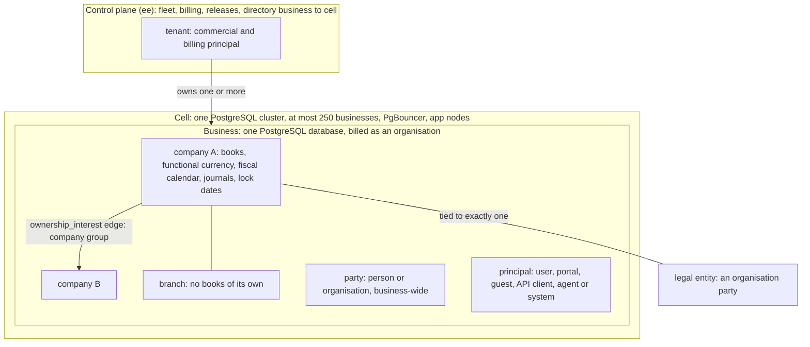

# Glossary

- **Status:** Draft 0.1
- **Date:** 2026-10-01
- **Scope:** Alphabetical glossary of the terms used across the obop documents: product, business and pricing, architecture, naming conventions, finance and compliance, tooling, and the Odoo terms with their obop counterparts.

**How to read.** [DECISIONS.md](DECISIONS.md) is binding and its section 4 ("Canonical vocabulary") is the authority for every word defined here; where this file and a research note differ, the register wins (D24). [CONVENTIONS.md](CONVENTIONS.md) ranks next and is the authority for the spelling of identifiers that more than one document uses (events, permission groups, data classes, states, ports); it settles no owner decision. Decisions are cited by ID (for example D6). Anything the owner has not ratified is written "Proposed (Dn)": that covers the licence (D1), the open/paid list (D2), the tiers, waves and calendar (D25, D26) and the release policy (D16). "(target)" is a design goal and "(estimate)" a model output; neither is a measurement, and nothing is built yet. Versions are as of 2026-10-01. Nothing here is legal advice.

## 1. Conventions and vocabulary map

### 1.1 Reading the tables

| Item | Meaning |
|---|---|
| Entry length | One to three sentences. Longer rules live in the linked document. |
| Used in | The document and section where the term is defined or used. Short labels such as "ARCHITECTURE 6.6" link to that section; "spec/" documents are under [spec/platform.md](spec/platform.md) and its siblings. |
| Odoo equivalent | The nearest Odoo concept, taken from the Odoo comparisons in the linked document. "-" means there is none or the comparison does not apply. "Community" and "Enterprise" appear only when they name Odoo editions (D24). |
| Decision status | FIXED (owner-mandated), BINDING (research-resolved), PROPOSED (needs ratification, written "Proposed (Dn)") and DEFERRED (decide later, with a trigger), as in [DECISIONS.md](DECISIONS.md) section 0. |
| Research tags | [R09 s5.3] means research file 09, section 5.3. Each tag used in this file is listed in section 5. |
| Dates | ISO 8601. M0 is 2026-10-01; W0 to W4 are release waves, never "phases". |

Terms are grouped by initial letter in section 2 and sorted word by word, ignoring punctuation and letter case. Section 3 lists the Odoo-origin terms with their obop counterparts. Section 4 lists deprecated and forbidden words.

Related documents: [CONVENTIONS.md](CONVENTIONS.md), [PRODUCT.md](PRODUCT.md), [ARCHITECTURE.md](ARCHITECTURE.md), [ROADMAP.md](ROADMAP.md), [BUSINESS.md](BUSINESS.md), [LOCALIZATION.md](LOCALIZATION.md), [ENGINEERING.md](ENGINEERING.md), [spec/platform.md](spec/platform.md), [spec/finance.md](spec/finance.md).

### 1.2 How the core vocabulary fits together

The words business, company, branch, organisation, tenant and cell name different levels of one structure. A tenant exists only in the control plane; everything below it is the data plane.

## 2. Glossary A to Z

### 2.1 A

| Term | Meaning | Used in | Odoo equivalent |
|---|---|---|---|
| **Account role** | A lower snake_case name for the function of a ledger account (`receivable`, `stock_valuation`, `grni`, `cogs`), resolved per company to a chart account. Modules request posting lines by role through `PostingPort`, never by account id. | [spec/finance 4.1.1](spec/finance.md#411-entities); [CONVENTIONS 6](CONVENTIONS.md#6-shared-entity-registry-and-state-machines) | - |
| **Accountant seat** | Proposed (D2): a free seat for an outside accountant, up to three per organisation on every plan and outside the full-user band. Each client is its own business, and the seat has MFA by default. | [BUSINESS 5](BUSINESS.md#5-pricing-hypotheses-proposed-d2); [PRODUCT 9](PRODUCT.md#9-editions-and-pricing-summary) | - |
| **Agent** | A principal of kind agent that acts for a user (delegated) or under its own service grants. Its permissions are the intersection of the delegating grants and its token scopes; it proposes through dry runs, creates drafts, never posts or pays without human approval, and can never approve a plan (D18). | [spec/ai 1.1](spec/ai.md#11-posture); [ARCHITECTURE 8.4](ARCHITECTURE.md#84-one-command-surface-for-humans-machines-and-agents) | Odoo 20 MCP tools run under a static per-user API key, and its AI features need IAP credits [R16 s2.1] |
| **App** | A module shown as a top-level menu entry (D24). A distribution unit is a "package", and only a package of kind `remote` is a "remote app". | [DECISIONS 4](DECISIONS.md#4-canonical-vocabulary); [ARCHITECTURE 4.2](ARCHITECTURE.md#42-modules); [PRODUCT](PRODUCT.md) | Application: a module with `application: True` in its manifest [R00 s3.5] |
| **Application Exception** | Proposed (D1) AGPL section 7 exception, modelled on Twenty's, under which third-party apps may carry any licence if they touch only documented interfaces. SDKs, WIT worlds and the UI SDK are Apache-2.0; X3 (Wasm) is the novel case counsel must confirm, and F1 is not covered. | [BUSINESS 3.3](BUSINESS.md#33-application-exception-and-extension-boundary); [ARCHITECTURE 9.3](ARCHITECTURE.md#93-packages-trust-and-compatibility) | Not needed in Odoo: LGPL-3 Community plus a proprietary Enterprise layer [R03 s3.1] |
| **Approvals engine** | One generic engine inside `automation` (W2) for every needs-approval case, human or agent: policies with a CEL condition, ordered steps, minimum approvals, delegation and escalation. Its modes `auto`, `confirm` and `approve_by_role` are the approval policy engine that D18 names a W2 deliverable. | [spec/platform 4.12](spec/platform.md#412-approvals-engine-inside-automation-w2); [spec/ai 4.3](spec/ai.md#43-write-protocol-and-approval-policy-kernel-w1-engine-in-automation-w2) | Approvals app (Odoo Enterprise) plus Odoo Studio approval rules [R15 s9] |
| **ARPA** | Average revenue per paying organisation per month. The plan assumes EUR 200 (plan mix 55/37/8 of Team, Growth and Scale, plus a 5% usage margin), and under EUR 150 at M24 (2028-10-01) triggers risk BR-08. It is a price-test hypothesis (Proposed, D2), not a measurement. | [BUSINESS 5.2](BUSINESS.md#52-price-check-and-benchmarks); [BUSINESS 9.1](BUSINESS.md#91-top-eight) | - |
| **ARR** | Annual recurring revenue. Proposed definition (D5): 12 times monthly recurring revenue from hosted subscriptions, `ee` subscriptions and the Assurance and payroll services, excluding one-off services, usage overage and pass-through. It gates hiring: at most 17 FTE before EUR 1M ARR (base case about M29). | [BUSINESS 6.7](BUSINESS.md#67-funding-plan-and-hiring-gates-proposed-d5); [ROADMAP 4.4](ROADMAP.md#44-hiring-gates-arr-gated-plan) | - |
| **Assurance service** | Proposed paid per-country service (D17, D2): legal-change SLA, filing connectors (an operated service over open code) and a capped warranty. Law-defined pack content stays open, and legal-compliance warranties are otherwise disclaimed by default (D38). | [LOCALIZATION 4.6](LOCALIZATION.md#46-funding-what-is-open-what-is-paid); [BUSINESS 4.2](BUSINESS.md#42-the-boundary) | - |
| **Audit file** | A statutory accounting export (DATEV, GoBD, FEC, SAF-T, JPK) that is a projection of the one ledger. All use the `AuditFileExporter` pack hook: generating the file is open, transmitting it is the paid Assurance connector. | [spec/finance 4.13](spec/finance.md#413-financial-reports-and-audit-trail); [LOCALIZATION 2.2](LOCALIZATION.md#22-charts-tax-templates-fiscal-positions-reports) | Mostly Enterprise: no `l10n_*_reports` module in the Community tree [R25 B1] |
| **Audit log** | Append-only, hash-chained record of field changes (`audit_change`) and security events (`security_event`) with signed checkpoints. UI and export are in the open edition (13-month default); WORM publication, SIEM streaming and multi-year tiering are on the paid list (Proposed, D2), and the existence of an audit log is never gated. | [spec/security-privacy 4.4](spec/security-privacy.md#44-audit-and-tamper-evidence); [ARCHITECTURE 6.4](ARCHITECTURE.md#64-integrity-in-the-database-legal-numbering-audit) | No general audit log in Community; the OCA `auditlog` module is Beta |
| **`auto_install`** | Manifest flag that installs a module in a business once its dependencies are present (D27 R7, per business). obop keeps the flag but replaces most glue modules with optional ports and TxEvents, so a bridge exists only to add storage or UI. | [ARCHITECTURE 4.2](ARCHITECTURE.md#42-modules); [DECISIONS D27](DECISIONS.md#d27-integration-contract) | Same manifest key; about 400 of 642 Community addon directories are `auto_install` glue [R00 s3.5] |

### 2.2 B

| Term | Meaning | Used in | Odoo equivalent |
|---|---|---|---|
| **Branch** | Subdivision of a company with no books of its own; it only tags documents. It is a separate table from `company` and dormant in W1, so a branch is never confused with a subsidiary, which is a company (D28). | [spec/platform 4.3](spec/platform.md#43-companies-branches-and-company-groups); [ARCHITECTURE 5.7](ARCHITECTURE.md#57-kernel-entity-model-d28) | A child company in Odoo's single company tree; a parent cannot later become a branch (D28) |
| **Bus database** | The one database per PostgreSQL cluster that hosts the coalescing notifier; each app node keeps one LISTEN connection, on the bus database only (D7). On single-business installs it is the business database. | [ARCHITECTURE 6.6](ARCHITECTURE.md#66-outbox-bus-database-and-wake-ups-d7) | `bus.bus` table signalled with `pg_notify` [R02 s12] |
| **Business** | The isolation and deployment unit: one PostgreSQL database with its module set, user directory, object-store prefix and backup unit (D6, D24). In the data plane it is never a "tenant", "instance" or "workspace". | [DECISIONS 4](DECISIONS.md#4-canonical-vocabulary); [ARCHITECTURE 6.2](ARCHITECTURE.md#62-database-per-business-cells) | A database; Odoo keeps one `Registry` per database [R02 s2.1] |
| **`BusinessTx` and `BusinessRouter`** | `BusinessTx` is the business-scoped transaction handle and the only way to obtain a database handle: it begins the transaction, drops to the restricted runtime role and sets company context. `BusinessRouter` picks the business database for a request. Both are renamed from `TenantTx` and `TenantRouter` (D24; the rename is Proposed). | [ARCHITECTURE 7.3](ARCHITECTURE.md#73-security-invariants-as-design-law-d33); [spec/security-privacy 4.3](spec/security-privacy.md#43-business-isolation) | `env`, the environment over a cursor [R02 s2.3] |
| **BYOK** | Bring your own key: a business supplies its own AI provider key or runs models locally. There is no obop credit wall; hosted credits are an optional paid convenience at cost plus 20% (D18). | [spec/ai 4.5](spec/ai.md#45-ai-gateway-byok-routes-egress-ledger-kill-switches-self-hosted-profile-ai-w3) | All AI metered through IAP credits in Odoo 20 [R03 s3.3] |

### 2.3 C

| Term | Meaning | Used in | Odoo equivalent |
|---|---|---|---|
| **camt.053** | The ISO 20022 XML account statement. With MT940 and CSV mapping it is a first statement-import format of `bank` in W1; OFX and QIF follow in W2 (Proposed, D25). | [spec/finance 4.5](spec/finance.md#45-payments-and-bank-reconciliation); [LOCALIZATION 2.4](LOCALIZATION.md#24-bank-formats) | Statement import is not in the Community 20.0 addons list; presumably Enterprise (inferred) |
| **CEL** | Common Expression Language (<https://cel.dev>): the only expression language stored in data (D11), used for conditions, formulas, visibility, validation and policies. The `cel` crate (0.14.5) documents no cost limit, so a W1 spike adds save-time limits (4 KB, AST depth 32), a step budget and a deadline. | [ARCHITECTURE 9.1](ARCHITECTURE.md#91-code-tiers-d11-and-ui-tiers); [spec/platform 4.13](spec/platform.md#413-automation-automation-w1) | Python expression strings run with `safe_eval` (see section 3, `ir.actions.server`) |
| **Cell** | One PostgreSQL cluster holding at most 250 business databases, with PgBouncer per cell, a control-plane directory from business to cell and stateless app nodes (D6). A cell is about 190k tables (estimate), so migrations are fleet jobs. | [ARCHITECTURE 3.2](ARCHITECTURE.md#32-deployment-profiles); [ARCHITECTURE 6.2](ARCHITECTURE.md#62-database-per-business-cells) | - |
| **Chart of accounts** | The country account list instantiated per company from a pack template. SKR03/04 (Germany) waits for written DATEV confirmation (D4) and BAS (Sweden) data never enters the public repository (D34); charts come from official sources, never from Odoo's data files. | [LOCALIZATION 3.6](LOCALIZATION.md#36-licensing-blockers); [spec/finance 4.1](spec/finance.md#41-ledger-kernel) | Chart template installed from an `l10n_*` package by company country [R01 s4] |
| **Chatter** | The record-bound conversation and task log: messages (comment, note, email in and out, system), followers with subtype subscriptions, activities and attachments. It is first-party (D39), and a model switches it on with the `threaded` capability flag, not by inheriting a base class. | [spec/platform 4.5](spec/platform.md#45-chatter-and-discuss-channels-mail-discuss); [spec/platform 4.1](spec/platform.md#41-kernel-entities-and-the-module-integration-contract) | Chatter via the `mail.thread` mixin (section 3) |
| **CLA** | Contributor licence agreement. Proposed (D1): a licence grant rather than an assignment, with a patent licence and an irrevocable "OSI licence forever" pledge; the signature bot is part of gate G0. | [BUSINESS 3.4](BUSINESS.md#34-cla-pledge-and-investor-covenant); [ENGINEERING 8](ENGINEERING.md#8-community-and-contribution-process) | Odoo also uses a licence-grant CLA [R03 s3.1], and a signature pull request must merge first [R28 C.2] |
| **Clean room** | Fixed constraint F3: Odoo is the functional reference, but obop copies no Enterprise or Community code, views, translations or assets and no OCA code. Behaviour comes from public documentation and Community source read for understanding; a running Odoo may serve only as a black-box differential oracle. | [DECISIONS 1](DECISIONS.md#1-fixed-constraints); [CLAUDE.md](../CLAUDE.md) | - |
| **Code tiers (X1 to X5)** | The five extension code tiers (D11): X1 declarative pack, X2 CEL, X3 Wasm component, X4 remote app, X5 first-party native crate. X1, X2 and X4 arrive in W1, X3 in W2; X5 is first-party only. R24's "T1 to T5" labels are retired (D24). | [ARCHITECTURE 9.1](ARCHITECTURE.md#91-code-tiers-d11-and-ui-tiers); [PRODUCT](PRODUCT.md); [BUSINESS 3.3](BUSINESS.md#33-application-exception-and-extension-boundary) | In-process Python modules with full database access; Odoo Online takes only data-only third-party modules [R24 s2.1] |
| **Company** | Ledger-owning scope of one legal entity: books, functional currency, fiscal calendar, journals, sequences and lock dates. It is flat and tied to one legal-entity party (D28); W1 ships one company and multi-company (selector, per-company books) arrives in W2 (Proposed, D25). | [ARCHITECTURE 5.7](ARCHITECTURE.md#57-kernel-entity-model-d28); [spec/platform 4.3](spec/platform.md#43-companies-branches-and-company-groups) | `res.company`, kept in one tree for branches and subsidiaries [R23 C.1] |
| **Company group** | A holding and its subsidiaries, modelled as `ownership_interest` edges between flat companies (D28); VAT groups are `fiscal_unit` rows. Intercompany mirroring arrives in W3 and consolidation in W4. Written "company group", never "group" alone. | [spec/finance 4.12](spec/finance.md#412-multi-company-intercompany-and-consolidation); [DECISIONS 4](DECISIONS.md#4-canonical-vocabulary) | The parent and child company tree; intercompany and consolidation are Enterprise [R23 C.1] |
| **Control plane and data plane** | Control plane: fleet, billing, releases and the business-to-cell directory (`ee`; the multi-business control plane is on the paid list). Data plane: business databases and app nodes. "Tenant" belongs to the control plane only (D24). | [DECISIONS 4](DECISIONS.md#4-canonical-vocabulary); [ARCHITECTURE 3.2](ARCHITECTURE.md#32-deployment-profiles) | - |
| **Plane (storage plane)** | One store of an instance's data that an operator protects separately: backed up, drilled and attested on its own. There is one today, `main` (the instance database); `--plane NAME` of `obop drill` and `obop storage check|attest` names it so that evidence belongs to one store when a second exists (D73; D75 to D77). Not the control plane or the data plane above, which are about who runs what. | [DECISIONS D73](DECISIONS.md) | - |
| **Conventions (naming authority)** | [CONVENTIONS.md](CONVENTIONS.md) fixes the spelling and ownership of every identifier that more than one document uses: forms by artefact, the cross-document event catalogue, the permission-group and data-class registries, shared entities and states, hub ports and provider traits, and the rename map. DECISIONS.md outranks it and it outranks ARCHITECTURE.md and every other document; Proposed items and owner questions stay open there. | [CONVENTIONS 1](CONVENTIONS.md#1-purpose-authority-and-change-procedure); [CONVENTIONS 8](CONVENTIONS.md#8-rename-map) | - |
| **Country pack** | A `pack` package that carries one jurisdiction's law as data plus trait implementations: charts, taxes, fiscal positions, report definitions, e-invoice formats, retention classes and translations. It is signed, effective-dated and shipped on its own channel because mandates move faster than releases (D34). | [LOCALIZATION 1.1](LOCALIZATION.md#11-definition); [LOCALIZATION 1.2](LOCALIZATION.md#12-why-a-separate-artefact) | An `l10n_*` module (section 3) that moves with the yearly major |
| **CRA** | EU Cyber Resilience Act. Art. 14 reporting (24 hours early warning, 72 hours notification, 14 days final report) has applied since 2026-09-11; main obligations apply from 2027-12-11, with a five-year minimum support period and free security updates. The company is the manufacturer and the steward the non-profit (Proposed, D17). | [ENGINEERING 6](ENGINEERING.md#6-cra-art-14-runbook-summary); [spec/security-privacy 4.8](spec/security-privacy.md#48-software-supply-chain-vulnerability-handling-and-the-cra) | - |

### 2.4 D

| Term | Meaning | Used in | Odoo equivalent |
|---|---|---|---|
| **Data Act** | EU Data Act (Regulation (EU) 2023/2854), applying since 2025-09-12; switching charges are prohibited from 2027-01-12. obop ships full export in every edition and puts the switching terms (2 months' notice, 30-day transition, 30-day retrieval, erasure) in the hosted contract before the first paid plan (D38). | [spec/integrations 4.9](spec/integrations.md#49-export-and-portability-base-t0-w1); [ENGINEERING 11.3](ENGINEERING.md#113-data-act-switching-terms-d38) | Self-hosted upgrades need a database copy sent to the vendor; export is per model [R04 s4.1] |
| **Data class** | A lower snake_case tag on columns that sets default readers and handling: `public_directory`, `internal`, `confidential_hr`, `special_category`, `financial` and `secret` (Proposed). `confidential_hr`, `special_category` and `financial` are the sensitive classes, kept in separate tables or columns behind `obop_cls_*` database roles. A data class is not a permission group or a retention class, and product cost and margin have no class (they sit behind the field permission `product.cost_viewer`). | [CONVENTIONS 5](CONVENTIONS.md#5-data-class-registry); [spec/security-privacy 4.2](spec/security-privacy.md#42-authorization) | - |
| **DATEV** | The German accountants' organisation and software vendor (over 40,000 members, per DATEV) that publishes the SKR03 and SKR04 charts. The DATEV export is one of the German audit files obop generates in the open edition; DATEV Connect online is partner-gated, and written DATEV confirmation of SKR03/04 is a D4 precondition. | [LOCALIZATION 3.3.1](LOCALIZATION.md#331-germany-l1-module-l10n_de-pack-l10n-de-w1); [LOCALIZATION 3.6](LOCALIZATION.md#36-licensing-blockers); [DECISIONS D4](DECISIONS.md#d4-first-market-icp-and-mvp-shape) | Odoo ships SKR03/04 and keeps the returns and exports in paid modules such as `l10n_de_reports` |
| **Decision record (D-ID)** | A numbered entry in [DECISIONS.md](DECISIONS.md) with a status: FIXED, BINDING, PROPOSED or DEFERRED. F1 to F4 are the fixed constraints, I-1 to I-4 the interpretations and Q1 to Q20 the open owner questions; a change needs a new ADR with the next free D-ID. | [DECISIONS 0](DECISIONS.md#0-front-matter-and-how-to-read); [DECISIONS 8](DECISIONS.md#8-open-questions-for-the-owner) | - |
| **Default-deny** | Access with no matching permission row is refused at model, field and action level. Every permission row declares a scope (`all`, `own`, `company` or `domain`), an implicit TRUE is a lint error, and a by-id read that fails returns 404, not 403 (D10). | [spec/security-privacy 4.2](spec/security-privacy.md#42-authorization); [ARCHITECTURE 7.2](ARCHITECTURE.md#72-the-algebra-d10) | Record rules were default-allow before 19.4 [R02 s3] |
| **Design partner** | An early customer organisation that acts as the acceptance test for scope: no new app is built without one, 3 to 5 are to be signed by the W0 exit (2026-12-31; none is signed as of 2026-10-01), and `mrp` and `pos` in W3 each need one (D25). | [ROADMAP 1](ROADMAP.md#1-principles) (PR1); [ROADMAP 2.3](ROADMAP.md#23-gates) (GT1); [PRODUCT 4.2](PRODUCT.md#42-principles) | - |
| **Domain (Domain AST)** | A filter over records held as a JSON AST (`And`, `Or`, `Not`, `Cond`) and compiled to SQL with bound parameters and identifiers taken only from the runtime registry. Odoo's prefix-list syntax is accepted as a front end (D22); JSON storage is Proposed (D12). | [ARCHITECTURE 5.3](ARCHITECTURE.md#53-domain-ast-to-sql); [spec/integrations 4.1](spec/integrations.md#41-public-rest-api-and-openapi-obop-http-t0-w1) | `Domain` AST with Polish-notation conditions (`&`, `\|`, `!`) [R02 s2.4], stored in records as Python-expression strings run with `safe_eval` [R02 s3] |
| **Dry run and `plan_id`** | `dry_run=true` on any mutation returns the diff, validation errors, risk tier and required approvals plus a `plan_id` that is digest-bound, principal-bound, time-limited and single-use. Committing a plan is idempotent on `plan_id`; if a touched record changed, commit returns 409 `plan_stale`. | [spec/ai 4.3](spec/ai.md#43-write-protocol-and-approval-policy-kernel-w1-engine-in-automation-w2); [ARCHITECTURE 8.4](ARCHITECTURE.md#84-one-command-surface-for-humans-machines-and-agents) | An optional preview on "Create Records"; no idempotency keys and no multi-call transaction [R16 s2.1, s5] |
| **Durable event** | An outbox-backed event delivered after commit: an `outbox_event` row plus one `outbox_delivery` row per subscriber, claimed with `SKIP LOCKED` and a lease, at-least-once and deduplicated by `inbox_processed(subscriber, event_id)`. Used for external I/O, webhooks, mail and indexing; architecture text never says "event" alone (D24, D27). | [ARCHITECTURE 4.3](ARCHITECTURE.md#43-the-integration-contract-d27); [ARCHITECTURE 6.6](ARCHITECTURE.md#66-outbox-bus-database-and-wake-ups-d7) | - |

### 2.5 E

| Term | Meaning | Used in | Odoo equivalent |
|---|---|---|---|
| **Edge command outbox** | The `command_outbox` table of the edge store: commands queued by a POS or warehouse shell, each with a UUIDv7 `command_id`, replayed server-side through normal domain services, where `unique(command_id)` gives exactly-once effects. It is not the server outbox. | [ARCHITECTURE 12](ARCHITECTURE.md#12-realtime-offline-and-sync); [spec/retail-commerce-marketing 4.1](spec/retail-commerce-marketing.md#41-point-of-sale-pos-obop-edge-store-hub-hardware-agent) | Browser offline cache of the POS |
| **Edge store** | `obop-edge`: a SQLite store with a fixed schema of at most 15 tables and `PRAGMA user_version` migrations, used by POS shells, the store hub and browser-only mode. It is never a projection of the server schema and has no runtime registry or ORM (D37). | [ARCHITECTURE 12](ARCHITECTURE.md#12-realtime-offline-and-sync); [DECISIONS D37](DECISIONS.md#d37-runtime-topology-and-edge-store) | Browser offline cache; Odoo 20 queues offline writes [R22 s2] |
| **`ee`** | The commercial code tree, shipped as separate artefacts, that holds only the closed paid list (control plane, native SAML, SIEM streaming and similar); its code converts to open 24 months after release (Proposed, D2). It is not an "Enterprise edition". | [BUSINESS 4.1](BUSINESS.md#41-offers); [ARCHITECTURE 15](ARCHITECTURE.md#15-repository-layout) | Odoo Enterprise, proprietary since Odoo 9.0 [R03 s2] |
| **Elevation (`Env<Elevated>`)** | A typed, audited escalation of access, with a reason and a reviewed list of code sites; it is the only way to bypass the permission algebra, and agents never hold it (D10). Break-glass access to a sensitive data class is such an elevation and also alerts security officers (Proposed). | [spec/security-privacy 4.2](spec/security-privacy.md#42-authorization); [ARCHITECTURE 7.2](ARCHITECTURE.md#72-the-algebra-d10) | `sudo()` (section 3) |
| **EN 16931** | European standard for the semantic model of an electronic invoice, used as obop's internal invoice semantics. UBL and CII syntaxes, XRechnung, Factur-X and Peppol BIS 3.0 are layered on it, and `per_group` rounding is mandatory for its output. | [spec/finance 4.6](spec/finance.md#46-e-invoicing-and-e-reporting); [ARCHITECTURE 6.3](ARCHITECTURE.md#63-keys-and-money-d9) | EN 16931 documents built in `account_edi_ubl_cii` [R09 s5.3] |
| **Envelope encryption** | Field-level scheme for a short catalogue of secrets and sensitive fields: a key-encryption key per business (local sealed file or OpenBao) wraps a random data key per record or field (AES-256-GCM, AAD bound to business, table, column and row id), with HMAC blind indexes for lookups. Cloud-KMS, HSM and customer-managed keys are paid (Proposed, D2). | [spec/security-privacy 4.5](spec/security-privacy.md#45-encryption-and-key-management) | - |
| **Erasure and DSAR** | A DSAR is a GDPR data subject access request, due one month from receipt and extendable by two months with notice. Erasure anonymises in place: personal fields are blanked on live records while posted ledger rows and numbers stay under their retention class and are purged when it lapses; an append-only erasure ledger is replayed after any restore. | [spec/security-privacy 4.6](spec/security-privacy.md#46-privacy-tooling); [ARCHITECTURE 7.3](ARCHITECTURE.md#73-security-invariants-as-design-law-d33) | - |
| **Event type** | The PascalCase name of an event, `<Aggregate><Fact>`, such as `SaleOrderConfirmed`, `InvoicePosted` or `TransferDone`: one name per fact, emitted only by the module that owns the aggregate. The delivery kind is T (TxEvent), D (durable event), T+D or SE (security log), and the webhook and MCP type is generated as `<aggregate_type>.<past participle>` (`sale_order.confirmed`). A command (`ValidateTransfer`) and an extension point (`BeforeInvoicePost`) are not events. | [CONVENTIONS 3](CONVENTIONS.md#3-event-catalogue); [ARCHITECTURE 4.3](ARCHITECTURE.md#43-the-integration-contract-d27) | - |
| **Exit drill** | Nightly job that copies the tree, rewrites `vite-plus` imports to upstream Vite, Vitest, Oxlint and Oxfmt and builds the copy (I-4: through pnpm scripts; ENGINEERING 2.4 proposes `vp install` and `vp exec` as the entry point), with a quarterly human review. It proves code portability if Vite+ is ever lost (D15, D23). It is the one place upstream tools run outside the bundled Vite+ toolchain (a throwaway copy; shipped builds always use `vp`), so it is a named exception to "`vp` only" that is Proposed (I-4; Q10, ENGINEERING Q-E2). | [ENGINEERING 2.4](ENGINEERING.md#24-exit-drill); [ENGINEERING 12](ENGINEERING.md#12-open-questions) (Q-E2); [DECISIONS 1.1](DECISIONS.md#11-pin-policy-what-latest-means-d23) (I-4, Q10); [ARCHITECTURE 10.1](ARCHITECTURE.md#101-toolchain-under-vp-and-pnpm) | - |
| **Expand, backfill, contract** | Mandatory tags on every migration: expand (additive), backfill (batched data move) and contract (destructive). CI rejects a contract in the release of its expand, and contracts and API removals ship only at `N.0` (D36; the `N.0` rule is Proposed, D16). | [ENGINEERING 4.3](ENGINEERING.md#43-destructive-changes-only-at-n0); [ARCHITECTURE 13.3](ARCHITECTURE.md#133-migrations-and-upgrades) | Per-module `pre`, `post` and `end` migration scripts [R02 s1] |
| **Extension** | Any third-party or business-own package (D24); never a "plugin" or "addon". Extensions reach obop through code tiers X1 to X4 and UI tiers F0 to F3, and in-process third-party Rust is unsupported (D11). | [DECISIONS 4](DECISIONS.md#4-canonical-vocabulary); [ARCHITECTURE 9](ARCHITECTURE.md#9-extension-platform) | An addon or custom module running in process |
| **Extension point** | A pre-step the owning module runs inside its own command, written `Before<Verb><Noun>` (`BeforeInvoicePost`, `BeforeTransferValidate`): a port with a chain of implementers, for example `stock_account` adding cost-of-goods lines before an invoice posts. It is run, not emitted, and is never an event. | [ARCHITECTURE 4.3](ARCHITECTURE.md#43-the-integration-contract-d27); [CONVENTIONS 3.6](CONVENTIONS.md#36-extension-points-commands-and-other-non-events) | - |
| **External id** | The stable `module.name` address of module-shipped and imported records. The `external_id` table keeps origin, module version and `content_hash`, so an upgrade never clobbers a customised record; the importers' identity ledger `external_ref` is a separate table. | [ARCHITECTURE 5.6](ARCHITECTURE.md#56-versioned-metadata-and-layers); [spec/integrations 4.8](spec/integrations.md#48-import-engine-and-migration-importers-base-t0-w0-engine) | `ir.model.data` (section 3) |

### 2.6 F to H

| Term | Meaning | Used in | Odoo equivalent |
|---|---|---|---|
| **Factur-X and ZUGFeRD** | Hybrid e-invoice: a PDF/A-3b document carrying CII XML. Factur-X 1.09.2 equals ZUGFeRD 2.5.2 (as of 2026-10-01), which is why the German and French packs share one format base. | [spec/finance 4.6](spec/finance.md#46-e-invoicing-and-e-reporting); [LOCALIZATION 3.1](LOCALIZATION.md#31-sequence-and-rationale) | Factur-X CII format class in `account_edi_ubl_cii` [R09 s5.3] |
| **Fiscal position** | Rule set that substitutes taxes and accounts by country, VAT-ID status (checked through VIES) and B2B or B2C, and carries reverse charge. It is instantiated per company from pack templates. | [spec/finance 4.4](spec/finance.md#44-tax); [LOCALIZATION 2.2](LOCALIZATION.md#22-charts-tax-templates-fiscal-positions-reports) | Fiscal position; the same concept |
| **Free forever and the ratchet** | Proposed (D2): the published, closed list of what stays free (every first-party app, REST, MCP and full export, multi-company, security fixes, the audit log), set against the paid list. The ratchet lets the lists move only from paid to open; `ee` code opens 24 months after release, and the CLA pledge and steward veto protect it. | [BUSINESS 4.3](BUSINESS.md#43-guard-rails-and-the-ratchet); [DECISIONS 6](DECISIONS.md#6-openpaid-boundary); [PRODUCT 9](PRODUCT.md#9-editions-and-pricing-summary) | Enterprise and Custom-plan gating of accounting, API and Studio [R03 s3.2, s3.3] |
| **Full user** | A user who creates or edits transactional records; the band unit of Proposed (D2) pricing (Team 5, Growth 25, Scale 100 plus). Portal users, up to three accountant seats and light users are not counted. | [BUSINESS 5](BUSINESS.md#5-pricing-hypotheses-proposed-d2); [PRODUCT 9](PRODUCT.md#9-editions-and-pricing-summary) | A paid per-user seat on the Standard or Custom plan [R03 s4.1] |
| **G0** | The public-repository gate: D1 to D3 ratified or cleared by counsel, the CLA bot live and the paid list published. The repository stays private until it passes, at the latest at 0.3 public alpha (2027-04-06) (Proposed, D26); what "counsel covers" means for D1 is open (Q16), so G0 has no settled date. Not to be confused with ARCHITECTURE's design goals G1 to G7. | [ROADMAP 2.3](ROADMAP.md#23-gates); [DECISIONS D26](DECISIONS.md#d26-release-waves-and-calendar); [DECISIONS 8](DECISIONS.md#8-open-questions-for-the-owner) (Q16) | - |
| **Gate ladder** | The D34 maturity ladder of a country pack: draft (edge channel), preview, stable, certified. Preview needs oracle passes on regulator examples; stable needs golden cases, recorded accountant or counsel sign-off and a signed release; a pack without golden cases cannot be stable. The channel mapping is Proposed. | [LOCALIZATION 1.4](LOCALIZATION.md#14-gate-ladder-and-channels); [ENGINEERING 1.7](ENGINEERING.md#17-golden-case-suites-and-oracles) | - |
| **Golden case** | A regulator- or accountant-sourced worked example with expected minor-unit results, used as a test fixture. Country packs and payroll packs need golden cases, including edge cases, to reach stable (D19, D34). | [ENGINEERING 1.7](ENGINEERING.md#17-golden-case-suites-and-oracles); [spec/people 4.10](spec/people.md#410-payroll-strategy) | - |
| **Hash chain** | Per-journal SHA-256 chain over posted ledger entries: `hash = SHA-256(prev_hash \|\| canonical(entry, lines))` with a version prefix and integer minor units. It is append-only and checked by `obop ledger verify` and the monthly restore drill; signed checkpoints to WORM storage are paid. | [spec/finance 4.1.4](spec/finance.md#414-legal-numbering-and-the-hash-chain); [ARCHITECTURE 6.4](ARCHITECTURE.md#64-integrity-in-the-database-legal-numbering-audit) | Odoo Community has a per-journal hash; obop adds a canonical integer form [R09 s4] |
| **Hub port** | A convergence port that keeps bridges linear instead of quadratic: `DemandPort` (implemented by `stock`), `QtyContributionPort` (`sales` for sale lines and `purchase` for purchase lines (Proposed)), `PostingPort` (`account`, by account role) and `InvoiceableSource` (implemented by `sales` and `subscriptions`, called by `invoicing`). D27 names the four ports; implementers beyond the first are Proposed until it is amended. | [ARCHITECTURE 4.3](ARCHITECTURE.md#43-the-integration-contract-d27); [CONVENTIONS 7.1](CONVENTIONS.md#71-hub-ports-d27) | `auto_install` glue modules [R01 s2.1] |

### 2.7 I to K

| Term | Meaning | Used in | Odoo equivalent |
|---|---|---|---|
| **ICP** | Ideal customer profile. Proposed (D4): owner-led firms with 5 to 50 people in services and light trade, one company, one country at a time, Germany first. | [BUSINESS 1.2](BUSINESS.md#12-icp-and-personas-proposed-d4); [PRODUCT](PRODUCT.md); [DECISIONS D4](DECISIONS.md#d4-first-market-icp-and-mvp-shape) | - |
| **Idempotency-Key and `command_id`** | Mutating API and agent calls take an `Idempotency-Key` header (up to 255 characters); whether it is required on plain CRUD or only accepted is open (integrations open question 11, Proposed). The first result, including a 5xx, is stored for at least 24 hours and replayed, the same key with a different payload returns 422 and an in-flight duplicate 409. A UUID key becomes the domain `command_id` (Proposed), which gives exactly-once effects (D9, D31); the `idempotency_key` column on a row is a different thing, a natural dedupe key. | [ARCHITECTURE 8.2](ARCHITECTURE.md#82-idempotency); [spec/integrations 4.1](spec/integrations.md#41-public-rest-api-and-openapi-obop-http-t0-w1); [spec/integrations 9](spec/integrations.md#9-open-questions); [CONVENTIONS 2.1](CONVENTIONS.md#21-forms-by-artefact) | None documented in JSON-2 [R16 s2.1] |
| **IDOR matrix** | Test matrix generated from the runtime registry (model, operation, permission group, relation) that asserts a denied by-id read returns the same non-leaking 404 by id, through export and through webhook replay. It must exist before any multi-business deployment (D36). | [ENGINEERING 1.6](ENGINEERING.md#16-registry-generated-idor-matrix); [ARCHITECTURE 7.2](ARCHITECTURE.md#72-the-algebra-d10) | - |
| **Interpretations I-1 to I-4** | Proposed readings of the fixed constraints, open as Q10: I-1 "Rust only" governs code obop authors (PostgreSQL and validators it merely runs are dependencies); I-2 `vp` is the entry point for every JS/TS command, with direct `pnpm` only where `vp` has no wrapper and CI failing on any lockfile other than `pnpm-lock.yaml`; I-3 "latest" means the newest release passing the pin policy; I-4 the nightly exit drill is a named exception to "`vp` only". | [DECISIONS 1](DECISIONS.md#1-fixed-constraints); [DECISIONS 8](DECISIONS.md#8-open-questions-for-the-owner) | - |
| **Journal entry** | Ledger header (`journal_entry`) with `journal_line` lines, in states draft, posted and reversed. A deferred trigger checks the balance once per posting, posted rows are immutable, and corrections are reversal entries (D30). | [spec/finance 4.1](spec/finance.md#41-ledger-kernel); [ARCHITECTURE 6.4](ARCHITECTURE.md#64-integrity-in-the-database-legal-numbering-audit) | `account.move` and `account.move.line`; balance is checked in the ORM only [R09 s1.3] |
| **KSeF** | Poland's central-clearance e-invoicing system (FA(3) XML; official TEST, DEMO and PROD environments). Mandatory from 2026-02-01 above PLN 200 million and from 2026-04-01 for others (smallest issuers 2027-01-01); the KSeF beta is W2 and the Polish pack reaches stable on 2028-08-31 (Proposed, D26). The hosted gateway is paid. | [LOCALIZATION 3.3.3](LOCALIZATION.md#333-poland-l1-module-l10n_pl-pack-l10n-pl-w3); [spec/finance 4.6](spec/finance.md#46-e-invoicing-and-e-reporting) | Odoo polls vendor bills every three hours and stores the UPO receipt [R09 s5.3] |

### 2.8 L to N

| Term | Meaning | Used in | Odoo equivalent |
|---|---|---|---|
| **Legal entity** | A juridical person, stored as an organisation `party`; a company is tied to exactly one. Never written "entity" alone (D24). | [DECISIONS 4](DECISIONS.md#4-canonical-vocabulary); [spec/platform 4.3](spec/platform.md#43-companies-branches-and-company-groups) | - |
| **Legal number** | Document number assigned only at posting from a row-locked counter per journal and fiscal year, late in the transaction; a rollback returns it. Gapless is a per-journal flag, on by default for sale journals, backed by a unique index and a nightly gap detector (D30). | [ARCHITECTURE 6.4](ARCHITECTURE.md#64-integrity-in-the-database-legal-numbering-audit); [spec/finance 4.1.4](spec/finance.md#414-legal-numbering-and-the-hash-chain) | Gaps tolerated and flagged afterwards [R09 s1.3] |
| **Light user** | A free self-service user (time off, expenses, timesheets, payslips, kiosk and POS operators, barcode), fair use up to 5x the number of full users (Proposed, D2). | [BUSINESS 5](BUSINESS.md#5-pricing-hypotheses-proposed-d2); [PRODUCT 9](PRODUCT.md#9-editions-and-pricing-summary) | The paid Light User tier (EUR 7.90, added by quote through an advisor; unit unverified) [R03 s4.1] |
| **Localisation maintenance tiers (L1 to L3)** | Proposed (D17) maintenance tiers of country packs: L1 obop core team (DE, FR, PL and the shared EU pack), L2 paid local partners (AT and CH in W3; BE, NL, ES, IT and Nordics in W4), L3 community volunteers. R25's "T1 to T3" labels are retired (D24). | [LOCALIZATION 1.3](LOCALIZATION.md#13-maintenance-tiers) | OCA-maintained localisation modules [R25 B1] |
| **Lock date** | A date at or before which posting is refused: fiscal (all journals), sale, purchase, tax, and an irreversible hard lock, with time-boxed audited per-principal exceptions. Database triggers enforce it on entries, lines and generated entries (D30). | [spec/finance 4.1.5](spec/finance.md#415-fiscal-calendar-and-lock-dates); [ARCHITECTURE 6.4](ARCHITECTURE.md#64-integrity-in-the-database-legal-numbering-audit) | Company lock dates with time-boxed per-user exceptions (`account.lock_exception`) in Odoo 20 [R09 s1.3] |
| **LTS and series** | Proposed (D16): two release series a year (third Tuesday of April and October); `N.0` is an LTS with five years of support (years 0 to 2 full, 2 to 5 security and legal-critical), `N.1` to `N.3` get 9 months. The first is 1.0 LTS on 2028-04-18; contract migrations and API removals happen only at `N.0`. | [ENGINEERING 4.2](ENGINEERING.md#42-series-support-and-the-patch-train); [PRODUCT](PRODUCT.md); [DECISIONS D16](DECISIONS.md#d16-release-lts-and-deprecation) | A yearly major; Odoo 20.0 has standard support to September 2029 (planned) [R00 s3.5] |
| **M0 and M9** | Month notation: M0 is 2026-10-01 and "Mn" is n months later, so M9 is 2027-07-01 and M24 is 2028-10-01. | [DECISIONS 0](DECISIONS.md#0-front-matter-and-how-to-read); [ROADMAP](ROADMAP.md#roadmap-waves-calendar-milestones-team-gates) | - |
| **MCP** | Model Context Protocol. obop serves it at `/mcp` (spec 2026-07-28, stateless Streamable HTTP, through `rmcp` 3.5.0), with tools generated from the runtime registry's operation metadata, OAuth 2.1 and per-principal tool lists. Annotations are advertised, never trusted for enforcement. | [spec/integrations 4.4](spec/integrations.md#44-mcp-endpoint-t0-w1); [spec/ai 4.1](spec/ai.md#41-agent-surface-and-mcp-server-kernel-t0-w1) | `/mcp` with a static per-user API key and five default tools [R21 s2.1] |
| **Migration ledger** | The append-only record of applied migrations (module, id, kind, checksum, applied_at, app version). It starts at 0.1 preview (2026-12-01) and is never squashed inside an LTS line; chain tests run N-1 from 0.3 and N-2 plus a 1,000-business fan-out from 0.5 (D36). | [ARCHITECTURE 13.3](ARCHITECTURE.md#133-migrations-and-upgrades); [ENGINEERING 1.5](ENGINEERING.md#15-migration-chain-tests) | Per-module `migrations/<version>/{pre,post,end}` scripts [R02 s1] |
| **Module** | A first-party unit with a manifest, an `*-api` crate and an implementation crate, installed per business (D24). Never an "addon" or "plugin". Its id is lower snake_case, and a bridge joins two ids (`stock_account`) and is specified in one spec. | [DECISIONS 4](DECISIONS.md#4-canonical-vocabulary); [ARCHITECTURE 4.2](ARCHITECTURE.md#42-modules); [CONVENTIONS 2.1](CONVENTIONS.md#21-forms-by-artefact) | Module (addon) with an `__manifest__.py` [R02 s1] |
| **Module tiers (T0 to T3)** | Proposed (D25): T0 kernel, present in every business; T1 must-have, without which the product is not a business OS; T2 second wave; T3 long tail (also the default for unlisted modules). Tier answers "is a business OS complete without it"; wave answers "when". | [DECISIONS 5.1](DECISIONS.md#51-tiers); [PRODUCT](PRODUCT.md) | - |
| **Money and minor units** | Ledger money is `bigint` minor units plus `currency_code`, with the exponent held as data; unit prices are `NUMERIC(24,8)`, quantities `NUMERIC(24,6)` and FX rates `NUMERIC(28,14)`. Rounding is per company, `per_line` or `per_group`, and floats are banned (D9). | [ARCHITECTURE 6.3](ARCHITECTURE.md#63-keys-and-money-d9) | Float quantities and one global unit precision [R10 s3.3] |
| **MRR** | Monthly recurring revenue. In funding it is the base of recurring ARR (12 times MRR); in `subscriptions` (T2, W3) an append-only ledger records each movement (new, expansion, contraction, churn, reactivation) and emits `MrrMovementRecorded`. | [BUSINESS 6.7](BUSINESS.md#67-funding-plan-and-hiring-gates-proposed-d5); [spec/sales-crm 4.5](spec/sales-crm.md#45-subscriptions-subscriptions) | Subscription MRR reports in Odoo Enterprise; the ledger goes beyond them |
| **MT940** | The older SWIFT text format for bank account statements. It is imported in W1 by `bank` beside camt.053. | [spec/finance 4.5](spec/finance.md#45-payments-and-bank-reconciliation); [LOCALIZATION 2.4](LOCALIZATION.md#24-bank-formats) | Statement import is not in the Community 20.0 addons list; presumably Enterprise (inferred) |
| **Named action** | A permission written `<module>.<action>`, such as `stock.validate`, `sales.price_override` or `hr.correct`, granted by rows of a permission group. It is a permission, not a group; the standard operations are `read`, `write`, `create`, `delete` and `export`. | [CONVENTIONS 4](CONVENTIONS.md#4-permission-group-registry) | - |
| **NOTIFY** | Forbidden in business transactions, because the commit takes a cluster-wide lock and LISTEN is per database; only `obop-bus-notifier` may call it, enforced by CI (D7). Wake-up ladder: in-process `tokio::sync::Notify`, a coalescing notifier (at most 10 per second per node), then polling at 250 ms to 2 s. | [ARCHITECTURE 6.6](ARCHITECTURE.md#66-outbox-bus-database-and-wake-ups-d7); [DECISIONS D7](DECISIONS.md#d7-realtime-and-queue-signalling) | `bus.bus` plus `pg_notify` [R02 s12] |

### 2.9 O

| Term | Meaning | Used in | Odoo equivalent |
|---|---|---|---|
| **`obop.toml`** | The one manifest for every package kind (`pack`, `wasm`, `remote`, `native`, `theme`): id, version, compatibility ranges, capability manifest and limits. It replaces R02's `module.toml` and R21's `obop.app.toml` (D32). | [ARCHITECTURE 9.3](ARCHITECTURE.md#93-packages-trust-and-compatibility) | `__manifest__.py`, a Python dict with `depends`, `data`, `auto_install` and `application` [R02 s1] |
| **Open edition** | Everything under AGPL (Proposed, D1); there is one codebase and no "Community" or "Enterprise" edition in Odoo's sense (D24). What is sold is operation and assurance, listed on the paid list. | [BUSINESS 4.1](BUSINESS.md#41-offers); [DECISIONS 6](DECISIONS.md#6-openpaid-boundary); [PRODUCT](PRODUCT.md) | Odoo Community (LGPL-3) [R03 s3.1] |
| **Oracle** | An off-the-shelf program or regulator sandbox that decides conformance in CI: CEN artefacts, the KoSIT XRechnung validator (Java), Mustang, phase4, KSeF TEST and DEMO. Oracles run only in CI images (I-1), and Odoo may serve only as a black-box differential oracle (F3). | [ENGINEERING 1.7](ENGINEERING.md#17-golden-case-suites-and-oracles); [LOCALIZATION 4.3](LOCALIZATION.md#43-oracles-and-conformance-gates) | - |
| **Organisation** | The customer-facing name and billing unit for one business; Proposed (D2) pricing is per organisation, banded by full users. Not a legal person (use "legal entity"). | [DECISIONS 4](DECISIONS.md#4-canonical-vocabulary); [BUSINESS 5](BUSINESS.md#5-pricing-hypotheses-proposed-d2); [PRODUCT](PRODUCT.md) | Odoo prices per user, not per organisation [R03 s4.1] |
| **ORM (in-house)** | The ORM driven by the runtime registry, on sqlx 0.9.0 and sea-query 1.0.2; SeaORM 2.0.4 is used only for fixed system tables. sqlx pools exist only inside `obop-orm`, and the Domain AST compiles to SQL with bound parameters (D29). | [ARCHITECTURE 1.3](ARCHITECTURE.md#13-technology-stack-at-a-glance); [ARCHITECTURE 5.3](ARCHITECTURE.md#53-domain-ast-to-sql) | The Odoo ORM (recordsets, one `Registry` per database) [R02 s2] |
| **OSS** | One-Stop Shop: the EU scheme for declaring VAT on cross-border B2C sales in one home-country return (EUR 10,000 threshold; quarterly and monthly returns). obop carries OSS mappings in tax templates and fiscal positions and OSS report definitions in the `l10n-eu` pack; OSS reporting is W2. | [LOCALIZATION 3.2](LOCALIZATION.md#32-shared-base-w0-w1); [spec/finance 4.4](spec/finance.md#44-tax) | OSS reporting is in Odoo Community; the national VAT returns are Enterprise |
| **Outbox** | The `outbox_event` and `outbox_delivery` rows written in the same transaction as a command. Dispatchers claim deliveries with `SKIP LOCKED` and a lease; the queue the edge shells use is the edge command outbox, not this. | [ARCHITECTURE 6.6](ARCHITECTURE.md#66-outbox-bus-database-and-wake-ups-d7) | - |
| **Oxfmt** | The Rust formatter bundled in Vite+ (0.70.0, still 0.x, as of 2026-10-01), run through `vp fmt` or `vp check`. | [ARCHITECTURE 1.3](ARCHITECTURE.md#13-technology-stack-at-a-glance); [ENGINEERING 2.3](ENGINEERING.md#23-vite-and-pnpm-driven-by-vp) | - |
| **Oxlint** | The Rust linter bundled in Vite+ (1.85.0 as of 2026-10-01), run through `vp lint` or `vp check`; its `jsx-a11y` rules are part of the accessibility gate. It cannot ban physical CSS margins, so a separate CI check does. | [ENGINEERING 1.8](ENGINEERING.md#18-accessibility-and-ui-gates); [spec/ux 4.9](spec/ux.md#49-design-system-and-theming) | - |

### 2.10 P

| Term | Meaning | Used in | Odoo equivalent |
|---|---|---|---|
| **PA (plateforme agréée)** | A private platform accredited by the French tax administration for e-invoicing and e-reporting, formerly "PDP"; the public PPF portal is reduced to a directory. obop integrates with a PA through its API and does not accredit one (Proposed, D17); FR pack stable is 2028-03-31. | [LOCALIZATION 3.3.2](LOCALIZATION.md#332-france-l1-module-l10n_fr-pack-l10n-fr-w2); [spec/finance 4.6](spec/finance.md#46-e-invoicing-and-e-reporting) | Odoo is itself a certified PA (`l10n_fr_pdp`) [R09 s5.2] |
| **Pack** | A package of kind `pack`: declarative data (X1, X2), optionally plus code, validated against the runtime registry (D32). A country pack is a localisation pack; a paid service is never called a pack. | [DECISIONS 4](DECISIONS.md#4-canonical-vocabulary); [LOCALIZATION 1.1](LOCALIZATION.md#11-definition) | Data files loaded from the manifest; `noupdate` protects edits [R02 s11] |
| **Pack stable** | The `stable` rung of the pack gate ladder, distinct from any release milestone. Dates (Proposed, D26): DE 2027-09-30, FR 2028-03-31, PL 2028-08-31, each needing oracle runs, golden cases, accountant sign-off and a signed pack release. | [ROADMAP 2.1](ROADMAP.md#21-what-the-milestone-words-mean); [PRODUCT](PRODUCT.md); [LOCALIZATION 1.4](LOCALIZATION.md#14-gate-ladder-and-channels) | - |
| **Package** | The distribution unit in the package registry, described by `obop.toml`; kinds are `pack`, `wasm`, `remote`, `native` and `theme` (D24, D32). | [DECISIONS 4](DECISIONS.md#4-canonical-vocabulary); [ARCHITECTURE 9.3](ARCHITECTURE.md#93-packages-trust-and-compatibility) | - |
| **Package registry** | The service that distributes signed OCI artefacts with trust levels, review tooling, compatibility results and a kill switch; package registry alpha in W2, marketplace commerce in W4. Whether the package registry server is open or `ee` is unsettled. Never just "the registry", which is the runtime registry. | [spec/integrations 4.7](spec/integrations.md#47-package-registry-and-marketplace-t0-w2-commerce-w4); [ARCHITECTURE 16.3](ARCHITECTURE.md#163-open-questions) | The Odoo Apps store, which keeps 30% of sales [R03 s6.2] |
| **Paid beta** | Proposed (D26): the 0.5 public and paid beta on 2027-07-06, when paid plans open; it is the first commercial offer, so CRA duties start, and the hosted contract carries the Data Act switching terms. The SLA plan follows on 2027-10-01. | [ROADMAP 2.1](ROADMAP.md#21-what-the-milestone-words-mean); [PRODUCT](PRODUCT.md); [ENGINEERING 4.1](ENGINEERING.md#41-calendar-and-engineering-gates) | - |
| **Paid list** | Proposed (D2): the published, closed, ratcheting list of paid items, limited to operation and assurance (native SAML and full SCIM, WORM audit publication, cloud-KMS and HSM, fleet DR, the multi-business control plane, white-label, hosted AI credits, hosting, support, the Assurance service, hosted gateways). It only moves from paid to open; security fixes, export, the API, multi-company, ledger integrity and the existence of an audit log are never gated. | [DECISIONS 6](DECISIONS.md#6-openpaid-boundary); [BUSINESS 4.3](BUSINESS.md#43-guard-rails-and-the-ratchet); [PRODUCT](PRODUCT.md) | Enterprise and Custom-plan gating of accounting, API and Studio [R03 s3.2, s3.3] |
| **Partner** | A channel, implementation, hosting or localisation partner (commercial). Never a contact or customer; in data that is a party. | [DECISIONS 4](DECISIONS.md#4-canonical-vocabulary); [BUSINESS 7.1](BUSINESS.md#71-partner-types-and-comparator) | Odoo partner programme [R03 s6.1] |
| **Party** | A person or organisation in the data model (D28). Typed addresses, identifiers and bank accounts hang off it; customer and vendor are per-company roles in `party_profile`, not tables, and principals are never parties. | [spec/platform 4.2](spec/platform.md#42-contacts-parties); [ARCHITECTURE 5.7](ARCHITECTURE.md#57-kernel-entity-model-d28) | `res.partner` (section 3) |
| **Payroll engine** | A generic rule engine in core (CEL, decimals, explainable and reproducible runs) with separately versioned country packs and provider connectors; no statutory filing in core and no AI in hiring decisions by default (D19). Rule content is open; the warranted payroll service is paid (Proposed). | [spec/people 4.10](spec/people.md#410-payroll-strategy); [LOCALIZATION 2.6](LOCALIZATION.md#26-payroll-stance) | Odoo Payroll (Enterprise since 13.0) with Python expressions in rule records [R13 s1, s4.2] |
| **Peppol** | Cross-border e-document network. obop sends Peppol BIS Billing 3.0.21 (mandatory 2026-08-17) through a certified partner access point in W1 and runs its own access point only near 250 businesses (Proposed, D17); the hosted Peppol gateway is paid. | [spec/finance 4.6](spec/finance.md#46-e-invoicing-and-e-reporting); [LOCALIZATION 4.2](LOCALIZATION.md#42-certification-and-declarations) | Peppol relayed through Odoo's IAP proxy (`account_peppol`) [R09 s5.3] |
| **Permission group** | A named bundle of permission rows with transitive implied groups, written `<module>.<role>` (for example `account.manager`, `pos.cashier`, `hr.admin`). Never "group" alone, and never "role" outside UI copy (D24); a named action such as `stock.validate` is a permission granted by group rows, not a group. | [spec/platform 4.4](spec/platform.md#44-principals-and-permission-groups); [DECISIONS 4](DECISIONS.md#4-canonical-vocabulary); [CONVENTIONS 4](CONVENTIONS.md#4-permission-group-registry) | `res.groups` [R02 s3] |
| **Permission row and restriction row** | The rows of the D10 algebra: effective access is OR(permission rows) AND AND(restriction rows). Permission rows bind to a permission group; restriction rows (company, soft-delete, embargo, residency) only narrow. Never "ACL" or "record rule". | [ARCHITECTURE 7.2](ARCHITECTURE.md#72-the-algebra-d10); [spec/security-privacy 4.2](spec/security-privacy.md#42-authorization) | `ir.access` (section 3) |
| **Pin policy** | The D23 definition of "latest" (Proposed, applied provisionally; Q10): a Rust release is eligible at x.y.1, or at x.y.0 after 14 days with no open regression; `vite-plus` must be at least 7 days old and pass the exit drill, a LICENSE/NOTICE diff, a single-copy check and the tests. Today: Rust 1.98.1 (1.98.0 skipped), `vite-plus` 1.0.0 eligible 2026-10-05, Node 24 LTS; which pnpm major to pin, 11.x or 12.x, is open (Q15). | [DECISIONS 1.1](DECISIONS.md#11-pin-policy-what-latest-means-d23); [ENGINEERING 2.2](ENGINEERING.md#22-rust-cargo-workspace-and-pinned-toolchain) | - |
| **Plans (Free, Team, Growth, Scale)** | The Proposed (D2) hosted plans per organisation per month on yearly billing: Free EUR 0, Team EUR 49, Growth EUR 249 and Scale from EUR 899, banded by full users. All prices are hypotheses to test. Growth is not called "Business" because D24 reserves business for the isolation unit (section 4). | [BUSINESS 5.1](BUSINESS.md#51-plans-yearly-billing); [PRODUCT 9](PRODUCT.md#9-editions-and-pricing-summary) | Standard and Custom plans priced per user [R03 s4.1] |
| **pnpm** | The only package manager (F2). It installs from the public npm registry, is pinned to one exact version with `vp env pin` and `packageManager` (the major, 11.x or 12.x, is open: Q15), and runs with `minimumReleaseAge` of at least 7 days, `trustPolicy: no-downgrade`, `blockExoticSubdeps` and `strictDepBuilds`; only `pnpm-lock.yaml` is committed. It is reached through `vp` (I-2, Proposed). Direct use appears in two places, both pending the owner's ruling (Q10, ENGINEERING Q-E2): the nightly exit drill, a named exception that is Proposed (I-4; see Exit drill), and the JavaScript SBOM and licence scan (`pnpm sbom`, `pnpm licenses list`, run as `vp env exec pnpm ...` or in a `vp run` task), because `vp pm sbom` and `vp pm licenses` do not exist in vite-plus 1.0.0. | [ENGINEERING 2.3](ENGINEERING.md#23-vite-and-pnpm-driven-by-vp); [CLAUDE.md](../CLAUDE.md) | - |
| **PO and ICU MessageFormat** | Translation format (D34): PO catalogues with an ICU MessageFormat 1 subset, Lingui on TypeScript, a PO parser and `icu` in Rust, and Weblate as the platform; machine translation is a suggestion and banned for statutory labels. MessageFormat 2 is reviewed in 2027-H2. | [LOCALIZATION 5.1](LOCALIZATION.md#51-format-and-toolchain-d34-binding); [spec/platform 4.19](spec/platform.md#419-multi-language) | PO files per module synced from Weblate [R25] |
| **Port** | A Rust trait in a `*-api` crate, implemented by its owner; optional ports are `Option<Arc<dyn Port>>` and need no bridge module. A "hub port" is a convergence port. Never a network port unqualified (D24, D27). | [ARCHITECTURE 4.3](ARCHITECTURE.md#43-the-integration-contract-d27) | `_inherit` glue in `auto_install` bridge modules (D27) |
| **POS fiscal adapter** | The trait behind point-of-sale fiscal compliance with three implementations: `LocalDevice` (in the hardware agent), `CloudSigner` and `ChainedSoftware`. Germany first (certified TSE through a cloud signer), in W3 with `pos`; the French NF525 and other national adapters come later or through L2 partners. | [LOCALIZATION 2.5](LOCALIZATION.md#25-pos-fiscal-adapters); [spec/retail-commerce-marketing 4.1](spec/retail-commerce-marketing.md#41-point-of-sale-pos-obop-edge-store-hub-hardware-agent) | Country modules, partly outside Community |
| **Principal** | An acting identity: user, portal user, guest, API client, agent or system (D28). Never called a "bot", and never a party subtype; `party_id` is optional. | [spec/platform 4.4](spec/platform.md#44-principals-and-permission-groups); [spec/security-privacy 4.1](spec/security-privacy.md#41-identity-and-authentication) | `res.users`, which inherits `res.partner` [R02 s3] |
| **Process role** | One binary, started with `--roles`: `http`, `cron`, `bus`, `ext`, `hub` or `all`. The responsibility split is a Proposal; operator work such as `obop migrate` is a subcommand, not a role. | [ARCHITECTURE 3.1](ARCHITECTURE.md#31-one-binary-process-roles) | Threaded, prefork and gevent server modes [R02 s12] |
| **Provider trait** | A Rust trait for an external capability, named for its role rather than ending in `Port`: `PaymentProvider`, `CarrierProvider`, `SmsProvider`, `LlmProvider`, `BankFeed`, `ExchangeRateSource`, `EDocTransport`, `FiscalAdapter`. Native adapters, pack hooks and connectors implement it, and hub and module ports keep the `Port` ending. | [CONVENTIONS 7.3](CONVENTIONS.md#73-provider-traits-and-pack-hooks); [ARCHITECTURE 4.3](ARCHITECTURE.md#43-the-integration-contract-d27) | - |

### 2.11 Q and R

| Term | Meaning | Used in | Odoo equivalent |
|---|---|---|---|
| **Quant** | On-hand stock per (company, product, location, lot, package, owner), held under one `UNIQUE NULLS NOT DISTINCT` key and changed only by one upsert. Reservation is a conditional atomic update, and done moves are immutable (D30). | [spec/supply-chain 4.1.2](spec/supply-chain.md#412-hard-problems-and-solutions) | `stock.quant`, where duplicates are tolerated and merged later [R10 s3.2] |
| **Reconciliation** | Matching bank statement lines to payments and invoice open items. Partials are append-only, an exchange-difference entry closes a match that is zero in line currency, and suggestions come from `reconcile_model` rules; AI may rank candidates but never posts. | [spec/finance 4.1.6](spec/finance.md#416-reconciliation-model); [spec/finance 4.5](spec/finance.md#45-payments-and-bank-reconciliation) | The reconciliation widget, an Enterprise feature [R09 s1.1] |
| **Registry** | The runtime model registry, `Arc<Registry>` per business, built from typed Rust models and business rows (`meta_model`, `meta_field`, `meta_selection`). It drives the ORM, API, OpenAPI, MCP, views, access, webhooks, imports, docs and the semantic layer (D29). Not the package registry, crates.io or the npm registry. | [ARCHITECTURE 5.1](ARCHITECTURE.md#51-one-registry-two-sources); [DECISIONS D29](DECISIONS.md#d29-registry-orm-and-rust-stack) | The `Registry` object, one per database [R02 s2.1] |
| **Reversal document** | The only correction for posted or done documents: a credit note is a reversal with commercial lines, and done stock moves are corrected by new moves plus adjustment entries. There is no reset to draft (D30). | [spec/finance 4.1.2](spec/finance.md#412-posting-rules); [spec/supply-chain 4.1.2](spec/supply-chain.md#412-hard-problems-and-solutions) | Correction rules depend on a company audit-trail setting (`restrictive_audit_trail`) [R09 s1.3] |
| **Ring** | A hosted-fleet rollout stage (Proposed): ring 0 is obop's own businesses (24-hour bake), ring 1 one canary cell (48 hours), ring 2 a quarter of cells (72 hours), ring 3 the rest. A ring halts above 2% business failures; state lives in `business_release_state`. | [ENGINEERING 4.6](ENGINEERING.md#46-hosted-fleet-rings); [ARCHITECTURE 13.3](ARCHITECTURE.md#133-migrations-and-upgrades) | - |
| **RLS** | Row-level security used as a fixed row-local backstop (FORCE, a non-owner non-BYPASSRLS role, `set_config(..., true)`), never as the rule engine, which is the D10 algebra. `COPY FROM` is rejected on RLS tables, so bulk import stages through non-RLS tables. | [ARCHITECTURE 6.8](ARCHITECTURE.md#68-rls-as-a-backstop); [DECISIONS D10](DECISIONS.md#d10-authorization-algebra-and-rls) | - |
| **Rolldown** | The Rust bundler inside Vite 8 (1.2.11 in the Vite+ 1.0.0 bundle, as of 2026-10-01). Its output behaviour "may still change" [R07 s1.3], so the first reproducible double builds show whether the embedded frontend bundle is deterministic. | [ARCHITECTURE 1.3](ARCHITECTURE.md#13-technology-stack-at-a-glance); [ENGINEERING 5.2](ENGINEERING.md#52-signing-attestation-sbom-reproducibility) | - |

### 2.12 S

| Term | Meaning | Used in | Odoo equivalent |
|---|---|---|---|
| **SBOM and attestation** | Releases carry CycloneDX SBOMs (1.5 for now), cosign keyless signatures and GitHub artifact attestations (SLSA v1.0 Build L2, L3 via a reusable workflow), and are built twice to compare hashes. Artefacts, SBOMs and attestations are kept 10 years (D36). | [ENGINEERING 5.2](ENGINEERING.md#52-signing-attestation-sbom-reproducibility); [ARCHITECTURE 7.4](ARCHITECTURE.md#74-supply-chain-and-cra) | - |
| **Schema manager** | `obop-schema`: the only crate that issues DDL. It diffs the runtime registry against `pg_catalog` into a plan whose steps are classed Instant, Concurrent, Blocking or Rewrite, runs under `lock_timeout` and drops columns in two phases. | [ARCHITECTURE 5.5](ARCHITECTURE.md#55-custom-field-ddl-the-schema-manager); [spec/platform 4.14](spec/platform.md#414-customization-customize-proposed) | Schema updated on module install or upgrade (`-u`) [R02 s1] |
| **Semantic layer** | Measures, dimensions and cubes declared in the runtime registry and queried through one typed `SemanticQuery` (measures, dimensions, filters, grain, target currency, rate type, company scope). Pivots, reports and agents share it under the caller's access; raw text-to-SQL is not offered (D18). | [spec/ai 4.4](spec/ai.md#44-semantic-layer-and-ask-analytics-t0-w1-ask-in-ai-w3); [spec/platform 4.17](spec/platform.md#417-reporting-and-bi-analytics-obop-report) | `read_group` and pivot views |
| **SEPA** | Single Euro Payments Area. W1 `payment` ships SEPA credit-transfer batches (pain.001, with maker-checker) and the invoice PDF carries a SEPA (EPC) QR code; direct debit (pain.008, mandates) follows in W2 (Proposed). | [spec/finance 4.5](spec/finance.md#45-payments-and-bank-reconciliation); [spec/finance 4.2](spec/finance.md#42-invoicing) | No batch or SEPA file module in the Community 20.0 addons list; presumably Enterprise (inferred) |
| **SES** | Simple electronic signature: a typed or drawn signature kept with an evidence bundle (document hash, IP address, user agent), the level obop provides itself. Advanced or qualified signatures come only through qualified trust service provider (QTSP) connectors (W3 to W4), and obop never self-labels a signature as advanced or qualified (D39). | [spec/platform 4.11](spec/platform.md#411-sign-sign-w3-acceptance-evidence-w1); [DECISIONS D39](DECISIONS.md#d39-collaboration-and-messaging-services) | Odoo 20 Enterprise offers qualified signatures through itsme |
| **Seven-app loop** | The Proposed (D4) W1 scope: Contacts and Products, CRM, Sales, Inventory with Purchase, Invoicing with Accounting, Payments, and Portal with PDF and email documents and attachments (the `documents` DMS app is W3, D25). They are seven user-facing capabilities, not seven modules (PRODUCT 3.1, a Proposed reading); a free compliant-invoicing on-ramp expands into them, and the Team plan includes all loop apps. | [PRODUCT 3.1](PRODUCT.md#31-ideal-customer-proposed-d4); [PRODUCT 5.2](PRODUCT.md#52-the-loop-and-the-platform-underneath); [DECISIONS D4](DECISIONS.md#d4-first-market-icp-and-mvp-shape) | - |
| **Sideloading** | Installing a package outside the package registry. It is always allowed; on shared cloud it is limited to X1 to X4, and the marketplace take rate never applies to sideloads (D32, D2). | [spec/integrations 4.7](spec/integrations.md#47-package-registry-and-marketplace-t0-w2-commerce-w4); [ARCHITECTURE 9.3](ARCHITECTURE.md#93-packages-trust-and-compatibility) | - |
| **Spike** | A time-boxed experiment with a numeric pass threshold. S1 (NOTIFY contention), S2 (250-database cell) and S3 (UUID size) read out on 2026-11-27 and freeze D6, D7 and D9; S4 to S11 are scheduled with the feature they gate. Thresholds are design targets, not measurements. | [ARCHITECTURE 16.1](ARCHITECTURE.md#161-spikes); [ROADMAP 3.2](ROADMAP.md#32-month-one-and-two-the-spikes) | - |
| **SSRF-hardened egress client** | The one outbound HTTP client (D33): HTTP(S) only, resolves A and AAAA and requires every address to be public, pins the resolved IP, follows no redirects, and blocks loopback, private, link-local and metadata ranges. Operators, not business administrators, allow-list internal hosts. | [spec/security-privacy 4.7](spec/security-privacy.md#47-platform-protections); [ARCHITECTURE 7.3](ARCHITECTURE.md#73-security-invariants-as-design-law-d33) | - |
| **State machine** | Registry data, not code: states and transitions with command, guards and emitted events, run only by command handlers. The kernel lifecycle has three values (draft, confirmed, cancelled); modules add derived progress fields such as `payment_state`, and ledger and stock documents extend it with posted and done (Proposed, in the specs; D28 fixes the three-value lifecycle). | [ARCHITECTURE 5.6](ARCHITECTURE.md#56-versioned-metadata-and-layers); [spec/supply-chain 4.1.3](spec/supply-chain.md#413-state-machines) | - |
| **Steward** | The EU non-profit that would hold the trademark, domains and the OSI-forever pledge and could veto any move off OSI licences; the company is the CRA manufacturer. Form and roles are for counsel (Proposed, D1, D17). | [BUSINESS 3.5](BUSINESS.md#35-company-and-steward); [DECISIONS D1](DECISIONS.md#d1-core-licence-contributor-terms-governance) | - |
| **Store hub** | The `hub` process role: the same binary on rusqlite, acting as LAN authority for a shop's tablets, registers and kitchen screens (W3). Never "hub" alone, and not part of `all` (Proposed). | [ARCHITECTURE 3.1](ARCHITECTURE.md#31-one-binary-process-roles); [spec/retail-commerce-marketing 4.1](spec/retail-commerce-marketing.md#41-point-of-sale-pos-obop-edge-store-hub-hardware-agent) | - |

### 2.13 T and U

| Term | Meaning | Used in | Odoo equivalent |
|---|---|---|---|
| **Template database** | The D36 test harness: a per-shard migrated template database cloned for each test that needs commits, instead of migrating per test (about 0.3 s against 1.5 to 4 s, estimate, unmeasured). Sprint one benchmarks migrate-per-test against `WAL_LOG` and `FILE_COPY` clones. | [ENGINEERING 1.2](ENGINEERING.md#12-database-tests-and-template-databases) | - |
| **Tenant** | The commercial and billing principal in the control plane, owning one or more businesses; absent from business databases, schemas and APIs. The renames `TenantTx`, `TenantRouter` and `tenant_release_state` are Proposed (D24). | [DECISIONS 4](DECISIONS.md#4-canonical-vocabulary) | - |
| **Trust levels** | Package trust levels (D32): private, community (automated gates only), reviewed, partner and core. A verified publisher needs domain proof plus six months of good standing. | [ARCHITECTURE 9.3](ARCHITECTURE.md#93-packages-trust-and-compatibility); [spec/integrations 4.7](spec/integrations.md#47-package-registry-and-marketplace-t0-w2-commerce-w4) | No isolation or capability manifest: in-process modules with full database access [R24 s2.1] |
| **TSE** | Technische Sicherheitseinrichtung: the BSI-certified security module required for German cash registers (section 146a AO). obop buys a certified cloud signer instead of certifying one, with the DSFinV-K export; it arrives with POS in W3. | [LOCALIZATION 2.5](LOCALIZATION.md#25-pos-fiscal-adapters); [LOCALIZATION 4.2](LOCALIZATION.md#42-certification-and-declarations) | Country modules, partly outside Community |
| **TxEvent** | An in-transaction event: past tense, run in the publisher's transaction in deterministic order (module depth, then priority), where an `Err` aborts the command. Defined in the publisher's `*-api` crate (D27). | [ARCHITECTURE 4.3](ARCHITECTURE.md#43-the-integration-contract-d27) | - |
| **Typst** | The PDF engine behind `obop-report` (0.15.1 as of 2026-10-01): PDF/A-3b for Factur-X and PDF/UA-1, with user-designed templates through minijinja. Proposed (D20): Typst only in W1 and W2, with no wkhtmltopdf and no browser renderer. | [ARCHITECTURE 11](ARCHITECTURE.md#11-reports-pdf-and-documents); [DECISIONS D20](DECISIONS.md#d20-report-and-pdf-engine) | wkhtmltopdf with QWeb templates; its upstream is archived [R02 s7] |
| **UI tiers (F0 to F3)** | UI extension tiers (D11): F0 declarative patches, F1 trusted ESM for first-party and business-own code only, F2 remote-dom in a sandboxed Worker, F3 sandboxed iframe. Third-party UI never enters the main realm. | [ARCHITECTURE 9.1](ARCHITECTURE.md#91-code-tiers-d11-and-ui-tiers); [spec/ux 4.2](spec/ux.md#42-runtime-shell-and-area-wide-contracts) | Extensions monkey-patch the web client at runtime [R02 s8] |
| **UStVA** | Umsatzsteuer-Voranmeldung, the German periodic VAT advance return. The DE pack generates it from tax tags in the open edition (beta 2027-06-30, Proposed, D26); sending it through ELSTER is a filing connector of the paid Assurance service, and whether the ELSTER library fits F1 and I-1 is open. | [LOCALIZATION 3.3.1](LOCALIZATION.md#331-germany-l1-module-l10n_de-pack-l10n-de-w1); [spec/finance 4.4](spec/finance.md#44-tax) | Returns and ELSTER transmission sit in paid modules (`l10n_de_reports`, `l10n_de_reports_elster`) |
| **UUIDv7** | Every model has an application-generated UUIDv7 primary key, `Id<M>`. A per-model `IdType` flag lets ledger, stock-move and log tables switch to `bigint` plus a public uuid if spike S3 exceeds +25% size or a 15% slowdown; ids are never capabilities (D9). | [ARCHITECTURE 6.3](ARCHITECTURE.md#63-keys-and-money-d9) | Integer record ids; Many2oneReference is a model plus an integer id [R02 s2.2] |

### 2.14 V

| Term | Meaning | Used in | Odoo equivalent |
|---|---|---|---|
| **Veri\*Factu** | Spain's billing-software regime: every invoice produces a registration or cancellation record carrying a hash of the previous record and a QR code, mandatory from 2027-01-01 for corporates and 2027-07-01 for others. Gated behind counsel (EUR 150,000 producer exposure per year and system type); the hosted gateway is paid. | [LOCALIZATION 3.6](LOCALIZATION.md#36-licensing-blockers); [LOCALIZATION 6](LOCALIZATION.md#6-compliance-calendar) | - |
| **ViDA** | VAT in the Digital Age: the EU package in force since 2025-04-14, with platform rules from 2028-07-01 (postponable to 2030-01-01), digital reporting requirements from 2030-07-01 and alignment of domestic systems in 2035-01-01. EN 16931 data is retained on every invoice to prepare for it [R00 s3.7]. | [LOCALIZATION 6](LOCALIZATION.md#6-compliance-calendar) | - |
| **View AST** | A versioned JSON AST with named slots and stable node ids, stored in the database and resolved per request into an effective view: base view, module patches, business overlay and user layer. Patches address slots or node ids, never XPath. | [spec/ux 4.3](spec/ux.md#43-view-definitions-ast-slots-expressions-layers); [ARCHITECTURE 10.3](ARCHITECTURE.md#103-metadata-driven-ui) | `ir.ui.view` with XPath inheritance (section 3) |
| **Vite+** | The unified JS/TS toolchain obop must use (F2), as one project-local `vite-plus` dependency at an exact version. 1.0.0 (2026-09-28, MIT) bundles Vite 8.3.1, Rolldown 1.2.11, Vitest 5.0.1, Oxlint 1.85.0, Oxfmt 0.70.0 and tsdown 0.23.0 and is eligible from 2026-10-05 (Proposed, D23; Q10). | [ARCHITECTURE 10.1](ARCHITECTURE.md#101-toolchain-under-vp-and-pnpm); [ENGINEERING 2.3](ENGINEERING.md#23-vite-and-pnpm-driven-by-vp) | - |
| **Vitest** | The test runner in the Vite+ bundle (5.0.1; upstream is already at 5.0.3), used through `vp test` for unit tests and Browser Mode. Imports go through one test re-export module, and `vp why` must show exactly one Vitest copy. | [ENGINEERING 1.1](ENGINEERING.md#11-the-test-pyramid); [ENGINEERING 2.3](ENGINEERING.md#23-vite-and-pnpm-driven-by-vp) | - |
| **`vp`** | The Vite+ CLI and the only entry point for JS/TS work: `vp install`, `vp dev`, `vp build`, `vp check` (format, lint and type-check in one pass), `vp test`, `vp run`, `vp pm` and `vp env`. Direct `pnpm` is allowed only where `vp` has no wrapper (I-2, Proposed). Two items are open for the owner's ruling (Q10, ENGINEERING Q-E2): the nightly exit drill, a named exception that is Proposed (I-4; see Exit drill), and the JavaScript SBOM and licence scan, which run as `pnpm sbom` and `pnpm licenses list` through `vp env exec pnpm ...` or a `vp run` task because `vp pm sbom` and `vp pm licenses` do not exist in vite-plus 1.0.0 (checked 2026-10-01); whether that counts as "`vp` only" is not yet ruled. Plain pnpm scripts in the drill are needed only if the check of the global `vp` on a tree without `vite-plus` fails (Q-E2 (c)). | [ARCHITECTURE 10.1](ARCHITECTURE.md#101-toolchain-under-vp-and-pnpm); [ENGINEERING 2.3](ENGINEERING.md#23-vite-and-pnpm-driven-by-vp) | - |

### 2.15 W to X

| Term | Meaning | Used in | Odoo equivalent |
|---|---|---|---|
| **Wasm component** | The X3 code tier: a WebAssembly component that implements a WIT world and runs in the `ext` role against a capability manifest; synchronous hooks run inside the caller's transaction with a hard budget, asynchronous ones from the job queue after commit. X3 arrives in W2, and the Wasm/AGPL boundary still needs counsel (D11). | [ARCHITECTURE 9.1](ARCHITECTURE.md#91-code-tiers-d11-and-ui-tiers); [ARCHITECTURE 9.2](ARCHITECTURE.md#92-the-wasm-host) | In-process Python |
| **wasmtime** | The WebAssembly runtime behind X3, wrapped in the single crate `obop-wasm-host` so the yearly LTS-to-LTS bump touches one crate. obop pins LTS v48 (latest 49.0.1; next LTS v60 about 2027-08-20, estimate), patches within 7 days (24 hours for High advisories), and layers fuel, epoch deadlines, store limits, per-business caps and the `ext` role instead of relying on fuel alone. | [ARCHITECTURE 9.2](ARCHITECTURE.md#92-the-wasm-host); [ENGINEERING 2.5](ENGINEERING.md#25-dependency-updates) | - |
| **Wave** | A release wave, W0 to W4 (Proposed, D26): W0 Foundations (2026-10-01 to 2026-12-31), W1 Loop (to 2027-09-30), W2 Release (to 2028-06-30), W3 Breadth (to 2029-06-30) and W4 Ecosystem (from 2029-07-01). Never "phase", and not a country order. | [DECISIONS 5.2](DECISIONS.md#52-waves-and-calendar-proposed-d26); [ROADMAP 2.2](ROADMAP.md#22-the-five-waves); [PRODUCT](PRODUCT.md) | - |
| **WCAG 2.2 AA** | The accessibility standard that is a release gate (D35): React Aria primitives, Oxlint `jsx-a11y`, axe in Playwright, manual screen-reader passes on five flows, and a non-drag path for every drag. Default storefront, checkout, portal and POS meet it. | [spec/ux 4.10](spec/ux.md#410-accessibility-wcag-22-aa-as-a-release-gate); [ENGINEERING 1.8](ENGINEERING.md#18-accessibility-and-ui-gates) | Accessibility was "not a priority" in 2018, with no conformance statement found [R19 s2.5] |
| **WIT** | The interface files that define the extension worlds (`sync-hook`, `async-hook`, `connector`) a Wasm component implements. Guests see only the versioned `obop:ext@1` package, which is additive within a major [R24 s5.3] and Apache-2.0 (Proposed, D1); worlds avoid `async func` until `wasm32-wasip3` is stable in Rust 1.100 (about 2026-11-12, estimate). | [ARCHITECTURE 9.2](ARCHITECTURE.md#92-the-wasm-host); [BUSINESS 3.1](BUSINESS.md#31-structure) | - |
| **XRechnung** | The German national e-invoice specification on top of EN 16931, output in W1 beside ZUGFeRD. It is validated in CI with the KoSIT validator 1.6.3 and xrechnung-schematron 2.6.0 (as of 2026-10-01). | [ENGINEERING 1.7](ENGINEERING.md#17-golden-case-suites-and-oracles); [LOCALIZATION 3.3.1](LOCALIZATION.md#331-germany-l1-module-l10n_de-pack-l10n-de-w1) | XRechnung format class in `account_edi_ubl_cii` [R09 s5.3] |

## 3. Odoo terms and their obop counterparts

Odoo-origin terms, sorted word by word ignoring punctuation. The Odoo-side facts are from the cited research; the obop counterpart is defined in the linked document. obop uses none of these words for its own concepts (section 4).

| Odoo term | What it is in Odoo | obop counterpart | Documented in |
|---|---|---|---|
| **IAP credits** | In-App Purchase credits: prepaid metered services such as SMS, lead generation and AI bill scanning; in Odoo 20 all AI features need them [R03 s3.3]. | No credit wall. Bring-your-own-key AI and provider traits; hosted credits are an optional paid convenience at cost plus 20% (D18). | [spec/ai 4.5](spec/ai.md#45-ai-gateway-byok-routes-egress-ledger-kill-switches-self-hosted-profile-ai-w3) |
| **`_inherit`, `_inherits`** | Python class inheritance that extends a model in place, copies a prototype or delegates to a parent row; load order decides overrides [R02 s2.1]. | No model inheritance between modules. Integration goes through ports, TxEvents, extension points and durable events (D27); a column one module adds to another's model is namespaced `<module_id>__<field>`. | [ARCHITECTURE 4.3](ARCHITECTURE.md#43-the-integration-contract-d27); [ARCHITECTURE 5.2](ARCHITECTURE.md#52-three-tier-field-storage) |
| **`ir.access`, `ir.model.access`, `ir.rule`** | Odoo's access model. Before 19.4: CSV `ir.model.access` rows per group plus `ir.rule` domains, default-allow. Since 19.4: one `ir.access` model where group-bound rows are permissions (OR-ed) and group-less rows are restrictions (AND-ed) [R02 s3]. | Permission rows and restriction rows with the same algebra, but default-deny with a mandatory scope (D10). | [ARCHITECTURE 7.2](ARCHITECTURE.md#72-the-algebra-d10); [spec/security-privacy 4.2](spec/security-privacy.md#42-authorization) |
| **`ir.actions.act_window`, `ir.ui.menu`** | Action records (`act_window` with model, view modes, domain and context; also `act_url`, `client` and `report` types) and the `ir.ui.menu` tree that points at them [R02 s4]. | `action` and `menu` registry rows (model, view modes, default domain, groups); menus show only permitted entries, and the URL holds the action, view type and domain. Report actions are `print_template` rows and server actions belong to `automation` (next row). | [spec/ux 4.2](spec/ux.md#42-runtime-shell-and-area-wide-contracts); [spec/platform 4.17](spec/platform.md#417-reporting-and-bi-analytics-obop-report) |
| **`ir.actions.server`, `base.automation`, `ir.cron`** | Three overlapping automation concepts: server actions (the `code` type runs Python stored in the database through `safe_eval`), automated actions and cron rows [R02 s6]. | One `automation` engine: a Domain scope, a CEL condition and declared actions, with Wasm for code; scheduled work runs on the leaderless `job` and `schedule_fire` queue (D11). | [spec/platform 4.13](spec/platform.md#413-automation-automation-w1); [ARCHITECTURE 6.7](ARCHITECTURE.md#67-jobs-blobs-and-search) |
| **`ir.attachment`** | The record behind a stored file: a binary field with `attachment=True` keeps its content in the filestore under an `ir.attachment` row, and compiled asset bundles are cached there too [R02 s2.2, s8]. | `attachment` (a link from any `attachable` record) plus a content-addressed `blob` (SHA-256, pending then committed) behind an `object_store` trait; access is authorised through the parent record. | [spec/platform 4.9](spec/platform.md#49-documents-attachments-w1-dms-w3); [spec/platform 4.1](spec/platform.md#41-kernel-entities-and-the-module-integration-contract) |
| **`ir.model`, `ir.model.fields`** | Metadata rows describing models and fields; rows with `state='manual'` create columns at runtime, which is how Odoo Studio adds custom fields [R02 s13]. | The runtime registry: typed Rust models plus business rows with `origin` module, business or user. Custom fields use three storage tiers and no EAV (D29). | [ARCHITECTURE 5.1](ARCHITECTURE.md#51-one-registry-two-sources); [ARCHITECTURE 5.2](ARCHITECTURE.md#52-three-tier-field-storage) |
| **`ir.model.data`, `noupdate`** | The table of external ids (module, name, model, record id) and the `noupdate` flag that stops a data file from overwriting a record on upgrade [R02 s11]. | `external_id` with origin, module version and `content_hash`; an upgrade re-applies only records whose hash still matches. | [ARCHITECTURE 5.6](ARCHITECTURE.md#56-versioned-metadata-and-layers) |
| **`ir.module.module`** | The per-database table of module state (uninstallable, uninstalled, installed, to upgrade, to remove, to install) with dependency and exclusion tables; the module itself is declared in `__manifest__.py` [R02 s1]. | `module_state` per business (uninstalled, to_install, installed, to_upgrade, to_remove) and `package_install` for packages; install, upgrade and uninstall are TxEvents that rebuild the per-business registry. The manifest for packages is `obop.toml`. | [spec/platform 4.18](spec/platform.md#418-apps-management-base); [ARCHITECTURE 9.3](ARCHITECTURE.md#93-packages-trust-and-compatibility) |
| **`ir.sequence`** | Numbering records: `standard` uses a PostgreSQL `SEQUENCE`, `no_gap` locks a row with `SELECT ... FOR UPDATE NOWAIT`; prefix and suffix patterns and date ranges are supported [R02 s2.3]. | `sequence` (scope, pattern, `gapless`, `next_value`), per company. Legal numbers come from a row-locked counter in the posting transaction (D30); PostgreSQL sequences serve internal references only. | [ARCHITECTURE 6.4](ARCHITECTURE.md#64-integrity-in-the-database-legal-numbering-audit); [spec/platform 4.1](spec/platform.md#41-kernel-entities-and-the-module-integration-contract) |
| **`ir.ui.view`, XPath inheritance** | Views stored as XML; extensions patch them with XPath or field locators and a position, which breaks when the base view changes [R02 s4]. | Versioned JSON view ASTs with named slots and stable node ids, structured patches, business overlays and a customisation report that flags upgrade risk. | [spec/ux 4.3](spec/ux.md#43-view-definitions-ast-slots-expressions-layers) |
| **JSON-2** | The Odoo 19+ external API: on Odoo Online limited to the Custom plan, one transaction per call, replacing legacy RPC services that are scheduled for removal in Odoo 22 (fall 2028) [R21 s2.1]. | Generated REST under `/api/v1` with atomic `$batch`, free on every plan (D31). A JSON-2-compatible `/json/2/` endpoint is DEFERRED (D22). | [spec/integrations 4.1](spec/integrations.md#41-public-rest-api-and-openapi-obop-http-t0-w1); [DECISIONS D22](DECISIONS.md#d22-odoo-compatibility-surface) |
| **`l10n_*`** | Odoo localisation modules: 229 of the 642 addon directories in the Odoo 20 Community tree, moving with the yearly major [R00 s3.5]. | Country packs: signed, effective-dated bundles on their own channel, plus thin first-party `l10n` modules in W1 (D34). | [LOCALIZATION 1.1](LOCALIZATION.md#11-definition) |
| **`mail.activity`** | A scheduled to-do on any record with type, due date, assignee and plan; `mail.activity.mixin` adds the overdue, today and planned state [R02 s5]. | `activity`, `activity_type` and `activity_plan` on the record's `thread`; overdue, today and planned are derived from the due date, not stored. | [spec/platform 4.5](spec/platform.md#45-chatter-and-discuss-channels-mail-discuss) |
| **`mail.alias`, `mail.alias.domain`, `mail.template`** | Inbound routing maps `alias@domain` to a target model with defaults and a contact policy, with bounce content per domain; a template has a `render_engine` (`inline_template`, `qweb` or `qweb_view`) and per-language rendering [R02 s5]. | `mail_alias_domain`, `mail_alias` (target model, defaults, contact policy, optional forced thread) and `mail_template` (per-language variants rendered by sandboxed `minijinja`). | [spec/platform 4.7](spec/platform.md#47-email-gateway-and-templates-mail) |
| **`mail.thread`** | The mixin that gives any model messages, followers and activities: 5,446 lines [R02 s5], with 433 `.sudo(` calls in `addons/mail` [R02 s2.6]. | Capability flags such as `threaded` in runtime-registry metadata and a `thread` entity with real foreign keys; no base-class inheritance. | [spec/platform 4.1](spec/platform.md#41-kernel-entities-and-the-module-integration-contract); [spec/platform 4.5](spec/platform.md#45-chatter-and-discuss-channels-mail-discuss) |
| **OCA** | Odoo Community Association: hosts third-party modules and OpenUpgrade; its French and Dutch localisation packs had one author on 82% of human commits [R25 B1]. | A package registry with trust levels, nightly `obop-compat` runs and two named maintainers per L1 pack. No OCA code may be copied (F3). | [LOCALIZATION 1.3](LOCALIZATION.md#13-maintenance-tiers); [DECISIONS 1](DECISIONS.md#1-fixed-constraints) |
| **Onchange (`@api.onchange`)** | Methods run from `BaseModel.onchange`, which lives in the `web` addon: a snapshot on `NewId` virtual records is changed and diffed, so a form field change can be a server round trip [R02 s2.3]. | A pure function over a `RecordView` trait shared by stored and virtual records, run as a bounded fixed-point loop and returned as a snapshot diff; simple expressions may later compile to the client. Modifiers and conditions are CEL (Proposed, D12). | [ARCHITECTURE 5.4](ARCHITECTURE.md#54-computed-fields-and-onchange); [spec/ux 7](spec/ux.md#7-where-obop-deliberately-differs-from-odoo-and-why) |
| **OpenUpgrade** | OCA's migration scripts for Community (AGPL-3.0). Its 20.0 branch holds one initial commit and no scripts as of 2026-10-01, so there is no open upgrade path to Odoo 20 [R02 s11]. | Upgrades are a product: expand/backfill/contract tags, chain tests and `obop upgrade --dry-run` from 0.3 (D16, D36). | [ENGINEERING 4.5](ENGINEERING.md#45-upgrade-paths-and-the-self-hoster-experience); [ENGINEERING 1.5](ENGINEERING.md#15-migration-chain-tests) |
| **Owl (OWL)** | Odoo's own JavaScript component framework; Odoo 20 ships 3.0.0-alpha.49 beside a compatibility layer [R02 s0]. | React 19 and TypeScript 7 on Vite+ (D15) with a metadata-driven view layer and no runtime patching of other modules. | [ARCHITECTURE 10.2](ARCHITECTURE.md#102-stack-and-workspace); [spec/ux 7](spec/ux.md#7-where-obop-deliberately-differs-from-odoo-and-why) |
| **Properties fields** | `Properties` and `PropertiesDefinition`: a per-container schema plus `jsonb` values, giving light user-defined fields without DDL; available in Odoo Community [R02 s2.2]. | A `property_definition` on a container record plus a `properties` JSONB column: tier 3 of the three-tier field storage (no DDL, no foreign key or unique constraint, a "promote to column" migration from day one). | [ARCHITECTURE 5.2](ARCHITECTURE.md#52-three-tier-field-storage); [spec/platform 4.14](spec/platform.md#414-customization-customize-proposed) |
| **QWeb** | Odoo's XML template engine (compiled on the server; a client-side flavour lives in Owl) behind website pages, emails and PDF reports, with wkhtmltopdf as the default PDF engine [R02 s4, s7]. | minijinja templates feeding Typst for documents (Proposed, D20); Rust-rendered block snapshots plus Vite islands for the storefront (Proposed, D14). | [ARCHITECTURE 11](ARCHITECTURE.md#11-reports-pdf-and-documents); [ARCHITECTURE 10.5](ARCHITECTURE.md#105-shells-offline-i18n-accessibility) |
| **`res.currency`, `res.currency.rate`** | Currencies with `rounding` and `decimal_places`, and date-based, company-aware rates looked up per date; `_convert` converts an amount [R02 s9]. | Money as `bigint` minor units with the exponent held as data (D9). Every line stores currency, foreign amount and the applied rate, and rates come from an `ExchangeRateSource` trait (spot, average, closing or historical). | [spec/finance 4.7](spec/finance.md#47-multi-currency); [ARCHITECTURE 6.3](ARCHITECTURE.md#63-keys-and-money-d9) |
| **`res.lang`** | Language records that hold formats; `translate=True` stores a `jsonb` value per language, the user language comes from the context `lang`, and PO files are per module [R02 s9]. | `language` (code, direction, active, CLDR 48 formats); translatable fields store `{lang: value}` as JSONB, and catalogues are PO with an ICU MessageFormat subset (D34). | [spec/platform 4.19](spec/platform.md#419-multi-language); [LOCALIZATION 5.1](LOCALIZATION.md#51-format-and-toolchain-d34-binding) |
| **`res.partner`** | Odoo's single table for people, companies and addresses; users inherit it [R02 s3]. | `party` with typed addresses, identifiers and bank accounts; customer and vendor are per-company `party_profile` roles; users are principals, not parties (D28). | [spec/platform 4.2](spec/platform.md#42-contacts-parties) |
| **Studio** | The Odoo Enterprise no-code customisation tool (Custom plan): custom `x_` models, view editors over XPath-inherited XML, approval rules, and export of customisations as a module ZIP [R02 s13]. | `customize` (Proposed), open: custom fields and models as runtime-registry rows, slot-addressed overlays, exported as a package (D32). | [spec/platform 4.14](spec/platform.md#414-customization-customize-proposed) |
| **`sudo()`** | The Odoo call that bypasses access checks; `addons/mail` alone has 433 of them in the 20.0 source [R02 s2.6]. | A typed, audited `Env<Elevated>` with a reason and a reviewed site list; agents never hold it (D10). | [spec/security-privacy 4.2](spec/security-privacy.md#42-authorization); [ARCHITECTURE 7.2](ARCHITECTURE.md#72-the-algebra-d10) |
| **`TransientModel` (wizards)** | A model kind for wizards whose rows are vacuumed after use; `AbstractModel` is the table-less mixin kind [R02 s2.1]. | No transient model kind. A wizard-style step is a typed command, defined once as Rust types behind REST and MCP, whose `dry_run=true` returns the diff and validation errors before anything commits. | [ARCHITECTURE 8.4](ARCHITECTURE.md#84-one-command-surface-for-humans-machines-and-agents); [ARCHITECTURE 4.5](ARCHITECTURE.md#45-one-command-end-to-end) |
| **XML-RPC, JSON-RPC** | The legacy external API services (`common`, `object`), scheduled for removal in Online 21.1 (winter 2027) and Odoo 22 (fall 2028); the `db` service is already gone in Odoo 20 [R00 s3.5]. | Not offered (D22, D31); generated REST, MCP and importers cover integration and switching. | [DECISIONS D22](DECISIONS.md#d22-odoo-compatibility-surface); [spec/integrations 7](spec/integrations.md#7-where-obop-deliberately-differs-from-odoo-and-why) |

## 4. Deprecated and forbidden words

These forms are banned or discouraged by [DECISIONS.md](DECISIONS.md) section 4 and sections 1 and 7, and, for identifier vocabulary, by [CONVENTIONS.md](CONVENTIONS.md) section 2.2. The register wins over any research note that still uses them.

| Word or form | Status | Use instead | Source |
|---|---|---|---|
| OBOP, Obop | Forbidden | obop, lower case | D24 |
| "tenant", "instance", "workspace" for a business in the data plane | Forbidden in schemas, APIs and data-plane code | business; "tenant" only for the commercial principal in the control plane | D24 |
| `TenantTx`, `TenantRouter`, `tenant_release_state` | Deprecated (rename Proposed) | `BusinessTx`, `BusinessRouter`, `business_release_state` | D24 |
| "entity" alone; "subsidiary" for a branch | Avoid | legal entity; branch (no books) or company (own books) | D24, D28 |
| "group" alone; "role" outside UI copy | Avoid | company group; permission group | D24 |
| "ACL", "record rule", "sudo" | Avoid in obop text | permission row, restriction row, typed elevation (`Env<Elevated>`) | D10, D24 |
| "partner" for a contact or customer | Forbidden in data | party; "partner" only for channel, implementation, hosting and localisation partners | D24, D28 |
| "bot" for an agent | Avoid | agent; principal | D24 |
| "addon", "plugin" | Forbidden | module (first-party); extension or package | D24 |
| "app" for a package; "pack" for a paid service | Avoid | package, remote app; Assurance service, payroll service | D24 |
| "registry" unqualified | Ambiguous | runtime registry; package registry; crates.io or the npm registry | D24 |
| "port" unqualified; "event" alone; "outbox" for the edge queue; "bus" or "hub" alone | Ambiguous in architecture text | Rust port or hub port; TxEvent or durable event; edge command outbox; bus database; store hub | D24 |
| "Community", "Enterprise", "Studio" as obop products | Forbidden (Odoo's words) | open edition; `ee`; `customize` | D24 |
| T1 to T5 for code tiers; T1 to T3 for pack tiers; "T0 (21) and T1 (19)"; "risk T7" | Deprecated | X1 to X5; L1 to L3; T0 to T3 module tiers; BR-nn risk ids | D24 |
| "L0" to "L8" for layers | Deprecated | Layer 0 to Layer 8 (L1 to L3 are pack tiers) | [ARCHITECTURE 1.5](ARCHITECTURE.md#15-resolved-conflicts) |
| "Phase"; "wave" for country order; bare "GA"; "DE GA" | Forbidden | W0 to W4; pack stable; paid beta; 1.0 LTS | D24, D26 |
| `module.toml`, `obop.app.toml` | Deprecated | `obop.toml` | D32 |
| "Business" as the name of the EUR 249 plan; "single-tenant"; an "Enterprise" support tier | Avoid | Growth (Proposed); dedicated cell; top plan | [BUSINESS 5.1](BUSINESS.md#51-plans-yearly-billing); [ENGINEERING 0](ENGINEERING.md#0-how-to-read-this-document) |
| Rhai or any Turing-complete text stored in data; `safe_eval`-style code in data | Forbidden in W1 and W2 | CEL for expressions; Wasm for code | D11 |
| `NOTIFY` in a business transaction | Forbidden | outbox plus the coalescing notifier | D7 |
| wkhtmltopdf; a Chromium PDF pool | Forbidden | Typst (Proposed, D20) | D20 |
| EWS; basic SMTP AUTH; self-labelled "advanced" or "qualified" signatures | Forbidden | OAuth-only Gmail API and Microsoft Graph; honest SES with QTSP connectors | D39 |
| XML-RPC; "12-month deprecation" | Not offered; superseded | REST and MCP; a 24-month deprecation floor (Proposed, D16) | D22, D31, D16 |
| The CLIs npm, npx, yarn and bun; any lockfile other than `pnpm-lock.yaml`, such as `package-lock.json`, `npm-shrinkwrap.json`, `yarn.lock`, `bun.lock` and `bun.lockb` | Forbidden (F2 names three of the lockfiles; the full list is I-2, Proposed) | `vp` and pnpm; only `pnpm-lock.yaml` is committed and CI fails on any other lockfile. The npm registry itself is fine | F2, I-2, [CLAUDE.md](../CLAUDE.md) |
| "N times faster than Odoo"; "fast" in a tagline | Forbidden until measured | correctness and operations; cite only Odoo's documented worker formula | D21 |
| "picking" for the document; "timesheet line"; "approval engine"; "quotation" in new text | Avoid | transfer (`stock_picking_type` and the physical act keep "picking"); timesheet entry; approvals engine; quote | [CONVENTIONS 2.2](CONVENTIONS.md#22-vocabulary-and-spelling) |
| Any identifier in the "From" column of the rename map | Retired | the name in its "To" column | [CONVENTIONS 8](CONVENTIONS.md#8-rename-map) |

## 5. Sources

All paths are relative to this file. Tags cite research notes by number and, where useful, section (`s4`) or sub-section.

| Tag | File |
|---|---|
| R00 | [research/README.md](research/README.md) |
| R01 | [research/01-odoo-app-catalog.md](research/01-odoo-app-catalog.md) |
| R02 | [research/02-odoo-architecture.md](research/02-odoo-architecture.md) |
| R03 | [research/03-odoo-business-model.md](research/03-odoo-business-model.md) |
| R04 | [research/04-odoo-voice-of-customer.md](research/04-odoo-voice-of-customer.md) |
| R07 | [research/07-vite-plus-frontend.md](research/07-vite-plus-frontend.md) |
| R09 | [research/09-accounting-finance-compliance.md](research/09-accounting-finance-compliance.md) |
| R10 | [research/10-supply-chain-manufacturing.md](research/10-supply-chain-manufacturing.md) |
| R13 | [research/13-hr-payroll.md](research/13-hr-payroll.md) |
| R15 | [research/15-platform-collaboration-documents.md](research/15-platform-collaboration-documents.md) |
| R16 | [research/16-ai-native-erp.md](research/16-ai-native-erp.md) |
| R19 | [research/19-ux-design-system.md](research/19-ux-design-system.md) |
| R21 | [research/21-integrations-interoperability-api.md](research/21-integrations-interoperability-api.md) |
| R22 | [research/22-data-layer-sync-realtime-performance.md](research/22-data-layer-sync-realtime-performance.md) |
| R23 | [research/23-kernel-model-architecture-decisions.md](research/23-kernel-model-architecture-decisions.md) |
| R24 | [research/24-extension-platform-sdk.md](research/24-extension-platform-sdk.md) |
| R25 | [research/25-localization-operating-model.md](research/25-localization-operating-model.md) |
| R28 | [research/28-docs-community-support-brand.md](research/28-docs-community-support-brand.md) |

Non-research sources: [DECISIONS.md](DECISIONS.md) for vocabulary and decision status, and [CONVENTIONS.md](CONVENTIONS.md) for identifier spellings and the registers; the expansion of CEL as Common Expression Language is from <https://cel.dev>.
