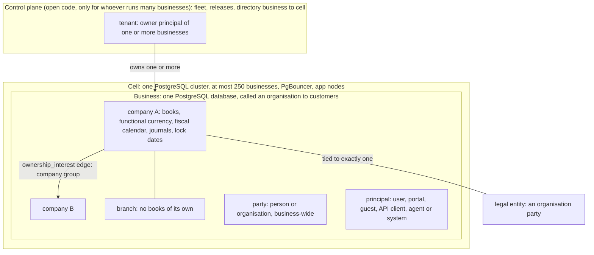

# Glossary

- **Status:** Draft 0.1
- **Date:** 2026-10-01
- **Scope:** Alphabetical glossary of the terms used across the obop documents: product and licensing, architecture, naming conventions, the agentic-first CLI and the plugin registry, finance and compliance, tooling, and the Odoo terms with their obop counterparts. Terms that the owner rulings of 2026-10-01 retired stay as short "Retired" entries so that old text can be decoded.

**How to read.** [DECISIONS.md](DECISIONS.md) is binding and its section 4 ("Canonical vocabulary") is the authority for every word defined here; where this file and a research note differ, the register wins (D24). The owner rulings of 2026-10-01 (OR-1 to OR-21, [DECISIONS, Owner rulings](DECISIONS.md#owner-rulings-2026-10-01)) are RATIFIED and override every Proposed position in the documents and the research; this file cites them as "OR-n". [CONVENTIONS.md](CONVENTIONS.md) ranks next and is the authority for the spelling of identifiers that more than one document uses (events, permission groups, data classes, states, ports); it settles no owner decision. The CLI grammar is specified in [spec/cli.md](spec/cli.md) and its spelling fixed in [CONVENTIONS 2.4](CONVENTIONS.md#24-cli-grammar-and-naming-proposed-until-q22). Decisions are cited by ID (for example D6). Anything the owner has not ruled is written "Proposed (Dn)": that covers the release cadence and the deprecation window after 1.0 (D85, Q28), the entries of the UI-parity exemption list (D80, OR-16), the staging and the remaining admission details of the plugin registry (D81, Q24, Q25), the slip order of the W1 cut (D86), the sandbox details (D83, Q34 to Q36), the ICP and the T0 list (D4, D25), and the dates of D26 other than the wave windows, the German pack date and the 1.0 target. "(target)" is a design goal and "(estimate)" a model output; neither is a measurement, and most of what is defined here is not built yet (early code exists; CLAUDE.md has the code map). Versions are as of 2026-10-01. Nothing here is legal advice.

## 1. Conventions and vocabulary map

### 1.1 Reading the tables

| Item | Meaning |
|---|---|
| Entry length | One to three sentences. Longer rules live in the linked document. |
| Used in | The document and section where the term is defined or used. Short labels such as "ARCHITECTURE 6.6" link to that section; "spec/" documents are under [spec/platform.md](spec/platform.md) and its siblings. |
| Odoo equivalent | The nearest Odoo concept, taken from the Odoo comparisons in the linked document. "-" means there is none or the comparison does not apply. "Community" and "Enterprise" appear only when they name Odoo editions (D24); the entry Community is the one exception, the lower plugin-registry trust tier, and says so. |
| Decision status | FIXED (owner-mandated), RATIFIED (an owner ruling of 2026-10-01, cited as OR-n), BINDING (research-resolved), PROPOSED (needs ratification, written "Proposed (Dn)"), DEFERRED (decide later, with a trigger) and SUPERSEDED (replaced, kept as a stub), as in [DECISIONS.md](DECISIONS.md) section 0. |
| Research tags | [R09 s5.3] means research file 09, section 5.3. Each tag used in this file is listed in section 5. |
| Dates | ISO 8601. M0 is 2026-10-01; W0 to W4 are release waves, never "phases". |
| Retired | An entry that starts "Retired" names a concept that an owner ruling removed. It says what replaced it; the word is kept so that old text can be decoded, and it must not be used in new text (section 4). |

Terms are grouped by initial letter in section 2 and sorted word by word, ignoring punctuation and letter case. Section 3 lists the Odoo-origin terms with their obop counterparts. Section 4 lists deprecated, forbidden and retired words.

Related documents: [CONVENTIONS.md](CONVENTIONS.md), [PRODUCT.md](PRODUCT.md), [ARCHITECTURE.md](ARCHITECTURE.md), [ROADMAP.md](ROADMAP.md), [BUSINESS.md](BUSINESS.md), [LOCALIZATION.md](LOCALIZATION.md), [ENGINEERING.md](ENGINEERING.md), [spec/platform.md](spec/platform.md), [spec/finance.md](spec/finance.md), [spec/cli.md](spec/cli.md), [LICENSE](../LICENSE) and [NOTICE](../NOTICE).

### 1.2 How the core vocabulary fits together

The words business, company, branch, organisation, tenant and cell name different levels of one structure. A tenant exists only in the control plane of whoever operates many businesses (a self-hoster, a partner or another third-party host; SpaceCorps hosts none for others today apart from its sample-data sandbox, D83) and there is no billing (OR-2); everything below it is the data plane.

## 2. Glossary A to Z

### 2.1 A

| Term | Meaning | Used in | Odoo equivalent |
|---|---|---|---|
| **Account role** | A lower snake_case name for the function of a ledger account (`receivable`, `stock_valuation`, `grni`, `cogs`), resolved per company to a chart account. Modules request posting lines by role through `PostingPort`, never by account id. | [spec/finance 4.1.1](spec/finance.md#411-entities); [CONVENTIONS 6](CONVENTIONS.md#6-shared-entity-registry-and-state-machines) | - |
| **Accountant seat** | Retired (OR-2). There are no plans, seats or bands. An outside accountant is an ordinary principal with permission groups in each client business, and each client is its own business. | [DECISIONS D2](DECISIONS.md#d2-open-boundary-the-software-is-free-no-paid-list); [spec/platform 4.4](spec/platform.md#44-principals-and-permission-groups) | - |
| **Agent** | A principal of kind agent that acts for a user (delegated) or under its own service grants. Its permissions are the intersection of the delegating grants and its token scopes; it uses the same typed commands as people (D80), proposes through dry runs and plans, creates drafts, never posts or pays without human approval, and can never approve a plan or satisfy step-up (D18). `obop agent create` makes the principal, group, expiry and token in one reviewable plan. | [spec/ai 1.1](spec/ai.md#11-posture); [spec/cli 5.4](spec/cli.md#54-agentsmd-skill-bundles-and-principals); [ARCHITECTURE 8.4](ARCHITECTURE.md#84-one-command-surface-for-humans-machines-and-agents) | Odoo 20 MCP tools run under a static per-user API key, and its AI features need IAP credits [R16 s2.1] |
| **Agentic first** | The principle of OR-4 (owner: "AGENTIC FIRST EVERYTHING CLI FOR EVERYTHING"; F6, D80): every capability is a typed command reachable through the obop CLI, the REST API and MCP first, and the web UI is a client of the same commands. Build order: define the command, generate the CLI, API and MCP, then build views. A feature is not done until it has parity. | [DECISIONS D80](DECISIONS.md#d80-agentic-first-surface-one-command-catalogue-three-equal-surfaces-the-ui-as-a-client); [spec/cli 1.1](spec/cli.md#11-definition-of-done-and-the-parity-rule) | Odoo's external API (JSON-2) is limited to the Custom plan on Odoo Online [R21 s2.1] |
| **App** | A module shown as a top-level menu entry (D24). A distribution unit is a "package", and only a package of kind `remote` is a "remote app". | [DECISIONS 4](DECISIONS.md#4-canonical-vocabulary); [ARCHITECTURE 4.2](ARCHITECTURE.md#42-modules); [PRODUCT](PRODUCT.md) | Application: a module with `application: True` in its manifest [R00 s3.5] |
| **Application Exception** | Retired (OR-1). The AGPL section 7 exception once proposed for third-party apps went with the AGPL core: the whole project is Apache-2.0, so the extension boundary is no longer a licence question. In-process third-party Rust stays unsupported for security reasons only (D11). | [DECISIONS D1](DECISIONS.md#d1-core-licence-contributor-terms-publisher); [DECISIONS D11](DECISIONS.md#d11-extension-and-scripting-model) | Not needed in Odoo: LGPL-3 Community plus a proprietary Enterprise layer [R03 s3.1] |
| **Approvals engine** | One generic engine inside `automation` (W2) for every needs-approval case, human or agent: policies with a CEL condition, ordered steps, minimum approvals, delegation and escalation. Its modes `auto`, `confirm` and `approve_by_role` are the approval policy engine that D18 names a W2 deliverable. | [spec/platform 4.12](spec/platform.md#412-approvals-engine-inside-automation-w2); [spec/ai 4.3](spec/ai.md#43-write-protocol-and-approval-policy-kernel-w1-engine-in-automation-w2) | Approvals app (Odoo Enterprise) plus Odoo Studio approval rules [R15 s9] |
| **ARPA** | Retired (OR-2, OR-6). Average revenue per paying organisation was a price-test metric of the withdrawn plan model. There are no plans, prices or paying organisations, so no ARPA exists. | [DECISIONS D2](DECISIONS.md#d2-open-boundary-the-software-is-free-no-paid-list); [DECISIONS D84](DECISIONS.md#d84-team-and-funding-posture) | - |
| **ARR** | Retired (OR-6). Annual recurring revenue, and the hiring gate once tied to it (at most 17 FTE before EUR 1M ARR), are gone: the project is self-funded, the team is the owner plus AI agents, and exit criteria are correctness and adoption measures. ARR is not a project metric. | [DECISIONS D84](DECISIONS.md#d84-team-and-funding-posture); [DECISIONS 5.2](DECISIONS.md#52-waves-and-calendar-d26-d86) | - |
| **Assurance service** | Retired (OR-2, D17). The planned paid per-country service (legal-change SLA, filing connectors, capped warranty) does not exist: SpaceCorps sells, warrants and operates nothing in compliance. Pack content is open and free, provided as is under Apache-2.0 with no compliance warranty (D38), and earns trust through golden cases and oracles. | [DECISIONS D17](DECISIONS.md#d17-compliance-operating-model); [DECISIONS D38](DECISIONS.md#d38-docs-disclosure-and-legal-pack); [LOCALIZATION 1.4](LOCALIZATION.md#14-gate-ladder-and-channels) | - |
| **Audit file** | A statutory accounting export (DATEV, GoBD, FEC, SAF-T, JPK) that is a projection of the one ledger. All use the `AuditFileExporter` pack hook: generating the file is open and free (`obop audit_file export`), and transmitting it is the user's step or an adapter with the user's own credentials, since SpaceCorps operates no filing gateway (D17). | [spec/finance 4.13](spec/finance.md#413-financial-reports-and-audit-trail); [LOCALIZATION 2.2](LOCALIZATION.md#22-charts-tax-templates-fiscal-positions-reports); [spec/cli 3.5](spec/cli.md#35-accounting-operations) | Mostly Enterprise: no `l10n_*_reports` module in the Community tree [R25 B1] |
| **Audit log** | Append-only, hash-chained record of field changes (`audit_change`) and security events (`security_event`) with signed checkpoints. UI and export are open with a 13-month default, and `obop audit tail` and `obop audit verify` read and check it. Publishing checkpoints to WORM storage, SIEM streaming and multi-year tiering are ordinary backlog items, neither withheld nor promised (D2); the audit log itself is never gated. | [spec/security-privacy 4.4](spec/security-privacy.md#44-audit-and-tamper-evidence); [ARCHITECTURE 6.4](ARCHITECTURE.md#64-integrity-in-the-database-legal-numbering-audit); [spec/cli 3.7](spec/cli.md#37-security) | No general audit log in Community; the OCA `auditlog` module is Beta |
| **`auto_install`** | Manifest flag that installs a module in a business once its dependencies are present (D27 R7, per business). obop keeps the flag but replaces most glue modules with optional ports and TxEvents, so a bridge exists only to add storage or UI. | [ARCHITECTURE 4.2](ARCHITECTURE.md#42-modules); [DECISIONS D27](DECISIONS.md#d27-integration-contract) | Same manifest key; about 400 of 642 Community addon directories are `auto_install` glue [R00 s3.5] |

### 2.2 B

| Term | Meaning | Used in | Odoo equivalent |
|---|---|---|---|
| **Bootstrap command and local command** | The two proposed classes of the exemption list (entries need owner approval, OR-16): CLI-only commands without REST and MCP parity. Bootstrap commands must work before or without a running server (`init`, `up`, `down`, `serve`, `migrate`, `upgrade`, `dev`, `self`); local commands act on the user's machine (`version`, `api`, `completion`, `man`, `config`, `diag`, `business verify`, `mcp bridge` and the plugin development commands). The reading is Proposed (spec/cli open question 2). | [spec/cli 1.1](spec/cli.md#11-definition-of-done-and-the-parity-rule) | - |
| **Branch** | Subdivision of a company with no books of its own; it only tags documents. It is a separate table from `company` and dormant in W1, so a branch is never confused with a subsidiary, which is a company (D28). | [spec/platform 4.3](spec/platform.md#43-companies-branches-and-company-groups); [ARCHITECTURE 5.7](ARCHITECTURE.md#57-kernel-entity-model-d28) | A child company in Odoo's single company tree; a parent cannot later become a branch (D28) |
| **Bus database** | The one database per PostgreSQL cluster that hosts the coalescing notifier; each app node keeps one LISTEN connection, on the bus database only (D7). On single-business installs it is the business database. | [ARCHITECTURE 6.6](ARCHITECTURE.md#66-outbox-bus-database-and-wake-ups-d7) | `bus.bus` table signalled with `pg_notify` [R02 s12] |
| **Business** | The isolation and deployment unit: one PostgreSQL database with its module set, user directory, object-store prefix and backup unit (D6, D24). In the data plane it is never a "tenant", "instance" or "workspace". | [DECISIONS 4](DECISIONS.md#4-canonical-vocabulary); [ARCHITECTURE 6.2](ARCHITECTURE.md#62-database-per-business-cells) | A database; Odoo keeps one `Registry` per database [R02 s2.1] |
| **`BusinessTx` and `BusinessRouter`** | `BusinessTx` is the business-scoped transaction handle and the only way to obtain a database handle: it begins the transaction, drops to the restricted runtime role and sets company context. `BusinessRouter` picks the business database for a request. Both are renamed from `TenantTx` and `TenantRouter` (D24; the rename is RATIFIED, OR-14). | [ARCHITECTURE 7.3](ARCHITECTURE.md#73-security-invariants-as-design-law-d33); [spec/security-privacy 4.3](spec/security-privacy.md#43-business-isolation) | `env`, the environment over a cursor [R02 s2.3] |
| **BYOK** | Bring your own key: a business supplies its own AI provider key or runs models locally. There is no obop credit wall and no hosted credits (D18, OR-2). | [spec/ai 4.5](spec/ai.md#45-ai-gateway-byok-routes-egress-ledger-kill-switches-self-hosted-profile-ai-w3) | All AI metered through IAP credits in Odoo 20 [R03 s3.3] |

### 2.3 C

| Term | Meaning | Used in | Odoo equivalent |
|---|---|---|---|
| **camt.053** | The ISO 20022 XML account statement. With MT940 and CSV mapping it is a first statement-import format of `bank` in W1; OFX and QIF follow in W2 (Proposed, D25). | [spec/finance 4.5](spec/finance.md#45-payments-and-bank-reconciliation); [LOCALIZATION 2.4](LOCALIZATION.md#24-bank-formats) | Statement import is not in the Community 20.0 addons list; presumably Enterprise (inferred) |
| **CEL** | Common Expression Language (<https://cel.dev>): the only expression language stored in data (D11), used for conditions, formulas, visibility, validation and policies. The `cel` crate (0.14.5) documents no cost limit, so a W1 spike adds save-time limits (4 KB, AST depth 32), a step budget and a deadline. | [ARCHITECTURE 9.1](ARCHITECTURE.md#91-code-tiers-d11-and-ui-tiers); [spec/platform 4.13](spec/platform.md#413-automation-automation-w2) | Python expression strings run with `safe_eval` (see section 3, `ir.actions.server`) |
| **Cell** | One PostgreSQL cluster holding at most 250 business databases, with PgBouncer per cell, a control-plane directory from business to cell and stateless app nodes (D6). It is a sizing rule for whoever operates many businesses, since SpaceCorps hosts none for others today apart from its sample-data sandbox (D83). A cell is about 190k tables (estimate), so migrations are fleet jobs (`obop migrate --fleet`). | [ARCHITECTURE 3.2](ARCHITECTURE.md#32-deployment-profiles); [ARCHITECTURE 6.2](ARCHITECTURE.md#62-database-per-business-cells) | - |
| **Chart of accounts** | The country account list instantiated per company from a pack template. SKR03/04 (Germany) waits for written DATEV confirmation (D4) and BAS (Sweden) data never enters the public repository (D34); charts come from official sources, never from Odoo's data files. | [LOCALIZATION 3.6](LOCALIZATION.md#36-licensing-blockers); [spec/finance 4.1](spec/finance.md#41-ledger-kernel) | Chart template installed from an `l10n_*` package by company country [R01 s4] |
| **Chatter** | The record-bound conversation and task log: messages (comment, note, email in and out, system), followers with subtype subscriptions, activities and attachments. It is first-party (D39), and a model switches it on with the `threaded` capability flag, not by inheriting a base class. | [spec/platform 4.5](spec/platform.md#45-chatter-and-discuss-channels-mail-discuss); [spec/platform 4.1](spec/platform.md#41-kernel-entities-and-the-module-integration-contract) | Chatter via the `mail.thread` mixin (section 3) |
| **CLA** | Retired (OR-1, D82). There is no contributor licence agreement, copyright assignment, "OSI licence forever" pledge or signature bot: contributions carry a DCO sign-off and are licensed inbound equals outbound under Apache-2.0. See DCO. | [DECISIONS D82](DECISIONS.md#d82-contribution-model-dco-no-cla-apache-20-in-and-out); [ENGINEERING 8](ENGINEERING.md#8-community-and-contribution-process) | Odoo also uses a licence-grant CLA [R03 s3.1], and a signature pull request must merge first [R28 C.2] |
| **Clean room** | Fixed constraint F3: Odoo is the functional reference, but obop copies no Enterprise or Community code, views, translations or assets and no OCA code. Behaviour comes from public documentation and Community source read for understanding; a running Odoo may serve only as a black-box differential oracle. | [DECISIONS 1](DECISIONS.md#1-fixed-constraints); [CLAUDE.md](../CLAUDE.md) | - |
| **Code tiers (X1 to X5)** | The five extension code tiers (D11; labels RATIFIED, OR-14): X1 declarative pack, X2 CEL, X3 Wasm component, X4 remote app, X5 first-party native crate. X1 and X2 are inside the W1 cut (RATIFIED, OR-15; X2 only if the CEL limits spike passes), X3 and the X4 app model land in W3 (Proposed, D86); X5 is first-party only. R24's "T1 to T5" labels are retired (D24). | [ARCHITECTURE 9.1](ARCHITECTURE.md#91-code-tiers-d11-and-ui-tiers); [DECISIONS D11](DECISIONS.md#d11-extension-and-scripting-model); [PRODUCT](PRODUCT.md) | In-process Python modules with full database access; Odoo Online takes only data-only third-party modules [R24 s2.1] |
| **Command catalogue** | The registry-generated list of every typed command (D80): one entry per command with a wire id `<subject>.<action>`, typed input and output, effect and risk class, error codes and its bindings on each surface. The CLI tree, REST routes, per-business OpenAPI, MCP tools, reference docs and the parity matrix are all generated from it, so a surface cannot drift. It is read with `obop catalogue list` and `obop schema`. | [spec/cli 2.1](spec/cli.md#21-binary-grammar-and-naming-rules); [spec/cli 2.9](spec/cli.md#29-introspection-completions-and-man-pages); [CONVENTIONS 2.4](CONVENTIONS.md#24-cli-grammar-and-naming-proposed-until-q22); [DECISIONS D80](DECISIONS.md#d80-agentic-first-surface-one-command-catalogue-three-equal-surfaces-the-ui-as-a-client) | - |
| **Community** | The lower trust tier of the plugin registry (OR-3, D81): automated gates only, labelled unreviewed, hidden from default search, and like every listing limited to plugins with an OSI-approved licence (OR-17); installing needs `--tier community` and an accepted "unreviewed" notice. Not Odoo's Community edition, a name that appears here only for Odoo (D24). | [spec/cli 4.5](spec/cli.md#45-trust-tiers); [DECISIONS D81](DECISIONS.md#d81-free-open-plugin-registry) | Odoo Community: the LGPL-3 edition beside the proprietary Enterprise layer [R03 s3.1] |
| **Company** | Ledger-owning scope of one legal entity: books, functional currency, fiscal calendar, journals, sequences and lock dates. It is flat and tied to one legal-entity party (D28); W1 ships one company and multi-company (selector, per-company books) arrives in W2 (Proposed, D25). | [ARCHITECTURE 5.7](ARCHITECTURE.md#57-kernel-entity-model-d28); [spec/platform 4.3](spec/platform.md#43-companies-branches-and-company-groups) | `res.company`, kept in one tree for branches and subsidiaries [R23 C.1] |
| **Company group** | A holding and its subsidiaries, modelled as `ownership_interest` edges between flat companies (D28); VAT groups are `fiscal_unit` rows. Intercompany mirroring arrives in W3 and consolidation in W4. Written "company group", never "group" alone. | [spec/finance 4.12](spec/finance.md#412-multi-company-intercompany-and-consolidation); [DECISIONS 4](DECISIONS.md#4-canonical-vocabulary) | The parent and child company tree; intercompany and consolidation are Enterprise [R23 C.1] |
| **Control plane and data plane** | Control plane: the fleet, release and directory (business to cell) tooling for whoever operates many businesses; open code in this repository (`obop-platform`), not part of a single-business install, and with no billing today (OR-2; the planned hosting service of OR-22 would need one). Data plane: business databases and app nodes. "Tenant" belongs to the control plane only (D24). | [DECISIONS 4](DECISIONS.md#4-canonical-vocabulary); [ARCHITECTURE 3.2](ARCHITECTURE.md#32-deployment-profiles) | - |
| **Plane (storage plane)** | One store of an instance's data that an operator protects separately: backed up, drilled and attested on its own. There is one today, `main` (the instance database); `--plane NAME` of `obop drill` and `obop storage check|attest` names it so that evidence belongs to one store when a second exists (D73; D75 to D77). Not the control plane or the data plane above, which are about who runs what. | [DECISIONS D73](DECISIONS.md) | - |
| **Conventions (naming authority)** | [CONVENTIONS.md](CONVENTIONS.md) fixes the spelling and ownership of every identifier that more than one document uses: forms by artefact, the cross-document event catalogue, the permission-group and data-class registries, shared entities and states, hub ports and provider traits, and the rename map. DECISIONS.md outranks it and it outranks ARCHITECTURE.md and every other document; Proposed items and owner questions stay open there. | [CONVENTIONS 1](CONVENTIONS.md#1-purpose-authority-and-change-procedure); [CONVENTIONS 8](CONVENTIONS.md#8-rename-map) | - |
| **Copy mode** | One of the two CLI modes for a plugin (D81): `obop plugin copy` fetches and verifies the plugin's source, registers it as business-own code (trust level `private`) with a provenance record, and writes a working tree into the user's own instance. There are no automatic updates, `obop plugin diff` shows drift from the recorded upstream, and copying adds no privilege. The registry lists only plugins with an OSI-approved licence (OR-17), so copying a listed plugin stays legally clean. Install mode is the alternative. | [spec/cli 4.4](spec/cli.md#44-install-versus-copy); [DECISIONS D81](DECISIONS.md#d81-free-open-plugin-registry) | - |
| **Country pack** | A `pack` package that carries one jurisdiction's law as data plus trait implementations: charts, taxes, fiscal positions, report definitions, e-invoice formats, retention classes and translations. It is signed, effective-dated, free and shipped on its own channel because mandates move faster than releases (D34, D17). | [LOCALIZATION 1.1](LOCALIZATION.md#11-definition); [LOCALIZATION 1.2](LOCALIZATION.md#12-why-a-separate-artefact) | An `l10n_*` module (section 3) that moves with the yearly major |
| **CRA** | EU Cyber Resilience Act. Art. 14 reporting (24 hours early warning, 72 hours notification, 14 days final report) has applied since 2026-09-11; main obligations apply from 2027-12-11, with a five-year minimum support period and free security updates. Whether and how it reaches a free Apache-2.0 project that hosts nothing for others today apart from a sample-data sandbox and plans a paid hosting service (OR-22), with SpaceCorps as publisher (manufacturer, open-source steward or neither), and whether the sandbox or the hosting service changes that analysis, are questions for counsel (OR-10, OR-20, OR-22, Q5); until advised, the vulnerability-handling runbook is prepared as if SpaceCorps were the manufacturer (Proposed, D17). | [ENGINEERING 6](ENGINEERING.md#6-cra-art-14-runbook-summary); [spec/security-privacy 4.8](spec/security-privacy.md#48-software-supply-chain-vulnerability-handling-and-the-cra); [DECISIONS D17](DECISIONS.md#d17-compliance-operating-model) | - |

### 2.4 D

| Term | Meaning | Used in | Odoo equivalent |
|---|---|---|---|
| **Data Act** | EU Data Act (Regulation (EU) 2023/2854), applying since 2025-09-12; switching charges are prohibited from 2027-01-12. The switching, retrieval and erasure duties fall on a provider of data processing services, that is, on whoever hosts obop for others; SpaceCorps hosts none for others today (OR-11, D83), and its sample-data sandbox holds no customer data (OR-20), so they do not apply to it now; they would apply to the hosting service planned by OR-22 once it is offered (D83). obop ships full export in every install (`obop business export`), never gated (D38). | [spec/integrations 4.9](spec/integrations.md#49-export-and-portability-base-t0-w1); [DECISIONS D83](DECISIONS.md#d83-hosting-posture-and-a-free-sandbox-at-the-public-beta); [DECISIONS D38](DECISIONS.md#d38-docs-disclosure-and-legal-pack) | Self-hosted upgrades need a database copy sent to the vendor; export is per model [R04 s4.1] |
| **Data class** | A lower snake_case tag on columns that sets default readers and handling: `public_directory`, `internal`, `confidential_hr`, `special_category`, `financial` and `secret` (Proposed). `confidential_hr`, `special_category` and `financial` are the sensitive classes, kept in separate tables or columns behind `obop_cls_*` database roles. A data class is not a permission group or a retention class, and product cost and margin have no class (they sit behind the field permission `product.cost_viewer`). | [CONVENTIONS 5](CONVENTIONS.md#5-data-class-registry); [spec/security-privacy 4.2](spec/security-privacy.md#42-authorization) | - |
| **DATEV** | The German accountants' organisation and software vendor (over 40,000 members, per DATEV) that publishes the SKR03 and SKR04 charts. The DATEV export is one of the German audit files obop generates, open and free; DATEV Connect online is partner-gated, and written DATEV confirmation of SKR03/04 is a D4 precondition. | [LOCALIZATION 3.3.1](LOCALIZATION.md#331-germany-l1-module-l10n_de-pack-l10n-de-w1); [LOCALIZATION 3.6](LOCALIZATION.md#36-licensing-blockers); [DECISIONS D4](DECISIONS.md#d4-first-market-icp-and-mvp-shape) | Odoo ships SKR03/04 and keeps the returns and exports in paid modules such as `l10n_de_reports` |
| **DCO** | Developer Certificate of Origin: every commit carries a `Signed-off-by` line, and a required CI check rejects commits without it (D82; the check is not built yet). It replaces the CLA (OR-1): there is no copyright assignment, contributors keep their copyright and license it under Apache-2.0 (inbound equals outbound), source files carry SPDX identifiers and NOTICE holds the attribution. The owner signs off every commit (`git commit -s`), and agents are recorded by a `Co-Authored-By` trailer and give no sign-off (RATIFIED, OR-18); counsel is still asked to confirm that this satisfies the DCO (a counsel item, Q16). | [DECISIONS D82](DECISIONS.md#d82-contribution-model-dco-no-cla-apache-20-in-and-out); [ENGINEERING 8](ENGINEERING.md#8-community-and-contribution-process) | Odoo asks for a licence-grant CLA [R03 s3.1] |
| **Decision record (D-ID)** | A numbered entry in [DECISIONS.md](DECISIONS.md) with a status: FIXED, RATIFIED, BINDING, PROPOSED, DEFERRED or SUPERSEDED. F1 to F6 are the fixed constraints, I-1 to I-4 the interpretations, OR-1 to OR-21 the owner rulings of 2026-10-01 and Q1 to Q36 the owner questions, some of them closed by those rulings; a change needs a new ADR with the next free D-ID (D1 to D86 exist today). | [DECISIONS 0](DECISIONS.md#0-front-matter-and-how-to-read); [DECISIONS 8](DECISIONS.md#8-open-questions-for-the-owner); [DECISIONS, Owner rulings](DECISIONS.md#owner-rulings-2026-10-01) | - |
| **Default-deny** | Access with no matching permission row is refused at model, field and action level. Every permission row declares a scope (`all`, `own`, `company` or `domain`), an implicit TRUE is a lint error, and a by-id read that fails returns 404, not 403 (D10). | [spec/security-privacy 4.2](spec/security-privacy.md#42-authorization); [ARCHITECTURE 7.2](ARCHITECTURE.md#72-the-algebra-d10) | Record rules were default-allow before 19.4 [R02 s3] |
| **Deprecation window** | How long a deprecated public contract (REST and MCP, the CLI command catalogue, the pack schema, `obop.toml`, the UI SDK) keeps working after the deprecation is announced. Before 1.0 it is 12 months (RATIFIED, OR-12); after 1.0 it is Proposed to stay 12 months (Q28). The 24-month floor of the earlier proposal is withdrawn. A deprecated CLI command keeps working and adds a `warnings[]` entry, and `--strict` turns it into a failure. | [DECISIONS D85](DECISIONS.md#d85-support-promise-and-release-train); [spec/cli 6](spec/cli.md#6-parity-testing-and-release) | Odoo schedules its legacy RPC services for removal in Online 21.1 and Odoo 22 (fall 2028) [R00 s3.5] |
| **Design partner** | An early organisation that acts as the acceptance test for scope: no new app is built without one, 3 to 5 are to be agreed to use obop by the W0 exit (2026-12-31; none is agreed as of 2026-10-01), at least 3 issue real invoices with it before the German pack is stable, and `mrp` and `pos` in W3 each need one (D25, D86). It is an agreement to use obop and give feedback, not a signed commercial contract, because nothing is sold. | [ROADMAP 1](ROADMAP.md#1-principles) (PR1); [ROADMAP 2.3](ROADMAP.md#23-gates) (GT1); [PRODUCT 4.2](PRODUCT.md#42-principles) | - |
| **Device** | A registered installation of a native app (the `device` model of D87, Proposed): user, name, platform, app version, push token, created, last seen and a revoked flag. Revoking it ends the refresh-token family of its sign-in and its queued commands are refused. Not the `pos_device` record of POS and kiosk devices (CONVENTIONS 9.2). | [spec/mobile 3](spec/mobile.md#3-what-native-support-means); [DECISIONS D87](DECISIONS.md#d87-native-apps-react-native-clients) | - |
| **Domain (Domain AST)** | A filter over records held as a JSON AST (`And`, `Or`, `Not`, `Cond`) and compiled to SQL with bound parameters and identifiers taken only from the runtime registry. Odoo's prefix-list syntax is accepted as a front end (D22); JSON storage is Proposed (D12). | [ARCHITECTURE 5.3](ARCHITECTURE.md#53-domain-ast-to-sql); [spec/integrations 4.1](spec/integrations.md#41-public-rest-api-and-openapi-obop-http-t0-w1) | `Domain` AST with Polish-notation conditions (`&`, `\|`, `!`) [R02 s2.4], stored in records as Python-expression strings run with `safe_eval` [R02 s3] |
| **Dry run, plan and apply (`plan_id`)** | `dry_run=true` on any mutation (`--dry-run` in the CLI) returns the diff, validation errors, risk tier and required approvals plus a `plan_id` that is digest-bound, principal-bound, time-limited and single-use. The plan is then applied with `--plan <id>` or `obop plan commit <id>`; committing is idempotent on `plan_id`, and if a touched record changed, commit returns 409 `plan_stale` (CLI exit 6). A plan that needs a human exits 10. | [spec/ai 4.3](spec/ai.md#43-write-protocol-and-approval-policy-kernel-w1-engine-in-automation-w2); [spec/cli 2.7](spec/cli.md#27-mutations-dry-run-plans-idempotency-confirmation); [ARCHITECTURE 8.4](ARCHITECTURE.md#84-one-command-surface-for-humans-machines-and-agents) | An optional preview on "Create Records"; no idempotency keys and no multi-call transaction [R16 s2.1, s5] |
| **Durable event** | An outbox-backed event delivered after commit: an `outbox_event` row plus one `outbox_delivery` row per subscriber, claimed with `SKIP LOCKED` and a lease, at-least-once and deduplicated by `inbox_processed(subscriber, event_id)`. Used for external I/O, webhooks, mail and indexing; architecture text never says "event" alone (D24, D27). | [ARCHITECTURE 4.3](ARCHITECTURE.md#43-the-integration-contract-d27); [ARCHITECTURE 6.6](ARCHITECTURE.md#66-outbox-bus-database-and-wake-ups-d7) | - |

### 2.5 E

| Term | Meaning | Used in | Odoo equivalent |
|---|---|---|---|
| **Edge command outbox** | The `command_outbox` table of the edge store: commands queued by a POS or warehouse shell, each with a UUIDv7 `command_id`, replayed server-side through normal domain services, where `unique(command_id)` gives exactly-once effects. It is not the server outbox. | [ARCHITECTURE 12](ARCHITECTURE.md#12-realtime-offline-and-sync); [spec/retail-commerce-marketing 4.1](spec/retail-commerce-marketing.md#41-point-of-sale-pos-obop-edge-store-hub-hardware-agent) | Browser offline cache of the POS |
| **Edge store** | `obop-edge`: a SQLite store with a fixed schema of at most 15 tables and `PRAGMA user_version` migrations, used by POS shells, the store hub and browser-only mode. It is never a projection of the server schema and has no runtime registry or ORM (D37). | [ARCHITECTURE 12](ARCHITECTURE.md#12-realtime-offline-and-sync); [DECISIONS D37](DECISIONS.md#d37-runtime-topology-and-edge-store) | Browser offline cache; Odoo 20 queues offline writes [R22 s2] |
| **`ee`** | Retired (OR-1, OR-2). The planned commercial code tree for a closed paid list does not exist: there is no enterprise layer, no paid layer and no second codebase. Fleet and control-plane tooling is ordinary open code, and the whole project is Apache-2.0 and free. | [DECISIONS D1](DECISIONS.md#d1-core-licence-contributor-terms-publisher); [DECISIONS D2](DECISIONS.md#d2-open-boundary-the-software-is-free-no-paid-list); [DECISIONS 6](DECISIONS.md#6-open-boundary) | Odoo Enterprise, proprietary since Odoo 9.0 [R03 s2] |
| **Elevation (`Env<Elevated>`)** | A typed, audited escalation of access, with a reason and a reviewed list of code sites; it is the only way to bypass the permission algebra, and agents never hold it (D10). Break-glass access to a sensitive data class is such an elevation and also alerts security officers (Proposed). | [spec/security-privacy 4.2](spec/security-privacy.md#42-authorization); [ARCHITECTURE 7.2](ARCHITECTURE.md#72-the-algebra-d10) | `sudo()` (section 3) |
| **EN 16931** | European standard for the semantic model of an electronic invoice, used as obop's internal invoice semantics. UBL and CII syntaxes, XRechnung, Factur-X and Peppol BIS 3.0 are layered on it, and `per_group` rounding is mandatory for its output. | [spec/finance 4.6](spec/finance.md#46-e-invoicing-and-e-reporting); [ARCHITECTURE 6.3](ARCHITECTURE.md#63-keys-and-money-d9) | EN 16931 documents built in `account_edi_ubl_cii` [R09 s5.3] |
| **Envelope encryption** | Field-level scheme for a short catalogue of secrets and sensitive fields: a key-encryption key per business (local sealed file or OpenBao) wraps a random data key per record or field (AES-256-GCM, AAD bound to business, table, column and row id), with HMAC blind indexes for lookups. Cloud-KMS and HSM connectors and customer-managed keys are ordinary backlog items, neither withheld nor promised (D2). | [spec/security-privacy 4.5](spec/security-privacy.md#45-encryption-and-key-management) | - |
| **Erasure and DSAR** | A DSAR is a GDPR data subject access request, due one month from receipt and extendable by two months with notice. Erasure anonymises in place: personal fields are blanked on live records while posted ledger rows and numbers stay under their retention class and are purged when it lapses; an append-only erasure ledger is replayed after any restore. | [spec/security-privacy 4.6](spec/security-privacy.md#46-privacy-tooling); [ARCHITECTURE 7.3](ARCHITECTURE.md#73-security-invariants-as-design-law-d33) | - |
| **Event type** | The PascalCase name of an event, `<Aggregate><Fact>`, such as `SaleOrderConfirmed`, `InvoicePosted` or `TransferDone`: one name per fact, emitted only by the module that owns the aggregate. The delivery kind is T (TxEvent), D (durable event), T+D or SE (security log), and the webhook and MCP type is generated as `<aggregate_type>.<past participle>` (`sale_order.confirmed`). A command (`ValidateTransfer`) and an extension point (`BeforeInvoicePost`) are not events. | [CONVENTIONS 3](CONVENTIONS.md#3-event-catalogue); [ARCHITECTURE 4.3](ARCHITECTURE.md#43-the-integration-contract-d27) | - |
| **Exemption list** | The list of operator-only commands (for example backup, doctor, upgrade, pack verify) that the owner approves as CLI-only, the one exception to literal UI parity (OR-16, D80). A command is on it only by the owner's approval, entry by entry, each with a written reason and the surfaces it lacks (at least the UI, and REST or MCP too for bootstrap and local commands). The entries proposed in spec/cli 1.1 are proposals until approved, and a UI-only step is not an exemption. | [DECISIONS D80](DECISIONS.md#d80-agentic-first-surface-one-command-catalogue-three-equal-surfaces-the-ui-as-a-client); [spec/cli 1.1](spec/cli.md#11-definition-of-done-and-the-parity-rule); [DECISIONS 4](DECISIONS.md#4-canonical-vocabulary) | - |
| **Exit drill** | Nightly job that copies the tree, rewrites `vite-plus` imports to upstream Vite, Vitest, Oxlint and Oxfmt and builds the copy (through pnpm scripts; whether its install step stays on `vp` is an implementation detail, ENGINEERING Q-E2), with a quarterly human review. It proves code portability if Vite+ is ever lost (D15, D23). It is the first of the RATIFIED exceptions to "`vp` only" (I-4, OR-9): a throwaway copy that never ships, while shipped builds, CI gates and developer commands always use `vp`. The second is `pnpm sbom` and the third the mobile toolchain (OR-34); see `vp`. | [ENGINEERING 2.4](ENGINEERING.md#24-exit-drill); [DECISIONS 1.1](DECISIONS.md#11-pin-policy-what-latest-means-d23); [ARCHITECTURE 10.1](ARCHITECTURE.md#101-toolchain-under-vp-and-pnpm) | - |
| **Expand, backfill, contract** | Mandatory tags on every migration: expand (additive), backfill (batched data move) and contract (destructive). CI rejects a contract in the release of its expand, and contracts and API removals ship only at the first release of a series, `N.0` (D36; the `N.0` rule is Proposed, D85). | [DECISIONS D85](DECISIONS.md#d85-support-promise-and-release-train); [ARCHITECTURE 13.3](ARCHITECTURE.md#133-migrations-and-upgrades); [ENGINEERING 1.5](ENGINEERING.md#15-migration-chain-tests) | Per-module `pre`, `post` and `end` migration scripts [R02 s1] |
| **Extension** | Any third-party or business-own package (D24). Architecture and data-model text says "extension" or "package", and the owner's word "plugin" (OR-3) is used in CLI commands and user-facing copy. Extensions reach obop through code tiers X1 to X4 and UI tiers F0 to F3, and in-process third-party Rust is unsupported (D11). | [DECISIONS 4](DECISIONS.md#4-canonical-vocabulary); [ARCHITECTURE 9](ARCHITECTURE.md#9-extension-platform) | An addon or custom module running in process |
| **Extension point** | A pre-step the owning module runs inside its own command, written `Before<Verb><Noun>` (`BeforeInvoicePost`, `BeforeTransferValidate`): a port with a chain of implementers, for example `stock_account` adding cost-of-goods lines before an invoice posts. It is run, not emitted, and is never an event. | [ARCHITECTURE 4.3](ARCHITECTURE.md#43-the-integration-contract-d27); [CONVENTIONS 3.6](CONVENTIONS.md#36-extension-points-commands-and-other-non-events) | - |
| **External id** | The stable `module.name` address of module-shipped and imported records. The `external_id` table keeps origin, module version and `content_hash`, so an upgrade never clobbers a customised record; the importers' identity ledger `external_ref` is a separate table. | [ARCHITECTURE 5.6](ARCHITECTURE.md#56-versioned-metadata-and-layers); [spec/integrations 4.8](spec/integrations.md#48-import-engine-and-migration-importers-base-t0-w0-engine) | `ir.model.data` (section 3) |

### 2.6 F to H

| Term | Meaning | Used in | Odoo equivalent |
|---|---|---|---|
| **Factur-X and ZUGFeRD** | Hybrid e-invoice: a PDF/A-3b document carrying CII XML. Factur-X 1.09.2 equals ZUGFeRD 2.5.2 (as of 2026-10-01), which is why the German and French packs share one format base. | [spec/finance 4.6](spec/finance.md#46-e-invoicing-and-e-reporting); [LOCALIZATION 3.1](LOCALIZATION.md#31-sequence-and-rationale) | Factur-X CII format class in `account_edi_ubl_cii` [R09 s5.3] |
| **First stable release** | "1.0", targeted for 2028-04-18 (RATIFIED, OR-13): the first release that carries the D85 support window, a 2-year security-fix window from its release. It does not ship until the CLI, API, MCP and UI parity test is green for every command that is not on the exemption list (D80, OR-16). It replaces "1.0 LTS": there is no LTS label (OR-12). | [DECISIONS D85](DECISIONS.md#d85-support-promise-and-release-train); [DECISIONS D26](DECISIONS.md#d26-release-waves-and-calendar); [ROADMAP 2.1](ROADMAP.md#21-what-the-milestone-words-mean) | - |
| **Fiscal position** | Rule set that substitutes taxes and accounts by country, VAT-ID status (checked through VIES) and B2B or B2C, and carries reverse charge. It is instantiated per company from pack templates. | [spec/finance 4.4](spec/finance.md#44-tax); [LOCALIZATION 2.2](LOCALIZATION.md#22-charts-tax-templates-fiscal-positions-reports) | Fiscal position; the same concept |
| **Foreground service** | An Android service that shows a persistent notification and keeps running while the app is in the background; the way the Mileage app keeps recording a trip. A service of type `location` needs the permissions listed in spec/mobile 4.2. | [spec/mobile 4.2](spec/mobile.md#42-platform-rules-that-shape-the-design) | - |
| **Free forever and the ratchet** | Retired (OR-2). The planned published, closed list of what stays free, set against a paid list that could only move to open, does not exist: nothing is paid, so there is no list and nothing to ratchet. Everything is free and open; security fixes, export, the API and CLI, multi-company, ledger integrity and the audit log are never gated because nothing is. | [DECISIONS 6](DECISIONS.md#6-open-boundary); [DECISIONS D2](DECISIONS.md#d2-open-boundary-the-software-is-free-no-paid-list) | Enterprise and Custom-plan gating of accounting, API and Studio [R03 s3.2, s3.3] |
| **Full user** | Retired (OR-2). The band unit of the withdrawn per-organisation pricing. There are no seats, bands or per-user prices; a user is a principal with permission groups (see Light user). | [DECISIONS D2](DECISIONS.md#d2-open-boundary-the-software-is-free-no-paid-list) | A paid per-user seat on the Standard or Custom plan [R03 s4.1] |
| **G0** | The public-repository gate (D26, OR-5), overtaken (OR-26) on 2026-10-26 when the owner made the repository SpaceCorps/obop public with its full history. Its conditions stay as a checklist before the 0.3 public alpha (2027-04-06, Proposed): the name cleared (counsel's opinion due 2026-12-15) or a screened fallback adopted, the licence and publisher matters settled, the DCO check (a CI job, built when outside contributors appear, OR-30) and the D33 P1 files (`SECURITY.md`, signed releases, SBOM) present; what counsel must cover is open (Q16), so the checklist has no settled date. Not to be confused with ARCHITECTURE's design goals G1 to G7. | [ROADMAP 2.3](ROADMAP.md#23-gates); [DECISIONS D26](DECISIONS.md#d26-release-waves-and-calendar); [DECISIONS 8](DECISIONS.md#8-open-questions-for-the-owner) (Q16) | - |
| **Gate ladder** | The D34 maturity ladder of a country pack: draft (edge channel), preview, stable, certified. Preview needs oracle passes on regulator examples; stable needs golden cases, recorded accountant or counsel sign-off and a signed release; a pack without golden cases cannot be stable. The channel mapping is Proposed. | [LOCALIZATION 1.4](LOCALIZATION.md#14-gate-ladder-and-channels); [ENGINEERING 1.7](ENGINEERING.md#17-golden-case-suites-and-oracles) | - |
| **Golden case** | A regulator- or accountant-sourced worked example with expected minor-unit results, used as a test fixture. Country packs and payroll packs need golden cases, including edge cases, to reach stable (D19, D34). | [ENGINEERING 1.7](ENGINEERING.md#17-golden-case-suites-and-oracles); [spec/people 4.10](spec/people.md#410-payroll-strategy) | - |
| **Hash chain** | Per-journal SHA-256 chain over posted ledger entries: `hash = SHA-256(prev_hash \|\| canonical(entry, lines))` with a version prefix and integer minor units. It is append-only and checked by `obop ledger verify` and the monthly restore drill; publishing signed checkpoints to WORM storage is an ordinary backlog item, neither withheld nor promised (D2). | [spec/finance 4.1.4](spec/finance.md#414-legal-numbering-and-the-hash-chain); [ARCHITECTURE 6.4](ARCHITECTURE.md#64-integrity-in-the-database-legal-numbering-audit) | Odoo Community has a per-journal hash; obop adds a canonical integer form [R09 s4] |
| **Hub port** | A convergence port that keeps bridges linear instead of quadratic: `DemandPort` (implemented by `stock`), `QtyContributionPort` (`sales` for sale lines and `purchase` for purchase lines (Proposed)), `PostingPort` (`account`, by account role) and `InvoiceableSource` (implemented by `sales` and `subscriptions`, called by `invoicing`). D27 names the four ports; implementers beyond the first are Proposed until it is amended. | [ARCHITECTURE 4.3](ARCHITECTURE.md#43-the-integration-contract-d27); [CONVENTIONS 7.1](CONVENTIONS.md#71-hub-ports-d27) | `auto_install` glue modules [R01 s2.1] |

### 2.7 I to K

| Term | Meaning | Used in | Odoo equivalent |
|---|---|---|---|
| **ICP** | Ideal customer profile. Proposed (D4): owner-led firms with 5 to 50 people in services and light trade, one company, one country at a time, Germany first (Germany is RATIFIED, OR-7; the profile is not). With the W1 cut (D86, confirmed by OR-15) the loop fits B2B invoicing and light trade best, and services firms arrive with the services variant in W3 (OR-15). | [PRODUCT 3.1](PRODUCT.md#31-ideal-customer-proposed-d4); [DECISIONS D4](DECISIONS.md#d4-first-market-icp-and-mvp-shape) | - |
| **Idempotency-Key and `command_id`** | Mutating API and agent calls take an `Idempotency-Key` header (up to 255 characters); whether it is required on plain CRUD or only accepted is open (integrations open question 11, Proposed). The first result, including a 5xx, is stored for at least 24 hours and replayed, the same key with a different payload returns 422 and an in-flight duplicate 409. A UUID key becomes the domain `command_id` (Proposed), which gives exactly-once effects (D9, D31); the `idempotency_key` column on a row is a different thing, a natural dedupe key. The `obop` CLI sends a key on every mutating call, a UUIDv7 per invocation that it reuses on its own retries. | [ARCHITECTURE 8.2](ARCHITECTURE.md#82-idempotency); [spec/integrations 4.1](spec/integrations.md#41-public-rest-api-and-openapi-obop-http-t0-w1); [spec/integrations 9](spec/integrations.md#9-open-questions); [CONVENTIONS 2.1](CONVENTIONS.md#21-forms-by-artefact); [spec/cli 2.7](spec/cli.md#27-mutations-dry-run-plans-idempotency-confirmation) | None documented in JSON-2 [R16 s2.1] |
| **IDOR matrix** | Test matrix generated from the runtime registry (model, operation, permission group, relation) that asserts a denied by-id read returns the same non-leaking 404 by id, through export and through webhook replay. It must exist before any multi-business deployment (D36). | [ENGINEERING 1.6](ENGINEERING.md#16-registry-generated-idor-matrix); [ARCHITECTURE 7.2](ARCHITECTURE.md#72-the-algebra-d10) | - |
| **Install mode** | One of the two CLI modes for a plugin (D81): `obop plugin install <id>` resolves and fetches a signed package by digest, verifies signatures and provenance, shows the capability diff as the plan, and on commit installs the version-pinned package and records version and digest in `obop.lock`. Updates are explicit (`plugin update`), the plugin keeps its listed trust tier, and a revoked version is refused. Copy mode is the alternative. | [spec/cli 4.3](spec/cli.md#43-registry-commands); [spec/cli 4.4](spec/cli.md#44-install-versus-copy); [DECISIONS D81](DECISIONS.md#d81-free-open-plugin-registry) | - |
| **Interpretations I-1 to I-4** | RATIFIED readings of the fixed constraints (I-1 by OR-14, I-2 and I-4 by OR-9, I-3 by OR-8): I-1 "Rust only" governs code obop authors and ships (PostgreSQL, PgBouncer, OCR engines, CI validators and the like that it merely runs are allowed dependencies, and optional sidecars stay out of the default install); I-2 `vp` is the entry point for every JS/TS command, with direct `pnpm` only where `vp` has no wrapper and CI failing on any lockfile other than `pnpm-lock.yaml`; I-3 "latest" means the newest release that has passed a 7 to 14 day cooldown, or its x.y.1 patch; I-4 the nightly exit drill is a named exception to "`vp` only". OR-9 allows two exceptions: the exit drill and `pnpm sbom`; OR-34 adds the mobile toolchain. | [DECISIONS 1](DECISIONS.md#1-fixed-constraints); [DECISIONS, Owner rulings](DECISIONS.md#owner-rulings-2026-10-01) | - |
| **Journal entry** | Ledger header (`journal_entry`) with `journal_line` lines, in states draft, posted and reversed. A deferred trigger checks the balance once per posting, posted rows are immutable, and corrections are reversal entries (D30). | [spec/finance 4.1](spec/finance.md#41-ledger-kernel); [ARCHITECTURE 6.4](ARCHITECTURE.md#64-integrity-in-the-database-legal-numbering-audit) | `account.move` and `account.move.line`; balance is checked in the ORM only [R09 s1.3] |
| **KSeF** | Poland's central-clearance e-invoicing system (FA(3) XML; official TEST, DEMO and PROD environments). Mandatory from 2026-02-01 above PLN 200 million and from 2026-04-01 for others (smallest issuers 2027-01-01); the KSeF beta is W2 and the Polish pack reaches stable on 2028-08-31 (Proposed, D26). SpaceCorps operates no hosted gateway today (D17); transmission uses the user's own credentials. | [LOCALIZATION 3.3.3](LOCALIZATION.md#333-poland-l1-module-l10n_pl-pack-l10n-pl-w3); [spec/finance 4.6](spec/finance.md#46-e-invoicing-and-e-reporting) | Odoo polls vendor bills every three hours and stores the UPO receipt [R09 s5.3] |

### 2.8 L to N

| Term | Meaning | Used in | Odoo equivalent |
|---|---|---|---|
| **Legal entity** | A juridical person, stored as an organisation `party`; a company is tied to exactly one. Never written "entity" alone (D24). | [DECISIONS 4](DECISIONS.md#4-canonical-vocabulary); [spec/platform 4.3](spec/platform.md#43-companies-branches-and-company-groups) | - |
| **Legal number** | Document number assigned only at posting from a row-locked counter per journal and fiscal year, late in the transaction; a rollback returns it. Gapless is a per-journal flag, on by default for sale journals, backed by a unique index and a nightly gap detector (D30). | [ARCHITECTURE 6.4](ARCHITECTURE.md#64-integrity-in-the-database-legal-numbering-audit); [spec/finance 4.1.4](spec/finance.md#414-legal-numbering-and-the-hash-chain) | Gaps tolerated and flagged afterwards [R09 s1.3] |
| **Light user** | Not a licence class: there are no seats, bands or prices (OR-2). In UX and permission text, a principal who does a few tasks (timesheet, expense, approve) with task-scoped permission groups and `own` scope. | [spec/ux 2](spec/ux.md#2-personas-and-roles); [spec/security-privacy 4.2](spec/security-privacy.md#42-authorization) | The paid Light User tier (EUR 7.90, added by quote through an advisor; unit unverified) [R03 s4.1] |
| **Localisation maintenance tiers (L1 to L3)** | Maintenance tiers of country packs (labels RATIFIED, OR-14): L1 the obop core team, which is the owner plus AI agents (DE, FR, PL and the shared EU pack); L2 third-party maintainers (for example BE, NL, ES, IT and the Nordics in W4; the placement is Proposed); L3 community volunteers. There is no paid partner tier and no revenue share (OR-2, D17), and R25's "T1 to T3" labels are retired (D24). | [LOCALIZATION 1.3](LOCALIZATION.md#13-maintenance-tiers) | OCA-maintained localisation modules [R25 B1] |
| **Lock date** | A date at or before which posting is refused: fiscal (all journals), sale, purchase, tax, and an irreversible hard lock, with time-boxed audited per-principal exceptions. Database triggers enforce it on entries, lines and generated entries (D30). | [spec/finance 4.1.5](spec/finance.md#415-fiscal-calendar-and-lock-dates); [ARCHITECTURE 6.4](ARCHITECTURE.md#64-integrity-in-the-database-legal-numbering-audit) | Company lock dates with time-boxed per-user exceptions (`account.lock_exception`) in Odoo 20 [R09 s1.3] |
| **LTS and series** | Retired as a label (OR-12, D85). There is no LTS and no five-year support on every fourth release. A series is a release `N.M`; before 1.0 the promise is an N-1 upgrade path and a 12-month deprecation window, and from the first stable release (1.0, 2028-04-18) a 2-year security-fix window, to be extended toward 5 years only as users and funding appear. The cadence after 1.0 (Proposed, Q28: one stable series a year) and the rule that contract migrations and API removals happen only at a series' first release (`N.0`) are Proposed. | [DECISIONS D85](DECISIONS.md#d85-support-promise-and-release-train); [DECISIONS D16](DECISIONS.md#d16-release-lts-and-deprecation) (superseded); [PRODUCT](PRODUCT.md) | A yearly major; Odoo 20.0 has standard support to September 2029 (planned) [R00 s3.5] |
| **M0 and M9** | Month notation: M0 is 2026-10-01 and "Mn" is n months later, so M9 is 2027-07-01 and M24 is 2028-10-01. | [DECISIONS 0](DECISIONS.md#0-front-matter-and-how-to-read); [ROADMAP](ROADMAP.md#roadmap-waves-calendar-milestones-team-gates) | - |
| **MCP** | Model Context Protocol. obop serves it at `/mcp` (spec 2026-07-28, stateless Streamable HTTP, through `rmcp` 3.5.0), with tools generated from the runtime registry's operation metadata, OAuth 2.1 and per-principal tool lists. Annotations are advertised, never trusted for enforcement. MCP is one of three equal surfaces generated from the command catalogue (D80). | [spec/integrations 4.4](spec/integrations.md#44-mcp-endpoint-t0-w1); [spec/ai 4.1](spec/ai.md#41-agent-surface-and-mcp-server-kernel-t0-w1) | `/mcp` with a static per-user API key and five default tools [R21 s2.1] |
| **Migration ledger** | The append-only record of applied migrations (module, id, kind, checksum, applied_at, app version). It starts at 0.1 preview (2026-12-01) and is never squashed inside a series; chain tests run N-1 from 0.3 and N-2 plus a 1,000-business fan-out from 0.5 (D36; release numbers Proposed, D26). | [ARCHITECTURE 13.3](ARCHITECTURE.md#133-migrations-and-upgrades); [ENGINEERING 1.5](ENGINEERING.md#15-migration-chain-tests) | Per-module `migrations/<version>/{pre,post,end}` scripts [R02 s1] |
| **Mileage trip** | A `mileage_trip` record (Proposed, D87): one drive recorded by the Mileage app. The server computes its distance from its points and never trusts the client's. Its governed state is `recording`, `ended`, `in_review`, `confirmed`, `rejected` or `locked`, and only `confirmed` trips count in totals. | [spec/mobile 5](spec/mobile.md#5-the-mileage-package) | - |
| **Module** | A first-party unit with a manifest, an `*-api` crate and an implementation crate, installed per business (D24). Never an "addon", and never a "plugin", which is a registry package. Its id is lower snake_case, and a bridge joins two ids (`stock_account`) and is specified in one spec. | [DECISIONS 4](DECISIONS.md#4-canonical-vocabulary); [ARCHITECTURE 4.2](ARCHITECTURE.md#42-modules); [CONVENTIONS 2.1](CONVENTIONS.md#21-forms-by-artefact) | Module (addon) with an `__manifest__.py` [R02 s1] |
| **Module tiers (T0 to T3)** | Proposed (D25): T0 kernel, present in every business; T1 must-have, without which the product is not a business OS; T2 second wave; T3 long tail (also the default for unlisted modules). Tier answers "is a business OS complete without it"; wave answers "when". | [DECISIONS 5.1](DECISIONS.md#51-tiers); [PRODUCT](PRODUCT.md) | - |
| **Money and minor units** | Ledger money is `bigint` minor units plus `currency_code`, with the exponent held as data; unit prices are `NUMERIC(24,8)`, quantities `NUMERIC(24,6)` and FX rates `NUMERIC(28,14)`. Rounding is per company, `per_line` or `per_group`, and floats are banned (D9). | [ARCHITECTURE 6.3](ARCHITECTURE.md#63-keys-and-money-d9) | Float quantities and one global unit precision [R10 s3.3] |
| **MRR** | Monthly recurring revenue, a term of the `subscriptions` module only (T2, W3): an append-only ledger records each movement (new, expansion, contraction, churn, reactivation) and emits `MrrMovementRecorded`. It measures the customer's own subscription business; the software has no revenue model, so MRR is no project metric (OR-2, OR-6). | [spec/sales-crm 4.5](spec/sales-crm.md#45-subscriptions-subscriptions) | Subscription MRR reports in Odoo Enterprise; the ledger goes beyond them |
| **MT940** | The older SWIFT text format for bank account statements. It is imported in W1 by `bank` beside camt.053. | [spec/finance 4.5](spec/finance.md#45-payments-and-bank-reconciliation); [LOCALIZATION 2.4](LOCALIZATION.md#24-bank-formats) | Statement import is not in the Community 20.0 addons list; presumably Enterprise (inferred) |
| **Named action** | A permission written `<module>.<action>`, such as `stock.validate`, `sales.price_override` or `hr.correct`, granted by rows of a permission group. It is a permission, not a group; the standard operations are `read`, `write`, `create`, `delete` and `export`. | [CONVENTIONS 4](CONVENTIONS.md#4-permission-group-registry) | - |
| **Native app** | A first-party mobile app built with React Native and Expo that is a client of the same API as the web back office, allowed only where a PWA cannot do the job (D87, OR-34). The first is Mileage. Not the package kind `native` (D32) and not a Tauri shell. | [DECISIONS D87](DECISIONS.md#d87-native-apps-react-native-clients); [spec/mobile](spec/mobile.md) | Odoo mobile apps (Enterprise) |
| **NOTIFY** | Forbidden in business transactions, because the commit takes a cluster-wide lock and LISTEN is per database; only `obop-bus-notifier` may call it, enforced by CI (D7). Wake-up ladder: in-process `tokio::sync::Notify`, a coalescing notifier (at most 10 per second per node), then polling at 250 ms to 2 s. | [ARCHITECTURE 6.6](ARCHITECTURE.md#66-outbox-bus-database-and-wake-ups-d7); [DECISIONS D7](DECISIONS.md#d7-realtime-and-queue-signalling) | `bus.bus` plus `pg_notify` [R02 s12] |

### 2.9 O

| Term | Meaning | Used in | Odoo equivalent |
|---|---|---|---|
| **`obop` CLI** | The `obop` command line: one static Rust binary that is also the server (D37) and the first surface of the agentic-first platform. The grammar is `obop <subject> <action> [<id>] [options]`, generated from the command catalogue (Q22, Proposed), with a JSON envelope, sorted keys and stable exit codes. It is a thin typed client of `/api/v1`, never wraps `vp`, `pnpm` or `cargo`, and never uses npm, npx, yarn or bun. | [spec/cli](spec/cli.md); [CONVENTIONS 2.4](CONVENTIONS.md#24-cli-grammar-and-naming-proposed-until-q22); [DECISIONS D80](DECISIONS.md#d80-agentic-first-surface-one-command-catalogue-three-equal-surfaces-the-ui-as-a-client) | - |
| **`obop.lock`** | The consumer-side lock file of plugins: a reviewable, diffable projection of what one business has installed or copied (id, mode `install` or `copy`, requested range, version, digest, trust tier, capability digest, signature identities). The database is authoritative at run time; `plugin install`, `copy`, `update` and `remove` write the lock, and `plugin lock export` and `sync` reproduce it, with `--frozen` failing on any difference. Not `pnpm-lock.yaml` or `Cargo.lock`. | [spec/cli 4.2](spec/cli.md#42-oboptoml-and-oboplock) | - |
| **`obop.toml`** | The one manifest for every package kind (`pack`, `wasm`, `remote`, `native`, `theme`): id, version, compatibility ranges, capability manifest and limits. Publishers write it and copy mode keeps it. It replaces R02's `module.toml` and R21's `obop.app.toml` (D32). | [ARCHITECTURE 9.3](ARCHITECTURE.md#93-packages-trust-and-compatibility); [spec/cli 4.2](spec/cli.md#42-oboptoml-and-oboplock) | `__manifest__.py`, a Python dict with `depends`, `data`, `auto_install` and `application` [R02 s1] |
| **Open edition** | Everything, under Apache-2.0 (OR-1, OR-2): one codebase, no `ee` tree, no paid list and no plans; the software is "completely free to use" and self-hostable (owner). There is no "Community" or "Enterprise" edition in Odoo's sense (D24); the phrase only says that nothing is withheld. | [DECISIONS D1](DECISIONS.md#d1-core-licence-contributor-terms-publisher); [DECISIONS 6](DECISIONS.md#6-open-boundary); [PRODUCT](PRODUCT.md) | Odoo Community (LGPL-3) [R03 s3.1] |
| **Operator, host and implementer** | Three roles around an installation (DECISIONS 4): an operator runs an installation (a self-hoster, a company, an accountant with many businesses); a host runs obop for others, which SpaceCorps does not do apart from its free sample-data sandbox (D83) and a third party may do under Apache-2.0, carrying a host's duties such as Data Act switching; an implementer configures obop for a business with custom fields, packs and plugins. The CRA roles of manufacturer and steward are separate and for counsel (Q5). | [DECISIONS 4](DECISIONS.md#4-canonical-vocabulary); [DECISIONS D83](DECISIONS.md#d83-hosting-posture-and-a-free-sandbox-at-the-public-beta) | - |
| **Oracle** | An off-the-shelf program or regulator sandbox that decides conformance in CI: CEN artefacts, the KoSIT XRechnung validator (Java), Mustang, phase4, KSeF TEST and DEMO. Oracles run only in CI images (I-1), and Odoo may serve only as a black-box differential oracle (F3). | [ENGINEERING 1.7](ENGINEERING.md#17-golden-case-suites-and-oracles); [LOCALIZATION 4.3](LOCALIZATION.md#43-oracles-and-conformance-gates) | - |
| **Organisation** | The customer-facing name for one business; not a billing unit, because there is no pricing (OR-2), and not a legal person (use "legal entity"). | [DECISIONS 4](DECISIONS.md#4-canonical-vocabulary); [PRODUCT](PRODUCT.md) | Odoo prices per user, not per organisation [R03 s4.1] |
| **ORM (in-house)** | The ORM driven by the runtime registry, on sqlx 0.9.0 and sea-query 1.0.2; SeaORM 2.0.4 is used only for fixed system tables. sqlx pools exist only inside `obop-orm`, and the Domain AST compiles to SQL with bound parameters (D29). | [ARCHITECTURE 1.3](ARCHITECTURE.md#13-technology-stack-at-a-glance); [ARCHITECTURE 5.3](ARCHITECTURE.md#53-domain-ast-to-sql) | The Odoo ORM (recordsets, one `Registry` per database) [R02 s2] |
| **OSS** | One-Stop Shop: the EU scheme for declaring VAT on cross-border B2C sales in one home-country return (EUR 10,000 threshold; quarterly and monthly returns). obop carries OSS mappings in tax templates and fiscal positions and OSS report definitions in the `l10n-eu` pack; OSS reporting is W2. | [LOCALIZATION 3.2](LOCALIZATION.md#32-shared-base-w0-w1); [spec/finance 4.4](spec/finance.md#44-tax) | OSS reporting is in Odoo Community; the national VAT returns are Enterprise |
| **Outbox** | The `outbox_event` and `outbox_delivery` rows written in the same transaction as a command. Dispatchers claim deliveries with `SKIP LOCKED` and a lease; the queue the edge shells use is the edge command outbox, not this. | [ARCHITECTURE 6.6](ARCHITECTURE.md#66-outbox-bus-database-and-wake-ups-d7) | - |
| **Owner rulings (OR-1 to OR-21)** | The twenty-one rulings the owner gave in chat on 2026-10-01 (OR-1 to OR-13 first, OR-14 to OR-21 later the same day), recorded as RATIFIED in the register: OR-1 Apache-2.0 and DCO; OR-2 no proprietary paid software; OR-3 a free plugin registry; OR-4 agentic first, CLI for everything; OR-5 name clearance (its private-repository part was overtaken on 2026-10-26); OR-6 self-funded; OR-7 Germany first; OR-8 the pin policy; OR-9 two exceptions to "`vp` only" (OR-34 later added a third); OR-10 SpaceCorps as publisher; OR-11 no hosting for others beyond a free demo or sandbox (overridden in part by OR-22: a paid hosting service is planned); OR-12 the support promise; OR-13 keep the dates, shrink the scope; OR-14 I-1, the D24 renames and the X and L tier labels; OR-15 the W1 cut confirmed; OR-16 literal UI parity with an owner-approved exemption list; OR-17 only OSI-approved-licence plugins are listed; OR-18 the owner signs off every commit and agents co-author by trailer; OR-19 npm-registry publication decided at W2, default none; OR-20 a hosted free sandbox at the public beta; OR-21 no NLnet Restack application now. They override every Proposed position in the documents and the research. | [DECISIONS, Owner rulings](DECISIONS.md#owner-rulings-2026-10-01) | - |
| **Oxfmt** | The Rust formatter bundled in Vite+ (0.70.0, still 0.x, as of 2026-10-01), run through `vp fmt` or `vp check`. | [ARCHITECTURE 1.3](ARCHITECTURE.md#13-technology-stack-at-a-glance); [ENGINEERING 2.3](ENGINEERING.md#23-vite-and-pnpm-driven-by-vp) | - |
| **Oxlint** | The Rust linter bundled in Vite+ (1.85.0 as of 2026-10-01), run through `vp lint` or `vp check`; its `jsx-a11y` rules are part of the accessibility gate. It cannot ban physical CSS margins, so a separate CI check does. | [ENGINEERING 1.8](ENGINEERING.md#18-accessibility-and-ui-gates); [spec/ux 4.9](spec/ux.md#49-design-system-and-theming) | - |

### 2.10 P

| Term | Meaning | Used in | Odoo equivalent |
|---|---|---|---|
| **PA (plateforme agréée)** | A private platform accredited by the French tax administration for e-invoicing and e-reporting, formerly "PDP"; the public PPF portal is reduced to a directory. obop integrates with a PA through its API and does not accredit one (D17); the FR pack stable date is 2028-03-31 (Proposed, D26). | [LOCALIZATION 3.3.2](LOCALIZATION.md#332-france-l1-module-l10n_fr-pack-l10n-fr-w2); [spec/finance 4.6](spec/finance.md#46-e-invoicing-and-e-reporting) | Odoo is itself a certified PA (`l10n_fr_pdp`) [R09 s5.2] |
| **Pack** | A package of kind `pack`: declarative data (X1, X2), optionally plus code, validated against the runtime registry (D32). A country pack is a localisation pack. Packs are free, and a service is never called a pack (none exists, D17). | [DECISIONS 4](DECISIONS.md#4-canonical-vocabulary); [LOCALIZATION 1.1](LOCALIZATION.md#11-definition) | Data files loaded from the manifest; `noupdate` protects edits [R02 s11] |
| **Pack stable** | The `stable` rung of the pack gate ladder, distinct from any release milestone. Dates: DE 2027-09-30 (RATIFIED, OR-13), FR 2028-03-31 and PL 2028-08-31 (Proposed, D26); each needs oracle runs, golden cases, accountant sign-off and a signed pack release, and without them the pack stays beta (D86). | [ROADMAP 2.1](ROADMAP.md#21-what-the-milestone-words-mean); [PRODUCT](PRODUCT.md); [LOCALIZATION 1.4](LOCALIZATION.md#14-gate-ladder-and-channels) | - |
| **Package** | The distribution unit of the plugin registry, described by `obop.toml`; kinds are `pack`, `wasm`, `remote`, `native` and `theme` (D24, D32). "Plugin" is the owner's word for a package in the registry (OR-3). | [DECISIONS 4](DECISIONS.md#4-canonical-vocabulary); [ARCHITECTURE 9.3](ARCHITECTURE.md#93-packages-trust-and-compatibility) | - |
| **Package registry** | The architecture-text name for the plugin registry (see there): signed OCI artefacts with trust levels, compatibility results and a kill switch, delivered in stages (stage 1 a git-backed static index, stage 2 an optional registry service, Proposed, D81) and with no commerce (OR-3). Never just "the registry", which is the runtime registry. | [DECISIONS D32](DECISIONS.md#d32-extension-packaging-and-trust); [DECISIONS D81](DECISIONS.md#d81-free-open-plugin-registry); [ARCHITECTURE 9.3](ARCHITECTURE.md#93-packages-trust-and-compatibility) | The Odoo Apps store, which keeps 30% of sales [R03 s6.2] |
| **Paid beta** | Retired (OR-2, OR-11). The proposed 0.5 "public and paid beta" on 2027-07-06, when paid plans would open, does not exist. 0.5 is a public beta with no commercial offer, no plan, no price and no SLA, and there is no paid cloud. | [DECISIONS D26](DECISIONS.md#d26-release-waves-and-calendar); [ROADMAP 2.1](ROADMAP.md#21-what-the-milestone-words-mean) | - |
| **Paid list** | Retired (OR-2). The proposed published, closed, ratcheting list of paid items does not exist. Nothing is paid or withheld, and every capability it named (native multi-IdP SAML, full SCIM, WORM audit publication, SIEM streaming, cloud-KMS and HSM, fleet disaster recovery, the multi-business control plane, a supported air-gap bundle) is an ordinary backlog item: not withheld, not promised. Hosted AI credits, white-label, support levels and the Assurance service are not built or sold at all, and paid hosting is only planned (OR-22, D83). | [DECISIONS 6](DECISIONS.md#6-open-boundary); [DECISIONS D2](DECISIONS.md#d2-open-boundary-the-software-is-free-no-paid-list) | Enterprise and Custom-plan gating of accounting, API and Studio [R03 s3.2, s3.3] |
| **Parity (CLI, API, MCP, UI)** | The definition of done of OR-4 (D80): a command exists in the CLI, the API and MCP with the same input and output schemas, the D10 permission check, a dry run with a digest-bound `plan_id` and an idempotency key for mutating commands, an audit entry, generated reference docs and a passing parity test. The UI is not part of the per-feature definition of done but reaches literal parity before the first stable release (OR-16): every command of every shipped module gets a UI, and 1.0 does not ship until the UI parity test is green for every command not on the exemption list. `obop dev parity` prints the matrix; bootstrap and local commands and other operator-only commands are CLI-only only by owner-approved exemption-list entries (see Exemption list). | [DECISIONS D80](DECISIONS.md#d80-agentic-first-surface-one-command-catalogue-three-equal-surfaces-the-ui-as-a-client); [spec/cli 1.1](spec/cli.md#11-definition-of-done-and-the-parity-rule); [spec/cli 6](spec/cli.md#6-parity-testing-and-release); [spec/platform 4.20](spec/platform.md#420-cli-api-and-mcp-surface-and-the-parity-rule) | - |
| **Partner** | A third party that implements, hosts or localises obop. There is no partner programme, fee, revenue share or tier (OR-2). Never a contact or customer; in data that is a party. | [DECISIONS 4](DECISIONS.md#4-canonical-vocabulary); [DECISIONS D2](DECISIONS.md#d2-open-boundary-the-software-is-free-no-paid-list) | Odoo partner programme [R03 s6.1] |
| **Party** | A person or organisation in the data model (D28). Typed addresses, identifiers and bank accounts hang off it; customer and vendor are per-company roles in `party_profile`, not tables, and principals are never parties. | [spec/platform 4.2](spec/platform.md#42-contacts-parties); [ARCHITECTURE 5.7](ARCHITECTURE.md#57-kernel-entity-model-d28) | `res.partner` (section 3) |
| **Payroll engine** | A generic rule engine in core (CEL, decimals, explainable and reproducible runs) with separately versioned country packs and provider connectors; no statutory filing in core and no AI in hiring decisions by default (D19). Rule content is open and free and comes with no warranty; there is no payroll service (D19, OR-2). | [spec/people 4.10](spec/people.md#410-payroll-strategy); [LOCALIZATION 2.6](LOCALIZATION.md#26-payroll-stance) | Odoo Payroll (Enterprise since 13.0) with Python expressions in rule records [R13 s1, s4.2] |
| **Peppol** | Cross-border e-document network. obop sends Peppol BIS Billing 3.0.21 (mandatory 2026-08-17) through a certified access point of the user's choice with bring-your-own credentials; SpaceCorps operates no access point and no hosted gateway (D17, D83). The transport adapter is out of W1 (RATIFIED, OR-15) and lands in W2 (Proposed, D86), and in W1 e-invoices travel by email or file. | [spec/finance 4.6](spec/finance.md#46-e-invoicing-and-e-reporting); [LOCALIZATION 4.2](LOCALIZATION.md#42-certification-and-declarations) | Peppol relayed through Odoo's IAP proxy (`account_peppol`) [R09 s5.3] |
| **Permission group** | A named bundle of permission rows with transitive implied groups, written `<module>.<role>` (for example `account.manager`, `pos.cashier`, `hr.admin`). Never "group" alone, and never "role" outside UI copy (D24); a named action such as `stock.validate` is a permission granted by group rows, not a group. | [spec/platform 4.4](spec/platform.md#44-principals-and-permission-groups); [DECISIONS 4](DECISIONS.md#4-canonical-vocabulary); [CONVENTIONS 4](CONVENTIONS.md#4-permission-group-registry) | `res.groups` [R02 s3] |
| **Permission row and restriction row** | The rows of the D10 algebra: effective access is OR(permission rows) AND AND(restriction rows). Permission rows bind to a permission group; restriction rows (company, soft-delete, embargo, residency) only narrow. Never "ACL" or "record rule". | [ARCHITECTURE 7.2](ARCHITECTURE.md#72-the-algebra-d10); [spec/security-privacy 4.2](spec/security-privacy.md#42-authorization) | `ir.access` (section 3) |
| **Pin policy** | The D23 definition of "latest" (RATIFIED, OR-8): the newest release that has passed a cooldown of 7 to 14 days, or its x.y.1 patch, so the toolchain runs up to about three weeks behind the newest release. A Rust release is eligible at x.y.1, or at x.y.0 after 14 days with no open regression; `vite-plus` must be at least 7 days old and pass the exit drill, a LICENSE/NOTICE diff, a single-copy check and the tests. Today (2026-10-27): Rust 1.99.0 (published 2026-10-01 and adopted after its 14-day wait; 1.98.0 was skipped), `vite-plus` 1.0.0 (eligible 2026-10-05), Node 24 LTS in the documents' policy while `.node-version` already says v26; the pnpm major is 12.x (OR-28; `package.json` pins 12.6.0). | [DECISIONS 1.1](DECISIONS.md#11-pin-policy-what-latest-means-d23); [ENGINEERING 2.2](ENGINEERING.md#22-rust-cargo-workspace-and-pinned-toolchain) | - |
| **Plans (Free, Team, Growth, Scale)** | Retired (OR-2). The proposed hosted plans Free, Team, Growth and Scale, with prices per organisation per month, do not exist. There are no plans, prices, price tests or per-seat or per-organisation pricing; Odoo's prices appear only as competitor facts (DECISIONS section 3, ruling 21). | [DECISIONS D2](DECISIONS.md#d2-open-boundary-the-software-is-free-no-paid-list) | Standard and Custom plans priced per user [R03 s4.1] |
| **Plugin** | The owner's word (OR-3) for a package of the free registry, used in CLI commands (`obop plugin ...`) and user-facing copy; architecture and data-model text says package or extension (D24). A plugin is used in one of two modes, install or copy, and carries a trust level. It is never an in-process Rust crate and never a first-party module. | [DECISIONS D81](DECISIONS.md#d81-free-open-plugin-registry); [spec/cli 4](spec/cli.md#4-the-plugin-registry-and-marketplace-or-3) | An addon or custom module, which runs in process with full database access [R24 s2.1] |
| **Plugin registry** | The free, open registry of plugins (OR-3, D81) that the `obop plugin` commands search, install from and copy from: an index of signed, version-pinned packages with community and verified tiers, automated gates and a revocation list (the kill switch). It lists only plugins with an OSI-approved licence (OR-17). It handles no payments: no fees, paid listings, payouts or take rate. Stage 1 (W2, Proposed) is a git-backed static index while artefacts stay in publishers' registries; stage 2 (W3 or W4, on demand) would be a registry service, a hosted service that needs an owner decision amending D83. | [spec/cli 4](spec/cli.md#4-the-plugin-registry-and-marketplace-or-3); [spec/cli 4.9](spec/cli.md#49-staged-delivery-cost-and-risk-proposed-d81); [DECISIONS D81](DECISIONS.md#d81-free-open-plugin-registry) | The Odoo Apps store, which keeps 30% of sales [R03 s6.2] |
| **pnpm** | The only package manager (F2). It installs from the public npm registry, is pinned to one exact version with `vp env pin` and `packageManager` (the major is 12.x, OR-28), and runs with `minimumReleaseAge` of at least 7 days, `trustPolicy: no-downgrade`, `blockExoticSubdeps` and `strictDepBuilds`; only `pnpm-lock.yaml` is committed. It is reached through `vp` (I-2, RATIFIED). Direct use is allowed in exactly two places (OR-9): the nightly exit drill (I-4; see Exit drill) and the JavaScript SBOM, `pnpm sbom`, run as `vp env exec pnpm sbom ...` or in a `vp run` task because `vp pm sbom` does not exist in vite-plus 1.0.0; that exception lapses when `vp` gains an SBOM wrapper. `pnpm licenses list` is not an exception (Q33, answered by OR-9). | [ENGINEERING 2.3](ENGINEERING.md#23-vite-and-pnpm-driven-by-vp); [CLAUDE.md](../CLAUDE.md) | - |
| **PO and ICU MessageFormat** | Translation format (D34): PO catalogues with an ICU MessageFormat 1 subset, Lingui on TypeScript, a PO parser and `icu` in Rust, and Weblate as the platform; machine translation is a suggestion and banned for statutory labels. MessageFormat 2 is reviewed in 2027-H2. | [LOCALIZATION 5.1](LOCALIZATION.md#51-format-and-toolchain-d34-binding); [spec/platform 4.19](spec/platform.md#419-multi-language) | PO files per module synced from Weblate [R25] |
| **Port** | A Rust trait in a `*-api` crate, implemented by its owner; optional ports are `Option<Arc<dyn Port>>` and need no bridge module. A "hub port" is a convergence port. Never a network port unqualified (D24, D27). | [ARCHITECTURE 4.3](ARCHITECTURE.md#43-the-integration-contract-d27) | `_inherit` glue in `auto_install` bridge modules (D27) |
| **POS fiscal adapter** | The trait behind point-of-sale fiscal compliance with three implementations: `LocalDevice` (in the hardware agent), `CloudSigner` and `ChainedSoftware`. Germany first (certified TSE through a cloud signer the user chooses), in W3 with `pos`; the French NF525 and other national adapters come later or through L2 third-party maintainers. | [LOCALIZATION 2.5](LOCALIZATION.md#25-pos-fiscal-adapters); [spec/retail-commerce-marketing 4.1](spec/retail-commerce-marketing.md#41-point-of-sale-pos-obop-edge-store-hub-hardware-agent) | Country modules, partly outside Community |
| **Principal** | An acting identity: user, portal user, guest, API client, agent or system (D28). Never called a "bot", and never a party subtype; `party_id` is optional. | [spec/platform 4.4](spec/platform.md#44-principals-and-permission-groups); [spec/security-privacy 4.1](spec/security-privacy.md#41-identity-and-authentication) | `res.users`, which inherits `res.partner` [R02 s3] |
| **Process role** | One binary, started with `--roles`: `http`, `cron`, `bus`, `ext`, `hub` or `all`. The responsibility split is a Proposal; operator work such as `obop migrate` is a subcommand, not a role. | [ARCHITECTURE 3.1](ARCHITECTURE.md#31-one-binary-process-roles) | Threaded, prefork and gevent server modes [R02 s12] |
| **Provenance record** | What copy mode writes for a copied plugin: source (repository and commit or digest), version, SPDX licence, the result of the signature check at copy time and the date, kept in `obop.lock` as a `mode = "copy"` entry with its upstream digest, with the licence files travelling with the source. It records where the code came from and does not raise its trust level (Q25, Proposed). Not the SLSA build provenance attestation that releases and packages also carry. | [spec/cli 4.4](spec/cli.md#44-install-versus-copy); [spec/cli 4.6](spec/cli.md#46-signing-provenance-sbom-and-capabilities); [DECISIONS D81](DECISIONS.md#d81-free-open-plugin-registry) | - |
| **Provider trait** | A Rust trait for an external capability, named for its role rather than ending in `Port`: `PaymentProvider`, `CarrierProvider`, `SmsProvider`, `LlmProvider`, `BankFeed`, `ExchangeRateSource`, `EDocTransport`, `FiscalAdapter`. Native adapters, pack hooks and connectors implement it, and hub and module ports keep the `Port` ending. | [CONVENTIONS 7.3](CONVENTIONS.md#73-provider-traits-and-pack-hooks); [ARCHITECTURE 4.3](ARCHITECTURE.md#43-the-integration-contract-d27) | - |
| **Public beta** | The 0.5 release (2027-07-06, Proposed): a public pre-release with no commercial offer, no plan, no price and no SLA (D26). The free, ephemeral, hosted sandbox opens with it once its duties are in place (OR-20, D83). Not a "paid beta" and not 1.0. | [DECISIONS D26](DECISIONS.md#d26-release-waves-and-calendar); [ROADMAP 2.1](ROADMAP.md#21-what-the-milestone-words-mean) | - |
| **Publisher** | (1) SpaceCorps, the owner's GitHub organisation and brand: obop's publisher, copyright holder and trademark holder (OR-10, D1); counsel can move it to a foundation later, and the CRA manufacturer or steward analysis for it goes to counsel (Q5). (2) In the plugin registry, the author of a plugin; a verified publisher is one that passes the publisher check of the verified tier (OR-17); how a publisher is checked, for example by proof of control of a domain or GitHub organisation and good standing, is Proposed detail of D81. | [DECISIONS D1](DECISIONS.md#d1-core-licence-contributor-terms-publisher); [DECISIONS D81](DECISIONS.md#d81-free-open-plugin-registry) | - |

### 2.11 Q and R

| Term | Meaning | Used in | Odoo equivalent |
|---|---|---|---|
| **Quant** | On-hand stock per (company, product, location, lot, package, owner), held under one `UNIQUE NULLS NOT DISTINCT` key and changed only by one upsert. Reservation is a conditional atomic update, and done moves are immutable (D30). | [spec/supply-chain 4.1.2](spec/supply-chain.md#412-hard-problems-and-solutions) | `stock.quant`, where duplicates are tolerated and merged later [R10 s3.2] |
| **Reconciliation** | Matching bank statement lines to payments and invoice open items. Partials are append-only, an exchange-difference entry closes a match that is zero in line currency, and suggestions come from `reconcile_model` rules; AI may rank candidates but never posts. | [spec/finance 4.1.6](spec/finance.md#416-reconciliation-model); [spec/finance 4.5](spec/finance.md#45-payments-and-bank-reconciliation) | The reconciliation widget, an Enterprise feature [R09 s1.1] |
| **Registry** | The runtime model registry, `Arc<Registry>` per business, built from typed Rust models and business rows (`meta_model`, `meta_field`, `meta_selection`). It drives the ORM, API, OpenAPI, MCP, views, access, webhooks, imports, docs and the semantic layer (D29). Not the plugin (package) registry, crates.io or the npm registry. | [ARCHITECTURE 5.1](ARCHITECTURE.md#51-one-registry-two-sources); [DECISIONS D29](DECISIONS.md#d29-registry-orm-and-rust-stack) | The `Registry` object, one per database [R02 s2.1] |
| **Reversal document** | The only correction for posted or done documents: a credit note is a reversal with commercial lines, and done stock moves are corrected by new moves plus adjustment entries. There is no reset to draft (D30). | [spec/finance 4.1.2](spec/finance.md#412-posting-rules); [spec/supply-chain 4.1.2](spec/supply-chain.md#412-hard-problems-and-solutions) | Correction rules depend on a company audit-trail setting (`restrictive_audit_trail`) [R09 s1.3] |
| **Ring** | Retired as a release promise (OR-11, OR-12). The hosted-fleet rollout stages (ring 0 to ring 3, with bake times) assumed a SpaceCorps-operated fleet, which does not exist today (D83; the hosting service of OR-22 could create one). The idea survives only as operator guidance for whoever runs many businesses: roll a release out cell by cell and halt on failures, tracked in `business_release_state`. | [DECISIONS D83](DECISIONS.md#d83-hosting-posture-and-a-free-sandbox-at-the-public-beta); [DECISIONS D85](DECISIONS.md#d85-support-promise-and-release-train) | - |
| **RLS** | Row-level security used as a fixed row-local backstop (FORCE, a non-owner non-BYPASSRLS role, `set_config(..., true)`), never as the rule engine, which is the D10 algebra. `COPY FROM` is rejected on RLS tables, so bulk import stages through non-RLS tables. | [ARCHITECTURE 6.8](ARCHITECTURE.md#68-rls-as-a-backstop); [DECISIONS D10](DECISIONS.md#d10-authorization-algebra-and-rls) | - |
| **Rolldown** | The Rust bundler inside Vite 8 (1.2.11 in the Vite+ 1.0.0 bundle, as of 2026-10-01). Its output behaviour "may still change" [R07 s1.3], so the first reproducible double builds show whether the embedded frontend bundle is deterministic. | [ARCHITECTURE 1.3](ARCHITECTURE.md#13-technology-stack-at-a-glance); [ENGINEERING 5.2](ENGINEERING.md#52-signing-attestation-sbom-reproducibility) | - |

### 2.12 S

| Term | Meaning | Used in | Odoo equivalent |
|---|---|---|---|
| **Sandbox** | (1) The free, ephemeral, hosted sandbox that SpaceCorps runs from the public beta (0.5): sample data only, abuse controls and auto-reset, no service level and no support (OR-20, D83). Its duties (terms of use, privacy notice, abuse and rate controls, egress and outbound-mail blocking, auto-reset, sanctions screening, a small running cost, on-call burden and counsel review) are listed in D83, and the open details are Q34 to Q36; because it holds no customer data and no customer contracts, it creates no Data Act switching or SLA duty. The local demo (`obop dev up`, a seeded instance on the user's machine) is an optional extra, not the ruled default. (2) A copy of a business for testing, made with `obop business clone`; say "business clone" for it. Not the UI sandbox of UI tiers F2 and F3, nor the Wasm sandbox of X3. | [DECISIONS D83](DECISIONS.md#d83-hosting-posture-and-a-free-sandbox-at-the-public-beta); [spec/cli 3.2](spec/cli.md#32-businesses); [spec/cli 3.10](spec/cli.md#310-development) | - |
| **SBOM and attestation** | Releases carry CycloneDX SBOMs (1.5 for now), cosign keyless signatures and GitHub artifact attestations (SLSA v1.0 Build L2, L3 via a reusable workflow), and are built twice to compare hashes. Artefacts, SBOMs and attestations are kept 10 years (Proposed, D36; pending the CRA role, Q5). The JavaScript SBOM is `pnpm sbom`, the second RATIFIED exception to "`vp` only" (OR-9). | [ENGINEERING 5.2](ENGINEERING.md#52-signing-attestation-sbom-reproducibility); [ARCHITECTURE 7.4](ARCHITECTURE.md#74-supply-chain-and-cra) | - |
| **Schema manager** | `obop-schema`: the only crate that issues DDL. It diffs the runtime registry against `pg_catalog` into a plan whose steps are classed Instant, Concurrent, Blocking or Rewrite, runs under `lock_timeout` and drops columns in two phases. | [ARCHITECTURE 5.5](ARCHITECTURE.md#55-custom-field-ddl-the-schema-manager); [spec/platform 4.14](spec/platform.md#414-customization-customize-proposed) | Schema updated on module install or upgrade (`-u`) [R02 s1] |
| **Security-fix window** | The period during which a release series receives security fixes (D85, RATIFIED by OR-12): 2 years from the first stable release (1.0, target 2028-04-18), to be extended toward 5 years only as users and funding appear. It replaces the 5-year LTS, and nothing else comes with it: no SLA, no response times, no patch train, no paid support. Fixes and advisories are never withheld or tiered (D2, D38); whether the CRA's five-year minimum support period reaches a free project that hosts nothing for others today apart from a sample-data sandbox, and plans a hosting service (OR-22), is for counsel (Q5). | [DECISIONS D85](DECISIONS.md#d85-support-promise-and-release-train) | Odoo 20.0 has standard support to September 2029 (planned) [R00 s3.5] |
| **Semantic layer** | Measures, dimensions and cubes declared in the runtime registry and queried through one typed `SemanticQuery` (measures, dimensions, filters, grain, target currency, rate type, company scope). Pivots, reports and agents share it under the caller's access; raw text-to-SQL is not offered (D18). The W1 cut places the semantic layer in W3 (Proposed, D86), and `obop <model> aggregate` covers agent reads until then. | [spec/ai 4.4](spec/ai.md#44-semantic-layer-and-ask-analytics-t0-w3-ask-in-ai-w3); [spec/platform 4.17](spec/platform.md#417-reporting-and-bi-analytics-obop-report) | `read_group` and pivot views |
| **SEPA** | Single Euro Payments Area. SEPA credit-transfer batches (pain.001, with maker-checker) and direct debit (pain.008, mandates) are `payment` features that the W1 cut leaves out (RATIFIED, OR-15) and places in W2 (Proposed, D86); W1 registers payments manually. The invoice PDF carries a SEPA (EPC) QR code. | [spec/finance 4.5](spec/finance.md#45-payments-and-bank-reconciliation); [spec/finance 4.2](spec/finance.md#42-invoicing) | No batch or SEPA file module in the Community 20.0 addons list; presumably Enterprise (inferred) |
| **SES** | Simple electronic signature: a typed or drawn signature kept with an evidence bundle (document hash, IP address, user agent), the level obop provides itself. Advanced or qualified signatures come only through qualified trust service provider (QTSP) connectors (W3 to W4), and obop never self-labels a signature as advanced or qualified (D39). | [spec/platform 4.11](spec/platform.md#411-sign-sign-w3-acceptance-evidence-w2); [DECISIONS D39](DECISIONS.md#d39-collaboration-and-messaging-services) | Odoo 20 Enterprise offers qualified signatures through itsme |
| **Seven-app loop** | Retired (OR-13, D86). R20's W1 scope of seven user-facing capabilities, including Purchase, Payments providers and Portal and a hosted Free plan as the on-ramp, was cut. The W1 loop replaces it. | [DECISIONS D86](DECISIONS.md#d86-w1-scope-cut-the-smallest-honest-loop); [DECISIONS D4](DECISIONS.md#d4-first-market-icp-and-mvp-shape) | - |
| **Sideloading** | Installing a package outside the plugin registry's index. It is always allowed, and a closed-licence plugin can be sideloaded but never listed (OR-17); a sideloaded package has trust level `private` and carries the `sideloaded` flag, and an unsigned one needs `--allow-unsigned`. Where one operator hosts many businesses it is limited to X1 to X4 (D32). There is no take rate, because the registry has no commerce (OR-3). | [spec/cli 4.5](spec/cli.md#45-trust-tiers); [ARCHITECTURE 9.3](ARCHITECTURE.md#93-packages-trust-and-compatibility) | - |
| **Slip order** | The stated order (D86) in which W1 items leave when time is short: scope moves, dates do not (OR-13; the cut itself is RATIFIED, OR-15). The first item to slip (extension surfaces beyond X1 and X2) is the last to return, and protected core items never slip inside W1: the kernel, D30 integrity and the D33 P0 and P1 items, invoicing, accounting with tax, e-invoicing and `l10n_de` with their oracles, CRM and sales, one-warehouse stock, the command catalogue with the parity test, the thin UI and the upgrade dry-run. The order itself, its checkpoints and the landing wave of each displaced item (except the services variant, W3) are Proposed (Q8); a separate order governs a W2 overrun. | [DECISIONS 5.3](DECISIONS.md#53-w1-cut-necessary-inside-calls-and-slip-order-d86); [DECISIONS D86](DECISIONS.md#d86-w1-scope-cut-the-smallest-honest-loop) | - |
| **SpaceCorps** | The owner's existing GitHub organisation and brand: obop's publisher, copyright holder and trademark holder (OR-10, D1). Its repository SpaceCorps/obop is public since 2026-10-26. It operates no hosted obop for others today (OR-11), apart from the free sample-data sandbox (OR-20); a paid hosting service is planned, not offered (OR-22), and the team is the owner plus AI agents (OR-6). | [DECISIONS D1](DECISIONS.md#d1-core-licence-contributor-terms-publisher); [DECISIONS D83](DECISIONS.md#d83-hosting-posture-and-a-free-sandbox-at-the-public-beta); [DECISIONS D84](DECISIONS.md#d84-team-and-funding-posture) | - |
| **Spike** | A time-boxed experiment with a numeric pass threshold. S1 (NOTIFY contention), S2 (250-database cell) and S3 (UUID size) read out on 2026-11-27 and freeze D6, D7 and D9; S4 to S11 are scheduled with the feature they gate. Thresholds are design targets, not measurements. | [ARCHITECTURE 16.1](ARCHITECTURE.md#161-spikes); [ROADMAP 3.2](ROADMAP.md#32-month-one-and-two-the-spikes) | - |
| **SSRF-hardened egress client** | The one outbound HTTP client (D33): HTTP(S) only, resolves A and AAAA and requires every address to be public, pins the resolved IP, follows no redirects, and blocks loopback, private, link-local and metadata ranges. Operators, not business administrators, allow-list internal hosts. | [spec/security-privacy 4.7](spec/security-privacy.md#47-platform-protections); [ARCHITECTURE 7.3](ARCHITECTURE.md#73-security-invariants-as-design-law-d33) | - |
| **State machine** | Registry data, not code: states and transitions with command, guards and emitted events, run only by command handlers. The kernel lifecycle has three values (draft, confirmed, cancelled); modules add derived progress fields such as `payment_state`, and ledger and stock documents extend it with posted and done (Proposed, in the specs; D28 fixes the three-value lifecycle). | [ARCHITECTURE 5.6](ARCHITECTURE.md#56-versioned-metadata-and-layers); [spec/supply-chain 4.1.3](spec/supply-chain.md#413-state-machines) | - |
| **Steward** | Reserved (OR-10). The word names a foundation that may one day replace SpaceCorps as publisher, if counsel moves the project there; it does not name SpaceCorps. The earlier proposal of a company as CRA manufacturer beside an EU non-profit steward with a veto is superseded, and the CRA role (manufacturer, open-source steward or neither) is a question for counsel (Q5). | [DECISIONS D1](DECISIONS.md#d1-core-licence-contributor-terms-publisher); [DECISIONS 4](DECISIONS.md#4-canonical-vocabulary) | - |
| **Store hub** | The `hub` process role: the same binary on rusqlite, acting as LAN authority for a shop's tablets, registers and kitchen screens (W3). Never "hub" alone, and not part of `all` (Proposed). | [ARCHITECTURE 3.1](ARCHITECTURE.md#31-one-binary-process-roles); [spec/retail-commerce-marketing 4.1](spec/retail-commerce-marketing.md#41-point-of-sale-pos-obop-edge-store-hub-hardware-agent) | - |

### 2.13 T and U

| Term | Meaning | Used in | Odoo equivalent |
|---|---|---|---|
| **Template database** | The D36 test harness: a per-shard migrated template database cloned for each test that needs commits, instead of migrating per test (about 0.3 s against 1.5 to 4 s, estimate, unmeasured). Sprint one benchmarks migrate-per-test against `WAL_LOG` and `FILE_COPY` clones. | [ENGINEERING 1.2](ENGINEERING.md#12-database-tests-and-template-databases) | - |
| **Tenant** | The owner principal in the control plane of whoever operates many businesses, owning one or more businesses; absent from business databases, schemas and APIs. There is no billing (OR-2). The renames `TenantTx`, `TenantRouter` and `tenant_release_state` are RATIFIED (D24, OR-14). | [DECISIONS 4](DECISIONS.md#4-canonical-vocabulary) | - |
| **Trust levels (trust tiers)** | Package trust levels (D32, amended by OR-3 and D81): `private` (business-own: authored here, copied or sideloaded), `community` (automated gates only, labelled unreviewed), `verified` (a verified publisher plus all automated gates: signatures, SBOM, capability manifest; OR-17) and `core` (first-party). The registry lists only plugins with an OSI-approved licence, in either tier (OR-17). The registry tiers are community and verified; `reviewed` merged into verified and `partner` was retired. Manual review is best effort and never promised, and copy mode never raises a level. | [ARCHITECTURE 9.3](ARCHITECTURE.md#93-packages-trust-and-compatibility); [spec/cli 4.5](spec/cli.md#45-trust-tiers); [DECISIONS D81](DECISIONS.md#d81-free-open-plugin-registry) | No isolation or capability manifest: in-process modules with full database access [R24 s2.1] |
| **TSE** | Technische Sicherheitseinrichtung: the BSI-certified security module required for German cash registers (section 146a AO). obop uses a certified cloud signer that the user chooses instead of certifying one, with the DSFinV-K export; it arrives with POS in W3. | [LOCALIZATION 2.5](LOCALIZATION.md#25-pos-fiscal-adapters); [LOCALIZATION 4.2](LOCALIZATION.md#42-certification-and-declarations) | Country modules, partly outside Community |
| **TxEvent** | An in-transaction event: past tense, run in the publisher's transaction in deterministic order (module depth, then priority), where an `Err` aborts the command. Defined in the publisher's `*-api` crate (D27). | [ARCHITECTURE 4.3](ARCHITECTURE.md#43-the-integration-contract-d27) | - |
| **Typed command** | One capability as one entry of the command catalogue: defined once from the runtime registry (or hand-written with the same macro for operational commands such as `backup.create` and `plugin.install`), with typed input and output, and reachable through the CLI, the REST API and MCP (OR-4, D80). Mutating typed commands support dry runs, plans and idempotency keys. Not an endpoint or RPC on a single surface. | [DECISIONS D80](DECISIONS.md#d80-agentic-first-surface-one-command-catalogue-three-equal-surfaces-the-ui-as-a-client); [spec/cli 2.1](spec/cli.md#21-binary-grammar-and-naming-rules) | - |
| **Typst** | The PDF engine behind `obop-report` (0.15.1 as of 2026-10-01): PDF/A-3b for Factur-X and PDF/UA-1, with user-designed templates through minijinja. Proposed (D20): Typst only in W1 and W2, with no wkhtmltopdf and no browser renderer. | [ARCHITECTURE 11](ARCHITECTURE.md#11-reports-pdf-and-documents); [DECISIONS D20](DECISIONS.md#d20-report-and-pdf-engine) | wkhtmltopdf with QWeb templates; its upstream is archived [R02 s7] |
| **UI tiers (F0 to F3)** | UI extension tiers (D11): F0 declarative patches, F1 trusted ESM for first-party and business-own code only, F2 remote-dom in a sandboxed Worker, F3 sandboxed iframe. Third-party UI never enters the main realm. | [ARCHITECTURE 9.1](ARCHITECTURE.md#91-code-tiers-d11-and-ui-tiers); [spec/ux 4.2](spec/ux.md#42-runtime-shell-and-area-wide-contracts) | Extensions monkey-patch the web client at runtime [R02 s8] |
| **UStVA** | Umsatzsteuer-Voranmeldung, the German periodic VAT advance return. The DE pack generates it from tax tags (beta 2027-06-30, Proposed, D26); sending it through ELSTER is the user's step or a later adapter with the user's own credentials, never core and never a SpaceCorps-operated filing connector (D17), and whether the ELSTER library fits F1 and I-1 is open. | [LOCALIZATION 3.3.1](LOCALIZATION.md#331-germany-l1-module-l10n_de-pack-l10n-de-w1); [spec/finance 4.4](spec/finance.md#44-tax) | Returns and ELSTER transmission sit in paid modules (`l10n_de_reports`, `l10n_de_reports_elster`) |
| **UUIDv7** | Every model has an application-generated UUIDv7 primary key, `Id<M>`. A per-model `IdType` flag lets ledger, stock-move and log tables switch to `bigint` plus a public uuid if spike S3 exceeds +25% size or a 15% slowdown; ids are never capabilities (D9). | [ARCHITECTURE 6.3](ARCHITECTURE.md#63-keys-and-money-d9) | Integer record ids; Many2oneReference is a model plus an integer id [R02 s2.2] |

### 2.14 V

| Term | Meaning | Used in | Odoo equivalent |
|---|---|---|---|
| **Veri\*Factu** | Spain's billing-software regime: every invoice produces a registration or cancellation record carrying a hash of the previous record and a QR code, mandatory from 2027-01-01 for corporates and 2027-07-01 for others. Gated behind counsel (EUR 150,000 producer exposure per year and system type); SpaceCorps operates no hosted gateway today (D17). | [LOCALIZATION 3.6](LOCALIZATION.md#36-licensing-blockers); [LOCALIZATION 6](LOCALIZATION.md#6-compliance-calendar) | - |
| **Verified** | The upper trust tier of the plugin registry (OR-3, D81): a verified publisher plus automated gates (signatures, SBOM, capability manifest; OR-17), and, as for every listing, only an OSI-approved licence. The proposed publisher check is proof of control of a domain or GitHub organisation (`obop plugin publisher verify`) and good standing (Proposed detail of D81). Manual security review is best effort and never promised; verified is not an audit or a warranty (D38). | [spec/cli 4.5](spec/cli.md#45-trust-tiers); [DECISIONS D81](DECISIONS.md#d81-free-open-plugin-registry) | - |
| **ViDA** | VAT in the Digital Age: the EU package in force since 2025-04-14, with platform rules from 2028-07-01 (postponable to 2030-01-01), digital reporting requirements from 2030-07-01 and alignment of domestic systems in 2035-01-01. EN 16931 data is retained on every invoice to prepare for it [R00 s3.7]. | [LOCALIZATION 6](LOCALIZATION.md#6-compliance-calendar) | - |
| **View AST** | A versioned JSON AST with named slots and stable node ids, stored in the database and resolved per request into an effective view: base view, module patches, business overlay and user layer. Patches address slots or node ids, never XPath. | [spec/ux 4.3](spec/ux.md#43-view-definitions-ast-slots-expressions-layers); [ARCHITECTURE 10.3](ARCHITECTURE.md#103-metadata-driven-ui) | `ir.ui.view` with XPath inheritance (section 3) |
| **Vite+** | The unified JS/TS toolchain obop must use (F2), as one project-local `vite-plus` dependency at an exact version. 1.0.0 (2026-09-28, MIT) bundles Vite 8.3.1, Rolldown 1.2.11, Vitest 5.0.1, Oxlint 1.85.0, Oxfmt 0.70.0 and tsdown 0.23.0 and is eligible from 2026-10-05 (pin policy RATIFIED, OR-8, D23). | [ARCHITECTURE 10.1](ARCHITECTURE.md#101-toolchain-under-vp-and-pnpm); [ENGINEERING 2.3](ENGINEERING.md#23-vite-and-pnpm-driven-by-vp) | - |
| **Vitest** | The test runner in the Vite+ bundle (5.0.1; upstream is already at 5.0.3), used through `vp test` for unit tests and Browser Mode. Imports go through one test re-export module, and `vp why` must show exactly one Vitest copy. | [ENGINEERING 1.1](ENGINEERING.md#11-the-test-pyramid); [ENGINEERING 2.3](ENGINEERING.md#23-vite-and-pnpm-driven-by-vp) | - |
| **`vp`** | The Vite+ CLI and the only entry point for JS/TS work: `vp install`, `vp dev`, `vp build`, `vp check` (format, lint and type-check in one pass), `vp test`, `vp run`, `vp pm` and `vp env`. Direct `pnpm` is allowed only where `vp` has no wrapper (I-2, RATIFIED). OR-9 rules that there are two exceptions to "`vp` only" (OR-34 adds a third, the mobile toolchain: Metro, the Expo CLI, Gradle and Xcode, started through `vp env exec` or `vp run`): the nightly exit drill (I-4; see Exit drill) and `pnpm sbom` for the JavaScript SBOM, run through `vp env exec pnpm sbom ...` or a `vp run` task because `vp pm sbom` and `vp pm licenses` do not exist in vite-plus 1.0.0 (checked 2026-10-01); that exception lapses when `vp` gains an SBOM wrapper. The `obop` CLI never wraps `vp`; a plugin UI build runs the pinned `vp build` as a child process. | [ARCHITECTURE 10.1](ARCHITECTURE.md#101-toolchain-under-vp-and-pnpm); [ENGINEERING 2.3](ENGINEERING.md#23-vite-and-pnpm-driven-by-vp); [spec/cli 3.10](spec/cli.md#310-development) | - |

### 2.15 W to X

| Term | Meaning | Used in | Odoo equivalent |
|---|---|---|---|
| **W1 loop** | The smallest honest loop that W1 (2027-01-01 to 2027-09-30) delivers (RATIFIED, OR-13, OR-15; slip order Proposed): the kernel (T0), invoicing, accounting with tax, German e-invoicing and `l10n_de`, CRM and sales, and basic stock with one warehouse, with generated CLI, REST, OpenAPI and MCP for everything in it and a thin UI (list, form, kanban, search, report viewer, reconciliation view). Out of W1 (RATIFIED, OR-15) are purchase orders, the portal, payment providers beyond manual registration (SEPA and Stripe), the Peppol transport, inbound mail and pricing rules, and the services variant (project and timesheet) goes to W3. Automation, extra views and the extension platform beyond X1 and X2 are also outside the cut. The landing wave of the other displaced items, W2 or W3, follows the slip order, which is Proposed. | [DECISIONS D86](DECISIONS.md#d86-w1-scope-cut-the-smallest-honest-loop); [DECISIONS 5.3](DECISIONS.md#53-w1-cut-necessary-inside-calls-and-slip-order-d86) | - |
| **Wasm component** | The X3 code tier: a WebAssembly component that implements a WIT world and runs in the `ext` role against a capability manifest; synchronous hooks run inside the caller's transaction with a hard budget, asynchronous ones from the job queue after commit. X3 arrives in W3 (Proposed, D86). The old AGPL boundary question is gone with OR-1; the sandbox exists for security (D11). | [ARCHITECTURE 9.1](ARCHITECTURE.md#91-code-tiers-d11-and-ui-tiers); [ARCHITECTURE 9.2](ARCHITECTURE.md#92-the-wasm-host) | In-process Python |
| **wasmtime** | The WebAssembly runtime behind X3, wrapped in the single crate `obop-wasm-host` so the yearly bump between wasmtime's own LTS lines touches one crate. D11 pins LTS v48 (latest 49.0.1; next LTS v60 about 2027-08-20, estimate); with X3 in W3 (D86) the v48 pin covers only the internal spike, and an ADR amends D11 when X3 starts. It patches within 7 days (24 hours for High advisories) and layers fuel, epoch deadlines, store limits, per-business caps and the `ext` role instead of relying on fuel alone. | [ARCHITECTURE 9.2](ARCHITECTURE.md#92-the-wasm-host); [ENGINEERING 2.5](ENGINEERING.md#25-dependency-updates) | - |
| **Wave** | A release wave, W0 to W4 (D26; the windows are RATIFIED by OR-13): W0 Foundations (2026-10-01 to 2026-12-31), W1 Loop (to 2027-09-30), W2 Release (to 2028-06-30), W3 Breadth (to 2029-06-30) and W4 Ecosystem (from 2029-07-01). Scope moves between waves and dates do not. Never "phase", and not a country order. | [DECISIONS 5.2](DECISIONS.md#52-waves-and-calendar-d26-d86); [ROADMAP 2.2](ROADMAP.md#22-the-five-waves); [PRODUCT](PRODUCT.md) | - |
| **WCAG 2.2 AA** | The accessibility standard that is a release gate (D35): React Aria primitives, Oxlint `jsx-a11y`, axe in Playwright, manual screen-reader passes on five flows, and a non-drag path for every drag. Default storefront, checkout, portal and POS meet it. | [spec/ux 4.10](spec/ux.md#410-accessibility-wcag-22-aa-as-a-release-gate); [ENGINEERING 1.8](ENGINEERING.md#18-accessibility-and-ui-gates) | Accessibility was "not a priority" in 2018, with no conformance statement found [R19 s2.5] |
| **WIT** | The interface files that define the extension worlds (`sync-hook`, `async-hook`, `connector`) a Wasm component implements. Guests see only the versioned `obop:ext@1` package, which is additive within a major [R24 s5.3] and Apache-2.0 like the whole project (D1); worlds avoid `async func` until `wasm32-wasip3` is stable in Rust 1.100 (about 2026-11-12, estimate). | [ARCHITECTURE 9.2](ARCHITECTURE.md#92-the-wasm-host); [DECISIONS D1](DECISIONS.md#d1-core-licence-contributor-terms-publisher) | - |
| **XRechnung** | The German national e-invoice specification on top of EN 16931, output in W1 beside ZUGFeRD. It is validated in CI with the KoSIT validator 1.6.3 and xrechnung-schematron 2.6.0 (as of 2026-10-01). | [ENGINEERING 1.7](ENGINEERING.md#17-golden-case-suites-and-oracles); [LOCALIZATION 3.3.1](LOCALIZATION.md#331-germany-l1-module-l10n_de-pack-l10n-de-w1) | XRechnung format class in `account_edi_ubl_cii` [R09 s5.3] |

## 3. Odoo terms and their obop counterparts

Odoo-origin terms, sorted word by word ignoring punctuation. The Odoo-side facts are from the cited research; the obop counterpart is defined in the linked document. obop uses none of these words for its own concepts (section 4).

| Odoo term | What it is in Odoo | obop counterpart | Documented in |
|---|---|---|---|
| **IAP credits** | In-App Purchase credits: prepaid metered services such as SMS, lead generation and AI bill scanning; in Odoo 20 all AI features need them [R03 s3.3]. | No credit wall. Bring-your-own-key AI and provider traits; there are no hosted credits (D18, OR-2). | [spec/ai 4.5](spec/ai.md#45-ai-gateway-byok-routes-egress-ledger-kill-switches-self-hosted-profile-ai-w3) |
| **`_inherit`, `_inherits`** | Python class inheritance that extends a model in place, copies a prototype or delegates to a parent row; load order decides overrides [R02 s2.1]. | No model inheritance between modules. Integration goes through ports, TxEvents, extension points and durable events (D27); a column one module adds to another's model is namespaced `<module_id>__<field>`. | [ARCHITECTURE 4.3](ARCHITECTURE.md#43-the-integration-contract-d27); [ARCHITECTURE 5.2](ARCHITECTURE.md#52-three-tier-field-storage) |
| **`ir.access`, `ir.model.access`, `ir.rule`** | Odoo's access model. Before 19.4: CSV `ir.model.access` rows per group plus `ir.rule` domains, default-allow. Since 19.4: one `ir.access` model where group-bound rows are permissions (OR-ed) and group-less rows are restrictions (AND-ed) [R02 s3]. | Permission rows and restriction rows with the same algebra, but default-deny with a mandatory scope (D10). | [ARCHITECTURE 7.2](ARCHITECTURE.md#72-the-algebra-d10); [spec/security-privacy 4.2](spec/security-privacy.md#42-authorization) |
| **`ir.actions.act_window`, `ir.ui.menu`** | Action records (`act_window` with model, view modes, domain and context; also `act_url`, `client` and `report` types) and the `ir.ui.menu` tree that points at them [R02 s4]. | `action` and `menu` registry rows (model, view modes, default domain, groups); menus show only permitted entries, and the URL holds the action, view type and domain. Report actions are `print_template` rows and server actions belong to `automation` (next row). | [spec/ux 4.2](spec/ux.md#42-runtime-shell-and-area-wide-contracts); [spec/platform 4.17](spec/platform.md#417-reporting-and-bi-analytics-obop-report) |
| **`ir.actions.server`, `base.automation`, `ir.cron`** | Three overlapping automation concepts: server actions (the `code` type runs Python stored in the database through `safe_eval`), automated actions and cron rows [R02 s6]. | One `automation` engine: a Domain scope, a CEL condition and declared actions, with Wasm for code; scheduled work runs on the leaderless `job` and `schedule_fire` queue (D11). | [spec/platform 4.13](spec/platform.md#413-automation-automation-w2); [ARCHITECTURE 6.7](ARCHITECTURE.md#67-jobs-blobs-and-search) |
| **`ir.attachment`** | The record behind a stored file: a binary field with `attachment=True` keeps its content in the filestore under an `ir.attachment` row, and compiled asset bundles are cached there too [R02 s2.2, s8]. | `attachment` (a link from any `attachable` record) plus a content-addressed `blob` (SHA-256, pending then committed) behind an `object_store` trait; access is authorised through the parent record. | [spec/platform 4.9](spec/platform.md#49-documents-attachments-w1-dms-w3); [spec/platform 4.1](spec/platform.md#41-kernel-entities-and-the-module-integration-contract) |
| **`ir.model.data`, `noupdate`** | The table of external ids (module, name, model, record id) and the `noupdate` flag that stops a data file from overwriting a record on upgrade [R02 s11]. | `external_id` with origin, module version and `content_hash`; an upgrade re-applies only records whose hash still matches. | [ARCHITECTURE 5.6](ARCHITECTURE.md#56-versioned-metadata-and-layers) |
| **`ir.model`, `ir.model.fields`** | Metadata rows describing models and fields; rows with `state='manual'` create columns at runtime, which is how Odoo Studio adds custom fields [R02 s13]. | The runtime registry: typed Rust models plus business rows with `origin` module, business or user. Custom fields use three storage tiers and no EAV (D29). | [ARCHITECTURE 5.1](ARCHITECTURE.md#51-one-registry-two-sources); [ARCHITECTURE 5.2](ARCHITECTURE.md#52-three-tier-field-storage) |
| **`ir.module.module`** | The per-database table of module state (uninstallable, uninstalled, installed, to upgrade, to remove, to install) with dependency and exclusion tables; the module itself is declared in `__manifest__.py` [R02 s1]. | `module_state` per business (uninstalled, to_install, installed, to_upgrade, to_remove) and `package_install` for packages; install, upgrade and uninstall are TxEvents that rebuild the per-business registry. The manifest for packages is `obop.toml`. | [spec/platform 4.18](spec/platform.md#418-apps-management-base); [ARCHITECTURE 9.3](ARCHITECTURE.md#93-packages-trust-and-compatibility) |
| **`ir.sequence`** | Numbering records: `standard` uses a PostgreSQL `SEQUENCE`, `no_gap` locks a row with `SELECT ... FOR UPDATE NOWAIT`; prefix and suffix patterns and date ranges are supported [R02 s2.3]. | `sequence` (scope, pattern, `gapless`, `next_value`), per company. Legal numbers come from a row-locked counter in the posting transaction (D30); PostgreSQL sequences serve internal references only. | [ARCHITECTURE 6.4](ARCHITECTURE.md#64-integrity-in-the-database-legal-numbering-audit); [spec/platform 4.1](spec/platform.md#41-kernel-entities-and-the-module-integration-contract) |
| **`ir.ui.view`, XPath inheritance** | Views stored as XML; extensions patch them with XPath or field locators and a position, which breaks when the base view changes [R02 s4]. | Versioned JSON view ASTs with named slots and stable node ids, structured patches, business overlays and a customisation report that flags upgrade risk. | [spec/ux 4.3](spec/ux.md#43-view-definitions-ast-slots-expressions-layers) |
| **JSON-2** | The Odoo 19+ external API: on Odoo Online limited to the Custom plan, one transaction per call, replacing legacy RPC services that are scheduled for removal in Odoo 22 (fall 2028) [R21 s2.1]. | Generated REST under `/api/v1` with atomic `$batch`, free and ungated because there are no plans (D31, OR-2); the same commands are in the CLI and MCP (D80). A JSON-2-compatible `/json/2/` endpoint is DEFERRED (D22). | [spec/integrations 4.1](spec/integrations.md#41-public-rest-api-and-openapi-obop-http-t0-w1); [DECISIONS D22](DECISIONS.md#d22-odoo-compatibility-surface) |
| **`l10n_*`** | Odoo localisation modules: 229 of the 642 addon directories in the Odoo 20 Community tree, moving with the yearly major [R00 s3.5]. | Country packs: signed, effective-dated bundles on their own channel, plus thin first-party `l10n` modules in W1 (D34). | [LOCALIZATION 1.1](LOCALIZATION.md#11-definition) |
| **`mail.activity`** | A scheduled to-do on any record with type, due date, assignee and plan; `mail.activity.mixin` adds the overdue, today and planned state [R02 s5]. | `activity`, `activity_type` and `activity_plan` on the record's `thread`; overdue, today and planned are derived from the due date, not stored. | [spec/platform 4.5](spec/platform.md#45-chatter-and-discuss-channels-mail-discuss) |
| **`mail.alias`, `mail.alias.domain`, `mail.template`** | Inbound routing maps `alias@domain` to a target model with defaults and a contact policy, with bounce content per domain; a template has a `render_engine` (`inline_template`, `qweb` or `qweb_view`) and per-language rendering [R02 s5]. | `mail_alias_domain`, `mail_alias` (target model, defaults, contact policy, optional forced thread) and `mail_template` (per-language variants rendered by sandboxed `minijinja`). | [spec/platform 4.7](spec/platform.md#47-email-gateway-and-templates-mail) |
| **`mail.thread`** | The mixin that gives any model messages, followers and activities: 5,446 lines [R02 s5], with 433 `.sudo(` calls in `addons/mail` [R02 s2.6]. | Capability flags such as `threaded` in runtime-registry metadata and a `thread` entity with real foreign keys; no base-class inheritance. | [spec/platform 4.1](spec/platform.md#41-kernel-entities-and-the-module-integration-contract); [spec/platform 4.5](spec/platform.md#45-chatter-and-discuss-channels-mail-discuss) |
| **OCA** | Odoo Community Association: hosts third-party modules and OpenUpgrade; its French and Dutch localisation packs had one author on 82% of human commits [R25 B1]. | A free plugin registry with trust tiers (OR-3), compatibility runs (`obop-compat`, W3) and country packs kept by the core team (L1) or third-party maintainers (L2). No OCA code may be copied (F3). | [LOCALIZATION 1.3](LOCALIZATION.md#13-maintenance-tiers); [DECISIONS 1](DECISIONS.md#1-fixed-constraints) |
| **Odoo Apps store** | The marketplace for third-party apps; Odoo keeps 30% of sales [R03 s6.2]. | A free, open plugin registry: no payments, no take rate, install or copy through the CLI, community and verified tiers (OR-3, D81). | [spec/cli 4](spec/cli.md#4-the-plugin-registry-and-marketplace-or-3); [DECISIONS D81](DECISIONS.md#d81-free-open-plugin-registry) |
| **Onchange (`@api.onchange`)** | Methods run from `BaseModel.onchange`, which lives in the `web` addon: a snapshot on `NewId` virtual records is changed and diffed, so a form field change can be a server round trip [R02 s2.3]. | A pure function over a `RecordView` trait shared by stored and virtual records, run as a bounded fixed-point loop and returned as a snapshot diff; simple expressions may later compile to the client. Modifiers and conditions are CEL (Proposed, D12). | [ARCHITECTURE 5.4](ARCHITECTURE.md#54-computed-fields-and-onchange); [spec/ux 7](spec/ux.md#7-where-obop-deliberately-differs-from-odoo-and-why) |
| **OpenUpgrade** | OCA's migration scripts for Community (AGPL-3.0). Its 20.0 branch holds one initial commit and no scripts as of 2026-10-01, so there is no open upgrade path to Odoo 20 [R02 s11]. | Upgrades are a product: expand/backfill/contract tags, chain tests and `obop upgrade --dry-run` from 0.3 (D85, D36). | [spec/cli 3.1](spec/cli.md#31-installation-lifecycle-the-instance-of-or-3); [ENGINEERING 1.5](ENGINEERING.md#15-migration-chain-tests) |
| **Owl (OWL)** | Odoo's own JavaScript component framework; Odoo 20 ships 3.0.0-alpha.49 beside a compatibility layer [R02 s0]. | React 19 and TypeScript 7 on Vite+ (D15) with a metadata-driven view layer and no runtime patching of other modules. | [ARCHITECTURE 10.2](ARCHITECTURE.md#102-stack-and-workspace); [spec/ux 7](spec/ux.md#7-where-obop-deliberately-differs-from-odoo-and-why) |
| **Properties fields** | `Properties` and `PropertiesDefinition`: a per-container schema plus `jsonb` values, giving light user-defined fields without DDL; available in Odoo Community [R02 s2.2]. | A `property_definition` on a container record plus a `properties` JSONB column: tier 3 of the three-tier field storage (no DDL, no foreign key or unique constraint, a "promote to column" migration from day one). | [ARCHITECTURE 5.2](ARCHITECTURE.md#52-three-tier-field-storage); [spec/platform 4.14](spec/platform.md#414-customization-customize-proposed) |
| **QWeb** | Odoo's XML template engine (compiled on the server; a client-side flavour lives in Owl) behind website pages, emails and PDF reports, with wkhtmltopdf as the default PDF engine [R02 s4, s7]. | minijinja templates feeding Typst for documents (Proposed, D20); Rust-rendered block snapshots plus Vite islands for the storefront (Proposed, D14). | [ARCHITECTURE 11](ARCHITECTURE.md#11-reports-pdf-and-documents); [ARCHITECTURE 10.5](ARCHITECTURE.md#105-shells-offline-i18n-accessibility) |
| **`res.currency`, `res.currency.rate`** | Currencies with `rounding` and `decimal_places`, and date-based, company-aware rates looked up per date; `_convert` converts an amount [R02 s9]. | Money as `bigint` minor units with the exponent held as data (D9). Every line stores currency, foreign amount and the applied rate, and rates come from an `ExchangeRateSource` trait (spot, average, closing or historical). | [spec/finance 4.7](spec/finance.md#47-multi-currency); [ARCHITECTURE 6.3](ARCHITECTURE.md#63-keys-and-money-d9) |
| **`res.lang`** | Language records that hold formats; `translate=True` stores a `jsonb` value per language, the user language comes from the context `lang`, and PO files are per module [R02 s9]. | `language` (code, direction, active, CLDR 48 formats); translatable fields store `{lang: value}` as JSONB, and catalogues are PO with an ICU MessageFormat subset (D34). | [spec/platform 4.19](spec/platform.md#419-multi-language); [LOCALIZATION 5.1](LOCALIZATION.md#51-format-and-toolchain-d34-binding) |
| **`res.partner`** | Odoo's single table for people, companies and addresses; users inherit it [R02 s3]. | `party` with typed addresses, identifiers and bank accounts; customer and vendor are per-company `party_profile` roles; users are principals, not parties (D28). | [spec/platform 4.2](spec/platform.md#42-contacts-parties) |
| **Studio** | The Odoo Enterprise no-code customisation tool (Custom plan): custom `x_` models, view editors over XPath-inherited XML, approval rules, and export of customisations as a module ZIP [R02 s13]. | `customize` (Proposed), open: custom fields and models as runtime-registry rows, slot-addressed overlays, exported as a package (D32). | [spec/platform 4.14](spec/platform.md#414-customization-customize-proposed) |
| **`sudo()`** | The Odoo call that bypasses access checks; `addons/mail` alone has 433 of them in the 20.0 source [R02 s2.6]. | A typed, audited `Env<Elevated>` with a reason and a reviewed site list; agents never hold it (D10). | [spec/security-privacy 4.2](spec/security-privacy.md#42-authorization); [ARCHITECTURE 7.2](ARCHITECTURE.md#72-the-algebra-d10) |
| **`TransientModel` (wizards)** | A model kind for wizards whose rows are vacuumed after use; `AbstractModel` is the table-less mixin kind [R02 s2.1]. | No transient model kind. A wizard-style step is a typed command, defined once as Rust types behind the CLI, REST and MCP, whose `dry_run=true` returns the diff and validation errors before anything commits. | [ARCHITECTURE 8.4](ARCHITECTURE.md#84-one-command-surface-for-humans-machines-and-agents); [ARCHITECTURE 4.5](ARCHITECTURE.md#45-one-command-end-to-end) |
| **XML-RPC, JSON-RPC** | The legacy external API services (`common`, `object`), scheduled for removal in Online 21.1 (winter 2027) and Odoo 22 (fall 2028); the `db` service is already gone in Odoo 20 [R00 s3.5]. | Not offered (D22, D31); generated REST, the CLI, MCP and importers cover integration and switching. | [DECISIONS D22](DECISIONS.md#d22-odoo-compatibility-surface); [spec/integrations 7](spec/integrations.md#7-where-obop-deliberately-differs-from-odoo-and-why) |

## 4. Deprecated, forbidden and retired words

These forms are banned, discouraged or retired by [DECISIONS.md](DECISIONS.md) section 4 and sections 1 and 7, by the owner rulings of 2026-10-01 (OR-1 to OR-21) and, for identifier vocabulary, by [CONVENTIONS 2.2](CONVENTIONS.md#22-vocabulary-and-spelling); its [section 8.2](CONVENTIONS.md#82-retired-vocabulary-owner-rulings-of-2026-10-01) lists the retired words from the identifier side. The register wins over any research note or older document that still uses them. "Retired" means that an owner ruling removed the concept; section 2 keeps a short entry for each so that old text can be decoded.

| Word or form | Status | Use instead | Source |
|---|---|---|---|
| OBOP, Obop | Forbidden | obop, lower case | D24 |
| "tenant", "instance", "workspace" for a business in the data plane | Forbidden in schemas, APIs and data-plane code | business; "tenant" only for the owner principal in the control plane of whoever operates many businesses | D24 |
| `TenantTx`, `TenantRouter`, `tenant_release_state` | Deprecated (rename RATIFIED, OR-14) | `BusinessTx`, `BusinessRouter`, `business_release_state` | D24, OR-14 |
| "entity" alone; "subsidiary" for a branch | Avoid | legal entity; branch (no books) or company (own books) | D24, D28 |
| "group" alone; "role" outside UI copy | Avoid | company group; permission group | D24 |
| "ACL", "record rule", "sudo" | Avoid in obop text | permission row, restriction row, typed elevation (`Env<Elevated>`) | D10, D24 |
| "partner" for a contact or customer; "partner programme", "partner tier" | Forbidden in data; retired as a programme | party; "partner" only for a third party that implements, hosts or localises obop (no programme, fee or revenue share) | D24, D28, OR-2 |
| "bot" for an agent | Avoid | agent; principal | D24 |
| "addon"; "plugin" for a first-party module or an in-process crate | Forbidden | module (first-party); extension or package. "Plugin" is the owner's word for a registry package (OR-3): use it in CLI commands and user-facing copy, and write "package" or "extension" in architecture and data-model text | D24, D81 |
| "fork" for install or copy mode | Avoid | install; copy. `obop plugin fork` is a distinct command that re-identifies a copy so that a derivative can be published (Proposed, [spec/cli open question 6](spec/cli.md#11-open-questions)) | D81 |
| "app" for a package; "pack" for a service | Avoid | package, remote app; a service is never called a pack, and none exists (D17) | D24 |
| "registry" unqualified | Ambiguous | runtime registry; plugin registry (package registry in architecture text); crates.io or the npm registry | D24 |
| "port" unqualified; "event" alone; "outbox" for the edge queue; "bus" or "hub" alone | Ambiguous in architecture text | Rust port or hub port; TxEvent or durable event; edge command outbox; bus database; store hub | D24 |
| "Community", "Enterprise", "Studio" as obop products; "enterprise layer"; "open-core" | Forbidden (Odoo's words) | open edition (one codebase, Apache-2.0, nothing withheld); `customize` for Studio. "Community" is also a plugin-registry trust tier, which is a different thing | D24, OR-2 |
| "paid list", "ratchet", "free forever", "`ee`", "operated services over open code" | Retired | nothing is paid or withheld; capabilities once on the list are unpromised backlog items ([DECISIONS 6](DECISIONS.md#6-open-boundary)) | OR-2, D2 |
| Plans (Free, Team, Growth, Scale), prices, "full user" bands, "accountant seat" or "light user" as a licence class, ARPA, price tests, per-seat or per-organisation pricing | Retired | no plans, no prices, no seats; obop is completely free to use and to self-host | OR-2, D2 |
| "Assurance service", "legal-change SLA", "payroll service", hosted AI credits, hosted Peppol, KSeF or Veri\*Factu gateways, certification programme, white-label licence, support tiers | Retired | none exists; packs are open, free and provided as is, and transmission uses the user's own credentials or an access point or platform the user chooses | OR-2, D17, D83 |
| "AGPL", "Application Exception", dual licence, "CLA", "OSI licence forever" pledge | Retired | Apache-2.0 for everything; DCO sign-off and no CLA | OR-1, D1, D82 |
| "steward" or "foundation" for SpaceCorps; the company as CRA manufacturer beside an EU non-profit | Retired | publisher (SpaceCorps); "steward" is reserved for a foundation that may replace it; the CRA role is for counsel (Q5) | OR-10, D1 |
| "reviewed" or "partner" trust level; marketplace commerce, "take rate", paid listing, payout | Retired | trust levels `private`, `community`, `verified`, `core`; a free plugin registry that handles no payments | OR-3, D81 |
| ARR targets, "hiring gate", seed or Series A, investor covenant, team-size plans, MRR as an obop metric | Retired | self-funded; the owner plus AI agents; no gates. MRR only as a `subscriptions` term | OR-6, D84 |
| SOC 2 or ISO 27001 plans; an SLA plan; "hosted cell", "obop Cloud", "paid cloud" | Retired | SpaceCorps hosts nothing for others today except the ruled sample-data sandbox (OR-20), whose own duties are listed in D83; the hosting service planned by OR-22 would carry a host's duties (Data Act switching terms, customer terms, a DPA), and those are open counsel items for it, not retired ones (ENGINEERING 11, C10); whoever else hosts obop carries a host's duties | OR-11, OR-20, OR-22, D83 |
| "demo tenant", "trial", "free tier" or "cloud" for the sandbox; "sandbox" for a test copy of a business | Avoid | sandbox (the free hosted sample-data one); business clone for a test copy | D83, OR-20 |
| "LTS", "1.0 LTS", "5-year LTS", "patch train" | Retired | "1.0", the first stable release; a 2-year security-fix window. Wasmtime's own LTS lines keep the word | OR-12, D85 |
| "24-month deprecation floor" | Withdrawn | a 12-month deprecation window before 1.0, and after 1.0 the same window unless the owner rules otherwise (Proposed, Q28). "12-month deprecation" is now correct | OR-12, D85 |
| XML-RPC | Not offered | REST, the CLI and MCP from one command catalogue | D22, D31 |
| T1 to T5 for code tiers; T1 to T3 for pack tiers; "T0 (21) and T1 (19)"; "risk T7" | Deprecated | X1 to X5; L1 to L3 (both RATIFIED, OR-14); T0 to T3 module tiers; BR-nn risk ids | D24, OR-14 |
| "L0" to "L8" for layers | Deprecated | Layer 0 to Layer 8 (L1 to L3 are pack tiers) | [ARCHITECTURE 1.5](ARCHITECTURE.md#15-resolved-conflicts) |
| "Phase"; "wave" for country order; bare "GA"; "DE GA"; "paid beta" | Forbidden | W0 to W4; pack stable; public beta (0.5); 1.0 (the first stable release) | D24, D26 |
| "Seven-app loop" | Retired | W1 loop | OR-13, D86 |
| "UI then API" build order; an API described as "the same as the UI" with no catalogue behind both; a feature called done when only the screen works | Retired | command first; CLI, API and MCP generated; UI last and at parity before 1.0 | OR-4, D80 |
| `module.toml`, `obop.app.toml` | Deprecated | `obop.toml` | D32 |
| "single-tenant" | Avoid | dedicated cell (a cell is a sizing rule for operators) | D6 |
| Rhai or any Turing-complete text stored in data; `safe_eval`-style code in data | Forbidden in W1 and W2 | CEL for expressions; Wasm for code | D11 |
| `NOTIFY` in a business transaction | Forbidden | outbox plus the coalescing notifier | D7 |
| wkhtmltopdf; a Chromium PDF pool | Forbidden | Typst (Proposed, D20) | D20 |
| EWS; basic SMTP AUTH; self-labelled "advanced" or "qualified" signatures | Forbidden | OAuth-only Gmail API and Microsoft Graph; honest SES with QTSP connectors | D39 |
| The CLIs npm, npx, yarn and bun; any lockfile other than `pnpm-lock.yaml`, such as `package-lock.json`, `npm-shrinkwrap.json`, `yarn.lock`, `bun.lock` and `bun.lockb` | Forbidden (F2 names three of the lockfiles; the full list is I-2, RATIFIED) | `vp` and pnpm; only `pnpm-lock.yaml` is committed and CI fails on any other lockfile. The npm registry itself is fine; whether obop publishes anything to it is decided at W2 (Q32, OR-19), and the default is none | F2, I-2, [CLAUDE.md](../CLAUDE.md) |
| "N times faster than Odoo"; "fast" in a tagline | Forbidden until measured | correctness and operations; cite only Odoo's documented worker formula | D21 |
| "picking" for the document; "timesheet line"; "approval engine"; "quotation" in new text | Avoid | transfer (`stock_picking_type` and the physical act keep "picking"); timesheet entry; approvals engine; quote | [CONVENTIONS 2.2](CONVENTIONS.md#22-vocabulary-and-spelling) |
| Any identifier in the "From" column of the rename map | Retired | the name in its "To" column | [CONVENTIONS 8](CONVENTIONS.md#8-rename-map) |

## 5. Sources

All paths are relative to this file. Tags cite research notes by number and, where useful, section (`s4`) or sub-section.

| Tag | File |
|---|---|
| R00 | [research/README.md](research/README.md) |
| R01 | [research/01-odoo-app-catalog.md](research/01-odoo-app-catalog.md) |
| R02 | [research/02-odoo-architecture.md](research/02-odoo-architecture.md) |
| R03 | [research/03-odoo-business-model.md](research/03-odoo-business-model.md) |
| R04 | [research/04-odoo-voice-of-customer.md](research/04-odoo-voice-of-customer.md) |
| R07 | [research/07-vite-plus-frontend.md](research/07-vite-plus-frontend.md) |
| R09 | [research/09-accounting-finance-compliance.md](research/09-accounting-finance-compliance.md) |
| R10 | [research/10-supply-chain-manufacturing.md](research/10-supply-chain-manufacturing.md) |
| R13 | [research/13-hr-payroll.md](research/13-hr-payroll.md) |
| R15 | [research/15-platform-collaboration-documents.md](research/15-platform-collaboration-documents.md) |
| R16 | [research/16-ai-native-erp.md](research/16-ai-native-erp.md) |
| R19 | [research/19-ux-design-system.md](research/19-ux-design-system.md) |
| R21 | [research/21-integrations-interoperability-api.md](research/21-integrations-interoperability-api.md) |
| R22 | [research/22-data-layer-sync-realtime-performance.md](research/22-data-layer-sync-realtime-performance.md) |
| R23 | [research/23-kernel-model-architecture-decisions.md](research/23-kernel-model-architecture-decisions.md) |
| R24 | [research/24-extension-platform-sdk.md](research/24-extension-platform-sdk.md) |
| R25 | [research/25-localization-operating-model.md](research/25-localization-operating-model.md) |
| R28 | [research/28-docs-community-support-brand.md](research/28-docs-community-support-brand.md) |

Non-research sources: [DECISIONS.md](DECISIONS.md) for vocabulary, decision status and the owner rulings OR-1 to OR-21; [CONVENTIONS.md](CONVENTIONS.md) for identifier spellings and the registers; [spec/cli.md](spec/cli.md) for the CLI, the agentic command surface and the plugin registry client; [LICENSE](../LICENSE) and [NOTICE](../NOTICE) at the repository root; the expansion of CEL as Common Expression Language is from <https://cel.dev>.
