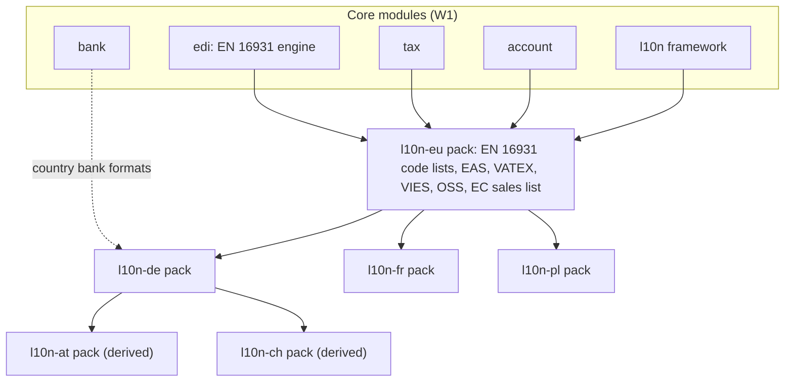
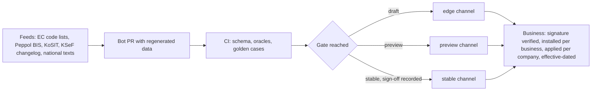

# Localisation and compliance packs: operating model and country programme

- **Status:** Draft 0.1
- **Date:** 2026-10-01
- **Scope:** How obop ships country law (charts, taxes, e-invoicing, audit files, fiscal devices, payroll stance, locale data, translations) as signed, versioned packs, who maintains them, that every pack is free and open (Apache-2.0, OR-1, OR-2), which typed commands manage them (CLI, API and MCP, OR-4) and which countries come when.

**At a glance.**

- A country pack is a signed, versioned, effective-dated bundle of data plus trait implementations that travels on its own channel, because mandates and code lists change faster than a release train (D34, binding).
- Germany is first (RATIFIED, OR-7) and the German pack is stable on 2027-09-30 (RATIFIED, OR-13). France then Poland, with pack stable dates 2028-03-31 and 2028-08-31, is Proposed (D4, D26). Austria and Switzerland follow in W3; Belgium, the Netherlands, Spain, Italy and the Nordics in W4, if third-party maintainers take them on. Wave placements are Proposed (D25).
- The three first-party packs cost 42.25 person-months plus 10 to 14 shared (estimate, +/-40%, R25). Maintenance is planned at 25% of build per year (estimate). R25 priced this for a funded team; the team is the owner plus AI agents (D84), so whether the German pack lands on 2027-09-30 is a named schedule risk (LZ-16), and the French and Polish packs are the first items to slip.
- Every pack is open and free under Apache-2.0 (OR-1, OR-2). SpaceCorps sells, warrants or operates nothing in compliance: no Assurance service, no legal-change SLA, no hosted Peppol, KSeF or Veri*Factu gateway, no certification programme (D17, D83). Pack updates are the same artefact for everyone, and legal changes are followed on a best-effort basis with no service level.
- In W1 German e-invoices are issued and received by email or file; the Peppol transport adapter is out of W1 (RATIFIED, OR-15) and planned for W2 (Proposed, D86), and users bring their own credentials or choose a certified access point.
- Packs are managed by typed commands that exist in the CLI, the REST API and MCP (`obop pack list|status|install|update|verify`, section 1.7; [spec/cli.md](spec/cli.md)). The web UI is a client of the same commands.
- The hard blockers are licences and oracles, not code: SKR03/04 needs written DATEV confirmation, BAS data can never enter the public repository, Spain carries a EUR 150,000 producer fine per economic year with sales and per distinct system type, and no DATEV, ELSTER or platform sandbox was reachable.

**Conventions.** Nothing here is legal advice; items marked "counsel" need a lawyer. Decisions are cited by ID, and the owner's rulings of 2026-10-01 by number (OR-1 to OR-21, "Owner rulings" in [DECISIONS.md](DECISIONS.md)). The rulings supersede the research on licence, price, funding, team, support and hosting: R25 and R26 are cited here for facts about law and markets, not for their operating or pricing model. Ratified records (D1, D2, D4 for the country, D17, D26 for the wave windows, the German pack date and the 1.0 target, D80 to D86) are stated as fact. A record that is still Proposed (D4 for the ICP and the order after Germany, D12, D20, D25, the later dates of D26, the staging of D81, the cadence of D85, the slip order of D86, the sandbox details of D83) is marked "(Proposed, Dn)" (or "Proposed Dn" in running prose) where a section first relies on it. Research is cited as [R25 B3] (file, section). Unmarked dates and figures were verified by the research against a primary source. "(secondary)" means an aggregator or press only, "(unverified)" means the research could not confirm it, "(estimate)" means a model output, not a measurement, and "(target)" is design intent. Tool and standard versions are as of 2026-10-01 [R00 s3]. Pack maintenance tiers are **L1 to L3** (R25 called them T1 to T3; D24 renames them, RATIFIED, OR-14); release waves are **W0 to W4**; the milestone R25 called general availability is written **pack stable** (D26). "Partner" means a third party that implements, hosts or localises obop; there is no partner programme, fee or revenue share (OR-2, DECISIONS section 4).

**Related documents.** [DECISIONS.md](DECISIONS.md), [CONVENTIONS.md](CONVENTIONS.md), [spec/cli.md](spec/cli.md), [spec/finance.md](spec/finance.md), [spec/people.md](spec/people.md), [spec/retail-commerce-marketing.md](spec/retail-commerce-marketing.md), [spec/ux.md](spec/ux.md), [spec/platform.md](spec/platform.md), [spec/integrations.md](spec/integrations.md), [spec/security-privacy.md](spec/security-privacy.md), [ROADMAP.md](ROADMAP.md), [BUSINESS.md](BUSINESS.md), [ENGINEERING.md](ENGINEERING.md), [ARCHITECTURE.md](ARCHITECTURE.md), [GLOSSARY.md](GLOSSARY.md).

**Decisions this document relies on.**

| Status | Decisions |
|---|---|
| Ratified (owner rulings of 2026-10-01) | D1 Apache-2.0 for the whole project, DCO, no CLA, SpaceCorps as publisher (OR-1, OR-10); D2 everything free, no paid list (OR-2); D4 Germany first (OR-7); D17 open packs, no operated or warranted service (OR-2, OR-10, OR-11); D26 wave windows, German pack date 2027-09-30 and 1.0 target (OR-13); D80 agentic-first, literal UI parity (OR-4, OR-16); D81 free plugin registry, OSI-approved licences only (OR-3, OR-17); D82 owner sign-off on every commit, agents by `Co-Authored-By` trailer (OR-18); D83 no hosting for others apart from the free sample-data sandbox at the public beta (OR-11, OR-20) and the paid hosting service planned in OR-22; D84 self-funded, owner plus AI agents, no grant application now (OR-6, OR-21); D85 support promise (OR-12); D86 the W1 cut (OR-13, OR-15); I-1 sidecars and oracles as dependencies (OR-14), with I-2 to I-4 (OR-8, OR-9), the D24 renames and the X and L labels (OR-14) and the W labels (OR-13) |
| Superseded | D5 funding and the 17-FTE gate (by D84); D16 release series, LTS and the 24-month deprecation floor (by D85) |
| Proposed | D4 ICP, T0 list, France then Poland; D12 expression storage; D20 Typst for documents; D25 module tiers and wave placements; the dates of D26 other than the three ratified ones; the staging of D81; the cadence of D85 (Q28); the slip order of D86 with its checkpoints and landing waves (Q8); the sandbox details of D83 (Q34 to Q36) |
| Binding | D8 PostgreSQL 17 and 18; D9 money and rounding; D11 code tiers (X1-X5); D18 AI posture; D19 payroll strategy; D24 vocabulary; D27 ports; D28 company model; D30 database-enforced integrity; D32 `obop.toml`, signing, trust levels (private, community, verified, core; amended by D81); D34 PO plus ICU MessageFormat 1 and signed, effective-dated packs; D35 logical CSS; D38 legal pack, Apache-2.0 warranty disclaimer and per-computation rule-pack version |
| Fixed | F1 Rust-only backend; F2 Vite+ and `vp`; F3 clean-room relative to Odoo; F5 Apache-2.0 and completely free; F6 agentic first, CLI for everything |

---

## 1 What a localisation pack is

### 1.1 Definition

A localisation pack is a package of kind `pack` (D32) that carries everything one jurisdiction adds to obop's generic engines. It has three layers of content:

- **Data (X1).** Charts, tax templates, fiscal positions, report definitions, code lists, address formats, legal-document templates, retention classes and translations.
- **Expressions (X2).** CEL conditions and formulas stored in data (D11; the storage form is Proposed, D12).
- **Trait implementations.** Code behind traits such as `DocFormat` and `EDocTransport` [R09 s8]. In W1 the country code is a first-party module (`l10n_de`: native X5 crates in the binary, shipped with the core releases) that consumes the signed pack (`l10n-de`: data), because the Wasm host arrives in W3 (D86 moves X3 out of W1 and W2; Proposed D25; D11; [ARCHITECTURE.md](ARCHITECTURE.md)). From W3, format builders, validators and transport clients can move into packs as Wasm components (X3); audit-critical algorithms such as hash chains stay X5 [R24 s7]. So before W3 the channel carries data (X1, X2), and a pack's `requires_core` names the core version that holds the code it needs (this reading of D11, D25 and D86 departs from R25 B5, see section 7.2).

Every pack is signed, semver-versioned and effective-dated (`valid_from`, `valid_to`). Core never imports a country [R09 s8]: a pack depends on `account`, `tax` and `edi` (through their `*-api` crates, per the D27 dependency law), never the reverse [R23 D.3]. The `l10n` framework and the `l10n_de` module are W1 deliverables (D86), `l10n_fr` follows in W2 and `l10n_pl` in W3 (Proposed, D4, D25). Pack ids use `l10n-<cc>`, as in the repository layout.

Proposed layering, so that law shared across countries has one owner (arrows run from a dependency to its dependents, as in [ARCHITECTURE.md](ARCHITECTURE.md) section 4.4):

`l10n-eu` is a Proposed addition: EN 16931 code lists change on their own clock (section 1.2), so they cannot live inside `edi`, which ships with core. Package ids follow D32; the `obop.l10n-de` form is Proposed.

### 1.2 Why a separate artefact

Law and standards move on clocks that differ from the core release train (pre-1.0 minors on first Tuesdays, then a stable series at most twice a year; cadence Proposed, D85, Q28):

| Clock | Cadence | Lead time before effect | Source |
|---|---|---|---|
| EN 16931 code lists and CEN artefacts | Effective 15 May and 15 Nov, moved to the next Monday on a weekend: next 2026-11-16, 2027-05-17, 2027-11-15 | Lists out 2026-09-11 (66 days), artefacts out 2026-10-09 (38 days) | [R09 s5.1], [R25 B2], [R27 C3] |
| Peppol BIS Billing 3.0.x | About twice a year | 3.0.20: 2025-11-24 to 2026-02-23; 3.0.21: 2026-05-20 to 2026-08-17 (about 13 weeks each) | [R09 s5.1], [R25 B2] |
| KoSIT XRechnung artefacts | About twice a year; validator 1.6.3 (2026-08-20), schematron 2.6.0 (changelog 2026-08-31, GitHub release 2026-09-02), testsuite 2026-08-31 | Follows Peppol | [R09 s5.1], [R25 B8] |
| KSeF API (Poland) | Changelog driven; release 2.8.1 reached TEST on 2026-09-22 and DEMO and PROD on 2026-09-23 | One day between test and production | [R25 B3] |
| obop core | Pre-1.0 minors on first Tuesdays; after 1.0 a stable series each April (and, if the owner keeps it, October), patch releases as needed; no fixed patch train | n/a | Proposed, D26, D85, Q28 |

Odoo shows the shape of the problem: 229 of 642 Odoo Community addon directories are `l10n_*`, yet none is an `l10n_*_reports` module, so VAT returns and audit exports sit in paid modules; OCA's French and Dutch repositories have one author on 82% of human commits [R25 B1]. Customer evidence ranks localisation gaps fifth among Odoo pains and recommends declarative packs, golden-file tests, named country maintainers and few countries done well [R04 s4.5].

### 1.3 Maintenance tiers

| Tier | Packs | Maintainer | Package trust level (D32) | Terms |
|---|---|---|---|---|
| L1 | DE, FR, PL and the shared EU pack | SpaceCorps, the publisher: the owner plus AI agents (D84), with a named human maintainer per pack who reviews what agents author (the owner signs off every commit and agents are recorded by a `Co-Authored-By` trailer, OR-18); a second named maintainer is wanted from the community (section 4.1) | `core` | Golden-case gate; legal changes followed best effort, with no legal-change SLA and no warranty (D17) |
| L2 | AT, CH (W3); BE, NL, ES, IT, Nordics (W4) | Third-party maintainers (companies, accountants or volunteers) who take a pack on. SpaceCorps pays them nothing and takes nothing: no partner agreement, revenue share or commission (OR-2) | `verified` for a verified publisher, otherwise `community` (D32, D81) | Same gates and signing; any local declaration, insurance or warranty is the maintainer's own, never SpaceCorps' |
| L3 | Everything else | Volunteer contributors, best effort | `community` | Marked unreviewed; no service level; no stable badge without the gates |

The L1 to L3 labels are RATIFIED (D24, OR-14). The tier contents are Proposed detail ([R25 B2] recast by D17 and OR-2: the L2 "paid local partner" tier is now a third-party maintainer tier). The mapping to trust levels follows D32 as amended by D81: `partner` is retired (R24 s9 used it for an SLA tier) and `reviewed` is merged into `verified`. L2 and L3 packs reach users as plugins of kind `pack` through the free, open registry (install version-pinned, or copy the source; section 1.7, [spec/cli.md](spec/cli.md) 4), and the registry's own stage 1 is a W2 deliverable (D81, Proposed staging). The registry lists only plugins with an OSI-approved licence, at either tier, and `verified` means a verified publisher plus automated gates (signatures, SBOM, capability manifest; RATIFIED, OR-17); a closed plugin can be sideloaded but not listed, so a pack that would bundle chart data under a non-OSI licence is not listable and that data stays a licensee-supplied file (section 3.6). Where a tier assignment differs between R25 and D25, D25 wins (section 7.2).

### 1.4 Gate ladder and channels

D34 fixes the ladder (draft, preview, stable, certified) and the channels (`stable`, `preview`, `edge`). The mapping between them is Proposed.

| Gate | Entry criteria | Channel | What it may claim |
|---|---|---|---|
| draft | Compiles; data schema-valid | `edge` | Nothing |
| preview | Passes the oracles on regulator examples (section 4.3) | `preview` | "Oracle-checked"; no SLA |
| stable | Golden cases including edge cases; differential tests; local accountant or counsel sign-off recorded in the release; signed release | `stable` | The stable badge; no legal-compliance warranty of any kind (Apache-2.0, D38, D17) |
| certified | An external certificate exists and is held by the pack's publisher (for example a French anti-fraud certificate); whether SpaceCorps itself ever seeks one is for counsel (Q5), and no certification programme exists (OR-2) | `stable` plus a badge | The certificate's scope only |

**Rule.** A pack without golden cases cannot reach stable [R13 Impl 11]. Milestones named alpha and beta in D26 (dates Proposed) map to `preview` (alpha: chart, taxes, e-invoice create and validate; beta: returns and exports complete; mapping Proposed) [R25 A8]. Stable is the gate, and the date does not override it: if the oracles, golden cases or accountant sign-off are missing on 2027-09-30, the German pack stays beta (D86).

### 1.5 The separate signed channel

A pack release consists of:

- **Manifest.** Pack id, country, semver, `valid_from` and `valid_to`, `requires_core` range, data version, capabilities and oracle versions [R25 B5].
- **Artefact.** An OCI artefact with publisher ed25519 and cosign keyless signatures, a CycloneDX SBOM and a capability manifest (D32).
- **Distribution metadata.** A TUF-secured update repository (Rust `tough` 0.24.0) with Sigstore verification (`sigstore` 0.14.0) or minisign (`minisign-verify` 0.3.0) [R25 B5]. DECISIONS binds only "signed channel"; TUF is R25's recommendation. Letting TUF targets point at OCI digests combines R25 with D32 and is Proposed.
- **Keys.** Pack-signing keys are separate from core-release keys and threshold-signed with the compliance lead. Revocation and freeze lists exist. Mirrors serve air-gapped sites [R25 B5]; a supported air-gap bundle is an unpromised backlog item, not a paid one (DECISIONS section 6). The plugin index of the registry may reuse the same trust root ([spec/cli.md](spec/cli.md) open question 5, Proposed).
- **Compatibility.** The pack schema is a public contract with a 12-month deprecation window before 1.0 (RATIFIED, OR-12, D85; after 1.0 the window stays 12 months unless the owner rules otherwise, Proposed, Q28; the 24-month floor of [R24 s5.3] is withdrawn). Nightly compatibility runs cover packs: 30 days of failure earns a warning, 90 days holds the pack from install on that core version [R24 s5.3]. The runner, `obop-compat`, arrives in W3 (D86 cut, Proposed D25), so W1 and W2 packs rely on the localisation suite in section 4.3.

Signed releases and SBOMs also serve CRA duties [R25 B5]; whether pack code is within the CRA scope of SpaceCorps as publisher of a free project that hosts nothing for others apart from the sample-data sandbox is a counsel question (Q5, OR-10).

### 1.6 Effective dating, provenance, reproducibility

- **Effective dating.** Tax and rule rows carry validity ranges. Overlap guarantees use `EXCLUDE ... gist`, which works on PostgreSQL 17; the 18-only temporal constraints (`WITHOUT OVERLAPS`, temporal foreign keys) sit behind `requires_pg = 18` (D8, [R09 s9]). On install and at each effective date of a pack version, `base` apps management emits `PackActivated` (pack id, version, kind, company), which `hr`, payroll, time off and the UI consume (Proposed; the emitter gap is listed in [CONVENTIONS.md](CONVENTIONS.md) section 3.7).
- **Reproducibility.** Every tax or payroll computation stores the rule-pack version and inputs (D38). Each e-document keeps raw XML, SHA-256 and the authority receipt immutably [R09 s8, MUST 3].
- **Upgrades.** A pack upgrade is a migration keyed by `template_version` [R09 s8]. It never overwrites a business overlay: D32 keeps three data layers (module, business overlay, user).
- **Provenance manifest (Proposed).** Every data file names its authority, URL, licence and retrieval date. CI fails on a missing entry and on any file marked restricted in the public tree. This enforces F3 (no copied Odoo data) and the BAS and SKR rules in section 3. Because everything in the tree is Apache-2.0 and anyone may copy and redistribute it (OR-1), a data file that its authority licenses only under restrictive terms cannot be in the tree at all; the file then travels as a licensee-supplied data pack (section 3.6).

**Scenario: obligation data drives behaviour (Proposed).**

- Given a German company whose prior-year turnover exceeds EUR 800,000 and the pack obligation record valid from 2027-01-01
- When it posts a customer invoice dated 2027-01-02
- Then the default output is a structured EN 16931 document, and its raw XML and SHA-256 are stored as the legal record

### 1.7 CLI, API and MCP surface

Agentic first, CLI for everything (OR-4, D80): every pack operation is a typed command in the one command catalogue, reachable through the `obop` CLI, the REST API and MCP, and the web UI is a client of the same commands. UI parity is literal (RATIFIED, OR-16): every pack command gets a UI before the first stable release, except operator-only commands that the owner approves as CLI-only with a written reason (the exemption list of D80); `obop pack verify` is one of the owner's own examples of such a command, no entry is approved yet, and the entries that [spec/cli.md](spec/cli.md) 1.1 proposes stay proposals until the owner approves them. A pack capability is not done until its command exists in all three surfaces with the same input and output schemas, the D10 permission check, a dry-run that returns a digest-bound `plan_id` for every mutating command, an audit entry, generated reference documentation and a passing parity test (D80, D36). An agent may plan a pack install or update, and a human approves and commits it (D18). Command names, grammar, flags, exit codes and the JSON envelope are those of [spec/cli.md](spec/cli.md) (Proposed until Q22 is answered); a wire id marked `*` there is not yet named by its owning spec.

| Command | What it does for packs | Kind | Wave |
|---|---|---|---|
| `obop pack list\|status` | Installed and available packs per channel (`stable`, `preview`, `edge`), effective dates, pending updates and the next `PackActivated` | R | W1 |
| `obop pack install\|update <id> [--channel c] [--company c]` | Plans and then installs or updates the signed, effective-dated bundle (Germany: pack `l10n-de` with module `l10n_de`); the plan lists the accounts, taxes, journals, sequences and lock dates it instantiates | M | W1, DE alpha 2027-03-31 |
| `obop pack verify <id>` | Verifies signature, effective dating, oracle versions and the golden-case digest; prints the gate (draft, preview, stable, certified) and the recorded sign-off reference | R | W1 |
| `obop business create --country DE` | Creates a business with its company, country and currency; the pack is then installed with `obop pack install` (golden path below) | M | W1 |
| `obop tax_return compute`; `obop audit_file export` | UStVA from tax tags; DATEV EXTF and GoBD exports through `AuditFileExporter` | R | W1, DE |
| `obop e_document validate\|send` | EN 16931 validation; send by email or file (the Peppol adapter is W2) | validate R, send M | W1 |
| `obop bank_statement import` | camt.053 and MT940 statement import | M | W1 |
| `obop plugin search\|info\|install\|copy\|update\|verify\|audit` | L2 and L3 packs (plugins of kind `pack`) from the free registry: install version-pinned, or copy the source into the business; sideloading of a local pack is W1 | per [spec/cli.md](spec/cli.md) 4.3 | W2 (registry stage 1) |

The golden path of a German business from an empty machine is [spec/cli.md](spec/cli.md) 8.1.

---

## 2 Pack contents

### 2.1 Inventory

| Content | Form | Examples |
|---|---|---|
| Chart of accounts | X1 data | SKR03/04, PCG, PCMN, generic chart |
| Tax templates | X1, effective-dated | Rates, groups, repartition lines with tags, cash-basis exigibility, withholding, non-deductible lines, OSS mappings |
| Fiscal positions | X1 | Domestic, intra-EU, export, reverse charge, OSS |
| Report definitions | X1 declarative expressions over tags and accounts | VAT return, balance sheet, P&L, statutory accounts, aged balances |
| Statutory exports and audit files | Code, hook `AuditFileExporter` | UStVA, EC sales list, DATEV export, GoBD, FEC, JPK, SAF-T variants, Modelo 303/347/349, XAF; Intrastat is deferred ([spec/finance.md](spec/finance.md) section 8) |
| Document formats | Code, trait `DocFormat` | XRechnung, ZUGFeRD/Factur-X, UBL BIS 3, CII, FA(3), FatturaPA |
| Transports | Code, trait `EDocTransport` (X4 if the provider mandates its own SDK or private network) | Email, Peppol access point, French platform, KSeF, SDI, AEAT |
| Integrity profiles | X1 policy data (`IntegrityProfile`); code for record chains | Gapless-sequence scope, hash-chain fields and version, QR spec, lock defaults, retention years |
| Bank formats | Code | camt.053, MT940, OFX, pain.001/008, CODA, AEB43 |
| Exchange-rate sources | Code, hook `ExchangeRateSource` | ECB daily reference rates; central banks differ by country [R09 s10] |
| POS fiscal adapters | Code, trait `FiscalAdapter`; `LocalDevice` runs in the hardware agent | TSE, RKSV, NF525, FDM, RT, Veri\*Factu, TicketBAI |
| Payroll | Separate pack family (section 2.6) | Rule parameters, country rules, filing payload builders |
| Legal documents | X1 templates (Typst, minijinja) | Layouts, mandatory mentions, declarations (section 2.7) |
| Address and locale data | X1, plus `VatIdValidator` | Address formats, identifier validators, holiday calendars (section 5.3) |
| Translations | PO catalogues | Statutory labels, glossary seeds (section 5) |
| Validators | Code; off-the-shelf sidecars optional and never in the default install (I-1); CI oracles | Schematron, business-rule crate |

"Code" rows are X5 crates until the Wasm host ships in W3 (D86), then X3 components, except audit-critical algorithms, which stay X5 (section 1.1). The layers follow [R09 s8]; bank formats, POS adapters, payroll, address data and translations come from [R12 s3.6], [R13 s5], [R19 s9] and [R25]; the tier assignment is Proposed.

### 2.2 Charts, tax templates, fiscal positions, reports

- **Instantiation.** Accounts, journals, taxes, fiscal positions, sequences, lock dates and the fiscal calendar are per company, instantiated from templates with composite keys `(company_id, id)` (D28, [R23 C.3]). Odoo installs its package from the company country and allows a switch only before posting; a branch follows its company [R01 s4]. obop should keep that rule (Proposed).
- **Accounts.** Type, reconcilable flag, deprecated flag and a tag set for statutory reports; hierarchical parents (Odoo 20 direction) [R09 s2]. Odoo 20 uses 19 account types [R09 s1.3].
- **Taxes.** Amount types group, fixed, percent and division; price-included; base-affecting; cash-basis exigibility; withholding; non-deductible VAT; reverse charge through fiscal position plus repartition tags; validity periods that cannot overlap [R09 s2, MUST 5]. Pack authors declare where each tax applies and what it replaces, instead of mapping tax to tax (Odoo 19 direction [R09 s1.3]; Proposed for obop).
- **Reports.** Declarative definitions, never hard-coded SQL per report [R09 s2]. Odoo's report data model and engines are in Odoo Community; the financial-statement catalogue is not [R09 s1.1]. obop builds its own from docs and behaviour (F3).
- **Audit files.** FEC, DATEV, SAF-T, JPK and XAF are projections of one ledger, so they form one hook family (`AuditFileExporter`) with shared ledger iterators [R09 s4, COULD 20].
- **Chart sources.** Charts come from official sources, never from Odoo's data files [R20 s11]. For licensed charts (section 3.6) keep the account list (numbers and names) separate from the account-role mapping that taxes and postings use; hub ports already request entries "by account role, not account id" (D27, [R23 D.2]). A pack can then ship its mapping and tax tags publicly and load a licensee-supplied account list (Proposed).

### 2.3 E-invoicing and e-reporting

- **Internal model.** EN 16931 is the internal invoice semantics. UBL and CII serialisers and KoSIT/CEN validation run in CI; Factur-X, XRechnung and Peppol BIS 3.0 are layered on top [R09 MUST 4]. Rounding per group is mandatory for EN 16931 (D9).
- **Traits.** `DocFormat { id, version, build, parse, validate }` and `EDocTransport { send, poll, receive, cancel }` with a status state machine, credential vault, retry and idempotency [R09 s8].
- **Transport archetypes.** The first three packs exercise three of them: email or Peppol without clearance (DE), decentralised accredited platforms (FR), central clearance (PL). Spain's report-only hash chain is the fourth [R25 A8].
- **Who operates what.** SpaceCorps operates no hosted Peppol, KSeF or Veri\*Factu gateway and no access point of its own (D17, D83, OR-11). All transport client code is open and free. Users bring their own credentials, or choose a certified access point or platform (PA) themselves; the pack never picks a commercial provider for them. In W1 German e-invoices are issued and received by email or file (`obop e_document validate|send`, section 1.7); the Peppol transport adapter is out of W1 (RATIFIED, OR-15) and planned for W2 as slip order item 12 (Proposed, D86, DECISIONS 5.3), and it returns before 2028-01-01 if capacity allows (question 20 in section 7.3). R26 recommends two interchangeable third-party access points behind the trait [R26 O4]; that is a technical pattern for the adapter, not an obop service. The free sample-data sandbox (D83, OR-20) blocks egress and outbound mail, so it reaches no mail server, access point, platform or authority.
- **Rust crates.** `en16931` 0.7.0 (repository created 2026-07-30, about two months old), `ksef` (about seven), `verifactu` (about eleven) and `zugferd` (older but still 0.1.x) are young, with low download counts: accelerators, not foundations [R09 s10, Verification log 19]. The Java KoSIT validator is a CI oracle (I-1, RATIFIED, OR-14), so production validation has to be Rust.

### 2.4 Bank formats

File import comes first: camt.053 and MT940 in W1 `bank` (the D86 cut, DECISIONS 5.1). SEPA payment files (pain.001 and pain.008) arrive with the `payment` providers in W2 and aggregator feeds in W3 (Proposed, D25). DECISIONS 5.1 does not place the CSV mapping UI, OFX or QIF; [spec/finance.md](spec/finance.md) section 4.5 does, and puts CSV mapping ahead of OFX where R09 SHOULD 16 ranks OFX second and CSV third (Proposed). Payment initiation uses pain.001 and pain.008 [R09 s6]. Country formats are pack code: CODA and AEB43 importers and a Winbooks export are Tryton precedents [R25 B1], unconfirmed beyond module presence [R25 Unresolved]. Parsers tolerate schema versions, because the EPC rulebook cadence was not verified. Aggregator feeds use bring-your-own credentials behind a `BankFeed` trait. The Payment Services Regulation had not been formally adopted on 2026-10-01 (the PSD3 directive file was not checked), so the bank layer stays replaceable [R21 s6.2], [R09 s6].

### 2.5 POS fiscal adapters

The POS fiscal layer is one trait, `FiscalAdapter` ([spec/retail-commerce-marketing.md](spec/retail-commerce-marketing.md) section 4.1), with three implementations: `LocalDevice` (serial or USB bridge in the hardware agent), `CloudSigner` (fiskaly-style HTTP) and `ChainedSoftware` (hash chain plus certification file). The order ledger is append-only, numbering is gapless per register, and reprints are marked as copies [R12 s3.6]. POS ships in W3 (Proposed, D25), with Germany first (a certified cloud signer or local device that the user chooses; SpaceCorps resells none); the French `ChainedSoftware` profile comes later, and the ES, IT, BE, AT and PL adapters are W4 packs for third-party maintainers (L2) ([spec/retail-commerce-marketing.md](spec/retail-commerce-marketing.md)).

| Country | Mechanism | Estimate |
|---|---|---|
| DE | Certified TSE through a cloud signer or local device the user chooses; DSFinV-K export; registration within one month (section 146a(4) AO) | 3-5 PM |
| FR | NF525 / anti-fraud regime; certificate or publisher attestation | 6-8 PM plus certification |
| AT | RKSV signature unit and FinanzOnline registration | not estimated |
| BE | Certified register with FDM black box for food-service above EUR 25,000; a restricted product mode that disables global discounts, loyalty, reprint and price edits | not estimated |
| IT | Certified RT printers; daily transmission | not estimated |
| ES | Veri\*Factu and TicketBAI | inside the Spain estimate |

Estimates are from [R25 A8] and are excluded from the country totals in section 3.5. The hash chain of D30 is the prerequisite for the chained-software and Spanish profiles.

### 2.6 Payroll stance

D19 is binding: a generic rule engine in core (CEL, decimals, explainable and reproducible runs), separately versioned country packs, provider connectors, no statutory filing in core, no arbitrary code in the database. Payroll packs are a family separate from accounting packs (`payroll_<cc>`, Proposed naming) so that each ships on its own cadence and liability.

- **Why separate.** Law changes per country and year; filing needs accredited channels and credentials; a pack without regulator worked examples cannot be stable [R13 s6, Impl 11]. Statutory anchors include UK Real Time Information, IRS Pub. 15-T, German Lohnsteuer, French DSN and Belgian Dimona and DmfA [R13 s5.3].
- **Effort.** 15 to 25 PM per country, or bought through providers (estimate, [R25 A8]).
- **Scope.** Payroll is out of the first delivery (Proposed, D4; D86 keeps it in W3 or later). The reference country is decided on 2029-04-01 and need not equal the first accounting country (D19). R13 argues against Germany or the UK as the first payroll pack and names France (via the MIT-licensed `modele-social`) or US federal as candidates.
- **Open and free.** Rule content is open and free and comes with no warranty; there is no payroll service (OR-2, D19; DECISIONS section 3, ruling 34).
- **AI.** HR AI features that rank or reject candidates are high-risk from 2027-12-02 (Regulation (EU) 2026/1744 of 8 July 2026, the Digital Omnibus on AI, in force 2026-07-27, per R13 s9.1; the corrigendum of 2026-09-29 was not read and counsel confirms scope, [spec/ai.md](spec/ai.md) open question 3); they stay off by default (D18).

### 2.7 Legal documents

"Legal documents" means four kinds of content, each sourced from the authority text and recorded with a citation, not written from memory:

1. **Layouts and mandatory mentions** on invoices, credit notes and receipts, rendered through Typst (Proposed, D20). Odoo's German package ships DIN 5008 layouts [R01 s4] and OCA has four DIN 5008 modules [R25 B1]; obop authors its own (F3).
2. **Producer declarations and certificates** that the system must display or retain: Spain's responsible declaration (RD 1007/2023 Art. 13), kept for all versions and visible in the system [R25 A6]; a French attestation or certificate.
3. **Retention classes** per model and country: Germany invoices eight years from the end of the issue year (section 14b(1) UStG); HGB section 257 sets 10 years for books, 8 for vouchers and 6 for commercial letters; UK companies six years; US three to seven years [R09 s4, R18 s8.1]. Erasure anonymises in place; purge jobs run when retention lapses [R18 s8.1].
4. **Consumer-law text** such as the withdrawal function, which the default storefront, checkout, portal and POS ship (D38).

The exact mandatory-mention lists per country are not in the research; the L1 maintainer compiles them from the statute and records the citation.

### 2.8 Address, locale and translations

Address formats, identifier validators, public-holiday calendars and default locale are pack data (section 5.3). Translations are PO catalogues (section 5).

---

## 3 Country programme

### 3.1 Sequence and rationale

R25 scored eleven markets or market groups (AT and CH together) on size, ERP gap, reachable dated mandate, build cost, chart licence, accountant interoperability, incumbent weakness, Odoo under-service, liability, language and access-point availability. The weights and the 1-5 scores are judgement [R25 A7].

| Country | Score /100 | Role in the programme |
|---|---|---|
| DE | 84 | First (RATIFIED, OR-7). Pack stable 2027-09-30 (RATIFIED, OR-13) |
| UK | 78 | Not a go-to-market country: no compliance wedge, strong incumbents |
| US | 77 | Same; sales tax bought behind a `TaxProvider` |
| PL | 68 | Third (Proposed). Pack stable 2028-08-31 (Proposed) |
| FR | 63 | Second (Proposed). Pack stable 2028-03-31 (Proposed) |
| ES | 60 | Gated fourth: counsel first |
| Nordics | 58 | W4, third-party maintainers (L2) |
| IT | 56 | W4, third-party maintainers (L2) |
| NL | 55 | W4, third-party maintainers (L2) |
| BE | 55 | W4, third-party maintainers (L2); cheapest Peppol proof |
| AT, CH | 54 | W3, derived from DE (CH unresearched, section 3.4) |

Germany leads under every weighting except cost-heavy ones (cost weight 25, mandate weight 10: US 85, UK 82, DE 80). Second and third place are within model error, about +/-8 points [R25 A7].

**Why France precedes higher-scoring Poland [R25 A8].**

1. The DE and FR formats share one base: ZUGFeRD 2.5.2 equals Factur-X 1.09.2.
2. The French base of 10-249 firms is 1.8 times Poland's and its 2027-09-01 date drives the 2027-28 migration wave.
3. DE, FR and PL together exercise the three transport archetypes.

**Flip rule (Proposed, D4).** If no French compliance lead or PA API partner (a platform whose API obop integrates with; no commercial partnership is implied, OR-2) exists by 2027-03-31, France and Poland swap. The order after Germany is re-scored in 2027-Q2 (D4) and again in 2028-Q2 [R25 A8] (Proposed); Germany itself is settled (OR-7). On a team of one human plus agents the French and Polish dates are also the first to slip (section 3.5; DECISIONS 5.3).

**Market facts.** About 281,000 German firms of 10-249 staff have no ERP (Eurostat 2024/2025), against about 90,000 in France and 68,000 in Poland; Odoo has 102 partners in Germany, 2.1 per 10,000 such firms [R25 A1, A5].

### 3.2 Shared base (W0-W1)

Before any country: the pack SDK, a conformance harness, signing and the data pipelines (10-14 PM, estimate [R25 A8]); the `l10n` framework; the `l10n-eu` pack with EN 16931 code lists, EAS 16.0, VATEX 8.0, VIES checks, OSS report definitions (EUR 10,000 threshold; quarterly and monthly returns) and the EC sales list [R09 s3, s5.1], [R25 B8]; the audit-file hook family; a generic chart [R09 s7]. The Peppol transport adapter that R25 counts here is a W2 item after the cut (D86; section 2.3). R25 sets the foundations milestone in 2026-Q4 with counsel engaged and the DATEV and platform outreach started (the W0 exit criteria of D26).

### 3.3 Sheets for the first three packs

In these sheets Germany first (D4, OR-7), the German pack stable date 2027-09-30 (D26, OR-13) and the operating model (D17) are RATIFIED; the French and Polish order and dates, the alpha and beta dates and every wave placement (D25) are Proposed.

#### 3.3.1 Germany (L1, module `l10n_de`, pack `l10n-de`, W1)

| Item | Content |
|---|---|
| Dates | Alpha 2027-03-31; beta 2027-06-30 (UStVA, DATEV export; e-invoices by email or file) (both Proposed, D26); pack stable 2027-09-30 (RATIFIED, OR-13), 93 days before the all-issuer date. Stable needs green oracles and golden cases and a recorded accountant sign-off: without them the pack stays beta and the date does not move (D86) |
| Scope in W1 (D86) | `l10n` framework and `l10n_de` (SKR03/04 chart and taxes, UStVA computation, DATEV EXTF export, GoBD export) with `edi` (EN 16931 issue and receive by email or file) and `bank` (camt.053 and MT940 import). Out of W1: the Peppol transport adapter (W2), POS/TSE and payroll (W3 or later). Not placed by the cut: DATEV Connect online (question 21 in section 7.3) |
| Mandate | Receive EN 16931 e-invoices since 2025-01-01; issue from 2027-01-01 above EUR 800,000 prior-year turnover; all businesses from 2028-01-01. No clearance platform; no domestic real-time reporting. Section 14 UStG defines the e-invoice as structured EN 16931 |
| Secondary | Legacy EDI to end-2027; invoices up to EUR 250 exempt; ZUGFeRD accepted from 2.0.1 but not MINIMUM or BASIC WL; the structured XML is the legal record and must be kept as received |
| Formats | XRechnung, ZUGFeRD 2.5.2 (= Factur-X 1.09.2, 2026-08-04), Peppol BIS Billing 3.0.21 |
| Transport | Email or file needs no access point and is the W1 route. Peppol is a W2 adapter through a certified access point that the user chooses, with the user's own credentials; SpaceCorps operates none (D4, D17, D83, D86) |
| Returns and exports | UStVA through ELSTER, EC sales list, DATEV export, GoBD export, DATEV Connect online (gated by DATEV's own developer programme). Odoo keeps these in paid modules (`l10n_de_reports`, `l10n_de_reports_elster`); obop generates the files for free in the same install. Transmission through ELSTER is the user's step or a later adapter, never core (DECISIONS 5.3, item 15); whether ERiC fits F1 and I-1 is open (section 7.3) |
| Chart | SKR03 and SKR04, published by DATEV; licence terms not found. Odoo and ERPNext ship them, which tolerates the practice but is not legal clearance |
| Licensing blocker | Written DATEV confirmation of SKR03/04 and developer-programme access is a precondition (Proposed, D4). Fallback: licensee-downloaded data pack [R25 MUST 4]. The free hosted sandbox (D83, OR-20) is public, so until the confirmation exists it seeds a non-DATEV sample chart or no German chart (sample data only; section 3.6, CN-17) |
| Accountant channel | DATEV: 40,296 members in 2025 (secondary; DATEV says "over 40,000"). The Bundeskartellamt forced access to its power-of-attorney database in 2019; partner and interface certification is criticised; programme terms and fees unverified |
| Producer exposure | Section 379(6) AO: fines up to EUR 25,000 for commercially advertising or distributing non-compliant cash-register systems or software (binds at POS, W3). Accounting software itself has no state certification (unverified) |
| Watch item | A draft bill of 2026-09-23 proposes digital receipts and mandatory electronic registers above EUR 100,000 turnover from 2028 (secondary) [R09 s4] |
| Oracles | CEN artefacts 1.3.16; KoSIT validator 1.6.3 with XRechnung configuration and testsuite v2026-08-31; xrechnung-schematron 2.6.0; Mustang 2.26.0; phase4 4.8.0. DATEV and ELSTER sandboxes not reachable |
| Effort | 14.5 PM (estimate; section 3.5). The W1 cut moves the Peppol adapter, which sits inside R25's 1.5 PM transport line, out of W1, and does not list DATEV Connect online (2.0 PM); R25 does not split the transport line, so the W1 share is not computed here |
| Out of first delivery | POS/TSE and payroll (D4) |

Sources: [R25 A2, A3, A6, A8, B3], [R09 s4, s5], [R20 Impl 9].

#### 3.3.2 France (L1, module `l10n_fr`, pack `l10n-fr`, W2)

| Item | Content |
|---|---|
| Dates | Start 2027-04; alpha 2027-09; platform-connector beta 2027-12; pack stable 2028-03-31 (all Proposed, D26). R25 assumed a second squad for this start, which the owner plus AI agents do not have (D84); the French pack stable date is the second item to slip if W2 overruns (DECISIONS 5.3). Stable lands about seven months after the 2027-09-01 SME date |
| Mandate | Since 2026-09-01: every VAT-registered business must be able to receive; large and mid-size firms issue and e-report. SMEs and micro-enterprises from 2027-09-01 (EC and DGFiP) |
| Model | Decentralised. Private accredited platforms ("nearly 100" in August 2025; today's count unverified). The public portal is reduced to a directory and data concentrator. DGFiP has been the Peppol France authority since 2025-07-08. Formats UBL 2.1, CII, Factur-X; national CIUS |
| Secondary | No sanctions in 2026 for firms on a serious compliance path; Decree 2026-677 of 2026-07-27; EUR 50 per missing e-invoice, capped at EUR 15,000 a year |
| Integration | Integrate with a platform through its API; do not become one (D17). The user chooses the platform and brings its credentials; SpaceCorps enters no commercial relationship with it (OR-2). Accreditation cost and requirements were not found. The platform to integrate against first is not chosen |
| Returns and exports | CA3 with EDI-TVA through an EDI provider the user chooses; FEC, mandatory since 2014-01-01 (not OECD SAF-T) |
| Chart | PCG (ANC regulation, official text); reuse licence unverified |
| Accountant channel | Pennylane public Company API v1.0 and v2.0; a Firm API is not confirmed |
| Anti-fraud (POS, W3) | NF525 / CGI 286 I-3 bis: accredited-body certificate or publisher attestation. LNE handed over to BYCYB (LNE certificates up to 2025-08-06); price and lead time are quote-only. Odoo's docs cite a EUR 7,500 fine; penalties are unverified. Attestation versus certificate: counsel |
| Payroll | DSN monthly plus event signals; `modele-social` is the candidate rules source (D19) |
| Oracles | CEN artefacts; Mustang (Factur-X); platform sandbox through the platform integrated first (not reachable today); no FEC validator identified |
| Effort | 14.25 PM, 1.0 less if DE is done first (estimate) |
| Flip | No compliance lead or platform integration by 2027-03-31: swap with Poland (Proposed, D4) |

Sources: [R25 A2, A3, A6, A8, B4], [R09 s4, s5.2], [R12 s3.6].

#### 3.3.3 Poland (L1, module `l10n_pl`, pack `l10n-pl`, W3)

| Item | Content |
|---|---|
| Dates | Start 2027-10; KSeF beta 2028-05; pack stable 2028-08-31 (Proposed, D26). Every Polish mandate date precedes it. The Polish start is the first item to slip if W2 overruns (DECISIONS 5.3) |
| Mandate | KSeF with FA(3): 2026-02-01 above PLN 200 million; 2026-04-01 for all except taxpayers invoicing up to PLN 10,000 a month, who start 2027-01-01. Until 2026-12-31 taxpayers may issue paper or electronic invoices outside KSeF while the monthly total of sales plus VAT on those invoices stays at or below PLN 10,000 (VAT Act Art. 145m, Dz.U. 2025 poz. 1203; stated on the KSeF portal page od-kiedy-trzeba-wystawiac-faktury-w-ksef, modified 2026-04-30); cash-register invoices and receipt-invoices also stay outside KSeF until 2026-12-31 (Art. 145n); KSeF is mandatory for all from 2027-01-01 (stages page). Penalties (VAT Act Art. 106ni) start 2027-01-01 under current law; on 2026-09-16 the Ministry of Finance announced a deferral to 2027-12-31 (penalties from 2028-01-01) that needs a statute and was not enacted by 2026-10-01 (gov.pl, primary). Plan on the announced date (Proposed) but keep it flagged as pending until the amending act is published |
| Model | Central clearance. Official TEST, DEMO and PROD environments; FA(3) and FA_PEF(3) (TEST also accepts FA(2)); API documentation is MIT; release 2.8.1. Odoo polls vendor bills every three hours and stores the UPO receipt [R09 s5.3] |
| Returns and exports | JPK_V7 VAT files (unverified detail); JPK_FA and KR_PD audit exports; the JPK family exists since 2016 (secondary) |
| Chart | No statutory chart |
| Certification | None for vendors; integration is tested in TEST and DEMO. KSeF API fees are not stated in the documents read |
| Accountant channel | Comarch and enova (unverified) |
| Oracles | KSeF TEST and DEMO (D34); no national JPK oracle identified. Rust crates `ksef` 0.7.3 and `ksef-client` 0.2.2 are early-stage accelerators |
| Why Poland | Table stakes rather than a trigger [R25 A2]: about 68,000 firms of 10-249 staff lack ERP, Odoo has 20 partners (1.8 per 10,000 firms; the author's count, not re-checked), labour cost is EUR 19.1 an hour against 45.0 in Germany |
| Effort | 13.5 PM (estimate). R25's planning rates of EUR 5-6k per PM for PL and ES against EUR 9-10k for DE, FR and NL priced paid staff and are historical under OR-6 |

Sources: [R25 A1, A2, A5, A8, B3], [R09 s5.2, s5.3].

### 3.4 Later packs

L2 means a third-party maintainer. SpaceCorps does not fund, contract or share revenue with them (OR-2), and nothing below is promised: W3 and W4 are an ordered backlog in which each item needs a design partner or a maintainer (DECISIONS 5.1). The packs reach users through the free plugin registry (section 1.7).

| Country | Wave, tier | Mandate and formats | Integration and blockers | Oracles | Estimate |
|---|---|---|---|---|---|
| AT | W3, L2, derived from DE | No B2B mandate; since 2020-04-18 structured e-invoices to federal entities (ebInterface 4.3/5/6 or UBL) | Reuses DE; POS needs RKSV through a cloud signer | DE set | about 7 PM |
| CH | W3, L2, derived from DE (unresearched: the wave and estimate are placeholders, section 7.3, question 19) | Mandates not checked [R25 A2]; no Eurostat ERP data | Reuses DE (assumed, not verified) | DE set | about 8 PM |
| BE | W4, L2 | Peppol BIS 3.0, no national CIUS, mandatory 2026-01-01; near-real-time reporting planned 2028 and a three-month grace (both secondary); PCMN chart | Peppol access point; Intervat XML and CODA; Odoo partner market saturated (137) | CEN artefacts, Peppol BIS | about 7.5 PM |
| NL | W4, L2 | No B2B mandate; cabinet plans 2030 for invoicing and 2031 for reporting (secondary, day unverified); NLCIUS; Auditfile XAF 3.2 | RGS chart (licence text not found); Digipoort/SBR (unverified); Exact Online REST API | CEN artefacts, Peppol BIS | about 9.5 PM |
| ES | W4, L2, gated by counsel | Veri\*Factu: corporate-tax payers before 2027-01-01, others before 2027-07-01; SII above EUR 6 million; TicketBAI adds about 3 PM per territory; B2B under RD 238/2026 applies 12 or 24 months after a ministerial order still in draft (projected 2027-10-01 and 2028-10-01, secondary) | The producer obligation (Order HAC/1177/2024 plus nine months) was not moved and was due July 2025 per the EC factsheet; fine EUR 150,000 per economic year with sales and per distinct system type (section 3.6) | AEAT sandbox not reachable | about 17 PM |
| IT | W4, L2 | SDI clearance and FatturaPA since 2019-01-01; EU derogation to 2027-12-31 | RT printers for POS | SDI sandbox not reachable | about 14 PM |
| SE | W4, L2 | No B2B mandate; Peppol BIS as is | BAS chart is proprietary (section 3.6); SIE is open, but only SIE-Gruppen members' software can be approved | CEN artefacts, Peppol BIS | about 6 PM |
| NO, DK, FI | W4, L2 | NO: SAF-T Financial since 2020 and an EHF date of 2027-01-01 (both secondary). DK: Bookkeeping Act requires certified systems able to use Peppol or NemHandel and to produce SAF-T on request (July 2026 date "expected"). FI: no B2B mandate, preparation by 2028 | Peppol access point; DK and NO audit files | CEN artefacts, Peppol BIS | about 7.5, 9 and 6 PM |
| UK | Unscheduled (COULD) | Peppol named core network 2026-06-24; mandate expected 2029 | HMRC VAT API v1.0 (beta label) with fraud-prevention headers; thin English pack for adoption, not go-to-market | HMRC sandbox not verified | about 7 PM |
| US | Unscheduled (COULD) | No federal B2B mandate | Sales tax bought behind `TaxProvider` (Stripe Tax 0.5% per transaction, or quote-based engines); 1099 and NACHA | None | about 6 PM |

Sources: [R25 A2, A3, A6, A8], [R09 s5.2, s7], [R12 s3.6].

### 3.5 Effort model

Person-months after the shared SDK exists, +/-40%, excluding payroll and POS fiscal (estimate, [R25 A8]):

| Pack | Chart | Taxes | VAT return | Format | Transport | Audit export | Total |
|---|---|---|---|---|---|---|---|
| DE | 1.0 | 1.5 | 3.0 | 2.5 | 1.5 | 5.0 | 14.5 |
| FR | 0.75 | 2.0 | 3.0 | 2.0 | 5.0 | 1.5 | 14.25 |
| PL | 0.5 | 1.5 | 3.0 | 2.5 | 4.0 | 2.0 | 13.5 |
| ES | 0.75 | 2.0 | 4.0 | 2.0 | 7.0 | 1.0 | about 17 |
| IT | 0.5 | 2.0 | 5.0 | 3.0 | 3.0 | 0.5 | about 14 |
| NL | 1.0 | 1.0 | 4.0 | 0.5 | 1.0 | 2.0 | about 9.5 |
| BE | 0.5 | 1.0 | 3.0 | 0.5 | 1.5 | 1.0 | about 7.5 |

DE's audit export splits into DATEV export 2.0, GoBD 1.0 and DATEV Connect online 2.0. Three packs come to 42.25 PM plus 10-14 shared. R25's working figure is about 42 PM plus 12 shared (54 PM) over 21 months, or 2.6 FTE (estimate); its EUR cost basis (roughly EUR 0.45 million engineering plus EUR 0.1 million legal and membership) assumed paid staff and is historical under OR-6. Maintenance at 25% of build per year is about 11 PM a year for the three packs (estimate).

**Effort against team size (D84).** These figures are the research's effort for a funded team and are not a staffing plan. The team is the owner plus AI agents; there is no FTE cap, hiring plan or funding gate (D84; D5 is superseded), so the 2.6 FTE question of the old draft is withdrawn. What remains is a schedule-feasibility risk (LZ-16): the German pack alone is 14.5 PM of estimated effort, and it has to land between 2027-01-01 and 2027-09-30 inside a wave that also builds the kernel, invoicing, accounting, CRM, sales and basic stock (D86). Nothing in this document assumes the agents close that gap. Mitigation is scope and never the date: the slip order of DECISIONS 5.3 (the Peppol adapter is already out of W1), the French and Polish packs as the first W2 items to slip, and a German pack that stays beta until its oracles, golden cases and accountant sign-off are in.

### 3.6 Licensing blockers

| Blocker | Facts | Rule |
|---|---|---|
| SKR03/04 (DATEV) | Published by DATEV; licence terms not found; shipped by Odoo and ERPNext | No SKR account list enters the public repository until written confirmation exists, and the confirmation must cover redistribution by anyone, because everything in the tree is Apache-2.0 (OR-1). If still open at DE alpha (2027-03-31), the alpha ships the import path only (Proposed; stricter than R25's "before public" wording) |
| BAS (Sweden) | Proprietary. Machine-readable JSON costs SEK 4,000 excluding VAT. Terms of 2026-04-14: integrate and sublicense to customers (4.3); no unauthorised copying or spreading or further sublicensing (4.5); not extended to group companies (4.4); a new annual version replaces the old one for new products and sales (3.2); audit right (4.6); as-is (8.1) | D34: BAS data never enters the public repository. SpaceCorps sells no distribution (OR-2), so R25's route of buying one licence and shipping BAS inside a commercial distribution (its inference from clause 4.3) is not available; a Swedish pack takes a licensee-supplied file, each business bringing its own BAS licence. Whether a third-party maintainer with its own BAS licence may redistribute under clause 4.3 is a counsel question. BAS is not law-defined, which is why it is treated differently from the charts of other countries |
| PCG, PCMN, RGS, PGC | Official texts or regulations; reuse licences unverified or not found | Confirm before shipping; record in the provenance manifest |
| Hosted sandbox seed (D83, OR-20) | The free sandbox is a public host of sample data: whatever its seed contains is served to anyone who opens it, and OR-20 limits it to sample data only | Its seed uses only chart and tax data whose licence permits public hosting (Proposed data policy, Q34; counsel, CN-17). SKR03/04 needs the written DATEV confirmation of the first row and cannot be public before it, so until then the sandbox uses a non-DATEV sample chart (for example the generic chart of section 3.2) or no German chart; BAS never enters it (D34); PCG, PCMN, RGS and PGC follow the confirm-before-shipping rule of their row |
| Spain producer fine | Art. 201 bis LGT (added by Ley 11/2021 art. 13.21, in force 2021-10-11; serious infractions): EUR 150,000 per economic year with sales and per distinct type of system (producing or marketing systems that permit manipulation or fail the art. 29.2.j specifications); EUR 1,000 per system marketed without a mandatory certificate; EUR 50,000 per year for holding uncertified or altered systems (user exposure, exclusive of the producer fine). Verified on the BOE consolidated text (section 8); the split of the tiers by limb is a reading, not stated in the law. Whether free distribution counts as "marketing" (comercializacion) is a counsel question (section 7.3, question 12) | No conformance claim and no Spanish pack from obop channels before counsel (D17 gates Spain behind counsel). A third-party maintainer who distributes a Spanish pack carries the producer duty itself (counsel; LZ-3) |
| ERiC (ELSTER) | Named in R25's effort row only; licence and Rust-linking implications not researched | Open question (section 7.3) |

### 3.7 Watchlist beyond the scheduled packs

Not scheduled by DECISIONS; L3, or L2 (a third-party maintainer) by demand. Dates are secondary unless noted [R09 s5.2]. HR: Fiskalizacija 2.0 from 2026-01-01 for VAT-registered businesses. RO: e-Factura B2B since 2024-01-01 (EC). SK: domestic B2B/B2G and real-time reporting from 2027-01-01. GR: myDATA, Phase B reported moved to 2026-11-02 (single source). SA: ZATCA Phase 2 in waves with at least six months' notice (wave 25 on 2027-02-01, one secondary source). AE: Peppol PINT, 2027-01-01 for the largest firms and 2027-07-01 for the rest. OM: 2027-04-01. PT: certified software, ATCUD, SAF-T(PT). R09's own order (DE, BE, FR, US, NL first) is superseded by D4.

**Other Odoo localisation markets (Proposed disposition).** Odoo Community ships packages and e-invoicing or document modules for India (IRN, e-way bill), Brazil (CNPJ, IBS/CBS), Mexico and other Latin American document regimes, Egypt (ETA), Malaysia (MyInvois), Vietnam, Taiwan and Hungary (NAV), among others [R01 s4]. R25 scored none of these markets and the research has no sheet for them, so their mandates are unresearched here. The disposition is that of the list above (no wave; L3 community packs, or L2 packs by a third-party maintainer on demand), with W4 as the earliest start. It covers SA and AE above and every regime named in this paragraph; [spec/finance.md](spec/finance.md) section 8 repeats it as "W4+, partner-led".

---

## 4 Operating model

### 4.1 Roles

The role split is Proposed except where a row cites the research or a ruling. A role is a duty, not a job title or a hire: the team is the owner plus AI agents (D84), so one person or agent may hold several, and the roles that need people outside the project (a practising accountant, counsel) are dependencies the project cannot buy (D84, LZ-17).

| Role | Responsibility |
|---|---|
| Pack maintainers | A named human per L1 pack reviews everything an AI agent authors; the owner signs off every commit and agents are recorded by a `Co-Authored-By` trailer (OR-18). R25 and R28 ask for two named maintainers per pack, to avoid the 82% single-author pattern, and for at least one practising accountant among localisation maintainers [R28 C.2]; the owner alone cannot meet that, so the second maintainer and the accountant come from the community or from design partners, unpaid or paid by the owner (Proposed combination; LZ-8) |
| Compliance lead | Owns feeds and threshold signing. A French-speaking lead or a platform integration is needed by 2027-03-31 (flip rule, section 3.1). There is no SLA to own (D17) |
| Local accountant or counsel | Sign-off for finance, tax and HR strings and for `stable`, recorded in the release notes [R25 B3, C3]. An external expert; the German accountant sign-off is a named risk (LZ-17) |
| Counsel | Engaged in W0 (exit criterion of D26); fees are paid by the owner (D84); required before any pack claims conformance (CN-16); Spain first (D17) |
| Publisher (SpaceCorps) | Publishes signed packs as is under Apache-2.0 and claims no conformance (D38); copyright and trademark holder (OR-10). Whether it is a CRA manufacturer, an open-source steward or neither for a free project that hosts nothing for others apart from the sample-data sandbox is for counsel (Q5). No producer declaration is signed and no E&O cover is planned (the E&O item of the old operating model fell away, D17) |
| Third-party maintainers (L2) | Author and sign packs under their own publisher identity and key. Any local declaration, insurance or warranty is theirs alone (R25 B6, recast; counsel, LZ-3). SpaceCorps lists the pack in the registry index and nothing more (D81) |
| Security lead | Covers pack code in the vulnerability-handling runbook (24 hours, 72 hours, 14 days), prepared as if SpaceCorps were the CRA manufacturer until counsel advises (D17, Q5) |
| Docs | A `/l10n/<country>/` section per pack: dated citations, "last verified", named maintainer, six-month staleness alert [R28 B.2] |

A pack-freshness dashboard shows upstream changes, last verified date and open bot PRs per pack [R25 SHOULD 14].

### 4.2 Certification and declarations

| Country | Route | Stance |
|---|---|---|
| ES | Producer self-declaration (RD 1007/2023 Art. 13), visible in the system and kept per version; no certification fee | Engineering plus EUR 150,000 exposure; counsel first |
| FR | NF525 / anti-fraud: certificate or attestation | Counsel decides; BYCYB quote-only, lead time unknown |
| DE | BSI-certified TSE (section 146a(3) AO) for cash registers | The user chooses a certified cloud signer or local TSE; POS is W3 |
| PL | No vendor certification | Pass TEST and DEMO |
| Peppol | OpenPeppol membership: access point only EUR 1,050 sign-up, EUR 1,850 a year and EUR 1,500 certification (EUR 4,400 in year one); with SMP EUR 7,050 (1-10 staff) or EUR 8,300 (11-50). These are the costs of a third-party access-point operator | SpaceCorps operates no access point and joins no network (D17, D83). The user chooses a certified access point and brings its credentials; a Peppyrus-style plan costs EUR 0-149 a month from 2026-11-01, paid by the user to that provider (secondary) |
| Accountants | R28 C.4 proposed an accountant exam track at EUR 150-300 (unverified) | Not offered: no certification programme and no exam fees (OR-2, D17); course content, if written, is free |

### 4.3 Oracles and conformance gates

| Area | Oracle (version, date) | Use |
|---|---|---|
| EN 16931 | CEN validation artefacts 1.3.16 (published 2026-04-16, effective 2026-05-15, EUPL-1.2) | Preview gate; D34 |
| XRechnung | KoSIT validator 1.6.3 (2026-08-20, Apache-2.0); configuration and testsuite v2026-08-31; xrechnung-schematron 2.6.0 (changelog 2026-08-31, GitHub release 2026-09-02) | Preview gate; D34 |
| Peppol | BIS Billing 3.0.21; phase4 4.8.0 (2026-10-01, Apache-2.0) | Transport tests, from W2 with the adapter |
| ZUGFeRD / Factur-X | Mustang 2.26.0 (2026-08-25, Apache-2.0) | Format tests |
| KSeF | TEST, DEMO, PROD; release 2.8.1 | D34 names DEMO |
| DATEV, ELSTER, AEAT, SDI, platform sandboxes | Not reachable | Gap: covered by golden cases and sign-off |

- **CI.** Pack-touching PRs run the localisation suite; nightly runs all packs; the suite budget is 5 minutes (target, [R27 A2]).
- **Golden cases** come from regulator worked examples. Odoo may run only as a black-box differential oracle (F3, [R09 MUST 7]); whether an Odoo licence permits that for the returns that sit in Odoo Enterprise is unresearched (section 7.3).
- **I-1 (RATIFIED, OR-14).** Java validators and phase4 are CI oracles, not shipped dependencies. As oracles they are not part of the shipped tree, so their own licences (for example EUPL-1.2 for the CEN artefacts) do not enter it; data that does ship must fit the Apache-2.0 dependency allow-list, which is a counsel item (DECISIONS D1, Q16).

### 4.4 Release cadence tied to code-list cycles

Three clocks, kept apart [R25 B5]:

| Clock | Cadence | Mechanism |
|---|---|---|
| Data (rates, code lists) | On event, at most weekly | Bot PR, oracle rerun, data-only release |
| Pack code, W1 and W2 (X5 crates) | Core releases, with a patch release when needed (there is no fixed patch train, D85) and an out-of-band patch for a schema rejection, best effort | Core signing; `requires_core` pins the minimum |
| Pack code, from W3 (X3 components) | On the pack channel, on event, best effort; the cadence is Proposed (D85) | Pack review and threshold signing |
| Core | Pre-1.0 minors; from 1.0 a stable series with a 2-year security-fix window (RATIFIED, D85; cadence Proposed, Q28) | Release engineering |

**Legal-change workflow (Proposed).**

1. A feed detects a change; the bot opens a PR within two business days.
2. The PR regenerates data and reruns oracles and goldens.
3. The maintainer reviews and updates golden cases; a local accountant signs off changed finance, tax or HR strings.
4. The pack reaches `preview` immediately; `stable` follows when the gate ladder of section 1.4 is met, on no promised date.
5. Threshold signing and publication.
6. Businesses see a pending update with its effective date (`obop pack status`); `obop pack update <id>` returns a dry-run plan, and the update applies on or before the effective date once a human (or an agent under an approval policy) commits the plan (Proposed; section 1.7).
7. After the effect date, watch rejections and keep a hotfix path with an internal 72-hour aim for schema rejections (an aim, not a promise).

**Worked cycle, November 2026.** Code lists published 2026-09-11; artefacts 2026-10-09; goldens refreshed by 2026-11-09 (one week ahead, [R27 C10]); effective 2026-11-16. Peppol BIS release pairs suggest the next version is published around November 2026 and mandatory around February 2027 (estimate from two data points).

**Legal changes: best effort, no SLA.** SpaceCorps promises no response time for a change of law (D17, DECISIONS section 6); the Assurance service and its legal-change SLA no longer exist (OR-2). Pack updates are the same artefact for everyone: every user of a channel receives the same artefact at the same time, with no early access and no tiers (D38 equal-time advisories). Draft rules ship as `preview` [R25 B2]. The internal aims below are R25 B2's service levels recast as targets that the owner and the agents try to meet and that nobody is owed (Proposed): where the law or final specification is published at least 30 days before effect, a pack released at least 14 days before effect; on shorter notice, 5 business days; a schema-rejection hotfix within 72 hours.

**Scenario: oracle failure blocks a cycle.**

- Given a new EN 16931 code-list release effective 2026-11-16
- When the bot PR fails KoSIT validation on a regulator example
- Then the pack stays at `preview`, the compliance lead is alerted, and the stable channel keeps the previous version until goldens pass

### 4.5 Data feeds

| Feed | Cadence and access | Pipeline |
|---|---|---|
| EC code lists and artefacts | 15 May and 15 Nov (next Monday on a weekend) | Bot PR, oracle rerun |
| Peppol BIS 3.0.x, KoSIT XRechnung | About twice a year | Same |
| VIES | REST, unauthenticated; `EL` for Greece | Background validator; tolerate outages |
| VAT rates | EC points to TEDB; API not confirmed | Own effective-dated tables, cross-checked to national texts |
| Charts | BAS and SKR annual; RGS calendar | Annual data release |
| KSeF, AEAT, HMRC | Regulator changelogs | Watch feeds |

[R25 B8]

### 4.6 Cost and sustainability: everything is free

Every pack, and everything around it, is open and free under Apache-2.0 (OR-1, OR-2). There is no paid list, no open/paid split, no Assurance service, no plan or price and no revenue share, and SpaceCorps sells, warrants or operates nothing in compliance (D17, D83). What the earlier draft sold is either not built at all (operated gateways, the legal-change SLA, the capped warranty, the local-declaration service, certified builds, the payroll service, exam fees) or is an ordinary free item (DECISIONS section 6). Any future service (support, hosting, certification) would be separate from the software and must never restrict it (D2). The former anchor of this section, "what is open, what is paid", still resolves here.

| Item | Status |
|---|---|
| Chart, tax and fiscal-position templates | Free, where the chart licence allows (section 3.6) |
| VAT-return and audit-file exports (generating the files) | Free |
| E-invoice syntaxes, validators, transport client code | Free |
| Transmission to authorities and networks | By the user, through adapters with the user's own credentials, or through a certified access point or platform the user chooses; SpaceCorps operates no gateway (D17, D83) |
| Pack SDK, conformance harness, authored golden cases | Free |
| Translations and per-country docs | Free; other locales by community translation (section 5.2) |
| Pack updates | The same artefact for everyone; legal changes followed best effort, no SLA (section 4.4) |
| Payroll | Rule content, free, no warranty; no payroll service |
| Certification | None offered |
| Pack management | Typed commands in the CLI, the API and MCP, all free and ungated (section 1.7; D31) |

**Who pays.** The owner (D84). The programme costs maintenance effort from the owner and the agents, plus a few outside costs that the owner pays: counsel, CI runners, domains and translation hosting (section 5.2). Nothing in the plan depends on revenue. The price hypotheses of R26 (an Assurance service at EUR 19 and EUR 39 per country per month, Peppol sends resold at cost plus 50%), the break-even arithmetic built on them (roughly 190 to 380 country subscriptions) and the revenue share for L2 partners (20% recurring on hosted subscriptions, [R26 A3]) are withdrawn with the services they priced. The effort estimate stays: maintenance of the three L1 packs at 25% of build per year is about 11 PM a year (estimate, section 3.5).

**Third parties.** A third-party maintainer (L2) is paid nothing by SpaceCorps and pays SpaceCorps nothing. What a third party charges its own customers for its own work is its own business and outside obop, which handles no payments (OR-3); any use of the obop name follows the trademark policy (Q26).

**Grants.** An optional idea only; no plan depends on it (D84). The owner ruled that there is no NLnet Restack application now (the project is self-funded) and that the question is revisited when a self-contained reusable crate exists (OR-21; Q31 is closed), so the 2026-11-03 round (12:00 CET) passes without an application. For that later decision: NLnet Restack (EUR 5,000-50,000 first grants) suits discrete crates such as EN 16931, a KSeF client and SAF-T; the Sovereign Tech Fund requires work above EUR 50,000 and excludes activity with other public funding, so one task is never funded twice [R25 SHOULD 15].

### 4.7 Warranty and liability

Packs are provided as is, without warranty, under Apache-2.0 (sections 7 and 8 of the licence, D38); BAS itself disclaims everything [R25 B6]. No compliance warranty of any kind exists: no capped warranty, no Assurance service (D17). Counsel precedes any conformance claim (CN-16), and SpaceCorps makes none today. The Product Liability Directive treats software as a product for products placed on the market after 2026-12-09, except free and open-source software developed or supplied outside a commercial activity [R28 E.7]; with no revenue, no hosting for others apart from the free sample-data sandbox and no commercial offer (OR-2, OR-11, OR-20), SpaceCorps is likely outside the commercial-activity limb, but that is an inference and goes to counsel with the CRA question (Q5), which also covers whether the sandbox changes the analysis (D83). A third party that hosts or sells obop carries its own exposure. Liability for injured persons cannot be limited by contract in any case [R28 E.1].

---

## 5 Translation operations

### 5.1 Format and toolchain (D34, binding)

- **One catalogue format, one syntax.** PO catalogues with an ICU MessageFormat 1 subset (plural, select, selectordinal, number, date). TypeScript uses Lingui 6.8.0 (2026-09-23, MIT); Rust uses a PO parser and `icu` 2.3.1 for plural rules [R25 C6].
- **Parity.** Shared golden fixtures across at least 10 locales run in both runtimes (Rust and TypeScript) [R25 C6].
- **Not adopted.** Fluent would double catalogues, glossaries and review flows. MessageFormat 2 has no mature Rust implementation; a review is set for 2027-H2 [R25 C6].
- **Tooling.** JS/TS extraction and compile steps are `vp run` tasks (F2).
- **Translatable data.** Columns store `{lang: value}` JSON with PO import and export [R23 B.1].

### 5.2 Weblate operations

- **Hosting.** Weblate (2026.9.1, 2026-09-08, GPL-3.0) is the decision (D34). R25 plans to self-host it and to use the free hosted Libre plan (public projects, 160,000 hosted strings) until volume justifies self-hosting [R25 C1]. obop is not open-core (OR-2), so R28's doubt about an open-core company no longer applies; whether Libre accepts a fully free Apache-2.0 project under SpaceCorps is unchecked (section 7.3, question 7), and it needs a public project, which the repository is since 2026-10-26. Crowdin's free plan requires that no commercial product be tied to the project [R28 B.5]; obop now has none, so that exclusion may no longer apply (unverified).
- **Cost.** Translation hosting is paid by the owner (self-funded, D84); nothing depends on revenue. Hosted plans start at EUR 47 a month (10,000 strings); about 30,000 source strings in 10 languages would sit near EUR 1,930 a year hosted (estimate, [R25 C1], [R28 B.5]), which is the ceiling if the free Libre plan is unavailable; self-hosting is the alternative.
- **Sync.** PO files live in the module repositories and are bot-synced, as Odoo's Translation Bot does per module [R25 C1]. **F3: Odoo's PO files are neither seed nor translation memory.**
- **Locales.** W1 commits to en and de only (D86, Proposed). The other target locales of D34 (12 in all: de, fr, pl, en, nl, es, it, pt, sv, da, nb, fi [R25 C1]) are the target set and arrive as community translations that pass review; this amends D34's reading "12 at first pack stable" for W1 (Proposed). R28 names a launch set of en, de, fr, es, nl, pl, it, pt-BR, then ja, ko, zh and ar; the lists disagree on pt versus pt-BR and on four locales (section 7.3).
- **Thresholds.** A locale is "supported" at 80% reviewed [R28 C.4]. Statutory strings for a pack's country must be 100% human-reviewed before stable (Proposed, from R25 C3 gate 3). For the German pack in W1 the German and English statutory strings need a named human reviewer and the accountant sign-off; a French or Polish string set needs its own reviewers, who come from the community or design partners (LZ-13, LZ-17).
- **Glossary and gates.** A per-language glossary per pack, seeded from authority vocabulary (ELSTER and UStG terms, PCG, KSeF field names in Polish) and owned by a named reviewer. Gates: translator, second reviewer, accountant sign-off for finance, tax and HR strings, string freeze with screenshots [R25 C3].
- **Machine translation.** A suggestion inside Weblate, never auto-committed; banned for statutory labels (tax names, report lines, legal text, e-invoice business terms); glossary enforcement on; no unreleased customer data sent; MT-sourced strings carry "needs review" [R25 C2], [R28 C.4]. DeepL's statement that texts are not stored or used for training without consent is not tied to a named plan (unverified).
- **Contracts** stay English-authoritative [R28 C.4].

### 5.3 Locale, number, date, currency, address

| Concern | Rule |
|---|---|
| Patterns | CLDR via ICU4X on the server and `Intl` in the browser. CLDR 48.2 is current (2026-03-17); CLDR 49 has been in beta since 2026-09-22 (release date not announced; CLDR 48 shipped 2025-10-29). The pack sets only the company's default locale [R19 s9] |
| Decimal input | Accept both "." and "," [R19 s9] |
| Money | Amount plus ISO 4217 currency, exponent as data, ledger amounts in integer minor units, no floats (D9); accounting negative style via `Intl.NumberFormat` `currencySign: "accounting"` [R19 s9] |
| Dates | Accounting dates are plain dates; events are instants plus IANA zone. `Temporal` is not Baseline, so use `temporal-polyfill` 1.0.5 or Rust-side formatting [R19 s9] |
| Address | Per-country format strings as pack data, including CJK largest-to-smallest ordering; no maintained Rust address-format crate was verified [R19 s9] |
| Phone and identifiers | `libphonenumber-js` 1.13.14 and Rust `phonenumber` 0.3.10; VAT ID, IBAN and national IDs validated by pack validators, VIES over HTTP [R19 s9], [R09 s10] |
| Holidays | Public-holiday calendars as pack data feeding the shared resource calendar used by SLA, planning, time off and payroll [R14], [R13 s3.2] (Proposed as pack data; the authoritative source is not researched) |
| CJK input | NFKC at write time; family-name-first display and optional reading fields [R19 s9] |

### 5.4 RTL, CJK and search

- **RTL.** `dir` on `html`; logical CSS only (a CI check bans physical margins); `dir="auto"` with `<bdi>` for user strings; isolate LTR runs such as invoice numbers, SKUs and phone numbers inside RTL text; mirror directional icons by rule but not time axes [R19 s9, D35].
- **Fixtures.** ar, he and fa, and ja, ko and zh run in every UI snapshot test (D34). The 12 target locales contain no RTL or CJK language, so these are test fixtures until a market needs them, and a locale beyond en and de arrives only as a reviewed community translation (D86).
- **PDFs.** Invoices must embed CJK and Arabic fonts (unverified guess, [R25 C4]). Whether Typst (Proposed, D20) shapes bidirectional and complex scripts correctly in PDF/A-3b output has not been researched (section 7.3).
- **Search is capability-detected.**

| Tier | Mechanism | Note |
|---|---|---|
| Baseline | `pg_trgm`, `unaccent`, ICU collations | Alphabetic locales |
| CJK, preferred | PGroonga 4.0.9 (2026-09-23) | Extension is PostgreSQL-licensed; Groonga is LGPL-2.1 |
| CJK, alternatives | `pg_bigm` v1.2; `zhparser` 2.4 (untagged on master) | Smaller fit |
| BM25 | ParadeDB `pg_search` (AGPL-3.0) | Only if AGPL is acceptable to the operator; an optional extension of the operator's own PostgreSQL, not an obop dependency (a licence fact about that software) |
| Fallback | `ILIKE` | Managed PostgreSQL where extensions are missing; availability unverified |

[R25 C5], D34.

---

## 6 Compliance calendar

External dates come from the research; obop dates are D26 and R25 milestones (the wave windows, 2027-09-30 and 1.0 are RATIFIED by OR-13; the others are Proposed). "Secondary" marks aggregator-only sources; "projection" marks dates that depend on an unpublished order.

| Date | Event | Kind | Consequence for obop |
|---|---|---|---|
| 2026-09-01 | FR: reception for all; large and mid-size issue and e-report | Law | Live; FR demand is already forming |
| 2026-09-11 | CRA Art. 14 reporting applies (24 h, 72 h, 14 days); EC code lists published | Law; standard | Runbook covers pack code, prepared as if SpaceCorps were the manufacturer until counsel advises (Q5); bot PR for the November cycle |
| 2026-10-09 | CEN artefacts for the November cycle | Standard | Oracle rerun |
| 2026-11-03 | NLnet Restack deadline, 12:00 CET | Funding (optional) | No application (OR-21); revisit when a self-contained reusable crate exists; no plan depends on it (D84) |
| 2026-11-09 | Goldens refreshed | obop | One week before effect [R27 C10] |
| 2026-11-13 | Owner answer on the remaining Proposed parts of Q8: ICP, T0 list, the slip order of the W1 cut, later dates (Germany first, the wave windows and the W1 cut were ratified on 2026-10-01, OR-7, OR-13, OR-15) | obop | Confirms the Proposed parts of D4, D25, D26 and D86 |
| 2026-11-16 | CEN code-list cycle effective | Standard | `l10n-eu` data release |
| 2026-12-09 | Product Liability Directive: software is a product | Law | Product-liability stance (section 4.7; counsel) |
| 2026-12-15 | Counsel opinion on the name "obop" due (OR-5) | obop | Else a screened fallback (D3); pack and package ids follow the name |
| 2026-12-31 | PL: transitional rule (Art. 145m) for invoices outside KSeF ends (up to PLN 10,000 a month). W0 exit: counsel engaged; DATEV and SKR confirmation requested; measured-throughput review of the kernel work against plan (D84) | Law; obop | Pack SDK, harness and signing exist |
| 2027-01-01 | DE issue mandate above EUR 800,000; ES Veri\*Factu for corporate-tax payers; PL: KSeF mandatory for all, including the smallest firms, and KSeF penalties start under current law (Art. 106ni; deferral announced, not enacted); SK domestic B2B (secondary) | Law | Precedes the DE alpha |
| 2027-03-15 | Written counsel advice due on the name, the CRA role of SpaceCorps, the publisher and trademark matters (Q5, Q16) | obop | Before the 0.3 public alpha |
| 2027-03-31 | DE pack alpha; France/Poland flip check | obop | Alpha ships import path if SKR is unresolved |
| 2027-04-06 | 0.3 public alpha | obop | Public alpha release; the repository itself has been public since 2026-10-26 (G0 checklist, D26; date Proposed) |
| 2027-05-17 | CEN code-list cycle effective | Standard | Code lists published 2027-03-05 and artefacts 2027-04-09 (EC registry schedule) |
| 2027-06-01 | Vulnerability-handling runbook drilled (D26) | obop | Covers pack code |
| 2027-06-30 | DE beta | obop | UStVA, DATEV export; e-invoices by email or file |
| 2027-07-01 | ES Veri\*Factu for other taxpayers | Law | Spain not shippable (counsel) |
| 2027-07-06 | 0.5 public beta; no commercial offer | obop | No plan, price or SLA exists (D2); the free hosted sample-data sandbox opens with it if its duties are in place (D83, OR-20; Proposed details, Q34 to Q36); the CRA role of SpaceCorps is with counsel (Q5) |
| 2027-09-01 | FR: SMEs and micro-enterprises | Law | FR pack stable is seven months later |
| 2027-09-30 | DE pack stable (RATIFIED, OR-13) | obop | 93 days before the all-issuer date; stays beta if oracles, golden cases or sign-off are missing (D86) |
| 2027-10-01 | W2 starts; ES B2B first tier (projection, secondary) | obop; law | Items displaced from W1 return in reverse slip order (DECISIONS 5.3); Spain not shippable (counsel) |
| 2027-11-15 | CEN code-list cycle effective | Standard | |
| 2027-12-02 | AI Act high-risk date (hiring tools; Regulation (EU) 2026/1744, Digital Omnibus on AI, per R13 s9.1; corrigendum of 2026-09-29 not read, counsel confirms scope) | Law | HR features AI-optional (D18) |
| 2027-12-11 | CRA main obligations | Law | Signed packs, SBOM; whether they reach a free project that hosts nothing for others apart from the sample-data sandbox with SpaceCorps as publisher is for counsel (Q5) |
| 2027-12-31 | IT derogation ends; PL: end of the announced KSeF penalty deferral, if enacted (penalties from 2028-01-01; gov.pl announcement of 2026-09-16, statute pending) | Law | |
| 2028-01-01 | DE: all issuers; BE near-real-time reporting planned (secondary) | Law | The only hard external driver of the calendar (OR-13); the Peppol adapter should be back by then if capacity allows (question 20) |
| 2028-03-31 | FR pack stable | obop | |
| 2028-04-18 | 1.0, the first stable release (RATIFIED, OR-13); 2-year security-fix window (D85) | obop | Packs tested against it |
| 2028-07-01 | ViDA platform rules; Member States may postpone to 2030-01-01 | Law | Watch |
| 2028-08-31 | PL pack stable | obop | |
| 2028-10-01 | ES B2B second tier (projection, secondary) | Law | Spain not shippable (counsel) |
| 2029-04-01 | Payroll reference country decision (D19) | obop | |
| 2030-07-01 | ViDA digital reporting | Law | EN 16931 data retained on every invoice |

Peppol BIS, KoSIT and KSeF releases have no fixed dates; the feeds in section 4.5 cover them. The 2027-H2 MessageFormat 2 review and the 2027-Q2 and 2028-Q2 re-scoring are also calendared.

---

## 7 Risks and unresolved items

### 7.1 Risk register

Triggers and thresholds are Proposed unless cited. LZ-9 (Assurance revenue against maintenance cost) and LZ-14 (programme staffing against the FTE cap) were withdrawn with the Assurance service and the FTE cap (OR-2, OR-6); their numbers are not reused, so the series has gaps and existing references hold.

| ID | Risk | Early-warning trigger | Mitigation |
|---|---|---|---|
| LZ-1 | SKR03/04 licence refused or unanswered | No written reply by 2027-03-31 | Import path; licensee-downloaded pack; role-mapped postings |
| LZ-2 | BAS or another chart leaks into the public repository | Provenance CI failure | D34; licensee-supplied data file (section 3.6) |
| LZ-3 | The Spanish producer fine (EUR 150,000 per economic year with sales and per system type) applies to SpaceCorps or to a Spanish pack distributed through its channels | Any Spanish adopter or Spanish pack submission; counsel opinion | No pack or conformance claim before counsel (D17); SpaceCorps holds no L2 declaration, and a third-party maintainer who publishes a Spanish pack carries its own producer duties, which the index terms must say (Q24; counsel) |
| LZ-4 | No French compliance lead or platform integration | Nothing by 2027-03-31 | Flip France and Poland (Proposed, D4) |
| LZ-5 | Mandate dates slip (PL penalties, ES order, GR, BE grace) | Official date changes | Effective-dated obligation data; do not time launches [R26 M2] |
| LZ-6 | Young Rust e-invoicing crates fail on real documents | Oracle divergence | Oracles decide; crates are accelerators [R09 s10] |
| LZ-7 | Oracle gaps (DATEV, ELSTER, AEAT, SDI, platform sandboxes) | A stable claim beyond oracle coverage | Golden cases and sign-off; claim only what is checked |
| LZ-8 | Single-maintainer pack: with the owner plus AI agents this holds from day one | One human author above 60% of commits (threshold Proposed) | A second named maintainer from the community or design partners; the owner signs off every commit and agents are recorded by a `Co-Authored-By` trailer (OR-18); freshness dashboard |
| LZ-10 | France stable arrives seven months after the SME date, and the French pack is among the first items to slip (DECISIONS 5.3) | FR demand without a product | Platform-connector beta 2027-12; position FR as migration wave |
| LZ-11 | Germany above-EUR-800k issuers must comply from 2027-01-01, before the alpha | Design-partner turnover over the threshold | Design-partner selection by turnover; the research does not size the ICP above EUR 800,000 |
| LZ-12 | Pack code treated as CRA product scope | Counsel view | Signed releases, SBOM, Art. 14 runbook cover packs |
| LZ-13 | Translation errors in statutory labels | Reviewer finds MT-sourced label | MT ban; 100% review; accountant sign-off |
| LZ-15 | Before W3 a code defect in a pack (for example a schema rejection) needs a core patch, so the internal 72-hour hotfix aim (no SLA) rests on out-of-band core releases | First schema-rejection incident | Out-of-band patch path drilled with the vulnerability-handling runbook; Section 7.3, question 18 |
| LZ-16 | Schedule feasibility: the owner plus AI agents may not be able to deliver the German pack (14.5 PM of estimated effort, section 3.5) inside W1 beside the kernel, invoicing, accounting, CRM, sales and stock loop (D84) | The W0 throughput review of 2026-12-31 (D84); the DE alpha slipping past 2027-03-31; the 0.3 and 0.4 checkpoints of DECISIONS 5.3 | Scope moves, dates do not: slip in the order of DECISIONS 5.3 (the Peppol adapter is already out of W1); French and Polish packs are first to slip; the German pack stays beta until oracles, golden cases and accountant sign-off are in rather than trading correctness for 2027-09-30 (D86) |
| LZ-17 | External experts the project cannot buy: no German accountant sign-off or counsel engagement by the time the pack needs them (D84) | No accountant or counsel engaged by DE alpha 2027-03-31 | Recruit from design partners; without a recorded sign-off the pack cannot reach `stable` (section 1.4); counsel costs are paid by the owner |

### 7.2 Where this document departs from the research

| Topic | Research | This document |
|---|---|---|
| Tier labels | R25 T1-T3 | L1-L3 (D24, OR-14) |
| Milestone label | R25 dates its general-availability milestones | "Pack stable" (D26) |
| Country order | R09: DE, BE, FR, US, NL first | DE first (RATIFIED, OR-7), then FR, PL (Proposed, D4); BE and NL in W4 |
| AT and CH | R25 B2 puts them in L2 (paid local partners) | Proposed D25 schedules them in W3, derived from DE; delivery by third-party maintainers (L2) is kept, without payment or revenue share (OR-2) |
| Own Peppol access point | R26 O4: about 150-200 paying tenants (R26's word for businesses); DECISIONS section 2.3 of the earlier draft: about 250 businesses or M31 | None: SpaceCorps operates no access point (D17, D83, OR-11); users choose a certified one |
| Peppol BIS version | R25 B3 names GitHub release v3.0.20 | 3.0.21 is current (R09; the Peppol release notes also list a 3.0.20-hotfix of 2026-01-27) |
| Poland smallest firms | R09: secondary, not on the KSeF page | R25 verified 2027-01-01 on the KSeF stages page (re-checked 2026-10-01) |
| Pack code before W3 | R25 B5: pack code ships monthly on the pack channel | W1 and W2 country code is X5 inside the core binary (D11), so it rides the core releases; only data rides the channel until the Wasm host (W3, D86) |
| Bank import order | R09 SHOULD 16: camt.053 and MT940, then OFX, then CSV mapping | DECISIONS 5.1 lists camt.053 and MT940 in W1; [spec/finance.md](spec/finance.md) section 4.5 adds CSV mapping in W1 and OFX and QIF in W2 (Proposed) |
| Operating model | R25 B2, B6, B7 and R26 A3: paid Assurance service, legal-change SLA, capped warranty, paid local partners with revenue share, operated gateways, exam fees, 17-FTE cap | None of these exist (OR-1, OR-2, OR-6, OR-11; section 4.6); legal changes are best effort without an SLA (section 4.4) |
| Locales at pack stable | D34 and R25 C1: 12 target locales at first pack stable | en and de in W1; the other locales as reviewed community translations (D86, Proposed) |
| Trust level of L2 packs | R24 s9: `partner` for SLA, localisation and e-invoice packs | `verified` or `community`; `partner` is retired (D32, D81) |
| Spring 2027 EN 16931 publication dates | Research gives only the November 2026 cycle and the 2027-05-17 effective date | Code lists 2027-03-05, artefacts 2027-04-09, from the EC registry page (checked 2026-10-01) |
| Chart licence timing | R25 MUST 4: DATEV confirmation "before public" release | No SKR list in the public repository before confirmation, which holds now that the repository is public (since 2026-10-26) (Proposed) |
| Re-score gates | R25 A8: 2027-Q2 and 2028-Q2 | D4 names 2027-Q2 only; 2028-Q2 is kept as Proposed |

### 7.3 Open questions

Numbers are kept stable because other documents cite them (questions 8 and 19). Questions 11, 13 and 15 were withdrawn with the revenue share, the FTE cap and the Assurance filing connector (OR-2, OR-6), and question 1 was recast for Apache-2.0 (OR-1); new questions 20 and 21 follow the old ones.

| # | Question | Needed by (Proposed) |
|---|---|---|
| 1 | Will DATEV confirm in writing that SKR03/04 may ship in a distribution that anyone may copy and redistribute under Apache-2.0 (OR-1), and on what terms is the developer programme (Connect online)? If not, the fallback is the licensee-downloaded data pack (section 3.6). | 2027-03-31 |
| 2 | Which French platform (PA) does the connector target first, and what do its accreditation and integration terms cost? No commercial relationship with SpaceCorps results (OR-2). | 2027-03-31 |
| 3 | Which Peppol access points does the W2 adapter document and test first behind `EDocTransport`? The user chooses; SpaceCorps operates none. | Before the Peppol adapter starts (W2, from 2027-10-01) |
| 4 | R25 names ELSTER's ERiC in its effort row, but the research did not establish its licence or whether using it is compatible with F1 and I-1. Counsel and owner. | Before DE beta |
| 5 | Can the Wasm host provide XAdES signing and qualified-seal access for KSeF, or must that connector be a remote app (X4)? | Before PL start, 2027-10 |
| 6 | Does Typst shape bidirectional and complex scripts correctly in PDF/A-3b? | Before any RTL market |
| 7 | Does Weblate's Libre plan accept a fully free Apache-2.0 project under SpaceCorps (it needs a public project, which the repository is since 2026-10-26), or do we self-host from day one at the owner's cost (D84)? | 2027-01 |
| 8 | `pt` versus `pt-BR`, and reconciling R25's twelve locales with R28's eight-locale launch set. Only en and de are committed in W1 (D86), so this is settled before the first community locale beyond them is accepted | Before the first community locale beyond en and de |
| 9 | What is the authoritative source of public-holiday data per country? | Before `hr` (W3) |
| 10 | Does an Odoo licence allow running Odoo Enterprise returns as a black-box differential oracle? | Before golden-case design |
| 12 | Does distributing a Spanish pack free of charge through the open channel (by SpaceCorps, or by a third-party maintainer through the registry index) count as "producing" or "marketing" (comercializacion) under Art. 201 bis LGT? Are pack vulnerabilities inside CRA scope for a free project that hosts nothing for others apart from the sample-data sandbox (Q5)? | Before any Spanish work |
| 14 | How many ICP firms exceed EUR 800,000 turnover in Germany? | Design-partner selection |
| 16 | Which extensions (PGroonga, `pg_bigm`) are available on target managed PostgreSQL services? | Before a CJK market |
| 17 | Has the amending act deferring KSeF penalties (VAT Act Art. 106ni) to 2028-01-01 been published? Current law starts them on 2027-01-01; the deferral was announced on 2026-09-16 and is pending (legislative watch, counsel). | Before PL start, 2027-10 |
| 18 | Can national CIUS business rules (EN 16931 has 317 rules in the `en16931` crate) be expressed as X2 CEL data so that rule updates ride the channel before the Wasm host exists? | W1 design review |
| 19 | Switzerland is placed in W3 as a pack derived from DE (Proposed D25), but R25 did not check Swiss mandates and has no Eurostat ERP data for it. Research Swiss e-invoicing, VAT, chart and bank-format requirements and confirm or move the wave and the 8 PM estimate. | 2026-11-13 ratification |
| 20 | Does a German B2B issuer need Peppol by 2028-01-01, or do email and file suffice? The accountant confirms at sign-off (DECISIONS 5.3, item 19). The answer decides whether the Peppol adapter must return before that date, since it is displaced to W2 (slip order item 12). | DE sign-off, before 2027-09-30 |
| 21 | Where does DATEV Connect online (2.0 PM in R25's German estimate) sit? The W1 cut lists the DATEV EXTF export, UStVA and GoBD (DECISIONS 5.3, item 15) but not Connect online, which also depends on DATEV's developer programme (question 1). | Q8 confirmation, 2026-11-13 |

Ratified on 2026-10-01 (OR-1 to OR-21): the Apache-2.0 licence, no paid list or service, Germany first, the wave windows, the German pack date and the 1.0 target, the support promise, no hosting for others apart from the free sample-data sandbox at the public beta (OR-11, OR-20), the self-funded team with no grant application now (OR-6, OR-21), I-1, the D24 renames and the X and L labels (OR-14), the W1 cut (OR-13, OR-15), literal UI parity (OR-16), OSI-approved licences only in the registry (OR-17) and the owner's sign-off on every commit (OR-18). Still Proposed and awaiting the owner: the ICP and the T0 list (Q8), the slip order of D86 (Q8), the order France then Poland, the later dates of D26, D12, D20, D25, the staging of D81, the cadence of D85 (Q28), the sandbox details of D83 (Q34 to Q36) and the W1 locale set (D86). Everything in sections 3, 4 and 6 that depends on those changes if the owner answers Q8 differently. Section 4.6 no longer depends on any answer: Q3 and Q19 are closed.

---

## 8 Sources

All links are relative to this file, `docs/LOCALIZATION.md`. Facts come from the research and carry its own verification grade. Ten were re-checked on primary pages on 2026-10-01: OpenPeppol fees, the KSeF stages page, the KSeF portal page on the monthly PLN 10,000 relief together with VAT Act Art. 145m to 145n (consolidated text Dz.U. 2026 poz. 1263), the Ministry of Finance announcement of 2026-09-16 on KSeF penalties (gov.pl), section 379(6) AO, section 14b UStG, the Peppol BIS 3.0 release notes, Weblate hosted prices, the EC EN 16931 registry (which supplied the spring 2027 publication dates in section 6) and Art. 201 bis LGT (re-checked on the BOE consolidated text, BOE-A-2003-23186, updated 2026-09-30, on 2026-10-01). The Polish penalty deferral is announced, not enacted (section 3.3.3).

| Tag | Document | Used for |
|---|---|---|
| D-IDs, OR-n | [DECISIONS.md](DECISIONS.md) | Binding decisions, the owner rulings of 2026-10-01 (OR-1 to OR-21), vocabulary, waves, the open boundary, calendar |
| CLI | [spec/cli.md](spec/cli.md) | The `obop pack` and `obop plugin` commands, the registry, the golden path of a German business |
| Licence | [../LICENSE](../LICENSE), [../NOTICE](../NOTICE) | Apache-2.0 and the attribution line |
| R00 | [research/README.md](research/README.md) | Verified stack facts, regulatory calendar, contradictions |
| R01 | [research/01-odoo-app-catalog.md](research/01-odoo-app-catalog.md) | Odoo localisation packages and install rules |
| R04 | [research/04-odoo-voice-of-customer.md](research/04-odoo-voice-of-customer.md) | Localisation gaps and design levers |
| R09 | [research/09-accounting-finance-compliance.md](research/09-accounting-finance-compliance.md) | Mandates, standards, pack architecture, integrity invariants, crates |
| R12 | [research/12-retail-pos-ecommerce-marketing.md](research/12-retail-pos-ecommerce-marketing.md) | POS fiscal archetypes and country mechanisms |
| R13 | [research/13-hr-payroll.md](research/13-hr-payroll.md) | Payroll packs, statutory regimes, golden-case rule, AI Act |
| R14 | [research/14-services-project-helpdesk-field.md](research/14-services-project-helpdesk-field.md) | Shared resource calendar |
| R18 | [research/18-security-compliance-deployment-ops.md](research/18-security-compliance-deployment-ops.md) | Retention classes and erasure |
| R19 | [research/19-ux-design-system.md](research/19-ux-design-system.md) | Locale, RTL, CJK, address, number formats |
| R20 | [research/20-market-personas-mvp-gtm.md](research/20-market-personas-mvp-gtm.md) | Clean-room charts, Germany notes |
| R21 | [research/21-integrations-interoperability-api.md](research/21-integrations-interoperability-api.md) | Bank feeds and PSD3 status |
| R23 | [research/23-kernel-model-architecture-decisions.md](research/23-kernel-model-architecture-decisions.md) | Company model, templates, ports, translated columns |
| R24 | [research/24-extension-platform-sdk.md](research/24-extension-platform-sdk.md) | Package format, signing, compatibility runs; its licence, `partner` tier and marketplace commerce material is superseded (OR-1, OR-3) |
| R25 | [research/25-localization-operating-model.md](research/25-localization-operating-model.md) | Country scoring, sheets, effort, operating model, translation programme |
| R26 | [research/26-business-model-pricing-risk.md](research/26-business-model-pricing-risk.md) | Mandate-timing risk (M2) and the access-point note (O4); its pricing, Assurance, partner and funding material is historical (OR-2, OR-6) |
| R27 | [research/27-quality-release-engineering.md](research/27-quality-release-engineering.md) | Localisation CI, calendar |
| R28 | [research/28-docs-community-support-brand.md](research/28-docs-community-support-brand.md) | Translation policy, per-country docs, Weblate pricing, PLD |
