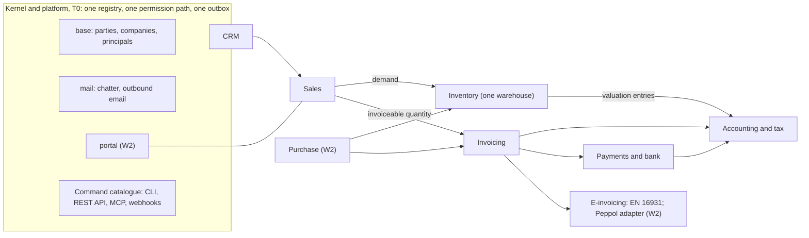

# obop product description: one business, one platform

> **Licence and price are settled.** The owner ruled on 2026-10-01 that the whole project is Apache-2.0 and completely free: no AGPL, Application Exception, CLA, `ee` tree, paid list, plans or prices (D1, D2; [DECISIONS.md](DECISIONS.md#owner-rulings)), and on 2026-10-27 that the one planned paid thing is a hosting service of SpaceCorps on dedicated Sliplane servers at about three times Sliplane's price, extra storage extra, not yet offered ([OR-22](DECISIONS.md#owner-rulings-2)). Where this document describes the old plans (Free, Team, Growth, Scale), prices, an `ee` list or a paid list, the rulings win and the text is history.

- **Status:** Draft 0.1
- **Date:** 2026-10-01
- **Scope:** The master product description: what obop is, who it is for, every app and module with tier and wave, how it differs from Odoo, ERPNext, Dolibarr and SaaS stacks, what it promises (and what it does not), what ships when, and what the owner still has to decide. obop is completely free and Apache-2.0; nothing in it is paid or gated, and SpaceCorps operates nothing for others except the free, ephemeral sample-data sandbox that opens at the public beta (OR-20); a paid hosting service on dedicated Sliplane servers is planned, not offered (OR-22).

**Summary.**

- **What:** an open-source operating system for businesses, with sales, stock, invoicing, accounting, payments and more as modules on one shared data model, and every capability a typed command reachable through the `obop` CLI, the REST API and MCP (agentic first, OR-4). Odoo is the functional reference, re-implemented clean-room (F3).
- **For whom:** owner-led services and light-trade firms of 5 to 50 people, one company, Germany first (Germany RATIFIED, OR-7; the firm profile Proposed, D4).
- **Why it wins:** it competes on the delivery contract, not on speed or language: one Apache-2.0 codebase with nothing paid, a free generated API, CLI and MCP, upgrades as a product feature, compliance as signed country packs and books protected by the database (sections 2 and 6).
- **Cost:** nothing for the software. The whole project is Apache-2.0 and completely free to use and to self-host (OR-1, OR-2): no plans, no paid list and no per-user price. The one planned paid thing is a hosting service run by SpaceCorps on dedicated Sliplane servers (OR-22): planned, not yet offered or charged. Apart from that SpaceCorps hosts nothing for others today (OR-11) except a free, ephemeral sandbox with sample data only, open to anyone who wants to try obop from the public beta (OR-20); a local demo with `obop dev up` stays optional. See section 9.
- **Dates:** the first delivery (W1) runs 2027-01-01 to 2027-09-30, cut to the smallest honest loop; public beta (0.5) 2027-07-06, with no commercial offer, and the free hosted sandbox is meant to open with it, if its go/no-go of 2027-06-01 passes (D83, OR-20); German pack stable 2027-09-30; 1.0, the first stable release, 2028-04-18. The W1 window, the German date and the 1.0 target are RATIFIED (OR-13); the 0.x dates are Proposed (D26; section 12 and [DECISIONS 5.2](DECISIONS.md#52-waves-and-calendar-proposed-d26)).
- **State and risks:** early code exists and the repository is public (since 2026-10-26); the product described here is mostly not built yet. The top risks are whether a very small team (the owner plus AI agents, self-funded, OR-6) can deliver on the kept dates, the accounting and localisation burden, and the German compliance dependencies (section 14.1).
- **Owner decisions:** the rulings of 2026-10-01 and 2026-10-27 (OR-1 to OR-25) are RATIFIED and 12 questions (Q1, Q3, Q4, Q7, Q10, Q13, Q19, Q23, Q27, Q29, Q30, Q31) are closed; the others remain open, reduced or deferred, and the first answers (Q15 on 2026-10-15, then Q17, Q20 and Q33 on 2026-10-23) fall due in October 2026 (section 14.2).

**How to read.**

- **Authority.** [DECISIONS.md](DECISIONS.md) is the binding register and wins over the research; decisions are cited by ID (for example D6) and owner rulings as OR-n. F1 to F6 are the owner's fixed constraints. The twenty-one owner rulings of 2026-10-01 (OR-1 to OR-21) are RATIFIED and override every Proposed position in the research and in earlier drafts; they settle the licence (Apache-2.0), the price (none), the funding (self-funded), the team (the owner plus AI agents), the support promise, the plugin registry and its licence rule, the agentic-first build order with literal UI parity, the DCO rule for agent-authored commits, the W1 cut and the free hosted sandbox at the public beta. D6 to D11, D15, D18, D19, D21, D22, D24 (its renames and its X and L prefixes RATIFIED, OR-14) and D27 to D39 are binding. Still Proposed are D12, D13, D14, D20, D25 (the T0 list), the firm profile and the French and Polish order in D4, and the details that D26, D80, D81, D83, D85 and D86 mark Proposed. So every tier, wave placement, 0.x date and figure below is Proposed unless a ruling or a binding decision is cited, even where the marker is not repeated.
- **Markers.** Most of what follows is not built (early code exists; CLAUDE.md has the code map): "(target)" is a design goal and "(estimate)" a model output; neither is a measurement. Facts and versions are as of 2026-10-01, month 0 (M0). Research is cited as [R20 s3]. Where the research proposed AGPL, plans, a paid list, a funded team, hosted operation or a 5-year LTS, the rulings supersede it and this document does not repeat it (DECISIONS section 7).
- **Vocabulary** follows D24 and the [GLOSSARY.md](GLOSSARY.md): a *business* is one PostgreSQL database; a *company* owns books; a *pack* is a signed data package; a *module* is first-party and an *app* a module with a top-level menu entry; a *plugin* is a package in the free registry. Identifier spellings (module ids, events, permission groups, ports, CLI commands) follow [CONVENTIONS.md](CONVENTIONS.md). The bare word "GA" is retired (D26); this document says *pack stable*, *public beta* and *1.0* (the first stable release).
- **Abbreviations** such as DCO, UStVA, DATEV, TSE, SEPA, camt.053, MT940 and QTSP are defined in the GLOSSARY.
- Nothing here is legal advice.

## 1. Pitch and tagline

### 1.1 Tagline

**One business, one platform.** (Proposed wording; "fast" stays out until the harness has run, BQ7 in [BUSINESS.md](BUSINESS.md), D21.)

### 1.2 One-paragraph pitch

obop is a free, open-source operating system for businesses: sales, stock, invoicing, accounting, payments, projects, support, HR and more, as modules on one shared data model, so there is one record of every customer, product and euro. Odoo is the functional reference and obop re-implements its concepts and behaviour clean-room (F3), but changes the delivery contract that Odoo's users complain about most:

- **Free and open, all of it.** The whole project is Apache-2.0 and completely free to use and to self-host; there is no open-core, no enterprise tree, no paid list and no plan (RATIFIED, OR-1, OR-2; D1, D2). The API, the CLI and MCP are generated from the model registry and free (D31, D80).
- **Agentic first, CLI for everything.** Every capability is a typed command reachable through the `obop` CLI, the REST API and MCP first; the web UI is a client of the same commands and reaches parity with them before the first stable release (RATIFIED, OR-4, OR-16; D80).
- **Upgradable and customisable.** Upgrades are a product feature with a local dry-run; the promise is an N-1 upgrade path and a 12-month deprecation window before 1.0, then a 2-year security-fix window from 1.0 (RATIFIED, OR-12; D85). Customisation is data that exports as a package (D29, D32), and plugins come from a free, open registry that lists only plugins with an OSI-approved licence (D81, OR-17).
- **Compliant.** Tax, e-invoicing and audit-file law live in signed, effective-dated country packs that are as is under Apache-2.0 and earn trust through oracles and golden cases (D34, D17).
- **Simple to run.** The backend is Rust, the frontend and tooling are Vite+ driven only through `vp` with pnpm (two ratified exceptions: the nightly exit drill and `pnpm sbom`, section 10), and the runtime is one binary plus PostgreSQL (F1, F2, D37).

Entry is compliant e-invoicing for owner-led services and light-trade firms of 5 to 50 people, Germany first (RATIFIED, OR-7), growing into the smallest honest loop of order to cash and bill to pay: kernel, invoicing, accounting with tax, German e-invoicing, CRM and sales, and basic stock (RATIFIED, OR-13, OR-15; D86; defined in section 3.1).

## 2. The problem

### 2.1 The ERP gap for small firms

Only sourced numbers are used; the fuller table is [BUSINESS.md s1.1](BUSINESS.md#11-sourced-market-facts). No market size is claimed: analyst totals disagree by about 30% and no primary analyst figure was readable [R20 s1.1].

| Fact | Value | Source |
|---|---|---|
| EU firms with 10+ staff using ERP (Eurostat 2025) | 46.45% overall; 41.08% of 10-49 staff; 69.93% of 50-249; 88.71% of 250+. By subtraction about 59% of 10-49 firms report no ERP | [R20 s1.2] |
| Micro firms (under 10 staff) | 94.4% of about 34M EU enterprises (2024); ERP use not measured | [R20 s1.2] |
| Germany, 10-249 staff | 480,442 firms; ERP use 37.5% (10-49) and 67.7% (50-249); about 281,000 without ERP (derived) | [R25 A1] |
| Implementation risk | Gartner via TechTarget: over 70% of recent ERP initiatives fail to fully meet their goals | [R20 s1.3] |
| Odoo's real customer | 88,510 identified companies, 77% under 50 staff (technographic crawl); EUR 620M 2025 revenue (company-stated) over 170,000 paying customers, about EUR 3.6k each (derived) | [R20 s2.1, s2.2] |
| SaaS sprawl | No verified SMB figure exists. Large-firm surveys report 106 apps per company (BetterCloud, 70% prefer a unified platform) and 305 (Zylo); both skew mid-market or enterprise and are not SMB facts | [R20 s3.2] |
| Cost of a stack | A 15-user agency: a SaaS stack about USD 6.5k a year against EUR 4.5k for Odoo Standard at list (modelled estimate, currencies not converted) | [R20 s3.2] |

The honest reading: obop has no licence fee, but a self-hosted business still carries its own operating and implementation effort, and at 15 users the licence delta against a SaaS stack is small anyway, so obop leads with consolidation, ownership and compliance, not price [R20 s3.2, R05 s6.3].

### 2.2 Odoo's open-core and upgrade grievances

Ranks are the voice-of-customer ranking [R04 s1]; evidence is review-site and forum sentiment plus primary documents.

| Rank | Grievance | Evidence | obop answer |
|---|---|---|---|
| 1 | Upgrades and migration | Custom modules sit outside the upgrade SLA; agreement v13 (2026-09-24) charges 25% of the annual price yearly for a database older than the three covered versions, and self-hosted upgrades need a database copy; the OpenUpgrade `20.0` branch holds one "Initial commit" (2026-09-28) and no scripts [R04 s4.1, R00 s3.5] | `obop upgrade --dry-run` on your own server, N-1 chain tests from 0.3 and an N-1 upgrade path before 1.0 (RATIFIED, OR-12; D36, D85); contract migrations only at the first release of a series (Proposed, D85) |
| 2 | Pricing and open-core surprises | Odoo Community's `account` is "Invoicing"; 23 of 51 editions-table rows are Enterprise-only; Odoo 20 moves Nilvera e-invoicing to Enterprise and bills all AI through IAP credits; 7% renewal uplift, 300% breach fee, a per-100-lines custom-code fee; 19.90 and 35.90 are 12-month introductory prices against 24.90 and 44.90 list [R01 s5, R04 s4.2, DECISIONS s3 ruling 21] | One Apache-2.0 codebase with nothing paid: no open-core, no plans, none of Odoo's contract levers (RATIFIED, OR-1, OR-2) |
| 2 | Gated API | External API Custom-only, one transaction per call, RPC services scheduled for removal in Online 21.1 and Odoo 22 (fall 2028) [R04 s4.10, R21 s2.1] | Generated REST, `$batch`, MCP, webhooks and the CLI, free and ungated (D31, D80) |
| 3 | Customisation debt | Studio is Custom-only; real changes need a programmer [R04 s4.3] | Fields, models, views and automations as data (D29, D32) |
| 5 | Localisation gaps | 229 `l10n_*` modules, yet returns and audit exports sit in paid modules [R04 s4.5, R25 B1] | Law-defined content open in signed packs with oracles and golden cases (D34) |
| 7, 9 | Performance, operations | About 6 concurrent users per worker; a proxy and a websocket worker [R04 s4.7, s4.9] | One binary plus PostgreSQL (D37); no speed multiple claimed (D21) |
| 12 | Disclosure | Enterprise customers get advisories at least two weeks early [R04 s4.12] | One publication moment for everyone (D38) |

### 2.3 What this means

The two worst grievances, upgrades and open-core pricing, are business-model and design choices, not Python limits: a Rust rewrite with the same model would reproduce them [R04 s1, R00 s4]. obop therefore competes on the delivery contract (free, open, upgradable, portable, predictable), answers the pricing grievance by having no paid layer at all (OR-2), and uses Rust for correctness and operations. "Written in Rust" is not a buying criterion for a bookkeeper, and no Rust business suite has traction (best repositories: 40, 23 and 16 stars) [R05 s3, s7].

## 3. Who it is for

### 3.1 Ideal customer (Proposed, D4)

Owner-led firms of 5 to 50 people in services and light trade, one company, one country at a time, Germany first (Germany RATIFIED, OR-7; the firm profile Proposed, D4). The owner-manager decides; the accountant influences; above about 20 users a consultant runs the project [R20 s3.3]. The on-ramp is compliant e-invoicing with unlimited users (nothing is licensed per user), growing into the loop defined below (D86; [R20 s9.2] for the capabilities it started from). Germany scores 84 of 100 in the country model and faces the all-issuer e-invoice mandate on 2028-01-01 [R25 A7, R09]. The W1 cut moves purchase orders to W2 and projects and timesheets to W3, so whether the profile stays "services and light trade" is a Q8 question (D4).

**The W1 loop** (called the seven-app loop in R20 and earlier drafts) is a set of user-facing capabilities, not modules: under D24 an app is a module with a top-level menu entry, and the W1 modules of section 11.1 deliver the capabilities below. The cut is RATIFIED (OR-13, OR-15; D86); the slip order and the landing waves of displaced modules (except the services variant, W3) are Proposed. Purchase orders, payment providers and the customer portal, which R20's loop included, are out of W1 (RATIFIED, OR-15) and land in W2 (Proposed; section 11.1); the `documents` DMS is W3 (section 5.3).

| # | Capability | W1 modules |
|---|---|---|
| 1 | Contacts and Products | `base`, `product`, `pricing` (list price and line discount) |
| 2 | CRM | `crm` |
| 3 | Sales | `sales` |
| 4 | Basic stock, one warehouse, with vendor bills | `stock`, `sale_stock`, `stock_account` (purchase orders: `purchase`, `purchase_stock`, W2) |
| 5 | Invoicing with Accounting, tax and German e-invoicing | `invoicing`, `account`, `tax`, `edi`, `l10n`, `l10n_de` |
| 6 | Payments and bank | `payment` (manual registration), `bank` (camt.053, MT940) |
| 7 | PDF and email documents and attachments | `mail` (reduced), `obop-report` |

`automation` (W2), `analytics` (W3), the command catalogue with the CLI, REST API, MCP and webhooks, and the views are the platform underneath. [ROADMAP.md](ROADMAP.md) PR1's warning sign, "more than 7 apps planned before design partners are live", is read here as more than seven capabilities, not more than the 18 modules and crates the register names for W1 beyond `base` (counted from DECISIONS 5.1; a proposed reading, section 14.3).

### 3.2 Personas

Fit is against the first loop; wave is when the persona's main apps ship (Proposed, D25, D26, D86). Nonprofit and government fit is inferred, not sourced [R20 s3.1]. Adoption paths are in [BUSINESS.md s1.2](BUSINESS.md#12-icp-and-personas-proposed-d4).

| Persona | Jobs to be done | Fit | Wave |
|---|---|---|---|
| Solo founder, freelancer (1-4) | Compliant invoices, cash, VAT | Medium (invoicing only) | W1 |
| Agency, professional services (5-20) | Lead to quote to project to timesheet to invoice; margin per project | Medium in W1 (CRM, quote, invoice; time tracked elsewhere); high from W3 | W1, W3 |
| Light-trade distributor (10-50) | Purchase, receive, sell, invoice; correct cost | Medium in W1 (vendor bills, sales, one warehouse); high once purchase orders arrive | W1, W2 |
| Manufacturer (20-100) | Bills of materials, manufacturing orders, lots | Medium | W3 |
| Retail (1-10 shops), e-commerce brand (3-30) | POS to stock to accounting; cross-channel stock | Low; medium-high if connector-first | W3 |
| Nonprofit, local government | Members, donors, budgets; tenders | Medium; low | W4+ |
| Accountant, bookkeeper (channel) | Clean books, DATEV-style export | Enabler | W1 |
| Implementer, developer (channel) | Customise without compiling Rust | Enabler | W1 (X1 packs, CEL, API, CLI), W2 (registry), W3 (X3, X4 app model) |

### 3.3 A day in the life

Illustrative composites built from the specs, not research findings: names are invented and each capability carries its proposed wave.

- **Solo founder (Lena, freelance designer, Germany, self-hosted on a small server; W1).** 08:40 Only Invoicing is enabled; the setup wizard loaded the German pack and showed its gate (preview or stable). 09:15 She turns a quote into an invoice; obop builds and validates an EN 16931 document and sends it by email or as a file (a Peppol access point of her choice arrives in W2). 11:30 She imports a camt.053 file (`obop bank_statement import`) and accepts two reconciliation suggestions by keyboard. 14:00 She asks a coding agent to draft invoices for this week's confirmed orders; the agent runs `obop invoice create_draft`, and she posts them herself. 17:00 Her accountant, invited as a user, exports the DATEV file (DE beta, 2027-06-30). Design target: first compliant invoice within 30 minutes of starting the install at M6 (adapted from R20 s12, which measured sign-up).
- **Agency owner (Omar, 12-person consultancy; W1, then W3).** He moves an opportunity to Qualified from the card menu, no dragging. A quote with optional lines goes out by email as a PDF; acceptance on a portal link and a deposit payment arrive with `portal` and the payment providers in W2. From W3 the accepted service line opens a project, consultants log time in a weekly grid, and approved hours feed the sale line, so invoicing and margin per project read one record. Until then he invoices from the order and tracks time elsewhere, because `project` and `timesheet` belong to the W3 services variant (D86).
- **Light-trade distributor (Ingrid, operations lead; W1, with purchase orders from W2).** In W1 she enters vendor bills, records goods receipts into the single warehouse, and a customer order reserves stock atomically; the invoice posts with cost of goods sold, balanced by a database trigger and numbered at posting without gaps. A return posts a credit note at original cost ([finance 5.1](spec/finance.md#51-sale-to-cash-with-partial-payments), [5.2](spec/finance.md#52-credit-note-after-a-partial-payment)). From W2 a reorder rule proposes a purchase order and she matches the vendor bill against order and receipt.
- **Manufacturer planner (Tomas, 60 staff; W3, needs a design partner, D25).** Bills of materials, manufacturing orders and shop-floor tablets; lots give genealogy; a failed quality check holds the lot; subcontracting uses a per-vendor location.
- **Shop and web-shop manager (Priya, three shops and an online store; W3).** The POS session keeps selling when the internet drops; orders sync by idempotent command id, and a `kill -9` mid-sync creates no duplicates. Closing posts one balanced session entry and one consolidated stock transfer; in Germany a certified TSE signs receipts. Web orders arrive through the `ecommerce` channel framework (Shopify and WooCommerce connectors W4), and the default checkout carries the consumer withdrawal function ([retail s5](spec/retail-commerce-marketing.md#5-cross-app-golden-paths)).
- **Association administrator (Noor; W4+, opportunistic).** Members and donors are parties, receipts are invoices, grants use analytic plans and budgets (W3), volunteers get self-service access through a small permission group. Local government waits for the public-sector track (W4+).
- **Accountant (Katrin, tax adviser, 40 client businesses; W1).** Each client is its own business and she is invited to it as a user with MFA by default. She reads the trial balance, runs the hash-chain verifier (`obop ledger verify`), locks the month with a time-boxed exception, prepares the VAT return from tax tags and exports for DATEV. An agent-drafted bill waits as a draft that only a human can post; the approvals inbox lane arrives in W2.
- **Implementer (Jonas, an independent consultant moving customers from Odoo; W1 to W3).** He dry-runs the Odoo importer on a customer's export (0.6); the report lists mapped, skipped and failed records and writes nothing. He adds a custom field with `obop custom_field create` (W1), adds an automation and an approval rule as an X1 pack with CEL conditions (W2), connects a legacy system through an OAuth client with REST and webhooks (packaged as an X4 remote app from W3), exports the customisation as a package and rehearses the upgrade with `obop upgrade --dry-run`. He publishes the pack to the free plugin registry with `obop plugin publish`; another business installs it with `obop plugin install` or copies its source with `obop plugin copy` (W2). He never compiles Rust.

### 3.4 Who it is not for yet

| Not yet | Why |
|---|---|
| Manufacturers and retailers needing `mrp` or `pos` now | T2, W3, each with a design partner (D25) |
| Firms needing projects and timesheets, purchase orders, a customer portal or Peppol | Out of W1 by the cut (RATIFIED, OR-15): purchase orders, portal and Peppol, which land in W2 (Proposed); the services variant (`project`, `timesheet`), which goes to W3 (RATIFIED, OR-15; D86) |
| Firms needing payroll | Engine W3; reference country decided 2029-04-01 (D19) |
| Multi-country or multi-company groups | One company in W1; multi-company W2 (the first W2 item to slip to W3), intercompany W3, consolidation W4 (D28, D86) |
| Firms outside Germany, France and Poland | Germany first (RATIFIED, OR-7); France and Poland follow in that order (Proposed, D4); AT, CH W3 (CH is unresearched, [LOCALIZATION.md](LOCALIZATION.md#73-open-questions) open question 19); BE, NL, IT, Nordics W4 via third-party maintainers; Spain gated behind counsel (D4, D17) |
| Offline writes, including POS order capture | 1.0 targets Odoo-19 parity (a read cache); POS order capture ships with `pos` in W3, after 1.0, and queued writes are W3+ (Proposed, D13; Q11) |
| Large enterprises (250+), public-sector tenders | Not the ICP; public-sector track waits for EU law |
| Buyers needing a warranted compliance claim | No pack is stable before 2027-09-30, and SpaceCorps never gives a compliance warranty or a legal-change service: packs are as is under Apache-2.0 and earn trust through oracles and golden cases (D17, D38) |
| Buyers needing a vendor-operated service, an SLA or paid support | SpaceCorps hosts nothing for others today and sells no support (OR-2, OR-11); the one exception is the free sample-data sandbox, which carries no service level and no real data (OR-20, D83); self-host, or ask a third-party host or implementer; support is community and best effort |
| Anyone wanting production use now | Early code exists but there is no supported release; 0.1 preview (2026-12-01) promises no stability (D26). The hosted sandbox is for trying obop out with sample data from the public beta; its terms forbid personal and production data (OR-20, D83) |

## 4. Vision and product principles

### 4.1 Vision

obop aims to be to a business what an operating system is to a computer: a small, strict kernel (parties, companies, permissions, a ledger, an outbox), first-party apps on top, extensions in a sandbox, and data the owner can always take away. Every capability is a typed command, so people, scripts and agents use one surface (agentic first, OR-4). The acceptance test is the chain Odoo's own catalogue uses: a sale confirms, stock moves, an invoice posts, a payment reconciles, and the journal entries balance without manual repair [R01 s2.2].

### 4.2 Principles

Each principle has a consequence a reviewer can check in the product.

| # | Principle | Concrete consequence | Decision |
|---|---|---|---|
| 1 | One business, one data model | A party is a person or organisation; customer and vendor are per-company profiles, not tables; the sale line joins delivery, invoicing and billable time | D27, D28 |
| 2 | Completely free, one Apache-2.0 codebase | No open-core, no enterprise tree, no paid list, no plans or prices; DCO sign-off, no CLA; SpaceCorps is the publisher and sells no software; the one planned service, hosting (OR-22), is separate and never restricts the software | RATIFIED, OR-1, OR-2; D1, D2, D82 |
| 3 | Agentic first, CLI for everything | Every capability is a typed command in the CLI, the REST API and MCP before any screen; the web UI is a client of the same commands and holds no business logic; a feature is not done until all three surfaces have it | RATIFIED, OR-4; D80 |
| 4 | The database protects the books | PostgreSQL enforces balanced entries, immutable posted rows, lock dates, gapless legal numbers, a hash chain and a unique quant key; corrections are reversals | D30 |
| 5 | Exact numbers | Ledger money is `bigint` minor units plus currency; prices and quantities are fixed-scale decimals; no floats | D9 |
| 6 | Metadata first | One registry drives ORM, API, OpenAPI, CLI, MCP tools, views, access, webhooks, imports and docs; a custom field needs no restart | D29, D32, D80 |
| 7 | The API is never gated | REST, OpenAPI 3.1, `$batch`, webhooks, MCP and the CLI are generated from one command catalogue and free, with a dated `Obop-Version` header | D31, D80 |
| 8 | Upgrades are a feature | `obop upgrade --dry-run` from 0.3; an N-1 upgrade path and a 12-month deprecation window before 1.0; a 2-year security-fix window from 1.0; contract migrations only at the first release of a series (Proposed) | RATIFIED, OR-12; D85; D36 |
| 9 | Compliance is data | Signed, effective-dated packs; `stable` needs oracle runs, golden cases and accountant sign-off; every tax line stores the rule-pack version; no compliance warranty | D34, D38, D17 |
| 10 | Agents are principals; drafts, not posts | Agent permissions are the intersection of user and token; dry-run returns a digest-bound `plan_id`; posting and paying need a human | D18 |
| 11 | Third-party code stays outside the trust domain | Others ship packs, CEL, Wasm on a pinned wasmtime LTS runtime (W3) or remote apps through a free, open registry; third-party UI runs in sandboxed frames; no in-process third-party Rust | D11, D81 |
| 12 | Operable by one person | One static binary plus PostgreSQL for deployments; SQLite for local and solo use (D44; embedded PostgreSQL stays possible, not built); no Node on customer servers | D37, D44 |
| 13 | Accessible and international by construction | WCAG 2.2 AA is a release gate; every drag has a non-drag path; logical CSS only; PO with ICU MessageFormat 1; RTL and CJK fixtures | D34, D35 |
| 14 | Leaving must be easy | Full export in every install, never gated; the Odoo importer; nothing to cancel, because nothing is subscribed | D22, D38; importer timing Proposed, D26 |
| 15 | Scope discipline | The smallest honest loop first, one country at a time, a stated slip order; scope moves and dates do not; no new app without a design partner | D4, D25, D86; [ROADMAP.md](ROADMAP.md) PR1 |
| 16 | Claims are measured | No multiple over Odoo until a harness runs monthly on fixed hardware (from M9); a pack claims only what its oracles check | D21 |
| 17 | Promise only what a very small team can keep | No SLA, no response times, no hosted service for others except the free sample-data sandbox (which carries no service level), no paid support; a 2-year security-fix window; nothing that needs funding to keep | RATIFIED, OR-6, OR-11, OR-12, OR-20; D83, D84, D85 |

## 5. The product

### 5.1 How to read the tables

Tier answers "is a business operating system complete without it"; wave answers "when". T0 is kernel and platform present in every business, T1 must-have, T2 second wave needing vertical depth or compliance, T3 the long tail; any module not listed defaults to T3 (D25). Waves: W0 2026-10-01 to 2026-12-31; W1 to 2027-09-30; W2 to 2028-06-30; W3 to 2029-06-30; W4 from 2029-07-01 (D26, RATIFIED by OR-13). The W1 rows are the D86 cut, whose in and out calls are RATIFIED (OR-13, OR-15); modules it displaced appear in the wave they land in (Proposed, except the services variant in W3), in the order of the slip list of [DECISIONS 5.3](DECISIONS.md#53-w1-cut-necessary-inside-calls-and-slip-order-d86) (Proposed). Other tier and wave values are Proposed (D25, D86) unless a ruling or a binding decision is cited; everything from W2 on is an ordered backlog paced by capacity and design partners, not by revenue (D84), and not a promise.

### 5.2 The loop and the platform underneath



The arrows are ports and events, never glue modules: an implementation crate depends only on kernel crates and `*-api` crates (D27, [ARCHITECTURE.md](ARCHITECTURE.md#44-the-module-graph-and-where-modules-land)).

### 5.3 Master table of apps and modules

Every row is open and free under Apache-2.0 (OR-1, OR-2). There is no paid list, so the "Open" column only records where a row is an unpromised backlog item or an operator concern. Names marked (Proposed) are not in the register. Waves follow the D86 cut (the W1 in and out calls are RATIFIED, OR-13, OR-15; the landing waves of displaced modules, except the services variant in W3, and the slip order are Proposed); modules it displaced appear in the wave they land in, and the slip order of DECISIONS 5.3 can move a row to a later wave. Spec links name the section that specifies the module; where a spec's own wave label predates the cut, the register wins (DECISIONS 5.1). The UI in D86 call 12 is thin: shell, list, form, kanban, search, report viewer and reconciliation view. A row marked "Proposed addition" puts into W1 something that [ux.md](spec/ux.md) adds beyond that list (the reduced Inbox, saved views, the palette, the setup wizard, the import screens, tokens with density and dark mode); those placements are Proposed, are collected in [ux open question 15](spec/ux.md#9-open-questions), and are not yet in the slip order of DECISIONS 5.3 (see section 11.1 and the question in section 14.3).

| Domain | Module or app | Purpose | Tier | Wave | Open | Spec |
|---|---|---|---|---|---|---|
| Kernel | Eleven kernel crates (`obop-types` to `obop-testkit`) | Registry, ORM, access, outbox, HTTP | T0 | W0 | Open | [architecture s4](ARCHITECTURE.md#4-layered-architecture-and-the-modular-monolith) |
| Kernel | `base` (Contacts app) | Parties, principals, one company, currency, external ids, attachments | T0 | W0 model, W1 app | Open | [platform 4.2](spec/platform.md#42-contacts-parties) |
| Kernel | Principals, permission groups | Default-deny access algebra | T0 | W0-W1 | Open; native multi-IdP SAML and full SCIM are unpromised backlog items (DECISIONS s6) | [security 4.2](spec/security-privacy.md#42-authorization) |
| Kernel | `mail` (reduced in W1) | Chatter, activities, followers, outbound email and templates with per-domain DKIM and the sender-domain checker | T0 | W1 | Open | [platform 4.5](spec/platform.md#45-chatter-and-discuss-channels-mail-discuss) |
| Kernel | `mail` inbound | Inbound gateway, aliases, bounce processing, OAuth-only mailbox connectors (Gmail API, Microsoft Graph) | T0 | W2 | Open | [platform 4.5](spec/platform.md#45-chatter-and-discuss-channels-mail-discuss) |
| Kernel | Notifications, Inbox | In-app and email; in W1 the Inbox is reduced to mentions, activities, alerts and a plain plan confirm; approvals lane W2 | T0 | W1 (Proposed addition, ux open question 15) | Open | [ux 4.8](spec/ux.md#48-notification-centre-and-inbox) |
| Kernel | `portal` | Capability links, quote acceptance | T0 | W2 | Open | [sales 4.8](spec/sales-crm.md#48-customer-portal-portal) |
| Kernel | `automation` with approvals engine | Rules, schedules, CEL; the approvals engine carries the D18 approval policy | T0 | W2 | Open | [platform 4.13](spec/platform.md#413-automation-automation-w1) |
| Kernel | `customize` (Proposed) | Custom fields W1 (typed command and admin screen); custom models and layout editor W3 | T0 | W1, W3 | Open | [platform 4.14](spec/platform.md#414-customization-customize-proposed) |
| Kernel | Search, import and export, multi-language | One search grammar; dry-run imports; PO with ICU | T0 | W0-W1 | Open | [platform 4.15](spec/platform.md#415-search-kernel-and-base-w1) |
| Kernel | `obop-report` | Typst PDFs (Proposed, D20) | T0 | W1 | Open | [platform 4.17](spec/platform.md#417-reporting-and-bi-analytics-obop-report) |
| Kernel | `analytics` | Semantic layer | T0 | W3 | Open | [platform 4.17](spec/platform.md#417-reporting-and-bi-analytics-obop-report) |
| Kernel | Dashboards | Shareable widget boards | T2 | W3 | Open | [platform 4.17](spec/platform.md#417-reporting-and-bi-analytics-obop-report) |
| Kernel | Apps management | Per-business install, dry-run upgrade, signed packages, as typed commands (D86 calls 16 and 22); the Settings screens are a client of them (Proposed) | T0 | W1 | Open | [platform 4.18](spec/platform.md#418-apps-management-base) |
| Kernel | Plugin registry | Free and open: search, install (version-pinned) or copy via the CLI; community and verified tiers; only plugins with an OSI-approved licence are listed (OR-17); no payments. Stage 1 a git-backed index, stage 2 a registry service on demand (Proposed, D81) | T0 | W2; W3 or W4 | Open | [cli 4](spec/cli.md#4-the-plugin-registry-and-marketplace-or-3) |
| Kernel | `obop-wasm-host`, `obop-ext-sdk`, `obop-compat` | Wasm extensions, SDK, compatibility runs | T0 | W3 | Open | [integrations 4.5](spec/integrations.md#45-connector-framework-t0-w1-wasm-w2) |
| Kernel | `resource` (Proposed) | Working calendars, leaves, public holidays | T0 (Proposed) | W3 | Open | [services 4.1](spec/services.md#41-resource) |
| Kernel | `discuss` | Channels, direct messages | T1 | W3 | Open | [platform 4.5](spec/platform.md#45-chatter-and-discuss-channels-mail-discuss) |
| Kernel | `calendar` | Events, Google and Microsoft sync | T1 | W3 | Open | [platform 4.8](spec/platform.md#48-calendar-and-contact-sync-calendar) |
| Kernel | `todo` (standalone To-do) | Personal task list; activities on any record ship with `mail` in W1 | T1 | W3 | Open | [platform 4.5.1](spec/platform.md#451-to-do-todo-t1-w3) |
| Kernel | `documents` | Folders, versions, retention (attachments from W1) | T1 | W3 | Open | [platform 4.9](spec/platform.md#49-documents-attachments-w1-dms-w3) |
| Kernel | `knowledge` | Article tree, live co-editing | T2 | W3 | Open | [platform 4.10](spec/platform.md#410-knowledge-knowledge-w3) |
| Kernel | `sign` | Envelopes, hash-chained trail (acceptance evidence W1) | T2 | W3 | Open | [platform 4.11](spec/platform.md#411-sign-sign-w3-acceptance-evidence-w1) |
| Kernel | `obop-edge`, store hub, hardware agent | Edge command outbox, LAN authority | T0 | W3 | Open | [retail 4.1](spec/retail-commerce-marketing.md#41-point-of-sale-pos-obop-edge-store-hub-hardware-agent) |
| UX | UI runtime, core views | Shell, form, list, kanban, search, report viewer, reconciliation view | T0 | W1 (D86 call 12) | Open | [ux 4.4](spec/ux.md#44-view-catalogue-and-behaviour-contract) |
| UX | Pivot, graph and calendar views | Analysis and scheduling views | T0 | W2 | Open | [ux 4.4](spec/ux.md#44-view-catalogue-and-behaviour-contract) |
| UX | Web UI parity work | A UI path for every command of every shipped module, measured by the parity test; gates 1.0 (OR-4, OR-16: literal parity, owner-approved exemption list) | T0 | W2 | Open | [cli 6](spec/cli.md#6-parity-testing-and-release) |
| UX | Gantt, map, cohort views | Scheduling, geography, retention | T0 | W3 | Open | [ux 4.4](spec/ux.md#44-view-catalogue-and-behaviour-contract) |
| UX | Design system, setup wizard | Tokens with density and dark mode, and the pack-aware setup wizard (reduced) in W1; business branding W3; anyone may rebrand a fork, subject to the trademark policy (Q26) | T0 | W1 (Proposed addition, ux open question 15); W3 | Open | [ux 4.14](spec/ux.md#414-onboarding-setup-sample-data-import) |
| Security | Identity, audit, encryption, privacy tooling | Passkeys, OIDC, hash-chained audit, erasure | T0 | W0-W2 | Open; WORM audit publication, SIEM streaming, cloud-KMS and HSM connectors are unpromised backlog items | [security 4](spec/security-privacy.md#4-per-app-specification) |
| Integrations | Command catalogue | One typed command per capability, generated from the registry; the source of the CLI, REST API, OpenAPI, MCP tools and webhooks (D80) | T0 | W0 skeleton, W1 | Open | [cli 2](spec/cli.md#2-command-model) |
| Integrations | `obop` CLI | Thin typed client of `/api/v1`; grammar `obop <subject> <action>` (Proposed, Q22); machine-readable output and stable exit codes | T0 | W0-W1 | Open | [cli](spec/cli.md) |
| Integrations | Generated REST, OpenAPI, webhooks | `$batch`, idempotency, signed webhooks | T0 | W1 | Open, ungated | [integrations 4.1](spec/integrations.md#41-public-rest-api-and-openapi-obop-http-t0-w1) |
| Integrations | MCP endpoint | Registry-generated tools | T0 | W1 | Open | [integrations 4.4](spec/integrations.md#44-mcp-endpoint-t0-w1) |
| Integrations | OAuth 2.1 provider, API keys, scoped agent tokens | How the CLI, scripts and agents authenticate (D18) | T0 | W1 | Open | [integrations 4.2](spec/integrations.md) |
| Integrations | Connector framework | First-party X5 adapters and OAuth-client access W1; X3 Wasm connectors and the X4 app model (consent UX, connected-apps inventory) W3 | T0 | W1; W3 | Open | [integrations 4.5](spec/integrations.md#45-connector-framework-t0-w1-wasm-w2) |
| Integrations | Extension surfaces beyond X1 and X2 | X3 host, F0 patches, F2, theme and branding packs | T0 | W3 | Open | [integrations 4.5](spec/integrations.md#45-connector-framework-t0-w1-wasm-w2) |
| Integrations | Importers | CSV 0.3; Odoo 0.6; QuickBooks W2; Xero, ERPNext W3 | T0 | W1-W3 | Open | [integrations 4.8](spec/integrations.md#48-import-engine-and-migration-importers-base-t0-w0-engine) |
| Integrations | Full export and restore | NDJSON archive, customisation package | T0 | W1 | Open, never gated | [integrations 4.9](spec/integrations.md#49-export-and-portability-base-t0-w1) |
| Integrations | Generated SDKs | SDKs beyond the OpenAPI document | T0 | W3 | Open | [integrations 4.11](spec/integrations.md#411-sdks-and-developer-experience-t0-cli-w1-sdks-w2) |
| AI | Agent surface, principals, write protocol | Typed commands, dry-run, `plan_id`; policy engine with the approvals engine W2 | T0 | W1, W2 | Open | [ai 4.1](spec/ai.md#41-agent-surface-and-mcp-server-kernel-t0-w1) |
| AI | `ai` | BYOK gateway, Ask, extraction, agents, forecasting | T2 | W3 | Open; BYOK only, no hosted credits | [ai 4.5](spec/ai.md#45-ai-gateway-byok-routes-egress-ledger-kill-switches-self-hosted-profile-ai-w3) |
| AI | A2A, commerce-agent protocols | Cross-business agents | T2 | W4 (Proposed) | Open | [ai 1.2](spec/ai.md#12-areas-and-modules) |
| Finance | `account` | Ledger, AR/AP, reconciliation, locks, hash chain, reports | T1 | W1 | Open | [finance 4.3](spec/finance.md#43-accounting) |
| Finance | `tax` | Tax engine, fiscal positions, returns | T1 | W1 | Open | [finance 4.4](spec/finance.md#44-tax) |
| Finance | `invoicing` | Invoices, credit notes, bills, reminders | T1 | W1 | Open | [finance 4.2](spec/finance.md#42-invoicing) |
| Finance | `payment` | Manual registration W1; SEPA files, Stripe plus one PSP W2 | T1 | W1, W2 | Open | [finance 4.5](spec/finance.md#45-payments-and-bank-reconciliation) |
| Finance | `bank` | camt.053 and MT940 statement import W1; aggregator feeds W3 | T1 | W1, W3 | Open | [finance 4.5](spec/finance.md#45-payments-and-bank-reconciliation) |
| Finance | `edi` | EN 16931 UBL/CII, Factur-X, XRechnung: issue and receive by email or file W1; Peppol transport adapter W2 (a certified access point the user chooses, bring-your-own credentials) | T1 | W1, W2 | Open | [finance 4.6](spec/finance.md#46-e-invoicing-and-e-reporting) |
| Finance | `analytic` | Plans, accounts, distribution | T0 | W3 | Open | [finance 4.8](spec/finance.md#48-analytic-accounting-and-budgets) |
| Finance | `l10n` framework, `l10n_de` | Pack hooks; SKR03/04 (subject to written DATEV confirmation), UStVA, DATEV, GoBD | T1 | W1 | Open; as is, no warranty (D17) | [localization 3.3](LOCALIZATION.md#33-sheets-for-the-first-three-packs) |
| Finance | `l10n_fr`, `l10n_pl` | French (platform integration) and Polish (KSeF) packs | T1 | W2 (Proposed, first to slip); W3 | Open; as is | [localization 3.3](LOCALIZATION.md#33-sheets-for-the-first-three-packs) |
| Finance | Austria, Switzerland, Belgium, Netherlands, Spain, Italy, Nordic packs | Country packs maintained by third-party maintainers (L2), with no payment or revenue share from SpaceCorps; Spain gated behind counsel | T2 | W3 (AT, CH; CH unresearched); W4 | Open content | [localization 3.4](LOCALIZATION.md#34-later-packs) |
| Finance | Multi-company | Selector, per-company books and locks; the first W2 item to slip to W3 | T1 | W2 | Open, never gated | [finance 4.12](spec/finance.md#412-multi-company-intercompany-and-consolidation) |
| Finance | Fixed assets, deferrals, budgets (Proposed names) | Schedule generators emitting ordinary entries | T1 | W3 | Open | [finance 4.9](spec/finance.md#49-fixed-assets-w3) |
| Finance | `expenses` | Claims, receipts, bills, reimbursement | T1 | W3 | Open | [people 4.5](spec/people.md#45-expenses-hr-side) |
| Finance | `intercompany`, `consolidation` | Mirrored documents; eliminations | T2 | W3; W4 | Open | [finance 4.12](spec/finance.md#412-multi-company-intercompany-and-consolidation) |
| Sales | `product` | Variants, UoM, packagings, combos | T0 | W1 | Open | [sales 4.1](spec/sales-crm.md#41-product-catalog-product) |
| Sales | `pricing` | List price and line discount through `PricingPort` in W1; pricelists and rules W2 | T0 | W1, W2 | Open | [sales 4.2](spec/sales-crm.md#42-pricing-pricing) |
| Sales | `crm` | Pipeline, leads, forecast; scoring W2 | T1 | W1 | Open | [sales 4.3](spec/sales-crm.md#43-crm-crm) |
| Sales | `sales` | Quotes, orders, down payments, margins | T1 | W1 | Open | [sales 4.4](spec/sales-crm.md#44-sales-sales) |
| Sales | `subscriptions` | Proration, dunning, MRR ledger | T2 | W3 | Open | [sales 4.5](spec/sales-crm.md#45-subscriptions-subscriptions) |
| Sales | `rental`, `commissions` | Period reservations; commission plans | T3 | W4+ or community | Open | [sales 4.6](spec/sales-crm.md#46-rental-rental) |
| Sales | `loyalty` | Coupons, gift cards, points | T2 | W3 | Open | [retail 4.2](spec/retail-commerce-marketing.md#42-loyalty-coupons-and-gift-cards-loyalty) |
| Supply | `stock` | One warehouse W1; lots, serials, routes, multi-warehouse W3 | T1 | W1, W3 | Open | [supply 4.1](spec/supply-chain.md#41-inventory-stock-stock_account) |
| Supply | `stock_account`, `sale_stock` | Valuation entries; order and delivery bridge | T1 | W1 | Open | [supply 4.1](spec/supply-chain.md#41-inventory-stock-stock_account) |
| Supply | `purchase`, `purchase_stock` | RFQ, PO, three-way match; receipt bridge | T1 | W2 | Open | [supply 4.2](spec/supply-chain.md#42-purchase-purchase-purchase_stock) |
| Supply | `delivery` | `CarrierProvider` trait, aggregator-first connectors | T1 | W3 | Open | [supply 4.9](spec/supply-chain.md#49-shipping-and-carriers-delivery) |
| Supply | `mrp` | Bills of materials, work orders, Shop Floor, subcontracting | T2 | W3 | Open | [supply 4.3](spec/supply-chain.md#43-manufacturing-mrp) |
| Supply | `quality`, `maintenance` | Control points and holds; equipment | T2 | W3 | Open | [supply 4.4](spec/supply-chain.md#44-quality-quality) |
| Supply | Barcode | Barcode fields from W1; nomenclature, scan-to-add and scan screens W3 (Proposed; scan-to-add was W2 before the cut); depth W4 | T2 | W3-W4 | Open | [supply 4.7](spec/supply-chain.md#47-barcode) |
| Supply | PLM, `repair`, MPS and MRP run | Engineering change; repairs; suggestions | T3 | W4+ or community | Open | [supply 4.5](spec/supply-chain.md#45-plm-engineering-change) |
| Retail | `pos` with `pos_stock`, `pos_account`; restaurant mode | Sessions, offline orders, fiscal adapters (DE TSE first, through a signer the user chooses); restaurant W3 end or W4 | T2 | W3 | Open | [retail 4.1](spec/retail-commerce-marketing.md#41-point-of-sale-pos-obop-edge-store-hub-hardware-agent) |
| Retail | `website` | Block pages, themes, forms, multilingual | T2 | W3 | Open | [retail 4.4](spec/retail-commerce-marketing.md#44-website-builder-website) |
| Retail | `ecommerce` | Catalogue, checkout, returns, headless API | T2 | W3 | Open | [retail 4.3](spec/retail-commerce-marketing.md#43-ecommerce-ecommerce-channel-sync-headless-api) |
| Retail | Shopify, WooCommerce connectors | Orders in; stock, price, tracking out | T2 | W4 | Open | [retail 4.3](spec/retail-commerce-marketing.md#43-ecommerce-ecommerce-channel-sync-headless-api) |
| Retail | `marketing` | Email and SMS, lists, tracking | T2 | W3 | Open | [retail 4.5](spec/retail-commerce-marketing.md#45-marketing-suite-marketing-email-sms-deliverability) |
| Retail | `livechat`, WhatsApp | Website chat; WhatsApp as X3 or X4 package | T2 | W3; W4 | Open | [retail 4.6](spec/retail-commerce-marketing.md#46-live-chat-and-long-tail-dispositions) |
| Retail | Marketing long tail | Automation, social, events, surveys, blog, forum, eLearning | T3 | W4+ or community | Open | [retail 4.6](spec/retail-commerce-marketing.md#46-live-chat-and-long-tail-dispositions) |
| People | `hr` with employee self-service | Employees, versions, time off, skills, onboarding; the employee core ships with `timesheet` (Proposed) | T1 | W3 | Open | [people 4.1](spec/people.md#41-employees) |
| People | `recruitment`, `attendances` | Hiring pipeline; check-in and overtime | T2 | W3 | Open | [people 4.4](spec/people.md#44-recruitment) |
| People | `payroll` | CEL engine, explainable runs, provider connectors; reference pack W4; no filing | T2 | W3, W4 | Open; rule content as is, no warranty, no payroll service | [people 4.10](spec/people.md#410-payroll-strategy) |
| People | `appraisals` (Proposed) | Reviews, goals | T3 | W4+ | Open | [people 4.8](spec/people.md#48-appraisals-and-okrs) |
| Services | `project` | Tasks, dependencies with lag, milestones | T1 | W3 | Open | [services 4.2](spec/services.md#42-project) |
| Services | `timesheet`, `sale_project`, `sale_timesheet` | Time on analytic lines; billable time | T1 | W3 (the services variant, first in W3) | Open | [services 4.3](spec/services.md#43-timesheets-and-the-time-to-invoice-bridges) |
| Services | `helpdesk` | Tickets, tested SLA engine, CSAT | T2 | W3 | Open | [services 4.4](spec/services.md#44-helpdesk) |
| Services | `planning` with field work | Shifts, sites, equipment, visits | T2 | W3 | Open | [services 4.5](spec/services.md#45-planning-and-field-work) |
| Services | `appointments` | Booking types, slot engine | T2 | W3 | Open | [services 4.6](spec/services.md#46-appointments) |
| Services | `service_contract` (Proposed), `fleet` | Entitlements; vehicles | T3 | W3 (Proposed); W4+ | Open | [services 4.8](spec/services.md#48-service-contracts-proposed) |

### 5.4 The suite by domain

**Kernel and platform.** Everything shares one registry, one permission path and one outbox, so a message on a quote, an approval on a bill and an agent's draft obey the same rules. Chatter is first-party and record-bound; W1 email is outbound only, through the operator's SMTP relay or a provider API with per-domain DKIM, and the inbound gateway and mailbox connectors (W2) are OAuth-only (Gmail API, Microsoft Graph) because Microsoft starts default-disabling EWS in Exchange Online on 2026-10-01 (tenant by tenant, admin-reversible) and turns it off permanently on 2027-04-01 (D39). Documents, knowledge and sign arrive in W3; an acceptance primitive with evidence exists from W1 ([platform.md](spec/platform.md)).

**Finance.** Accounting is the acceptance test of the platform and its largest cost: Odoo's `account` model code is about 1.9 MB against 0.3 MB for `sale` [R20 s9.1]. Invoicing and Accounting share one ledger; showing Accounting adds views and migrates no data. W1 registers payments manually and imports bank statements (camt.053, MT940); SEPA files and Stripe plus one PSP are W2 and aggregator feeds W3. Reconciliation, reports, assets, deferrals, budgets and consolidation, which Odoo keeps in Enterprise, are open (RATIFIED, OR-2). EN 16931 is the internal invoice model, and country law is a pack, not core code ([finance.md](spec/finance.md), [LOCALIZATION.md](LOCALIZATION.md)).

**Sales and CRM.** Leads and opportunities share one table; pricing is a deterministic engine whose every result carries an explain trace (W1 ships list price and line discount, pricelists and rules follow in W2); quotes go out as PDF by email in W1 and can be accepted and prepaid on the portal from W2. Subscriptions (W3) are a first-class aggregate with dunning and an append-only MRR ledger, where Odoo only flags a contract in exception ([sales-crm.md](spec/sales-crm.md)).

**Supply chain.** Transfer, move and move line with a quant projection, but one quant row per key, immutable done moves, exact decimal quantities and explicit FIFO layers. Valuation is independent of accounting. W1 is one warehouse with valuation entries; purchase orders follow in W2, and lots, serials, routes and multi-warehouse in W3. Quality, barcode screens and carrier connectors, which Odoo keeps proprietary, are open ([supply-chain.md](spec/supply-chain.md)).

**Retail, commerce and marketing.** POS is an append-only ledger with idempotent command ids, an edge store, a store hub, a hardware agent and a published offline contract. The website is versioned JSON blocks rendered by Rust with Vite islands and no Node in production (Proposed, D14). Marketing carries a built-in deliverability subsystem. None of it is in W1 or W2 ([retail-commerce-marketing.md](spec/retail-commerce-marketing.md)).

**People.** An HR core at Odoo Community parity with effective-dated employee versions, plus what Odoo keeps in Enterprise. Payroll is the moat and the liability, so the core holds a generic CEL rule engine, country packs and provider connectors and never files statutory returns (D19). Special-category data is protected in the data layer, with read audit ([people.md](spec/people.md)).

**Services.** One clock (`resource` calendars), one time table (timesheets are analytic lines) and one join point (delivered quantity on the sale line). The services variant (`project`, `timesheet`, with the employee core and `resource`) is the first item of W3 (D86). Helpdesk, planning, field work, appointments and Gantt, which are Enterprise in Odoo, are open, with a tested SLA engine and dependencies with lag ([services.md](spec/services.md)).

**AI, integrations, security and UX.** The typed command catalogue is the only agent surface: the CLI, the REST API and MCP are generated from it, and agents create drafts that humans post ([ai.md](spec/ai.md), [cli.md](spec/cli.md)). The API, importers, connectors and the plugin registry are in [integrations.md](spec/integrations.md), identity, isolation, audit and CRA handling in [security-privacy.md](spec/security-privacy.md), views, accessibility and offline in [ux.md](spec/ux.md).

### 5.5 Disposition of every Odoo app class

Classes are those of the Odoo 20 catalogue [R01 s3, s4]. Dispositions: *Ships*, *Deferred* (T3 or later, extension API or community), *Connector* (X3 or X4 package or provider trait), *Not planned*. CE and EE are Odoo Community and Odoo Enterprise. The dispositions for mail plugins, snailmail and check printing are this document's proposals: platform.md lists mail plugins as not scheduled, finance.md s8 leaves check printing unscheduled, and no spec covers snailmail.

| Odoo app class (edition) | Disposition | Wave |
|---|---|---|
| Contacts (CE) | Ships: `base` Contacts app | W0, W1 |
| Discuss and Mail (CE); Calendar (CE) | Ships: `mail` (reduced in W1, inbound gateway W2); `discuss` and `calendar` | W1; W3 |
| Gmail and Outlook mail plugins (CE) | Not planned first-party: an add-in is an X4 remote app over the API and MCP; mailboxes connect through the OAuth-only gateway (D39) | n/a |
| To-do (CE) | Ships: activities on any record; standalone to-do is T1 | W1; W3 |
| Automation rules (CE); Security: TOTP, passkeys, OAuth, LDAP (CE) | Ships: `automation`; kernel identity | W2; W1 |
| Portal, UTM, link tracker (CE) | Ships: `portal`; UTM in `crm`; link tracker with `marketing` | W2; W1; W3 |
| Digest (CE) | Deferred: scheduled report delivery is Proposed | W2 |
| SMS, phone validation (CE) | Connector: `SmsProvider` trait, bring-your-own Twilio first | W3 |
| Snailmail, posting a document (CE) | Not planned: a postal-provider connector (X3 or X4) if users ask | n/a |
| IAP credit mechanism (CE, EE) | Not planned: no credit wall; provider connectors use the business's own keys and AI is BYOK (D18) | n/a |
| Partner Autocomplete, VAT lookup (IAP) | Connector: the VIES check is a W1 pack validator and connector; registry and address lookups are provider connectors, off by default | W1; W2 |
| Lead Mining and enrichment (IAP) | Connector: provider connectors with the business's own keys | W3 |
| Digitization, invoice and receipt OCR (IAP) | Ships in `ai`: BYOK extraction of bills and receipts as drafts for human review | W3 |
| Data Recycle (CE, EE) | Ships: retention classes, purge jobs, record-level hold | W1 |
| Spreadsheet, Dashboards (CE library, EE) | Ships: dashboards; a spreadsheet view is not scheduled | W3 |
| Documents, Knowledge, Appointments (EE) | Ships: `documents`, `knowledge`, `appointments` | W3 |
| Approvals (EE) | Ships: engine in `automation`; a standalone app is T3 | W2; W4+ |
| Phone and VoIP (EE) | Connector: click-to-call and call logging through provider APIs (X3 or X4); no softphone or PBX | W4+ |
| IoT (EE) | Not planned as a box: the hardware agent and store hub replace it (D37); other drivers are T3, through the extension API or community | W3; W4+ |
| WhatsApp (EE) | Connector: X3 or X4 package | W4 |
| Invoicing (CE); Accounting (EE) | Ships, both open: `invoicing`, `account`; assets, deferrals, budgets W3; consolidation W4 | W1 |
| Check printing (CE) | Deferred: a pack-supplied Typst template; the US payment rails and forms it belongs to are unscheduled ([finance s8](spec/finance.md#8-out-of-scope-non-goals-and-later)) | W4+ |
| Intrastat (EE); loans | Deferred: Intrastat as a possible pack export, loans as later work; both outside the first cuts ([finance s8](spec/finance.md#8-out-of-scope-non-goals-and-later)) | W4+ |
| Expenses (CE) | Ships: `expenses` | W3 |
| Online payments, 21 providers (CE) | Ships narrower: manual registration W1; SEPA and Stripe plus one PSP W2; others as connectors W3 | W1; W2; W3 |
| Payroll (EE); payroll localisations, 24 countries | Ships: engine W3; one reference pack after 2029-04-01; provider connectors; no filing | W3; W4 |
| Sign (EE) | Ships: `sign`; qualified signatures via QTSP connectors | W3 |
| ESG, Equity (EE) | Not planned first-party (T3, community) | W4+ |
| CRM (CE); Sales (CE) | Ships: `crm` (scoring W2), `sales` | W1 |
| Loyalty, Live Chat (CE); Subscriptions (EE) | Ships: `loyalty`, `livechat`, `subscriptions`; AI live-chat agents are not planned through W3 and are revisited in W4 | W3 |
| Point of Sale, restaurant (CE) | Ships: retail `pos` W3; restaurant W3 end or W4 | W3 |
| Rental (EE) | Deferred: T3 | W4+ |
| Amazon, Shopee, Lazada, TikTok, Gelato | Connector: Shopify and WooCommerce W4; the rest community or third-party plugins | W4+ |
| Website, eCommerce (CE) | Ships: `website`, `ecommerce` | W3 |
| Blog, Forum, eLearning (CE) | Deferred: blog as an X1 pack; forum and eLearning community-maintained | W4+ |
| Online jobs (CE) | Ships: through a `recruitment_website` bridge (Proposed) | W3 |
| Inventory (CE) | Ships: one warehouse W1; lots, serials, routes, multi-warehouse W3 | W1, W3 |
| Ship orders without Inventory; Valuation without Inventory (Odoo 20 modes) | Not planned (Proposed): optional ports give the separability instead; a lightweight shipment record is W4+ at the earliest ([supply s8](spec/supply-chain.md#8-out-of-scope-non-goals-and-later)) | n/a |
| Barcode (EE) | Ships: scan-to-add and scan screens W3, depth W4 (Proposed; scan-to-add was W2 before the cut) | W3-W4 |
| Purchase (CE) | Ships: `purchase` | W2 |
| Manufacturing, Shop Floor, Quality, Maintenance | Ships: `mrp` with Shop Floor, subcontracting, `quality`, `maintenance` | W3 |
| PLM (EE), Repairs (CE), Fleet (CE), Appraisals (EE) | Deferred: T3 | W4+ |
| Delivery and carriers (CE generic) | Ships: `CarrierProvider` trait W3; connectors aggregator-first | W3 |
| Employees, Time Off (CE) | Ships: `hr`; the employee core arrives with `timesheet` | W3 |
| Attendances, Recruitment (CE) | Ships: `attendances`, `recruitment` | W3 |
| Lunch, Frontdesk, Referrals, Marketing Card | Not planned first-party (T3, community) | n/a |
| Email and SMS Marketing (CE) | Ships: `marketing` | W3 |
| Events, Surveys (CE); Marketing Automation (EE) | Deferred: Events as an X1 pack; simple forms via the form block; fixed flow templates on `automation` | W4+ |
| Social Marketing (EE) | Connector: X4 remote apps | W4+ |
| Project, Timesheets (CE) | Ships: `project`, `timesheet` | W3 |
| Planning (EE); Field Service (EE, merged into Planning in Odoo 20) | Ships: `planning` with field work; task subtype versus shift stays open until 2028-07-01 | W3 |
| Helpdesk (EE) | Ships: `helpdesk` | W3 |
| Studio (EE); Properties (CE) | Ships, open: `customize`; custom fields with three-tier storage | W1-W3 |
| Developer platform, external API, apps store | Ships: free generated API, CLI and MCP; the free plugin registry (search, install, copy; only OSI-approved-licence plugins are listed, OR-17); no marketplace commerce (OR-3) | W1; W2; n/a |
| Odoo mobile apps (EE) | Not planned: no native apps beyond the PWA and Tauri shells ([ux s8](spec/ux.md#8-out-of-scope-non-goals-and-later)) | n/a |
| AI: agents, skills, MCP, AI fields (EE) | Ships: MCP W1, `ai` W3; voice, image and web-page generation and AI live-chat agents not planned through W3 (revisited in W4) | W1, W3 |
| Industries, 60 plus bundles (EE) | Deferred: industry bundles as data packs | W4+ |
| Fiscal localisations, 229 `l10n_*` modules | Ships: DE W1, FR W2, PL W3; AT, CH W3 (CH unresearched); BE, NL, ES, IT, Nordics W4 via third-party maintainers; rest community | W1-W4 |

## 6. What makes obop different

### 6.1 Differentiators, with evidence and the feature that delivers each

| # | Differentiator | Evidence | Product feature | Matters most against |
|---|---|---|---|---|
| 1 | Complete accounting, nothing paid | Odoo Community ships "Invoicing" only; 23 of 51 editions-table rows are Enterprise-only [R01 s1.2, s5]; Dolibarr's accounting is simpler [R05 s2.1] | `account` with reconciliation, reports, assets, deferrals, budgets and consolidation, all open and free (RATIFIED, OR-2) | Odoo |
| 2 | Ledger integrity in the database | Odoo checks balance only in the ORM and tolerates duplicate quants [R08, R10] | Deferred balance trigger, immutable posted rows, gapless numbers at posting, hash chain, unique quant key (D30) | Odoo, ERPNext, Dolibarr |
| 3 | Upgrades as a product | Rank-1 pain; OpenUpgrade `20.0` is empty; ERPNext v15 to v16 friction in 2026 forum threads [R04 s4.1, s5.1] | `obop upgrade --dry-run`, backup and signature gates, N-1 chain tests from 0.3 and N-2 from 0.5 (D36, D85) | Odoo, ERPNext |
| 4 | Free generated API, CLI, MCP, webhooks | Odoo's API is Custom-only and its MCP uses a static key [R21 s2.1, R16 s2.1]; the Xero API has been metered since 2026-03-02 [R00 s3.8] | Registry-generated REST and OpenAPI 3.1, `$batch`, OAuth 2.1, Standard Webhooks, MCP and the `obop` CLI from one command catalogue, free and ungated (D31, D80) | Odoo, SaaS stacks |
| 5 | Compliance as signed, tested data | 229 Odoo `l10n_*` modules, yet returns sit in paid modules; ERPNext has thin EU e-invoicing [R25 B1, R05 s2.1] | Signed effective-dated packs, oracles, golden cases, the pack version stored on every computation (D34, D38) | Odoo, ERPNext, Dolibarr |
| 6 | Customisation as data; extensions outside the trust domain | Studio is Custom-only; Odoo modules run in-process; partners become indispensable [R04 s4.3, R24 s2.1] | Fields, models, views and automations exported as packages; X1 and X2 in W1, X3 and the X4 app model in W3; a free, open plugin registry with install and copy; a customisation report (D11, D29, D32, D81) | Odoo, ERPNext |
| 7 | One binary plus PostgreSQL | Odoo needs a proxy and websocket worker; ERPNext needs bench, MariaDB, Redis, Node, supervisor [R04 s4.9, R05 s2.1] | Static binary with roles, SQLite for solo installs (D37, D44) | ERPNext, Odoo |
| 8 | Agents as principals, agentic first, no credit wall | Odoo 20 meters AI through IAP credits; its auto-post bills can post without a human [R16 s2.1, spec/ai.md s7] | Every capability a typed command on CLI, API and MCP; permission intersection, `plan_id`, idempotency, drafts not posts, BYOK, per-module kill switch (D18, D80) | Odoo |
| 9 | Nothing paid, nothing gated | Odoo's renewal uplift, old-version fee, breach fee [R04 s4.2]; per-user or per-app SaaS pricing | Apache-2.0 for everything, DCO sign-off and no CLA, no plans or price list, none of Odoo's contract levers (RATIFIED, OR-1, OR-2; D1, D2, D82) | Odoo, SaaS stacks |
| 10 | Accessibility and portability | No Odoo conformance statement found; Odoo imports are permanent [R19 s2.5] | WCAG 2.2 AA gate; dry-run import with rollback; full export in every install (D35, D38) | Odoo |

Against a SaaS stack the claim is one data model, no integration tax and ownership, not list price (a free licence still leaves the operating effort of self-hosting) [R05 s6.3, R20 s3.2]; against ERPNext, EU e-invoicing and lighter operations; against Dolibarr, a modern UI and a real ledger.

### 6.2 What we are not better at (yet)

- **Breadth.** Odoo Community has 642 addon directories and 34 apps; the cut W1 of D86 names 18 modules and crates beyond `base` (counted from DECISIONS 5.1). ERPNext-2015-level breadth is a three-to-five-year goal [R01 s1.3, R05 s7].
- **Localisation.** 229 Odoo `l10n_*` modules and 103 documented countries against three first-party packs by 2028-08-31 (Proposed; the French and Polish packs slip first).
- **Payroll.** Odoo Enterprise lists 24 countries; obop ships one reference pack after 2029-04-01 and never files returns (D19).
- **Ecosystem.** Odoo lists 4,455 directory partners (it claims 21,000 plus), OCA about 20,000 modules, Frappe 200 plus partners; obop has none, its repository has been public only since 2026-10-26, and its free plugin registry starts as a git-backed index in W2 (Proposed, D81) [R20 s2.1, s4].
- **Evidence.** Little is built, nothing is benchmarked and no user research exists [spec/ux.md s8]; no performance claim is made (D21).
- **Offline.** Odoo 20 queues offline writes; obop 1.0 targets Odoo-19 parity (Proposed, D13).
- **AI breadth.** Odoo 20 ships voice, image and web-page generation and 61 industry pages; obop skips the former through W3 and has no industry bundles before W4.
- **Reach and capacity.** Odoo Experience expected 45,000 attendees on EUR 4.5M; Rust is used by 14.8% of developers; obop is built by the owner plus AI agents, self-funded, against Odoo's roughly 7,500 staff [R20 s5, s10, s2.1]. Whether a team this small can deliver even the cut W1 on the kept dates is a named risk (OR-6, D84).
- **UI and point-tool depth.** Generic metadata-driven views are where clones fall short [R04 s4.8]; point tools such as Twenty out-execute a suite's CRM [R05 s6.2]. The W1 UI is deliberately thin: list, form, kanban, search and the accounting views (D86).
- **Accountant tooling.** DATEV interoperability is unverified and no DATEV or ELSTER sandbox was reachable [R25 A3, B3].
- **Operations and support.** obop has no hosted service for others beyond the free, ephemeral sample-data sandbox (OR-20), no SLA and no paid support; support is community and best effort, inside the D85 security-fix window (OR-11, OR-12).

## 7. The platform promise

### 7.1 Customisation without forking

Customisation is registry data in three layers (module, business overlay, user), so an upgrade never overwrites a customised record (D32). Field storage has three tiers: typed columns, promoted custom columns, and JSONB properties; there is no EAV (D29).

- **Scenario: a custom field reaches every surface.** Given 1,000 existing quotes and a designer, when she (or an agent, with `obop custom_field create`) adds the text field "Customer PO" readable by `sales.user`, then a nullable column is added as an instant schema step; the field appears in the form, the API, the CLI, MCP, the per-business OpenAPI document and import mappings; a principal outside `sales.user` cannot read, filter or export it; and exporting the customisation gives a package that applies cleanly to a second business ([platform s5.4](spec/platform.md#54-custom-field-from-ui-to-api-w1)).

| Lever | What a business can do without code |
|---|---|
| Fields and models | Typed, promoted or property fields with a stable id (W1); custom models and relations (editors W3) |
| Views | Patch forms and lists by slot and node id, never XPath; four saved-view scopes (view patches W3) |
| Automations, approvals | Triggers, CEL conditions, actions, dry-run, run log; approval policies on guarded commands (W2) |
| Templates, themes | Email and PDF templates (minijinja into Typst), portal and website themes, shipped as packs (theme and branding packs W3) |

CEL is the only expression language stored in data for conditions, formulas, validation and policies; minijinja and Typst templates are a separate, sandboxed render-time category (Proposed with D14 and D20), and Rhai is not shipped in W1 or W2 (D11). Its cost limits (4 KB source, AST depth 32, a step budget, a deadline) are a W1 spike because the `cel` crate documents none ([R24 s3.2]); X2 ships in W1 only if the spike passes, otherwise W1 has declarative actions only (D86, Q9).

### 7.2 Extension tiers

| Tier | What | Publisher | Runs as | Wave |
|---|---|---|---|---|
| X1 declarative pack | Fields, models, view patches, automations, templates, themes | Anyone | Data validated against the registry | W1 (view patches and theme packs W3) |
| X2 CEL | Conditions, formulas, visibility, validation | Anyone | Pure, total, metered evaluator | W1, if the cost-limit spike passes |
| X3 Wasm component | Hooks, validators, connectors | Publishers; trust level decides listing | Pinned wasmtime LTS in the `ext` role, capability manifest | W3 |
| X4 remote app | Any language or infrastructure | Publishers; trust level decides listing | OAuth 2.1, webhooks, REST, MCP | OAuth client access W1; app model (consent UX, connected-apps inventory) W3 |
| X5 native crate | Posting, tax, payment adapters | First-party only | In-process Rust, Apache-2.0 like everything else | W0 on |
| F0 to F3 (UI) | Declarative patches; trusted ESM (first-party and own code only); remote-dom; sandboxed iframe | F2, F3 registry plugins | Third-party UI never enters the main realm | F0, F2 and F3 W3 |

Packages are signed OCI artefacts with a capability manifest diffed on every upgrade, a CycloneDX SBOM, four trust levels (`private`, `community`, `verified`, `core`), always-allowed sideloading and a registry kill switch (a revocation list the CLI checks); `obop-compat` warns at 30 days of failure and holds installation at 90 (compatibility runs are W3; D32, [R24 s5.3]). The whole project is Apache-2.0, so the extension boundary is a security decision, not a licence question: in-process third-party Rust stays unsupported for security reasons only (D11, OR-1). D11 pins wasmtime v48, which covers only the internal spike; the X3 host should start on the LTS then current (v60, about 2027-08-20) by an ADR that amends D11 (D86).

**The free plugin registry (RATIFIED, OR-3, OR-17, D81; staging Proposed).** "Plugin" is the owner's word for a package in the registry. There are no fees, paid listings, take rate, payouts or payments of any kind; SpaceCorps handles no money. The CLI offers two ways to use a plugin ([cli.md section 4](spec/cli.md#4-the-plugin-registry-and-marketplace-or-3)):

| Mode | Command | What you get | After that |
|---|---|---|---|
| Install | `obop plugin install <id>[@range]` | A signed, version-pinned package fetched by digest, recorded in `obop.lock` with its capability digest | Updates are explicit (`plugin update` shows the capability diff); the listed tier applies |
| Copy | `obop plugin copy <id> --to <dir>` | The plugin's source in the user's own instance, as business-own (`private`) code with recorded provenance (source, version, digest, licence) | No automatic updates; copy adds no privilege and the registry kill switch does not apply |

Discovery is `obop plugin search`, `info`, `verify` and `audit`. Registry tiers are `community` (automated gates only, labelled unreviewed, hidden from default search) and `verified` (a verified publisher plus automated gates: signatures, SBOM and the capability manifest; OR-17); manual review is best effort and never promised. Staged delivery (Proposed, D81): stage 1 is a git-backed static index plus the CLI in W2, listing `pack` plugins only, with artefacts kept in publishers' registries; stage 2 is a registry service only if stage 1's volume justifies it (W3 or W4), which needs an owner decision because SpaceCorps hosts nothing for others today (D83). **RATIFIED (OR-17):** listing requires an OSI-approved licence, in either tier, and `verified` means a verified publisher plus automated gates (signatures, SBOM, capability manifest); a closed plugin can be sideloaded but not listed, so copy mode stays legally clean. **Open:** who operates the index (Q24) and copy-mode provenance (Q25); how a publisher is verified and the full gate list stay Proposed detail of D81.

### 7.3 The free generated API, CLI and MCP

Every model, custom field and installed package appears in `/api/v1/{model}` resources and actions, a per-business OpenAPI 3.1 document, RFC 9457 errors, cursor pagination with `updated_since` and tombstones, atomic `POST /$batch`, `Idempotency-Key`, Standard Webhooks and an OAuth 2.1 provider, under a dated `Obop-Version` header; stable endpoints are never removed within a major (D31). MCP 2026-07-28 at `/mcp` exposes the same commands as tools, with OAuth client metadata instead of a static key. The `obop` CLI is a thin typed client of the same `/api/v1` and is generated from the same command catalogue. Nothing is gated and there is no plan to upgrade to (OR-2); no surface is a second implementation (D31, D80; [cli.md](spec/cli.md)).

#### 7.3.1 Agentic first: one command catalogue, three equal surfaces

The owner's ruling is "AGENTIC FIRST EVERYTHING CLI FOR EVERYTHING" (RATIFIED, OR-4, D80). Three rules follow.

1. **Command first.** Every capability is one typed command, defined once in a catalogue generated from the runtime registry (registry metadata, permission rows, dry-run behaviour). The CLI, the REST API and MCP are generated from it, and the views are built last.
2. **Done means parity.** A feature is done when its command exists in the CLI, the API and MCP with the same input and output schemas, the D10 permission check, a dry-run with a digest-bound `plan_id` and an idempotency key for mutating commands, an audit entry, generated reference documentation and a passing CLI/API/MCP parity test (D80, D36). No module ships a feature as UI-only.
3. **The UI is a client.** The web UI (React on Vite+, driven through `vp` with pnpm) calls the same commands and holds no business logic. It is not part of the per-feature definition of done, but 1.0 does not ship until the UI parity test is green, and that parity is literal (RATIFIED, OR-16): every command of every shipped module gets a UI, except operator-only commands that the owner approves as CLI-only, each with a written reason (the exemption list).

"CLI for everything" includes operations: install, upgrade, backup and restore, diagnostics, the plugin commands and the development loop are typed commands too. Agents are principals that use the same commands as people; their writes are plans that a human commits (section 7.4). A few bootstrap and local commands (`init`, `up`, `serve`, `migrate`, `upgrade`, `plugin new`) work without a server and can be CLI-only solely through an owner-approved exemption-list entry (OR-16); the entries of cli.md 1.1 are proposals until the owner approves them. The grammar `obop <subject> <action>`, the output envelope and the exit codes are Proposed until Q22 is answered (by 2026-12-31) and are frozen before 0.3 (to be confirmed).

#### 7.3.2 The command surface at a glance

Examples from [cli.md](spec/cli.md) section 3; every row exists on the CLI, REST and MCP except the bootstrap and local commands above, whose exemption-list entries are proposals until approved (OR-16). Waves are Proposed placements (D86).

| Area | Example commands | Wave |
|---|---|---|
| Install and operate | `obop init`, `serve`, `up`, `status`, `backup create\|verify\|restore`, `upgrade --dry-run` | W0 to W1; the upgrade dry-run at 0.3 |
| Diagnostics | `obop doctor`, `diag` (a local file only, nothing uploaded) | W2 (Proposed); in W1 `init` and `upgrade --dry-run` run the checks they need |
| Businesses and data | `obop business create\|export\|import\|verify`, `obop <model> list\|get\|create\|update\|aggregate`, `obop data import\|export` | W1 |
| Packs | `obop pack list\|install\|verify` (Germany: `l10n-de`) | W1; DE alpha 2027-03-31 |
| Accounting | `obop invoice create_draft\|post\|reverse`, `payment register`, `bank_statement import`, `journal_entry post`, `lock_date set`, `tax_return compute`, `audit_file export`, `e_document validate\|send`, `ledger verify` | W1 |
| Customisation | `obop custom_field create\|list`, `customize export --as-package`; `automation_rule` (W2); `custom_model` (W3) | W1; W2; W3 |
| Security and agents | `obop principal invite`, `api_key create`, `agent create\|guide`, `plan show\|commit\|wait`, `access check`, `audit verify`; `approval` (W2) | W1; W2 |
| Events | `obop outbox tail`, `webhook_endpoint create`, `job wait` | W1 |
| Plugins | `obop plugin search\|info\|install\|copy\|update\|verify\|audit\|publish` | W2 (sideload and verify W1) |
| Introspection | `obop schema`, `catalogue list`, `whoami`, `api`, `completion`, `man` | W0 |

### 7.4 AI posture

Bring your own key, no credit wall and no hosted credits (D18, OR-2). The typed command catalogue, reached through the CLI, the REST API or MCP, is the only agent surface (D80). Agents are principals whose permissions are the intersection of the user's grants and the token's scopes; writes go through dry-run, a digest-bound single-use `plan_id` and idempotency keys; agents create drafts and never post or pay. Questions go through a governed semantic layer (W3), not raw text-to-SQL. A fully self-hosted profile exists, and HR and credit-scoring AI are AI-optional (D18) and proposed to ship off, ahead of the EU AI Act high-risk date of 2027-12-02. obop runs no inference inside the server process ([spec/ai.md](spec/ai.md)).

### 7.5 Data portability and upgrades as a product feature

- **Full export in every install, never gated:** NDJSON per model with stable ids, attachments by SHA-256, the audit log, posted entries with legal numbers and hash values, and the customisation as a package; secrets are excluded; a CI round trip (export, wipe, import, empty diff) runs with every release (`obop business export`; [spec/integrations.md s4.9](spec/integrations.md#49-export-and-portability-base-t0-w1), D38).
- **Importers:** CSV at 0.3 (2027-04-06); the Odoo importer at 0.6 (2027-09-07); QuickBooks in W2; Xero and ERPNext in W3; dry-run in a transaction, saved mappings, an external-id ledger, rollback by run (D22; Proposed, D26, D86).
- **Scenario: a local upgrade rehearsal.** Given a self-hosted business on 1.0 with a verified recent backup, when the operator runs `obop upgrade --dry-run` for the next release, then it prints the path, migrations by kind with duration and lock estimates, disk headroom, extension compatibility and manual steps, and changes nothing; the real run refuses without a verified backup and checks the release signature first ([ENGINEERING.md s4.5](ENGINEERING.md#45-upgrade-paths-and-the-self-hoster-experience)).
- **Support promise (RATIFIED, OR-12; D85).** Before 1.0: an N-1 upgrade path and a 12-month deprecation window for public contracts (REST and MCP, the CLI command catalogue, the pack schema, `obop.toml`, the UI SDK). From the first stable release (1.0, target 2028-04-18): a 2-year security-fix window, extended toward 5 years only as users and funding appear. Nothing more is promised: no SLA, no response times, no LTS label, no patch train, no hosted fleet, no paid support. Proposed mechanics (Q28): pre-1.0 minors on first Tuesdays; after 1.0 one stable series a year on the third Tuesday of April, each with 2 years of security fixes from its release; the deprecation window stays 12 months; contract migrations and API removals only at a series' first release. Whether the CRA's five-year minimum support period reaches a free project that hosts nothing for others today except the sample-data sandbox is a counsel question (Q5).

### 7.6 If you run Odoo today

obop is a clean-room re-implementation (F3), not a fork, so what carries over is data and habits, not code. The Odoo importer arrives at 0.6 (2027-09-07) and the QuickBooks importer in W2 (Proposed, D26, D86); a dry-run first writes nothing.

| | What | How and why |
|---|---|---|
| Carries over | Master data, open items and opening balances (full history is not the default) from export files of any Odoo version or from JSON-2 on Odoo 19 and 20; `module.name` external ids; Odoo domain syntax in API filters | The importer keeps an identity ledger, so re-runs upsert; a run can be rolled back (D22; [spec/integrations.md s4.8](spec/integrations.md#48-import-engine-and-migration-importers-base-t0-w0-engine)) |
| Re-created by hand as packs | Custom fields, view patches, automations and approval rules as X1 packs with CEL conditions; links to other systems through an OAuth client with REST and webhooks (packaged as X4 remote apps from W3) | There is no converter: the importer moves data, not UI; the customisation then exports as a package (D29, D32) |
| Does not carry | Python addons and OCA modules; XML views and Studio customisations; XML-RPC and JSON-RPC clients; any Odoo Enterprise asset | No in-process third-party code (D11); clean-room (F3); no XML-RPC, and a JSON-2-compatible endpoint is deferred (D22); [spec/ux.md s8](spec/ux.md#8-out-of-scope-non-goals-and-later) |

## 8. Non-functional promises

Every number is a target or a proposal, not a measurement.

| Area | Promise | Enforced or measured by |
|---|---|---|
| Security | Default-deny access through one query path; typed, audited elevation; a business-scoped transaction handle; hash-chained audit log; Argon2id, TOTP, passkeys; one SSRF-hardened egress client; dependency gates from the first commit (D33) | P0 list enforced in CI; a registry-generated IDOR matrix before any multi-business deployment (D36) |
| Privacy | Personal-data flags drive erasure (anonymise in place, erasure ledger replayed after restore); subject export; consent records; per-country retention classes; field-level envelope encryption; the operator chooses where a business runs, and SpaceCorps hosts no customer data (the free sandbox holds sample data only; D83, OR-20) | Registry lint: a model without flags cannot ship (Proposed) |
| Accessibility | WCAG 2.2 AA is a release gate; every drag has a non-drag path; default storefront, checkout, portal and POS meet AA and ship the consumer withdrawal function (D35, D38) | axe in CI; manual screen-reader passes on five flows before each release |
| Locales | English and German are the W1 commitment; the other target locales of D34 (12 at first pack stable) arrive as community translations that pass review (Proposed, D86); RTL and CJK fixtures in CI; machine translation is a suggestion, banned for statutory labels (D34) | Supported at 80% reviewed; statutory strings 100% human-reviewed (Proposed) |
| Offline | 1.0 targets Odoo-19 parity: a read cache of visited views and a published degraded-feature list; POS order capture with invoicing after reconnect ships with `pos` and `obop-edge` in W3, after 1.0, unless the owner pulls a slice into W2 (Q11); queued writes W3+; ledger writes and AI stay online (Proposed, D13) | Tests fail when a feature silently behaves differently offline |
| Reliability | Point-in-time recovery; a monthly restore-and-verify drill that logs RTO and re-verifies hash chains; at-least-once events with idempotent handlers; resumable fleet migrations for operators (D6) | Downtime targets (target, for operators): patch under 10 s, minor under 60 s, `N.0` under 5 min p95 for a 20 GB business |
| Performance | Posting p95 at most 400 ms and reads at most 150 ms on a 2 vCPU, 4 GB server; trial balance over 10 million lines within 2 s; a 100,000-row list at 60 fps; shell JavaScript at most 250 kB gzip. No multiple over Odoo is claimed (D21) | Odoo-versus-obop harness on fixed hardware, monthly from M9 (2027-07) |
| Compliance | CRA: Art. 14 reporting (24 h, 72 h, 14 days) since 2026-09-11, main obligations 2027-12-11, a five-year support period; whether and how these reach SpaceCorps as publisher of a free project that hosts nothing for others today except the sample-data sandbox, and plans a hosting service (OR-22), is for counsel (Q5, which also asks whether the sandbox or the hosting service changes the analysis; D83), so the vulnerability-handling runbook is prepared as if SpaceCorps were the manufacturer (Proposed, D17); security updates are never gated. E-invoicing: Germany issue above EUR 800,000 from 2027-01-01 and for all from 2028-01-01, France SMEs 2027-09-01, Poland KSeF. Data Act: no switching charges from 2027-01-12, a duty of hosts, which SpaceCorps is not: the sandbox holds no customer data and no customer contracts (D83). Software is a product under the Product Liability Directive from 2026-12-09 [R00 s3.7]; its reach for a free project is a counsel question | Runbook drilled by 2027-06-01, before the public beta (D17); pack `stable` gate; counsel items in [BUSINESS.md s10](BUSINESS.md#10-legal-and-regulatory-items-for-counsel) |
| Support | Community support only, best effort, free; no SLA, no response times, no paid support and no hosted service for others except the free, ephemeral sample-data sandbox that opens at the public beta (OR-2, OR-11, OR-20, D83). A 2-year security-fix window from the first stable release (OR-12, D85). Fixes and advisories are never withheld or tiered (D38). Implementers own customisation | [ENGINEERING.md s9](ENGINEERING.md#9-support-model) |

<a id="9-editions-and-pricing-summary"></a>

## 9. Licence and cost

obop is completely free to use and to self-host (owner; RATIFIED, OR-2), and the whole project is Apache-2.0 (RATIFIED, OR-1; [LICENSE](../LICENSE), [NOTICE](../NOTICE)). There is one codebase and no edition in Odoo's sense (D24): no open-core, no enterprise tree, no closed or ratcheting paid list, no plans, no price list, no per-seat or per-organisation pricing, no paid partner programme and no marketplace commission. There is no revenue model for the software. The one planned paid service is hosting (OR-22); any other future service (support, certification) would be separate from the software, must never restrict it, and would need a published amendment to D2 (Proposed). Licensing, governance and sustainability are in [BUSINESS.md](BUSINESS.md).

| Question | Answer |
|---|---|
| What does it cost? | EUR 0 for the software. Running it costs your own server and time; an implementer, if you hire one, is your own contract. SpaceCorps plans to offer hosting on dedicated Sliplane servers for those who prefer it (OR-22: three times the provider's price rounded up to a price ending in 9, from about EUR 29 a month); that is planned, not offered or charged yet. |
| Can I self-host it? | Yes: a single-business install (SQLite for local and solo use, PostgreSQL for deployments, D44), and cells for whoever runs many businesses (D6, D37). |
| Is anything held back? | No. Every first-party app, the REST API, the CLI, MCP, importers, full export, security fixes, signed releases and law-defined pack content are open. The capabilities earlier drafts put on a paid list (native multi-IdP SAML, full SCIM, WORM audit publication, SIEM streaming, cloud-KMS and HSM connectors, customer-managed keys, fleet disaster recovery, a supported air-gap bundle) are ordinary backlog items: not withheld, not promised (DECISIONS s6). |
| How do contributions work? | A DCO sign-off on every commit, no CLA, no copyright assignment: inbound equals outbound Apache-2.0 (D82). The owner signs off every commit (`git commit -s`), and agents are recorded with a `Co-Authored-By` trailer (RATIFIED, OR-18); counsel is asked to confirm that this satisfies the DCO. |
| Who is the publisher? | SpaceCorps: publisher, copyright holder and trademark holder (OR-10). Apache-2.0 grants no trademark rights; the trademark policy is Q26. |
| Who hosts it? | Anyone, under Apache-2.0, carrying a host's duties. SpaceCorps hosts nothing for others today (OR-11), apart from the free hosted sandbox (ephemeral, sample data only, no service level) that opens at the public beta 0.5 (OR-20, D83); the paid hosting service of OR-22 is planned, not offered; `obop dev up` stays as an optional local demo. The sandbox's duties are listed below the table. |
| What does the sandbox cost? | Visitors pay nothing. SpaceCorps pays a small running cost itself, from the owner's own funds; the Proposed ceiling is EUR 100 per month all-in (an estimate, not a quote; Q35). |
| What support exists? | Community support, best effort, and the D85 security-fix window (section 7.5). No SLA, no response times, no paid support. |
| What does the plugin registry cost? | Nothing, and obop handles no payments (OR-3, D81). |
| What warranty is there? | None beyond Apache-2.0's "as is": no compliance warranty, no legal-change service, no payroll service (D17, D38). |

**The free hosted sandbox (RATIFIED, OR-20; D83; its details are Proposed, Q34 to Q36).** The owner chose a hosted free sandbox at the public beta over the register's earlier default of a local demo only. It is ephemeral, holds sample data only, has abuse controls and auto-reset, and is run by SpaceCorps; OR-11 still bars hosting other people's real data on the free sandbox (the paid hosting service of OR-22 is separate and not yet offered). It opens with 0.5 (2027-07-06, a Proposed date, so it moves if 0.5 moves) and is not part of the protected core of the W1 cut; the public beta does not wait for it. The duties it creates, listed once in D83, are: terms of use that forbid personal and production data; a privacy notice; abuse and rate controls; egress and outbound-mail blocking; an auto-reset time to live; sanctions screening (BUSINESS CN-20); a named small running cost paid by the owner (above); the on-call burden of one human plus agents running a public service with no promised availability; and counsel review before it opens. It creates no Data Act switching duty and no SLA, because it holds no customer data and no customer contracts. Its risks (abuse, on-call, cost) are in the risk register of [BUSINESS.md](BUSINESS.md#9-consolidated-risk-register).

**Not promised** (DECISIONS s6): hosting or any operated service (the free sandbox is a try-out with no promise of availability, and the hosting service of OR-22 is not offered yet), support beyond the D85 promise, a service level or response time, a compliance warranty, certification, hosted Peppol, KSeF or Veri*Factu gateways, delivery dates beyond section 12 and DECISIONS 5.2, or that any backlog item is built.

**Odoo's prices, as competitor facts only.** Odoo lists EUR 24.90 (Standard) and EUR 44.90 (Custom) per user per month on yearly billing; 19.90 and 35.90 are 12-month introductory prices [DECISIONS s3 ruling 21]. the software has no price to set against them.

Superseded by OR-1 and OR-2: the AGPL core with an Application Exception, the licence-grant CLA, the closed ratcheting paid list, the Free, Team, Growth and Scale plans and the marketplace take rate of earlier drafts (DECISIONS s7).

## 10. Technology summary in product terms

The stack is fixed by the owner (F1, F2) and reconciled in [ARCHITECTURE.md](ARCHITECTURE.md#13-technology-stack-at-a-glance). Versions are as of 2026-10-01 [R00 s3]; "latest" means the newest release that has passed a cooldown of 7 to 14 days, or its `x.y.1` patch (RATIFIED, OR-8, D23 with I-3), so the project intentionally runs up to about three weeks behind the newest release.

| What you get | How | Pin and decision |
|---|---|---|
| One process runs the suite | Rust stable, edition 2024; one static musl binary with roles `http`, `cron`, `bus`, `ext`, `hub`, `all`; axum isolated in one crate; sqlx and sea-query under an in-house registry-driven ORM | Rust 1.99.0 today (`rust-toolchain.toml`; 1.98.0 was skipped for a miscompilation); tokio 1.53.1, axum 0.8.9, sqlx 0.9.0 (F1, D29, D37, D23) |
| A database you can operate | PostgreSQL 17 and 18, one database per business, cells of at most 250 with PgBouncer, pgBackRest, SQLite for local and solo use (D44) | 18.6 is the reference (D6, D8, D37) |
| An accessible, metadata-driven front end | React 19 and TypeScript 7 (TSX only), TanStack Query, Router, Table, Virtual, React Aria, Tailwind 4; views are JSON | D15, D35 |
| One toolchain, one package manager | Vite+ through `vp` only; pnpm pinned with `vp env pin`; only `pnpm-lock.yaml` is committed; npm, npx, yarn and bun are never used | `vite-plus` 1.0.0 (2026-09-28, MIT; eligible 2026-10-05) bundling Vite 8.3.1, Rolldown 1.2.11, Vitest 5.0.1, Oxlint 1.85.0, Oxfmt 0.70.0, tsdown 0.23.0; Node 24 LTS, Node 26 by 0.2 (F2, D15, D23) |
| Safe extensions | Wasm components on a pinned wasmtime LTS (W3), CEL, signed OCI packages, remote apps | wasmtime v48 LTS pinned by D11 for the internal spike (v60 proposed when X3 starts, D86), `cel` 0.14.5 (D11, D32) |
| Documents and agents | Typst for PDF/A-3b and PDF/UA-1; MCP 2026-07-28 through `rmcp`; bring-your-own model key | typst 0.15.1, `rmcp` 3.5.0 (Proposed D20; D18) |
| Shops that sell offline | Fixed-schema SQLite edge store, store hub on the same binary, Tauri 2 shells, Rust hardware agent (W3) | Tauri 2.12.1, rusqlite 0.40.2 (D37) |
| One command surface | The `obop` CLI is the server's own Rust binary acting as a thin typed client of `/api/v1`; released through GitHub Releases, crates.io and OCI images, never through the npm registry | D37, D80; no npm-registry publication is the default until the owner decides at W2 (Q32, OR-19) |

Every JavaScript or TypeScript task goes through `vp`:

```sh
vp install --frozen-lockfile   # the only install in CI
vp check                       # format, lint and type-check in one pass
vp test                        # unit and browser tests
vp build                       # production bundle, embedded into the Rust binary
```

Vite+ 1.0 is days old and its alias layer is the risk: every `vite-plus` import passes through one config factory, and four tripwires (a licence or NOTICE change, core features behind a paid service, a breaking 1.x minor, plan issue #2405 slipping a quarter) reopen the risk, never the constraint (D15, D23).

The nightly exit drill (D15, D23, I-4) builds a throwaway copy of the tree with plain Vite 8, Vitest 5, Oxlint and Oxfmt to prove the code could leave Vite+. It is the first of exactly two named exceptions to "`vp` only", RATIFIED by the owner (OR-9): it runs upstream tools without `vp`, in a copy that never ships, and a human reviews it quarterly; shipped builds, CI gates and developer commands always use `vp` ([ENGINEERING.md s2.4](ENGINEERING.md#24-exit-drill)). The second exception is the JavaScript SBOM: `vp pm sbom` does not exist in vite-plus 1.0.0, so the SBOM runs as `pnpm sbom` through `vp env exec` or a `vp run` task until `vp` gains an SBOM wrapper (I-2, OR-9). There is no third exception: `pnpm licenses list` is not covered, and the licence check reads the SBOM or goes through `vp` (a Proposed reading, Q33). npm, npx, yarn and bun are never used, and no publication to the npm registry is planned: the default stays no publication until the owner decides at W2 (Q32, OR-19).

## 11. Scope

### 11.1 The first delivery (W1, 2027-01-01 to 2027-09-30)

W1 is cut to the smallest honest loop (RATIFIED, OR-13, OR-15; D86): kernel, invoicing, accounting with tax, German e-invoicing, CRM and sales, and basic stock. The necessary-inside calls (what else the loop cannot do without) are RATIFIED (OR-15), except the conditions on its row 16 (X2 only if the D11 spike passes) and row 21 (locales); the slip order and the landing waves of displaced items, except the services variant in W3, are Proposed ([DECISIONS 5.3](DECISIONS.md#53-w1-cut-necessary-inside-calls-and-slip-order-d86)); R23's graph is the dependency law. `customize` is a Proposed module that carries the W1 custom-field promise of section 7.1.

| In W1 | Explicitly not in W1 (lands in) |
|---|---|
| T0: the `base` Contacts app with import and export; `product`; `mail` (chatter, activities, followers, outbound email, templates); `pricing` (list price and line discount); `obop-report`; `customize` (Proposed; custom fields only); the command catalogue with CLI, REST, OpenAPI, MCP and webhooks; the OAuth 2.1 provider, API keys and scoped agent tokens; form, list and kanban views, search, report viewer, reconciliation view | POS, payroll, manufacturing, multi-country tax (D4); `portal`, `automation` rules and approvals, `pricing` rules, the `mail` inbound gateway, pivot, graph and calendar views (W2); `analytic`, `analytics` (W3) |
| T1 finance: `account`, `tax`, `invoicing`, `payment` (manual registration), `bank` (camt.053, MT940), `edi` (EN 16931 UBL/CII, Factur-X, XRechnung; issue and receive by email or file), `l10n` framework, `l10n_de` (SKR03/04, UStVA, DATEV EXTF export, GoBD); vendor bills (AP) and receipt of EN 16931 invoices | Peppol transport adapter, SEPA files, Stripe plus one PSP (W2); aggregator bank feeds (W3) |
| T1 commercial and supply: `crm`, `sales`, `stock` (one warehouse), `sale_stock`, `stock_account` | `purchase`, `purchase_stock`, multi-company (W2); lots, serials, routes, multi-warehouse; `project`, `timesheet` and the employee core; assets, deferrals, budgets; HR, expenses, documents (W3) |
| X1 packs; X2 CEL only if the D11 cost-limit spike passes; full export and restore; CSV importer at 0.3, Odoo importer at 0.6; generated reference docs; `obop upgrade --dry-run`, backup and restore commands, the N-1 chain test | X3, the X4 app model, F0 patches, F2, theme packs, generated SDKs beyond OpenAPI (W3); the public plugin registry, stage 1 (W2); QuickBooks importer (W2); Xero and ERPNext importers (W3) |
| One company with a dormant branch (D28), Germany first; locales English and German | FR and PL packs; queued offline writes; GraphQL; Rhai; a browser PDF renderer; agents beyond the typed commands and MCP |

Never cut inside W1: the kernel, the D30 integrity rules and the D33 P0 and P1 security items, ledger and tax correctness, `edi` and `l10n_de` with their oracles, the command catalogue with the parity test, the thin UI, the upgrade dry-run and the vulnerability-handling runbook. If time is short, items leave in the Proposed slip order of [DECISIONS 5.3](DECISIONS.md#53-w1-cut-necessary-inside-calls-and-slip-order-d86) and return in reverse: the first out are the extension surfaces beyond X1 and X2 and the last, only once the rest are gone, the Odoo importer and the `customize` admin screen. Scope moves; dates do not (OR-13).

The UI items that [ux.md](spec/ux.md) adds to the thin UI of D86 call 12 (the reduced Inbox, saved views, the palette, the setup wizard, the import screens, tokens with density and dark mode) are a Proposed addition and are not in that order yet. [ux open question 15](spec/ux.md#9-open-questions) proposes an order for them (the DTCG compiler pipeline first, then the palette's non-navigation commands, saved-view sharing beyond personal, the setup wizard, and the Inbox beyond plain plan confirms), which does not place them against the 15 items of DECISIONS 5.3. Until the owner places them in the slip order (Q8), the W1 UI scope has two definitions: the thin UI of D86 call 12, which is RATIFIED (OR-15), and that thin UI plus these Proposed additions (section 14.3).

### 11.2 Three milestones, not one

D26 splits what the research called "GA" into three dated milestones. The German pack date and the 1.0 target are RATIFIED (OR-13); the 0.5 date is Proposed.

| Milestone | Date | Means | Does not mean |
|---|---|---|---|
| Public beta (0.5) | 2027-07-06 | A public pre-release of the loop; no commercial offer exists, and no plan, price or SLA. The free hosted sandbox opens with it (D83, OR-20); its opening rule, a go/no-go on 2027-06-01, is Proposed (Q35) | Stable packs, API stability or any service level for the sandbox |
| Pack stable (DE) | 2027-09-30 | German pack passes oracles (CEN artefacts, KoSIT), golden cases and recorded accountant sign-off; if they are not there the pack stays beta, because correctness is not traded for the date | API stability, a certificate, a warranty, any customer count |
| 1.0 | 2028-04-18 | The first stable release: signed with SBOM and attestation, CLI, API, MCP and UI parity green, the D85 security-fix window of 2 years, contract removals only at the first release of a series | A promise of hosting, an SLA or an LTS; the first time the German pack is dependable |

### 11.3 Non-goals of the whole product

- No hosted service for others except the free, ephemeral sample-data sandbox that opens at the public beta (OR-20, D83), no paid tier, no paid support or SLA, no payments of any kind in the plugin registry and no marketplace commerce (OR-2, OR-3, OR-11).
- No XML-RPC (D22), no GraphQL in W1, no in-process third-party Rust (D11), no Rhai in W1 or W2.
- No metered AI credits, inference in the server process, raw text-to-SQL, training on customer data, or autonomous posting or paying (D18).
- No statutory filing in core payroll (D19); no obop-run payment processor, bank-aggregator licence, fiscal signer or qualified trust service provider.
- No Electric, PowerSync or Zero, no CRDT for transactional data, no SQLite as the domain database, no microservices, no pool-mode multi-tenancy (D6, D13, D27, D37).
- No Odoo Enterprise code or assets, and no copied Odoo Community code, views, translations or assets (F3).
- No full WMS, multi-vendor marketplace, product information management, softphone, IoT box, staff screen or GPS monitoring, or native store apps beyond the PWA and Tauri shells.
- No HIPAA marketing, FIPS 140 operation or SMS one-time codes in v1 ([spec/security-privacy.md s8](spec/security-privacy.md#8-out-of-scope-non-goals-and-later)).

## 12. Roadmap summary

This section gives only the window and one headline milestone per wave. What ships in each wave, the dated releases and the exit criteria live in one place, the table of DECISIONS [5.2](DECISIONS.md#52-waves-and-calendar-proposed-d26) (D26, D86), and are not repeated here. Keep the dates, shrink the scope (OR-13): the wave windows, the German pack date (2027-09-30) and the 1.0 target (2028-04-18) are RATIFIED; the other dates and the exit criteria are Proposed. Only the German dates have a hard external driver, the 2028-01-01 all-issuer mandate: if M0 slips or capacity falls short, W1 scope compresses along the slip order of [DECISIONS 5.3](DECISIONS.md#53-w1-cut-necessary-inside-calls-and-slip-order-d86) and 2027-09-30 does not move. Exit criteria are correctness and adoption measures that a very small team controls; none depends on paying customers, ARR, headcount or stars. The team is the owner plus AI agents (OR-6), and whether it can deliver on these dates is a named risk (section 14.1). Plan of record: [ROADMAP.md](ROADMAP.md#2-the-canonical-waves).

| Wave | Window | Headline milestone |
|---|---|---|
| W0 Foundations | 2026-10-01 to 2026-12-31 | 0.1 preview 2026-12-01 (no stability promise); three spikes read out by 2026-11-27 |
| W1 Loop | 2027-01-01 to 2027-09-30 | 0.5 public beta 2027-07-06 (no commercial offer; the free hosted sandbox opens with it, D83, OR-20); German pack stable 2027-09-30, or still beta if the oracles, golden cases or accountant sign-off are missing |
| W2 Release | 2027-10-01 to 2028-06-30 | 1.0 on 2028-04-18, the first stable release, with the D85 support window and CLI/API/MCP/UI parity green |
| W3 Breadth | 2028-07-01 to 2029-06-30 | The services variant first, then in demand order, each with a design partner (`mrp` and `pos` first among the T2 apps); the April 2029 series on 2029-04-17 (numbering a placeholder; cadence Proposed, Q28; an October 2028 slot on 2028-10-17 only if Q28 keeps two series a year) |
| W4 Ecosystem | From 2029-07-01 | The April 2030 series on 2030-04-16 (numbering a placeholder; cadence Proposed, Q28; an October 2029 slot on 2029-10-16 only if Q28 keeps two series a year); governed by the release cadence, not an exit date |

## 13. Success metrics and kill criteria

### 13.1 Metrics

Adoption, correctness and parity. No revenue, customer-count, ARR, conversion, retention, partner or star metric is tracked or targeted (OR-2, OR-6, D84; the hosting service of OR-22 is not offered, so it has none either). The plan of record is [ROADMAP.md](ROADMAP.md#81-metrics-by-wave). North star: businesses completing the loop (quote to invoice to reconciled payment) at least once a week [R20 s12]. SpaceCorps holds no sign-up database and the CLI sends no telemetry (cli.md 2.13); usage telemetry is opt-in and off by default (Proposed, D85), so no adoption target rests on it and the count is design-partner reports plus whatever is opted in. M6 is 2027-04-01, M12 2027-10-01, M24 2028-10-01. Figures marked D26 or D86 are exit criteria (Proposed detail under OR-13); the install-to-invoice figures are R20's proposals; nothing is a measurement.

| Metric | Target | When | Basis |
|---|---|---|---|
| Design partners agreed to use it | 3 to 5 | W0 exit, 2026-12-31 | D26 |
| Design partners issuing real invoices with it; SpaceCorps' own invoicing runs on it | at least 3 | 2027-09-30 (W1 exit) | D26, D86 |
| The W1 design partners still use it after the 1.0 upgrade | all that remain in scope | 1.0, 2028-04-18 | DECISIONS 5.2 |
| Install to first compliant invoice | under 30 min; under 15 min; under 10 min | M6; M12; M24 | (target), adapted from R20 s12, which measured sign-up to first compliant invoice |
| DE pack correctness: oracles (CEN artefacts, KoSIT), golden cases and ledger proptests green; no known trial-balance bug | all green | DE alpha 2027-03-31; stable 2027-09-30; kept green after | D26, D86 |
| CLI/API/MCP parity test | green for every shipped module | from the first commands (D36); UI parity green at 1.0, for every command not on the owner-approved exemption list (OR-16) | D36, D80, OR-4, OR-16 |

R20's proposed 5, 50 and 500 production organisations and the GitHub star and contributor targets are not carried: nothing could verify them without telemetry, and no star metric is tracked (ROADMAP 8.1). Community and registry measures (external contributors with DCO sign-off, plugins in the index by tier) are counted from the opening of the repository on 2026-10-26, not from M0, and are measured and published without a target (a proposal).

### 13.2 Kill and pivot criteria

The research defines no wind-down criteria. These are the register's and roadmap's tripwires ([ROADMAP.md](ROADMAP.md#82-kill-and-pivot-criteria) carries the fuller set). None depends on revenue, because there is none.

| Trigger | Response | Status |
|---|---|---|
| A spike misses its threshold on 2026-11-27 | Smaller cells and an owner decision on whether a pooled mode for operators is ever built (DEFERRED), or `IdType` flips to `bigint`, or the NOTIFY ban stays | Register (D6, D7, D9) |
| Fewer than 3 design partners agreed by 2026-12-31, or none by 2027-03-31 | Extend the search; at none, reopen the ICP (Q8) | Proposal ([ROADMAP.md](ROADMAP.md#82-kill-and-pivot-criteria)) |
| Counsel's opinion on the name is adverse or absent on 2026-12-15 | Adopt a screened fallback (kernelbiz, monobiz, mercora); the repository is already public, so a rename touches public artefacts | Register (D3, OR-5) |
| No French compliance lead or platform (PA) integration by 2027-03-31, or no written SKR and DATEV confirmation | Swap France and Poland, or ship charts as licensee-downloaded data packs | Proposed (D4) |
| The W0 throughput review (2026-12-31) shows the kernel milestones K1 and K2 more than a month behind plan | The owner cuts items along the slip order now; dates do not move | Proposal; named risk (D84) |
| The protected core is behind at the 0.3 or 0.4 checkpoint (2027-04-06, 2027-05-04) | The owner decides how many items to cut, counting from the top of the slip order; 2027-09-30 still stands, and the DE pack stays beta until its oracles, golden cases and accountant sign-off are in | Proposed (D86) |
| A known trial-balance bug open on 2027-09-30 | The pack is not stable; the 93-day float to 2028-01-01 shrinks | Proposed (D26) |
| If counsel finds SpaceCorps a CRA manufacturer (Q5): technical file late (2027-11-30) or sign-off after 2027-12-10; or the parity test is red at RC2 (2028-04-04) | Nothing is labelled 1.0 and there is no early "1.0" (D26); the W2 slip order runs first, and if the gate is still red the owner decides between the date and the gate (not pre-decided; the series numbering is part of Q28) | Proposed (D26, D86) |
| The owner stops or is unavailable for a long period (key-person risk, D84) | No criterion exists | Open ([ROADMAP.md](ROADMAP.md#93-open-questions)) |
| A Vite+ tripwire fires (licence or NOTICE change, core features behind a paid service, a breaking 1.x minor, plan issue #2405 slipping a quarter) | The Vite+ risk reopens, never the constraint; the exit drill shows the cost of leaving | Register (D15) |

## 14. Top risks and decisions still needed

### 14.1 Top eight risks

From [BUSINESS.md s9.1](BUSINESS.md#91-top-eight), re-cut for the rulings; L is likelihood, I is impact, and the ratings marked (proposal) there are proposals. The register also holds, among others, database-per-business at scale (BR-07), registry abuse (BR-36), the self-hosting barrier for owner-led firms (BR-38) and Vite+ 1.0 being days old (BR-21; its tripwires and the exit drill are in section 10). The free hosted sandbox adds abuse, on-call and running-cost risks (OR-20): see the BUSINESS risk register, with sanctions screening at CN-20.

| ID | Risk | L / I | Mitigation |
|---|---|---|---|
| BR-32 | Schedule feasibility: the kept dates (DE pack 2027-09-30, 1.0 2028-04-18) rest on estimates for 4 to 17 people, and the team is the owner plus AI agents | H / H | Scope moves, dates do not: cut along the slip order (D86), the DE pack stays beta until its oracles, golden cases and accountant sign-off are in, a throughput review at the W0 exit, no app without a design partner |
| BR-33 | Key person: one human owner, no second maintainer and no second holder of keys and accounts | M / H (proposal) | A second administrator on the organisation, registries, domain and signing identities; runbooks and decisions kept in the repository; the foundation option if the project grows |
| BR-02 | Accounting correctness burden: a wrong ledger, tax or posting rule costs users money and trust | H / H | Database-enforced integrity (D30); ledger property tests, golden cases and oracle-gated packs; recorded accountant sign-off before `stable`; one country first |
| BR-10 | German compliance dependencies the team cannot generate: written SKR03/04 and DATEV confirmation, an accountant for sign-off, the oracles and the mandate dates | M / H (proposal) | Charts as data packs the licensee downloads; flip France and Poland per D4; Peppol stays optional; re-score in 2027-Q2 |
| BR-34 | Agent-generated code quality and provenance | M / H (proposal) | The owner signs off every commit, agent-authored ones included, which D82 reads as a review before signing; agents are recorded by a `Co-Authored-By` trailer (RATIFIED, OR-18; counsel confirms the DCO wording, CN-02); proptests, oracles and golden cases are the acceptance test; clean-room attestation (F3) |
| BR-17 | Name or trademark conflict: OBOPP pending, OBOL live | M / H (proposal) | No announcement, spend or filing before clearance (OR-5; the repository was opened on 2026-10-26 regardless); counsel opinion by 2026-12-15, else a screened fallback |
| BR-35 | CRA role of SpaceCorps unknown: manufacturer, open-source steward or neither | M / H | Prepare the vulnerability-handling runbook as if manufacturer, drilled by 2027-06-01; SBOM and signed releases; counsel advice by 2027-03-15 (Q5) |
| BR-03 | Runtime customisation without recompiling is the hardest architecture piece | M / H | Metadata-first registry (D29); X1 and X2 in W1, X3 and the X4 app model in W3 (D86); copy mode for plugin source |

### 14.2 Decisions the owner still has to make

Taken from [section 8 of the register](DECISIONS.md#8-open-questions-for-the-owner) with its recommended defaults. **Closed by the rulings of 2026-10-01:** Q1, Q3, Q4, Q7, Q10, Q13, Q19, Q23, Q27, Q29, Q30 and Q31, and the country part of Q8 (12 of 36 questions; the closed rows are not repeated below). **Deferred by ruling:** Q32 stays open and is decided at W2 (OR-19). **Reduced** to what still needs counsel or the owner for SpaceCorps as publisher of a free Apache-2.0 project: Q2, Q5, Q16 and Q20 (and Q6 and Q8). **New** on 2026-10-01: Q22 to Q33 after the first batch of rulings and Q34 to Q36 with the hosted sandbox (OR-20). Q1 to Q14 are ranked by irreversibility, Q15 to Q20 were added later and Q22 to Q36 follow. 24 questions are open, reduced or deferred, and by date Q15 is due first. Everything below keeps its recommended default and stays Proposed until the owner says otherwise in chat. The rows are abridged; where wording differs, the register's section 8 wins. Section 14.4 lists the owner questions kept in other documents.

| Rank | Decision | D-ID | Recommended default | Answer by |
|---|---|---|---|---|
| Q2 | Keep "obop": the counsel opinion on the name (the working name is RATIFIED, OR-5; the private status was overtaken on 2026-10-26) | D3, G0 | Clearance opinion by 2026-12-15, else a screened fallback; handles reserved by 2026-10-15 | 2026-12-15 |
| Q5 | CRA role of SpaceCorps as publisher of a free project that hosts nothing for others today except the sample-data sandbox (manufacturer, open-source steward or neither); whether the sandbox changes that analysis; whether the five-year support period reaches it; whether a foundation is ever wanted | D1, D17, D83, D85 | Written counsel advice by 2027-03-15; until then prepare the runbook as if SpaceCorps were the manufacturer | 2027-03-15 |
| Q6 | Spike readout: cell size and key type | D6, D9 | Keep a database per business; UUIDv7 if thresholds pass | 2026-11-27 |
| Q8 | ICP, T0 app list (including `customize` and `resource`), the slip order of DECISIONS 5.3 with its checkpoints and the landing waves of displaced items, and the remaining Proposed dates (Germany, the wave windows, the German date, the 1.0 target and the W1 in and out calls are ratified) | D4, D25, D26, D86 | Confirm all | 2026-11-13 |
| Q9 | Expression storage | D12 | Domains as JSON AST; CEL source plus compiled form for the rest | 2026-12-31 |
| Q11 | Offline scope at 1.0 and the wave of POS order capture | D13, D25 | Odoo-19 parity for the apps shipped by 1.0 (read cache, degraded-feature list); POS capture with `pos` in W3 | 2027-09-30 |
| Q12 | Typst only, no browser renderer | D20 | Typst only | 2027-09-30 |
| Q14 | Storefront without Node, and whether Starlight (Astro) may be the docs fallback in D38, which needs the same F2 waiver | D14, D38 | No Node in production; no Astro without a waiver, and no Starlight fallback without one (VitePress stays the docs generator) | 2028-03-31 |
| Q15 | Which pnpm major to pin, 11.x or 12.x | D23, Q-E6 | Newest 11.x at least 7 days old until the settings are verified on 12.x | 2026-10-15 |
| Q16 | What counsel must cover, given Apache-2.0 (the repository is already public) | D1, D26, Q5 | Written advice by 2027-03-15 on the name, the CRA role, the publisher and trademark matters, the DCO wording for agent-authored commits (OR-18, CN-02) and dependency licences | 2026-12-15 |
| Q17 | Runner plan (self-funded, so cost counts); CI runs on GitHub-hosted runners since the repository went public | D36, Q-E1 | Stay on them; the Hetzner CCX43 proposal of ENGINEERING 3.2 applies only if builds outgrow them | 2026-10-23 |
| Q18 | Identifier families that share letters: keep and qualify, or rename | D24 | Keep and qualify now; rename only on the owner's request, before the first public commit | 2026-11-13 |
| Q20 | Which legal entity stands behind SpaceCorps and where it is incorporated (it decides the CRA analysis of Q5, liability and the jurisdiction of the dogfood ledger) | D1, ROADMAP 9.3 | No default in the research; ask counsel with Q5 | 2026-10-23 |
| Q22 | CLI name and command grammar freeze | D80, OR-4 | Binary `obop`; grammar `obop <noun> <verb>` (the subject and action of cli.md) generated from the command catalogue; machine-readable output on every command; frozen before 0.3 (to be confirmed); specified in [cli.md](spec/cli.md) | 2026-12-31 |
| Q24 | Registry hosting: who operates what | D81 | Stage 1 a public git repository under the SpaceCorps organisation holding the index and revocations; artefacts stay in publishers' OCI registries; no SpaceCorps artefact store or service; the operator's role goes to counsel with Q5 | 2027-09-30 |
| Q25 | Copy-mode provenance and trust | D81 | `obop plugin copy` writes the source with a provenance record, never auto-updates and does not raise the trust tier | 2027-09-30 |
| Q26 | Trademark use policy for a permissive project (Apache-2.0 grants no trademark rights) | D3, D1 | Adopt the ENGINEERING 10.3 draft with SpaceCorps as holder, minus its partner, certification and white-label clauses; nominative use free; counsel reviews | 2026-12-15 |
| Q28 | Release cadence after 1.0, what the 2-year window attaches to, and the deprecation window after 1.0 | D85 | One stable series a year (third Tuesday of April), each with 2 years of security fixes, 12-month deprecation, destructive migrations only at a series' first release; the register's recommendation, not a ruling | 2027-03-31 |
| Q32 | Does obop publish anything to the npm registry (the `@obop/*` SDKs); deferred by ruling (OR-19) | D3, D80 | Until the owner rules, no npm-registry publication and no `@obop` scope reserved: the CLI from GitHub Releases and crates.io, the SDKs as versioned tarballs and OCI artefacts installable with pnpm by URL | W2 (2027-10-01 to 2028-06-30) |
| Q33 | `pnpm licenses list` is not one of the two exceptions of OR-9 | I-2 | Not an exception: the licence check reads the SBOM or runs through `vp` | 2026-10-23 |
| Q34 | Sandbox terms of use, privacy notice and data policy | D83, OR-20 | Terms that forbid personal and production data, disclaim any service level, persistence and support, and let SpaceCorps reset, throttle or close the sandbox at any time; sample data only, from the seed set of the local demo; no sign-up, no email address and no analytics beyond what abuse control needs; a short privacy notice; counsel reviews the terms and the notice before it opens | 2027-05-04 |
| Q35 | Where the sandbox runs, its monthly cost ceiling and its place in the schedule | D83, OR-20 | One small EU virtual server running the ordinary single binary and PostgreSQL with a template-database clone per session, separate from CI, signing keys and the repository; a ceiling of EUR 100 per month all-in, paid by the owner (an estimate, not a quote); outside the protected core of DECISIONS 5.3, so the public beta does not wait for it; the 0.4 checkpoint (2027-05-04) decides whether it opens with 0.5 or later; go/no-go 2027-06-01; it can be closed at any time | 2027-03-31 |
| Q36 | Abuse, egress and sanctions approach for the sandbox | D83, OR-20 | Per-address and per-session rate limits and quotas; a session business dropped after 2 hours idle or 24 hours at most, with a nightly full reset (the numbers are a proposal); default-deny egress with webhooks and URL imports off and outbound mail to a log-only sink; no plugin install or sideloading and small upload limits; a kill switch; sanctions screening (CN-20) by blocking at the edge the jurisdictions counsel names, and counsel decides whether a free sample-data sandbox needs screening at all | 2027-05-04 |

### 14.3 Product questions the specs raise

Not in the register. The defaults are proposals of this document and the cited spec, not decisions. BQ8 (pull `project` and `timesheet` into W1) was closed by OR-13 and OR-15, and the Free-plan API-limit row is moot (OR-2).

| Question | Related | Proposed default |
|---|---|---|
| What does the "seven apps" limit of [ROADMAP.md](ROADMAP.md) PR1 count: capabilities or modules? | D4, D25, D86 | Count the seven capabilities of section 3.1 (W1 names 18 modules and crates beyond `base`) |
| Which UI items beyond the thin UI of D86 call 12 does W1 carry, and where do they sit in the slip order? | D86 call 12, Q8, [ux open question 15](spec/ux.md#9-open-questions) | Keep them Proposed W1 placements; when Q8 is answered (2026-11-13), fold the order proposed in ux open question 15 into DECISIONS 5.3 so that W1 has one slip order. The report viewer, the reconciliation view, the command bindings and the WCAG gate stay |

### 14.4 Questions kept in other documents

The register's section 8 folds in or closes: Q-E1 (as Q17), Q-E2 (Q10, closed by OR-9), Q-E3 (Q7, closed; the residue is Q28), Q-E6 (Q15), Q-E8 and Q-E9 (moot: DCO with no CLA, no paid beta), BQ1, BQ3 to BQ6, BQ9 and BQ10 (moot: no plans, partners, steward budget or financial model), BQ2 and BQ11 (Q19, closed), BQ8 (closed by OR-13 and OR-15), BQ12 (Q4, closed), BQ13 (Q16), and ROADMAP 9.3 items 1 and 3 (moot and Q4), item 2 (Q20), items 4 and 9 (Q28) and item 5 (Q16). The rest stay in three lists.

| Where | Items | Worth noting now |
|---|---|---|
| [BUSINESS.md s11](BUSINESS.md#11-open-decisions-for-the-owner) | BQ7 | BQ7 (drop "fast" from the tagline) is due before the 0.3 public alpha |
| [ENGINEERING.md s12](ENGINEERING.md#12-open-questions) | Q-E4, Q-E5, Q-E10, Q-E11 | Q-E11 (cargo-fuzz needs a nightly compiler, an F1 question) is not covered by the closure of Q10 (OR-8, OR-9, OR-14) and stays open, with no exception, until ruled |
| [ROADMAP.md s9.3](ROADMAP.md#93-open-questions) | Items 6, 7 and the contributor half of 8 | The wasmtime pin for the X3 host (D86 proposes v60 by ADR when X3 starts), wind-down criteria, contributor targets |

Which answers block which gate ([ROADMAP.md s2.3](ROADMAP.md#23-gates)): the G0 checklist (D26; the repository itself is public since 2026-10-26) needs the name cleared or a fallback adopted (Q2) and the licence and publisher matters settled, with what counsel must cover set by Q16 (fed by Q5 and Q26, and by counsel's confirmation of the DCO wording for agent-authored commits, OR-18; Q29 itself is closed). Next deadlines, in order: Q15 (2026-10-15); Q17, Q20 and Q33 (2026-10-23); Q8 and Q18 (2026-11-13); Q6 (2026-11-27); Q2, Q16 and Q26 (2026-12-15); Q9 and Q22 (2026-12-31); later, among others, Q35 (2027-03-31) and Q34 and Q36 (2027-05-04).

## 15. Document map

| Document | Description |
|---|---|
| [README.md](../README.md) | Root pitch and navigation |
| [CLAUDE.md](../CLAUDE.md) | Hard constraints: Rust; Vite+ through `vp`; pnpm only; Apache-2.0 and free; agentic-first parity |
| [LICENSE](../LICENSE), [NOTICE](../NOTICE) | The Apache-2.0 licence text and the attribution ("Copyright 2026 SpaceCorps contributors") for the whole project |
| [PRODUCT.md](PRODUCT.md) | This document |
| [ARCHITECTURE.md](ARCHITECTURE.md) | Reconciled architecture and stack; the CLI, API and MCP surface |
| [DECISIONS.md](DECISIONS.md) | Binding register: the owner rulings OR-1 to OR-21, decisions D1 to D86, vocabulary, waves, the W1 cut and slip order, the open boundary (everything is free), open questions |
| [CONVENTIONS.md](CONVENTIONS.md) | Naming and contract authority: identifiers, events, permission groups, data classes, ports, CLI grammar |
| [ROADMAP.md](ROADMAP.md) | Waves, calendar, CLI-first sequencing, gates, kill criteria; the team is the owner plus AI agents |
| [BUSINESS.md](BUSINESS.md) | Licensing and governance, sustainability, community, go-to-market, risk register and counsel items (not a revenue plan) |
| [LOCALIZATION.md](LOCALIZATION.md) | Country packs (free) and the compliance operating model |
| [ENGINEERING.md](ENGINEERING.md) | Engineering practice: quality, CI/CD, release and support policy, documentation, community, brand and legal pack |
| [GLOSSARY.md](GLOSSARY.md) | Terms |
| [spec/finance.md](spec/finance.md) | Accounting, invoicing, payments, tax, e-invoicing, assets |
| [spec/sales-crm.md](spec/sales-crm.md) | Catalogue, pricing, CRM, sales, subscriptions, portal |
| [spec/supply-chain.md](spec/supply-chain.md) | Inventory, purchase, manufacturing, quality |
| [spec/retail-commerce-marketing.md](spec/retail-commerce-marketing.md) | POS, eCommerce, website, marketing |
| [spec/people.md](spec/people.md) | HR, recruitment, expenses, payroll strategy |
| [spec/services.md](spec/services.md) | Project, timesheets, helpdesk, planning, appointments |
| [spec/platform.md](spec/platform.md) | Kernel apps: contacts, mail, documents, approvals, customisation |
| [spec/ux.md](spec/ux.md) | Views, design system, accessibility, offline |
| [spec/ai.md](spec/ai.md) | Agents, MCP, write protocol, BYOK |
| [spec/integrations.md](spec/integrations.md) | API, webhooks, connectors, importers, portability |
| [spec/cli.md](spec/cli.md) | The `obop` CLI, the command catalogue, the plugin registry client, agent use and parity testing |
| [spec/security-privacy.md](spec/security-privacy.md) | Identity, isolation, audit, privacy, CRA |
| [research/README.md](research/README.md) | Research index, verified facts, contradictions, open decisions; the licensing, pricing, funding, team, support and open-or-paid recommendations in the research are superseded by OR-1 to OR-21 |
| Research, Odoo and market | [01 app catalogue](research/01-odoo-app-catalog.md), [02 architecture](research/02-odoo-architecture.md), [03 business model](research/03-odoo-business-model.md), [04 voice of customer](research/04-odoo-voice-of-customer.md), [05 competitors](research/05-competitive-landscape.md), [20 market and go-to-market](research/20-market-personas-mvp-gtm.md) |
| Research, stack and data | [06 Rust](research/06-rust-stack.md), [07 Vite+](research/07-vite-plus-frontend.md), [08 metadata and ORM](research/08-metadata-platforms-dynamic-orm.md), [22 data layer](research/22-data-layer-sync-realtime-performance.md), [23 kernel decisions](research/23-kernel-model-architecture-decisions.md), [24 extension platform](research/24-extension-platform-sdk.md) |
| Research, domains | [09 accounting](research/09-accounting-finance-compliance.md), [10 supply chain](research/10-supply-chain-manufacturing.md), [11 CRM and subscriptions](research/11-crm-sales-subscriptions.md), [12 retail and marketing](research/12-retail-pos-ecommerce-marketing.md), [13 HR and payroll](research/13-hr-payroll.md), [14 services](research/14-services-project-helpdesk-field.md), [15 platform and documents](research/15-platform-collaboration-documents.md) |
| Research, cross-cutting | [16 AI](research/16-ai-native-erp.md), [17 licensing](research/17-oss-licensing-business-models.md), [18 security and operations](research/18-security-compliance-deployment-ops.md), [19 UX](research/19-ux-design-system.md), [21 integrations](research/21-integrations-interoperability-api.md), [25 localisation](research/25-localization-operating-model.md), [26 pricing and risk](research/26-business-model-pricing-risk.md), [27 quality and release](research/27-quality-release-engineering.md), [28 docs, community, brand](research/28-docs-community-support-brand.md) |

## 16. Sources

Links are relative to `docs/PRODUCT.md`. D-, F-, I-, OR- and Q-IDs and rulings refer to [DECISIONS.md](DECISIONS.md); BR- and BQ-IDs to [BUSINESS.md](BUSINESS.md); Q-E IDs to [ENGINEERING.md](ENGINEERING.md); G-gates to [ROADMAP.md](ROADMAP.md). No fact from outside the repository is stated.

| Tag | File |
|---|---|
| R00 | [research/README.md](research/README.md) |
| R01 | [research/01-odoo-app-catalog.md](research/01-odoo-app-catalog.md) |
| R04 | [research/04-odoo-voice-of-customer.md](research/04-odoo-voice-of-customer.md) |
| R05 | [research/05-competitive-landscape.md](research/05-competitive-landscape.md) |
| R08 | [research/08-metadata-platforms-dynamic-orm.md](research/08-metadata-platforms-dynamic-orm.md) |
| R09 | [research/09-accounting-finance-compliance.md](research/09-accounting-finance-compliance.md) |
| R10 | [research/10-supply-chain-manufacturing.md](research/10-supply-chain-manufacturing.md) |
| R16 | [research/16-ai-native-erp.md](research/16-ai-native-erp.md) |
| R19 | [research/19-ux-design-system.md](research/19-ux-design-system.md) |
| R20 | [research/20-market-personas-mvp-gtm.md](research/20-market-personas-mvp-gtm.md) |
| R21 | [research/21-integrations-interoperability-api.md](research/21-integrations-interoperability-api.md) |
| R23 | [research/23-kernel-model-architecture-decisions.md](research/23-kernel-model-architecture-decisions.md) |
| R24 | [research/24-extension-platform-sdk.md](research/24-extension-platform-sdk.md) |
| R25 | [research/25-localization-operating-model.md](research/25-localization-operating-model.md) |
| Rulings | The owner's rulings of 2026-10-01 (OR-1 to OR-21), "Owner rulings (2026-10-01)" in [DECISIONS.md](DECISIONS.md#owner-rulings) |
| Licence files | [../LICENSE](../LICENSE) (Apache-2.0) and [../NOTICE](../NOTICE) |
| CLI | [spec/cli.md](spec/cli.md) (the grammar, output and exit conventions of D80 and Q22) |
