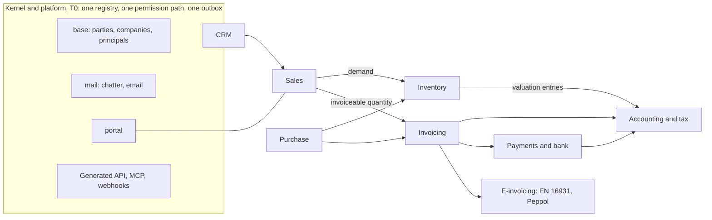

# obop product description: one business, one platform

- **Status:** Draft 0.1
- **Date:** 2026-10-01
- **Scope:** The master product description: what obop is, who it is for, every app and module with tier, wave and open or paid status, how it differs from Odoo, ERPNext, Dolibarr and SaaS stacks, what it promises, what ships when, and what the owner still has to decide.

**Summary.**

- **What:** an open-source operating system for businesses, with sales, purchasing, stock, invoicing, accounting, payments and more as modules on one shared data model. Odoo is the functional reference, re-implemented clean-room (F3).
- **For whom:** owner-led services and light-trade firms of 5 to 50 people, one company, Germany first (Proposed, D4).
- **Why it wins:** it competes on the delivery contract, not on speed or language: one open edition, a free generated API, upgrades as a product feature, compliance as signed country packs and books protected by the database (sections 2 and 6).
- **Price:** self-hosting the open edition costs EUR 0; hosted plans are EUR 0, 49, 249 and from 899 per organisation per month (hypotheses, section 9).
- **Dates:** first delivery (W1) 2027-01-01 to 2027-09-30; paid beta 2027-07-06; German pack stable 2027-09-30; 1.0 LTS 2028-04-18 (Proposed, D26; section 12).
- **State and risks:** nothing is built. The top risks are funding, the accounting and localisation burden, and customisation without recompiling (section 14.1).
- **Owner decisions:** eighteen decisions and the interpretations I-1 to I-4 are Proposed, and twenty-one owner questions are open; the first answers (Q10 and Q15, Q1 to Q3 and Q19, Q4, Q17 and Q20) fall due between 2026-10-15 and 2026-10-23 (section 14.2).

**How to read.**

- **Authority.** [DECISIONS.md](DECISIONS.md) is the binding register and wins over the research; decisions are cited by ID (for example D6). F1 to F4 are owner-mandated and fixed; D6 to D11, D15, D18, D19, D21, D22, D24 and D27 to D39 are binding, except the nightly exit drill in D15 and the renames and X, L and W labels in D24, which stay Proposed. Fourteen decisions are still Proposed (D1 to D5, D12, D13, D14, D16, D17, D20, D23, D25, D26), as are the interpretations I-1 to I-4 of F1 and F2, so every licence, price, tier, wave, date and version pin below is Proposed even where the marker is not repeated.
- **Markers.** Nothing is built: "(target)" is a design goal, "(estimate)" a model output, "(hypothesis)" a price to test; none is a measurement. Facts and versions are as of 2026-10-01, month 0 (M0). Research is cited as [R20 s3].
- **Vocabulary** follows D24 and the [GLOSSARY.md](GLOSSARY.md): a *business* is one PostgreSQL database; a *company* owns books; a *pack* is a signed data package; a *module* is first-party and an *app* a module with a top-level menu entry. Identifier spellings (module ids, events, permission groups, ports) follow [CONVENTIONS.md](CONVENTIONS.md). The bare word "GA" is retired (D26); this document says *pack stable*, *paid beta* and *1.0 LTS*.
- **Abbreviations** such as ARR, ARPA, UStVA, DATEV, TSE, SEPA, camt.053, MT940 and QTSP are defined in the GLOSSARY.
- Nothing here is legal advice.

## 1. Pitch and tagline

### 1.1 Tagline

**One business, one platform.** (Proposed wording; "fast" stays out until the harness has run, BQ7 in [BUSINESS.md](BUSINESS.md), D21.)

### 1.2 One-paragraph pitch

obop is an open-source operating system for businesses: sales, purchasing, stock, invoicing, accounting, payments, projects, support, HR and more, as modules on one shared data model, so there is one record of every customer, product and euro. Odoo is the functional reference and obop re-implements its concepts and behaviour clean-room (F3), but changes the delivery contract that Odoo's users complain about most:

- **Open.** Every first-party app and every security outcome is open (Proposed, D2); the API is generated from the model registry and free on every plan (D31).
- **Upgradable and customisable.** Upgrades are a product feature with a local dry-run and a 24-month deprecation floor (Proposed, D16); customisation is data that exports as a package (D29, D32).
- **Compliant.** Tax, e-invoicing and audit-file law live in signed, effective-dated country packs (D34).
- **Simple to run.** The backend is Rust, the frontend and tooling are Vite+ driven only through `vp` with pnpm (two narrow exceptions, the nightly exit drill and the JS SBOM and licence scan, await the owner's ruling, section 10), and the runtime is one binary plus PostgreSQL (F1, F2, D37).

Entry is a free, compliant e-invoicing on-ramp for 5 to 50 person services and light-trade firms, Germany first, growing into a seven-app order-to-cash and procure-to-pay loop (Proposed, D4; defined in section 3.1).

## 2. The problem

### 2.1 The ERP gap for small firms

Only sourced numbers are used; the fuller table is [BUSINESS.md s1.1](BUSINESS.md#11-sourced-market-facts). No market size is claimed: analyst totals disagree by about 30% and no primary analyst figure was readable [R20 s1.1].

| Fact | Value | Source |
|---|---|---|
| EU firms with 10+ staff using ERP (Eurostat 2025) | 46.45% overall; 41.08% of 10-49 staff; 69.93% of 50-249; 88.71% of 250+. By subtraction about 59% of 10-49 firms report no ERP | [R20 s1.2] |
| Micro firms (under 10 staff) | 94.4% of about 34M EU enterprises (2024); ERP use not measured | [R20 s1.2] |
| Germany, 10-249 staff | 480,442 firms; ERP use 37.5% (10-49) and 67.7% (50-249); about 281,000 without ERP (derived) | [R25 A1] |
| Implementation risk | Gartner via TechTarget: over 70% of recent ERP initiatives fail to fully meet their goals | [R20 s1.3] |
| Odoo's real customer | 88,510 identified companies, 77% under 50 staff (technographic crawl); EUR 620M 2025 revenue (company-stated) over 170,000 paying customers, about EUR 3.6k each (derived) | [R20 s2.1, s2.2] |
| SaaS sprawl | No verified SMB figure exists. Large-firm surveys report 106 apps per company (BetterCloud, 70% prefer a unified platform) and 305 (Zylo); both skew mid-market or enterprise and are not SMB facts | [R20 s3.2] |
| Cost of a stack | A 15-user agency: a SaaS stack about USD 6.5k a year against EUR 4.5k for Odoo Standard at list (modelled estimate, currencies not converted) | [R20 s3.2] |

The honest reading: at 15 users the licence delta against a SaaS stack is small, so obop leads with consolidation, ownership and compliance, not price [R20 s3.2, R05 s6.3].

### 2.2 Odoo's open-core and upgrade grievances

Ranks are the voice-of-customer ranking [R04 s1]; evidence is review-site and forum sentiment plus primary documents.

| Rank | Grievance | Evidence | obop answer |
|---|---|---|---|
| 1 | Upgrades and migration | Custom modules sit outside the upgrade SLA; agreement v13 (2026-09-24) charges 25% of the annual price yearly for a database older than the three covered versions, and self-hosted upgrades need a database copy; the OpenUpgrade `20.0` branch holds one "Initial commit" (2026-09-28) and no scripts [R04 s4.1, R00 s3.5] | `obop upgrade --dry-run` on your own server, N-1 chain tests from 0.3, contract migrations only at `N.0` (Proposed, D16, D26; D36) |
| 2 | Pricing and open-core surprises | Odoo Community's `account` is "Invoicing"; 23 of 51 editions-table rows are Enterprise-only; Odoo 20 moves Nilvera e-invoicing to Enterprise and bills all AI through IAP credits; 7% renewal uplift, 300% breach fee, a per-100-lines custom-code fee; 19.90 and 35.90 are 12-month introductory prices against 24.90 and 44.90 list [R01 s5, R04 s4.2, DECISIONS ruling 21] | One open edition, a published closed ratcheting paid list, none of Odoo's contract levers (Proposed, D2) |
| 2 | Gated API | External API Custom-only, one transaction per call, RPC services scheduled for removal in Online 21.1 and Odoo 22 (fall 2028) [R04 s4.10, R21 s2.1] | Generated REST, `$batch`, MCP and webhooks on every plan (D31) |
| 3 | Customisation debt | Studio is Custom-only; real changes need a programmer [R04 s4.3] | Fields, models, views and automations as data (D29, D32) |
| 5 | Localisation gaps | 229 `l10n_*` modules, yet returns and audit exports sit in paid modules [R04 s4.5, R25 B1] | Law-defined content open in signed packs with oracles and golden cases (D34) |
| 7, 9 | Performance, operations | About 6 concurrent users per worker; a proxy and a websocket worker [R04 s4.7, s4.9] | One binary plus PostgreSQL (D37); no speed multiple claimed (D21) |
| 12 | Disclosure | Enterprise customers get advisories at least two weeks early [R04 s4.12] | One publication moment for everyone (D38) |

### 2.3 What this means

The two worst grievances, upgrades and open-core pricing, are business-model and design choices, not Python limits: a Rust rewrite with the same model would reproduce them [R04 s1, R00 s4]. obop therefore competes on the delivery contract (open, upgradable, portable, predictable) and uses Rust for correctness and operations. "Written in Rust" is not a buying criterion for a bookkeeper, and no Rust business suite has traction (best repositories: 40, 23 and 16 stars) [R05 s3, s7].

## 3. Who it is for

### 3.1 Ideal customer (Proposed, D4)

Owner-led firms of 5 to 50 people in services and light trade, one company, one country at a time, Germany first. The owner-manager decides; the accountant influences; above about 20 users a consultant runs the project [R20 s3.3]. The free on-ramp is compliant invoicing with unlimited users; the product is the seven-app loop defined below (Proposed, D4; [R20 s9.2]). Germany scores 84 of 100 in the country model and faces the all-issuer e-invoice mandate on 2028-01-01 [R25 A7, R09].

**The seven-app loop** is R20's seven user-facing capabilities, not seven modules: under D24 an app is a module with a top-level menu entry, and the W1 modules of section 11.1 deliver the capabilities below. The seventh capability is portal access with PDF and email documents and attachments (as D4 words it); the `documents` DMS is W3 (section 5.3).

| # | Capability | W1 modules |
|---|---|---|
| 1 | Contacts and Products | `base`, `product`, `pricing` |
| 2 | CRM | `crm` |
| 3 | Sales | `sales` |
| 4 | Inventory with Purchase | `stock`, `sale_stock`, `purchase`, `purchase_stock`, `stock_account` |
| 5 | Invoicing with Accounting | `invoicing`, `account`, `tax`, `analytic`, `edi`, `l10n`, `l10n_de` |
| 6 | Payments | `payment`, `bank` |
| 7 | Portal with PDF and email documents and attachments | `portal`, `mail`, `obop-report` |

`automation`, `analytics`, the generated API, MCP and the views are the platform underneath all seven. [ROADMAP.md](ROADMAP.md) PR1's warning sign, "more than 7 apps planned before design partners are live", is read here as more than seven capabilities, not more than 23 modules (a proposed reading, section 14.3).

### 3.2 Personas

Fit is against the first loop; wave is when the persona's main apps ship (Proposed, D25, D26). Nonprofit and government willingness to pay is inferred, not sourced [R20 s3.1]. Buying motions are in [BUSINESS.md s1.2](BUSINESS.md#12-icp-and-personas-proposed-d4).

| Persona | Jobs to be done | Fit | Wave |
|---|---|---|---|
| Solo founder, freelancer (1-4) | Compliant invoices, cash, VAT | Medium (invoicing only) | W1 |
| Agency, professional services (5-20) | Lead to quote to project to timesheet to invoice; margin per project | High; project arrives W2 | W1, W2 |
| Light-trade distributor (10-50) | Purchase, receive, sell, invoice; correct cost | High | W1 |
| Manufacturer (20-100) | Bills of materials, manufacturing orders, lots | Medium | W3 |
| Retail (1-10 shops), e-commerce brand (3-30) | POS to stock to accounting; cross-channel stock | Low; medium-high if connector-first | W3 |
| Nonprofit, local government | Members, donors, budgets; tenders | Medium; low | W4+ |
| Accountant, bookkeeper (channel) | Clean books, DATEV-style export | Enabler | W1 |
| Implementer, developer (channel) | Customise without compiling Rust | Enabler | W1 |

### 3.3 A day in the life

Illustrative composites built from the specs, not research findings: names are invented and each capability carries its proposed wave.

- **Solo founder (Lena, freelance designer, Germany, Free plan; W1).** 08:40 Only Invoicing is enabled; the setup wizard loaded the German pack and showed its gate (preview or stable). 09:15 She turns a quote into an invoice; obop builds and validates an EN 16931 document and sends it by email or the partner Peppol access point. 11:30 She imports a camt.053 file and accepts two reconciliation suggestions by keyboard. 17:00 Her accountant, on a free seat, exports the DATEV file (DE beta, 2027-06-30). Design target: first compliant invoice within 30 minutes of sign-up at M6 [R20 s12].
- **Agency owner (Omar, 12-person consultancy; W1, then W2).** He moves an opportunity to Qualified from the card menu, no dragging. A quote with optional lines goes out by portal link; the client signs and pays the deposit. From W2 the accepted service line opens a project, consultants log time in a weekly grid, and approved hours feed the sale line, so invoicing and margin per project read one record. In W1 he invoices from the order and tracks time elsewhere, because `project` and `timesheet` are W2 unless the loop is on schedule at 0.5 (BQ8).
- **Light-trade distributor (Ingrid, operations lead; W1).** A reorder rule proposes a purchase order; she receives into the single warehouse and matches the vendor bill against order and receipt. A customer order reserves stock atomically; the invoice posts with cost of goods sold, balanced by a database trigger and numbered at posting without gaps. A return posts a credit note at original cost ([finance 5.1](spec/finance.md#51-sale-to-cash-with-partial-payments), [5.2](spec/finance.md#52-credit-note-after-a-partial-payment)).
- **Manufacturer planner (Tomas, 60 staff; W3, needs a design partner, D25).** Bills of materials, manufacturing orders and shop-floor tablets; lots give genealogy; a failed quality check holds the lot; subcontracting uses a per-vendor location.
- **Shop and web-shop manager (Priya, three shops and an online store; W3).** The POS session keeps selling when the internet drops; orders sync by idempotent command id, and a `kill -9` mid-sync creates no duplicates. Closing posts one balanced session entry and one consolidated stock transfer; in Germany a certified TSE signs receipts. Web orders arrive through the `ecommerce` channel framework (Shopify and WooCommerce connectors W4), and the default checkout carries the consumer withdrawal function ([retail s5](spec/retail-commerce-marketing.md#5-cross-app-golden-paths)).
- **Association administrator (Noor; W4+, opportunistic).** Members and donors are parties, receipts are invoices, grants use analytic plans and budgets (W3), volunteers hold free light seats. Local government waits for the public-sector track (W4+).
- **Accountant (Katrin, tax adviser, 40 client businesses; W1).** Each client is its own business with up to three free accountant seats and MFA by default. She reads the trial balance, runs the hash-chain verifier, locks the month with a time-boxed exception, prepares the VAT return from tax tags and exports for DATEV. From W2 an agent-drafted bill waits in her Inbox as a draft only a human can post.
- **Implementer (Jonas, Odoo partner moving customers; W1, W2).** He dry-runs the Odoo importer on a customer's export (0.6); the report lists mapped, skipped and failed records and writes nothing. He adds a custom field and an approval rule as an X1 pack with CEL conditions, builds an X4 remote app for a legacy system, exports the customisation as a package and rehearses the upgrade with `obop upgrade --dry-run`. He never compiles Rust.

### 3.4 Who it is not for yet

| Not yet | Why |
|---|---|
| Manufacturers and retailers needing `mrp` or `pos` now | T2, W3, each with a design partner (D25) |
| Firms needing payroll | Engine W3; reference country decided 2029-04-01 (D19) |
| Multi-country or multi-company groups | One company in W1; multi-company W2, intercompany W3, consolidation W4 (D28) |
| Firms outside Germany, France and Poland | Three first-party packs; AT, CH W3 (CH is unresearched, [LOCALIZATION.md](LOCALIZATION.md#73-open-questions) open question 19); BE, NL, IT, Nordics W4 via paid partners; Spain gated behind counsel (D4, D17) |
| Offline writes, including POS order capture | 1.0 targets Odoo-19 parity (a read cache); POS order capture ships with `pos` in W3, after 1.0, and queued writes are W3+ (Proposed, D13; Q11) |
| Large enterprises (250+), public-sector tenders | Not the ICP; public-sector track waits for EU law |
| Buyers needing a warranted compliance claim today | No pack is stable before 2027-09-30; warranties exist only in the paid Assurance service (Proposed, D17) |
| Anyone wanting production use now | Nothing is built; 0.1 preview (2026-12-01) promises no stability (D26) |

## 4. Vision and product principles

### 4.1 Vision

obop aims to be to a business what an operating system is to a computer: a small, strict kernel (parties, companies, permissions, a ledger, an outbox), first-party apps on top, extensions in a sandbox, and data the owner can always take away. The acceptance test is the chain Odoo's own catalogue uses: a sale confirms, stock moves, an invoice posts, a payment reconciles, and the journal entries balance without manual repair [R01 s2.2].

### 4.2 Principles

Each principle has a consequence a reviewer can check in the product.

| # | Principle | Concrete consequence | Decision |
|---|---|---|---|
| 1 | One business, one data model | A party is a person or organisation; customer and vendor are per-company profiles, not tables; the sale line joins delivery, invoicing and billable time | D27, D28 |
| 2 | One open edition; paid means operation and assurance | Every first-party app and security outcome is open; a published, closed paid list that only moves from paid to open; `ee` code opens after 24 months | Proposed, D2 |
| 3 | The database protects the books | PostgreSQL enforces balanced entries, immutable posted rows, lock dates, gapless legal numbers, a hash chain and a unique quant key; corrections are reversals | D30 |
| 4 | Exact numbers | Ledger money is `bigint` minor units plus currency; prices and quantities are fixed-scale decimals; no floats | D9 |
| 5 | Metadata first | One registry drives ORM, API, OpenAPI, MCP tools, views, access, webhooks, imports and docs; a custom field needs no restart | D29, D32 |
| 6 | The API is never a plan upgrade | REST, OpenAPI 3.1, `$batch`, webhooks and MCP on every plan, with a dated `Obop-Version` header | D31 |
| 7 | Upgrades are a feature | Two series a year, contract migrations only at `N.0`, a 24-month deprecation floor, `obop upgrade --dry-run` from 0.3 | Proposed, D16; D36 |
| 8 | Compliance is data | Signed, effective-dated packs; `stable` needs oracle runs, golden cases and accountant sign-off; every tax line stores the rule-pack version | D34, D38; Proposed, D17 |
| 9 | Agents are principals; drafts, not posts | Agent permissions are the intersection of user and token; dry-run returns a digest-bound `plan_id`; posting and paying need a human | D18 |
| 10 | Third-party code stays outside the trust domain | Others ship packs, CEL, Wasm on a pinned LTS runtime or remote apps; third-party UI runs in sandboxed frames; no in-process third-party Rust | D11 |
| 11 | Operable by one person | One static binary plus PostgreSQL; embedded PostgreSQL for solo installs; no Node on customer servers | D37 |
| 12 | Accessible and international by construction | WCAG 2.2 AA is a release gate; every drag has a non-drag path; logical CSS only; PO with ICU MessageFormat 1; RTL and CJK fixtures | D34, D35 |
| 13 | Leaving must be easy | Full export in every edition, Odoo and QuickBooks importers, Data Act switching terms, no egress charges | D22, D38; QuickBooks importer timing Proposed, D26 |
| 14 | Scope discipline | One loop and one country at a time; no new app without a design partner | D4, D25; [ROADMAP.md](ROADMAP.md) PR1 |
| 15 | Claims are measured | No multiple over Odoo until a harness runs monthly on fixed hardware (from M9); a pack claims only what its oracles check | D21 |

## 5. The product

### 5.1 How to read the tables

Tier answers "is a business operating system complete without it"; wave answers "when". T0 is kernel and platform present in every business, T1 must-have, T2 second wave needing vertical depth or compliance, T3 the long tail; any module not listed defaults to T3 (D25). Waves: W0 2026-10-01 to 2026-12-31; W1 to 2027-09-30; W2 to 2028-06-30; W3 to 2029-06-30; W4 from 2029-07-01 (D26). Tier, wave and open or paid values are Proposed (D25, D26, D2) unless a binding decision is cited; W3 breadth is paced by ARR, not the calendar (Proposed, D5).

### 5.2 The loop and the platform underneath



The arrows are ports and events, never glue modules: an implementation crate depends only on kernel crates and `*-api` crates (D27, [ARCHITECTURE.md](ARCHITECTURE.md#44-the-module-graph-and-where-modules-land)).

### 5.3 Master table of apps and modules

Open or paid uses the register's closed list (DECISIONS s6): "Open" means nothing paid is attached. Names marked (Proposed) are not in the register. Spec links name the section that specifies the module.

| Domain | Module or app | Purpose | Tier | Wave | Open or paid | Spec |
|---|---|---|---|---|---|---|
| Kernel | Eleven kernel crates (`obop-types` to `obop-testkit`) | Registry, ORM, access, outbox, HTTP | T0 | W0 | Open | [architecture s4](ARCHITECTURE.md#4-layered-architecture-and-the-modular-monolith) |
| Kernel | `base` (Contacts app) | Parties, principals, one company, currency, external ids, attachments | T0 | W0 model, W1 app | Open | [platform 4.2](spec/platform.md#42-contacts-parties) |
| Kernel | Principals, permission groups | Default-deny access algebra | T0 | W0-W1 | Open; native SAML, full SCIM paid | [security 4.2](spec/security-privacy.md#42-authorization) |
| Kernel | `mail` with deliverability core | Chatter, activities, OAuth-only email, templates, DKIM checks | T0 | W1 | Open | [platform 4.5](spec/platform.md#45-chatter-and-discuss-channels-mail-discuss) |
| Kernel | Notifications, Inbox | In-app and email; approvals lane W2 | T0 | W1 | Open | [ux 4.8](spec/ux.md#48-notification-centre-and-inbox) |
| Kernel | `portal` | Capability links, quote acceptance | T0 | W1 | Open | [sales 4.8](spec/sales-crm.md#48-customer-portal-portal) |
| Kernel | `automation` with approvals engine | Rules, schedules, CEL; approvals W2 | T0 | W1, W2 | Open | [platform 4.13](spec/platform.md#413-automation-automation-w1) |
| Kernel | `customize` (Proposed) | Custom fields W1; model and layout editors W2 | T0 | W1-W3 | Open | [platform 4.14](spec/platform.md#414-customization-customize-proposed) |
| Kernel | Search, import and export, multi-language | One search grammar; dry-run imports; PO with ICU | T0 | W0-W1 | Open | [platform 4.15](spec/platform.md#415-search-kernel-and-base-w1) |
| Kernel | `analytics`, `obop-report` | Semantic layer, pivot; Typst PDFs (Proposed, D20) | T0 | W1 | Open | [platform 4.17](spec/platform.md#417-reporting-and-bi-analytics-obop-report) |
| Kernel | Dashboards | Shareable widget boards | T2 | W3 | Open | [platform 4.17](spec/platform.md#417-reporting-and-bi-analytics-obop-report) |
| Kernel | Apps management, package registry service | Per-business install, dry-run upgrade, signed packages | T0 | W1, W2 | Open; registry server code open, hosted registry a paid operated service (Proposed, Q19) | [platform 4.18](spec/platform.md#418-apps-management-base) |
| Kernel | `obop-wasm-host`, `obop-ext-sdk`, `obop-compat` | Wasm extensions, SDK, compatibility runs | T0 | W2 | Open | [integrations 4.5](spec/integrations.md#45-connector-framework-t0-w1-wasm-w2) |
| Kernel | `resource` (Proposed) | Working calendars, leaves | T0 (Proposed) | W2 | Open | [services 4.1](spec/services.md#41-resource) |
| Kernel | `discuss` | Channels, direct messages | T1 | W2 | Open | [platform 4.5](spec/platform.md#45-chatter-and-discuss-channels-mail-discuss) |
| Kernel | `calendar` | Events, Google and Microsoft sync | T1 | W2 | Open | [platform 4.8](spec/platform.md#48-calendar-and-contact-sync-calendar) |
| Kernel | `todo` (standalone To-do) | Personal task list; activities on any record ship with `mail` in W1 | T1 | W3 | Open | [platform 4.5.1](spec/platform.md#451-to-do-todo-t1-w3) |
| Kernel | `documents` | Folders, versions, retention (attachments from W1) | T1 | W3 | Open | [platform 4.9](spec/platform.md#49-documents-attachments-w1-dms-w3) |
| Kernel | `knowledge` | Article tree, live co-editing | T2 | W3 | Open | [platform 4.10](spec/platform.md#410-knowledge-knowledge-w3) |
| Kernel | `sign` | Envelopes, hash-chained trail (acceptance evidence W1) | T2 | W3 | Open | [platform 4.11](spec/platform.md#411-sign-sign-w3-acceptance-evidence-w1) |
| Kernel | `obop-edge`, store hub, hardware agent | Edge command outbox, LAN authority | T0 | W3 | Open | [retail 4.1](spec/retail-commerce-marketing.md#41-point-of-sale-pos-obop-edge-store-hub-hardware-agent) |
| UX | UI runtime, core views | Form, list, kanban, pivot, graph, calendar | T0 | W1 | Open | [ux 4.4](spec/ux.md#44-view-catalogue-and-behaviour-contract) |
| UX | Gantt, map, cohort views | Scheduling, geography, retention | T0 | W3 | Open | [ux 4.4](spec/ux.md#44-view-catalogue-and-behaviour-contract) |
| UX | Design system, setup wizard | Tokens, branding, pack-aware setup | T0 | W1 | Open; partner white-label paid | [ux 4.14](spec/ux.md#414-onboarding-setup-sample-data-import) |
| Security | Identity, audit, encryption, privacy tooling | Passkeys, OIDC, hash-chained audit, erasure | T0 | W0-W2 | Open; WORM, SIEM, KMS and HSM paid | [security 4](spec/security-privacy.md#4-per-app-specification) |
| Integrations | Generated REST, OpenAPI, webhooks | `$batch`, idempotency, signed webhooks | T0 | W1 | Open, every plan | [integrations 4.1](spec/integrations.md#41-public-rest-api-and-openapi-obop-http-t0-w1) |
| Integrations | MCP endpoint | Registry-generated tools | T0 | W1 | Open | [integrations 4.4](spec/integrations.md#44-mcp-endpoint-t0-w1) |
| Integrations | Connector framework | X5 adapters, X4 apps; Wasm W2 | T0 | W1, W2 | Open | [integrations 4.5](spec/integrations.md#45-connector-framework-t0-w1-wasm-w2) |
| Integrations | Importers | CSV 0.3; Odoo, QuickBooks 0.6; Xero, ERPNext W2 | T0 | W1-W2 | Open | [integrations 4.8](spec/integrations.md#48-import-engine-and-migration-importers-base-t0-w0-engine) |
| Integrations | Full export and restore | NDJSON archive, customisation package | T0 | W1 | Open, never sold | [integrations 4.9](spec/integrations.md#49-export-and-portability-base-t0-w1) |
| Integrations | CLI, SDKs | CLI v0 W1; SDKs W2 | T0 | W1-W2 | Open; SDKs Apache-2.0 (Proposed, D1) | [integrations 4.11](spec/integrations.md#411-sdks-and-developer-experience-t0-cli-w1-sdks-w2) |
| Integrations | Marketplace commerce | Paid listings | T3 | W4 | Open; 0% take rate at launch (Proposed) | [integrations 4.7](spec/integrations.md#47-package-registry-and-marketplace-t0-w2-commerce-w4) |
| AI | Agent surface, principals, write protocol | Typed commands, dry-run, `plan_id`; policy engine W2 | T0 | W1, W2 | Open | [ai 4.1](spec/ai.md#41-agent-surface-and-mcp-server-kernel-t0-w1) |
| AI | `ai` | BYOK gateway, Ask, extraction, agents, forecasting | T2 | W3 | Open; hosted credits paid | [ai 4.5](spec/ai.md#45-ai-gateway-byok-routes-egress-ledger-kill-switches-self-hosted-profile-ai-w3) |
| AI | A2A, commerce-agent protocols | Cross-business agents | T2 | W4 (Proposed) | Open | [ai 1.2](spec/ai.md#12-areas-and-modules) |
| Finance | `account` | Ledger, AR/AP, reconciliation, locks, hash chain, reports | T1 | W1 | Open | [finance 4.3](spec/finance.md#43-accounting) |
| Finance | `tax` | Tax engine, fiscal positions, returns | T1 | W1 | Open | [finance 4.4](spec/finance.md#44-tax) |
| Finance | `invoicing` | Invoices, credit notes, bills, reminders | T1 | W1 | Open | [finance 4.2](spec/finance.md#42-invoicing) |
| Finance | `payment` | Manual, SEPA, Stripe plus one PSP | T1 | W1 | Open; hosted gateways paid | [finance 4.5](spec/finance.md#45-payments-and-bank-reconciliation) |
| Finance | `bank` | camt.053, MT940, CSV; aggregator feeds W2 | T1 | W1, W2 | Open | [finance 4.5](spec/finance.md#45-payments-and-bank-reconciliation) |
| Finance | `edi` | EN 16931, Factur-X, XRechnung, Peppol via partner | T1 | W1 | Open; hosted Peppol gateway paid | [finance 4.6](spec/finance.md#46-e-invoicing-and-e-reporting) |
| Finance | `analytic` | Plans, accounts, distribution | T0 | W1 | Open | [finance 4.8](spec/finance.md#48-analytic-accounting-and-budgets) |
| Finance | `l10n` framework, `l10n_de` | Pack hooks; SKR03/04 (subject to written DATEV confirmation), UStVA, DATEV, GoBD | T1 | W1 | Open; Assurance service paid | [localization 3.3](LOCALIZATION.md#33-sheets-for-the-first-three-packs) |
| Finance | `l10n_fr`, `l10n_pl` | French (platform connector) and Polish (KSeF) packs | T1 | W2; W3 | Open; Assurance paid | [localization 3.3](LOCALIZATION.md#33-sheets-for-the-first-three-packs) |
| Finance | Austria, Switzerland, Belgium, Netherlands, Spain, Italy, Nordic packs | Country packs maintained by L2 partners, who are paid under a revenue share; Spain gated behind counsel | T2 | W3 (AT, CH; CH unresearched); W4 | Open content | [localization 3.4](LOCALIZATION.md#34-later-packs) |
| Finance | Multi-company | Selector, per-company books and locks | T1 | W2 | Open, never gated | [finance 4.12](spec/finance.md#412-multi-company-intercompany-and-consolidation) |
| Finance | Fixed assets, deferrals, budgets (Proposed names) | Schedule generators emitting ordinary entries | T1 | W3 | Open | [finance 4.9](spec/finance.md#49-fixed-assets-w3) |
| Finance | `expenses` | Claims, receipts, bills, reimbursement | T1 | W3 | Open | [people 4.5](spec/people.md#45-expenses-hr-side) |
| Finance | `intercompany`, `consolidation` | Mirrored documents; eliminations | T2 | W3; W4 | Open | [finance 4.12](spec/finance.md#412-multi-company-intercompany-and-consolidation) |
| Sales | `product` | Variants, UoM, packagings, combos | T0 | W1 | Open | [sales 4.1](spec/sales-crm.md#41-product-catalog-product) |
| Sales | `pricing` | Pricelists, deterministic engine, explain trace | T0 | W1 | Open | [sales 4.2](spec/sales-crm.md#42-pricing-pricing) |
| Sales | `crm` | Pipeline, leads, forecast; scoring W2 | T1 | W1 | Open | [sales 4.3](spec/sales-crm.md#43-crm-crm) |
| Sales | `sales` | Quotes, orders, down payments, margins | T1 | W1 | Open | [sales 4.4](spec/sales-crm.md#44-sales-sales) |
| Sales | `subscriptions` | Proration, dunning, MRR ledger | T2 | W3 | Open | [sales 4.5](spec/sales-crm.md#45-subscriptions-subscriptions) |
| Sales | `rental`, `commissions` | Period reservations; commission plans | T3 | W4+ or community | Open | [sales 4.6](spec/sales-crm.md#46-rental-rental) |
| Sales | `loyalty` | Coupons, gift cards, points | T2 | W3 | Open | [retail 4.2](spec/retail-commerce-marketing.md#42-loyalty-coupons-and-gift-cards-loyalty) |
| Supply | `stock` | One warehouse W1; lots, serials, routes, multi-warehouse W2 | T1 | W1, W2 | Open | [supply 4.1](spec/supply-chain.md#41-inventory-stock-stock_account) |
| Supply | `stock_account`, `sale_stock`, `purchase_stock` | Valuation entries; order and receipt bridges | T1 | W1 | Open | [supply 4.1](spec/supply-chain.md#41-inventory-stock-stock_account) |
| Supply | `purchase` | RFQ, PO, three-way match | T1 | W1 | Open | [supply 4.2](spec/supply-chain.md#42-purchase-purchase-purchase_stock) |
| Supply | `delivery` | `CarrierProvider` trait, aggregator-first connectors | T1 | W3 | Open | [supply 4.9](spec/supply-chain.md#49-shipping-and-carriers-delivery) |
| Supply | `mrp` | Bills of materials, work orders, Shop Floor, subcontracting | T2 | W3 | Open | [supply 4.3](spec/supply-chain.md#43-manufacturing-mrp) |
| Supply | `quality`, `maintenance` | Control points and holds; equipment | T2 | W3 | Open | [supply 4.4](spec/supply-chain.md#44-quality-quality) |
| Supply | Barcode | Scan-to-add W2, screens W3, depth W4 | T2 | W2-W4 | Open | [supply 4.7](spec/supply-chain.md#47-barcode) |
| Supply | PLM, `repair`, MPS and MRP run | Engineering change; repairs; suggestions | T3 | W4+ or community | Open | [supply 4.5](spec/supply-chain.md#45-plm-engineering-change) |
| Retail | `pos` with `pos_stock`, `pos_account`; restaurant mode | Sessions, offline orders, fiscal adapters (DE TSE first); restaurant W3 end or W4 | T2 | W3 | Open; operated Assurance paid | [retail 4.1](spec/retail-commerce-marketing.md#41-point-of-sale-pos-obop-edge-store-hub-hardware-agent) |
| Retail | `website` | Block pages, themes, forms, multilingual | T2 | W3 | Open; white-label paid | [retail 4.4](spec/retail-commerce-marketing.md#44-website-builder-website) |
| Retail | `ecommerce` | Catalogue, checkout, returns, headless API | T2 | W3 | Open | [retail 4.3](spec/retail-commerce-marketing.md#43-ecommerce-ecommerce-channel-sync-headless-api) |
| Retail | Shopify, WooCommerce connectors | Orders in; stock, price, tracking out | T2 | W4 | Open | [retail 4.3](spec/retail-commerce-marketing.md#43-ecommerce-ecommerce-channel-sync-headless-api) |
| Retail | `marketing` | Email and SMS, lists, tracking | T2 | W3 | Open | [retail 4.5](spec/retail-commerce-marketing.md#45-marketing-suite-marketing-email-sms-deliverability) |
| Retail | `livechat`, WhatsApp | Website chat; WhatsApp as X3 or X4 package | T2 | W3; W4 | Open | [retail 4.6](spec/retail-commerce-marketing.md#46-live-chat-and-long-tail-dispositions) |
| Retail | Marketing long tail | Automation, social, events, surveys, blog, forum, eLearning | T3 | W4+ or community | Open | [retail 4.6](spec/retail-commerce-marketing.md#46-live-chat-and-long-tail-dispositions) |
| People | `hr` with employee self-service | Employees, versions, time off, skills, onboarding | T1 | W3 (employee core W2) | Open; light users free | [people 4.1](spec/people.md#41-employees) |
| People | `recruitment`, `attendances` | Hiring pipeline; check-in and overtime | T2 | W3 | Open | [people 4.4](spec/people.md#44-recruitment) |
| People | `payroll` | CEL engine, explainable runs, provider connectors; reference pack W4; no filing | T2 | W3, W4 | Rules open; warranted service paid | [people 4.10](spec/people.md#410-payroll-strategy) |
| People | `appraisals` (Proposed) | Reviews, goals | T3 | W4+ | Open | [people 4.8](spec/people.md#48-appraisals-and-okrs) |
| Services | `project` | Tasks, dependencies with lag, milestones | T1 | W2 | Open | [services 4.2](spec/services.md#42-project) |
| Services | `timesheet`, `sale_project`, `sale_timesheet` | Time on analytic lines; billable time | T1 | W2 (W1 if on schedule at 0.5) | Open | [services 4.3](spec/services.md#43-timesheets-and-the-time-to-invoice-bridges) |
| Services | `helpdesk` | Tickets, tested SLA engine, CSAT | T2 | W3 | Open | [services 4.4](spec/services.md#44-helpdesk) |
| Services | `planning` with field work | Shifts, sites, equipment, visits | T2 | W3 | Open | [services 4.5](spec/services.md#45-planning-and-field-work) |
| Services | `appointments` | Booking types, slot engine | T2 | W3 | Open | [services 4.6](spec/services.md#46-appointments) |
| Services | `service_contract` (Proposed), `fleet` | Entitlements; vehicles | T3 | W3 (Proposed); W4+ | Open | [services 4.8](spec/services.md#48-service-contracts-proposed) |
| Paid list | `ee` tree and services | SAML, SCIM, WORM and SIEM audit, KMS and HSM, fleet DR, control plane, air-gap, white-label, hosting, support, Assurance, payroll service, AI credits, operated services over open code (Proposed, Q19) | n/a | with the paid list | Paid, closed, ratcheting (Proposed, D2) | [DECISIONS s6](DECISIONS.md#6-openpaid-boundary) |

### 5.4 The suite by domain

**Kernel and platform.** Everything shares one registry, one permission path and one outbox, so a message on a quote, an approval on a bill and an agent's draft obey the same rules. Chatter is first-party and record-bound; mail is OAuth-only (Gmail API, Microsoft Graph) because Microsoft starts default-disabling EWS in Exchange Online on 2026-10-01 (tenant by tenant, admin-reversible) and turns it off permanently on 2027-04-01 (D39). Documents, knowledge and sign arrive in W3; an acceptance primitive with evidence exists from W1 ([platform.md](spec/platform.md)).

**Finance.** Accounting is the acceptance test of the platform and its largest cost: Odoo's `account` model code is about 1.9 MB against 0.3 MB for `sale` [R20 s9.1]. Invoicing and Accounting share one ledger; showing Accounting adds views and migrates no data. Reconciliation, reports, assets, deferrals, budgets and consolidation, which Odoo keeps in Enterprise, are open (Proposed, D2). EN 16931 is the internal invoice model, and country law is a pack, not core code ([finance.md](spec/finance.md), [LOCALIZATION.md](LOCALIZATION.md)).

**Sales and CRM.** Leads and opportunities share one table; pricing is a deterministic engine whose every result carries an explain trace; quotes can be accepted and prepaid on the portal. Subscriptions are a first-class aggregate with dunning and an append-only MRR ledger, where Odoo only flags a contract in exception ([sales-crm.md](spec/sales-crm.md)).

**Supply chain.** Transfer, move and move line with a quant projection, but one quant row per key, immutable done moves, exact decimal quantities and explicit FIFO layers. Valuation is independent of accounting. Quality, barcode screens and carrier connectors, which Odoo keeps proprietary, are open ([supply-chain.md](spec/supply-chain.md)).

**Retail, commerce and marketing.** POS is an append-only ledger with idempotent command ids, an edge store, a store hub, a hardware agent and a published offline contract. The website is versioned JSON blocks rendered by Rust with Vite islands and no Node in production (Proposed, D14). Marketing carries a built-in deliverability subsystem. None of it is in W1 or W2 ([retail-commerce-marketing.md](spec/retail-commerce-marketing.md)).

**People.** An HR core at Odoo Community parity with effective-dated employee versions, plus what Odoo keeps in Enterprise. Payroll is the moat and the liability, so the core holds a generic CEL rule engine, country packs and provider connectors and never files statutory returns (D19). Special-category data is protected in the data layer, with read audit ([people.md](spec/people.md)).

**Services.** One clock (`resource` calendars), one time table (timesheets are analytic lines) and one join point (delivered quantity on the sale line). Helpdesk, planning, field work, appointments and Gantt, which are Enterprise in Odoo, are open, with a tested SLA engine and dependencies with lag ([services.md](spec/services.md)).

**AI, integrations, security and UX.** The typed command API is the only agent surface, MCP is generated from it, and agents create drafts that humans post ([ai.md](spec/ai.md)). The API, importers and connectors are in [integrations.md](spec/integrations.md), identity, isolation, audit and CRA handling in [security-privacy.md](spec/security-privacy.md), views, accessibility and offline in [ux.md](spec/ux.md).

### 5.5 Disposition of every Odoo app class

Classes are those of the Odoo 20 catalogue [R01 s3, s4]. Dispositions: *Ships*, *Deferred* (T3 or later, extension API or community), *Connector* (X3 or X4 package or provider trait), *Not planned*. CE and EE are Odoo Community and Odoo Enterprise. The dispositions for mail plugins, snailmail and check printing are this document's proposals: platform.md lists mail plugins as not scheduled, finance.md s8 leaves check printing unscheduled, and no spec covers snailmail.

| Odoo app class (edition) | Disposition | Wave |
|---|---|---|
| Contacts (CE) | Ships: `base` Contacts app | W0, W1 |
| Discuss and Mail (CE); Calendar (CE) | Ships: `mail`; `discuss` and `calendar` | W1; W2 |
| Gmail and Outlook mail plugins (CE) | Not planned first-party: an add-in is an X4 remote app over the API and MCP; mailboxes connect through the OAuth-only gateway (D39) | n/a |
| To-do (CE) | Ships: activities on any record; standalone to-do is T1 | W1; W3 |
| Automation rules (CE); Security: TOTP, passkeys, OAuth, LDAP (CE) | Ships: `automation`; kernel identity | W1 |
| Portal, UTM, link tracker (CE) | Ships: `portal`; UTM in `crm`; link tracker with `marketing` | W1; W3 |
| Digest (CE) | Deferred: scheduled report delivery is Proposed | W2 |
| SMS, phone validation (CE) | Connector: `SmsProvider` trait, bring-your-own Twilio first | W3 |
| Snailmail, posting a document (CE) | Not planned: a postal-provider connector (X3 or X4) if partners ask | n/a |
| IAP credit mechanism (CE, EE) | Not planned: no credit wall; provider connectors use the business's own keys and AI is BYOK (D18) | n/a |
| Partner Autocomplete, VAT lookup (IAP) | Connector: the VIES check is a W1 pack validator and connector; registry and address lookups are provider connectors, off by default | W1; W2 |
| Lead Mining and enrichment (IAP) | Connector: provider connectors with the business's own keys | W3 |
| Digitization, invoice and receipt OCR (IAP) | Ships in `ai`: BYOK extraction of bills and receipts as drafts for human review | W3 |
| Data Recycle (CE, EE) | Ships: retention classes, purge jobs, record-level hold | W1 |
| Spreadsheet, Dashboards (CE library, EE) | Ships: dashboards; a spreadsheet view is not scheduled | W3 |
| Documents, Knowledge, Appointments (EE) | Ships: `documents`, `knowledge`, `appointments` | W3 |
| Approvals (EE) | Ships: engine in `automation`; a standalone app is T3 | W2; W4+ |
| Phone and VoIP (EE) | Connector: click-to-call and call logging through provider APIs (X3 or X4); no softphone or PBX | W4+ |
| IoT (EE) | Not planned as a box: the hardware agent and store hub replace it (D37); other drivers are T3, through the extension API or community | W3; W4+ |
| WhatsApp (EE) | Connector: X3 or X4 package | W4 |
| Invoicing (CE); Accounting (EE) | Ships, both open: `invoicing`, `account`; assets, deferrals, budgets W3; consolidation W4 | W1 |
| Check printing (CE) | Deferred: a pack-supplied Typst template; the US payment rails and forms it belongs to are unscheduled ([finance s8](spec/finance.md#8-out-of-scope-non-goals-and-later)) | W4+ |
| Intrastat (EE); loans | Deferred: Intrastat as a possible pack export, loans as later work; both outside the first cuts ([finance s8](spec/finance.md#8-out-of-scope-non-goals-and-later)) | W4+ |
| Expenses (CE) | Ships: `expenses` | W3 |
| Online payments, 21 providers (CE) | Ships narrower: manual, SEPA, Stripe plus one PSP; others as connectors | W1; W2-W3 |
| Payroll (EE); payroll localisations, 24 countries | Ships: engine W3; one reference pack after 2029-04-01; provider connectors; no filing | W3; W4 |
| Sign (EE) | Ships: `sign`; qualified signatures via QTSP connectors | W3 |
| ESG, Equity (EE) | Not planned first-party (T3, community) | W4+ |
| CRM (CE); Sales (CE) | Ships: `crm` (scoring W2), `sales` | W1 |
| Loyalty, Live Chat (CE); Subscriptions (EE) | Ships: `loyalty`, `livechat`, `subscriptions`; AI live-chat agents are not planned through W3 and are revisited in W4 | W3 |
| Point of Sale, restaurant (CE) | Ships: retail `pos` W3; restaurant W3 end or W4 | W3 |
| Rental (EE) | Deferred: T3 | W4+ |
| Amazon, Shopee, Lazada, TikTok, Gelato | Connector: Shopify and WooCommerce W4; the rest community or partner packages | W4+ |
| Website, eCommerce (CE) | Ships: `website`, `ecommerce` | W3 |
| Blog, Forum, eLearning (CE) | Deferred: blog as an X1 pack; forum and eLearning community-maintained | W4+ |
| Online jobs (CE) | Ships: through a `recruitment_website` bridge (Proposed) | W3 |
| Inventory (CE) | Ships: one warehouse W1; lots, serials, routes, multi-warehouse W2 | W1, W2 |
| Ship orders without Inventory; Valuation without Inventory (Odoo 20 modes) | Not planned (Proposed): optional ports give the separability instead; a lightweight shipment record is W4+ at the earliest ([supply s8](spec/supply-chain.md#8-out-of-scope-non-goals-and-later)) | n/a |
| Barcode (EE) | Ships: scan-to-add W2, screens W3, depth W4 | W2-W4 |
| Purchase (CE) | Ships: `purchase` | W1 |
| Manufacturing, Shop Floor, Quality, Maintenance | Ships: `mrp` with Shop Floor, subcontracting, `quality`, `maintenance` | W3 |
| PLM (EE), Repairs (CE), Fleet (CE), Appraisals (EE) | Deferred: T3 | W4+ |
| Delivery and carriers (CE generic) | Ships: `CarrierProvider` trait W3; connectors aggregator-first | W3 |
| Employees, Time Off (CE) | Ships: `hr`; employee core arrives with `timesheet` | W3 (core W2) |
| Attendances, Recruitment (CE) | Ships: `attendances`, `recruitment` | W3 |
| Lunch, Frontdesk, Referrals, Marketing Card | Not planned first-party (T3, community) | n/a |
| Email and SMS Marketing (CE) | Ships: `marketing` | W3 |
| Events, Surveys (CE); Marketing Automation (EE) | Deferred: Events as an X1 pack; simple forms via the form block; fixed flow templates on `automation` | W4+ |
| Social Marketing (EE) | Connector: X4 remote apps | W4+ |
| Project, Timesheets (CE) | Ships: `project`, `timesheet` | W2 |
| Planning (EE); Field Service (EE, merged into Planning in Odoo 20) | Ships: `planning` with field work; task subtype versus shift stays open until 2028-07-01 | W3 |
| Helpdesk (EE) | Ships: `helpdesk` | W3 |
| Studio (EE); Properties (CE) | Ships, open: `customize`; custom fields with three-tier storage | W1-W3 |
| Developer platform, external API, apps store | Ships: free generated API; packages and registry; marketplace commerce | W1; W2; W4 |
| Odoo mobile apps (EE) | Not planned: no native apps beyond the PWA and Tauri shells ([ux s8](spec/ux.md#8-out-of-scope-non-goals-and-later)) | n/a |
| AI: agents, skills, MCP, AI fields (EE) | Ships: MCP W1, `ai` W3; voice, image and web-page generation and AI live-chat agents not planned through W3 (revisited in W4) | W1, W3 |
| Industries, 60 plus bundles (EE) | Deferred: industry bundles as data packs | W4+ |
| Fiscal localisations, 229 `l10n_*` modules | Ships: DE W1, FR W2, PL W3; AT, CH W3 (CH unresearched); BE, NL, ES, IT, Nordics W4 via paid partners; rest community | W1-W4 |

## 6. What makes obop different

### 6.1 Differentiators, with evidence and the feature that delivers each

| # | Differentiator | Evidence | Product feature | Matters most against |
|---|---|---|---|---|
| 1 | Complete accounting in the open edition | Odoo Community ships "Invoicing" only; 23 of 51 editions-table rows are Enterprise-only [R01 s1.2, s5]; Dolibarr's accounting is simpler [R05 s2.1] | `account` with reconciliation, reports, assets, deferrals, budgets and consolidation, all open (Proposed, D2) | Odoo |
| 2 | Ledger integrity in the database | Odoo checks balance only in the ORM and tolerates duplicate quants [R08, R10] | Deferred balance trigger, immutable posted rows, gapless numbers at posting, hash chain, unique quant key (D30) | Odoo, ERPNext, Dolibarr |
| 3 | Upgrades as a product | Rank-1 pain; OpenUpgrade `20.0` is empty; ERPNext v15 to v16 friction in 2026 forum threads [R04 s4.1, s5.1] | `obop upgrade --dry-run`, backup and signature gates, N-1 and N-2 chain tests, ring rollout (Proposed, D16; D36) | Odoo, ERPNext |
| 4 | Free generated API, MCP, webhooks | Odoo's API is Custom-only and its MCP uses a static key [R21 s2.1, R16 s2.1]; the Xero API has been metered since 2026-03-02 [R00 s3.8] | Registry-generated REST and OpenAPI 3.1, `$batch`, OAuth 2.1, Standard Webhooks, MCP on every plan (D31) | Odoo, SaaS stacks |
| 5 | Compliance as signed, tested data | 229 Odoo `l10n_*` modules, yet returns sit in paid modules; ERPNext has thin EU e-invoicing [R25 B1, R05 s2.1] | Signed effective-dated packs, oracles, golden cases, the pack version stored on every computation (D34, D38) | Odoo, ERPNext, Dolibarr |
| 6 | Customisation as data; extensions outside the trust domain | Studio is Custom-only; Odoo modules run in-process; partners become indispensable [R04 s4.3, R24 s2.1] | Fields, models, views and automations exported as packages; X1 to X4; a customisation report (D11, D29, D32) | Odoo, ERPNext |
| 7 | One binary plus PostgreSQL | Odoo needs a proxy and websocket worker; ERPNext needs bench, MariaDB, Redis, Node, supervisor [R04 s4.9, R05 s2.1] | Static binary with roles, embedded PostgreSQL for solo installs (D37) | ERPNext, Odoo |
| 8 | Agents as principals, no credit wall | Odoo 20 meters AI through IAP credits; its auto-post bills can post without a human [R16 s2.1, spec/ai.md s7] | Permission intersection, `plan_id`, idempotency, drafts not posts, BYOK, per-module kill switch (D18) | Odoo |
| 9 | Published commercial rules | Odoo's renewal uplift, old-version fee, breach fee [R04 s4.2]; per-user or per-app SaaS pricing | Per-organisation plans, closed ratcheting paid list, OSI-forever pledge, steward veto (Proposed, D1, D2) | Odoo, SaaS stacks |
| 10 | Accessibility and portability | No Odoo conformance statement found; Odoo imports are permanent [R19 s2.5] | WCAG 2.2 AA gate; dry-run import with rollback; full export in every edition (D35, D38) | Odoo |

Against a SaaS stack the claim is one data model, no integration tax and ownership, not list price [R05 s6.3, R20 s3.2]; against ERPNext, EU e-invoicing and lighter operations; against Dolibarr, a modern UI and a real ledger.

### 6.2 What we are not better at (yet)

- **Breadth.** Odoo Community has 642 addon directories and 34 apps; the W1 list in D25 names 23 modules on top of `base`. ERPNext-2015-level breadth is a three-to-five-year goal [R01 s1.3, R05 s7].
- **Localisation.** 229 Odoo `l10n_*` modules and 103 documented countries against three first-party packs by 2028-08-31.
- **Payroll.** Odoo Enterprise lists 24 countries; obop ships one reference pack after 2029-04-01 and never files returns (D19).
- **Ecosystem.** Odoo lists 4,455 directory partners (it claims 21,000 plus), OCA about 20,000 modules, Frappe 200 plus partners; obop has none, and its repository is private until gate G0 [R20 s2.1, s4].
- **Evidence.** Nothing is built or benchmarked and no user research exists [spec/ux.md s8]; no performance claim is made (D21).
- **Offline.** Odoo 20 queues offline writes; obop 1.0 targets Odoo-19 parity (Proposed, D13).
- **AI breadth.** Odoo 20 ships voice, image and web-page generation and 61 industry pages; obop skips the former through W3 and has no industry bundles before W4.
- **Reach and hiring.** Odoo Experience expected 45,000 attendees on EUR 4.5M; Rust is used by 14.8% of developers, and the plan caps the team at 17 FTE before EUR 1M ARR (Proposed, D5) against Odoo's roughly 7,500 staff [R20 s5, s10, s2.1].
- **UI and point-tool depth.** Generic metadata-driven views are where clones fall short [R04 s4.8]; point tools such as Twenty out-execute a suite's CRM [R05 s6.2].
- **Accountant tooling.** DATEV interoperability is unverified and no DATEV or ELSTER sandbox was reachable [R25 A3, B3].

## 7. The platform promise

### 7.1 Customisation without forking

Customisation is registry data in three layers (module, business overlay, user), so an upgrade never overwrites a customised record (D32). Field storage has three tiers: typed columns, promoted custom columns, and JSONB properties; there is no EAV (D29).

- **Scenario: a custom field reaches every surface.** Given 1,000 existing quotes and a designer, when she adds the text field "Customer PO" readable by `sales.user`, then a nullable column is added as an instant schema step; the field appears in the form, the API, the per-business OpenAPI document and import mappings; a principal outside `sales.user` cannot read, filter or export it; and exporting the customisation gives a package that applies cleanly to a second business ([platform s5.4](spec/platform.md#54-custom-field-from-ui-to-api-w1)).

| Lever | What a business can do without code |
|---|---|
| Fields and models | Typed, promoted or property fields with a stable id; custom models and relations (editors W2) |
| Views | Patch forms and lists by slot and node id, never XPath; four saved-view scopes |
| Automations, approvals | Triggers, CEL conditions, actions, dry-run, run log; approval policies on guarded commands (W2) |
| Templates, themes | Email, PDF (minijinja into Typst), portal and website themes, shipped as packs |

CEL is the only expression language stored in data for conditions, formulas, validation and policies; minijinja and Typst templates are a separate, sandboxed render-time category (Proposed with D14 and D20), and Rhai is not shipped in W1 or W2 (D11). Its cost limits (4 KB source, AST depth 32, a step budget, a deadline) are a W1 spike because the `cel` crate documents none ([R24 s3.2]).

### 7.2 Extension tiers

| Tier | What | Publisher | Runs as | Wave |
|---|---|---|---|---|
| X1 declarative pack | Fields, models, view patches, automations, templates, themes | Anyone | Data validated against the registry | W1 |
| X2 CEL | Conditions, formulas, visibility, validation | Anyone | Pure, total, metered evaluator | W1 |
| X3 Wasm component | Hooks, validators, connectors | Publishers; trust level decides listing | Pinned wasmtime LTS (v48) in the `ext` role, capability manifest | W2 |
| X4 remote app | Any language or infrastructure | Publishers; trust level decides listing | OAuth 2.1, webhooks, REST, MCP | W1 |
| X5 native crate | Posting, tax, payment adapters | First-party only | In-process Rust, AGPL | W0 on |
| F0 to F3 (UI) | Declarative patches; trusted ESM (first-party and own code only); remote-dom; sandboxed iframe | F2, F3 marketplace | Third-party UI never enters the main realm | F0 W1, F2 W2, F3 W3 |

Packages are signed OCI artefacts with a capability manifest diffed on every upgrade, a CycloneDX SBOM, five trust levels (private, community, reviewed, partner, core), always-allowed sideloading and a registry kill switch; `obop-compat` warns at 30 days of failure and holds installation at 90 (D32, [R24 s5.3]). The licence boundary (Application Exception, Apache-2.0 SDKs) is Proposed (D1); the Wasm case needs counsel before third parties are solicited.

### 7.3 The free generated API and MCP

Every model, custom field and installed package appears in `/api/v1/{model}` resources and actions, a per-business OpenAPI 3.1 document, RFC 9457 errors, cursor pagination with `updated_since` and tombstones, atomic `POST /$batch`, `Idempotency-Key`, Standard Webhooks and an OAuth 2.1 provider, under a dated `Obop-Version` header; stable endpoints are never removed within a major (D31). MCP 2026-07-28 at `/mcp` exposes the same commands as tools, with OAuth client metadata instead of a static key.

### 7.4 AI posture

Bring your own key, no credit wall; hosted credits are an optional paid convenience at cost plus 20% (D18). The typed command API is the only agent surface. Agents are principals whose permissions are the intersection of the user's grants and the token's scopes; writes go through dry-run, a digest-bound single-use `plan_id` and idempotency keys; agents create drafts and never post or pay. Questions go through a governed semantic layer, not raw text-to-SQL. A fully self-hosted profile exists, and HR and credit-scoring AI are AI-optional (D18) and proposed to ship off, ahead of the EU AI Act high-risk date of 2027-12-02. obop runs no inference inside the server process ([spec/ai.md](spec/ai.md)).

### 7.5 Data portability and upgrades as a product feature

- **Full export in every edition, Free included:** NDJSON per model with stable ids, attachments by SHA-256, the audit log, posted entries with legal numbers and hash values, and the customisation as a package; secrets are excluded; a CI round trip (export, wipe, import, empty diff) runs with every release. ([spec/integrations.md s4.9](spec/integrations.md#49-export-and-portability-base-t0-w1), D38).
- **Importers:** CSV at 0.3 (2027-04-06); Odoo and QuickBooks at 0.6 (2027-09-07); Xero and ERPNext in W2; dry-run in a transaction, saved mappings, an external-id ledger, rollback by run (D22; Proposed, D26).
- **Scenario: a local upgrade rehearsal.** Given a self-hosted business on 1.0 with a verified recent backup, when the operator runs `obop upgrade --dry-run` for 1.1, then it prints the path, migrations by kind with duration and lock estimates, disk headroom, extension compatibility and manual steps, and changes nothing; the real run refuses without a verified backup and checks the release signature first ([ENGINEERING.md s4.5](ENGINEERING.md#45-upgrade-paths-and-the-self-hoster-experience)).
- **Release policy (Proposed, D16):** two series a year (third Tuesday of April and October); `N.0` is an LTS with five years of support (years 0 to 2 full, 2 to 5 security and legal-critical); `N.1` to `N.3` get nine months and are expand-only; contract migrations and API removals only at `N.0`; 24-month deprecation floor.

### 7.6 If you run Odoo today

obop is a clean-room re-implementation (F3), not a fork, so what carries over is data and habits, not code. The Odoo and QuickBooks importers arrive at 0.6 (2027-09-07) (Proposed, D26); a dry-run first writes nothing.

| | What | How and why |
|---|---|---|
| Carries over | Master data, open items and opening balances (full history is not the default) from export files of any Odoo version or from JSON-2 on Odoo 19 and 20; `module.name` external ids; Odoo domain syntax in API filters | The importer keeps an identity ledger, so re-runs upsert; a run can be rolled back (D22; [spec/integrations.md s4.8](spec/integrations.md#48-import-engine-and-migration-importers-base-t0-w0-engine)) |
| Re-created by hand as packs | Custom fields, view patches, automations and approval rules as X1 packs with CEL conditions; links to other systems as X4 remote apps | There is no converter: the importer moves data, not UI; the customisation then exports as a package (D29, D32) |
| Does not carry | Python addons and OCA modules; XML views and Studio customisations; XML-RPC and JSON-RPC clients; any Odoo Enterprise asset | No in-process third-party code (D11); clean-room (F3); no XML-RPC, and a JSON-2-compatible endpoint is deferred (D22); [spec/ux.md s8](spec/ux.md#8-out-of-scope-non-goals-and-later) |

## 8. Non-functional promises

Every number is a target or a proposal, not a measurement; nothing is built.

| Area | Promise | Enforced or measured by |
|---|---|---|
| Security | Default-deny access through one query path; typed, audited elevation; a business-scoped transaction handle; hash-chained audit log; Argon2id, TOTP, passkeys; one SSRF-hardened egress client; dependency gates from the first commit (D33) | P0 list enforced in CI; a registry-generated IDOR matrix before any multi-business deployment (D36) |
| Privacy | Personal-data flags drive erasure (anonymise in place, erasure ledger replayed after restore); subject export; consent records; per-country retention classes; field-level envelope encryption; region pinning on hosted Scale is paid (Proposed, D2) | Registry lint: a model without flags cannot ship (Proposed) |
| Accessibility | WCAG 2.2 AA is a release gate; every drag has a non-drag path; default storefront, checkout, portal and POS meet AA and ship the consumer withdrawal function (D35, D38) | axe in CI; manual screen-reader passes on five flows before each release |
| Locales | 12 target locales at first pack stable; RTL and CJK fixtures in CI; machine translation is a suggestion, banned for statutory labels (D34) | Supported at 80% reviewed; statutory strings 100% human-reviewed (Proposed) |
| Offline | 1.0 targets Odoo-19 parity: a read cache of visited views and a published degraded-feature list; POS order capture with invoicing after reconnect ships with `pos` and `obop-edge` in W3, after 1.0, unless the owner pulls a slice into W2 (Q11); queued writes W3+; ledger writes and AI stay online (Proposed, D13) | Tests fail when a feature silently behaves differently offline |
| Reliability | Point-in-time recovery; a monthly restore-and-verify drill that logs RTO and re-verifies hash chains; at-least-once events with idempotent handlers; fleet rings that halt above 2% failures | Downtime targets: patch under 10 s, minor under 60 s, `N.0` under 5 min p95 for a 20 GB business |
| Performance | Posting p95 at most 400 ms and reads at most 150 ms on a 2 vCPU, 4 GB server; trial balance over 10 million lines within 2 s; a 100,000-row list at 60 fps; shell JavaScript at most 250 kB gzip. No multiple over Odoo is claimed (D21) | Odoo-versus-obop harness on fixed hardware, monthly from M9 (2027-07) |
| Compliance | CRA: Art. 14 reporting (24 h, 72 h, 14 days) since 2026-09-11, main obligations 2027-12-11, five-year support, security updates never gated. E-invoicing: Germany issue above EUR 800,000 from 2027-01-01 and for all from 2028-01-01, France SMEs 2027-09-01, Poland KSeF. Data Act: no switching charges from 2027-01-12. Software is a product under the Product Liability Directive from 2026-12-09 [R00 s3.7] | Runbook live before any commercial offer, drilled by 2027-06-01; pack `stable` gate; counsel items in [BUSINESS.md s10](BUSINESS.md#10-legal-and-regulatory-items-for-counsel) |
| Support | Community support is free in every edition. Hosted: platform incidents and first-party bugs, Sev1 first response 1 hour on 24/5 (Proposed). Partners own customisation. Fixes are never sold; response time is | [ENGINEERING.md s9](ENGINEERING.md#9-support-model-and-cost-per-ticket) |

## 9. Editions and pricing summary

obop has no "Community" or "Enterprise" edition in Odoo's sense (D24): the open edition is everything under the proposed AGPL, `ee` is the closed paid list, and everything else sold is an operated or warranted service. Economics and partner terms are in [BUSINESS.md](BUSINESS.md#4-editions-the-free-forever-list-the-paid-list-and-the-ratchet-proposed-d2); all prices are hypotheses to test (Proposed, D2). There are three ways to run obop; the plan table below covers only the second.

| How you run it | Price (hypothesis) | What you get |
|---|---|---|
| Self-host the open edition | EUR 0 | Every first-party app, the API, importers and full export; community support (BUSINESS [s4.1](BUSINESS.md#41-offers)) |
| Hosted plans | Free, EUR 49, EUR 249, from EUR 899 a month | The plan table below |
| Self-host with paid services | Support EUR 2,400 or 6,000 a year; `ee` subscription from EUR 12,000 a year | Response commitments on bug reports, or the paid-list capabilities plus 24x5 support; service prices per country or per employee are in BUSINESS [s5.3](BUSINESS.md#53-self-host-and-service-prices-hypothesis) |

| Plan (per organisation per month, yearly billing) | Price (hypothesis) | Includes |
|---|---|---|
| Free | EUR 0 | Invoicing bundle with EN 16931 and Peppol, unlimited users, 1 GB and 100 documents a month, community support, full export |
| Team | EUR 49 | 5 full users, all loop apps, backups, EU region, email support |
| Growth | EUR 249 | 25 full users, all apps, 100 GB, point-in-time recovery, staging, 1-business-day support |
| Scale | From EUR 899 | 100 plus users, dedicated cell, region pinning, customer-managed keys, native SAML and SCIM, advanced audit, 99.9% target, 24x5 |

The unit is the organisation, banded by full users. Portal users, up to three accountant seats and light users (fair use up to 5x full users) are free. API, Wasm extensions and multi-company are free on every plan; any plan limit on them is a hosted capacity control, not a gate. The EUR 249 plan is called Growth because D24 reserves "business" for the isolation unit (Proposed, BQ1). Odoo's list prices are EUR 24.90 (Standard) and EUR 44.90 (Custom) per user per month on yearly billing; 19.90 and 35.90 are 12-month introductory prices [DECISIONS ruling 21]. List price is the price: no introductory step-up and no priced exit.

**The open edition is free forever** (self-hosting costs EUR 0 and includes every app below; the Free plan above is only the hosted entry tier, limited to the invoicing bundle; the list is published before the first public commit; Proposed, D2):

- All first-party apps (accounting, inventory, manufacturing, CRM, HR, payroll engine, POS, helpdesk, documents), multi-company, custom fields and models, Wasm extensions, the package registry client and sideloading; the code of every operated service below (package registry server, mail OAuth broker, bank-feed, SMS and sending-relay adapters, routing and tile adapters) with bring-your-own credentials (Proposed addition, Q19).
- REST, webhooks, MCP, OpenAPI, importers and full-fidelity export on every plan with no switching or egress charges; BYOK AI with usage ledger and budget caps.
- Password, TOTP, passkey, OIDC and LDAP sign-in; permission and restriction rows; field permissions; the hash-chained audit log with UI and export; envelope encryption; the backup recipe; a single-business install.
- Security fixes, SBOMs, signed releases and CRA reporting; law-defined pack content (charts, taxes, fiscal positions, VAT-return and audit-file exports, e-invoice syntaxes, validators); business branding, templates, themes, a portal custom domain; community support.

**Paid, a closed list** (Proposed, D2): native multi-IdP SAML and full SCIM; WORM checkpoint publication, SIEM streaming, legal hold (on audit tiers; a record-level retention hold stays open), multi-year audit tiering, auditor evidence packs; cloud-KMS and HSM connectors, customer-managed keys, region pinning; fleet disaster recovery, the multi-business control plane, the supported air-gap bundle; partner white-label; hosted AI credits; hosting, support and service levels; the per-country Assurance service (legal-change SLA, filing connectors, capped warranty); the payroll service; certification exams; hosted Peppol, KSeF and Veri*Factu gateways; and, as a Proposed addition (Q19), operated services over open code: the hosted package registry, the hosted OAuth broker for mailbox providers such as Gmail, the hosted bank-feed broker, a hosted sending relay with managed IP reputation and SMS credits, and hosted routing and tiles. "Filing connectors" means such an operated service over open code, never closed code.

**Guard rails.** Security fixes, data export, the API, multi-company, ledger integrity and the existence of an audit log are never gated. The list moves only from paid to open, `ee` code opens after 24 months, a licence-grant CLA with an OSI pledge and a steward veto protect the ratchet, and a hosting competitor is answered with trademark policy and service levels, never a relicence. Marketplace take rate: 0% at launch, cap 15%, announced 12 months ahead, never on free packages or sideloads.

## 10. Technology summary in product terms

The stack is fixed by the owner (F1, F2) and reconciled in [ARCHITECTURE.md](ARCHITECTURE.md#13-technology-stack-at-a-glance). Versions are as of 2026-10-01 [R00 s3]; "latest" means the newest release that passes the pin policy, not the newest tag (Proposed, D23 with I-3: until the owner ratifies it in Q10, the project runs up to about three weeks behind the newest release).

| What you get | How | Pin and decision |
|---|---|---|
| One process runs the suite | Rust stable, edition 2024; one static musl binary with roles `http`, `cron`, `bus`, `ext`, `hub`, `all`; axum isolated in one crate; sqlx and sea-query under an in-house registry-driven ORM | Rust 1.98.1 today (1.98.0 skipped for a miscompilation; 1.99.x to be adopted 2026-10-15 to 2026-10-22); tokio 1.53.1, axum 0.8.9, sqlx 0.9.0 (F1, D29, D37; pin policy Proposed, D23; Q10) |
| A database you can operate | PostgreSQL 17 and 18, one database per business, cells of at most 250 with PgBouncer, pgBackRest, embedded PostgreSQL for solo installs | 18.6 is the reference (D6, D8, D37) |
| An accessible, metadata-driven front end | React 19 and TypeScript 7 (TSX only), TanStack Query, Router, Table, Virtual, React Aria, Tailwind 4; views are JSON | D15, D35 |
| One toolchain, one package manager | Vite+ through `vp` only; pnpm pinned with `vp env pin`; only `pnpm-lock.yaml` is committed; npm, npx, yarn and bun are never used | `vite-plus` 1.0.0 (2026-09-28, MIT; eligible 2026-10-05) bundling Vite 8.3.1, Rolldown 1.2.11, Vitest 5.0.1, Oxlint 1.85.0, Oxfmt 0.70.0, tsdown 0.23.0; Node 24 LTS, Node 26 by 0.2 (F2, D15; pin policy Proposed, D23; Q10) |
| Safe extensions | Wasm components on a pinned wasmtime LTS, CEL, signed OCI packages, remote apps | wasmtime v48 LTS, `cel` 0.14.5 (D11, D32) |
| Documents and agents | Typst for PDF/A-3b and PDF/UA-1; MCP 2026-07-28 through `rmcp`; bring-your-own model key | typst 0.15.1, `rmcp` 3.5.0 (Proposed D20; D18) |
| Shops that sell offline | Fixed-schema SQLite edge store, store hub on the same binary, Tauri 2 shells, Rust hardware agent (W3) | Tauri 2.12.1, rusqlite 0.40.2 (D37) |

Every JavaScript or TypeScript task goes through `vp`:

```sh
vp install --frozen-lockfile   # the only install in CI
vp check                       # format, lint and type-check in one pass
vp test                        # unit and browser tests
vp build                       # production bundle, embedded into the Rust binary
```

Vite+ 1.0 is days old and its alias layer is the risk: every `vite-plus` import passes through one config factory, and four tripwires (a licence or NOTICE change, core features behind a paid service, a breaking 1.x minor, plan issue #2405 slipping a quarter) reopen the risk, never the constraint (D15; Proposed, D23).

The register proposes a nightly exit drill (D15 clause and D23, Proposed, I-4): a job that builds a throwaway copy of the tree with plain Vite 8, Vitest 5, Oxlint and Oxfmt to prove the code could leave Vite+. It is the one place upstream tools run without `vp`; shipped builds, CI gates and developer commands always use `vp`. Whether that fits "`vp` only" is the owner's call, so the owner is asked to record the drill as a named exception (I-4, Q10 and Q-E2, [ENGINEERING.md s2.4](ENGINEERING.md#24-exit-drill)). Q10 and Q-E2 cover a second case: `vp pm sbom` and `vp pm licenses` do not exist in vite-plus 1.0.0, so the JS SBOM and licence scan run as `pnpm sbom` and `pnpm licenses list` through `vp env exec` or a `vp run` task (I-2), and whether that counts as "`vp` only" is also the owner's ruling.

## 11. Scope

### 11.1 The first delivery (W1, 2027-01-01 to 2027-09-30)

The W1 list in the register names 23 modules on top of `base`; R20's cut lines govern delivery and R23's graph is the dependency law (Proposed, D25). `customize` is not among the 23: it is a Proposed module that carries the W1 custom-field promise of section 7.1 (section 5.3).

| In W1 | Explicitly not in W1 |
|---|---|
| T0: the `base` Contacts app with import and export; `product`, `mail`, `portal`, `analytic`, `automation`, `pricing`, `analytics`, `obop-report`; `customize` (Proposed; custom fields only); generated REST, OpenAPI, MCP; six view types; search | POS, payroll, manufacturing, multi-country tax (D4) |
| T1 finance: `account`, `tax`, `invoicing`, `payment` (manual, SEPA, Stripe plus one), `bank` (camt.053, MT940), `edi` (EN 16931, Factur-X, XRechnung, Peppol via a partner), `l10n` framework, `l10n_de` | Multi-company (one company, dormant branch, D28); multi-warehouse, lots, serials, routes |
| T1 commercial and supply: `crm`, `sales`, `purchase`, `stock` (one warehouse), `sale_stock`, `purchase_stock`, `stock_account` | `project` and `timesheet` unless on schedule at 0.5; assets, deferrals, budgets; HR, expenses, documents |
| X1, X2 and X4; CLI v0; full export and restore; CSV importer at 0.3, Odoo and QuickBooks at 0.6 | X3 (internal spike only), third-party UI tiers, public package registry, white-label |
| One company, Germany first; the free invoicing on-ramp | FR and PL packs; aggregator bank feeds; Xero and ERPNext importers; queued offline writes; GraphQL; Rhai; a browser PDF renderer; agents beyond the typed API and MCP |

### 11.2 Three milestones, not one

D26 splits what the research called "GA" into three dated milestones (Proposed).

| Milestone | Date | Means | Does not mean |
|---|---|---|---|
| Paid beta (0.5) | 2027-07-06 | First paid cloud plans; first commercial offer, so CRA duties start; hosted contract carries Data Act terms | An SLA or stable packs |
| Pack stable (DE) | 2027-09-30 | German pack passes oracles, golden cases and recorded accountant sign-off; at least 10 paying and 50 production organisations | API stability, an LTS, a certificate |
| 1.0 LTS | 2028-04-18 | First `N.0`: five years of support, contract removals only at `N.0`, fully subject to the CRA main obligations | The first time the German pack is dependable |

### 11.3 Non-goals of the whole product

- No XML-RPC (D22), no GraphQL in W1, no in-process third-party Rust (D11), no Rhai in W1 or W2.
- No metered AI credits, inference in the server process, raw text-to-SQL, training on customer data, or autonomous posting or paying (D18).
- No statutory filing in core payroll (D19); no obop-run payment processor, bank-aggregator licence, fiscal signer or qualified trust service provider.
- No Electric, PowerSync or Zero, no CRDT for transactional data, no SQLite as the domain database, no microservices, no pool-mode multi-tenancy (D6, D13, D27, D37).
- No Odoo Enterprise code or assets, and no copied Odoo Community code, views, translations or assets (F3).
- No full WMS, multi-vendor marketplace, product information management, softphone, IoT box, staff screen or GPS monitoring, or native store apps beyond the PWA and Tauri shells.
- No HIPAA marketing, FIPS 140 operation or SMS one-time codes in v1 ([spec/security-privacy.md s8](spec/security-privacy.md#8-out-of-scope-non-goals-and-later)).

## 12. Roadmap summary

Windows, releases and exit criteria are D26 (register [s5.2](DECISIONS.md#52-waves-and-calendar-proposed-d26)) in compressed form, with some qualifiers and rationale dropped; the register is the full table. All are Proposed until the owner answers Q8 (due 2026-11-13). Only the German dates have a hard external driver, the 2028-01-01 mandate: if M0 slips, W1 compresses and 2027-09-30 does not move. Plan of record: [ROADMAP.md](ROADMAP.md#2-the-canonical-waves).

| Wave | Window | What ships | Exit criteria |
|---|---|---|---|
| W0 Foundations | 2026-10-01 to 2026-12-31 | CI baseline; T0 kernel; three spikes read out by 2026-11-27; migration ledger; 0.1 preview 2026-12-01 (no stability promise); security policy and CRA runbook v0 | G0 passed, or dated no later than 2027-04-06 if Q16 leaves counsel coverage open; D6, D7, D9 frozen; pins per D23 (Proposed); 3 to 5 design partners; counsel retained; DATEV and SKR confirmation requested |
| W1 Loop | 2027-01-01 to 2027-09-30 | 0.2 (02-02); DE pack alpha 03-31; 0.3 public alpha 04-06 (N-1 guarantee, `obop upgrade --dry-run`); 0.4 05-04; DE beta 06-30; 0.5 public and paid beta 07-06; 0.6 09-07; X1, X2, X4; CLI v0; Peppol via a partner; MCP; importers | DE pack stable 2027-09-30; at least 10 paying and 50 production organisations; CRA runbook drilled; ledger proptests green; N-1 and N-2 chain tests; no known trial-balance bug |
| W2 Release | 2027-10-01 to 2028-06-30 | SLA plan and DE Assurance service 10-01; 0.7 11-02; CRA technical file 11-30, sign-off by 12-10; cut `release/1.0` 2028-03-07, RCs 03-21 and 04-04; **1.0 LTS 2028-04-18**; 1.0.1 05-02; FR pack stable 03-31; PL start 2027-10, KSeF beta 2028-05; X3 host, F2, registry alpha; partner programmes; SOC 2 Type I; multi-company; services variant | 1.0 LTS signed with SBOM and attestation; CRA sign-off; FR stable; SOC 2 Type I; at least 40 paying organisations |
| W3 Breadth | 2028-07-01 to 2029-06-30 | PL pack stable 2028-08-31; 1.1 2028-10-17; 1.2 2029-04-17; T2 apps in demand order (`mrp`, `pos` first); F3; custom domains; partner white-label; payroll engine; own Peppol access point if volume supports it (about M31); SOC 2 Type II and ISO 2029-04 | ARR at least EUR 1M (base case about M29); two T2 apps stable; M24 check 2028-10-01: 150 paying organisations targeted, under 60 triggers the D5 cut |
| W4 Ecosystem | From 2029-07-01 | 1.3 2029-10-16; 2.0 LTS 2030-04-16; marketplace commerce; verticals; public-sector track once the EU strategy is law | Governed by the LTS cadence |

## 13. Success metrics and kill criteria

### 13.1 Metrics

North star: weekly active organisations completing the loop (quote to invoice to reconciled payment) at least once [R20 s12]. M6 is 2027-04-01, M12 2027-10-01, M24 2028-10-01. Targets are R20's proposals and D26 exit criteria; model outputs are estimates.

| Metric | M6 | M12 | M24 | Basis |
|---|---|---|---|---|
| Design partners or production organisations | 5 | 50 | 500 | (target) [R20 s12] |
| Paying organisations | 0 | 10 | 150 | (target); D26 needs 10 paying and 50 production by 2027-09-30 and 40 paying at W2 exit; under 60 at M24 triggers the D5 cut |
| Sign-up to first compliant invoice | under 30 min | under 15 min | under 10 min | (target) |
| Certified partners | 0 | 5 | 30 | (target); the financial model carries 2, 8, 40 at M18, M24, M36 (estimate) |

Two sets of numbers do not sit on the M0 grid:

- **Public repository, counted in months after the public flip, not since M0** (a proposal in [ROADMAP.md](ROADMAP.md#81-metrics-by-wave)). GitHub stars and external contributors (target): 1k and 10 after 6 months, 5k and 50 after 12, 15k and 200 after 24, which is about 2029-04 if the flip comes at the latest date, 0.3 public alpha on 2027-04-06 (D26).
- **Commercial assumptions** (hypothesis) [R26 M7, M9]. Free-to-paid conversion is assumed at 5%, with a tripwire under 2%; ARPA is planned at EUR 200, with a tripwire under EUR 150 at M24.

### 13.2 Kill and pivot criteria

The research defines no wind-down criteria. These are the register's and roadmap's tripwires ([ROADMAP.md](ROADMAP.md#82-kill-and-pivot-criteria) lists 16).

| Trigger | Response | Status |
|---|---|---|
| A spike misses its threshold on 2026-11-27 | Smaller cells and an owner decision on a pooled Free tier, or `IdType` flips to `bigint`, or the NOTIFY ban stays | Register (D6, D7, D9) |
| No French compliance lead or platform partner by 2027-03-31, or no written SKR and DATEV confirmation | Swap France and Poland, or ship charts as licensee-downloaded data packs | Proposed (D4) |
| A known trial-balance bug open on 2027-09-30 | The pack is not stable; the 93-day float to 2028-01-01 shrinks | Proposed (D26) |
| CRA technical file late (2027-11-30) or sign-off after 2027-12-10 | Nothing is labelled 1.0; the 1.0 LTS takes the next train, 2028-10-17, and the planned 1.1 moves to 2029-04-17 (a proposal; the numbering is open, [ROADMAP.md s9.3](ROADMAP.md#93-open-questions) item 9) | Proposed (D26) |
| Under 60 paying organisations on 2028-10-01 | Cut to 6 FTE; bridge with services and partners | Proposed (D5) |
| ARR under EUR 1M at M30 (2029-04-01) | Funding-gap plan; hold at 17 FTE | Register ([R26 F1]) |
| Odoo opens accounting in its free edition or cuts prices | Reconfirm positioning on openness, portability and per-organisation pricing | Proposal |

## 14. Top risks and decisions still needed

### 14.1 Top eight risks

From [BUSINESS.md](BUSINESS.md#9-consolidated-risk-register); L is likelihood, I is impact.

| ID | Risk | L / I | Mitigation |
|---|---|---|---|
| BR-01 | Funding gap; the base model's EUR 10.8M peak could not be reproduced | H / H | 17-FTE cap, 6-FTE fallback, services bridge, grants (about 6% of burn) |
| BR-02 | Accounting, localisation and payroll burden | H / H | One country first with a founding accountant; two maintainers per pack; database-enforced integrity |
| BR-03 | Customisation without recompiling is the hardest architecture piece | M / H | Metadata-first registry; X1, X2, X4 in W1 |
| BR-04 | Partner channel underdelivers; services dwarf commissions | M / H | Profitable implementation; 0% on services; accountants first |
| BR-05 | The AGPL extension boundary is untested in court | M / H | No in-process third-party Rust; Application Exception; opinion before soliciting third parties |
| BR-06 | Investor-driven relicensing or an exit against the pledge | M / H | Pledge, steward veto, covenant before any priced round |
| BR-07 | Database per business does not scale (about 190,000 tables per cell) | M / H | Cells of at most 250; resumable fleet migrations; router seam to pool mode |
| BR-08 | ARPA shortfall | M / H | Price tests, Scale tier, Assurance attach; a 25% miss adds about EUR 3.4M to peak funding (estimate) |

### 14.2 Decisions the owner still has to make

Taken from [section 8 of the register](DECISIONS.md#8-open-questions-for-the-owner) with its recommended defaults: Q1 to Q14 are ranked by irreversibility, Q15 to Q20 were added later and follow in order of addition. By date Q10 and Q15 are due first. Nothing is ratified yet. The rows are abridged; where wording differs, the register's section 8 wins. Section 14.4 lists the owner questions kept in other documents.

| Rank | Decision | D-ID | Recommended default | Answer by |
|---|---|---|---|---|
| Q1 | Licence suffix, CLA grant and pledge, company plus EU non-profit steward | D1 | AGPL-3.0-or-later, section 7 exception, licence-grant CLA with pledge; instruct counsel | 2026-10-20 |
| Q2 | Keep "obop"; when the repository may go public | D3, G0 | Working name; handles by 2026-10-15; counsel opinion by 2026-12-15; else a fallback | 2026-10-20 |
| Q3 | Ratify the free and paid lists and the ratchet, including the operated-service lines | D2, Q19 | Ratify as written | 2026-10-20 |
| Q4 | Funding path, hiring gate, covenant, NLnet application, and the bridge between the seed and the ARR-gated round | D5, BQ12 | Gated plan; apply to NLnet (deadline 2026-11-03); bridge per BQ12 | 2026-10-23 |
| Q5 | Steward legal form and CRA roles | D1, D17 | Counsel opinion before the paid beta; the part that gates the public flip is Q16 | 2027-06-01 |
| Q6 | Spike readout: Free-tier economics and key type | D6, D9 | Keep a database per business; UUIDv7 if thresholds pass | 2026-11-27 |
| Q7 | Release, LTS and 24-month deprecation, with months counted as release months | D16, Q-E3 | Ratify; removals only at `N.0`; count release months | 2027-03-31 |
| Q8 | Germany first, ICP, T0 app list (including `customize` and `resource`), calendar | D4, D25, D26 | Confirm all | 2026-11-13 |
| Q9 | Expression storage | D12 | Domains as JSON AST; CEL source plus compiled form for the rest | 2026-12-31 |
| Q10 | Interpretations I-1 to I-4 (I-2 includes whether the JS SBOM and licence scan via `vp env exec pnpm` count as "`vp` only"; I-4 is the nightly exit drill as a named exception to "`vp` only"; Q-E2, section 10); the D23 pin policy; the D24 renames and X and L prefixes; the Rust 1.99 adoption window | D23, D15, D24 | Ratify; adopt 1.99.x 2026-10-15 to 2026-10-22 | 2026-10-15 |
| Q11 | Offline scope at 1.0 and the wave of POS order capture | D13, D25 | Odoo-19 parity for the apps shipped by 1.0 (read cache, degraded-feature list); POS capture with `pos` in W3 | 2027-09-30 |
| Q12 | Typst only, no browser renderer | D20 | Typst only | 2027-09-30 |
| Q13 | Marketplace terms, white-label licence | D2 | 0% at launch, cap 15% | 2028-03-31 |
| Q14 | Storefront without Node, and whether Starlight (Astro) may be the docs fallback in D38, which needs the same F2 waiver | D14, D38 | No Node in production; no Astro without a waiver, and no Starlight fallback without one (VitePress stays the docs generator) | 2028-03-31 |
| Q15 | Which pnpm major to pin, 11.x or 12.x | D23, Q-E6 | Newest 11.x at least 7 days old until the settings are verified on 12.x | 2026-10-15 |
| Q16 | What "counsel covers" means for the public flip, and when Q5 is answered | D1, D26, Q5 | Written counsel advice on all nine R17 s12 items by 2027-03-15 gates the flip; formed entities, E&O cover and signed CRA roles gate the paid beta | 2026-12-15 |
| Q17 | Runner plan while the repository is private | D36, D26, Q-E1 | One Hetzner CCX43 for Rust builds plus standard runners, no merge queue (ENGINEERING proposal) | 2026-10-23 |
| Q18 | Identifier families that share letters: keep and qualify, or rename | D24 | Keep and qualify now; rename only on the owner's request, before the first public commit | 2026-11-13 |
| Q19 | Operated services on the paid list, and later additions to the closed list | D2, BQ2, BQ11 | Open code with paid operation for the registry server, brokers, relays, SMS and routing; new capabilities join the paid list only by a published amendment with steward-board consent and 12 months' notice, for capabilities never shipped open | 2026-10-20 |
| Q20 | Where the company is incorporated, which decides the CRA manufacturer role and the dogfood ledger | ROADMAP 9.3 | No default in the research; ask counsel with Q5 | 2026-10-23 |

### 14.3 Product questions the specs raise

Not in the register. The defaults are proposals of this document and the cited spec, not decisions.

| Question | Related | Proposed default |
|---|---|---|
| Pull `project` and `timesheet` into W1 for the agency persona (BQ8)? | D25 | Accept W2 unless the loop is on schedule at 0.5; answer with Q8 |
| Does a 50-requests-a-minute Free limit contradict "the API is never gated"? | D2, D31 | Published fair-use capacity controls, never a feature gate |
| `timesheet` (W2) needs an employee record and `resource` calendars, but `hr` is W3 | D25 | Ship an employee core and `resource` with `timesheet` in W2 ([people](spec/people.md#9-open-questions), [services](spec/services.md#9-open-questions)) |
| What does the "seven apps" limit of [ROADMAP.md](ROADMAP.md) PR1 count: capabilities or modules? | D4, D25 | Count the seven capabilities of section 3.1 (W1 has 23 modules) |

### 14.4 Questions kept in other documents

The register's section 8 folds in Q-E1 (as Q17), Q-E2 (Q10), Q-E3 (Q7), Q-E6 (Q15), BQ2 and BQ11 (Q19), BQ12 and ROADMAP 9.3 item 3 (Q4), item 2 (Q20), item 4 (Q7) and item 5 (Q16). The rest stay in three lists.

| Where | Items | Worth noting now |
|---|---|---|
| [BUSINESS.md s11](BUSINESS.md#11-open-decisions-for-the-owner) | BQ1 to BQ13 | BQ1 and BQ3 to BQ10 stay there; BQ7 (drop "fast") is due before the public flip and BQ8 is raised in section 14.3. BQ13 is the business-side wording of the counsel-timing question in Q16 |
| [ENGINEERING.md s12](ENGINEERING.md#12-open-questions) | Q-E1 to Q-E10 | Q-E4, Q-E5 and Q-E7 onward stay there. Q-E2 records the named exceptions to "`vp` only": the nightly exit drill, and whether the JS SBOM and licence scan (`pnpm sbom`, `pnpm licenses list`, which have no `vp pm` wrapper) run through `vp env exec` or a `vp run` task count as "`vp` only"; only the drill's plain-pnpm-scripts fallback waits on a W0 check of the global `vp`. Decided with Q10 (2026-10-15) |
| [ROADMAP.md s9.3](ROADMAP.md#93-open-questions) | Nine items | Items 1, 6, 7 and 8 (headcount definition, wasmtime for the X3 host, wind-down criteria, contributor and partner targets) stay there; item 9, the series numbering after a missed 1.0, is decided with Q7 |

Which answers block which gate ([ROADMAP.md s2.3](ROADMAP.md#23-gates)): Q1 to Q3 (with Q19) and Q16 decide whether gate G0, the public repository, can pass; Q5 and the counsel items feed the commercial-offer gate on 2027-06-01. Next deadlines, in order: Q10 and Q15 (2026-10-15); Q1, Q2, Q3 and Q19 (2026-10-20); Q4, Q17 and Q20 (2026-10-23); Q8, Q18 and BQ8 (2026-11-13); Q6 (2026-11-27); Q16 (2026-12-15).

## 15. Document map

| Document | Description |
|---|---|
| [README.md](../README.md) | Root pitch and navigation |
| [CLAUDE.md](../CLAUDE.md) | Hard constraints: Rust; Vite+ through `vp`; pnpm only |
| [PRODUCT.md](PRODUCT.md) | This document |
| [ARCHITECTURE.md](ARCHITECTURE.md) | Reconciled architecture and stack |
| [DECISIONS.md](DECISIONS.md) | Binding register, vocabulary, waves, open/paid list |
| [CONVENTIONS.md](CONVENTIONS.md) | Naming and contract authority: identifiers, events, permission groups, data classes, ports |
| [ROADMAP.md](ROADMAP.md) | Waves, calendar, team, gates, kill criteria |
| [BUSINESS.md](BUSINESS.md) | Licensing, editions, pricing, economics, go-to-market, risks |
| [LOCALIZATION.md](LOCALIZATION.md) | Country packs and compliance operating model |
| [ENGINEERING.md](ENGINEERING.md) | Engineering practice: quality, CI/CD, release, documentation, community, support, brand and legal pack |
| [GLOSSARY.md](GLOSSARY.md) | Terms |
| [spec/finance.md](spec/finance.md) | Accounting, invoicing, payments, tax, e-invoicing, assets |
| [spec/sales-crm.md](spec/sales-crm.md) | Catalogue, pricing, CRM, sales, subscriptions, portal |
| [spec/supply-chain.md](spec/supply-chain.md) | Inventory, purchase, manufacturing, quality |
| [spec/retail-commerce-marketing.md](spec/retail-commerce-marketing.md) | POS, eCommerce, website, marketing |
| [spec/people.md](spec/people.md) | HR, recruitment, expenses, payroll strategy |
| [spec/services.md](spec/services.md) | Project, timesheets, helpdesk, planning, appointments |
| [spec/platform.md](spec/platform.md) | Kernel apps: contacts, mail, documents, approvals, customisation |
| [spec/ux.md](spec/ux.md) | Views, design system, accessibility, offline |
| [spec/ai.md](spec/ai.md) | Agents, MCP, write protocol, BYOK |
| [spec/integrations.md](spec/integrations.md) | API, webhooks, connectors, importers, portability |
| [spec/security-privacy.md](spec/security-privacy.md) | Identity, isolation, audit, privacy, CRA |
| [research/README.md](research/README.md) | Research index, verified facts, contradictions, open decisions |
| Research, Odoo and market | [01 app catalogue](research/01-odoo-app-catalog.md), [02 architecture](research/02-odoo-architecture.md), [03 business model](research/03-odoo-business-model.md), [04 voice of customer](research/04-odoo-voice-of-customer.md), [05 competitors](research/05-competitive-landscape.md), [20 market and go-to-market](research/20-market-personas-mvp-gtm.md) |
| Research, stack and data | [06 Rust](research/06-rust-stack.md), [07 Vite+](research/07-vite-plus-frontend.md), [08 metadata and ORM](research/08-metadata-platforms-dynamic-orm.md), [22 data layer](research/22-data-layer-sync-realtime-performance.md), [23 kernel decisions](research/23-kernel-model-architecture-decisions.md), [24 extension platform](research/24-extension-platform-sdk.md) |
| Research, domains | [09 accounting](research/09-accounting-finance-compliance.md), [10 supply chain](research/10-supply-chain-manufacturing.md), [11 CRM and subscriptions](research/11-crm-sales-subscriptions.md), [12 retail and marketing](research/12-retail-pos-ecommerce-marketing.md), [13 HR and payroll](research/13-hr-payroll.md), [14 services](research/14-services-project-helpdesk-field.md), [15 platform and documents](research/15-platform-collaboration-documents.md) |
| Research, cross-cutting | [16 AI](research/16-ai-native-erp.md), [17 licensing](research/17-oss-licensing-business-models.md), [18 security and operations](research/18-security-compliance-deployment-ops.md), [19 UX](research/19-ux-design-system.md), [21 integrations](research/21-integrations-interoperability-api.md), [25 localisation](research/25-localization-operating-model.md), [26 pricing and risk](research/26-business-model-pricing-risk.md), [27 quality and release](research/27-quality-release-engineering.md), [28 docs, community, brand](research/28-docs-community-support-brand.md) |

## 16. Sources

Links are relative to `docs/PRODUCT.md`. D-, F-, I- and Q-IDs and rulings refer to [DECISIONS.md](DECISIONS.md); BR- and BQ-IDs to [BUSINESS.md](BUSINESS.md); Q-E IDs to [ENGINEERING.md](ENGINEERING.md); G-gates to [ROADMAP.md](ROADMAP.md). No fact from outside the repository is stated.

| Tag | File |
|---|---|
| R00 | [research/README.md](research/README.md) |
| R01 | [research/01-odoo-app-catalog.md](research/01-odoo-app-catalog.md) |
| R04 | [research/04-odoo-voice-of-customer.md](research/04-odoo-voice-of-customer.md) |
| R05 | [research/05-competitive-landscape.md](research/05-competitive-landscape.md) |
| R08 | [research/08-metadata-platforms-dynamic-orm.md](research/08-metadata-platforms-dynamic-orm.md) |
| R09 | [research/09-accounting-finance-compliance.md](research/09-accounting-finance-compliance.md) |
| R10 | [research/10-supply-chain-manufacturing.md](research/10-supply-chain-manufacturing.md) |
| R16 | [research/16-ai-native-erp.md](research/16-ai-native-erp.md) |
| R17 | [research/17-oss-licensing-business-models.md](research/17-oss-licensing-business-models.md) |
| R19 | [research/19-ux-design-system.md](research/19-ux-design-system.md) |
| R20 | [research/20-market-personas-mvp-gtm.md](research/20-market-personas-mvp-gtm.md) |
| R21 | [research/21-integrations-interoperability-api.md](research/21-integrations-interoperability-api.md) |
| R23 | [research/23-kernel-model-architecture-decisions.md](research/23-kernel-model-architecture-decisions.md) |
| R24 | [research/24-extension-platform-sdk.md](research/24-extension-platform-sdk.md) |
| R25 | [research/25-localization-operating-model.md](research/25-localization-operating-model.md) |
| R26 | [research/26-business-model-pricing-risk.md](research/26-business-model-pricing-risk.md) |
