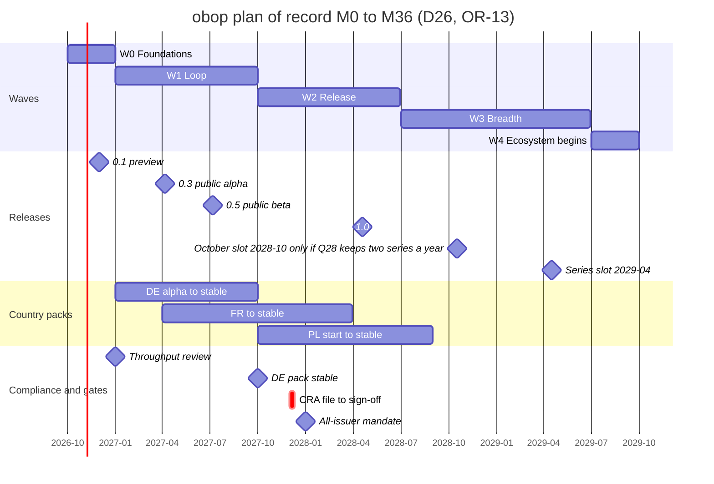
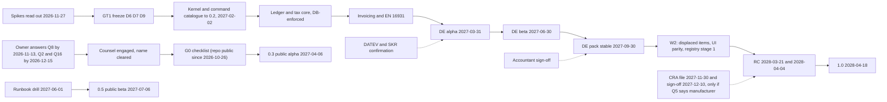

# Roadmap: waves, calendar, milestones, team, gates

Status: Draft 0.1  
Date: 2026-10-01  
Scope: Delivery plan from M0 (2026-10-01) to 2030-04 for a free, Apache-2.0 project built by the owner plus AI agents: waves, a quarter plan for the first 36 months, team and capacity, dependencies, cut lines and the slip order, release train and support window, metrics, kill and pivot criteria, schedule risks. Command-first sequencing (CLI, API and MCP before the UI) runs through every section.

Related: [DECISIONS.md](DECISIONS.md) (binding), [CONVENTIONS.md](CONVENTIONS.md) (naming), [spec/cli.md](spec/cli.md) (the agentic-first command surface), [ENGINEERING.md](ENGINEERING.md), [BUSINESS.md](BUSINESS.md), [LOCALIZATION.md](LOCALIZATION.md), [ARCHITECTURE.md](ARCHITECTURE.md), [PRODUCT.md](PRODUCT.md).

**How to read this document.** The plan was written on 2026-10-01 before any code; early code now exists (CLAUDE.md has the code map) but the product described here is mostly not built and no design partner has agreed to use it yet. The owner rulings of 2026-10-01, 2026-10-27 and 2026-10-28 (OR-1 to OR-35) are RATIFIED and reflected here: the whole project is Apache-2.0 and free, there is no paid software, the team is the owner plus AI agents, SpaceCorps hosts nothing for others today apart from a free hosted sandbox with sample data only that opens with the public beta (OR-11, OR-20, D83) and, planned but not offered, a paid hosting service on dedicated Sliplane servers (OR-22), and the waves keep their dates while the scope of W1 shrinks (OR-13, OR-15, D86). The repository `SpaceCorps/obop` has been public since 2026-10-26, which overtook gate G0. What the owner has not answered stays Proposed. Every date carries one of these markers.

| Marker | Meaning |
|---|---|
| Anchor | External date (law, standard, vendor release). obop cannot move it. |
| OR-n | An owner ruling of 2026-10-01, RATIFIED; recorded in the "Owner rulings" section of DECISIONS.md. |
| D26, D86 | Date or scope from section 5 of DECISIONS.md. The wave windows, the German pack date 2027-09-30 and the 1.0 target 2028-04-18 are RATIFIED (OR-13); every other date is a Proposed placement that this document treats as the plan of record (Q8, answer by 2026-11-13). |
| (proposal) | A choice made here that neither DECISIONS.md nor the research settles. Collected in section 9.3 where it needs the owner. |
| (target), (estimate) | A design target, or a model output or arithmetic. Neither is a measurement. |

M0 is 2026-10-01, so M9 is 2027-07-01, M12 2027-10-01, M18 2028-04-01, M24 2028-10-01, M30 2029-04-01 and M36 2029-10-01. "Wave" means a release wave W0 to W4 only (D24). Decisions relied on. RATIFIED by the owner rulings: D1 to D3, D4 (the country), D17, D23, the D24 renames and the X and L prefixes (OR-14), D26 (wave windows, German pack date, 1.0 target), D80 to D86 (D80 literal UI parity with an owner-approved exemption list, OR-16; D81 the OSI-approved-licence listing rule and the meaning of verified, OR-17; D82 the owner's sign-off on every commit with agents recorded by a `Co-Authored-By` trailer, OR-18; D83 the free hosted sandbox at the public beta, OR-20; D84 no grant application now, OR-21; D86 the W1 cut, OR-15), interpretations I-1 to I-4 (I-1 by OR-14) and the exit-drill exception of D15; D5 and D16 are superseded by D84 and D85. BINDING: D6 to D11, D15, D18, D19, D21, D22, D24, D27 to D39. Proposed: D4 (ICP, T0 list, France then Poland), D12 to D14, D20, D25, the staging and remaining admission details of D81 (Q24, Q25), the cadence and post-1.0 deprecation window of D85 (Q28), the slip order and landing waves of D86, the sandbox details of D83 (host, cost ceiling, terms, abuse approach: Q34 to Q36), the owner's approval of each entry of the D80 exemption list, and the remaining dates of D26. Not ruled and open: Q32, whether obop publishes to the npm registry, decided at W2 with the default of no publication (OR-19). Identifiers local to this document are PR1 to PR8 (principles), GT1, GT3 and GT4 (gates; G0 keeps its D26 name), K1 to K11 (kernel milestones) and SR1 to SR15 (schedule risks; SR7 is withdrawn and not reused). The former hiring gates HG0 to HG3 and the gates GT2, GT5 and GT6 are withdrawn with OR-2, OR-6 and OR-11. None of these reuses an identifier of another document: the design goals G1 to G7 and spikes S1 to S11 of [ARCHITECTURE.md](ARCHITECTURE.md), the D33 priorities P0 to P2, the CRA clock H0 of [ENGINEERING.md](ENGINEERING.md) or the R26 risk ids. Nothing here is legal advice.

## 1. Principles

Eight rules decide what is built, in what order, and what may slip.

| # | Principle | Rule | Enforced by | Source |
|---|---|---|---|---|
| PR1 | Scope discipline | One loop, one country at a time. No new app without a design partner. Every later app reuses the `party`, `product`, `document` and ledger primitives. | Section 6. The W1 cut of D86 governs W1 (R20 s9.3 no longer does); R23's 40-module graph is the dependency law, not the delivery list (D25, Proposed). Changing a cut line needs a design partner, a named offset and a DECISIONS.md amendment (proposal). Warning sign: more than 7 apps planned before design partners are live. | D86, OR-13, [R20 s9.2], [R05 s7] |
| PR2 | Correctness before breadth | Ledger, tax, pricing and stock invariants are release gates, not backlog. PostgreSQL enforces balance, immutability, lock dates and numbering (D30). No pack is stable without golden cases (D34). A feature is done only when it exists in CLI, API and MCP with a passing parity test (OR-4, D80). | W1 and W2 exit criteria; the pack gate ladder; proptests before a crate leaves alpha; the parity test (2.4). | D30, D34, D36, D80, [R27 A2], [R25 B3] |
| PR3 | Dogfood | obop runs the project's own books and CRM, app by app, from the moment each app exists. A release reaches design partners only after it has run on the project's own businesses. | Schedule in 1.1. | [R20 s10], [R27 C7] |
| PR4 | Anchors beat wishes | Only the German dates have a hard external driver (2028-01-01). If M0 slips, compress W1; do not move 2027-09-30. | Float table (9.2); slip order (6.2). | OR-13, D26 |
| PR5 | Measure before claiming | No multiple over Odoo until the Odoo-versus-obop harness has run on fixed hardware; it runs monthly from M9 (Proposed). | Harness in the CI schedule. | D21, [R27 A7] |
| PR6 | Scope moves, dates do not | When time or capacity runs short, W1 and W2 shed scope along the stated slip order (6.2) and get it back in reverse order. The German pack date 2027-09-30 and the 1.0 target 2028-04-18 are kept as targets, and correctness is not traded for a date: a pack without its oracles, golden cases and sign-off stays beta, and nothing is labelled 1.0 while the parity gate is red. If the 1.0 date and the parity gate ever collide, scope levers run first and the choice between them is the owner's and open (6.2, 9.3 item 9). | Section 6.2; checkpoints at 0.3 and 0.4; the throughput review (4.4). | OR-13, D26, D84, D86 |
| PR7 | The G0 checklist before 0.3 | The repository was opened on 2026-10-26, so G0 no longer gates visibility. Its checklist stays as the work to finish before the 0.3 public alpha: the name cleared or a fallback adopted, the publisher matters settled, the DCO check (a CI job, built when outside contributors appear, OR-30) and the D33 P1 files present (`SECURITY.md`, signed releases, SBOM). There is no CLA bot and no paid list to publish. | Gate G0 (2.3). | OR-5, D26, D33, D82 |
| PR8 | Upgrade is a product | N-1 upgrade guarantee from 0.3, `obop upgrade --dry-run`, contract migrations only at the first release of a series (`N.0`), a 12-month deprecation window before 1.0. | Section 7. | D85, D36 |

### 1.1 Dogfood schedule (proposal)

- **Engineering.** The nightly edge build runs on the project's own development and dogfood businesses (a seeded local instance, `obop dev up`, D83) as soon as `base` runs (0.1), with a 24 h bake before any design partner receives it ([R27 C7], an inference there). Until the registry-generated IDOR matrix exists (K3, by 0.4), that is one business, because D36 forbids any multi-business deployment before that matrix. Design partners run their own installations; SpaceCorps operates none for them (D83; the hosting service of OR-22 is planned, not offered). The free sandbox holds sample data only and is not an installation for anyone's real business (D83, OR-20).
- **Business.** From 0.4 (2027-05-04) the project runs contacts, CRM, quotes, invoices and manual payments on obop; vendor bills and basic stock from 0.5; purchase orders return in W2 (6.2). Its own books go live once a pack for its jurisdiction is at least `preview`; until then a German sample company in the same instance runs the DE pack daily. Where SpaceCorps stands legally is open (Q20, 9.3 item 2); the W1 exit criterion is that SpaceCorps' own invoicing runs on it.
- **Later apps.** `project`, `helpdesk`, `documents` and `website` run the project's own work the week each reaches preview; all four are W3 items (D25). No paid beta exists and support is community only, so no interim ticket tool is planned (the former ENGINEERING Q-E9 is moot).

## 2. The canonical waves

Names, windows, scope and exit criteria are D26, D86 and section 5 of DECISIONS.md. The wave table and the exit criteria have one home, [DECISIONS 5.2](DECISIONS.md#52-waves-and-calendar-d26-d86), and are not reprinted here: each wave below points to its row and adds only what this plan places itself. The wave windows, the German pack target and the 1.0 target are RATIFIED (OR-13); the rest of the calendar is Proposed (D26).

### 2.1 What the milestone words mean

The register splits three milestones that the research called "GA" and retires the bare word (D26, D24). This section is the only place the old word appears.

| Research wording | Source | Register term |
|---|---|---|
| "DE GA 2027-09-30" | [R25 A8] | pack stable (DE) |
| "paid cloud at month 9" | [R26 B5] | retired: there is no paid cloud, paid beta or plan (OR-2, OR-11); 0.5 is a public beta with no commercial offer |
| "1.0 LTS GA 2028-04-18" | [R27 C10] | 1.0, the first stable release (D85) |
| "v1.0 and paid cloud in months 12 to 20" | [R20 s10] | 1.0 only (month 18) |

| Term | Date | Definition | Evidence (proposal) | It does not mean |
|---|---|---|---|---|
| preview (0.1) | 2026-12-01 | First tagged kernel build | CI green on PG 17 and 18 | Any stability promise |
| public alpha (0.3) | 2027-04-06 | Public alpha release (the repository is already public with full history since 2026-10-26); N-1 upgrade guarantee; `obop upgrade --dry-run`; CSV importer; CLI grammar frozen (Q22, OR-31); D33 P1 security items present | G0 checklist; signed release with SBOM; `SECURITY.md` | Production use or any service level |
| public beta (0.5) | 2027-07-06 | A public pre-release with no commercial offer: no plan, price or SLA exists (D2, D26). `obop business export` and `import`, the N-2 chain test and the 1,000-business fan-out test exist. The free hosted sandbox opens with it (D83, OR-20): ephemeral, sample data only, no service level; go/no-go 2027-06-01 | Runbook drill log (2027-06-01); chain and fan-out test results; the export round trip; the sandbox go/no-go record | A commercial offer, hosting of anyone's real data or stable packs |
| pack stable (DE) | 2027-09-30 | The DE pack reaches the `stable` rung of the D34 ladder (draft, preview, stable, certified) inside the 0.x line (core 0.6) | KoSIT and CEN oracle runs, golden cases, recorded accountant sign-off, signed pack release | API stability, a support window, or a certificate (none known for DE accounting software, [R25 A6], unverified). If the oracles, golden cases or sign-off are missing, the pack stays beta (D86) |
| 1.0 | 2028-04-18 | The first stable release and first series `N.0`, carrying the 2-year security-fix window (OR-12, D85); CLI, API, MCP and UI parity green (OR-4); contract removals only at the first release of a series (Proposed). It falls after the CRA main obligations (2027-12-11), which apply only if counsel finds SpaceCorps to be a manufacturer (Q5) | Signed artefacts, SBOM, attestation, double reproducible build, chain tests, parity test, CRA sign-off if applicable | An LTS, an SLA, a five-year promise, or the first time the DE pack is dependable |

Why the split matters: pack stable is a compliance milestone with an external deadline, delivered on the pack channel inside the 0.x line, well before 1.0. 1.0 is the first release that carries the D85 support window; it cannot be pulled forward to avoid the CRA, because D26 rejects an early "1.0".

### 2.2 The five waves

**W0 Foundations, 2026-10-01 to 2026-12-31.**
- Ships: the W0 row of [DECISIONS 5.2](DECISIONS.md#52-waves-and-calendar-d26-d86). Read here: the T0 kernel is the eleven kernel crates of D25, from `obop-types` to `obop-testkit`, and module `base`, the Contacts app; the spikes read out by 2026-11-27 and 0.1 is a preview on 2026-12-01 with no stability promise.
- Exit: the W0 row of DECISIONS 5.2, applied as the gates G0 and GT1 (2.3); the throughput review of K1 and K2 against plan is 4.4 (D84).
- Reading of "ships" (proposal): a walking skeleton merged and tested on PG 17 and 18 by 2026-12-31, hardened by 0.2. Section 4.5 shows why.

**W1 Loop (D86), 2027-01-01 to 2027-09-30.** The smallest honest loop (RATIFIED, OR-13, OR-15): kernel, invoicing, accounting with tax, German e-invoicing, CRM and sales, basic stock. Germany first (OR-7).
- Ships: 0.2 (2027-02-02); DE pack alpha 2027-03-31; 0.3 public alpha 2027-04-06 (N-1 guarantee, `obop upgrade --dry-run`, CSV importer); 0.4 2027-05-04; DE beta 2027-06-30; 0.5 public beta 2027-07-06 (no commercial offer; the free hosted sandbox opens with it, D83, OR-20); 0.6 2027-09-07 (Odoo importer); code tiers X1 and X2 (X2 only if the D11 limits spike passes); the generated CLI, REST, OpenAPI and MCP for every shipped module, with the OAuth 2.1 provider, API keys and scoped agent tokens (D80, D31, D18); a thin UI as a client of the same commands.
- Scope (RATIFIED, OR-15, apart from the condition on X2 and the locales call; the slip order is Proposed, D86 and DECISIONS 5.3). T0: `base`, `product`, `mail` (reduced to chatter, activities, followers, outbound email and templates), `pricing` (list price and line discount), `obop-report`, `customize` custom fields, the command catalogue with CLI, REST, OpenAPI, MCP and webhooks, form, list and kanban views, search, the report viewer and the reconciliation view. T1: `account`, `tax`, `invoicing`, `payment` (manual only), `bank` (camt.053, MT940), `edi` (EN 16931 UBL and CII, Factur-X, XRechnung; issue and receive by email or file), `l10n` framework and `l10n_de` (chart, taxes, UStVA, DATEV EXTF export, GoBD), `crm`, `sales`, one-warehouse `stock`, `sale_stock`, `stock_account`. Locales: en and de; the other target locales of D34 arrive as reviewed community translations.
- Exit (Proposed detail under OR-13): the W1 row of DECISIONS 5.2, applied as gate GT3 (2.3): DE pack stable on 2027-09-30 if its oracles, golden cases and accountant sign-off are in, otherwise it stays beta and the date does not move. Where SpaceCorps' own invoicing stands legally is Q20 (1.1).

**W2 Release, 2027-10-01 to 2028-06-30.**
- Ships: 0.7 2027-11-02; CRA technical file 2027-11-30 and sign-off by 2027-12-10 (only if counsel finds SpaceCorps to be a manufacturer, Q5); `release/1.0` cut 2028-03-07, RC 2028-03-21 and 2028-04-04; 1.0 2028-04-18, the first stable release with the D85 support window; 1.0.1 2028-05-02; the items displaced from W1, returning in reverse slip order (6.2); package registry stage 1 (a git-backed index with the `obop plugin` commands, D81); the approvals engine; the web UI parity work that gates 1.0 (D80; literal parity, OR-16); multi-company; FR pack stable 2028-03-31 and PL start 2027-10, KSeF beta 2028-05 (all three Proposed and among the first to slip).
- Scope (D25, Proposed): `purchase` and `purchase_stock`, `portal`, `payment` SEPA files and Stripe plus one, the Peppol transport adapter (a certified access point of the user's choice, bring-your-own credentials), the `mail` inbound gateway and OAuth mailbox connectors (Gmail API, Microsoft Graph, D39), `pricing` rules and price lists, `automation` rules and the approvals engine with the D18 approval policy engine, pivot, graph and calendar views, the QuickBooks importer, multi-company (selector, per-company books), `l10n_fr` (Proposed, D4).
- Exit (Proposed under OR-13): the W2 row of DECISIONS 5.2; gate GT4 (2.3) sets the conditions for the 1.0 label.

**W3 Breadth, 2028-07-01 to 2029-06-30.**
- Ships: the services variant first (`project`, `timesheet`, `sale_project`, `sale_timesheet`, with the `hr` employee core, `resource` calendars, `analytic`, `calendar` and `discuss`; [spec/people.md](spec/people.md), [spec/services.md](spec/services.md)); then in demand order and each with a design partner: the extension platform (X3 host, SDK, compat, F2, the X4 app model, theme packs), stock lots, serials, routes and multi-warehouse (and barcode scan-to-add), bank feeds, Xero and ERPNext importers, `analytics`, `customize` models and the layout editor, T1 `hr`, `expenses`, `documents`, `delivery`, fixed assets, deferrals, budgets; PL pack stable 2028-08-31 (Proposed, slips to W4 if W2 overran); the series slots after 1.0 (cadence Proposed, Q28; section 7); T2 apps (`mrp` and `pos` first); F3; custom domains; the payroll engine; registry stage 2 on demand (D81).
- Scope (Proposed, D25): the remaining T2 list of D25 (`website`, `ecommerce`, `helpdesk`, `planning`, `subscriptions`, `sign`, `knowledge`, `ai` agents, AT and CH packs, `intercompany` and others); barcode scan screens (Proposed, [spec/supply-chain.md](spec/supply-chain.md)); T0 `obop-edge`, gantt, map and cohort views, `customize` form builder and print-template designer (Proposed, Q8). The Wasm host should start on the wasmtime LTS then current, v60 (about 2027-08-20), and an ADR amends D11 when X3 starts (D86, 9.3 item 6).
- Exit: the W3 row of DECISIONS 5.2 (at least two T2 apps stable, each with a design partner).

**W4 Ecosystem, from 2029-07-01.** Ships the later series slots (section 7; cadence Proposed, Q28), verticals, the public-sector track once the EU strategy is law, and the D25 W4 list (`consolidation`, WMS depth, payroll reference pack, L2 third-party maintainer packs, connectors). Exit: none; governed by the release cadence, not an exit date.

### 2.3 Gates

G0 is D26 and keeps that name in every document; it was overtaken on 2026-10-26 (the repository is public), and its checklist now gates the 0.3 public alpha instead. GT1, GT3 and GT4 are labels introduced here (proposal). GT2 (commercial offer), GT5 (viability) and GT6 (ARR) are withdrawn with OR-2, OR-6 and OR-11 and their numbers are not reused. The prefix GT keeps the gates apart from the design goals G1 to G7 of [ARCHITECTURE.md](ARCHITECTURE.md); in this document GT1, GT3 and GT4 always mean the gates below.

| Gate | When | Pass condition | On failure |
|---|---|---|---|
| G0 Public repository (overtaken 2026-10-26; checklist before 0.3) | W0 exit; latest before 0.3 (2027-04-06, Proposed) | The name is cleared (counsel opinion by 2026-12-15, Q2) or a screened fallback is adopted; the licence and publisher matters are settled (OR-5, OR-10; what counsel must have covered is Q16); the DCO check (a CI job, built when outside contributors appear, OR-30, D82); the D33 P1 files exist (`SECURITY.md`, signed releases, SBOM). There is no CLA bot and no paid list to publish. Q16's recommended default puts counsel's written advice at 2027-03-15, so the checklist has no settled date until the owner answers Q16 | 0.3 cannot ship as a public alpha with a public promise (the repository itself is already public) |
| GT1 Architecture freeze | 2026-12-31 | Spike readouts reviewed; D6, D7, D9 frozen; pins per D23; 3 to 5 design partners agreed to use it; counsel engaged; the throughput review of 4.4 done | 8.2 rows 1 to 3 |
| GT3 Pack stable | 2027-09-30 | The W1 exit criteria (the W1 row of [DECISIONS 5.2](DECISIONS.md#52-waves-and-calendar-d26-d86); 2.2) | DE pack stays beta until the oracles, golden cases and sign-off are in; the date does not move, the label does (D86) |
| GT4 1.0 | CRA sign-off by 2027-12-10 if applicable; cut 2028-03-07; RCs 2028-03-21 and 2028-04-04 | CRA sign-off (only if counsel finds SpaceCorps to be a manufacturer, Q5); double reproducible build; SBOM and attestation; chain tests; the CLI, API, MCP and UI parity test green for every command not on the owner-approved exemption list (OR-4, OR-16); no known trial-balance bug | Nothing is labelled 1.0 until the gate is met and there is no early "1.0" (D26); the W2 slip order (6.2) runs first; if the gate is still red, the choice between the date and the gate is the owner's, and the next slot and the numbering are open (6.2, 9.3 item 9) |

**Sandbox go/no-go (a checkpoint, not a release gate; D83, OR-20).** On 2027-06-01, the day of the runbook drill, the owner checks that the duties of D83 are in place: terms of use that forbid personal and production data, a privacy notice, abuse and rate controls with a kill switch, egress and outbound-mail blocking, the auto-reset time to live, the sanctions-screening approach, and counsel's review of the terms, the notice and the screening (Q34, Q36; the host and the cost ceiling are Q35). If they are, the sandbox opens with 0.5 on 2027-07-06; if not, it opens later and 0.5 does not wait for it (Proposed details, Q35). No release gate depends on the sandbox, and it is outside the protected core of DECISIONS 5.3.

### 2.4 Build order: command first (OR-4, D80)

Every capability is one typed command in a catalogue generated from the runtime registry; the CLI, the REST API and MCP are generated from it, and the web UI is a client of the same commands (D80, [spec/cli.md](spec/cli.md#1-purpose-and-the-agentic-first-principle)). The order of work for any feature is therefore: define the command (registry metadata, permission rows, dry-run behaviour); generate CLI, API, MCP and the reference documentation; build the view last. A feature is done when it exists in CLI, API and MCP with the same schemas, the D10 permission check, a dry-run with a digest-bound `plan_id` and an idempotency key for mutating commands, an audit entry, generated reference documentation and a passing parity test. The UI is not part of the per-feature definition of done but reaches parity before 1.0 (OR-4), and that parity is literal (OR-16): every command of every shipped module gets a UI, except operator-only commands (for example backup, doctor, upgrade, pack verify) that the owner approves as CLI-only with a written reason, which form the exemption list. No wave therefore plans a UI-only feature, and a slipped item (6.2) slips on all surfaces together.

| Wave | Command-surface deliverables ([spec/cli.md](spec/cli.md#9-waves)) | Parity gate |
|---|---|---|
| W0 | Catalogue skeleton and grammar (Q22 by 2026-12-31, frozen before 0.3); `obop init`, `serve`, `status`, `login`, `api`, `schema`, `catalogue`; CRUD for kernel models | Parity test started with the first commands (D36) |
| W1 | 0.3: `upgrade --dry-run`, CSV import, N-1 chain, grammar freeze; 0.5: `business export` and `import`, N-2 chain; 0.6: Odoo importer; throughout, each module's commands as it ships, plus `pack`, `customize`, webhooks, outbox, `agent` and `plan` | Parity test green for every shipped module; golden transcripts |
| W2 | Registry stage 1 (`plugin search`, `install`, `copy`, `fork`, `publish`, `audit`), `approval`, `automation_rule`, QuickBooks import, `--company`, `mcp bridge`, `plugin dev`; the UI parity work | CLI, API, MCP and UI parity green at 1.0 |
| W3 and later | `wasm`, `remote` and `theme` kinds, `custom_model`, `view_override`, `analytics query`, Xero and ERPNext importers, `ai_agent` and skills, registry stage 2 | Each item has a design partner (D25) |

## 3. Plan for the first 36 months

The wave windows, 2027-09-30 and 2028-04-18 are RATIFIED (OR-13). Other dates come from D26 (Proposed placements) or external anchors; everything else is (proposal).

### 3.1 Overview

The CRA bar applies only if counsel finds SpaceCorps to be a manufacturer (Q5). The series slot after 1.0 (2029-04-17) is the Proposed yearly cadence of D85 (Q28); the October 2028 slot exists only if Q28 keeps two series a year. FR and PL are Proposed and the first items to slip in W2.

### 3.2 Month one and two: the spikes

Three spikes read out by 2026-11-27 (D6, D7, D9; specified in [R23 DR-1, DR-2, DR-6], none executed). The CEL limits spike is a W1 item in the register (D11); it starts at the end of W0 so that it reads out before 0.2 (proposal).

| Spike | Method | Pass threshold | If it fails | Readout |
|---|---|---|---|---|
| NOTIFY contention (D7) | pgbench on PG 18, then 19 RC: 32 databases `t00` to `t31`, one process each, scripts `plain`, `notify`, `coalesced` | `coalesced` reaches at least 90% of `plain`. Expected confirmation of the ban: `notify` sums near a single-database run while `plain` scales | Below 90%: realtime drops to the polling floor (250 ms to 2 s) and NATS JetStream is reconsidered (proposal); nothing blocks. If `notify` shows no contention, the ban may relax to SHOULD; the one-LISTEN rule never relaxes | 2026-11-27 |
| 250-database cell (D6) | 250 databases of 800 tables from registry DDL on PG 18; measure create time, catalog size, idle memory, autovacuum lag, `pg_dump`, migration fan-out, PgBouncer pools | Fan-out migration under 30 minutes and idle memory under 4 GB (inferred thresholds) | Smaller cells, a sizing rule for whoever operates many businesses (D6, D83). Whether a pooled mode is ever built is the owner's call (DEFERRED); no Free-tier decision exists any more (OR-2, OR-11) | 2026-11-27 |
| UUID size (D9) | 300M synthetic `journal_line` rows, `bigint` versus UUIDv7; size, insert TPS, buffer hits on party-ledger and product-move queries | At most +25% size and 15% slowdown on the OLTP mix | `IdType` flips ledger, stock-move and log tables to `bigint` plus a public uuid; no module code changes | 2026-11-27 |
| CEL limits (D11, D12) | 4 KB source and AST depth 32 limits, a step budget, a wall-clock deadline, host-registered functions only; conformance tests | All limits enforced by one evaluator for server and Wasm client (`cel` 0.14.5 documents no cost limit) | No CEL in stored data at 0.2; X1 declarative actions only until limits land | Start 2026-12; readout by 2027-01-29, before 0.2 (proposal) |

Also in sprint one (D36): benchmark three test-database clone strategies (migrate per test, `WAL_LOG` template, `FILE_COPY` with `clone`); start the command catalogue skeleton and the CLI grammar proposal (Q22); note that the DCO check is a CI job to build when outside contributors appear (OR-30, D82); engage counsel; reserve handles by 2026-10-15; adopt Rust 1.99.x in the 2026-10-15 to 2026-10-22 window (5.4).

### 3.3 Kernel milestone ladder (proposal)

K11 is listed in time order; K1 to K10 keep their earlier numbers.

| # | Milestone | Target | Acceptance evidence |
|---|---|---|---|
| K1 | Workspace, crate DAG, `xtask` dependency law (D27), CI baseline incl. "NOTIFY only in `obop-bus-notifier`" (D7), the DCO check (D82), the JavaScript lockfile lint (I-2), `vp` pins (D23) | 2026-10 | CI red on an impl-to-impl edge, on NOTIFY elsewhere, on a commit without sign-off and on a foreign lockfile |
| K2 | Registry, ORM and REST walking skeleton for `base` on PG 17 and 18 | 0.1 | One binary serves generated REST for `party`, `company`, `currency`; migration ledger started |
| K11 | Command catalogue, generated CLI, REST, OpenAPI and MCP (D80): `GET /api/v1/catalogue`, the first commands (`obop init`, `serve`, `status`, `schema`, `catalogue`), the parity test started (D36), grammar freeze (Q22) | Skeleton 0.1; every shipped module as it lands; freeze by 0.3 | A command added once appears in CLI, REST and MCP; `obop dev parity` lists it; a route or tool outside the catalogue fails the build ([spec/cli.md](spec/cli.md#6-parity-testing-and-release)) |
| K3 | Default-deny security, Domain AST to SQL, typed elevation (D10); registry-generated IDOR matrix before the first multi-business deployment | 0.2; matrix by 0.4 | Identical answers from list, by-id, export and RLS paths (also through the CLI); restrictive-policy benchmark on 10M `journal_line` rows |
| K4 | Outbox, inbox, per-subscriber deliveries, coalescing notifier (D7, D27) | 0.2 | Effectively-once test with `kill -9` |
| K5 | PostgreSQL-enforced ledger (D30): deferred balanced-entry trigger, immutability, lock dates, gapless numbers, hash chain | 0.3 | Proptests; hash-chain verifier job (`obop ledger verify`) |
| K6 | CEL (X2) with limits; expression storage per D12 (Q9 by 2026-12-31) | 0.2 to 0.3 | CEL spike pass |
| K7 | The thin UI as a client of the catalogue: form, list and kanban views, search, the report viewer and the reconciliation view | 0.3 to 0.4 | Drift gate; axe pass (D35); no view shows or does more than the catalogue exposes |
| K8 | Multi-company selector, per-company books (D28) | W2 (first W2 item to slip to W3) | Composite-FK suite; IDOR matrix with two companies |
| K9 | Approvals engine and package registry stage 1 (a git-backed index with `obop plugin search`, `install` and `copy`, D81) in W2; `obop-wasm-host`, `obop-ext-sdk` and `obop-compat` with the X3 host in W3 | W2; W3 | Stage 1: index CI gates run on a pull request, a signed test plugin installs and copies, a revoked version is refused. X3: nightly compat run; capability diff per upgrade |
| K10 | `obop-edge`, gantt, map, cohort views | W3 | Two tablets and a store hub, one hour offline, 10k queued orders, `kill -9` mid-sync, exactly-once on `command_id` ([R23 DR-7]) |

### 3.4 Quarter by quarter

"Dated" lists anchors and D26 dates; "Work" is (proposal) and is an ordered backlog for the owner and the agents, not a staffing plan. Answer dates follow section 8 of DECISIONS.md.

**Beside the quarters (D87, OR-34; no calendar date).** The first native slice, "one background-recorded trip from a real phone" ([spec/mobile.md](spec/mobile.md) 9), is client work beside the waves: Android first, development builds, synthetic data only. It is outside the W1 cut (D86) and is proposed as an exit criterion of no wave; it draws on the same agent capacity as the waves (4.4), so the owner decides whether anything slips; the main session relayed on 2026-10-27 that the owner asked for it to start (relayed, not quoted; OR-34), and it carries no date of its own (the calendar's labels are milestones, OR-32). Work, in order: the Expo and Metro spike on the pnpm workspace; `@obop/client` generated from `/api/openapi.json`; the mobile client class of `obop-oauth`, the `device` model and revocation (done 2026-10-28, [spec/mobile.md](spec/mobile.md) 8.5); the `mileage` package with ingestion and validation; the app (sign-in, Start, foreground service, SQLite outbox, upload, Stop, Submit; review and confirmation are in the back office); label tables and docs. The real-phone acceptance test is the owner's to run or to witness. Auto-stop, maps, push, reimbursement and iOS are not in it. Step 4 is built (2026-10-28): the Mileage backend as the built-in module `crates/modules/mileage` (trips and points, the review, the distance computed at `end`), with its rules inside the module and not as generic kernel features ([spec/mobile.md](spec/mobile.md) 5.8 and 8.6).

**Beside the quarters (D88, D89; Proposed; no calendar date).** The platform team that builds on obop asked for model rules and delete rules (asks 11.2, 11.5 and 11.6 of its amendment of 2026-10-28), and the decision records D88 and D89 are the designs; nothing in them is built. This is the lead's proposed order of that work on 2026-10-28, not a schedule and not a promise, and it moves if the owner ranks the work otherwise: ask 11.4 (the keyed lookup of the unique check, in review as pull request 28 on 2026-10-28); ask 11.3 (length rules on text fields, in the queued kinds-limits package); the commands slice of D75; D88 slice 1 (model rules without the clock, which carries ask 11.5 and the part of ask 11.2 that needs no clock); D89 slice 0a (a neutral refusal for today's `refuse`, one scan per human delete) and then the rest of D89 in the order of its record (0b, 1, 2, then 5 after the D75 commands slice and the D77 engine slice; 3 with D76 and D78; the bench of slice 4 before any cap is published); ask 11.1 (a list filtered by what the caller has not seen, which needs its own decision record, and none exists yet); and ask 6.3 (erasure and retention, which D89 serves only with a declared policy per reference). The place of D88 slice 2 (the clock and `frozen`) is not fixed. The owner has ruled on three points of D89 (OR-35); Q59, Q60 and Q61 are open.

**2026-Q4 (M0 to M2), W0.**
- Dated: 10-05 vite-plus 1.0.0 eligible (D23). 10-15 handles reserved; 10-15 to 10-22 Rust 1.99.x window (1.99.0 adopted). 10-23 Q20. 10-28 Node 26 enters LTS. 11-12 Rust 1.100.0 expected. 11-13 Q8 and Q18. 11-16 CEN code lists take effect. 11-27 spike readout, Q6. 12-01 0.1 preview, migration ledger starts. 12-09 Product Liability Directive: software counts as a product for anything placed on the market after this date (counsel). 12-15 counsel opinion on the name (Q2), Q16 and Q26. 12-31 Q9 and Q22, W0 exit, throughput review; SMTP AUTH basic off by default.
- Work: K1 in month 1; K2 and the K11 skeleton in month 2; `base`, `obop-jobs`, `-i18n`, `-storage` in month 3; the DCO check; security policy and vulnerability-handling runbook v0; design-partner search; DATEV and SKR requests; counsel engaged; KoSIT goldens refreshed by 11-09 ([R27 C10]).

**2027-Q1 (M3 to M5), W1.**
- Dated: 01-01 Germany: e-invoice issuing mandatory above EUR 800k turnover; Spain: Veri*Factu for corporate-tax payers (Spain is gated behind counsel, D17). 01-12 Data Act switching-charge ban (a duty of hosts of customer data, which SpaceCorps is not today: the sandbox holds sample data only, D83; the hosting service of OR-22 would make it one). 02-02 0.2 (Node 26 adopted). 03-15 Q5 (counsel advice on the CRA role). 03-31 DE pack alpha; Q28; Q35 (sandbox host and cost ceiling); French compliance lead or PA partner deadline (D4).
- Work: K3, K4, K6, K11; `product`, `pricing`, `mail` (reduced); `account` and `tax` with K5; `obop-report` on Typst; `l10n_de` chart and taxes; XRechnung and ZUGFeRD create and validate against KoSIT; counsel delivers the trademark policy (Q26) and the confirmation of the DCO wording for agent-authored commits (OR-18, CN-02); G0 checklist closes.

**2027-Q2 (M6 to M8), W1.**
- Dated: 04-01 Microsoft EWS off permanently (not a W1 dependency, 9.2). 04-06 0.3 public alpha, G0 checklist closed at the latest. 05-04 0.4; Q34 and Q36, and the sandbox opening decision at the 0.4 checkpoint (Proposed, Q35). 05-17 CEN code lists take effect. 06-01 vulnerability-handling runbook drilled (D26); sandbox go/no-go (D83). 06-30 DE beta (UStVA, DATEV EXTF export). Country order re-scored in 2027-Q2 (D4); French pack work starts only if capacity allows (Proposed, first to slip).
- Work: `invoicing`, `payment` (manual), `bank`, `edi`, `crm`, `sales`, `stock`, `sale_stock`, `stock_account`; D33 P1 items before the flip (signed releases, SBOM, `SECURITY.md`); the docs site with reference pages generated from the catalogue (D38); `obop upgrade --dry-run` and the N-1 chain test; a parity test green for each module as it lands; dogfood (1.1); the sandbox build work for the go/no-go (proposal, D83, Q34 to Q36): seed set, template-database clone with TTL and reset jobs, rate limits, default-deny egress with an outbound-mail sink, kill switch, terms-of-use and privacy-notice pages.

**2027-Q3 (M9 to M11), W1.**
- Dated: 07-01 Spain: Veri*Factu for other taxpayers. 07-06 0.5 public beta and the free hosted sandbox (D83, OR-20; it opens only if the 06-01 go/no-go passes). 09 FR pack alpha ([R25 A8], Proposed). 09-01 French SME mandate. 09-07 0.6. 09-30 DE pack stable, W1 exit, Q11, Q12, Q24 and Q25.
- Work: N-2 chain test and 1,000-business fan-out from 0.5 (D36); `business export` and `import` round trip; Odoo-versus-obop harness monthly from 2027-07 (D21, Proposed); Odoo importer; design-partner pilots and the accountant sign-off; an internal Wasm connector spike from 2027-08-01 (D11), on wasmtime v60 once it is out (about 2027-08-20; 9.3 item 6).

**2027-Q4 (M12 to M14), W2.**
- Dated: 10-01 W2 starts; Q32 (npm-registry publication) is decided during W2 (OR-19; default: none); PL start (Proposed, first to slip). 11-02 0.7. 11-15 CEN code lists take effect. 11-30 CRA technical file (only if applicable, Q5). 12-02 EU AI Act Annex III high-risk date (HR and credit-scoring AI stay optional, D18). 12-10 CRA sign-off (if applicable). 12-11 CRA main obligations (a Saturday; whether they reach a free project is Q5).
- Work: the displaced W1 items return in reverse slip order (6.2), `purchase` and `purchase_stock` first; K8; K9 (registry stage 1, approvals engine); the UI parity work starts (pivot, graph and calendar views); FR PA connector beta (2027-12, [R25 A8], Proposed).

**2028-Q1 (M15 to M17), W2.**
- Dated: 01-01 Germany: all issuers, the only hard external driver. 03-07 `release/1.0` cut. 03-21 RC1. 03-31 FR pack stable (Proposed); Q14.
- Work: the UI parity work completes (OR-4); 1.0 prerequisites (reproducible double build, builder image, Node 26, artefact retention); QuickBooks importer.

**2028-Q2 (M18 to M20), W2.**
- Dated: 04-04 RC2. 04-18 1.0. 05-02 1.0.1. May: PL KSeF beta (Proposed). 06-30 W2 exit.
- Work: the D85 security-fix process drilled (an advisory and a backport); country re-score 2028-Q2 ([R25 A8]); decide field work as task subtype or planning shift before `planning` design starts (2028-07-01).

**2028-Q3 (M21 to M23), W3.**
- Dated: 07-01 W3. 08-31 PL pack stable (Proposed). About 2028-08 Wasmtime v48 support ends (estimate, [R24 s3.3]). 09-05 cut, RCs 09-19 and 10-03 for the 2028-10-17 slot, kept only if Q28 keeps two series a year. Fall: Odoo removes XML-RPC and JSON-RPC (D22 trigger).
- Work: the services variant first (`project`, `timesheet`, `sale_project`, `sale_timesheet`, employee core, `resource`, `analytic`, `calendar`, `discuss`); then `mrp` and `pos` with design partners; the X3 host on wasmtime v60; T1 `hr`, `expenses`, `documents`; `obop-edge`; F3; payroll engine design.

**2028-Q4 (M24 to M26), W3.**
- Dated: 10-17 the October series slot (kept only if Q28 keeps two series a year). November: PG 17 is 12 months from end of life, floor decision (D8).
- Work: the extension platform (SDK, compat, F2, the X4 app model); stock extensions and bank feeds; fixed assets, deferrals, budgets; `pos` with DE TSE via a signer the user chooses; registry stage 2 on demand.

**2029-Q1 (M27 to M29), W3.**
- Dated: no external anchor. The April series slot is cut 03-06 with RCs 03-20 and 04-03 (section 7).
- Work: further T2 apps in demand order; AT and CH packs; `intercompany`.

**2029-Q2 (M30 to M32), W3.**
- Dated: 04-01 payroll reference-country decision (D19). 04-17 the April series slot (Q28). 06-30 W3 exit.
- Work: payroll engine.

**2029-Q3 (M33 to M35), W4 from 07-01.**
- Dated: 09-04 cut for the 2029-10-16 slot, kept only if Q28 keeps two series a year. 10-01 M36; then the 2030-04-16 slot.
- Work: verticals; `consolidation`; payroll reference pack; L2 third-party maintainer packs.

## 4. Team and capacity

The team is the owner plus AI agents (OR-6, D84). There is no headcount path, no composition table, no hiring plan, no FTE cap, no hiring gate and no funding tranche: HG0 to HG3, GT5 and GT6, and the seed and Series A assumptions they rested on, are withdrawn. Costs that the plan does need (counsel, CI runners, domains, and from 2027 the small running cost of the sandbox, Q35) are paid by the owner, and nothing in the plan depends on revenue (D84). This section is about capacity, not staffing.

### 4.1 The team

- **Owner.** The one human: decides (DECISIONS section 8), engages counsel and the accountant, finds design partners, triages Vite+ (D15, "the owner or an agent assigned to it") and signs off every commit, agent-authored ones included (OR-18, D82: the owner signs off, counsel confirms the DCO wording; the register reads this as the owner reviewing each agent-authored commit before signing).
- **AI agents.** Implement crates, modules, generated artefacts, tests and documentation, and run the maintenance that the quality platform needs (D36: a standing duty of the owner and the agents, not a headcount). Agents are principals in the product (D18) and contributors in the repository; the clean-room attestation (F3) and the DCO apply to their output as to anyone's. An agent is recorded with a `Co-Authored-By` trailer and never provides the sign-off (OR-18).
- **No one else is assumed.** Outside contributors are welcome now that the repository is public (since 2026-10-26) but the plan never counts on them.

### 4.2 What the size of the team changes (proposal)

- **One critical chain.** Work follows the ladder in 3.3 in sequence; the leverage is that a command written once yields CLI, API, MCP and reference docs (D29, D80), not parallel teams.
- **Machine checks stand in for review depth.** Proptests, oracles, golden cases, chain tests, the IDOR matrix and the parity test are the release gates (PR2), because human review capacity is one person.
- **No promised service.** Support is community and best effort, with no SLA (D85), so nothing in the plan needs an on-call rota. The one exception is the free sandbox (D83, OR-20): a public service that one human has to watch, with no promised availability, which is why it can be switched off at any time (4.4).
- **External dependencies dominate.** The accountant sign-off, counsel and the DATEV and SKR access cannot be generated (4.3).

### 4.3 External expertise the plan depends on

| Skill | Needed by | Note |
|---|---|---|
| German accounting (SKR03/04, GoBD, UStVA, DATEV formats) and recorded sign-off | M3; sign-off by 2027-09-30 | 1 to 2 external experts, part-time acceptable, one per country ([R20 s10], [R26 P2]); no accountant is named yet. Agents cannot provide it |
| Counsel for a free Apache-2.0 project | W0 (name, Q2; coverage, Q16); 2027-03-15 (CRA role, Q5) | Name clearance, the CRA role of SpaceCorps, trademark policy (Q26), confirmation that the owner's sign-off plus a `Co-Authored-By` trailer satisfies the DCO for agent-authored commits (OR-18, CN-02), dependency licences (CN-08), the registry operator's role (Q24) |
| Counsel review of the free sandbox: terms of use, privacy notice, sanctions-screening approach, and whether the sandbox changes the CRA analysis (Q34, Q36, D83) | 2027-06-01 (go/no-go) | A bounded review paid by the owner (D84). If it is late the sandbox opens later; 0.5 does not move |
| E-invoicing (EN 16931, XRechnung, Factur-X) | 2027-03-31 | The oracles (KoSIT, CEN artefacts) run in CI; a human expert still reviews the golden cases |
| French compliance lead with PA knowledge; Polish KSeF and JPK knowledge | 2027-03-31; 2027-10 | The French lead is the D4 flip rule |
| Vulnerability handling and the CRA runbook (24 h, 72 h, 14 days) | 2027-06-01 drill | [R27 B7] assumes a rota of two trained people; one human cannot staff it (SR10, 9.3 item 10) |
| Engineering skills: Rust with PostgreSQL internals; TypeScript 7, React 19, Vite+, WCAG 2.2 AA; PgBouncer and pgBackRest for operators; Wasmtime from W3 | M0 | Covered by the owner and the agents; the risk is review depth (SR14), not hiring. Wasmtime patches within 7 days, 24 h for High (D11) |
| Payroll domain | Not before 2029-04-01 | D19 |

### 4.4 Throughput review and the schedule-feasibility risk

Schedule feasibility is a named risk (D84): the kept dates (OR-13) sit on effort estimates that assumed 4 to 17 people, and one human plus agents may not deliver even the cut W1 on time. The hiring gates that used to sit here are gone; the mitigation is scope, in the order 6.2 states, never dates.

- **Review at the W0 exit, 2026-12-31 (Proposed, D84).** Measure how much of K1, K2 and the K11 skeleton landed against the 3.3 targets, in calendar days from plan to merged and tested. Record the outcome in a dated note in the repository. It feeds GT1.
- **Reading rule (proposal).** If K1 and K2 together landed more than a month late, the owner is asked at the review to cut the first items of the slip order now (6.2) rather than at the 0.3 checkpoint, and to re-scale the remaining ladder by the measured ratio.
- **Later checkpoints.** 0.2 (2027-02-02), 0.3 (2027-04-06) and 0.4 (2027-05-04): compare the W1 items delivered with the slip order; at 0.3 and 0.4 the owner decides how many items to cut (DECISIONS 5.3). At 0.4 the owner also decides whether the sandbox opens with 0.5 or later (Q35, Proposed).
- **The sandbox is unplanned effort (named risk, SR15).** The free hosted sandbox (D83, OR-20) adds build work (the seed set, TTL and reset jobs, rate limits, the egress and mail sink, the kill switch, the terms and notice pages) and on-call attention to a W1 that the capacity check already finds over-subscribed (4.5). It is an operating duty outside the protected core (DECISIONS 5.3), not a W1 module. If the throughput review or the 0.3 and 0.4 checkpoints show W1 behind, the sandbox is what opens later or not at all; the public beta does not wait for it (Proposed, Q35).
- **Rule that does not bend.** Nothing in the protected core slips before everything ahead of it in the order (D84); the DE pack stays beta rather than wrong (PR6).

### 4.5 Capacity check for W0 and W1 (estimate)

| Item | Person-months | Source |
|---|---|---|
| W0 capacity in the research's sizing: 4 to 6 FTE over 3 months | about 15 | arithmetic |
| W1 capacity in the research's sizing: 6 to 10 FTE over 9 months, about 90% engineering and domain | about 72, of which 65 usable | arithmetic |
| DE pack | 14.5 (plus or minus 40%) | [R25 A8] |
| Shared pack SDK, harness, signing, data pipelines | 10 to 14 | [R25 A8] |
| Extension platform cut (X1, X2, X4, SDKs, theming; the research's "CLI v0" line is replaced by the generated CLI, which stays in W1, D80); line items sum to 28 | 26 to 34 | [R24 s11] |
| Subtotal before the OR-13 cut | 50.5 to 62.5 | |
| Subtotal of the two items that stay whole in W1 (DE pack, shared pack work) | 24.5 to 28.5 | arithmetic |

Before the cut, these three items alone took about 78% to 96% of the research's W1 capacity at 6 to 10 FTE, before `account`, `sales`, `stock`, `mail`, `pricing`, reports, views, MCP, importers or docs. The research gives no person-months for those, but accounting models are 5 to 6 times the size of sales ([R20 s9.1]). The figures come from different notes; read this as a smoke alarm, and it is the reason the W1 cut (D86) exists: the extension surfaces beyond X1 and X2 (X3, the X4 app model, F0 patches, F2, theme packs, SDKs beyond the OpenAPI document) leave W1 (slip-order item 1) and X1 and X2 stay. The generated CLI, API and MCP do not leave: the research's "CLI v0" line is replaced by the generated command surface for every shipped module (OR-4, D80), so part of the 26 to 34 person-months above is CLI effort that does not leave W1. The alarm now rings for a different reason as well. These sums were made for 6 to 10 people, and nobody knows what the owner plus agents deliver, so the capacity check does not say the cut W1 fits; the measurement in 4.4 does. The sandbox (D83, OR-20) is in none of these sums: it adds effort and on-call attention on top of a W1 that is already over-subscribed, and it costs money as well, a small running cost with a Proposed ceiling of EUR 100 per month all-in (an estimate, not a quote; Q35), paid by the owner. Proposals: (a) pre-agree the trim at the 0.3 checkpoint, which is the slip order of 6.2; (b) build the DE pack and the ledger in sequence as one chain, not in parallel.

## 5. Dependencies and critical path

### 5.1 Owner decisions on the calendar

The open questions of section 8 of DECISIONS.md (Q1 to Q61), in order of answer date. Q57 and Q58 (D88) were closed on 2026-10-28 by answers of the platform team and are not listed. Closed by the rulings and not listed: Q1 (OR-1, OR-10), Q3 and Q19 (OR-2), Q4 (OR-6), Q7 (OR-12), Q10 (OR-8, OR-9, OR-14), Q13 (OR-2, OR-3), Q23 (OR-17), Q27 (OR-20), Q29 (OR-18), Q30 (OR-16) and Q31 (OR-21). Q32 (npm-registry publication) stays open and is decided at W2 (OR-19), with the default of no publication until then. Q2, Q5, Q16 and Q20 are reduced to what counsel or the owner still has to settle for SpaceCorps as publisher of a free Apache-2.0 project. Proposed records stay Proposed until the owner says so. Besides the questions, the owner approves the entries of the UI-parity exemption list one by one (OR-16); the Proposed timing is an initial list before the UI parity work starts on 2027-10-01 (D80).

| Q | Decision | Answer by | Blocks |
|---|---|---|---|
| Q15 | D23 pnpm major: 12.x, closed by OR-28 (ENGINEERING Q-E6) | closed | The exact pnpm pin and the lockfile (5.4) |
| Q17 | D36 runner plan: GitHub-hosted runners, closed by OR-29 (ENGINEERING Q-E1) | closed | CI capacity |
| Q20 | Which legal entity stands behind SpaceCorps and where it is incorporated (9.3 item 2) | 2026-10-23 | The CRA analysis of Q5, liability for a free project, the jurisdiction of the dogfood ledger, the provider identification in the sandbox privacy notice (Q34) |
| Q33 | `pnpm licenses list` is not one of the two `vp` exceptions (I-2), closed (answered by OR-9) | closed | How the JavaScript licence check runs |
| Q8 | D4 ICP, T0 list, the slip order and landing waves of displaced items (DECISIONS 5.3) and the remaining Proposed dates of D25, D26 and D86 | 2026-11-13 | The whole plan |
| Q18 | Identifier families that share letters: keep and qualify, or rename | 2026-11-13 | Names used across the plan; a rename must come before the first public commit |
| Q6 | D6, D9 cell size and key type (spike readout) | 2026-11-27 | GT1 |
| Q2 | D3 counsel opinion on the name; handles reserved by 2026-10-15 | 2026-12-15 | G0 |
| Q16 | What counsel must cover, given Apache-2.0 (formerly before the public flip, G0, D26) | 2026-12-15 | The G0 checklist and its date; the W0 exit; 9.3 item 5 |
| Q26 | D3, D1 trademark use policy for a permissive project | 2026-12-15 | G0 (publisher and trademark matters) |
| Q9 | D12 expression storage | 2026-12-31 | CEL spike design, K6 |
| Q22 | D80 CLI name and command grammar freeze | 2026-12-31 | K11; frozen before the 0.3 public alpha (OR-31) |
| Q5 | D17, D85 the CRA role of SpaceCorps as publisher of a free project (and whether the sandbox of D83 or the planned hosting service of OR-22 changes the analysis) | 2027-03-15 | Whether the CRA dates of 2027-11-30 and 2027-12-10 apply; the runbook scope; the five-year minimum support period |
| Q28 | D85 release cadence after 1.0, what the 2-year window attaches to, the deprecation window after 1.0 | 2027-03-31 | Public promises at 0.3; section 7; 9.3 item 9 |
| Q35 | D83 where the sandbox runs, its monthly cost ceiling (Proposed: EUR 100 all-in, paid by the owner) and its place in the schedule | 2027-03-31 | The sandbox build work (3.4); the go/no-go of 2027-06-01 |
| Q34, Q36 | Q34 D83 sandbox terms of use, privacy notice and data policy; Q36 D83 sandbox abuse, egress and sanctions approach | 2027-05-04 | The sandbox go/no-go of 2027-06-01; counsel review (4.3) |
| Q11, Q12 | Q11 D13 offline scope with the wave of POS order capture; Q12 D20 Typst only | 2027-09-30 | W3 edge, reports |
| Q24, Q25 | D81 who operates what; copy-mode provenance | 2027-09-30 | Registry stage 1 in W2 |
| Q14 | D14 storefront without Node (and the docs fallback of D38) | 2028-03-31 | `website` |
| Q32 | Whether obop publishes anything to the npm registry; until the owner rules, the default is no publication (OR-19) | W2 (2027-10-01 to 2028-06-30) | SDK distribution ([spec/cli.md](spec/cli.md#7-distribution)) |
| Q37 to Q43 | D87 native apps: Apple and Google accounts and store listings (Q37), push (Q38), map tiles and geocoding (Q39), a data class `location` (Q40), legal sign-off for an automatic trip end (Q41), Storybook for the app (Q42, answered 2026-10-28: the web Storybook through react-native-web, OR-34 g), Google Play services in the Android app (Q43) | Each before the thing it blocks; no calendar date | A store or TestFlight build (Q37), push (Q38), any map (Q39), the release of the `mileage` package (Q40), auto-stop work (Q41), the app's component library (Q42), a store release or the own location module (Q43) |
| Q44 to Q56 | D75 to D78 storage records: reserved field names of installed modules (Q44), actor and group spellings (Q45), history of `connection` (Q46), history retention (Q47), accepted ICU differences (Q48), pushdown behaviour changes (Q49), its default switch (Q50), `storage_event` retention and the PostgreSQL floor (Q51), CLI-only exemption entries (Q52), frozen records refusing online writes (Q53), the amendments of D49 (Q54), the shape of `list` (Q55), the order of ties (Q56) | Each before the package it blocks; no calendar date | The PostgreSQL history package (Q44), the first model that is tracked (Q45, Q46), the first instance that holds personal data in tracked models (Q47), the default switch of the pushdown (Q48, Q49), the first release that contains the pushdown (Q50), the `storage_event` model (Q51), the first stable release (Q52), the first guarded package on a real instance (Q53), the keyset package (Q54 to Q56) |
| Q59, Q60 | D89 the cap of one atomic delete (Proposed: 2,000 rows, ceiling 4,000, provisional until the bench) and who may delete before the DELETE position of D79 exists (Proposed: ship `cascade` first, with advice A1 for public targets) | Before D89 slice 2 is released; no calendar date | D89 slice 2 (`cascade` and `set_null`) and the publication of the cap |
| Q61 | D88 whether the result of a closed poll must be final, that is, whether a vote may still be withdrawn after the close (Proposed: no, delete stays open) | Before D88 slice 3 would be built; no calendar date | D88 slice 3 only (delete under frozen rules); nothing else waits for it |

### 5.2 Dependency register

| Dependency | Needed by | Status and lead time | If late | Fallback |
|---|---|---|---|---|
| Counsel engaged (Q2, Q5, Q16, Q26; also the OR-18 DCO confirmation and dependency licences) | W0 exit; written advice by 2027-03-15 (Q16 default); the registry operator's role before stage 1 (Q24) | Not engaged; paid by the owner | The G0 checklist slips; the 0.3 public alpha of 2027-04-06 is at risk | 0.3 waits (SR2) |
| Name clearance (D3) | Handles 2026-10-15; opinion 2026-12-15 | Register searches not done; OBOPP pending (class 35), OBOL two live (classes 9, 42) ([R28]) | 0.3 public alpha blocked; a rename touches the already public repository | Screened fallbacks kernelbiz, monobiz, mercora |
| Written DATEV and SKR03/04 confirmation | Requested by W0 exit; chart by DE alpha; developer-programme access by DE beta | Licence terms, fees, lead time not found ([R25 A3, B4]) | Charts cannot sit in a public repo; alpha slips | Charts as licensee-downloaded data packs (D4); EXTF and GoBD exports first, Connect online later |
| A certified Peppol access point chosen by the user (bring-your-own credentials; SpaceCorps contracts none and operates none, D17, D83) | The Peppol adapter in W2 (slip-order item 12); not needed in W1 | Access points and their APIs not yet surveyed | No Peppol transport | E-invoices travel by email or file; Peppol is optional for German B2B (the accountant confirms at sign-off) |
| French compliance lead and PA partner | 2027-03-31 | None identified | Flip FR and PL (D4) | PL second |
| DE accountant sign-off | 2027-09-30 | No accountant named | GT3 cannot close; the pack stays beta | Two experts, one part-time per country |
| Design partners, 3 to 5 | W0 exit | None agreed as of 2026-10-01 | No acceptance test for scope | Reopen the ICP (Q8) |
| Vulnerability-handling runbook drill and CRA advice (Q5) | 2027-06-01 | Not started; one human owner (SR10) | Known gap before 0.5; counsel asked whether a public beta without the drill is acceptable (Q5) | Prepare as if SpaceCorps were the manufacturer (D17) |
| Sandbox host, terms of use, privacy notice and counsel review (D83; Q34 to Q36) | Go/no-go 2027-06-01 (opens with 0.5, 2027-07-06) | Not started; a small server and a bounded counsel review, both paid by the owner | The sandbox opens later; the public beta proceeds | A local demo (`obop dev up`) only |
| CI runners (Q17, closed by OR-29) | K1, 2026-10 | GitHub-hosted runners (`ubuntu-latest`) are in use, free for a public repository; self-funded, so cost counts | Slow PR gates | Stay on them; the Hetzner CCX43 proposal is withdrawn (OR-29), and a move needs a new owner decision |

### 5.3 Critical path

- **DE pack stable (2027-09-30).** The chain is kernel, ledger, EN 16931 invoicing, alpha, beta, stable. The external long poles are DATEV and SKR access and the accountant sign-off, both of unknown lead time. The internal long pole is the throughput of the owner plus agents (SR3, 4.4). Float to the 2028-01-01 mandate is 93 days.
- **Public alpha (0.3, 2027-04-06) and public beta (0.5, 2027-07-06).** The alpha waits for the G0 checklist: the name cleared or a fallback, the publisher matters, the DCO check and the D33 P1 files (the repository itself has been public since 2026-10-26). The beta waits for the runbook drill. No money, hosting or cell is on this path, and neither is the sandbox: it opens with the beta only if its go/no-go of 2027-06-01 passes, and the beta does not wait for it (Proposed, D83, Q35).
- **1.0 (2028-04-18).** The chain is the CRA technical file and sign-off (only if applicable), the cut, two RCs and the UI parity gate. The CRA date 2027-12-11 is a Saturday, so sign-off by Friday 2027-12-10 leaves one day. 1.0 is a kept target date (OR-13); if the gate is not met it is not labelled 1.0 (D26), the choice between the date and the gate is the owner's after the slip order has run (6.2), and the numbering of the next slot is open (9.3 item 9).

### 5.4 Pin calendar (D23)

All versions as of 2026-10-01. The pin policy is RATIFIED (D23, OR-8, OR-9) and deliberately runs up to about three weeks behind the newest release (I-3). `obop version` prints the pins the binary was built with ([spec/cli.md](spec/cli.md#7-distribution)).

| Component | Pinned now | Next event | Rule |
|---|---|---|---|
| Rust | 1.99.0 (adopted after 2026-10-15; 1.98.0 skipped) | Rust 1.99.0 was published on 2026-10-01 (release post dated that day; the stable-channel manifest serves it, Last-Modified 12:38 UTC after a 404 at about 10:10 UTC; verified). The pin stayed 1.98.1 until the D23 rule allowed it (`x.y.0` plus 14 days = 2026-10-15), not because the channel lacked it; `rust-toolchain.toml` pins 1.99.0 now. 1.100.0 expected about 2026-11-12, eligible 2026-11-26 | Eligible at `x.y.1`, or `x.y.0` plus 14 days with no open regression; adopt within 7 days; an advisory overrides; a release branch inside its security-fix window keeps a per-branch toolchain in a digest-pinned builder image |
| vite-plus | 1.0.0 (2026-09-28, MIT), eligible 2026-10-05 | Bundles Vite 8.3.1, Rolldown 1.2.11, Vitest 5.0.1, Oxlint 1.85.0, oxlint-tsgolint 7.0.2003, Oxfmt 0.70.0, tsdown 0.23.0 | At least 7 days old; passes exit drill, LICENSE and NOTICE diff, one Vite and one Vitest copy, test suite |
| `vp` only (OR-9) | Every JS/TS build, test, lint, format, task and environment command is `vp` | Check at each `vite-plus` upgrade whether `vp` has gained an SBOM wrapper | Three RATIFIED exceptions: the nightly exit drill (a throwaway copy that never ships, I-4), `pnpm sbom` through `vp env exec` or a `vp run` task until `vp` supports it (I-2), and the mobile toolchain (Metro, the Expo CLI, Gradle and Xcode through `vp env exec` or `vp run`; OR-34, D87). No other; `pnpm licenses list` is not one (Q33) |
| Node | 24 LTS (`.node-version` already says v26 on 2026-10-27) | Node 26 LTS from 2026-10-28; adopt by 0.2 (2027-02-02) and before the 1.0 branch is cut | Node 24 ends 2028-04-30 |
| pnpm | Exact version via `vp env pin` and `packageManager`; the 12.x line is ratified (OR-28) | `minimumReleaseAge` at least 7 days (strict), `trustPolicy: no-downgrade`, `blockExoticSubdeps`, `strictDepBuilds` with `allowBuilds`; CI runs `vp install --frozen-lockfile` | Only `pnpm-lock.yaml` is committed |
| Expo SDK (React Native) | SDK 57 (React Native 0.86) for now, ruled by OR-34; pinned since the Expo spike of 2026-10-27: `expo` 57.0.30 and the SDK 57 bill of materials in `web/apps/mileage-app`, with `expo` 57.0.31 held until the 7 day cooldown ends on 2026-10-28 and the cooldown enforced by `minimumReleaseAge` in `pnpm-workspace.yaml` | An upgrade guide dated 2026-10-21 (seen in a search result, page not read) names SDK 58 (React Native 0.88) as current. The owner amended OR-34 e on 2026-10-28 (relayed): start the app on SDK 58 if its packages pass the cooldown when the app's build starts, otherwise stay on SDK 57 and move at the first clean point | The pin policy (D23). The app pins one exact SDK |
| PostgreSQL | 17 and 18 supported, 18 reference | CI adds 19 at RC (planned early October 2026, release date not announced); floor moves to 18 when 17 is 12 months from end of life (2028-11) | 1.0 supports PostgreSQL 17 and 18 (D8); newer majors join the matrix as they pass CI; the floor raise applies from the 2029-04-17 slot at the earliest (proposal, [ENGINEERING.md](ENGINEERING.md) Q-E4) |
| Wasmtime | v48 (48.0.3, 2026-09-24) for the internal connector spike only | Next LTS v60 about 2027-08-20; the X3 host (W3) should start on v60, and an ADR amends D11 when X3 starts (D86); v48 support ends about 2028-08 | Patch within 7 days, 24 h for High |
| Core crates | tokio 1.53.1, axum 0.8.9 (0.9 pending), sqlx 0.9.0, sea-query 1.0.2, utoipa 6.0.0 | Exact pins in `[workspace.dependencies]` | Renovate cooldown 7 days; cargo-deny blocks |

## 6. Scope cut lines

The W1 cut and its in and out calls are RATIFIED (OR-13, OR-15, D86); the slip order below is Proposed (DECISIONS 5.3); the exclusions also rest on Proposed D4, D13 and D20. Tier placement is in [PRODUCT.md](PRODUCT.md). A module not listed defaults to T3. From W2 on the plan is an ordered backlog, not a promise: nothing is sold or withheld (D2).

### 6.1 What is explicitly not in each wave

| Wave | Explicitly not in this wave | Lands |
|---|---|---|
| W0 | Country packs; third-party extensions; UI beyond a shell (the repository is public since 2026-10-26) | Packs, X1 and X2 in W1; registry stage 1 in W2; X3 in W3 |
| W1 | POS, payroll, manufacturing, multi-country tax (D4); multi-company (one company, dormant `branch`, D28); `purchase` and `purchase_stock`; `portal`; `payment` beyond manual (SEPA files, Stripe); the `mail` inbound gateway and OAuth mailbox connectors; `pricing` rules and price lists; `automation` rules and the approvals engine; the Peppol transport adapter; pivot, graph and calendar views; QuickBooks, Xero and ERPNext importers; `analytic` and `analytics`; the extension surfaces beyond X1 and X2 (X3, the X4 app model, F0 patches, F2, theme and branding packs, SDKs beyond the OpenAPI document); project and timesheets (the services variant); `resource` calendars; custom models and the layout editor; multi-warehouse, lots, serials, routes and the other `stock` extensions; barcode scan-to-add; assets, deferrals, budgets, HR, expenses, documents; FR and PL packs; aggregator bank feeds; queued offline writes (D13); GraphQL (D31); Rhai (D11); a browser PDF renderer (D20); AI agents beyond the typed commands and MCP; locales beyond en and de | W2: the displaced items in reverse slip order (6.2), `purchase` first, then the Peppol adapter, inbound mail, pricing rules, payment providers, `portal`, QuickBooks, `automation` and approvals, and the pivot, graph and calendar views; plus multi-company, registry stage 1, the UI parity work and FR (Proposed). W3: the services variant, `analytic`, `analytics`, `resource`, X3 and the extension platform, stock extensions, scan-to-add, Xero and ERPNext, custom models and layout editor, assets, HR, edge, F3, PL. Later: queued writes |
| W2 | All T2 apps (`mrp`, `pos`, `website`, `ecommerce`, `helpdesk`, `planning`, `subscriptions`, `ai` agents and the rest); the services variant; `hr` beyond the employee core, `expenses`, payroll, `documents`; PL stable; F3; custom domains; `intercompany`; X3 and the extension platform; registry stage 2 | W3, except `consolidation` (W4) |
| W3 | `consolidation`; barcode depth (GS1, batch and wave screens; the plain scan screens are W3) and WMS depth; payroll reference pack (country decided 2029-04-01); BE, NL, ES, IT and Nordic packs (third-party maintainers, L2; Spain gated behind counsel, D17); WhatsApp and marketplace connectors; the public-sector track; all T3 | W4 or contributors |
| W4 | Nothing is promised; T3 arrives as X3 or X4 packages, plugins from the registry (D81) or contributor work | |

**Native apps (D87).** The Mileage slice is not in the scope of any wave above and is not part of the W1 cut; it is client work beside the waves (3.4), and the owner decides whether it displaces anything.

Never, under the register: XML-RPC (D22), in-process third-party Rust (D11), metered or hosted AI credits (D18, OR-2), statutory filing in core payroll (D19), Electric, PowerSync or Zero (D37), Odoo Enterprise code or assets (F3), any paid tier, price list or payment handling in the registry (OR-2, OR-3), hosting for others by SpaceCorps apart from the free sample-data sandbox and the hosting service planned by OR-22 (OR-11, OR-20, D83), and a feature that exists on one surface only (OR-4).

### 6.2 Slip order and cut rules (Proposed, DECISIONS 5.3)

Scope moves, dates do not (PR6). The slip order, the protected core, the necessary-inside calls and the order for a W2 overrun have one home, [DECISIONS 5.3](DECISIONS.md#53-w1-cut-necessary-inside-calls-and-slip-order-d86), and are not reprinted here, so the two documents cannot drift apart. Wherever this document says "the slip order (6.2)" it means the slip-order table there (item 1 leaves first and returns last) and, where it says "the W2 slip order", the "If W2 overruns" paragraph that follows it.

Rules (proposal): a wave may not pull work from the next without naming the offset; W1 compresses before 2027-09-30 moves; the first cut inside W1 is the first item of the order.

Date against gate (proposal, not ruled). DECISIONS 5.3 keeps 1.0 on 2028-04-18 (OR-13) and protects the 1.0 parity gate (OR-4, OR-16), but does not say which yields if both cannot hold. The order of levers proposed here: (1) the W2 slip order; (2) the scope of the gate, which only the owner can narrow, by approving further operator-only commands as CLI-only with a written reason (the owner-approved exemption list, OR-16; an entry never turns a red test green); (3) only then an explicit owner decision between the date and the gate, which is not pre-decided (8.2 row 6, 9.3 item 9). The label 1.0 is never given to a build that fails the gate (D26). Until the owner answers, 2028-04-18 is a kept target, not a guarantee that the label is applied on that day.

Checkpoints on the calendar (Proposed): the throughput review at the W0 exit (4.4), then 0.3 (2027-04-06) and 0.4 (2027-05-04), where the owner decides how many items to cut, counting from 1. The counting rule, and what happens if the protected core is still behind at 0.4, are in DECISIONS 5.3.

Where the order is applied in this plan: the returned items in the quarter plan (3.4), the reading rule of the throughput review (4.4), the exclusions per wave (6.1), the kill and pivot rows 6 and 8 (8.2) and the schedule risks SR1, SR3 and SR12 (9.1).

### 6.3 Deferred items with dated triggers (DECISIONS 2.3)

Reference payroll country, 2029-04-01 (D19). Field work as task subtype or planning shift, before `planning` design starts, 2028-07-01. JSON-2-compatible endpoint, when three design partners ask or in fall 2028 (D22). MessageFormat 2 review, 2027-H2 (D34). Opening the hosted sandbox at the public beta, go/no-go 2027-06-01 (D83). Publishing to the npm registry, decided by the owner at W2, 2027-10-01 to 2028-06-30 (OR-19; no publication until then). Undated triggers: a pooled mode for operators (the cell spike fails, D6; the owner decides); Rhai inside signed packs (measured demand in W3, D11); NATS JetStream (measured wake-up lag or polling-fallback rate above the threshold set at the 2026-11-27 readout, D7); registry stage 2 (stage 1 volume justifies it; W3 or W4, D81); a grant application (OR-21: revisit when a self-contained reusable crate exists); extending the security-fix window toward 5 years (users and funding appear, D85). The capabilities of the former paid list are ordinary backlog items with no date: not withheld, not promised (DECISIONS 6). Removed with the rulings: the pooled Free tier, the own Peppol access point and the marketplace take rate.

## 7. Release train, support window and deprecation policy

The promise is RATIFIED (OR-12, D85); the cadence after 1.0 and the deprecation window after 1.0 are Proposed (Q28). Details live in [ENGINEERING.md](ENGINEERING.md).

- **Before 1.0.** An N-1 upgrade path (any 0.N upgrades to 0.N+1 with `obop upgrade --dry-run`) and a 12-month deprecation window for public contracts: REST and MCP, the CLI command catalogue, the pack schema, `obop.toml`, the UI SDK (OR-12, D85). The 0.x minors land on first Tuesdays (Proposed, D26): 0.1 2026-12-01, 0.2 2027-02-02, 0.3 2027-04-06, 0.4 2027-05-04, 0.5 2027-07-06, 0.6 2027-09-07, 0.7 2027-11-02. Promises: none at 0.1 (D26) and, as a proposal, 0.2; N-1 upgrade guarantee and chain test from 0.3; N-2 chain test and 1,000-business fan-out from 0.5 (D36); the CLI grammar frozen before 0.3 (Q22, OR-31). The migration ledger is append-only and never squashed inside a line.
- **From 1.0 (2028-04-18, the first stable release).** A 2-year security-fix window, to be extended toward 5 years only as users and funding appear (OR-12). Nothing beyond this is promised: no SLA, no response times, no "LTS" label, no patch train, no hosted fleet, no paid support. Security fixes land on `main` and are backported inside each series' window; fixes and advisories are never withheld or tiered (D2, D38). Patch releases as needed (Proposed).
- **Series (Proposed, Q28).** Pre-1.0 numbering is the 0.x line above. After 1.0 the recommendation is one stable series a year on the third Tuesday of April, each with 2 years of security fixes from its release date (so about two lines are live at once); destructive migrations and contract removals only at a series' first release (`N.0`), expand-only in between (D36). `release/N.M` is cut six weeks before release, RC1 at four weeks, RC2 at two ([R27 C3], kept as a Proposed mechanic). DECISIONS 5.2 also places October slots; the table shows both. Series numbers are placeholders until Q28 is answered.

| Slot | Release | Cut | RC1, RC2 | Security-fix window ends (estimate from D85) | Under the Q28 default |
|---|---|---|---|---|---|
| 1.0, the first stable release | 2028-04-18 | 2028-03-07 | 03-21, 04-04 | 2030-04-18 | Kept (RATIFIED target) |
| 1.1 | 2028-10-17 | 2028-09-05 | 09-19, 10-03 | 2030-10-17 | October slot dropped |
| 1.2 | 2029-04-17 | 2029-03-06 | 03-20, 04-03 | 2031-04-17 | Kept |
| 1.3 | 2029-10-16 | 2029-09-04 | 09-18, 10-02 | 2031-10-16 | October slot dropped |
| 2.0 | 2030-04-16 | 2030-03-05 | 03-19, 04-02 | 2032-04-16 | Kept |

- **Deprecation.** Public contracts (REST and MCP, the CLI command catalogue, WIT, `obop.toml`, the pack schema, the UI SDK tiers F2 and F3) are deprecated for at least 12 months before removal. That is RATIFIED before 1.0 and continues after 1.0 unless the owner rules otherwise (Proposed, Q28); removals land at the first release of a series. The CLI prints deprecations as `warnings[]` and `--strict` fails CI ([spec/cli.md](spec/cli.md#6-parity-testing-and-release)). The 24-month floor is withdrawn.
- **Security-fix process.** Advisories reach everyone at once (D38). The vulnerability-handling runbook (24 h, 72 h, 14 days) is prepared as if SpaceCorps were the CRA manufacturer (Proposed, D17) and drilled by 2027-06-01; the D85 process (an advisory and a backport) is drilled before 1.0. Whether the CRA's five-year minimum support period reaches a free project with SpaceCorps as publisher is a counsel question (Q5); if it does, the window lengthens by law, not by this document.
- **Operators.** Anyone who runs many businesses chooses their own rollout order and canaries; that is operator guidance in ENGINEERING, not a release promise (D85, D83).
- **1.0 prerequisites.** Node 26 before the 1.0 branch is cut; a per-branch pinned toolchain for a release branch inside its window (D23); a reproducible double build; artefacts, SBOMs and attestations kept 10 years (Proposed, pending Q5, D36); the CLI, API, MCP and UI parity test green (OR-4).

## 8. Success metrics and kill or pivot criteria

### 8.1 Metrics by wave

Figures marked D26 or D86 are exit criteria (Proposed under OR-13). R20 figures are proposed targets (target). R20 dates its targets by month, not wave: M12 (2027-10-01) is the W1/W2 boundary, and M24 (2028-10-01) falls three months into W3, so the M24 target sits in the W3 row. No revenue, customer-count, ARR, conversion, retention, partner or star metric is tracked or targeted (OR-2, OR-6, D84): correctness means oracles, golden cases, proptests and the parity test; adoption means design partners actually using it.

| Wave | Correctness and parity | Adoption | Compliance and trust | Community and registry |
|---|---|---|---|---|
| W0 | Spikes read out with raw numbers; PR gate p50 at most 20 min (target, [R27 B1]); parity test started with the first commands (D36) | 3 to 5 design partners agreed to use it (D26) | Counsel engaged; vulnerability-handling runbook v0; security policy | Private |
| W1 | Zero known trial-balance bugs; ledger proptests green; N-1 chain from 0.3, N-2 and fan-out from 0.5; CLI/API/MCP parity test green for every shipped module; first compliant invoice in under 30 min at M6, 15 at M12 ([R20 s12], target) | At least 3 design partners issue real invoices with it; SpaceCorps' own invoicing runs on it (D26, D86) | Pack stable with oracle runs, golden cases and accountant sign-off; runbook drilled by 2027-06-01 (D26) | Counted from the opening of the repository on 2026-10-26, not M0 (proposal): external contributors with DCO sign-off; measured and published, no target |
| W2 | 1.0 signed with SBOM and attestation; CLI, API, MCP and UI parity green at 1.0 (OR-4); upgrade dry-run and N-1 chain green | The W1 design partners still use it after the 1.0 upgrade (DECISIONS 5.2) | D85 security-fix process drilled; DE pack still passes its oracles; CRA sign-off if applicable; FR stable (Proposed); one country audited by a local accountant at M12 ([R20 s12], target) | Registry stage 1 live (D81); plugins in the index by tier, measured, no target |
| W3 | At least two T2 apps stable: golden cases, proptests and a design partner each (D26, DECISIONS 5.2); parity still green; time to first invoice under 10 min at M24 (target) | A design partner for each T2 app (D25); two countries audited by a local accountant at M24 ([R20 s12], target) | PL stable (Proposed); every shipped pack passes its oracles; advisories handled inside the D85 window | Measured and published, no target |

Measures (proposal), none with a target: known trial-balance bugs open (zero is the gate); oracle runs green per pack; golden cases per pack; proptest suites green; the parity matrix share of commands on all surfaces (`obop dev parity`, 100% for shipped modules, exemption-list entries aside, OR-16); results of the Odoo-versus-obop harness once it runs (D21); design partners live; real invoices issued by partners, as they report them; release downloads; external contributors; plugins in the index by tier. Usage telemetry is opt-in and off by default (D85), so no adoption target rests on it.

### 8.2 Kill and pivot criteria

"Register" rows take the trigger and response from DECISIONS.md (where the decision is still Proposed the row says so); "proposal" rows are this document's. The word "fixed" is not used because DECISIONS.md reserves FIXED for owner-mandated constraints. The revenue, ARR, paying-organisation, partner, SOC 2 and LTS-upkeep triggers of the earlier draft are withdrawn with OR-2, OR-6 and OR-12. The research defines no wind-down criteria (9.3 item 7).

| # | Wave | Trigger | Response | Status |
|---|---|---|---|---|
| 1 | W0 | A spike misses its threshold on 2026-11-27 | Variant from 3.2: smaller cells (a pooled mode stays the owner's call), or the `IdType` flip, or the NOTIFY ban stays | Register (D6, D7, D9) |
| 2 | W0 | The G0 checklist not closed by 2027-02-02: the name is not cleared, the publisher matters are open or the P1 files are missing (the date is open until Q16 is answered; its recommended default puts counsel's written advice at 2027-03-15) | Fallback name (kernelbiz, monobiz, mercora) or counsel escalation; 0.3 moves to the first Tuesday after the checklist closes (OR-5) | Proposal |
| 3 | W0 | Fewer than 3 design partners agreed by 2026-12-31; zero by 2027-03-31 | Extend the search; at zero, reopen the ICP (Q8) | Proposal |
| 4 | W1 | No French compliance lead or PA partner by 2027-03-31; or no written SKR or DATEV confirmation | Flip FR and PL; or ship charts as data packs downloaded by the licensee | Register, Proposed (D4) |
| 5 | W1 | Known trial-balance bug open, or oracles, golden cases or accountant sign-off missing, at 2027-09-30 | The pack is not stable and stays beta; the 93-day float to 2028-01-01 shrinks day for day | Register, Proposed (D26, D86) |
| 6 | W2 | CRA file late (2027-11-30) or sign-off not by 2027-12-10, if counsel finds SpaceCorps to be a manufacturer (Q5); or the parity test is red at RC2 (2028-04-04) | Nothing is labelled 1.0 and there is no early "1.0" (D26). The W2 slip order (6.2) runs first; if the gate is still red, the owner decides between the date and the gate (not pre-decided; order of levers in 6.2; 9.3 item 9) | Register in part, Proposed (D26, D86) |
| 7 | Any | Vite+ licence or NOTICE change; remote cache or core `vp` features behind a paid service; a 1.x minor breaks a CLI flag or config key; plan issue #2405 slips a quarter | Reopens the Vite+ risk, not the constraint: run the exit drill as a rehearsal and bring a decision to the owner | Register (D15); the exit-drill exception is RATIFIED (I-4) |
| 8 | W0 to W2 | Schedule feasibility: K1 and K2 landed more than a month behind plan at the W0 exit, or the protected core is behind at 0.3 or 0.4 | The owner cuts items from the slip order now (6.2); the dates do not move; the pack stays beta rather than wrong | Proposal; named risk (D84) |
| 9 | Any | The owner stops or is unavailable for a long period (key-person risk, D84) | No criterion exists; open question (9.3 item 7) | Open |
| 10 | W1 and later | Sandbox tripwire: the running cost exceeds the ceiling (Proposed EUR 100 per month, Q35), or the abuse load exceeds the owner's capacity | Close the sandbox (D83: it can be closed at any time), not the project; the public beta and the dates are unaffected; evaluation falls back to the local demo (`obop dev up`) | Proposal (D83, OR-20) |

## 9. Risks to the schedule

The wider project risk register, including sustainability, accounting correctness, registry abuse, the sandbox, trademark clearance and bus factor, is in [BUSINESS.md](BUSINESS.md). The research register ([R26 Part D]) is historical for its funding, hiring, pricing and hosting risks (D84). The risks below move dates. The SR-ids are this document's and do not reuse the spike numbers S1 to S11 of [ARCHITECTURE.md](ARCHITECTURE.md); R26 ids are always written with the R26 tag. SR7 (the seed-to-Series-A gap) is withdrawn with OR-6 and its number is not reused.

### 9.1 Register

| ID | Risk | Milestone hit | Early warning | Response |
|---|---|---|---|---|
| SR1 | Owner answers late (Q8 by 2026-11-13, Q2 and Q16 by 2026-12-15, Q22 by 2026-12-31) | The G0 checklist, W1 scope, all of W0 | No answer by the date | Compress W1 along the slip order (6.2); 2027-09-30 does not move (D26) |
| SR2 | Name not cleared or the publisher matters open (OBOPP, OBOL) | The G0 checklist; 0.3 public alpha | Counsel opinion not in by 2026-12-15 | Fallback name; 0.3 waits |
| SR3 | Schedule feasibility (D84): the cut W1 still exceeds what one human plus agents deliver by 2027-09-30 (4.5) | DE alpha; 0.3; 0.5; DE pack stable | K1 and K2 behind plan at the W0 exit; the ledger behind plan at the 0.3 checkpoint | The slip order (6.2): scope moves, dates do not; the pack stays beta rather than wrong (PR6) |
| SR4 | DATEV or SKR access unresolved | DE alpha, beta, stable | No written confirmation by W0 exit | Data-pack delivery; EXTF first |
| SR5 | A Peppol access point chosen by the user changes its API or terms; the adapter depends on third parties (D17) | Peppol adapter (W2, slip-order item 12) | A change notice from an access point | Email and file transport stay; the adapter is optional in Germany (5.2) |
| SR6 | One human owner and external expertise the project cannot generate: the DE accountant sign-off, counsel, a French compliance lead ([R26 P2]); the owner's absence stops the project (D84) | The G0 checklist; GT3 | No accountant named by DE alpha; counsel not engaged by W0 exit; no expert review on ledger PRs | Two experts, one part-time per country; counsel for the few named questions (Q2, Q5, Q16, Q26); 9.3 item 7 |
| SR8 | Toolchain churn: Vite+ 1.0 days old ([R26 T1, T2]); a Rust regression; sqlx and axum majors ([R26 T4]) | Pins; 0.2 | Nightly exit drill fails | D23 rules (cooldown, x.y.1); config factory |
| SR9 | Database per business at scale ([R26 T6]): fan-out over 1 h per cell, a sizing rule for operators (D6, D83) | 0.5 fan-out test; operators' fleets | Nightly fan-out job | Cells of at most 250; resumable migrations |
| SR10 | CRA role unclear (Q5): if counsel finds SpaceCorps to be a manufacturer, there are 11 days from technical file to the main date and the Art. 14 clocks apply to a one-person project; [R27 B7] assumes a rota of two | Runbook drill 2027-06-01; GT4 (conditional) | A drill misses a deadline; counsel advice not in by 2027-03-15 | Runbook prepared as if SpaceCorps were the manufacturer (D17); quarterly tabletop; counsel says what suffices (Q5, 9.3 item 10) |
| SR11 | Mandate dates move (Poland penalties, Spain orders, France tolerance, [R26 M2]); three CEN cycles land in W0 to W2 | Pack content | Official date change | Do not time a launch to one date; refresh goldens before each effective date |
| SR12 | 2028-Q1 and Q2 density: the 1.0 cut and RCs, the UI parity work, registry stage 1, the approvals engine, multi-company, the returned W1 items, FR stable, PL start, for one human plus agents | 1.0; FR stable | Two of these behind at 2028-01-31 | The W2 slip order (6.2) |
| SR13 | Adoption: Odoo responds ([R26 M1]) or design partners do not adopt; DE stable lands 93 days before the all-issuer date, and firms above EUR 800k turnover must already issue from 2027-01-01 (inference) | W1 exit; adoption | Fewer than 3 design partners using the DE beta (2027-06-30) | Lead with what is free and open: Apache-2.0, self-hosted, portable export, oracle-checked German pack |
| SR14 | Accounting correctness burden and agent-generated code quality (D84): ledger, tax and pack errors found late | K5; GT3 | Oracle, golden-case or proptest failures late; a review backlog on ledger PRs | Proptests, oracles, golden cases, chain tests and the IDOR matrix are release gates (PR2, D30, D36); the owner's sign-off on every commit, agent-authored ones included (OR-18); no pack labelled stable without them |
| SR15 | Sandbox effort, abuse and on-call (D83, OR-20): building and running a public service is unplanned effort and on-call attention for one human plus agents on a W1 that is already over-subscribed (4.5); abuse load or running cost above what the owner can carry | Sandbox opening with 0.5; the W1 slip order | The 2027-06-01 go/no-go not met; W1 behind at the 0.4 checkpoint; cost above the EUR 100 ceiling (Q35); abuse reports | The sandbox is outside the protected core and can be closed at any time: it opens later or closes, the public beta does not wait for it, and evaluation falls back to the local demo (8.2 row 10) |

### 9.2 Float to external anchors

| Anchor | Date | obop milestone | Float (days) | Reading |
|---|---|---|---|---|
| Microsoft EWS off | 2027-04-01 | 0.3 public alpha, 2027-04-06 | 5 after | Not a W1 dependency: W1 sends outbound email through the operator's SMTP relay or a provider API; the OAuth-only mailbox connectors come with the inbound gateway in W2 (D39) |
| Vulnerability-handling runbook drill (D26) | 2027-06-01 | 0.5 public beta, 2027-07-06 | 35 before | Little room |
| Sandbox go/no-go (D83, proposal) | 2027-06-01 | 0.5 public beta, 2027-07-06 | 35 before | Counsel review of the terms of use and the privacy notice must fit in this window; if it does not, the sandbox opens later and 0.5 does not move |
| German all-issuer mandate | 2028-01-01 | DE pack stable, 2027-09-30 | 93 before | Customers get a three-month migration window |
| CRA technical file | 2027-11-30 | CRA main date, 2027-12-11 | 11 before | Only if applicable (Q5); sign-off by 2027-12-10 leaves 1 day |
| CRA main date | 2027-12-11 | 1.0, 2028-04-18 | 129 after | 1.0 is subject to it only if counsel finds SpaceCorps to be a manufacturer (Q5) |
| French SME mandate | 2027-09-01 | FR pack stable, 2028-03-31 | 212 after | FR misses the start of the SME migration period ([R25 A8] treats 2027 to 2028 as one period) |

### 9.3 Open questions

Items 1, 3 and 4 of the earlier list (headcount definition, the seed-to-Series-A gap, the 24-month deprecation arithmetic) are moot after the rulings; numbering is kept so that references from other documents hold.

- **Item 2. Which legal entity stands behind SpaceCorps, and where is it incorporated?** It decides the CRA analysis of Q5, liability for a free project, which pack SpaceCorps' own books need and the provider identification in the sandbox privacy notice (Q34). Owner question Q20 (by 2026-10-23); the recommended default is to ask counsel with Q5.
- **Item 5. Counsel coverage for the 0.3 public alpha.** The repository is already public (2026-10-26); the G0 checklist needs the name cleared or a fallback adopted, and the publisher and trademark matters settled. The recommended default of Q16 is written counsel advice on the name (Q2), the CRA role (Q5), the publisher and trademark matters (Q26), the DCO wording for agent-authored commits (OR-18 confirmation, CN-02) and dependency licence compatibility with Apache-2.0 (CN-08) by 2027-03-15, which is 22 days before the 0.3 public alpha (2027-04-06). Owner question Q16 (by 2026-12-15). Not decided.
- **Item 6. Wasmtime for the X3 host.** The register pins v48, whose support ends about 2028-08, and D86 moves X3 to W3 (from 2028-07). Start the host on v60 (about 2027-08-20) and amend D11 by ADR when X3 starts, with v48 covering only the internal spike (Proposed, D86).
- **Item 7. The owner stops or is unavailable.** The research defines no criterion for stopping and no succession, and the D5 cut and services-funded fallback are gone. What happens to a public repository with one human owner if the owner is unavailable for a long time or stops, and who holds the repository, the handles and the marks (SpaceCorps is the publisher, OR-10)? Not decided; no default proposed.
- **Item 8. Contributor counts.** R20 assumed a public repository from day one; the register planned to delay it to G0, but the owner opened it on 2026-10-26, so counting external contributors from that date is proposed, with no numeric target (8.1). The partner half of the earlier question is moot (no partner programme, OR-2).
- **Item 9. The 1.0 date against the parity gate, and series numbering after a missed 1.0.** First, the kept date (OR-13) and the protected gate (OR-4) are not ranked by the register; 6.2 proposes the order of levers and leaves the final choice to the owner. Second, D85 defines no renumbering rule. If 1.0 is not labelled on 2028-04-18 (GT4), the next slot is 2029-04-17 under the Q28 default of one series a year, or 2028-10-17 only if Q28 keeps two series a year (the October placement of DECISIONS 5.2 is conditional on that). Open: does the slipped release keep the name 1.0? Decide with Q28 (by 2027-03-31).
- **Item 10. Vulnerability handling with one human.** [R27 B7] asks for a rota of two trained people for the Art. 14 clocks. One human plus agents cannot staff a rota, and an agent cannot hold a legal duty. Ask counsel with Q5 what suffices for a free project, and whether the runbook drill of 2027-06-01 needs a second named person.

## 10. Sources

Tags map to files relative to this document. D-tags (D1 to D89), F-tags, Q-tags, OR-tags and the sections of DECISIONS.md refer to [DECISIONS.md](DECISIONS.md). Pinned versions and the regulatory calendar come from [R00 s3.2, s3.3, s3.7]. Dates computed in this document (weekdays, day counts, cut and RC dates, the six-week Rust train) were checked by calendar arithmetic. The one other outside fact is the Rust 1.99.0 publication in 5.4, checked on 2026-10-01 against the Rust stable-channel manifest and the release announcement (verified). Module ids and names follow [CONVENTIONS.md](CONVENTIONS.md); command names follow [spec/cli.md](spec/cli.md).

| Tag | File |
|---|---|
| R00 | [research/README.md](research/README.md) |
| R05 | [research/05-competitive-landscape.md](research/05-competitive-landscape.md) |
| R20 | [research/20-market-personas-mvp-gtm.md](research/20-market-personas-mvp-gtm.md) |
| R23 | [research/23-kernel-model-architecture-decisions.md](research/23-kernel-model-architecture-decisions.md) |
| R24 | [research/24-extension-platform-sdk.md](research/24-extension-platform-sdk.md) |
| R25 | [research/25-localization-operating-model.md](research/25-localization-operating-model.md) |
| R26 | [research/26-business-model-pricing-risk.md](research/26-business-model-pricing-risk.md) |
| R27 | [research/27-quality-release-engineering.md](research/27-quality-release-engineering.md) |
| R28 | [research/28-docs-community-support-brand.md](research/28-docs-community-support-brand.md) |
| Rulings | OR-1 to OR-21, "Owner rulings (2026-10-01)" in [DECISIONS.md](DECISIONS.md); they outrank every research note |
| CLI | [spec/cli.md](spec/cli.md) (the agentic-first command surface and the plugin registry client) |
| Licence files | [../LICENSE](../LICENSE) (Apache-2.0) and [../NOTICE](../NOTICE) |
