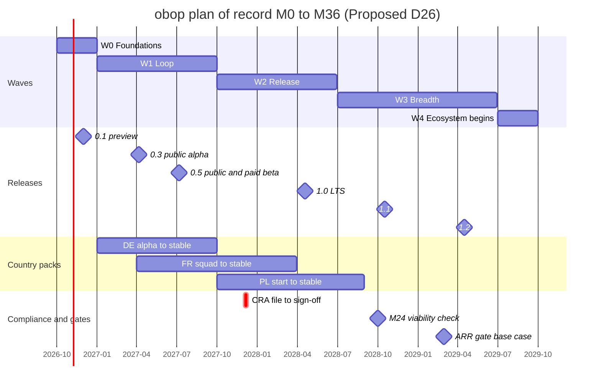
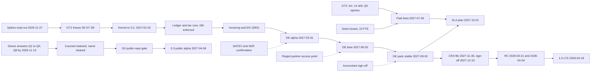

# Roadmap: waves, calendar, milestones, team, gates

Status: Draft 0.1  
Date: 2026-10-01  
Scope: Delivery plan from M0 (2026-10-01) to the 2.0 LTS (2030-04-16): waves, a quarter plan for the first 36 months, team and hiring gates, dependencies, cut lines, release train, metrics, kill and pivot criteria, schedule risks.

Related: [DECISIONS.md](DECISIONS.md) (binding), [CONVENTIONS.md](CONVENTIONS.md) (naming), [ENGINEERING.md](ENGINEERING.md), [BUSINESS.md](BUSINESS.md), [LOCALIZATION.md](LOCALIZATION.md), [ARCHITECTURE.md](ARCHITECTURE.md), [PRODUCT.md](PRODUCT.md).

**How to read this document.** The project has not started: nothing is built, no design partner is signed and no owner decision is ratified. Every date carries one of these markers.

| Marker | Meaning |
|---|---|
| Anchor | External date (law, standard, vendor release). obop cannot move it. |
| D26 | Date or scope from section 5.2 of DECISIONS.md. Proposed (D26) until the owner ratifies it (Q8, answer by 2026-11-13); this document treats it as the plan of record. |
| (proposal) | A choice made here that neither DECISIONS.md nor the research settles. Collected in section 9.3. |
| (target), (estimate) | A design target, or a model output or arithmetic. Neither is a measurement. |

M0 is 2026-10-01, so M9 is 2027-07-01, M12 2027-10-01, M18 2028-04-01, M24 2028-10-01, M30 2029-04-01 and M36 2029-10-01. "Wave" means a release wave W0 to W4 only (D24). BINDING decisions relied on: D6 to D11, D15, D18, D19, D21, D22, D24, D27 to D39 (the exit-drill clause of D15 and the renames and labels of D24 are Proposed, Q10). Proposed: D1 to D5, D12 to D14, D16, D17, D20, D23, D25, D26. Identifiers local to this document are PR1 to PR8 (principles), GT1 to GT6 (gates; G0 keeps its D26 name), HG0 to HG3 (hiring gates), K1 to K10 (kernel milestones) and SR1 to SR13 (schedule risks). None reuses an identifier of another document: the design goals G1 to G7 and spikes S1 to S11 of [ARCHITECTURE.md](ARCHITECTURE.md), the D33 priorities P0 to P2, the CRA clock H0 of [ENGINEERING.md](ENGINEERING.md) or the R26 risk ids. Nothing here is legal advice.

## 1. Principles

Eight rules decide what is built, in what order, and what may slip.

| # | Principle | Rule | Enforced by | Source |
|---|---|---|---|---|
| PR1 | Scope discipline | One loop, one country at a time. No new app without a design partner. Every later app reuses the `party`, `product`, `document` and ledger primitives. | Section 6. R20 s9.3 governs W1; R23's 40-module graph is the dependency law, not the delivery list (D25, Proposed). Changing a cut line needs a design partner, a named offset and a DECISIONS.md amendment (proposal). Warning sign: more than 7 apps planned before design partners are live. | [R20 s9.2], [R26 Part D], [R05 s7] |
| PR2 | Correctness before breadth | Ledger, tax, pricing and stock invariants are release gates, not backlog. PostgreSQL enforces balance, immutability, lock dates and numbering (D30). No pack is stable without golden cases (D34). | W1 and W2 exit criteria; the pack gate ladder; proptests before a crate leaves alpha. | D30, D34, D36, [R27 A2], [R25 B3] |
| PR3 | Dogfood | obop runs the company that builds it, app by app, from the moment each app exists. Releases reach customers only after running on the project's own businesses. | Schedule in 1.1. | [R20 s10], [R27 C7] |
| PR4 | Anchors beat wishes | Only the German dates have a hard external driver (2028-01-01). If M0 slips, compress W1; do not move 2027-09-30. | Float table (9.2); slip order (6.2). | Proposed (D26) |
| PR5 | Measure before claiming | No multiple over Odoo until the Odoo-versus-obop harness has run on fixed hardware; it runs monthly from M9. | Harness in the CI schedule. | D21, [R27 A7] |
| PR6 | Money gates hiring | At most 17 FTE before EUR 1M recurring ARR; cut to 6 FTE if paying organisations are under 60 at M24. | Section 4.4. | Proposed (D5), [R26 B5] |
| PR7 | Nothing public before G0 | The repository stays private until the licence, CLA, name and paid list are settled; the public flip happens at the latest at 0.3. | Gate G0 (2.3). | Proposed (D26, D3) |
| PR8 | Upgrade is a product | N-1 upgrade guarantee from 0.3, `obop upgrade --dry-run`, contract migrations only at `N.0`, ring rollout. | Section 7. | Proposed (D16); D36 |

### 1.1 Dogfood schedule (proposal)

- **Engineering.** The nightly edge build runs on ring 0, the company's own businesses, as soon as `base` runs (0.1), with a 24 h bake before any customer business ([R27 C7], an inference there). Until the registry-generated IDOR matrix exists (K3, by 0.4), ring 0 is one business, because D36 forbids any multi-business deployment before that matrix.
- **Business.** From 0.4 (2027-05-04) the company runs contacts, CRM, quotes, invoices and payments on obop; purchasing and stock from 0.5. Its own books go live once a pack for its jurisdiction is at least `preview`; until then a German sample company in the same cell runs the DE pack daily. Where the company is incorporated is open (9.3).
- **Later apps.** `project`, `helpdesk`, `documents`, `website` and hosted billing run the project's own work the week each reaches preview. `helpdesk` is W3 (D25) but support must exist from the paid beta (2027-07-06), so an interim ticket tool is needed until then (open in [ENGINEERING.md](ENGINEERING.md), Q-E9).

## 2. The canonical waves

Names, windows, scope and exit criteria are D26 and section 5.2 of DECISIONS.md, restated without change. The calendar is Proposed (D26).

### 2.1 What the milestone words mean

The register splits three milestones that the research called "GA" and retires the bare word (D26, D24). This section is the only place the old word appears.

| Research wording | Source | Register term |
|---|---|---|
| "DE GA 2027-09-30" | [R25 A8] | pack stable (DE) |
| "paid cloud at month 9" | [R26 B5] | paid beta, opens 2027-07-06 |
| "1.0 LTS GA 2028-04-18" | [R27 C10] | 1.0 LTS |
| "v1.0 and paid cloud in months 12 to 20" | [R20 s10] | all three (1.0 LTS is month 18) |

| Term | Date | Definition | Evidence (proposal) | It does not mean |
|---|---|---|---|---|
| preview (0.1) | 2026-12-01 | First tagged kernel build | CI green on PG 17 and 18 | Any stability promise |
| public alpha (0.3) | 2027-04-06 | Repository public with full history; N-1 upgrade guarantee; `obop upgrade --dry-run`; CSV importer; D33 P1 security items present | G0 checklist; signed release with SBOM; `SECURITY.md` | Production use or an SLA |
| public beta and paid beta (0.5) | 2027-07-06 | First paid cloud: paid plans open as a beta; first commercial offer, so CRA duties apply; the hosted contract carries the Data Act switching terms. Free, EUR 49, EUR 249 and from EUR 899 are price-test hypotheses (Proposed, D2); "entities" appear in plan tables only from W2 (ruling 33) | Art. 14 drill log, counsel opinion (Q5), contract text, insurance certificate | An SLA (starts 2027-10-01) or stable packs |
| pack stable (DE) | 2027-09-30 | The DE pack reaches the `stable` rung of the D34 ladder (draft, preview, stable, certified) inside the 0.x line (core 0.6) | KoSIT and CEN oracle runs, golden cases, recorded accountant sign-off, signed pack release | API stability, an LTS, or a certificate (none known for DE accounting software, [R25 A6], unverified) |
| SLA plan and DE Assurance service | 2027-10-01 | Paid: legal-change SLA, filing connectors, capped warranty (Proposed, D17) | Contract, on-call rota | Free support |
| 1.0 LTS | 2028-04-18 | First `N.0`: five years' support (years 0 to 2 full, 2 to 5 security and legal-critical; Proposed, D16); contract removals only at `N.0`; falls after the CRA main obligations (2027-12-11) and is fully subject to them | Signed artefacts, SBOM, attestation, double reproducible build, CRA sign-off, chain tests | The first time the DE pack is dependable |

Why the split matters: pack stable is a compliance milestone with an external deadline, delivered on the pack channel inside the 0.x line, well before the first LTS. The 1.0 LTS is a five-year support promise; revenue does not wait for it, and it cannot be pulled forward to avoid the CRA (D26 rejects an early "1.0").

### 2.2 The five waves

**W0 Foundations, 2026-10-01 to 2026-12-31.**
- Ships: CI baseline; T0 kernel (the eleven kernel crates of D25, from `obop-types` to `obop-testkit`, and module `base`, the Contacts app); three spikes read out by 2026-11-27; migration ledger starts; 0.1 preview 2026-12-01; security policy and CRA runbook v0.
- Exit: G0 passed, or dated no later than 2027-04-06 if Q16 leaves counsel coverage open (D26); D6, D7, D9 frozen; pins per D23; 3 to 5 design partners signed; counsel retained; DATEV and SKR confirmation requested.
- Reading of "ships" (proposal): a walking skeleton merged and tested on PG 17 and 18 by 2026-12-31, hardened by 0.2. Section 4.5 shows why.

**W1 Loop, 2027-01-01 to 2027-09-30.**
- Ships: 0.2 (2027-02-02); DE pack alpha 2027-03-31; 0.3 public alpha 2027-04-06; 0.4 2027-05-04; DE beta 2027-06-30; 0.5 public beta and paid beta plans 2027-07-06; 0.6 2027-09-07; code tiers X1, X2, X4; CLI v0; Peppol via a partner access point; MCP; CSV importer, then Odoo and QuickBooks importers (0.6).
- Scope (Proposed, D25), the seven-app loop. T0: `product`, `mail`, `portal`, `analytic`, `automation`, `pricing`, `analytics`, `obop-report`, `customize` custom fields (Proposed, Q8), generated REST, OpenAPI and MCP, six view types, search. T1: `account`, `tax`, `invoicing`, `payment` (manual, SEPA, Stripe plus one), `bank` (camt.053, MT940), `edi` (EN 16931 UBL and CII, Factur-X, XRechnung), `l10n` framework and `l10n_de`, `crm`, `sales`, `purchase`, one-warehouse `stock`, `sale_stock`, `purchase_stock`, `stock_account`.
- Exit: DE pack stable 2027-09-30 (oracles, golden cases, accountant sign-off); at least 10 paying and 50 production organisations; CRA runbook drilled; ledger proptests green; N-1 and N-2 chain tests; no known trial-balance bug.

**W2 Release, 2027-10-01 to 2028-06-30.**
- Ships: SLA plan and Assurance DE service 2027-10-01; 0.7 2027-11-02; CRA technical file 2027-11-30, sign-off by 2027-12-10; `release/1.0` cut 2028-03-07, RC 2028-03-21 and 2028-04-04; 1.0 LTS 2028-04-18; 1.0.1 2028-05-02; FR pack stable 2028-03-31; PL start 2027-10, KSeF beta 2028-05; X3 host, F2, package registry alpha; accountant and certified-partner programmes; SOC 2 Type I; multi-company; services variant.
- Scope (Proposed, D25): `project`, `timesheet` (with an employee core of employee, version and calendar ahead of the rest of `hr`, as proposed in [spec/people.md](spec/people.md) and [spec/services.md](spec/services.md)), `sale_project`, `sale_timesheet` (W1 only if the loop is on schedule at 0.5), `calendar`, `discuss`, stock lots, serials and routes, `l10n_fr`, aggregator bank feeds, the approvals engine with the D18 approval policy engine, `obop-wasm-host`, `obop-ext-sdk`, `obop-compat`, `resource` working calendars, leaves and public holidays ([spec/services.md](spec/services.md); Proposed, Q8), `customize` custom models and the layout editor ([spec/platform.md](spec/platform.md); Proposed, Q8), Xero and ERPNext importers.
- Further W2 items that [PRODUCT.md](PRODUCT.md) and the specs assign to W2 but D25 does not name (proposal; additions to the D25 list): barcode scan-to-add ([spec/supply-chain.md](spec/supply-chain.md); the scan screens are W3); and the `stock` extensions multi-warehouse, packages, putaway and removal strategies, dropshipping, standard cost, landed costs and valuation replay (same spec).
- Exit: 1.0 LTS signed with SBOM and attestation; CRA sign-off; FR stable; SOC 2 Type I; at least 40 paying organisations.

**W3 Breadth, 2028-07-01 to 2029-06-30.**
- Ships: PL pack stable 2028-08-31; 1.1 2028-10-17; 1.2 2029-04-17; T2 apps in demand order (`mrp` and `pos` first, each with a design partner); F3; custom domains; partner white-label; payroll engine; own Peppol access point if volume supports it (about M31); SOC 2 Type II and ISO 2029-04.
- Scope (Proposed, D25): T1 `hr` (beyond the W2 employee core), `expenses`, `documents`, `delivery`, `l10n_pl`, fixed assets, deferrals, budgets, to-do; the remaining T2 list of D25 (`website`, `ecommerce`, `helpdesk`, `planning`, `subscriptions`, `sign`, `knowledge`, `ai` agents, AT and CH packs, `intercompany` and others); barcode scan screens (Proposed, [spec/supply-chain.md](spec/supply-chain.md)); T0 `obop-edge`, gantt, map and cohort views, `customize` form builder and print-template designer (Proposed, Q8).
- Exit: ARR at least EUR 1M (base case about M29); at least two T2 apps stable; M24 check (2028-10-01): 150 paying organisations targeted, under 60 triggers the D5 cut; hiring above 17 FTE only after the ARR gate.

**W4 Ecosystem, from 2029-07-01.** Ships 1.3 (2029-10-16), 2.0 LTS (2030-04-16), marketplace commerce, verticals, the public-sector track once the EU strategy is law, and the D25 W4 list (`consolidation`, WMS depth, payroll reference pack, L2 partner packs, connectors). Exit: none; governed by the LTS cadence.

### 2.3 Gates

G0 is D26 and keeps that name in every document. GT1 to GT5 are labels introduced here (proposal); GT6 is the D5 ARR gate. The prefix GT keeps them apart from the design goals G1 to G7 of [ARCHITECTURE.md](ARCHITECTURE.md); in this document GT1 to GT6 always mean the gates below.

| Gate | When | Pass condition | On failure |
|---|---|---|---|
| G0 Public repository | W0 exit; latest before 0.3 (2027-04-06) | D1 to D3 ratified or cleared; CLA bot live; paid list published (D26). D1 adds that counsel has covered all nine items of [R17 s12]; whether "covered" means written advice or formed entities, and when Q5 is answered, is open (Q16), so G0 has no settled date until the owner answers | Repository stays private; 0.3 cannot ship publicly |
| GT1 Architecture freeze | 2026-12-31 | Spike readouts reviewed; D6, D7, D9 frozen; pins per D23; design partners signed; counsel retained | 8.2 rows 1 to 3 |
| GT2 Commercial offer | 2027-06-01, 35 days before 2027-07-06 | Art. 14 runbook drilled; Data Act terms in the contract; Q5 opinion; E&O cover; restore drill passed | Paid beta for design partners only |
| GT3 Pack stable | 2027-09-30 | W1 exit criteria | DE pack stays beta; SLA start moves |
| GT4 LTS | CRA sign-off by 2027-12-10; cut 2028-03-07; RCs 03-21, 04-04 | CRA sign-off; double reproducible build; SBOM and attestation; chain tests; no known trial-balance bug | 1.0 LTS takes the next train date, 2028-10-17, and the planned 1.1 moves to 2029-04-17 (proposal; 9.3 item 9) |
| GT5 Viability | 2028-10-01 (M24) | At least 60 paying organisations (target 150) | Cut to 6 FTE (D5) |
| GT6 ARR | First month with ARR at least EUR 1M (base about M29) | Recurring ARR at least EUR 1M | Hold at 17 FTE |

## 3. Plan for the first 36 months

Proposed (D26). Dates come from D26 or external anchors; everything else is (proposal).

### 3.1 Overview

### 3.2 Month one and two: the spikes

Three spikes read out by 2026-11-27 (D6, D7, D9; specified in [R23 DR-1, DR-2, DR-6], none executed). The CEL limits spike is a W1 item in the register (D11); it starts at the end of W0 so that it reads out before 0.2 (proposal).

| Spike | Method | Pass threshold | If it fails | Readout |
|---|---|---|---|---|
| NOTIFY contention (D7) | pgbench on PG 18, then 19 RC: 32 databases `t00` to `t31`, one process each, scripts `plain`, `notify`, `coalesced` | `coalesced` reaches at least 90% of `plain`. Expected confirmation of the ban: `notify` sums near a single-database run while `plain` scales | Below 90%: realtime drops to the polling floor (250 ms to 2 s) and NATS JetStream is reconsidered (proposal); nothing blocks. If `notify` shows no contention, the ban may relax to SHOULD; the one-LISTEN rule never relaxes | 2026-11-27 |
| 250-database cell (D6) | 250 databases of 800 tables from registry DDL on PG 18; measure create time, catalog size, idle memory, autovacuum lag, `pg_dump`, migration fan-out, PgBouncer pools | Fan-out migration under 30 minutes and idle memory under 4 GB (inferred thresholds) | Smaller cells; owner decides a pooled Free tier (Q6). Infra at 2x moves the base funding trough from EUR 10.8M to 11.3M (model, [R26 B7]) | 2026-11-27 |
| UUID size (D9) | 300M synthetic `journal_line` rows, `bigint` versus UUIDv7; size, insert TPS, buffer hits on party-ledger and product-move queries | At most +25% size and 15% slowdown on the OLTP mix | `IdType` flips ledger, stock-move and log tables to `bigint` plus a public uuid; no module code changes | 2026-11-27 |
| CEL limits (D11, D12) | 4 KB source and AST depth 32 limits, a step budget, a wall-clock deadline, host-registered functions only; conformance tests | All limits enforced by one evaluator for server and Wasm client (`cel` 0.14.5 documents no cost limit) | No CEL in stored data at 0.2; X1 declarative actions only until limits land | Start 2026-12; readout by 2027-01-29, before 0.2 (proposal) |

Also in sprint one (D36): benchmark three test-database clone strategies (migrate per test, `WAL_LOG` template, `FILE_COPY` with `clone`); engage counsel; reserve handles by 2026-10-15; file the NLnet application by 2026-11-03.

### 3.3 Kernel milestone ladder (proposal)

| # | Milestone | Target | Acceptance evidence |
|---|---|---|---|
| K1 | Workspace, crate DAG, `xtask` dependency law (D27), CI baseline incl. "NOTIFY only in `obop-bus-notifier`" (D7), `vp` pins (D23) | 2026-10 | CI red on an impl-to-impl edge and on NOTIFY elsewhere |
| K2 | Registry, ORM and REST walking skeleton for `base` on PG 17 and 18 | 0.1 | One binary serves generated REST for `party`, `company`, `currency`; migration ledger started |
| K3 | Default-deny security, Domain AST to SQL, typed elevation (D10); registry-generated IDOR matrix before the first multi-business cell | 0.2; matrix by 0.4 | Identical answers from list, by-id, export and RLS paths; restrictive-policy benchmark on 10M `journal_line` rows |
| K4 | Outbox, inbox, per-subscriber deliveries, coalescing notifier (D7, D27) | 0.2 | Effectively-once test with `kill -9` |
| K5 | PostgreSQL-enforced ledger (D30): deferred balanced-entry trigger, immutability, lock dates, gapless numbers, hash chain | 0.3 | Proptests; hash-chain verifier job |
| K6 | CEL (X2) with limits; expression storage per D12 (Q9 by 2026-12-31) | 0.2 to 0.3 | CEL spike pass |
| K7 | Six view types, search, generated OpenAPI and MCP | 0.3 to 0.4 | Drift gate; axe pass (D35) |
| K8 | Multi-company selector, per-company books (D28) | W2 | Composite-FK suite; IDOR matrix with two companies |
| K9 | Approvals engine, `obop-wasm-host`, `obop-ext-sdk`, `obop-compat`, package registry service | W2 | Nightly compat run; capability diff per upgrade |
| K10 | `obop-edge`, gantt, map, cohort views | W3 | Two tablets and a store hub, one hour offline, 10k queued orders, `kill -9` mid-sync, exactly-once on `command_id` ([R23 DR-7]) |

### 3.4 Quarter by quarter

FTE figures are the proposal in 4.1. "Dated" lists anchors and D26 dates; "Work" is (proposal).

**2026-Q4 (M0 to M2), W0, 4 to 6 FTE.**
- Dated: 10-05 vite-plus 1.0.0 eligible (D23). 10-06 first patch Tuesday. 10-15 Q10 and Q15, handles reserved; 10-15 to 10-22 Rust 1.99.x window. 10-20 Q1 to Q3 and Q19. 10-23 Q4, Q17 and Q20. 10-28 Node 26 enters LTS. 11-03 12:00 CET NLnet deadline. 11-12 Rust 1.100.0 expected. 11-13 Q8 and Q18. 11-16 CEN code lists take effect. 11-27 spike readout, Q6. 12-01 0.1 preview, migration ledger starts. 12-09 Product Liability Directive: software counts as a product for anything placed on the market after this date (counsel). 12-15 counsel opinion on the name, Q16. 12-31 Q9, W0 exit; SMTP AUTH basic off by default.
- Work: K1 in month 1; K2 in month 2; `base`, `obop-jobs`, `-i18n`, `-storage` in month 3; security policy and CRA runbook v0; design-partner search; DATEV and SKR requests; KoSIT goldens refreshed by 11-09 ([R27 C10]).

**2027-Q1 (M3 to M5), W1, 6 to 8 FTE.**
- Dated: 01-01 Germany: e-invoice issuing mandatory above EUR 800k turnover; Spain: Veri*Factu for corporate-tax payers (Spain is gated behind counsel, D17). 01-12 Data Act switching-charge ban. 02-02 0.2 (Node 26 adopted). 03-31 DE pack alpha; Q7 answer; French compliance lead or PA partner deadline (D4).
- Work: K3, K4, K6; `product`, `analytic`, `pricing`, `mail`; `account` and `tax` with K5; `obop-report` on Typst; `l10n_de` chart and taxes; XRechnung and ZUGFeRD create and validate against KoSIT; mail gateway OAuth-only; counsel delivers D1 text, CLA and exception; G0 checklist closes.

**2027-Q2 (M6 to M8), W1, 8 to 9 FTE.**
- Dated: 04-01 Microsoft EWS off. 04-06 0.3 public alpha. 05-04 0.4. 05-17 CEN code lists take effect. 06-01 GT2. 06-30 DE beta (UStVA, DATEV EXTF export, Peppol via partner). Country order re-scored in 2027-Q2 (D4); FR squad starts 2027-04 ([R25 A8]).
- Work: `invoicing`, `payment`, `bank`, `edi`, `crm`, `sales`, `purchase`, `stock` and bridges; D33 P1 items before the flip (signed releases, SBOM, `SECURITY.md`, OIDC, SCIM subset); docs site (D38); first cell and ring 0; billing, hosted contract, E&O cover.

**2027-Q3 (M9 to M11), W1, 9 to 10 FTE.**
- Dated: 07-01 Spain: Veri*Factu for other taxpayers. 07-06 0.5. 09 FR pack alpha ([R25 A8]). 09-01 French SME mandate. 09-07 0.6. 09-30 DE pack stable, W1 exit, Q11 and Q12.
- Work: N-2 chain test and 1,000-business fan-out from 0.5 (D36); Odoo-versus-obop harness monthly from 2027-07; ring 1 canary cell; Odoo and QuickBooks importers; accountant pilot; internal Wasm connector spike between M10 and M12, 2027-08-01 to 2027-10-01 (D11); `sale_project` and `sale_timesheet` only if the loop is on schedule at 0.5.

**2027-Q4 (M12 to M14), W2, 10 to 14 FTE.**
- Dated: 10-01 SLA plan and DE Assurance; PL start. 11-02 0.7. 11-15 CEN code lists take effect. 11-30 CRA technical file. 12-02 EU AI Act Annex III high-risk date (HR and credit-scoring AI stay optional, D18). 12-10 CRA sign-off. 12-11 CRA main obligations (a Saturday).
- Work: K8; services variant; approvals engine and approval policy engine; X3 host, F2, registry alpha begin; accountant programme; SOC 2 evidence from M12; FR PA connector beta (2027-12, [R25 A8]).

**2028-Q1 (M15 to M17), W2, about 14 FTE.**
- Dated: 01-01 Germany: all issuers. 03-07 `release/1.0` cut. 03-21 RC1. 03-31 FR pack stable; Q13 and Q14.
- Work: stock lots, serials, routes; bank feeds; Xero and ERPNext importers; LTS prerequisites (reproducible double build, builder image, Node 26, artefact retention).

**2028-Q2 (M18 to M20), W2, 14 to 17 FTE.**
- Dated: 04-04 RC2. 04-18 1.0 LTS. 05-02 1.0.1. May: PL KSeF beta. 06-30 W2 exit. SOC 2 Type I planned for M18, 2028-04-01 ([R26 B1]).
- Work: certified-partner programme (R26 plans 2 partners at M18); country re-score 2028-Q2 ([R25 A8]); decide field work as task subtype or planning shift before `planning` design starts (2028-07-01).

**2028-Q3 (M21 to M23), W3, 17 FTE.**
- Dated: 07-01 W3. 08-31 PL pack stable. About 2028-08 Wasmtime v48 support ends (estimate, [R24 s3.3]). 09-05 `release/1.1` cut, RCs 09-19 and 10-03. Fall: Odoo removes XML-RPC and JSON-RPC (D22 trigger).
- Work: `mrp` and `pos` with design partners; T1 `hr`, `expenses`, `documents`; `obop-edge`; F3; payroll engine design.

**2028-Q4 (M24 to M26), W3, 17 FTE.**
- Dated: 10-01 GT5. 10-17 1.1. November: PG 17 is 12 months from end of life, floor decision (D8).
- Work: partner white-label and reseller console (`ee`); fixed assets, deferrals, budgets; `pos` with DE TSE via a cloud signer; Series A preparation (window M27 to M30, [R26 B5]); SOC 2 Type II observation.

**2029-Q1 (M27 to M29), W3, 17 FTE until GT6.**
- Dated: 01-01 Series A window opens. 03-01 base-case ARR of EUR 1M (model, estimate).
- Work: further T2 apps in demand order; AT and CH packs; `intercompany`.

**2029-Q2 (M30 to M32), W3.**
- Dated: 04-01 payroll reference-country decision (D19). April: SOC 2 Type II and ISO. 04-17 1.2. About M31 (2029-05-01): own Peppol access point decision on measured volume. 06-30 W3 exit.
- Work: payroll engine; hiring above 17 FTE only after GT6.

**2029-Q3 (M33 to M35), W4 from 07-01.**
- Dated: 09-04 `release/1.3` cut. 10-01 M36; then 10-16 1.3 and 2030-04-16 2.0 LTS.
- Work: marketplace commerce (take rate only after a year of verified paid-listing actuals, D2); verticals; `consolidation`; payroll reference pack; L2 packs.

## 4. Team shape and hiring gates

Proposed (D5). The gates and the 17-FTE cap are D5; the role mix and tranches are (proposal). Funding and economics are in [BUSINESS.md](BUSINESS.md).

### 4.1 Headcount path

| Point | R20 band | R26 base (ungated) | Gated plan (D5) |
|---|---|---|---|
| M0 | 4 to 6 (months 0 to 3) | 4 | 4 |
| M3 | 4 to 6 | 6 | 6 |
| M12 | 8 to 12 | 10 | 10 |
| M20 | 14 to 20 | 17 | 17 |
| M24 | 25 to 40 (months 20 to 32) | 22 | at most 17; cut to 6 if under 60 paying organisations |
| M32 | 25 to 40 | 33 | at most 17 until GT6 |
| M36 | 40 and above (from month 32) | 37 | 17, or more only after GT6 |

Base figures are model values ([R26 B5, B6], estimate). Conservative scenario: 6, 8 and 10 FTE at M12, M24, M36, ARR EUR 0.38M at M36. The gated model shifts breadth hiring by 9 months and lowers peak funding from about EUR 10.8M to EUR 7.1M; its revenue does not depend on hiring, which flatters it.

### 4.2 Composition (proposal)

Part-time roles count fractionally and contractors by FTE equivalent, so the cap cannot be bypassed.

| Role | M0 | M3 | M12 | M20 |
|---|---|---|---|---|
| CTO and kernel architect | 1 | 1 | 1 | 1 |
| Senior Rust backend | 2 | 3 | 4 | 5 |
| Frontend (TypeScript, React, Vite+) | 1 | 1 | 1 | 2 |
| Product designer | 0 | 0 | 0.5 | 1 |
| Accounting domain experts (part-time allowed) | 0 | 0.5 | 1 | 1.5 |
| Pack and compliance engineer (EN 16931; DE, then FR, then PL) | 0 | 0 | 1 | 2 |
| Platform, SRE and quality platform | 0 | 0.5 | 1 | 1.5 |
| Security and compliance owner | 0 | 0 | 0 | 0.5 |
| Docs and developer relations | 0 | 0 | 0.5 | 1 |
| Product, partnerships and growth | 0 | 0 | 0 | 1 |
| Support | 0 | 0 | 0 | 0.5 |
| **Total** | **4** | **6** | **10** | **17** |

Until the security owner joins, the platform hire and the CTO own the CRA runbook. The quality-platform duty is 0.5 to 1 FTE (D36). At M20 one FTE is left for go-to-market; more must come out of engineering, because the cap binds.

### 4.3 Skills the plan depends on

| Skill | Needed by | Note |
|---|---|---|
| Rust with PostgreSQL internals (locks, triggers, fleet migrations) | M0 | Rust is used by 14.8% of developers ([R20 s10]); time-to-fill over 90 days is the R26 P1 trigger |
| German accounting (SKR03/04, GoBD, UStVA, DATEV formats) and sign-off | M3; sign-off by 2027-09-30 | 1 to 2 experts, part-time acceptable, one per country ([R20 s10], [R26 P2]) |
| E-invoicing (EN 16931, XRechnung, Factur-X, Peppol) | 2027-03-31 | |
| French compliance lead with PA knowledge; Polish KSeF and JPK knowledge | 2027-03-31; 2027-10 | The French lead is the D4 flip rule |
| Security and CRA (Art. 14 rota of two trained people, advisories, SBOM) | 2027-06-01 | [R27 B7] |
| TypeScript 7, React 19, Vite+, WCAG 2.2 AA | M0 | A named engineer triages Vite+ issues (D15) |
| Platform: PgBouncer, pgBackRest, cells, ring rollout | 2027-07-06 | |
| Wasm host (Wasmtime, capability model) | Spike 2027-08; host W2 | Patch within 7 days, 24 h for High (D11) |
| Partner and accountant programmes; payroll domain | W2; not before 2029-04-01 | [R26 M6, M8]; D19 |

### 4.4 Hiring gates (ARR-gated plan)

| Gate | Condition | Releases | Source |
|---|---|---|---|
| HG0 | Q4 answered (2026-10-23) and seed closed | 4 FTE, then 6 by M3 | D5, [R26 B6] |
| HG1 | GT1 passed | 6, then 10 by M12 (R20 band 8 to 12; R26 base 10) | [R20 s10], [R26 B6] |
| HG2 | GT3 passed: 10 paying, 50 production organisations | 10 to 14 (proposal) | D26 |
| HG3 | 40 paying organisations: the W2 exit figure and the geometric midpoint of 10 at M12 and 150 at M24, reached about M18 (estimate) | 14 to 17 (proposal) | D26, [R20 s12] |
| GT5 | 2028-10-01: at least 60 paying organisations | Hold 17; under 60, cut to 6 and bridge with services and partners | D5 |
| GT6 | Recurring ARR at least EUR 1M (base about M29) | Hiring above 17: first tranche to 25 (proposal), later tranches against an ARR step the owner sets | D5 |

HG2 and HG3 exist because the D5 cut comes at M24, four months after the base case reaches 17 FTE. Hiring pace is one of the three levers that matter in the model: hiring at 75% of plan lowers the peak need to EUR 6.6M ([R26 B7]).

### 4.5 Capacity check for W0 and W1 (estimate)

| Item | Person-months | Source |
|---|---|---|
| W0 capacity: 4 to 6 FTE over 3 months | about 15 | arithmetic |
| W1 capacity: 6 to 10 FTE over 9 months, about 90% engineering and domain | about 72, of which 65 usable | arithmetic |
| DE pack | 14.5 (plus or minus 40%) | [R25 A8] |
| Shared pack SDK, harness, signing, data pipelines | 10 to 14 | [R25 A8] |
| Extension platform cut (X1, X2, X4, CLI v0, SDKs, theming); line items sum to 28 | 26 to 34 | [R24 s11] |
| Subtotal | 50.5 to 62.5 | |

These three items alone take about 78% to 96% of W1 capacity, before `account`, `sales`, `purchase`, `stock`, `mail`, `portal`, `automation`, `pricing`, reports, views, MCP, importers, docs or the hosted stack. The research gives no person-months for those, but accounting models are 5 to 6 times the size of sales ([R20 s9.1]). The figures come from different notes; read this as a smoke alarm. Proposals: (a) treat the R24 cut as a ceiling and pre-agree a trim list at the 0.3 checkpoint, starting with business branding, the DTCG pipeline and theme packs (part of its 5 person-month line); (b) release the HG2 tranche early if the seed allows: two engineers hired six months earlier cost about EUR 0.14M (estimate from R26 B4), against about EUR 5.7M for a six-month paid-cloud slip (model, [R26 B7]); (c) staff the DE pack and the ledger from the same people, in sequence.

## 5. Dependencies and critical path

### 5.1 Owner decisions on the calendar

All twenty questions of section 8 of DECISIONS.md (Q1 to Q20), in order of answer date. Proposed records stay Proposed until the owner says so.

| Q | Decision | Answer by | Blocks |
|---|---|---|---|
| Q10 | I-1 to I-4 (I-4 is the exit-drill exception), the D23 pin policy, the D24 renames and the Rust 1.99 window | 2026-10-15 | Pins; what "Rust exclusively" and "`vp` only" mean |
| Q15 | D23 which pnpm major to pin, 11.x or 12.x (ENGINEERING Q-E6) | 2026-10-15 | The exact pnpm pin and the lockfile (5.4) |
| Q1 | D1 licence suffix, CLA grant, pledge, company plus steward | 2026-10-20 | G0; counsel instruction |
| Q2 | D3 name; when the repository may go public | 2026-10-20 | G0; handles by 10-15, counsel opinion by 12-15 |
| Q3 | D2 free and paid lists, ratchet, including the operated-service lines (Q19) | 2026-10-20 | G0 (publish before the first public commit) |
| Q19 | D2 operated services on the paid list, and later additions to the closed list | 2026-10-20 | Publishing the paid list at G0 (with Q3) |
| Q4 | D5 funding path, hiring gate, covenant, NLnet | 2026-10-23 | Hiring; NLnet filing 2026-11-03 |
| Q17 | D36, D26 runner plan while the repository is private (ENGINEERING Q-E1) | 2026-10-23 | CI capacity before G0 |
| Q20 | Where the company is incorporated (9.3 item 2) | 2026-10-23 | The CRA manufacturer role and the dogfood ledger |
| Q8 | D4 Germany first, ICP, T0 list, D26 calendar | 2026-11-13 | The whole plan |
| Q18 | Identifier families that share letters: keep and qualify, or rename | 2026-11-13 | Names used across the plan; a rename must come before the first public commit |
| Q6 | D6, D9 Free-tier economics and key type | 2026-11-27 | GT1 |
| Q16 | D1, D26 what "counsel covers" means for the public flip, and when Q5 is answered | 2026-12-15 | G0 and its date; the W0 exit; see 9.3 item 5 |
| Q9 | D12 expression storage | 2026-12-31 | CEL spike design, K6 |
| Q7 | D16 release, LTS, 24-month deprecation, months counted as release months | 2027-03-31 | Public promises at 0.3; see 9.3 item 4 |
| Q5 | D1, D17 steward legal form, CRA roles | 2027-06-01 | GT2; the part that gates the public flip is Q16 |
| Q11, Q12 | Q11 D13 offline scope with the wave of POS order capture; Q12 D20 Typst only | 2027-09-30 | W3 edge, reports |
| Q13, Q14 | Q13 D2 marketplace terms and white-label licence; Q14 D14 storefront without Node | 2028-03-31 | `website`, registry commerce |

### 5.2 Dependency register

| Dependency | Needed by | Status and lead time | If late | Fallback |
|---|---|---|---|---|
| Counsel retained (nine items, [R17 s12]) | W0 exit; Wasm/AGPL boundary before third parties are solicited (W2) | Not retained | G0 fails | None |
| Name clearance (D3) | Handles 2026-10-15; opinion 2026-12-15 | Register searches not done; OBOPP pending (class 35), OBOL two live (classes 9, 42) ([R28]) | Public flip blocked | Screened fallbacks kernelbiz, monobiz, mercora |
| Seed about EUR 3M (D5) | Hiring beyond 4 FTE | Not closed per the research | Hold at 4 FTE | Lean services-funded variant, 6 to 10 FTE ([R26 B5]) |
| NLnet Restack | 2026-11-03 12:00 CET | EUR 5,000 to 50,000 first grants; disclose generative-AI use ([R26 C1]) | Grants are about 6% of base burn either way (estimate; R26 writes "under 6%", but EUR 0.4M of 6.6M is 6.1%) | None needed |
| Written DATEV and SKR03/04 confirmation | Requested by W0 exit; chart by DE alpha; developer-programme access by DE beta | Licence terms, fees, lead time not found ([R25 A3, B4]) | Charts cannot sit in a public repo; alpha slips | Charts as licensee-downloaded data packs (D4); EXTF and GoBD exports first, Connect online later |
| Peppol partner access point | Contract by DE beta 2027-06-30 | Partner plans priced in [R25 B4]; Peppol BIS cycle about 13 weeks | No send or receive; beta slips | A second partner ([R26 O4]); own access point near 250 businesses or M31 (2 to 4 months, about EUR 4.4k in year one, [R25 B4]) |
| French compliance lead and PA partner | 2027-03-31 | None identified | Flip FR and PL (D4) | PL second |
| DE accountant sign-off | 2027-09-30 | No accountant named | GT3 cannot close | Two experts, one part-time per country |
| Design partners, 3 to 5 | W0 exit | None signed | No acceptance test for scope | Reopen the ICP (Q8) |
| First-offer package: Data Act terms, E&O and product-liability cover, Art. 14 drill, Q5 opinion | 2027-06-01 (GT2) | Not started | Paid beta for design partners only | None |
| SOC 2 Type I auditor | Evidence from M12; report in W2 | Type II needs 9 to 12 months of observation ([R26 O1]) | Large-customer deals blocked | None |
| First hosted cell, S3-compatible store | Ring 0 by 0.4 | Hetzner stock unverified ([R22 s10]) | Hosted beta slips | Multi-provider ([R26 O5]) |

### 5.3 Critical path

- **DE pack stable (2027-09-30).** The chain is kernel, ledger, EN 16931 invoicing, alpha, beta, stable. The external long poles are DATEV and SKR access and the accountant sign-off, both of unknown lead time. Float to the 2028-01-01 mandate is 93 days.
- **First paid cloud (2027-07-06).** Depends on seed, about 10 FTE, a running cell and GT2. A six-month slip costs about EUR 5.7M in the base model ([R26 B7]), so launch and conversion are the first metrics to instrument.
- **1.0 LTS (2028-04-18).** The chain is CRA technical file, sign-off, cut, two RCs. The CRA date 2027-12-11 is a Saturday, so sign-off by Friday 2027-12-10 leaves one day. There are only two train dates a year (D16), so a missed 1.0 takes the next one, 2028-10-17, which is the date planned for 1.1; the slipped LTS keeps the name 1.0 and 1.1 moves to 2029-04-17 (estimate; the rule is a proposal and whether the LTS phase then shifts to October is open, 9.3 item 9). Paid-cloud revenue does not depend on the LTS, so that slip costs trust, not modelled revenue (inference).

### 5.4 Pin calendar (D23)

All versions as of 2026-10-01. The pin policy is Proposed (D23) and applied provisionally until the owner answers Q10 (by 2026-10-15); it deliberately runs up to about three weeks behind the newest release (I-3).

| Component | Pinned now | Next event | Rule |
|---|---|---|---|
| Rust | 1.98.1 (skip 1.98.0) | Rust 1.99.0 was published on 2026-10-01 (release post dated that day; the stable-channel manifest serves it, Last-Modified 12:38 UTC after a 404 at about 10:10 UTC; verified). The pin stays 1.98.1 because of the D23 rule (`x.y.0` plus 14 days = 2026-10-15), not because the channel lacks it: adopt 1.99.x between 2026-10-15 and 2026-10-22, or at 1.99.1, once debug and release CI pass. 1.100.0 expected about 2026-11-12, eligible 2026-11-26 | Eligible at `x.y.1`, or `x.y.0` plus 14 days with no open regression; adopt within 7 days; an advisory overrides; LTS branches keep a per-branch toolchain in a digest-pinned builder image |
| vite-plus | 1.0.0 (2026-09-28, MIT), eligible 2026-10-05 | Bundles Vite 8.3.1, Rolldown 1.2.11, Vitest 5.0.1, Oxlint 1.85.0, oxlint-tsgolint 7.0.2003, Oxfmt 0.70.0, tsdown 0.23.0 | At least 7 days old; passes exit drill, LICENSE and NOTICE diff, one Vite and one Vitest copy, test suite |
| Node | 24 LTS | Node 26 LTS from 2026-10-28; adopt by 0.2 (2027-02-02) and before any LTS branch is cut | Node 24 ends 2028-04-30 |
| pnpm | Exact version via `vp env pin` and `packageManager`; 11.x or 12.x is open (Q15, by 2026-10-15) | `minimumReleaseAge` at least 7 days (strict), `trustPolicy: no-downgrade`, `blockExoticSubdeps`, `strictDepBuilds` with `allowBuilds`; CI runs `vp install --frozen-lockfile` | Only `pnpm-lock.yaml` is committed |
| PostgreSQL | 17 and 18 supported, 18 reference | CI adds 19 at RC (planned early October 2026, release date not announced); floor moves to 18 when 17 is 12 months from end of life (2028-11) | 1.0 LTS supports PostgreSQL 17 and 18 (D8); newer majors join the matrix as they pass CI; the floor raise applies from 1.2 at the earliest (proposal, [ENGINEERING.md](ENGINEERING.md) Q-E4) |
| Wasmtime | v48 (48.0.3, 2026-09-24) behind `obop-wasm-host` | Next LTS v60 about 2027-08-20 | Patch within 7 days, 24 h for High |
| Core crates | tokio 1.53.1, axum 0.8.9 (0.9 pending), sqlx 0.9.0, sea-query 1.0.2, utoipa 6.0.0 | Exact pins in `[workspace.dependencies]` | Renovate cooldown 7 days; cargo-deny blocks |

## 6. Scope cut lines

Proposed (D25); the exclusions below also rest on Proposed D4, D13 and D20. Tier placement is in [PRODUCT.md](PRODUCT.md). A module not listed defaults to T3.

### 6.1 What is explicitly not in each wave

| Wave | Explicitly not in this wave | Lands |
|---|---|---|
| W0 | Public repository, hosted service, country packs, third-party extensions, UI beyond a shell | Repository at G0 (latest 0.3); hosted 0.5; packs and X1, X2, X4 in W1; X3 in W2 |
| W1 | POS, payroll, manufacturing, multi-country tax (D4); multi-company (one company, dormant `branch`, D28); multi-warehouse, lots, serials, routes and the other W2 `stock` extensions; `resource` calendars; custom models and the layout editor; barcode scan-to-add; project and timesheets unless on schedule at 0.5; assets, deferrals, budgets, HR, expenses, documents; X3 (internal spike only), business-own F1, F2, F3 (a third-party F1 does not exist, D11), public package registry, white-label; FR and PL packs; aggregator bank feeds; Xero and ERPNext importers; queued offline writes (D13); GraphQL (D31); Rhai (D11); browser PDF renderer (D20); AI agents beyond the typed API and MCP | W2: project, multi-company, lots and the other `stock` extensions, `resource`, custom models and layout editor, scan-to-add, X3, business-own F1, F2, FR, importers. W3: assets, HR, edge, F3. Later: queued writes |
| W2 | All T2 apps (`mrp`, `pos`, `website`, `ecommerce`, `helpdesk`, `planning`, `subscriptions`, `ai` agents and the rest) except barcode scan-to-add; `hr` beyond the employee core, `expenses`, payroll, `documents`; PL stable; F3; custom domains; partner white-label; `intercompany`; SOC 2 Type II; own Peppol access point | W3, except marketplace commerce and `consolidation` (W4) |
| W3 | `consolidation`; barcode depth (GS1, batch and wave screens; the plain scan screens are W3) and WMS depth; payroll reference pack (country decided 2029-04-01); BE, NL, ES, IT, Nordic packs (L2 partners; Spain gated behind counsel, D17); marketplace commerce; WhatsApp and marketplace connectors; public-sector track; all T3 | W4 or contributors |
| W4 | Nothing is promised; T3 arrives as X3 or X4 packages or contributor work | |

Never, under the register: XML-RPC (D22), in-process third-party Rust (D11), metered AI credits (D18), statutory filing in core payroll (D19), Electric, PowerSync or Zero (D37), Odoo Enterprise code or assets (F3).

### 6.2 Slip order and cut rules (proposal)

If W2 overruns, slip in this order, cheapest first: (1) X3 host, F2 and registry alpha; (2) PL start; (3) services variant; (4) SOC 2 Type I report date (keep evidence collection); (5) multi-company. Protected: CRA sign-off, signed artefacts and chain tests, DE support and the Assurance service, FR stable.

Rules: a wave may not pull work from the next without naming the offset; W1 compresses before 2027-09-30 moves; the first cut inside W1 is extension-platform branding and theme work (4.5).

### 6.3 Deferred items with dated triggers (DECISIONS 2.3)

D2 and D17 are Proposed. Reference payroll country, 2029-04-01 (D19). Field work as task subtype or planning shift, before `planning` design starts, 2028-07-01. JSON-2-compatible endpoint, when three design partners ask or in fall 2028 (D22). MessageFormat 2 review, 2027-H2 (D34). Own Peppol access point, about 250 businesses or M31 (D17). Undated triggers: pooled Free tier (spike fails, Free cost over 10% of COGS, or conversion under 2%, D6); Rhai inside signed packs (measured demand in W3, D11); NATS JetStream (measured wake-up lag or polling-fallback rate above the threshold set at the 2026-11-27 readout, D7); marketplace take rate (a year of verified paid-listing actuals, D2).

## 7. Release train, LTS and deprecation policy

Proposed (D16); details live in [ENGINEERING.md](ENGINEERING.md).

- **0.x line.** Minor releases ride the first-Tuesday patch train: 0.1 2026-12-01, 0.2 2027-02-02, 0.3 2027-04-06, 0.4 2027-05-04, 0.5 2027-07-06, 0.6 2027-09-07, 0.7 2027-11-02. Promises: none at 0.1 (D26) and, as a proposal, 0.2; N-1 upgrade guarantee and chain test from 0.3; N-2 chain test and 1,000-business fan-out from 0.5 (D36). The migration ledger is append-only and never squashed inside a line.
- **Series.** Two a year, on the third Tuesday of April and October. `N.0` is an LTS; `N.1` to `N.3` are regular, with nine months of support, and expand-only relative to their `N.0`. `release/N.M` is cut six weeks before release, RC1 at four weeks, RC2 at two ([R27 C3]).

| Series | Type | Release | Cut | RC1, RC2 | Support (estimate from D16) |
|---|---|---|---|---|---|
| 1.0 | LTS | 2028-04-18 | 2028-03-07 | 03-21, 04-04 | Full to 2030-04; security and legal-critical to 2033-04 |
| 1.1 | Regular | 2028-10-17 | 2028-09-05 | 09-19, 10-03 | About 2029-07 |
| 1.2 | Regular | 2029-04-17 | 2029-03-06 | 03-20, 04-03 | About 2030-01 |
| 1.3 | Regular | 2029-10-16 | 2029-09-04 | 09-18, 10-02 | About 2030-07 |
| 2.0 | LTS | 2030-04-16 | 2030-03-05 | 03-19, 04-02 | Full to 2032-04; security to 2035-04 |

- **Patch train.** First Tuesday monthly; security-only LTS branches roll up quarterly, with out-of-band fixes for CVE deadlines. Fixes land on `main` first and are backported.
- **Hosted fleet.** Ring 0 own businesses (24 h), ring 1 one canary cell (48 h), ring 2 a quarter of cells (72 h), ring 3 the rest; required upgrade stops sit at `N.0`.
- **Deprecation.** Public contracts (API, WIT, manifest, pack schema, UI SDK F2 and F3) are deprecated for at least 24 months and removed at the first `N.0` after that; F1 gets 12 months. By arithmetic, 2.0 (2030-04-16) falls two days short of 24 months after 1.0 (2028-04-18), so anything first deprecated at or after 1.0 cannot go at 2.0; the first such removal lands at 3.0, about 2032-04-20 (estimate). This is a Q7 item (9.3).
- **Capacity tripwire.** If LTS upkeep exceeds 20% of engineering for two quarters, stretch LTS spacing to 2.5 years.
- **LTS prerequisites.** Node 26 before any LTS cut; per-branch pinned toolchain; reproducible double build; artefacts, SBOMs and attestations kept 10 years.

## 8. Success metrics and kill or pivot criteria

### 8.1 Metrics by wave

Figures marked D26 are exit criteria. R20 figures are proposed targets (target); R26 figures are model outputs (estimate). R20 dates its targets by month, not wave: M12 (2027-10-01) is the W1/W2 boundary, and M24 (2028-10-01) falls three months into W3, so the M24 targets in the W2 row are read at the GT5 check.

| Wave | Product and quality | Commercial | Compliance and trust | Contributors and ecosystem |
|---|---|---|---|---|
| W0 | Spikes read out with raw numbers; PR gate p50 at most 20 min (target, [R27 B1]) | 3 to 5 design partners signed (D26) | Counsel retained; CRA runbook v0; security policy | Private |
| W1 | Zero known trial-balance bugs; ledger proptests green; N-1 chain from 0.3, N-2 and fan-out from 0.5 (D26); first compliant invoice in under 30 min at M6, 15 at M12 ([R20 s12], target) | At least 10 paying and 50 production organisations at 2027-09-30 (D26); free-to-paid conversion at least 2% (tripwire, [R26 M7]; the model assumes 5%) | Pack stable with oracle runs, golden cases, accountant sign-off; CRA runbook drilled by 2027-06-01 (D26) | Counted from the public flip, not M0 (proposal): 1k stars and 10 external contributors after 6 months, 5k and 50 after 12 ([R20 s12], target) |
| W2 | 1.0 LTS signed with SBOM and attestation; time to first invoice under 10 min at M24 (target) | At least 40 paying organisations at W2 exit (D26); gross retention at least 90% at M12 and 95% at M24 ([R20 s12], target); ARPA about EUR 200, tripwire under EUR 150 at M24 ([R26 M9]) | CRA sign-off; FR stable; SOC 2 Type I; one country audited by a local accountant at M12, two countries plus SOC 2 Type I at M24 ([R20 s12]) | Certified partners: 5 at M12, 30 at M24 ([R20 s12], target); R26 models 2, 8 and 40 at M18, M24, M36 and triggers below 5 at M24 |
| W3 | At least two T2 apps stable (D26) | ARR at least EUR 1M (base M29, estimate); 150 paying at M24 (target; 146 in the base model, estimate); 500 production organisations at M24 (target) | PL stable; SOC 2 Type II and ISO 2029-04 | 15k stars and 200 external contributors 24 months after the flip, about 2029-04 (target) |

Model reference points (estimate, [R26 B5]; not independently reproducible, a rebuild gave a peak of about EUR 12.7M and break-even at M71 against EUR 10.8M and M64): base case 10, 146 and 637 paying organisations at M12, M24, M36; cumulative cash -1.06M, -3.11M, -6.23M (ungated).

### 8.2 Kill and pivot criteria

"Register" rows take the trigger and response from DECISIONS.md or the R26 risk register (where the decision is still PROPOSED the row says so); "proposal" rows are this document's. The word "fixed" is not used because DECISIONS.md reserves FIXED for owner-mandated constraints. The research defines no wind-down criteria (9.3).

| # | Wave | Trigger | Response | Status |
|---|---|---|---|---|
| 1 | W0 | A spike misses its threshold on 2026-11-27 | Variant from 3.2: smaller cells and a pooled-Free decision, or `IdType` flip, or the NOTIFY ban stays | Register (D6, D7, D9) |
| 2 | W0 | G0 not passed by 2027-02-02 (the date is open until Q16 is answered: its recommended default puts counsel's written advice at 2027-03-15) | Fallback name or licence escalation; 0.3 moves to the first Tuesday after G0; private builds continue | Proposal |
| 3 | W0 | Fewer than 3 design partners by 2026-12-31; zero by 2027-03-31 | Extend the search; at zero, reopen the ICP (Q8) | Proposal |
| 4 | W1 | No French compliance lead or PA partner by 2027-03-31; or no written SKR or DATEV confirmation | Flip FR and PL; or ship charts as data packs downloaded by the licensee | Register, Proposed (D4) |
| 5 | W1 | Conversion under 2% or Free cost over 10% of COGS | Owner decides a pooled Free tier | Register (D6, whose Free-tier default is Proposed; [R26 M7]) |
| 6 | W1 | GT2 items incomplete on 2027-06-01 | Paid beta for design partners only; public plans wait. A six-month slip costs about EUR 5.7M (model) | Proposal |
| 7 | W1 | Known trial-balance bug open at 2027-09-30 | Pack is not stable; the 93-day float to 2028-01-01 shrinks day for day | Register, Proposed (D26 exit criterion) |
| 8 | W1 | Under 10 paying or under 50 production organisations at 2027-09-30 | HG2 tranche stays closed; hold at 10 FTE | Proposal |
| 9 | W2 | CRA file late (2027-11-30) or sign-off not by 2027-12-10 | Nothing is labelled 1.0; the 1.0 LTS moves to 2028-10-17 and 1.1 to 2029-04-17 (9.3 item 9); no early "1.0" (D26) | Register in part, Proposed (D26) |
| 10 | W2 | Under 40 paying organisations when HG3 falls due (about M18) or at W2 exit | HG3 tranche stays closed; plan the services bridge before M24 | Proposal |
| 11 | W2 | Odoo opens accounting in its free edition or cuts prices ([R26 M1]) | Reconfirm positioning on openness, portability and per-organisation pricing; not price alone | Proposal |
| 12 | Any | Vite+ licence or NOTICE change; remote cache or core `vp` features behind a paid service; a 1.x minor breaks a CLI flag or config key; plan issue #2405 slips a quarter | Reopens the Vite+ risk, not the constraint: run the exit drill as a rehearsal and bring a decision to the owner | Register (D15); Proposed (D23, I-4) |
| 13 | W3 | Under 60 paying organisations at 2028-10-01 | Cut to 6 FTE; bridge with services and partners | Register, Proposed (D5) |
| 14 | W3 | ARR under EUR 1M at M30 (2029-04-01) | Funding-gap plan: stage gates, services bridge, EIC, seed extension ([R26 F1]); hold at 17 FTE | Register ([R26 F1]) |
| 15 | W3 | Under 5 certified partners at M24; under 20 accountant pilots at M18; ARPA under EUR 150 at M24 | Redesign the programme; run price tests | Register ([R26 M6, M8, M9]) |
| 16 | W3 | LTS upkeep over 20% of engineering for two quarters | Stretch LTS spacing to 2.5 years | Register, Proposed (D16) |

## 9. Risks to the schedule

The full register is [R26 Part D]; these are the risks that move dates. The SR-ids are this document's and do not reuse the spike numbers S1 to S11 of [ARCHITECTURE.md](ARCHITECTURE.md); R26 ids are always written with the R26 tag.

### 9.1 Register

| ID | Risk | Milestone hit | Early warning | Response |
|---|---|---|---|---|
| SR1 | Owner answers late (Q1 to Q4 by 2026-10-23, Q8 by 2026-11-13) | G0, hiring, all of W0 | No answer by the date | Compress W1; 2027-09-30 does not move (D26) |
| SR2 | Name or licence not cleared (OBOPP, OBOL) | G0; public flip | Counsel opinion not in by 2026-12-15 | Fallback name; stay private; 0.3 waits |
| SR3 | W0 and W1 over-subscribed against 6 to 10 FTE (4.5) | DE alpha; 0.3; 0.5 | Ledger behind plan at the 0.3 checkpoint | Trim the extension cut; release HG2 early |
| SR4 | DATEV or SKR access unresolved | DE alpha, beta, stable | No written confirmation by W0 exit | Data-pack delivery; EXTF first |
| SR5 | Peppol partner price or availability change ([R26 O4]) | DE beta | Price up 50% or an outage | Second partner |
| SR6 | Hiring: Rust time-to-fill over 90 days ([R26 P1]); accounting expert shortage ([R26 P2]) | HG1 to HG3; GT3 | Roles open beyond 90 days; no expert review on ledger PRs | Generalists plus training; two experts |
| SR7 | Seed ends before the Series A window (cash on EUR 3M lasts to M24 ungated, [R26 B5]; window M27 to M30) | Everything after M24 | Paying organisations under plan at M18 | HG2 and HG3 gates; GT5 cut; services bridge |
| SR8 | Toolchain churn: Vite+ 1.0 days old ([R26 T1, T2]); a Rust regression; sqlx and axum majors ([R26 T4]) | Pins; 0.2 | Nightly exit drill fails | D23 rules; config factory |
| SR9 | Database per business at scale ([R26 T6]): fan-out over 1 h per cell | Hosted beta; W2 fleet | Nightly fan-out job | Cells of at most 250; resumable migrations |
| SR10 | CRA: 11 days from technical file to the main date; the first commercial offer (2027-07-06) precedes it and starts the Art. 14 clock (D26) | GT2; GT4 | A drill misses a deadline | Rota of two; quarterly tabletop; counsel |
| SR11 | Mandate dates move (Poland penalties, Spain orders, France tolerance, [R26 M2]); three CEN cycles land in W0 to W2 | Pack content | Official date change | Do not time a launch to one date; refresh goldens before each effective date |
| SR12 | 2028-Q1 and Q2 density: 1.0 cut and RCs, FR stable, PL beta, SOC 2 Type I, X3, F2, registry, multi-company, services variant, for 14 to 17 people | 1.0 LTS; FR stable | Two of these behind at 2028-01-31 | Slip order (6.2) |
| SR13 | Market: Odoo responds ([R26 M1]); DE stable lands 93 days before the all-issuer date, and firms above EUR 800k turnover must already issue from 2027-01-01 (inference) | Conversion | Trial-to-paid falls | Lead with consolidation, ownership, portability |

### 9.2 Float to external anchors

| Anchor | Date | obop milestone | Float (days) | Reading |
|---|---|---|---|---|
| Microsoft EWS off | 2027-04-01 | 0.3 public alpha, 2027-04-06 | 5 after | Mail gateway OAuth-only from the first public build (D39) |
| Data Act switching-charge ban | 2027-01-12 | Paid beta, 2027-07-06 | 175 after | Contract terms ready before the first paid plan |
| Art. 14 drill (D26) | 2027-06-01 | First commercial offer | 35 before | Little room |
| German all-issuer mandate | 2028-01-01 | DE pack stable, 2027-09-30 | 93 before | Customers get a three-month migration window |
| CRA technical file | 2027-11-30 | CRA main date, 2027-12-11 | 11 before | Sign-off by 2027-12-10 leaves 1 day |
| CRA main date | 2027-12-11 | 1.0 LTS, 2028-04-18 | 129 after | 1.0 is fully subject |
| French SME mandate | 2027-09-01 | FR pack stable, 2028-03-31 | 212 after | FR misses the start of the SME migration period ([R25 A8] treats 2027 to 2028 as one period) |

### 9.3 Open questions

1. **Headcount definition.** Do owner, founder, CEO and CFO roles count against the 17-FTE cap? Contractors and part-timers count by FTE equivalent here.
2. **Where is the company incorporated?** It decides the dogfood ledger, the CRA manufacturer role and which pack the company's own books need. Owner question Q20 (by 2026-10-23).
3. **Seed to Series A gap.** Ungated cash on EUR 3M ends at M24; the Series A window is M27 to M30. The research does not report the gated runway on EUR 3M. Carried by Q4 (BUSINESS BQ12).
4. **Deprecation arithmetic.** With the 24-month floor counted in days, nothing deprecated from 1.0 can go at 2.0 (two days short). [ENGINEERING.md](ENGINEERING.md) (Q-E3) proposes counting release months (April 2028 to April 2030), under which 2.0 qualifies. Decide with Q7 (by 2027-03-31), which carries this question.
5. **Counsel timing against the public flip.** D1 says nothing goes public until counsel covers all nine items of [R17 s12], including CRA roles and steward form, but the default Q5 answer date (2027-06-01) is after the latest public flip (2027-04-06). Either Q5 moves earlier, or "covered" means advice rather than formed entities. Owner question Q16 (by 2026-12-15); its recommended default is written counsel advice on all nine items by 2027-03-15, with formed entities, E&O cover and signed CRA roles gating the paid beta (Q5) rather than the flip. Not decided.
6. **Wasmtime for the X3 host.** The register pins v48, whose support ends about 2028-08, four months after 1.0. Build on v48 as written, or smoke-test the spike on v60 (about 2027-08-20) and ask for an ADR.
7. **Wind-down criteria.** The research defines the D5 cut and a services-funded fallback but no criterion for stopping the company. What happens if GT5 fails and the bridge cannot fund 6 FTE for 12 months?
8. **Contributor and partner targets.** R20 assumed a public repository from day one; the register delays it to G0, so counting from the flip is proposed. R20 wants 30 certified partners at M24, R26's model has 8; which is the plan?
9. **Series numbering after a missed 1.0.** The next train date, 2028-10-17, is already the planned 1.1 date, and D16 defines `N.0` as the April LTS without saying how a slipped 1.0 renumbers the series. This document assumes the slipped LTS keeps the name 1.0 and the regular 1.1 moves to 2029-04-17. Open: does the LTS phase then shift to October (the next LTS, 2.0, on 2030-10-15), or stay in April (2.0 on 2030-04-16, only 18 months after a 1.0 in October 2028, which worsens the deprecation arithmetic in item 4)? Decide with Q7 (by 2027-03-31).

## 10. Sources

Tags map to files relative to this document. D-tags (D1 to D39), F-tags, Q-tags, rulings and section 5.2 refer to [DECISIONS.md](DECISIONS.md). Pinned versions and the regulatory calendar come from [R00 s3.2, s3.3, s3.7]. Dates computed in this document (weekdays, day counts, cut and RC dates, the six-week Rust train) were checked by calendar arithmetic. The one other outside fact is the Rust 1.99.0 publication in 5.4, checked on 2026-10-01 against the Rust stable-channel manifest and the release announcement (verified). Module ids and names follow [CONVENTIONS.md](CONVENTIONS.md).

| Tag | File |
|---|---|
| R00 | [research/README.md](research/README.md) |
| R05 | [research/05-competitive-landscape.md](research/05-competitive-landscape.md) |
| R17 | [research/17-oss-licensing-business-models.md](research/17-oss-licensing-business-models.md) |
| R20 | [research/20-market-personas-mvp-gtm.md](research/20-market-personas-mvp-gtm.md) |
| R22 | [research/22-data-layer-sync-realtime-performance.md](research/22-data-layer-sync-realtime-performance.md) |
| R23 | [research/23-kernel-model-architecture-decisions.md](research/23-kernel-model-architecture-decisions.md) |
| R24 | [research/24-extension-platform-sdk.md](research/24-extension-platform-sdk.md) |
| R25 | [research/25-localization-operating-model.md](research/25-localization-operating-model.md) |
| R26 | [research/26-business-model-pricing-risk.md](research/26-business-model-pricing-risk.md) |
| R27 | [research/27-quality-release-engineering.md](research/27-quality-release-engineering.md) |
| R28 | [research/28-docs-community-support-brand.md](research/28-docs-community-support-brand.md) |
