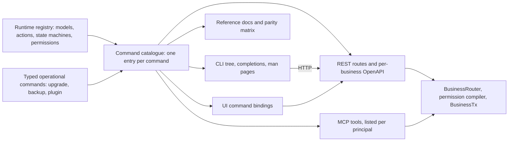

# CLI and the agentic command surface: `obop`, REST and MCP from one catalogue, and the plugin registry client

- **Status:** Draft 0.1
- **Date:** 2026-10-01; landed in the repository 2026-10-27 with the owner's other rulings, and checked against the code of that day (section 1.4)
- **Scope:** The `obop` command line as the first surface of the agentic-first platform (OR-4, OR-16, D80): grammar, global flags, output and error contracts, the command catalogue by area, its relationship to the REST API and MCP, the free plugin registry and its CLI (OR-3, OR-17, D81), agent use, parity testing, distribution and waves. It defines no business behaviour; the owning specs define what each command does.

**How to read.** [DECISIONS.md](../DECISIONS.md) is binding. "OR-n" is an owner ruling of 2026-10-01 or 2026-10-27 (RATIFIED), "Dn" a decision record, "Qn" an owner question. D80 and Q22 fix only the direction (binary `obop`, grammar `obop <noun> <verb>`, machine-readable output everywhere, frozen before the 0.3 public alpha: the repository is already public and a first CLI exists, so the freeze point needs the owner's confirmation), so the detail below is Proposed until Q22 is answered. **A first CLI is built; section 1.4 lists exactly what exists today. Everything else in this file is Proposed.** Besides OR-3 and OR-4 the file relies on OR-14 (the X1 to X5 and L1 to L3 labels and the `Business` renames), OR-16 (literal UI parity with an owner-approved exemption list), OR-17 (only plugins with an OSI-approved licence are listed; "verified" adds a verified publisher and automated gates), OR-18 (the owner signs off every commit; agents co-author by trailer) and OR-20 (a hosted free sandbox opens at the public beta), all RATIFIED; under OR-19 the npm-registry question (Q32) is decided at W2 and the default stays no publication. "Proposed" marks a design choice that neither the research nor DECISIONS settles; "Proposed (Dn)" marks reliance on a Proposed record. Names follow [CONVENTIONS.md](../CONVENTIONS.md); the naming rules it lacks are in 2.1. Wave placements follow D26 and D86 (dates RATIFIED by OR-13 and the W1 cut by OR-15; the placement of each command and the slip order are Proposed). A wire id marked `*` is not yet named by its owning spec and follows the CONVENTIONS 2.1 rule `<model>.<action>`. Everything here is Apache-2.0 and free (OR-1, OR-2); the CLI gates nothing. Sample JSON is illustrative. Nothing here is legal advice.

## 1. Purpose and the agentic-first principle

### 1.1 Definition of done and the parity rule

OR-4 is "AGENTIC FIRST EVERYTHING CLI FOR EVERYTHING". This spec turns it into three rules.

1. **Command first.** Every capability is one typed command, defined once in a command catalogue generated from the runtime registry (D29, D80). Build order: define the command (registry metadata, permission rows, dry-run behaviour), generate CLI, REST and MCP, then build views.
2. **Done means parity.** A feature is done when its command exists in CLI, API and MCP with the same input and output schemas, the D10 permission check, a dry-run with a digest-bound `plan_id` and an idempotency key for mutating commands, an audit entry, generated reference documentation and a passing parity test (D80, D36).
3. **The UI is a client.** The web UI calls the same commands and holds no business logic. It is not part of the per-feature definition of done, but 1.0 does not ship until the UI parity test is green for every command that is not on the exemption list (D35, D80; literal parity, OR-16).

**Parity rule added here.** A surface may expose a command only if the catalogue contains it (Proposed). UI parity is literal (RATIFIED, OR-16): every command of every shipped module gets a UI before the first stable release. The catalogue may contain a command without a surface only through an entry on the **exemption list** (RATIFIED mechanism, OR-16): operator-only commands that the owner approves as CLI-only, each with a written reason and the surfaces it lacks. An entry lacks the UI, and lacks REST and MCP too only when it says so; a command on no approved entry has all four surfaces (CLI, REST, MCP and, by 1.0, the UI). Nothing is exempt until the owner approves it, so the entries below are Proposed until the owner approves them one by one, and in any document a command called exempt is a proposed entry until then. This subsection is the single enumerated list of entries: other documents cite it and do not restate a subset. The groups below are only a Proposed way to organise the list. A step that only a person can perform is not an exemption (below the table).

| Proposed entries (group) | Why a surface is missing | Surfaces lacked | Commands |
|---|---|---|---|
| **Bootstrap** | Must work before or without a running server, or replaces it | UI, REST, MCP | `init`, `serve`, `up`, `down`, `migrate`, `upgrade`, `dev` (all subcommands), `self update\|verify` |
| **Local** | Acts on the user's machine, its files or its credential store, with no server data | UI, REST, MCP | `version`, `api`, `completion`, `man`, `config`, `catalogue sync`, `login`, `logout`, `diag`, `business verify`, `mcp bridge`, `plugin new\|lint\|test\|package\|dev\|migrate\|fork\|diff\|publish\|publisher`, and the register-local hardware operations of [retail-commerce-marketing.md](retail-commerce-marketing.md) (open question 20: print a test page, pulse the drawer, read a scale) |
| **Operator-only** (the examples named in OR-16) | Run by whoever operates the instance, from a shell, a scheduler or CI, not as a business screen; the server already serves them, so REST and MCP exist (proposed; today `backup`, `restore`, `drill`, `storage` and `migrate` are command line only, with no page or API route, and D73 asks the owner to approve that exemption). `upgrade`, the fourth example, is in the bootstrap group | UI | `backup create\|verify\|list\|restore`, `doctor`, `pack verify` |

**Human acts are not an exemption (not adopted: OR-16 covers CLI-only operator commands only, and OR-4 bars UI-only features).** A step that only a person can perform (the browser consent of a mailbox or calendar connection, a signer's own act on the link a sign request issues, the permission prompt of a Web Push subscription; platform 4.6 to 4.11) is part of a catalogue command that exists on all three surfaces. The command starts the step and hands the person a URL, a status command reads its state and a revoke command undoes it. An agent that reaches the human act stops there, as it does for step-up (2.11), and cannot perform it. The live co-editing socket is a transport, not a capability: the content it edits stays readable and writable as commands. [platform.md](platform.md) 4.20 point 5 and its open question 16 follow this reading.

`login` and `logout` are local because they hold the client's credentials; `whoami` is a read command with REST and MCP forms. Register operations that change server state are not on the list: they are catalogue commands queued in the edge command outbox. The exemption list is a file in the repository that only the owner changes (Proposed). Each entry records `command`, `reason`, `surfaces` (the surfaces it lacks), `approved_by` (the owner) and `approved_on`; the last two stay empty, and the entry is marked `proposed`, until the owner approves it. The catalogue marks each listed command (`ui.exempt`, 2.9). A command added to the list needs its own entry and reason, and the parity test (6) fails on any gap that no approved entry covers. The initial list is wanted before the UI parity work starts in W2 (2027-10-01; Proposed timing, D80). Parity concerns the generated surface; visibility stays per principal, so a destructive command is generated for MCP yet not listed to an agent (ai.md 4.3).

### 1.2 Who the CLI serves

- **Operators** (self-hosters, an accountant with many businesses) run `init`, `serve`, `backup`, `upgrade`, `doctor` and `business create`; they need safe defaults and a plan before every destructive step.
- **Implementers** run `custom_field`, `plugin`, `customize export` and `data import`; they need a fast dev loop, plan and apply, and exportable customisation.
- **LLM agents** (a coding agent with a shell, or an MCP client) run `schema`, `whoami`, `access check` and any record command with `--dry-run`; they need deterministic output, stable codes, self-description and no prompts.
- **CI** runs `upgrade --dry-run`, `plugin verify`, `backup verify` and `dev parity`; it needs gating exit codes and parseable JSON.
- **End-user scripts** (an accountant's export job) run `invoice list --all`, `data export` and `bank_statement import`; they need a versioned contract and expiring API keys.

### 1.3 What the CLI is not

- **Not a second implementation.** It is a thin typed client of the same command registry. Every business command is an HTTP call to `/api/v1`, so authentication, rate limits, idempotency, the permission compiler and the audit trail are identical for every caller (Proposed). There is no direct-database mode, which would be a second path around D10 and D33. The binary is also the server (D37), so bootstrap commands link the server crates and run in process.
- **Not a wrapper of the frontend toolchain.** Frontend work is `vp` with pnpm (F2, [R07 s1.4]). The CLI has no `obop web`, `obop build` or UI `obop test`, and never calls `npm`, `npx`, `yarn` or `bun`. Nor does it wrap `cargo`; a plugin UI build delegates to `vp` (3.10).
- **Not a query language, shell or AI client.** Filters are the Odoo domain syntax (D22), expressions are CEL (D11), and there is no `obop sql`, because RLS cannot express the access algebra (D10, D18). It embeds no model; `ai` features arrive in W3 as commands like any other.

**Boundaries.** [ai.md](ai.md) owns the write protocol and MCP, [integrations.md](integrations.md) the REST API, OAuth provider, importers and export, [platform.md](platform.md) the import engine and customisation, and the domain specs what each command does. This file owns the grammar, flags, output and exit contracts, the catalogue tables, the registry client and the distribution of the binary, and restates none of their rules.

### 1.4 What exists today (2026-10-27)

The `obop` binary exists (`crates/obop`, `obop --help` prints one usage page; the user-facing page is `web/apps/site/content/en/docs/reference/cli.md`). It is a thin set of hand-written commands over the one `Dispatcher` (REST, MCP and CLI share it), not yet the catalogue-generated tree of 2.1. The grammar is `obop <command> [options]`, not `obop <subject> <action>`. This table is a statement of fact about the code; the right-hand column says what the rest of this file proposes for the same thing, and every rename in it is Proposed (Q22).

| Built today | Proposed counterpart in this file |
|---|---|
| `serve [--addr] [--static DIR] [--public-site] [--trust-proxy]`; `platform serve ...` (the control plane: sign-up, instances, forum, status page) | `serve` (3.1); the control plane is operator tooling outside this catalogue |
| `call [--token T] <model> <command> [key=value ...]` (POST `/api/{model}/{command}`; values converted by field type; `filter`, `order`, `aggregate` as JSON text) | `<subject> <action>` (2.1), `api` (2.8) |
| `commands [--token T]` (the commands this token may see; `GET /api/commands`); `GET /api/meta` and `GET /api/openapi.json` | `catalogue list`, `schema` (2.9) |
| `import <model> FILE.csv [--mode partial] [--dry-run] [--key K]` (through the generated `bulk_create`, D70) | `data import` (3.4) |
| `mcp [--token T]` (stdio); hosted MCP at `/mcp` with OAuth sign-in (D51, D64) | `mcp bridge` (2.11, 3.9), the hosted endpoint is the server's |
| `admin create\|users\|groups\|offboard\|disable\|enable\|import\|reset-mfa`; `agent-token USER --scopes ...` | `agent` and security commands (3.7, 3.9) |
| `modules check\|list\|tree\|plan\|market\|install\|install-from\|uninstall\|updates\|update\|update-all\|rollback\|labels`; `sequences backfill`; `connectors purge`; `site seed\|show\|set`; `status incident ...` | `pack`, `plugin` (3.3, 4.3) and `customize` (3.6) for the package parts; the rest are module or operator commands |
| `migrate status\|verify\|plan\|run\|rehearse\|rollback`; `update check\|status\|start\|rollback`; `platform release ...`, `platform upgrade-instances` | `migrate`, `upgrade` (3.1) |
| `backup`, `backup verify`, `backup run\|list\|prune`, `restore`, `drill`, `storage check\|attest\|show`, `secrets status\|rotate` | `backup create\|verify\|list\|restore`, `doctor` (3.1) |

Global options built today: `--db URL` (or `OBOP_DATABASE_URL`), `--token` (or `OBOP_TOKEN`), `--demo`, `--dev-auth`, `--version`. None of the global flags of 2.2, no profiles, no `--format`, no `--dry-run` as a global flag (several commands have their own `--dry-run`), no `--plan`, no `--idempotency-key` (only `import --key`), no shell completions, no `config.toml` and no login flow exist yet. Output is the command's own text or JSON; there is no common envelope (2.3). The REST surface is `POST /api/{model}/{command}` with bearer tokens, not the dated `/api/v1` of 2.1. The commands of this table that act on a database (`migrate`, `backup`, `restore`, `drill`, `storage`, `secrets`) work without a running server, which is why 1.1 proposes `migrate` and the backup family as CLI-only entries. Exit statuses built today are in 2.4.

Everything else in sections 2 to 11 (the plugin registry client, `obop.lock`, `init`, `upgrade`, `business`, `pack`, `plan`, `schema`, `login`, completions, man pages, telemetry choices, the golden paths) is Proposed and not built.

## 2. Command model

### 2.1 Binary, grammar and naming rules

The binary is `obop` (Q22). A catalogue entry is `(subject, action)` with the wire id `<subject>.<action>` (CONVENTIONS 2.1). The CLI form is `obop <subject> <action> [<id>] [options]`, the REST form `/api/v1/{subject}/[{id}/]{action}` (ARCHITECTURE 8.1; today `POST /api/{model}/{command}`, 1.4) and the MCP tool name is the wire id. Entries come from three sources:

1. **Generated CRUD** per registry model: `list`, `get`, `create`, `update`, `delete`, and `aggregate` (a `read_group` equivalent, Proposed).
2. **Generated actions** from state machines and declared registry actions: `sale_order.confirm`, `invoice.post`.
3. **Typed operational commands**, hand-written but defined with the same macro in the same catalogue: `backup.create`, `upgrade.apply`, `plugin.install`.

The command tree is built at run time from the catalogue the server publishes (`GET /api/v1/catalogue`, Proposed), cached per profile and refreshed when `RegistryVersionChanged` moves the registry version. Custom fields, custom models and installed plugins therefore appear in the CLI without upgrading the binary, as in OpenAPI (D31). A built-in snapshot of the platform commands lets `obop init` and `obop --help` work with no server.

**Naming rules this file proposes for CONVENTIONS (all Proposed).**

| # | Rule | Example |
|---|---|---|
| N1 | The subject is the model id verbatim (snake_case). A hyphenated spelling is accepted on input and never printed | `obop sale_order confirm` (also `sale-order`) |
| N2 | Reserved words cannot be model ids: the first word of every command in 3 that no model backs (`init`, `upgrade`, `backup`, `business`, `pack`, `plugin`, `agent`, `data`, `dev`, `self` and the rest). The registry refuses a colliding id; an `xtask` lint checks it | Q22 reserves `plugin`, `upgrade`, `diag`, `dev`, `telemetry` |
| N3 | A model may declare one short CLI alias in registry metadata, published in the catalogue. Only `plan` (for `command_plan`) and `approval` (for `approval_request`) exist in W1 and W2. The `plan` alias is provisional: it collides with the W3 sales-crm model `plan` (CONVENTIONS 2.4; open question 13) | `obop plan show <id>` |
| N4 | Typed flags are the kebab-case of input property names; `--set name=value` and `--body` use the exact names | `--partner-id`, `--set x_customer_po=PO-7781` |
| N5 | A CLI `error.code` is the RFC 9457 `code` slug unchanged (CONVENTIONS "Problem code"); exit codes are a coarse class (2.4) | `lock_date_violation`, exit 7 |
| N6 | JSON keys are snake_case and sorted; money is `*_minor` as a string plus `currency_code` (ARCHITECTURE 8.1, CONVENTIONS 3.3) | `"amount_total_minor": "119000"` |
| N7 | Client environment variables use the areas `CLI` and `AUTH`, with `_FILE` for secrets (CONVENTIONS 2.1). The consumer-side lock file is `obop.lock`, the client config `config.toml`; `obop.toml` stays the package manifest (D32) | `OBOP_CLI_PROFILE`, `OBOP_AUTH_API_KEY_FILE` |
| N8 | Renames (all Proposed): `obop ext ...` becomes `obop plugin ...` (`ext apply` becomes `plugin install ./pkg`, `ext migrate` becomes `plugin migrate`, 3.10); `obop restore` becomes `obop business import`. `restore` is built and has stable exit statuses 3, 4 and 5 (2.4), so a rename needs the old spelling kept as an alias until the owner decides (Q22). Documents to conform: platform 5.4, ux 4.x, ARCHITECTURE 3.1 and 9.3, ENGINEERING 4.4, integrations 4.9 and 4.11, finance 4.1.4 | `obop business import <archive>` |

A positional `<id>` is a UUIDv7 or an external id `module.name`. The canonical input is a JSON body (`--body @file` or `--body -`); `--set` and typed flags are sugar for it. Help text is the registry `help` string that D38 already requires for every model, field, action and error code.

### 2.2 Global flags

| Flag | Meaning | Default |
|---|---|---|
| `--profile <name>` | Server, business and credentials | `default_profile`, else `default` |
| `--business <slug>` | Business to act on, resolved to the host name `BusinessRouter` routes on (integrations 4.1); there is no database-name header | The profile's |
| `--company <id>` | Active company, sent as `Obop-Company` (W2, multi-company) | The principal's default |
| `--format <f>`, `--json` | `table`, `json`, `ndjson`, `csv`; `--json` is `--format json` | `table` on a terminal, `json` otherwise |
| `--fields <spec>` | Nested field selection, the API `fields=` spec | Catalogue default |
| `--dry-run` | Print the plan; write nothing. Accepted and ignored on a read command, so a blanket flag is safe | Off |
| `--plan <id\|file>` | Commit a plan after checking it matches this command and arguments (2.7) | None |
| `--yes` | Answer the local confirmation prompt. Not a credential; it never satisfies a server-side approval | Off |
| `--no-input` | Never prompt; fail with exit 2 or 12 if input or login is needed. Implied off a terminal or when `CI` is set | Off |
| `--idempotency-key <k>` | Use this key (up to 255 characters) | A UUIDv7 per invocation, reused on the CLI's own retries |
| `--wait`, `--no-wait`, `--timeout <d>`, `--retry <n>` | Wait for job commands; request timeout; retries on network error, 429 and 5xx with jittered backoff | `--wait` up to 10 minutes; 30 s; 3 |
| `--api-version <date>` | Sent as `Obop-Version` | Pinned in the profile |
| `--quiet`, `--verbose` | Suppress non-essential stderr; add request ids and a redacted HTTP trace | Neither |
| `--color <auto\|always\|never>` | `NO_COLOR` is honoured; JSON never carries colour | `auto` |
| `--strict` | Turn deprecation warnings into failures (6) | Off |

### 2.3 Output

Standard output carries data only; standard error carries diagnostics and progress. In JSON mode every command prints one envelope with sorted keys, and `data` is the server body verbatim, so `obop api` and typed commands agree. Output is deterministic for the same state and input apart from `meta`, which the golden transcripts of section 6 rely on.

```json
{
  "command": "invoice.get",
  "data": {
    "amount_total_minor": "119000",
    "currency_code": "EUR",
    "id": "0197a3c4-5d2e-7b10-8f3a-2c6e9d41b7a5",
    "row_version": 3,
    "state": "draft"
  },
  "meta": {
    "business": "muster",
    "duration_ms": 38,
    "obop_version": "2027-03-02",
    "request_id": "01980f6e-7c21-7a45-9d10-3b5f8e2a4c67",
    "trace_id": "4bf92f3577b34da6a3ce929d0e0e4736"
  },
  "ok": true,
  "warnings": []
}
```

A failure prints the same envelope with `ok: false`, an `error` object and `exit`, on standard output, plus one human line on standard error unless `--quiet`:

```json
{
  "command": "invoice.post",
  "error": {
    "code": "lock_date_violation",
    "detail": "The posting date is on or before the fiscal lock date.",
    "errors": [{ "code": "date_locked", "pointer": "/date" }],
    "retryable": false,
    "status": 422,
    "title": "Period is locked",
    "type": "https://docs.obop.example/problems/lock_date_violation"
  },
  "exit": 7,
  "ok": false
}
```

`table` is for people and is not a contract; `ndjson` prints one record per line with no envelope, and a failure after the first line goes to standard error as one JSON line with a non-zero exit; `csv` is the import-compatible export form with external ids (integrations 4.9). There is no built-in `--jq`.

### 2.4 Exit codes

**Built today.** `0` on success. `1` for any failed command (`error: ...` on standard error). `2` for a usage error (an unknown command prints the usage page). `3` `restore_key_required` (a sealed backup's key is not configured), `4` `backup_not_sealed` (a plain backup where a key is configured) and `5` `restore_files_failed` (records restored, an uploaded file could not be written) are stable statuses of the commands that open a backup (`backup verify`, `restore`, `drill`; D73). `75` (`EX_TEMPFAIL`, "try again later") is the stable status of `call` and `import` when the database refuses the request (a 503 `storage_busy`, `storage_unavailable` or `storage_timeout` over REST), and the line says whether anything was changed (D74, OR-23); scripts may retry on 75 only, and every other failed call exits 1.

**Proposed classes.** A client with a richer error model (2.5) needs coarse classes beyond these. The table keeps the classes of the earlier draft but moves the numbers that collide with the built statuses: auth, denied and invalid are 12, 13 and 14 (the draft had 3, 4 and 5), and busy is 75, the built status (the draft had 8; 8 stays unassigned). The other classes are unchanged. Under OR-23 a script retries on 75 only; the retry advice of the other rows applies once the idempotency-key flow of 2.7 exists. Every number below is Proposed until Q22 is answered, except 0, 1, 2, 3, 4, 5 and 75, which are built.

| Code | Name | Meaning | Retry |
|---|---|---|---|
| 0 | ok | Success, including an idempotent replay and a valid dry-run | n/a |
| 1 | internal | Unexpected client or server error; today also any failed call that is not a store refusal | If `retryable` |
| 2 | usage | Unknown command, bad flag, or input failing the catalogue schema (built for an unknown command) | No |
| 3, 4, 5 | (built) | `restore_key_required`, `backup_not_sealed`, `restore_files_failed` of the backup and restore family | No |
| 6 | conflict | Stale plan or row version, idempotency key reused or in flight | Re-read, re-plan |
| 7 | refused | A domain or database rule says no (lock date, immutability, balance), or a plan is infeasible | No |
| 9 | unreachable | No response or a timeout; the operation may have happened | Yes, same key |
| 10 | approval | A plan waits for a human (confirm or approve-by-role) | Wait, then commit |
| 11 | partial | A non-atomic batch or a job finished with failed items | Inspect `data.results` |
| 12 | auth | Not logged in, token expired, or step-up needed (a human must act) | After login |
| 13 | denied | 403 or 404, indistinguishable by design (integrations 4.1) | No |
| 14 | invalid | The server rejected the input; `errors[]` carries pointers | After fixing input |
| 75 | busy | 429 or 503; honour `Retry-After` (built for `call` and `import`: the database refused, OR-23) | Yes |
| 130 | interrupted | SIGINT; replay with the same key is safe | Yes |

Adding a code is a minor change; repurposing one is a major change (6). The built statuses 3, 4, 5 and 75 are already part of the contract and cannot be repurposed.

### 2.5 Error model

The server answers with RFC 9457 `application/problem+json` (`type`, `title`, `status`, `detail`, `code`, `retryable`, `errors[]`, `request_id`, `trace_id`; integrations 4.1, [R21 s5]). The CLI never renames `code`; it adds `exit` from the class below, and the catalogue lists the codes each command can return, so `obop schema` shows them. The documents already name `idempotency_key_required`, `idempotency_key_reuse`, `lock_date_violation`, `unbalanced_entry`, `posted_immutable`, `plan_stale`, `approval_required`, `insufficient_scope`, `field_not_readable` and `endpoint_url_not_allowed`; the other slugs below are Proposed.

| Problem `code` | HTTP | Exit | Retryable |
|---|---|---|---|
| `validation_failed` | 400, 422 | 5 | No |
| `unauthenticated`, `token_expired`, `step_up_required` | 401 | 3 | No (a human acts) |
| `forbidden`, `not_found`, `insufficient_scope` | 403, 404 | 4 | No |
| `plan_stale`, `precondition_failed`, `idempotency_key_reuse` | 409, 412, 422 | 6 | No |
| `idempotency_in_flight` | 409 | 6 | Yes |
| `lock_date_violation`, `unbalanced_entry`, `posted_immutable` | 409, 422 | 7 | No |
| `approval_required` | per problem | 10 | After approval |
| `rate_limited`, `unavailable` | 429, 503 | 8 | Yes |
| `internal_error` | 5xx | 1 | Per `retryable` |

### 2.6 Lists, streaming, filters and jobs

- **Pagination.** `--limit` (default 50, maximum 200), `--cursor`, and `--all`, which follows cursors. Under `--all`, `ndjson` and `table` stream, while `json` buffers up to 10,000 records and then fails with `result_too_large` (limits Proposed). `--updated-since <timestamp|sync_token>` reads the commit-safe change feed and prints `next_sync_token` (integrations 4.1, [R21 s3]).
- **Filters in the domain language.** `--where '<domain>'` takes the JSON AST or an Odoo prefix list (integrations 4.1). `--filter` is repeatable, AND-combined sugar compiled client-side to the same AST: `=`, `!=`, `<`, `<=`, `>`, `>=`, `~` (case-insensitive match), `in`, and dotted paths that become `any` sub-domains. The server rejects filter, sort or group on unreadable fields (D10), so a filter can never widen access.
- **Streams and jobs.** `outbox tail --follow`, `audit tail --follow` and `data export` are NDJSON. Commands the server runs as jobs (import, export, backup, fleet migrate) answer with a job ref; `--wait` polls to the end, streams `JobProgressed` frames (shape Proposed) to standard error and sets the exit code from the outcome. On timeout the CLI exits 9 and prints the job id; `obop job wait <id>` resumes.

```sh
obop invoice list --filter direction=out --filter state=posted \
  --filter 'date>=2027-01-01' --filter 'partner_id.country_code=DE' \
  --fields number,date,amount_total_minor,currency_code --all --format ndjson
```

### 2.7 Mutations: dry-run, plans, idempotency, confirmation

Every mutating command follows the D18 protocol of ai.md 4.3, which this file does not restate.

- **Plan.** `--dry-run` runs the handler in a rolled-back transaction and returns a plan. `--plan <id>` commits it after the CLI and server check that command and canonical arguments match the plan digest; `obop plan commit <id>` is the short form. A commit is idempotent on `plan_id`. Commands that run without a server (`upgrade`, `migrate`) use a plan file (`*.plan.json`) with the same digest fields, bound to the binary digest, the migration head and the verified backup id.
- **Approval.** When the principal's policy for the command's effect needs a human (agents at `commit` and above), running the command without `--plan` creates the plan and exits 10. `obop plan wait <id> --timeout 15m` polls until it is approved, rejected or expired. The commit then runs as the approving human, with the agent recorded as proposer (ai.md 4.3).
- **Idempotency.** The CLI always sends an `Idempotency-Key`, so a dropped connection is retried with the same key and cannot double-post. A script repeating a logical operation across invocations passes its own key; `meta.replayed` flags a stored result.
- **Confirmation.** A local prompt guards irreversible steps (`backup restore`, `business delete`); `--yes` answers it, and `--no-input` without `--yes` fails with exit 2 instead of hanging.

```json
{
  "command": "invoice.post",
  "data": {
    "plan": {
      "approval": { "mode": "confirm", "satisfied_by": "human" },
      "args_digest": "sha256:7c1e0a52…",
      "diff": [{ "change": "state draft to posted", "id": "0197a3c4-5d2e-7b10-8f3a-2c6e9d41b7a5", "model": "invoice" }],
      "digest": "sha256:4b7d1e0c…",
      "expires_at": "2027-03-02T14:40:00Z",
      "plan_id": "0197a3d9-6a11-7c3e-9b42-5f0d8e17a2c4",
      "principal_chain": [{ "kind": "agent", "name": "ap-intake" }, { "kind": "user", "on_behalf_of": "sven@muster.example" }],
      "risk": "medium",
      "touched": [{ "id": "0197a3c4-5d2e-7b10-8f3a-2c6e9d41b7a5", "model": "invoice", "row_version": 3 }],
      "valid": true
    }
  },
  "exit": 10,
  "ok": false
}
```

Exit 10 is not a failure of the plan; `ok` is false because nothing was committed. `meta` and `warnings` are omitted.

### 2.8 The raw escape hatch and batches

`obop api <METHOD> <path> [--query k=v] [--data @file]` sends an authenticated request to the profile's own server with business routing, `Obop-Version` and an idempotency key, and prints the raw body (`--envelope` wraps it; `--paginate` follows cursors). It refuses any other host, so a token cannot be sent elsewhere. It is not a bypass: the API is generated from the catalogue, so `obop api` reaches what typed commands reach, under the same permission compiler and audit. `obop batch run --file ops.json [--atomic]` posts `$batch` (W1); one plan covers the batch at the maximum risk of its items (ai.md 4.3). `/json/2/` is not offered (D22, DEFERRED).

### 2.9 Introspection, completions and man pages

`obop catalogue list [--subject s] [--effect e]` lists entries; `catalogue sync` refreshes the cache. `obop schema <wire-id>` prints the entry: JSON Schema 2020-12 for input and output (`schemars`, ARCHITECTURE 8.4), operation metadata, error codes, the bindings and the UI binding. `schema --all` dumps the catalogue (the artefact the docs generator and the parity test read), `--openapi` the business OpenAPI, `--mcp-tools` the tool list of the current principal.

```json
{
  "approval": "confirm",
  "dry_run": true,
  "effect": "commit",
  "errors": ["approval_required", "lock_date_violation", "plan_stale"],
  "id": "invoice.post",
  "idempotent": true,
  "risk": "medium",
  "surfaces": { "cli": "obop invoice post <id>", "mcp": "invoice.post", "rest": "POST /api/v1/invoice/{id}/post" },
  "ui": { "binding": "sales.invoice_form#post", "exempt": null }
}
```

Metadata field names are ai.md 4.1's; values are illustrative. `ui.exempt` is `null` or the command's exemption-list entry, `{reason, surfaces, state: proposed|approved, approved_on}` (1.1), where `surfaces` names the surfaces the command lacks. `--help --format json` prints a command's entry, so an agent reads help as data; an unknown command exits 2 with a `did_you_mean` list. `obop completion bash|zsh|fish|powershell|elvish` emits completions built from the catalogue, with dynamic completion of subjects, actions and record ids through a hidden `obop __complete`. `obop man --out <dir>` renders man pages from the same catalogue, and release archives ship both.

### 2.10 Configuration

`config.toml` lives in the platform config directory (XDG on Linux, `%APPDATA%\obop` on Windows, Application Support on macOS). It holds profiles, never secrets. Precedence is flag, environment variable, profile, built-in default. `obop config get|set|list|path` edit it. Each flag has a variable `OBOP_CLI_<FLAG>` (for example `OBOP_CLI_PROFILE`, `OBOP_CLI_FORMAT`, `OBOP_CLI_NO_INPUT`), and credentials use `OBOP_AUTH_API_KEY_FILE`, `OBOP_AUTH_CLIENT_ID` and `OBOP_AUTH_CLIENT_SECRET_FILE`. The CLI also honours `NO_COLOR`, `CI` and the W3C `TRACEPARENT`. Server-side settings use the same scheme and belong to ARCHITECTURE.

```toml
default_profile = "muster"
[profiles.muster]
server      = "https://obop.muster.example"
business    = "muster"
api_version = "2027-03-02"
auth        = "device"          # device | loopback | api_key_file | client_credentials
```

### 2.11 Authentication

| Method | For | Notes |
|---|---|---|
| Authorization code with PKCE S256 on a loopback redirect (RFC 8252), the desktop default | Humans | The CLI is a pre-registered first-party public client (`obop-cli`, trust level `core`) |
| Device authorization grant (RFC 8628) | Humans on SSH and in containers | A Proposed addition to the OAuth provider, which lists code with PKCE and client credentials only (integrations 4.2; open question 4) |
| API key from a file | Scripts, CI | Scoped, mandatory expiry (default 90 days, Proposed), shown once. Creating one needs step-up, so a person creates it (security-privacy.md 4.1) |
| Client credentials | Service principals, CI, agents | Short-lived access token (one hour or less), refreshed by the CLI; preferred to long-lived keys |

Service principals use client credentials. Agent principals use a scoped token of either kind (5.4). `obop login`, `logout` (revokes the refresh token, RFC 7009) and `whoami` complete the set. `whoami` prints the principal chain, kind, scopes, expiry and permission groups, so an agent knows what it may do. `obop access check <wire-id> [--record id] [--as principal]` answers "may this principal run this?" and explains the permission and restriction rows, without running anything. **Step-up.** When the server demands a fresh passkey or TOTP, an interactive CLI repeats the browser flow and a non-interactive one exits 12 with `step_up_required` and a URL. An agent cannot satisfy step-up, by design. `obop init` alone mints a credential without step-up, because no principal exists yet: it writes a bootstrap profile valid for 24 hours (Proposed; open question 8).

### 2.12 Secrets handling

Tokens live in the OS keychain (Windows Credential Manager, macOS Keychain, Secret Service) with a `0600` file fallback; rotating refresh tokens are stored atomically under a file lock. Secrets (D33, [R18 s5]) are never accepted as argument values, because process lists and shell history leak them: use `_FILE` variables, `--*-file` options or standard input. Fields marked `secret` in the catalogue (data class `secret`, CONVENTIONS 5) can be set only through `--body`, never `--set`. Tokens travel only in the `Authorization` header. `--verbose` redacts headers and secret-class fields, and a value shown once (an API key) goes to standard output or to `--secret-out <file>` created with mode `0600`.

### 2.13 Telemetry

None. The CLI sends no usage data and makes no background network call: it contacts the profile's server, the plugin index and artefact hosts when a plugin command asks, and the release host when `self update` or `upgrade` asks. The opt-in usage telemetry and switchable advisory check of D85 are the server's, managed with `obop telemetry` (3.1).

## 3. Command catalogue by area

"Kind" is **R**ead-only or **M**utating. Every row exists on CLI, REST and MCP and has a UI path by 1.0 (OR-16), except the commands of the exemption list of 1.1, each only once the owner has approved its entry (the bootstrap and local commands are proposed as CLI-only there). The Wave column places the command; its UI follows under the parity matrix (6). Waves are Proposed placements (D25, D26, D86); the slip order of DECISIONS 5.3 can move a row to the later wave it names. **W1 discipline (Proposed).** W1 is the smallest honest loop (OR-13, OR-15), so a row sits in W1 only if it is a DECISIONS 5.3 necessary-inside call (RATIFIED, OR-15) or follows from one of its reasons (a) to (e); a wave cell names the row or reason where that is not obvious. Operator and authoring conveniences beyond that are placed in W2 and are not part of the W1 cut (open question 12). All commands accept the global flags of 2.2.

### 3.1 Installation lifecycle (the "instance" of OR-3)

| Command | What it does | Kind | Wave |
|---|---|---|---|
| `obop init` | Creates config and keys, prepares PostgreSQL (embedded for solo, or an existing cluster), runs kernel migrations, creates the first business and owner, writes a 24-hour bootstrap profile | M | W0 |
| `obop serve [--roles r,..]`; `obop up`, `obop down` | Run the roles (`http`, `cron`, `bus`, `ext`, `hub`, `all`; D37) in the foreground, or start and stop a managed solo stack with embedded PostgreSQL in the background | M | W0 |
| `obop status`, `obop version` | Version, catalogue hash, pins (Rust, `vite-plus`, pnpm), series and the end of its security-fix window, roles, businesses, migration head, backup age, revoked plugins, advisories | R | W0 |
| `obop doctor [--fix]` | Capability checks (PostgreSQL and extensions, PgBouncer mode, clock, disk, egress allow-list, object store); `--fix` prints a plan | R | W2 (Proposed); in W1 `init` and `upgrade --dry-run` run the checks they need |
| `obop diag` | Writes a redacted allow-list diagnostics bundle to a local file for an issue; nothing is uploaded | R | W2 (Proposed) |
| `obop backup create\|verify\|list\|restore` | Per-business logical dump with manifest; `verify` restores to a scratch database and re-checks checksums, hash chains and erasure-ledger replay; `restore` is destructive | M; `verify`, `list` R | W1 (5.3 row 22) |
| `obop migrate [--business b \| --fleet]` | Applies tagged migrations; fleet mode fans out with bounded concurrency and resumable per-business state (ENGINEERING 1.5), operator tooling for whoever runs many businesses | M | W0 single; `--fleet` W2 (Proposed), until then `upgrade` migrates the businesses of an instance one after another |
| `obop upgrade` | `--dry-run` prints the plan: path, migrations by kind with lock and duration estimates, disk headroom, compatibility, manual steps, downtime. `--plan <file>` applies a reviewed plan; with neither flag it plans, asks, then applies. Also `--to`, `--rehearse` and `--phase pre\|post` (ENGINEERING 4.5, [R27 C6]) | M | W1, dry-run at 0.3 (5.3 row 22) |
| `obop telemetry preview\|enable\|disable\|status` | Server usage telemetry, default off; `preview` prints the exact payload | M; `preview`, `status` R | W2 (Proposed) |
| `obop self update\|verify` | Replaces or verifies a client-only binary (7) | M; `verify` R | W2 (Proposed) |

### 3.2 Businesses

| Command | What it does | Kind | Wave |
|---|---|---|---|
| `obop business create\|list\|get` | Provision a business database from a template with company, country and owner; list and read | M; others R | W1 |
| `obop business clone <src> --as <name> [--config-only]` | Template-database copy of a business for testing; `--pseudonymise`, driven by the personal-data flags, arrives with it (Proposed) | M | W2 (Proposed) |
| `obop business export` | Full export job: NDJSON per model, attachments by SHA-256, audit log, configuration package, manifest. Needs `api.export_owner` and step-up (integrations 4.9) | M (audited) | W1, by 0.5 |
| `obop business verify <archive>` | Checks manifest digests, hash chains and the absence of secrets | R | W1 |
| `obop business import <archive>` | Loads an export archive into an empty business of the same or a later series under the restore role, keeping ids, legal numbers and hash chain, then replays the erasure ledger | M, destructive | W1 |
| `obop business delete` | Two-phase removal after an export; not exposed to agents | M, destructive | W1 |

### 3.3 Packs

Country packs travel on their own signed channel (D34, LOCALIZATION 1.5, [R25 B5]). `pack` is the localisation view over the same install engine as `plugin` and writes the same `obop.lock`.

| Command | What it does | Kind | Wave |
|---|---|---|---|
| `obop pack list\|status` | Installed and available packs per channel (`stable`, `preview`, `edge`), effective dates, the next `PackActivated` | R | W1 |
| `obop pack install\|update <id> [--channel c] [--company c]` | Installs the signed, effective-dated bundle (Germany: pack `l10n-de` with module `l10n_de`); the plan lists the accounts, taxes, journals, sequences and lock dates it instantiates | M | W1, DE alpha 2027-03-31 |
| `obop pack verify <id>` | Verifies signature, effective dating, oracle versions and golden-case digest; prints the gate (draft, preview, stable, certified) and the recorded accountant sign-off reference | R | W1 |

### 3.4 Data

| Command | What it does | Kind | Wave |
|---|---|---|---|
| `obop <model> list\|get` | Query with domain filters, `--fields`, `--sort` and cursor; `get` takes a UUID or external id | R | W1 |
| `obop <model> aggregate` | Group and sum under the caller's access (`--group-by`, `--agg sum:amount_total_minor`); keeps agents able to answer questions if `analytics` slips | R | W1 |
| `obop <model> create\|update\|delete` | CRUD. Documents are created as drafts, `update` sends `If-Match` from `row_version`, posted rows are never deleted (D30) | M | W1 |
| `obop <model> <action> [<id>]` | Any registry action: `sale_order confirm`, `lead convert`, `stock_transfer validate`* | M | per module |
| `obop data export <model>` | CSV, XLSX or NDJSON in import-compatible form with external ids; needs the `export` operation; audited | R | W1 |
| `obop data import <file> --model m` | Upload, map, dry-run and commit through `import_run`; `obop import_run rollback <id>` undoes a run | M | W1, CSV at 0.3 |
| `obop data import odoo --from-export <dir>` or `--json2 <url> --key-file f` | Odoo importer: partners, products, taxes, chart, open invoices and bills, opening balances as a draft entry with a zero trial-balance diff (integrations 4.8) | M | W1, 0.6 (slip item 14) |
| `obop data import quickbooks\|xero\|erpnext` | Foreign importers | M | QuickBooks W2; Xero, ERPNext W3 |
| `obop analytics query` | A `SemanticQuery` (measures, dimensions, filters, grain, target currency, company scope) with provenance | R | W3 (slip item 2, DECISIONS 5.3; until then `aggregate`, 3.4) |

### 3.5 Accounting operations

| Command | What it does | Kind | Wave |
|---|---|---|---|
| `obop invoice create_draft\|post\|reverse*` | Draft; post with number, chain and lock check; reverse by credit note | M | W1 |
| `obop payment register*`; `obop bank_statement import*`; `obop bank_statement_line reconcile*` | Register a manual payment; import camt.053 or MT940; match a statement line to open items (`ReconcileLines`) | M | W1 |
| `obop journal_entry post\|reverse*` | Post or reverse an entry | M | W1 |
| `obop lock_date set\|list`, `obop lock_exception grant\|revoke` | Fiscal, sale, purchase, tax and hard lock dates; time-boxed exceptions | M; `list` R | W1 |
| `obop period close <period>` | Composite convenience: checks drafts, unreconciled lines and the tax closing, then sets lock dates; the plan shows blockers (open question 9) | M | W2 (Proposed); in W1 the lock dates are set with `lock_date set` |
| `obop tax_return compute*` | UStVA from tax tags for a period | R | W1, DE |
| `obop audit_file export*` | DATEV EXTF and GoBD exports through `AuditFileExporter` | R | W1, DE |
| `obop e_document validate\|send*` | EN 16931 validate; send by email or file (the Peppol adapter is W2) | M; `validate` R | W1 |
| `obop ledger verify` | Recomputes the per-journal hash chain | R | W1 |

### 3.6 Customisation

| Command | What it does | Kind | Wave |
|---|---|---|---|
| `obop custom_field create\|list\|hide\|drop` | Typed, promoted or JSONB field; the plan classifies schema steps as Instant, Rewrite, Blocking or Concurrent and asks the personal-data question (platform 4.14) | M; `list` R | W1 (admin screen: slip item 15) |
| `obop customize export --as-package <dir>` | Exports the business overlay as an `obop.toml` package with `origin = business`; `plugin install ./dir` applies it to another business | R | W1 |
| `obop view list\|get`; `obop view_override create\|reset` | Read effective views; patches are F0 patches | R; M | W1; W3 (slip item 1) |
| `obop automation_rule create\|test\|enable\|disable` | Rules as data; `test --record <id>` shows actions and diffs without committing (platform 4.13) | M; `test` R | W2 (slip item 6) |
| `obop custom_model create`; `obop customize report` | Custom models with a generated menu entry; deltas from stock with upgrade risk | M; R | W3; W2 |

### 3.7 Security

| Command | What it does | Kind | Wave |
|---|---|---|---|
| `obop principal invite\|list\|get\|suspend\|deactivate [--kind user\|agent\|api_client]` | Principal management (security-privacy.md 4.1) | M; others R | W1 |
| `obop permission_group list\|grant\|revoke` | Permission-group membership | M; `list` R | W1 |
| `obop access check <wire-id>` | Explains allow or deny for the caller or, with `security.officer`, another principal | R | W1 (Proposed) |
| `obop api_key create\|list\|revoke`; `obop oauth_client`, `consent_grant list\|revoke` | Scoped, expiring keys (creation needs step-up); connected clients and consents | M; `list` R | W1 |
| `obop audit tail [--follow]` | Streams the `security_event` and `audit_change` rows the caller may read (`audit.reader`) | R | W1 |
| `obop audit verify` | Verifies the hash-chained audit log against signed checkpoints | R | W1 |

### 3.8 Events and jobs

| Command | What it does | Kind | Wave |
|---|---|---|---|
| `obop outbox tail [--follow] [--type t] [--from cursor]` | Streams durable events from a resumable `(xid8, event_id)` cursor under the caller's read permissions | R | W1 |
| `obop webhook_endpoint create\|list\|pause\|rotate_secret\|delete`; `obop webhook test\|deliveries\|replay` | Standard Webhooks endpoints; send a test event, read the 30-day delivery log, replay stored bytes | M; lists R | W1 |
| `obop job list\|get\|wait\|cancel` | Durable jobs, including those behind `--wait` | M; others R | W1 |

### 3.9 Agents

| Command | What it does | Kind | Wave |
|---|---|---|---|
| `obop agent create\|list\|suspend\|revoke` | Composite over `principal`, `agent_delegation` and `api_key`: creates the principal, group, expiry and token in one plan; `list` is the inventory with effective permissions | M; `list` R | W1 |
| `obop agent guide [--plugin id]` | Renders the catalogue for the caller's permissions plus the `AGENTS.md` and skills of installed plugins (5.4) | R | W1 (5.3 reason c: renders the generated catalogue and adds no backend) |
| `obop plan list\|show\|commit\|reject\|wait` | Command plans (`command_plan`, alias `plan`) | M; `list`, `show` R | W1 |
| `obop approval list\|show\|decide\|delegate`; `obop approval_policy ...` | Approvals engine; decisions only by humans | M | W2 |
| `obop mcp tools`; `obop mcp bridge` | List the MCP tools of the caller; a stdio to Streamable HTTP bridge in Rust using the CLI's credentials (open question 3) | R; process | W1; W2 |

The configured assistants of `ai` (`ai_agent`, skills, runs) are W3 (D25).

### 3.10 Development

| Command | What it does | Kind | Wave |
|---|---|---|---|
| `obop dev up\|down\|reset\|logs`; `obop dev parity` | An optional local demo or development business on embedded PostgreSQL, seeded from the same sample data as the hosted sandbox (D83, OR-20); print the parity matrix (6) | M; `parity` R | W1 |
| `obop dev new module <id>` | In a repository checkout, scaffolds the `<id>-api` and implementation crates, manifest, permission seed and structural-suite hookup (Proposed) | M | W2 (Proposed); contributors use the repository's own tooling until then |
| `obop plugin new\|lint\|test\|package` | Scaffold a pack; lint manifest, licence, capabilities and accessibility; run the inherited structural suite in a scratch business; build the OCI artefact | M; `lint`, `test` R | W2 (Proposed), with the registry; the first-party packs are checked by the repository's CI until then |
| `obop plugin dev` | Watch and sync to a dev business with plan and apply and hot reload | M | W2 |
| `obop plugin migrate <path> [--dry-run]` | Runs the codemods that a `deprecations.json` entry names over a plugin source tree, printing the patch under `--dry-run`; codemods are versioned with the deprecation list (ENGINEERING 4.4). Replaces the former `obop ext migrate` (N8) | M (local files) | W3 (Proposed), with the first `N.0` that removes a deprecated contract |
| `obop catalogue`, `schema`, `api`, `completion`, `man`, `config` | Introspection and local tools (2.8 to 2.10) | R | W0 |

Frontend tasks are not wrapped. A plugin with a UI tier builds with the project's own `vp` tasks; `obop plugin package` runs the pinned `vp build` as a child process (`vp_required` if absent) and exposes none of its options. The UI SDK reaches plugin projects as release tarballs installed with `vp add <url>` (Q32 default: no npm-registry publication until the owner decides at W2, OR-19). Templates pin `vite-plus` exactly, use pnpm only and carry the D23 supply-chain settings.

The free hosted sandbox that opens with the public beta (0.5, 2027-07-06; D83, OR-20) is an ordinary obop server holding sample data only, so the CLI treats it like any other profile and has no sandbox-specific code path. `obop dev up` is the optional local alternative, seeded from the same sample data. The sandbox's terms, host, cost ceiling and abuse controls are Proposed (Q34 to Q36) and are stated in DECISIONS D83 and those questions, not here.

## 4. The plugin registry and marketplace (OR-3)

OR-3 gives obop a free, open registry of plugins. The CLI can search it, install a plugin version-pinned, or copy its source into the user's own installation; there are verified and community trust tiers. obop handles no payments: no price, licence-key or entitlement field exists in the manifest schema, and there is no listing fee, take rate or payout (OR-2, OR-3, D81). "Plugin" is the owner's word and is used in commands and user copy; architecture text says "package" (D24).

### 4.1 Package kinds

| Code tier | Manifest `kind` | Typical plugin | Install | Copy | Lands |
|---|---|---|---|---|---|
| X1 declarative pack, X2 CEL rules | `pack` | Fields, models, view patches, automations, CEL validation and formula rules, templates, import mappings, country packs | Yes | Yes: the data files | Sideload W1; index W2 |
| X3 Wasm component | `wasm` | Hooks, validators, HTTP connectors | Yes | Source only, built by you | W3 (slip item 1) |
| X4 remote app | `remote` | External SaaS and agents over OAuth, REST, webhooks, MCP | Yes: registers the OAuth client and consent | The app's source; you run it | W3 |
| X5 native crate | `native` | Posting, tax, protocol adapters | First-party only (`core`) | Vendor the source into your own build; nothing loads it into a stock binary | Not from the registry |
| Theme, F2 and F3 UI | `theme` | Branding, storefront themes | Yes | Yes | W3 |

Stage 1 of the index (W2) therefore lists only `pack` plugins; the other kinds arrive with the extension platform (DECISIONS 5.3, item 1).

### 4.2 `obop.toml` and `obop.lock`

`obop.toml` is the one package manifest (D32; keys in ARCHITECTURE 9.3). Publishers write it and copy mode keeps it. This file adds three Proposed keys: `[package] source_repository` (required for `verified`, so copy mode has source), `[agent]` with `agents_md` and `skills` (5.4), and an `[upstream]` table that `plugin fork` writes (id, version, digest, source).

`obop.lock` is the consumer-side projection of what one business has installed. The database (`package_install`, platform 4.18) is authoritative at run time; the lock is the reviewable, diffable file that `plugin install|copy|update|remove` write and `plugin lock export|sync` (`--locked`, `--frozen`) reproduce, with `--frozen` failing on any difference (the analogue of `vp install --frozen-lockfile`).

```toml
version = 1
index   = "<index-snapshot-url>"            # placeholder: the snapshot the resolution used

[[plugin]]
id        = "acme.payment-reminders"
mode      = "install"                       # install | copy
requested = "^1.4"
version   = "1.4.2"
digest    = "sha256:5e0c…"
tier      = "verified"
capability_digest = "sha256:a19f…"
signature = { publisher_key = "ed25519:…", cosign_identity = "https://github.com/acme/payment-reminders/.github/workflows/release.yml@refs/tags/v1.4.2" }

[[plugin]]
id      = "acme.dach-quote-terms"
mode    = "copy"
version = "1.4.2"                           # the upstream version it was copied at
path    = "extensions/sven/dach-quote-terms"
tier    = "private"
licence = "Apache-2.0"
[plugin.upstream]
digest  = "sha256:77d2…"
```

### 4.3 Registry commands

**Built today:** `obop modules check\|list\|tree\|plan\|market\|install\|install-from\|uninstall\|updates\|update\|update-all\|rollback` and the Modules page install, upgrade and remove X1 packages (`obop.toml`: declarative models, fields, actions, translations) from an upload, from the bundled catalogue or from an `OBOP_MARKETPLACE_URL` catalogue, with dependency plans and atomic upgrades (D45, D55, D63). There is no signed index, `obop.lock`, copy mode, trust tier or `plugin` command yet; those below are Proposed, and the existing `modules` spellings are the ones to keep working (as aliases) if the owner adopts `plugin` (Q22).

These are typed catalogue commands (D80); those that work on local files and the index (`fork`, `diff`, `publish`, `publisher`) are proposed as CLI-only (1.1), the rest also exist as REST and MCP. `install` is canonical (D81) and `add` a documented alias. All are W2, because stage 1 of the index is a W2 deliverable (D81, DECISIONS 5.1), except where noted.

| Command | What it does | Kind |
|---|---|---|
| `plugin search <q> [--kind k] [--tier t] [--compatible]` | Queries the local index snapshot, no server; default tier filter is `verified` | R |
| `plugin info <id>[@v]` | Manifest, versions, tier, signer identities, SBOM summary, capabilities, SPDX licence, revocation, deprecation, agent docs | R |
| `plugin install <id>[@range]` (alias `add`) | Resolves, fetches by digest, verifies, shows the capability diff as the plan, applies on commit, writes the lock. In W1 for a local path or URL with `--sideload` | M |
| `plugin copy <id>[@v] --to <dir>` | Fetches and verifies the source, registers it as business-own code (`private`) with provenance, and writes a working tree to `<dir>` for editing; `plugin install ./dir` applies later edits. No updates | M |
| `plugin fork <id> --as <publisher.name> --to <dir>` | Re-identifies a copy under your namespace, sets version 0.1.0 and records `[upstream]`, so you may publish a derivative. `copy` never re-identifies | M |
| `plugin update [id]` | Plan: versions in range, capability diff; explicit apply | M |
| `plugin remove <id> [--data archive\|drop_after_days\|keep]` | Uninstalls per the manifest's `[uninstall]` policy after a confirmed export | M |
| `plugin publish` | Signs the artefact and opens a pull request against the index with the entry (4.9) | M |
| `plugin publisher init\|verify` | Prints and checks the DNS TXT record or GitHub organisation proof needed for `verified` | M |
| `plugin verify <id\|path>` | Checks digest, signatures, provenance, SBOM, licence, capability manifest and revocation list. W1 for sideloads | R |
| `plugin audit` | Installed and copied plugins against revocations, OSV advisories, yanks and deprecations | R |
| `plugin diff <id>` | Local changes of a copy against its recorded upstream source | R |

### 4.4 Install versus copy

| Dimension | `install` | `copy` |
|---|---|---|
| You get | A signed, version-pinned package fetched by digest | The plugin's source tree in your extension directory |
| Who maintains it | The publisher; you follow versions | You, from the moment of copying |
| Updates | Explicit: `plugin update` shows the capability diff | None. `plugin diff` shows your drift; re-copying is manual |
| Provenance | Digest and signature identities in the lock | Source, version, digest, SPDX licence, signature check at copy time and date in the lock and `[upstream]` |
| Trust level afterwards | The listed tier (`verified` or `community`) | `private`. Copy adds no privilege: capabilities, egress hosts and UI tier (F2 or F3) stay as the source manifest declared, and raising them, or moving UI to F1, is a separate audited command needing `api.extension_admin` and step-up (Q25) |
| Registry kill switch | Disables the version | Does not apply; `plugin audit` warns when the upstream version it was copied from is revoked |
| Removal and licence | Honours `[uninstall]`; licence shown at install | Delete the directory; LICENSE and NOTICE travel with the source |
| Choose it when | You want the publisher's fixes | You must change behaviour, audit every line, or leave the publisher |

### 4.5 Trust tiers

| Tier | Meaning | Gates | CLI default |
|---|---|---|---|
| `core` | First-party `obop.*`, signed by core keys | Core release process | Comes with the binary or the pack channel |
| `verified` | Verified publisher plus all automated gates (signatures, SBOM, capability manifest; OR-17) | Domain or GitHub-organisation proof and good standing (how a publisher is verified is Proposed detail of D81); manual security review is best effort and never promised | Listed and installable |
| `community` | Automated gates only, labelled unreviewed | Automated gates | Hidden from default search; install needs `--tier community` and shows an "unreviewed" notice the user accepts |
| `private` (sideloaded) | Business-own: authored here, copied, or sideloaded | None by the registry | A plugin from a file or URL outside the index carries the `sideloaded` flag of `package_install`; an unsigned one needs `--allow-unsigned` |

Both listed tiers require an OSI-approved SPDX licence (OR-17, 4.7); sideloading is always allowed (D32). `plugin.install` is a high-risk `commit` effect: an agent gets a plan and a human confirms it (exit 10).

### 4.6 Signing, provenance, SBOM and capabilities

- **Artefact.** An OCI artefact: manifest, pack files, prebuilt UI or component, a CycloneDX SBOM (required for `wasm`, `native` and UI kinds) and provenance (D32). Publishers host artefacts in their own OCI registries and the index references them by digest (Q24, [R24 s5.2]).
- **Verification at install (Proposed).** (1) The digest equals the index entry. (2) The publisher's ed25519 signature verifies against the key in the index. (3) The Sigstore signature (cosign keyless: a short-lived certificate bound to the publisher's CI identity, logged in a transparency log) matches the identity the publisher registered. (4) A provenance attestation names the source repository and commit. (5) The version is not revoked. All material travels in the artefact, so a mirror or an air-gapped site verifies offline, and installing runs no script on the user's machine.
- **Consent is the plan.** The install plan lists capabilities (record scopes, hooks, allow-listed egress hosts with purpose strings, limits, UI tier) and carries a `capability_digest`. Committing the plan consents to exactly that digest; an update that adds a scope or host changes it and needs a new plan (D32). A non-interactive install must pass `--plan` from a dry-run a human reviewed.

### 4.7 Licence policy, moderation and takedown

**Licence (RATIFIED, OR-17).** An OSI-approved SPDX licence is required for listing in either tier; closed plugins can be sideloaded but not listed, and copy mode needs source, so it stays legally clean.

**Gates, moderation and takedown.** Per version, automated gates run: manifest lint, licence check, SBOM and OSV scan, capability diff, secret scan, name reservation (`obop.*` is reserved) and size caps (Proposed, D81); compatibility runs (`obop-compat`) are W3. Reports go to the index repository. Manual review is best effort and promised nowhere (D81). A revocation entry (id, versions, reason class, date, advisory link) in the index is the only enforcement SpaceCorps has, because artefacts live in publishers' registries. The CLI refuses to install a revoked version and `plugin audit` flags installed ones; a running server reads the list on a schedule and can disable a version (the D32 kill switch; [R24 s9] targets about an hour, and no service level is promised). Legal notices, the index operator's CRA role and the publisher terms go to counsel (Q5, Q24).

### 4.8 Versioning and deprecation

Plugins use semver and declare `[compat] obop` ranges. A publisher may set `deprecated` with a successor and may `yank` a version (no new installs, existing ones continue); revocation is the security action. The CLI prints deprecations as `warnings[]`. A package with no release for 12 months is flagged unmaintained (R24 adds two failed compatibility runs, from W3). Core contracts plugins depend on (pack schema, `obop.toml`, REST, MCP, the CLI) follow the OR-12 window: 12 months before 1.0 and, Proposed, after it (Q28).

### 4.9 Staged delivery, cost and risk (Proposed, D81)

**Stage 1 (W2): a git-backed static index.** A repository under the SpaceCorps GitHub organisation holds one manifest per plugin version, publisher records, tiers and revocations. CI runs the gates on every pull request and publishes a signed snapshot as static files; the CLI reads the snapshot, and `plugin publish` opens the pull request. The config allows several indexes (`[registries]`), so a company or partner can run a private index without SpaceCorps. A public index announces the name, so it waits for the G0 checklist (OR-5; the main repository is already public since 2026-10-26) even though it is a separate repository.

**Stage 2 (W3 or W4, on demand): a registry service** with API, search, publishing and review tooling. It is a hosted service for other people, and OR-11 says SpaceCorps hosts none (the sample-data sandbox of D83, OR-20, is not one), so it needs an owner decision that amends D83 (open question 7).

**What even stage 1 costs.** Hosting and CI minutes are near zero. The real costs are moderation labour on a one-human team (D84); an index signing key that needs two or more independent custodians (ENGINEERING 5.2); abuse and typosquatting; an unanswered legal question about an operator's duties for third-party content (Q5, Q24); and a revoked plugin staying live because a self-hoster does not poll. Mitigations: end-to-end verification, so an index compromise cannot forge artefacts; digests pinned in `obop.lock`; signed snapshots with an expiry (open question 5); no payments, no accounts and no promised service level.

## 5. Agent integration

### 5.1 The CLI is the agent's primary tool

A coding agent with a shell already runs commands, reads JSON and branches on exit codes, so the CLI is the shortest path to the whole platform; MCP serves clients that speak it, and the two are equal because both come from the catalogue. The CLI is agent-safe by construction: non-interactive off a terminal; sorted-key, schema-described JSON; stable error codes; `--fields`, NDJSON and `--quiet` to spend few tokens; a universal `--dry-run` and idempotency key; and `obop schema` and `obop access check` to learn and test before acting. An agent discovers with `obop whoami`, `obop catalogue list --effect read`, `obop schema <id>` and `obop agent guide`; an MCP client with `server/discover` and `tools/list`, per principal and deterministic (ai.md 4.1). The lists agree because one permission compiler filters one catalogue.

### 5.2 Deterministic, idempotent, plan then apply

The protocol is ai.md 4.3 ([R16 s5]); the CLI binds to it as follows.

| ai.md concept | CLI form |
|---|---|
| `dry_run=true` returns diff, validation, risk, approvals and a `plan_id` | `--dry-run` prints `data.plan` (2.7) |
| Commit with the digest-bound, single-use, principal-bound, time-limited `plan_id` | `--plan <id>` or `obop plan commit <id>` |
| `plan_stale` (409) when a touched record changed | Exit 6; run `--dry-run` again |
| `approval_required`; an agent never approves | Exit 10; `obop plan wait`; a human runs `obop plan commit` or `obop approval decide` |
| Idempotency key; a replay returns the first result | Automatic key; `--idempotency-key` for logical operations |
| Agents create drafts, humans post | `invoice create_draft` is `auto`; `invoice post` by an agent is `confirm` |

### 5.3 One source of truth



A command therefore exists as CLI, API and MCP together, and a surface cannot drift because it holds no definition of its own. Custom fields, custom models and plugins reach all three at once (platform 4.14, D31).

### 5.4 `AGENTS.md`, skill bundles and principals

The repository root ships an `AGENTS.md` (Proposed) for agents that contribute code: the pinned Rust toolchain, `vp` and pnpm only, no `npm`, `npx`, `yarn` or `bun`, the commit convention (the owner signs off every commit with `git commit -s`; an agent adds a `Co-Authored-By` trailer and never a `Signed-off-by` line; OR-18, D82), the clean-room attestation (F3), and how to run the parity test. A plugin may ship its own `AGENTS.md` and a `skills/` directory, listed under `[agent]` in its manifest; a skill is the ai.md 4.7 bundle, and its install shows a capability diff. `obop agent guide` renders the installed ones beside the catalogue, so instructions always match the installed commands.

An agent is a principal, never a party or a "bot" (D28). Its effective permission is the delegator's or service group's grants intersected with the token scopes (`<model>:<operation>`) and its declared ceiling, evaluated per call; delegation depth is one (ai.md 4.2). `obop agent create` makes the principal, group, expiry (default 90 days, Proposed) and token in one reviewable plan.

### 5.5 Safety rules

- **Drafts or plans.** An agent's write at `commit` effect or above produces a plan, never an effect. `money_and_payee` and `destructive` commands are not exposed to agents in W1 (fail closed); W2 adds approve-by-role (ai.md 4.3).
- **Human gates.** `--yes` cannot satisfy a server-side approval, which needs a human principal; the committed plan runs as that human, with the agent as proposer.
- **Attribution and limits.** Every call carries the token's principal chain. The CLI sends `User-Agent: obop-cli/<version>`, a `traceparent` when `TRACEPARENT` is set, and an optional `--agent-model <id>`, recorded as asserted and untrusted. Per-principal token buckets apply; the CLI backs off on 429 and exits 75 after `--retry`.
- **Untrusted data.** The CLI never executes server-provided content. Values taken from documents are data, and changes to bank details or payees always need a human (ai.md 4.3).

## 6. Parity, testing and release

**Parity matrix.** `obop dev parity` and a CI artefact (`parity.json`, rendered as a reference page) list every wire id against CLI, REST, MCP and UI. CLI and REST entries come from the generated command tree and OpenAPI operations; the MCP column from `tools/list` for a test principal holding every permission; the UI column from `ui-bindings.json`, which the web build emits through a `vp run` task (Proposed). The gate: every shipped module is 100% CLI, REST and MCP or has an approved exemption, and a route, tool or command absent from the catalogue fails the build. UI coverage is tracked from W1 and complete before 1.0 (OR-16): the parity test fails on any command with no UI binding and no approved exemption. The exemption list is a file in the repository owned by the owner (Proposed, 1.1); a `proposed` entry is shown in the matrix but does not satisfy the gate. The parity test is a W1 exit criterion (DECISIONS 5.2).

**Golden transcripts and help snapshots.** Each golden path of section 8 is a recorded transcript (command, standard input, exit code, standard output, standard error) replayed against a seeded business with a fixed clock and a seeded UUIDv7 generator, scrubbing only `meta`. Snapshots change only through an explicit bless step a reviewer approves. `obop help --format json` for the whole tree and the man pages are snapshotted on every change; help is the catalogue, so a snapshot diff is a catalogue diff. Transcripts run on Linux, macOS and Windows.

**Contract tests.** (1) A catalogue diff tool flags breaking changes (removed or renamed wire id, a newly required input, a narrowed enum, a changed exit or error code) beside `oasdiff` for OpenAPI (ENGINEERING 1.1). (2) For each wire id, generated minimal input through CLI, REST and MCP must return identical `data`. (3) The D10 permission property test also runs through the CLI. (4) Replay, `plan_stale`, single-use plans and `approval_required` are tested for an agent and a human. (5) Every `--json` output validates against the catalogue's output schema.

**Semver of the CLI contract.** The contract is the command tree (subjects, actions, flags), exit codes, error codes, JSON output schemas, environment variables and config keys; it excludes `table` output and standard error text. Additive changes are minor; removing, renaming, retyping or repurposing is major. The CLI and server are one binary and one version, and a CLI N works against servers N-1 to N+1 (Proposed), because the catalogue comes from the server and `Obop-Version` is pinned per profile.

**Deprecation per OR-12.** Before 1.0 the promise is N-1 upgrades and a 12-month deprecation window for the CLI command catalogue (D85). A deprecated command keeps working and adds a `warnings[]` entry (`code`, `since`, `remove_in`, successor) and a `deprecations.json` entry (ENGINEERING 4.4, minus the 24-month floor OR-12 withdrew); `--strict` makes it exit 2 for CI. Removals land only at the first release of a series (D85, Proposed). After 1.0 the window stays 12 months unless the owner rules otherwise (Q28).

## 7. Distribution

- **One static binary.** Linux x86_64 and aarch64 on musl (D37); macOS arm64 and x86_64; Windows x86_64 and arm64. Production servers run on Linux only; macOS and Windows use `dev up` (Proposed). Built with `dist` (formerly cargo-dist, [R06 s2]); each archive carries completions and man pages.
- **Channels.** GitHub Releases is the source of truth; crates.io for `cargo install`; a Homebrew tap, a winget manifest and a Scoop bucket; `.deb` and `.rpm` release assets, with a signed apt repository only if demand appears, because it adds a key duty (Proposed); container images on GHCR built from scratch. Package names wait for name clearance (OR-5, D3).
- **Never npm.** No npm-registry package (the Q32 default until the owner decides at W2, OR-19; the CLI binary itself is never an npm package, D80), no shim, no `npx` entry point, and the `dist` npm-installer output is disabled (F2). Nothing the CLI needs requires Node on a customer machine (D37).
- **Signed releases.** cosign keyless signatures, GitHub artifact attestations (SLSA v1.0 Build L2, L3 via a reusable workflow), a CycloneDX SBOM, `cargo-auditable` data and two reproducible builds compared by hash (D33, D36, ENGINEERING 5.2). The JavaScript SBOM of the embedded UI is `pnpm sbom` run through `vp env exec` or a `vp run` task, the second of the two exceptions to "vp only" (OR-9); the first is the nightly exit drill. Installer scripts verify a release asset's SHA-256 against the signed checksum file and resolve nothing else.
- **`obop self update` (Proposed, W2).** For client-only installs (an accountant's laptop, a CI image). It contacts the release host only when invoked, verifies attestation, signature and checksum before replacing the file, and refuses when a package manager or a server install owns the binary. On a server, `obop upgrade` acquires and verifies the target binary, then migrates (ENGINEERING 4.5).
- **Pins (OR-8).** The binary is built with an exact `rust-toolchain.toml` channel, `--locked` and `overflow-checks = true`. "Latest" means the newest release past a 7 to 14 day cooldown, or its x.y.1 patch, so the toolchain runs up to about three weeks behind (Rust 1.99.0 today per `rust-toolchain.toml`, eligible under that rule from 2026-10-15; `vite-plus` 1.0.0 is eligible from 2026-10-05). `obop version` prints the pins, including the `vite-plus` that built the embedded UI.

## 8. Golden paths

These are acceptance transcripts (6). They run off a terminal, so output is JSON by default (2.2). Identifiers, dates and amounts are illustrative; angle-bracket placeholders are not final.

### 8.1 (a) An agent bootstraps a German business from an empty machine (W1, from DE alpha 2027-03-31)

*Given* a machine with the signed binary and a human who supplied a password file. The agent uses only the shell.

```sh
obop init --solo --owner-email owner@muster.example --owner-password-file ./owner.pw
obop up
obop business create --name "Muster GmbH" --country DE --currency EUR --idempotency-key muster-create-1
obop pack install l10n-de --company main --dry-run > pack.plan.json
obop pack install l10n-de --plan "$(jq -r .data.plan.plan_id pack.plan.json)"
obop pack verify l10n-de
obop agent create --name bootstrap-agent --permission-group account.bookkeeper \
  --scopes 'invoice:create_draft,party:create,party:read' --expires 90d --secret-out ./agent.key
obop login --profile agent --api-key-file ./agent.key
obop logout --profile bootstrap          # the 24-hour bootstrap credential is discarded
```

*Then* `pack.plan.json` lists the accounts, taxes, journals, sequences and lock dates the pack instantiates. `pack verify` prints the gate reached, here `preview` (oracles pass on regulator examples; no accountant sign-off is recorded, so not `stable`):

```json
{ "command": "pack.verify", "data": { "channel": "preview", "gate": "preview", "oracles": [{ "name": "kosit", "result": "pass", "version": "1.6.3" }], "pack": "l10n-de", "sign_off": null, "signature": "valid", "version": "0.9.0" }, "ok": true, "warnings": [] }
```

The agent now works under its own narrow token. *When* it runs `obop invoice post <id>`, *then* it exits 10 with a plan and nothing is posted; the owner commits it as in 8.4.

### 8.2 (b) An implementer copies a plugin, modifies it and publishes it (W2)

*Given* Sven, an implementer, and the verified pack `acme.dach-quote-terms`.

```sh
obop plugin search "quote terms" --kind pack
obop plugin info acme.dach-quote-terms@1.4.2
obop plugin copy acme.dach-quote-terms@1.4.2 --to extensions/sven/dach-quote-terms --dry-run > copy.plan.json
obop plugin copy acme.dach-quote-terms@1.4.2 --to extensions/sven/dach-quote-terms \
  --plan "$(jq -r .data.plan.plan_id copy.plan.json)"
# edit the pack files, then
obop plugin lint extensions/sven/dach-quote-terms && obop plugin test extensions/sven/dach-quote-terms
obop plugin diff acme.dach-quote-terms                     # local drift against the recorded upstream
obop plugin fork acme.dach-quote-terms --as sven.dach-quote-terms-plus --to extensions/sven/plus
obop plugin package extensions/sven/plus --out ./dist
obop plugin publish ./dist --tier community
```

*Then* the copy plan shows provenance (`acme.dach-quote-terms` 1.4.2, digest, `Apache-2.0`), the capability digest and trust level `private`, and `obop.lock` gets a `mode = "copy"` entry. The fork gets a new identity, version 0.1.0 and an `[upstream]` block, and keeps LICENSE and NOTICE. `publish` signs the artefact, runs the gates (`capability_diff`, `licence`, `name_reservation`, `osv`, `secret_scan`) and returns the pull request it opened against the index. Reaching `verified` needs `plugin publisher verify` first (OR-17; how a publisher is verified stays Proposed).

### 8.3 (c) CI runs an upgrade dry-run gate (W1, from 0.3)

```sh
set -e
obop backup verify --latest
obop upgrade --dry-run --to 0.4.0 > plan.json      # exit 7 if infeasible
jq -e '.data.plan.manual_steps | length == 0' plan.json
```

*Given* a CI profile using client credentials, exit 0 means a feasible plan and exit 7 means blockers, which the JSON names:

```json
{ "command": "upgrade.apply", "data": { "plan": { "backup": { "age_hours": 5, "verified": true }, "digest": "sha256:c0a4…", "disk_headroom_gb": 41, "downtime_estimate_s": 48, "feasible": true, "from": "0.3.2", "manual_steps": [], "migrations": { "backfill": 2, "contract": 0, "expand": 7 }, "plan_file": "upgrade-0.3.2-0.4.0.plan.json", "to": "0.4.0" } }, "exit": 0, "ok": true, "warnings": [] }
```

The release job, gated by an environment approval, applies the same file: `obop upgrade --plan upgrade-0.3.2-0.4.0.plan.json --phase pre`, swap the binary, then `--phase post`. The plan is bound to the binary digest, migration head and backup id, so a changed state fails with exit 6.

### 8.4 (d) An agent drafts a vendor bill from an emailed PDF; a human approves and posts it (W1 variant; `ai` extraction is W3)

*Given* agent `ap-intake` holding `invoice:create_draft`, `invoice:post` under policy `confirm`, `party:read` and `attachment:create`, and the vendor's PDF RE-0412, which the agent fetched with its own mail tool (the inbound gateway is W2).

```sh
obop party list --filter 'name~Mueller' --fields id,name
obop invoice create_draft --body @bill-RE-0412.json --idempotency-key bill-RE-0412   # net 1,000.00, VAT 19% 190.00
obop attachment create --record invoice:0197a3c4-5d2e-7b10-8f3a-2c6e9d41b7a5 --file RE-0412.pdf
obop invoice post 0197a3c4-5d2e-7b10-8f3a-2c6e9d41b7a5 --dry-run      # plan, exit 0
obop invoice post 0197a3c4-5d2e-7b10-8f3a-2c6e9d41b7a5                # exit 10, same plan
```

*Then* the draft has net `100000`, tax `19000` and total `119000` minor units EUR, the PDF attached and a chatter note that agent `ap-intake` drafted it; no number is assigned. The agent reports the plan id, and the human runs:

```sh
obop plan show 0197a3d9-6a11-7c3e-9b42-5f0d8e17a2c4
obop plan commit 0197a3d9-6a11-7c3e-9b42-5f0d8e17a2c4
```

*Then* the invoice is posted with its legal number, hash-chain link and lock-date check, executed as the human with `ap-intake` recorded as proposer, and a second commit returns the same result with `meta.replayed: true`. *When* the agent edits the draft after the dry-run and the human commits the old plan, *then* the exit is 6 with `plan_stale`. *When* an agent without the scope calls `obop invoice post`, *then* the exit is 13.

### 8.5 (e) A user exports everything and leaves (W1, by 0.5)

```sh
obop business export --output ./muster-export          # exit 12, step_up_required, with a URL
# the owner completes step-up in a browser, then:
obop business export --output ./muster-export --wait
obop business verify ./muster-export                    # manifest digests, hash chain, no secrets
obop data export invoice --format csv --out invoices.csv
obop audit_file export --kind datev_extf --from 2027-01-01 --to 2027-12-31 --out datev/
obop plugin lock export > obop.lock
```

*Then* the archive holds NDJSON per model, attachments by SHA-256, the audit log, the erasure ledger, posted entries with legal numbers and hash values, and the customisation as an `obop.toml` package; no key, token or connection credential is present (integrations 4.9). To move to another obop, `obop business import ./muster-export` on an empty business re-verifies the chain; the published CI round trip (export, wipe, import, empty diff) is the guarantee. The owner may then run `obop business delete`, a two-phase destructive command.

## 9. Waves

CLI first, then API and MCP generated, then UI parity before the first stable release (D80). Because all three are generated from one catalogue, "CLI first" means the catalogue entry and its CLI are the milestone, REST and MCP arrive in the same change, and the UI follows under the parity matrix.

| Wave | Window | CLI deliverables | Gates |
|---|---|---|---|
| W0 | 2026-10-01 to 2026-12-31 | Catalogue skeleton and grammar (Q22 answered by 2026-12-31, frozen before 0.3, to be confirmed); `init`, `serve` (built), `status`, `login`, `api`, `schema`, `catalogue` (`commands` is built); CRUD for kernel models; 0.1 preview 2026-12-01 | Parity test started with the first commands (D36) |
| W1 | 2027-01-01 to 2027-09-30 | 0.3 (2027-04-06): `upgrade --dry-run`, CSV import, N-1 chain, grammar freeze. 0.5 (2027-07-06): `business export\|import`, N-2 chain. 0.6 (2027-09-07): Odoo importer. Throughout: each module's commands as it ships, `pack`, `customize`, webhooks, outbox, `agent`, `plan`, sideloaded packs | Parity test green for every shipped module; golden transcripts a, c, d, e; at least 3 design partners issue real invoices; the DE pack stays beta if the protected core is late (D86) |
| W2 | 2027-10-01 to 2028-06-30 | Registry stage 1 (`plugin search\|install\|copy\|fork\|publish\|audit`), `approval`, `automation_rule`, QuickBooks import, `--company`, `mcp bridge`, `plugin dev`, `plugin new\|lint\|test\|package`; the operator conveniences kept out of the W1 cut (`doctor`, `diag`, `migrate --fleet`, `telemetry`, `self`, `business clone`, `period close`, `dev new module`; open question 12); UI parity work; 1.0 on 2028-04-18 | CLI, API, MCP and UI parity green at 1.0 (every command not on the owner-approved exemption list, OR-16); D85 security-fix process drilled; registry stage 1 is among the first items to slip (DECISIONS 5.3) |
| W3 and later | from 2028-07-01 | `wasm`, `remote` and `theme` kinds, `custom_model`, `view_override`, `analytics query`, Xero and ERPNext importers, `ai_agent` and skills, compatibility runs, `plugin migrate` with the first `N.0` that removes a deprecated contract, registry stage 2 on demand | Each item needs a design partner (D25) |

## 10. Non-goals

- A graphical or terminal UI, a REPL, a scripting language, a formula language beyond domains and CEL (D11, D12), or raw SQL.
- Wrapping `vp`, `pnpm` or `cargo`; any use of `npm`, `npx`, `yarn` or `bun` (F2).
- A hosted CLI service, a SpaceCorps cloud login, licence keys or entitlements (OR-2, OR-11); any payment in the registry (OR-3).
- Usage telemetry, background update checks or auto-update of the CLI (2.13).
- Plugin auto-updates, client-side lifecycle scripts, third-party native code in a stock binary (D11), an embedded model or an "ask" command before the `ai` module (W3).
- GraphQL, `/json/2/`, XML-RPC (D22, D31).

## 11. Open questions

Each open item has a recommended default; items 2, 10 and 11 are closed and stay only so that numbers cited by other documents resolve. Q22, Q24, Q25 and Q32 (decided at W2) of DECISIONS remain open and are not restated; Q23 and Q30 are answered (OR-17, OR-16).

1. **Noun spelling (Q22).** Model ids verbatim with a hyphen alias on input, or kebab-case canonical? *Default:* verbatim, so `obop sale_order confirm` equals the wire id and the MCP tool name.
2. **Exemption list and parity (closed, OR-16).** OR-16 settles the rule: UI parity is literal and the only exceptions are the operator-only commands the owner approves as CLI-only, each with a written reason (the exemption list of 1.1). What stays Proposed is its content: the bootstrap, local and operator-only groups of 1.1 are a Proposed way to organise the entries, and each entry needs the owner's approval. `init`, `up`, `serve`, `migrate`, `upgrade` and `self` cannot be served by the server they start or replace, and local commands act on the user's machine, so those groups also lack REST and MCP. Steps that only a person can perform (mailbox consent, a signer's own act, Web Push, the co-editing socket) are not adopted as a UI-only class, because OR-4 bars UI-only features; they are modelled as catalogue commands on all three surfaces that stop at the person's act (1.1). `login` and `logout` are local, register-local hardware operations join the local group as retail-commerce-marketing.md open question 20 proposes, and platform, ux, integrations and ARCHITECTURE cite 1.1 instead of restating a subset.
3. **Stdio bridge.** integrations 4.4 ships no stdio bridge, to avoid JavaScript tooling; a Rust `obop mcp bridge` needs none. *Default:* ship it in W2 and amend integrations 4.4.
4. **Device grant.** Add RFC 8628 to the OAuth provider for headless logins? *Default:* yes, with loopback PKCE as the desktop default.
5. **Index signing.** A SpaceCorps key over snapshots with an expiry, or TUF metadata as used for the pack channel (LOCALIZATION 1.5)? *Default:* reuse TUF so one verifier serves packs and plugins.
6. **`fork` versus `copy`.** DECISIONS section 4 lists "fork" as a word to avoid for install and copy. *Default:* keep `fork` as a distinct command (re-identify to publish a derivative) and annotate that vocabulary row.
7. **Registry service (stage 2).** It is a hosted service for others (OR-11). *Default:* decide only when stage 1 volume justifies it, by amending D83.
8. **Bootstrap credential.** May `init` mint a 24-hour admin credential without step-up? *Default:* yes; it has local machine and database access, and `logout` discards it.
9. **`period close`.** finance.md defines lock dates and tax closing but no composite. *Default:* finance defines it as a convenience over them, with blockers in the plan.
10. **Analytics placement (closed).** DECISIONS 5.3 (slip-order item 2) places the semantic layer in W3, and [ai.md](ai.md) and 3.4 agree; `aggregate` covers agent reads in W1 and W2. Kept only so that the number cited by ai.md open question 11 resolves; whether `aggregate` is enough for the design partners' agents is that document's question.
11. **Diagnostics (closed).** OR-2 and OR-11 removed any upload to a support service: `obop diag` writes a local file only (3.1), as ENGINEERING 9.2 now states. Kept only so that the number cited by ENGINEERING 9.2 resolves.
12. **W1 command surface (D86, Q8).** DECISIONS 5.3 rows 1 to 23 and its slip order name none of `doctor`, `diag`, `migrate --fleet`, `telemetry`, `self`, `business clone`, `period close`, `dev new module` or `plugin new|lint|test|package`, and ARCHITECTURE 8.6 lists several of them as W0 to W1. *Default:* W2, as placed in 3, so the W1 cut gains no unordered scope; `init` and `upgrade --dry-run` run the host checks they need in W1, and `agent guide` stays in W1 as a rendering of the generated catalogue (5.3 reason c). The 5.3 calls are RATIFIED (OR-15); the owner still confirms these placements (Q8).
13. **The `plan` alias.** CONVENTIONS 2.4 records that the alias `plan` for `command_plan` (N3) collides with the sales-crm model `plan` (W3), and that cli, sales-crm and Q22 settle which gives way; sales-crm open question 20 covers only a `quote` alias. *Default:* the model keeps `plan` (a model id and an alias cannot share a spelling, N2), the alias is dropped, and command plans are addressed as `command_plan` with `--plan <id>` as the usual short form. Settle it before the grammar freeze at 0.3 (2027-04-06), because removing a spelling afterwards is a major change (6); the examples here use the alias until then.
14. **Trust attribute spelling.** This file writes `tier` (`obop.lock` and the `--tier` flag of `plugin search`, `install` and `publish`), CONVENTIONS 2.1 names the attribute `trust_level`, and both leave one spelling open (Q25). *Default:* `trust_level` in `obop.lock` and JSON, and `--trust-level` as the flag (N4 derives it from the property name); "tier" stays prose for the trust tiers of OR-3.
15. **First-party pack ids.** The commands here use `l10n-de`, while the `obop.*` namespace is reserved for `core` plugins (4.5, 4.7). *Default:* `pack` commands take the short id and resolve it in the `obop.` namespace, and `obop.lock` and `plugin` commands store and print `obop.l10n-de`; the module id stays `l10n_de`.
16. **Exit codes (Proposed numbering).** The earlier draft used 3, 4, 5 and 8 for auth, denied, invalid and busy; the built CLI already uses 3, 4 and 5 for `restore_key_required`, `backup_not_sealed` and `restore_files_failed` and 75 for a refused store (2.4). *Default:* this file renumbers the proposed classes (auth 12, denied 13, invalid 14, busy 75) and every document that cited the old numbers was conformed; the owner confirms or picks another scheme (Q22).
17. **Spellings of the built commands.** `restore`, `backup`, `migrate`, `modules`, `call` and `commands` exist (1.4) and differ from the proposed `business import`, `backup create`, `plugin`, `<subject> <action>` and `catalogue`. *Default:* keep every built spelling as an alias for at least the 12-month deprecation window of D85 once a proposed spelling is adopted; the owner decides which spelling is canonical (Q22).

## 12. Sources

Relative links from `docs/spec/`. D-, OR-, F- and Q-identifiers refer to [DECISIONS.md](../DECISIONS.md); names follow [CONVENTIONS.md](../CONVENTIONS.md). Sibling specs are linked inline.

| Tag | File |
|---|---|
| R06 | [research/06-rust-stack.md](../research/06-rust-stack.md) |
| R07 | [research/07-vite-plus-frontend.md](../research/07-vite-plus-frontend.md) |
| R16 | [research/16-ai-native-erp.md](../research/16-ai-native-erp.md) |
| R18 | [research/18-security-compliance-deployment-ops.md](../research/18-security-compliance-deployment-ops.md) |
| R21 | [research/21-integrations-interoperability-api.md](../research/21-integrations-interoperability-api.md) |
| R24 | [research/24-extension-platform-sdk.md](../research/24-extension-platform-sdk.md) |
| R25 | [research/25-localization-operating-model.md](../research/25-localization-operating-model.md) |
| R27 | [research/27-quality-release-engineering.md](../research/27-quality-release-engineering.md) |
| Rulings | OR-1 to OR-21, "Owner rulings (2026-10-01)" in [DECISIONS.md](../DECISIONS.md) |
| Documents | [ARCHITECTURE.md](../ARCHITECTURE.md), [ENGINEERING.md](../ENGINEERING.md), [LOCALIZATION.md](../LOCALIZATION.md), [CONVENTIONS.md](../CONVENTIONS.md), [GLOSSARY.md](../GLOSSARY.md); [ai.md](ai.md), [integrations.md](integrations.md), [platform.md](platform.md), [security-privacy.md](security-privacy.md), [finance.md](finance.md) |
