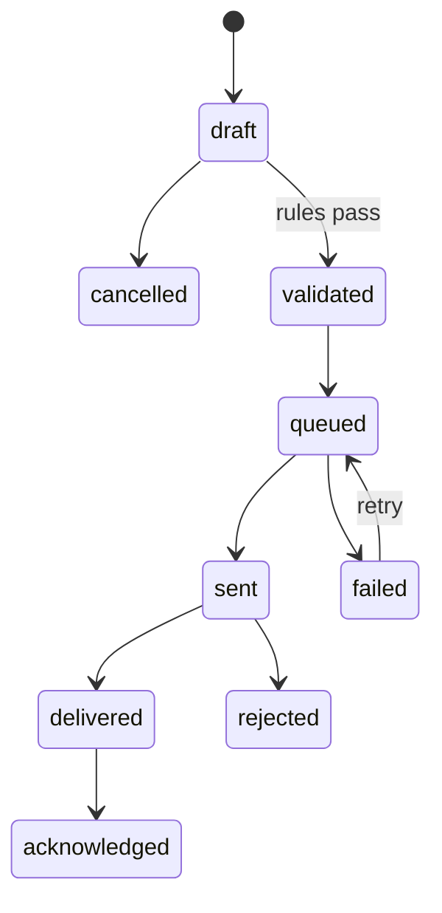

# Finance: accounting, invoicing, payments, banking, tax, e-invoicing, assets, budgets, consolidation

> **Status:** Draft 0.1  
> **Date:** 2026-10-01  
> **Scope:** Product specification of obop's finance area: the ledger kernel, Invoicing, Accounting, payments and bank reconciliation, tax, e-invoicing, assets, deferrals, budgets, expenses (financial side), multi-currency, multi-company and consolidation.

## 1. Purpose and scope

### 1.1 What this area is

Finance is obop's system of record for money. It owns the double-entry ledger and every document that creates ledger entries: invoices, bills, payments, bank statement lines, expense bills, asset and deferral schedules. It is also the acceptance test of the whole platform: sale, delivery, invoice, payment and journal entries must reconcile without manual repair [R01 s2.2, R09]. Odoo Community ships only "Invoicing"; reports, bank reconciliation, assets, deferrals, budgets and consolidation are Enterprise [R01 s5, R09 s1.1]. obop ships all of them open (Proposed, D2) and never gates ledger integrity, export or the API ([DECISIONS section 6](../DECISIONS.md)).

The entry path is the free, compliant Invoicing app (D4, Proposed). It runs on the same ledger as the Accounting app: showing the Accounting app adds ledger views and migrates no data. Accounting is the largest and riskiest build: Odoo's `account` model code is about 1.9 MB against 0.3 MB for `sale` [R20 s9.1], and the accounting and localisation burden is risk S2 [R26].

### 1.2 Modules

Tier, wave and open/paid status follow [DECISIONS section 5-6](../DECISIONS.md). Tiers and waves are Proposed (D25, D26) until the owner ratifies them; dated windows are W1 2027-01-01 to 2027-09-30, W2 to 2028-06-30, W3 to 2029-06-30, W4 after.

| Module (app) | Content | Tier | Wave | Open/paid |
|---|---|---|---|---|
| `account` (Accounting) | Ledger kernel, journals, AR/AP, reconciliation, locks, hash chain, reports | T1 | W1 | Open |
| `tax` | Tax engine, fiscal positions, tags, tax reports | T1 | W1 | Open |
| `invoicing` (Invoicing) | Invoices, credit notes, bills, terms, reminders, PDF | T1 | W1 | Open |
| `payment` | Manual, SEPA, Stripe plus one PSP, batches | T1 | W1 | Open; hosted gateways paid |
| `bank` | camt.053 and MT940 import, CSV mapping, reconciliation; aggregator feeds in W2 | T1 | W1, feeds W2 | Open |
| `edi` | EN 16931 UBL/CII, Factur-X, XRechnung, Peppol via partner access point | T1 | W1 | Open; hosted Peppol gateway paid |
| `l10n` framework, `l10n_de` | Pack hooks, German pack; `l10n_fr` W2, `l10n_pl` W3 | T1 | W1 | Open; Assurance service paid |
| `analytic` | Plans, accounts, distribution, lines | T0 | W1 | Open |
| `stock_account` | Stock valuation postings (specified in [supply-chain](supply-chain.md)) | T1 | W1 | Open |
| Multi-company | Selector, per-company books | T1 | W2 | Open |
| Approvals (in `automation`) | Posting and payment approvals | T0 | W2 | Open |
| `expenses` (financial side) | Expense bills, reimbursement; HR side in [people](people.md) | T1 | W3 | Open |
| Fixed assets, deferrals, budgets | Modules `assets`, `deferral`, `budget` (names Proposed) | T1 | W3 | Open |
| `intercompany` | Mirrored documents between companies | T2 | W3 | Open |
| `consolidation` | Translation, eliminations, non-controlling interest | T2 | W4 | Open |

Paid, per the closed list (D2): hosted gateways (Peppol, KSeF, Veri*Factu), the per-country Assurance service (legal-change SLA, filing connectors, capped warranty), WORM or object-lock checkpoint publication and auditor evidence packs. A hosted bank-feed broker [R21 s6.2] is listed only as a Proposed operated service over open code ([DECISIONS section 6](../DECISIONS.md), Q19 with Q3); because the list is closed and only ratchets from paid to open once published, the owner must answer before it is published (before the first public commit, D2; open question 6).

### 1.3 Boundaries

| Neighbour | Finance owns | Neighbour owns | Contract |
|---|---|---|---|
| [Sales and CRM](sales-crm.md) | Invoice posting, payment state | Orders, pricing, quantities, subscription dunning | `InvoiceableSource` (implemented by `sales` and `subscriptions`, called by `invoicing`); `InvoicePosted` updates `qty_invoiced` [R23 D.4] |
| [Supply chain](supply-chain.md) | Ledger, account roles, posting modes | Moves, valuation entries, landed costs, the three-way match (`purchase_bill_match`) | `PostingPort` by account role (callers `stock_account`, `mrp_account`); the `BeforeInvoicePost` extension point adds COGS |
| [People](people.md) | Vendor bill and reimbursement | Employees, expense policy, payroll engine | An approved claim (`ExpenseClaimApproved`) becomes a draft bill through `invoicing`; payroll calls `PostingPort` itself after a confirmed run (entries defined by the payroll pack) and emits `PayRunPosted` |
| [Retail](retail-commerce-marketing.md) | Session entries, PSP money | POS, checkout, fiscal signers | `pos_account` posts `PosSessionClosed` totals via `PostingPort`; `payment` |
| [Services](services.md) | Invoice of billable time, read from the sale line | Timesheets, project | Timesheets are analytic lines; billable time reaches invoicing only through the sale line (`QtyContributionPort` via `sale_timesheet`), then `InvoiceableSource` on `sales` [R23 D.4] |
| [Platform](platform.md) | Report definitions, locks | Contacts, currencies, approvals engine, import, documents | Registry, outbox, semantic layer |
| [Security](security-privacy.md), [Integrations](integrations.md), [AI](ai.md), [UX](ux.md) | Permission rows, retention classes, commands and events | Audit log, erasure; API, webhooks, MCP, importers; agents; views | D10, D33, section 4.15 |
| [Localization](../LOCALIZATION.md) | Pack hooks (section 4.14) | Pack content, channels, gates | D17, D34 |

### 1.4 Conventions

Entity, field, state, permission-group and event names follow [CONVENTIONS.md](../CONVENTIONS.md), the naming authority; they stay Proposed design unless a row cites a decision or research tag. Wave placements of capabilities that [DECISIONS section 5](../DECISIONS.md) does not name are Proposed too. Anything that rests on D2 (open/paid list), D4 (first market), D12 (expression storage), D13 (offline scope), D17 (compliance operating model), D20 (Typst) or D25/D26 (tiers, waves, dates) inherits "Proposed" even where the text does not repeat it; D28, D30, D34, D35 and D38 are binding. Money is bigint minor units in the ledger (D9). Figures marked (target) or (estimate) are not measurements. Versions and dates are as of 2026-10-01. Statutory statements come from the research and are not legal advice; a pack's stable gate includes accountant sign-off (D34, [R25 B3]).

## 2. Personas and roles

| Persona | Jobs in this area | Default permission group |
|---|---|---|
| Business owner or manager | Cash position, approve payments, read reports | `account.read`, `account.payment_approver` in small businesses |
| Billing clerk, office manager | Quote to invoice, send, chase, register payments | `account.billing` |
| Bookkeeper (in-house, part-time) | Bills, statements, reconciliation, payment runs | `account.bookkeeper` |
| Accountant, internal | Entries, closing, VAT returns | `account.user` |
| External accountant (up to 3 free seats, D2) | Read, adjust, export; MFA required by default | `account.adviser` |
| Controller or finance manager | Chart, taxes, journals, lock dates, budgets, consolidation | `account.manager` |
| Auditor, tax inspector (time-boxed) | Read ledger, audit log, hash verification, exports | `account.read` plus `audit.reader` |
| Employee | Submit expenses | Expense user (people); no `account.*` group |
| Customer, vendor | View and pay documents | Portal principal |
| Implementer | Install pack, map chart, migrate opening balances | `account.manager` plus pack install right |
| Agent, API client | Drafts, reads, suggestions | Intersection of token scopes and user rights (D18) |

| Permission group | Grants (scope `company`, D10) | Never grants |
|---|---|---|
| `account.read` | Reports, documents, drill-through, hash verification, exports | Edits |
| `account.billing` | Create and post sales documents, register payments, send | Vendor bank details, configuration |
| `account.bookkeeper` | Bills, statements, reconciliation, draft payments and batches | Batch release, configuration, locks |
| `account.user` | Post and reverse entries, revaluation, closing, tax reports, reconcile models | Hard lock, bank-detail changes |
| `account.adviser` | Everything `account.user` grants on the companies named on the seat, plus export | Configuration, payment release |
| `account.manager` | Configuration, soft lock dates, lock exceptions, packs; hard lock with step-up re-authentication [R18 s2] | Payment release (separate group) |
| `account.payment_approver` | Release batches, approve vendor bank-detail changes | Creating the same payment (separation of duties) |

The group names are the `account.*` names of the registry in [CONVENTIONS](../CONVENTIONS.md) section 4; [security-privacy](security-privacy.md) section 2 holds the seed list, and [ux](ux.md) and [people](people.md) use the same names. Auditors combine `account.read` with `audit.reader`; there is no separate auditor group. Agents never hold `account.payment_approver`; they create drafts, propose reconciliations and run dry-runs with a digest-bound `plan_id`, while posting, paying and changing bank details need a human or an approval policy (D18, [R16 s5]). IBANs, statement lines, batch files and customer payment token references (PSP references) are `financial` class behind `obop_cls_*` roles (D10, [R23 DR-4]). PSP API keys and webhook secrets are class `secret` (Proposed, [security-privacy](security-privacy.md) 4.1); until it is ratified they are vault entries handled as `financial`. Card numbers are never stored.

## 3. Capability map

Parity: CE and EE mean Odoo Community and Odoo Enterprise. "Not verified" marks edition facts the research did not establish.

| Capability | Description | Wave | Odoo parity |
|---|---|---|---|
| Double-entry ledger | Journals, entries, lines, GL, trial balance | W1 | Matches EE (CE has Invoicing only) |
| Chart from pack, parent accounts, roles | Country templates; roles replace hard-coded accounts | W1 | Matches CE/EE; parent accounts as Odoo 20 |
| Posted immutability, reversal-only correction | No unpost, ever | W1 | Beyond (DB-enforced, unconditional) |
| Gapless legal numbering at post | Row-locked counter per journal and fiscal year | W1 | Beyond (Odoo flags gaps afterwards) |
| Hash chain per journal | Versioned, integer canonical form, verifier | W1 | Matches CE; beyond on canonical form |
| Lock dates, time-boxed exceptions | Fiscal, sale, purchase, tax, hard | W1 | Matches CE (20.0 source); DB-enforced |
| Explicit fiscal years and periods | Non-overlapping tables | W1 | Beyond (Odoo keeps last day and month) |
| Opening balances, year-end closing | Dated opening entries with trial-balance diff; optional closing entry | W1 | Beyond; edition of Odoo's closing not verified |
| Invoices, credit and debit notes, bills, down payments | One document model, credit links | W1 | Matches CE |
| Payment terms, early-payment discount | Instalments, three discount modes, cash rounding | W1 | Matches CE |
| PDF, email, portal view and pay | Typst PDF/A-3b (Proposed, D20) | W1 | Matches CE; beyond on archival PDF |
| Overdue reminders; follow-up policy | Simple W1; multi-level W2 | W1, W2 | CE has automatic reminders in Odoo 20 [R01 s3.2]; no follow-up module in the CE tree [R09 s1.1] |
| Duplicate-bill fingerprint | Vendor, number, amount, date. The three-way match (`purchase_bill_match`) belongs to `purchase` ([supply-chain](supply-chain.md) 4.2); a mismatch sets `invoice.payment_hold` through an `invoicing-api` command (Proposed) | W1 | Not verified |
| Tax engine | Percent, fixed, group, division, price-included, base-affecting, tags | W1 | Matches CE |
| Fiscal positions, reverse charge | Substitution by country and VAT status | W1 | Matches CE |
| Cash-basis exigibility | Transition account, entries at payment | W1 (Proposed) | Matches CE |
| Withholding on payment, non-deductible VAT | Repartition features | W2 | Matches CE (Odoo 20) |
| VAT return from tags; OSS | German UStVA first; OSS W2 | W1, W2 | Returns match EE; OSS matches CE |
| `TaxProvider` trait | Contract W1; US sales-tax adapters W3 | W1, W3 | Matches EE (Avatax) |
| Payments, outstanding-account flow | `in_process` prevents double payment | W1 | Matches CE |
| SEPA credit transfer (pain.001) | Batches with maker-checker | W1 | No batch or SEPA file module in the Community 20.0 addons list (presumably EE, [I]) |
| SEPA direct debit (pain.008), mandates | Collection batches | W2 (Proposed) | Same: no module in the Community 20.0 list (presumably EE, [I]) |
| PSP payments | Stripe plus one; idempotent webhooks; payout reconciliation | W1 | Narrower than the 21 online providers in Odoo 20's docs [R21 s6.1], deliberately |
| Statement import | camt.053, MT940, CSV W1; OFX, QIF W2 | W1, W2 | No statement-import module in the Community 20.0 addons list (presumably EE, [I]) |
| Aggregator bank feeds | Bring-your-own-credential | W2 | Matches EE |
| Reconciliation | Split view, rules, suggestions, write-offs | W1 | Matches EE |
| Multi-currency | Rate types, exchange differences, revaluation | W1 | Matches CE; revaluation matches EE [I] |
| EN 16931 model, UBL/CII, XRechnung, Factur-X/ZUGFeRD | Create, parse, validate | W1 | Matches CE |
| Peppol via partner access point | `EDocTransport` trait | W1 | Matches CE (IAP proxy); beyond (bring your own) |
| Immutable e-document artefact | Raw XML, SHA-256, receipt | W1 | Beyond |
| Authority adapters | France via PA W2; KSeF beta W2, stable W3; Veri*Factu gated by counsel | W2, W3 | CE has connectors |
| Analytic accounting | Plans, distribution, lines | W1 | Matches CE |
| Budgets | Per analytic account, account, period; revisions | W3 | Matches EE |
| Fixed assets, deferrals | Schedule generators emitting ordinary entries | W3 | Matches EE |
| Expenses to vendor bills | Approved claim becomes a bill | W3 | Matches CE (Odoo 20) |
| Report engine and viewer | Trial balance, GL, aged, balance sheet, P&L; drill-through | W1 | Engine CE; catalogue and viewer EE |
| Audit-file exports | DATEV, GoBD W1; FEC W2; JPK W3 | W1-W3 | Mostly EE: no `l10n_*_reports` module in the CE tree [R25 B1] |
| Cash-flow statement, comparatives | Period columns, cash-flow report | W2 (Proposed) | Not verified |
| Multi-company books | Selector, per-company chart and locks | W2 | CE shares one tree; obop keeps company flat (D28) |
| Approvals on post and pay | Engine with CEL conditions | W2 | Matches EE |
| Intercompany mirroring | Durable events, inbox, reject | W3 | EE (inferred from absence) |
| VAT groups (`fiscal_unit`) | Returns per unit | W3 (Proposed) | Matches Odoo's tax units [R23 C.1]; no tax-unit module or model in the CE 20.0 tree, so presumably EE [I] |
| Consolidation | Translation, CTA, eliminations, non-controlling interest | W4 | Matches EE; beyond on eliminations |
| Code inside report definitions | Odoo lists a `custom` report engine; obop allows CEL only | Never | Deliberately skipped (D11) |

## 4. Per-app specification

### 4.1 Ledger kernel

Shared by every finance app. Each app section below adds only what differs.

#### 4.1.1 Entities

| Entity | Module | Purpose | Key fields | States |
|---|---|---|---|---|
| `account` | account | Chart node | `code` (unique per company), `account_type`, `reconcile`, `parent_id`, `is_group`, `currency_code?` | active, deprecated |
| `account_role` | account | Posting target by name | `role`, `account_id`, `valid_during` | - |
| `journal` | account | Numbering, hashing and posting scope | `kind` (sale, purchase, bank, cash, credit_card, general), `gapless`, `hash_chain`, `credit_note_series`, `payment_posting` (direct, via_outstanding) | active |
| `journal_sequence` | account | Counter and chain head per journal and fiscal year | `next_value`, `last_hash`, `last_chain_seq` | - |
| `journal_entry` | account | Ledger header | `entry_kind`, `ledger_kind` (statutory, consolidation), `date`, `number`, `currency_code`, `party_id`, `source_ref`, `reverses_entry_id`, `hash`, `prev_hash`, `is_system` | draft, posted, reversed |
| `journal_line` | account | Ledger line | `account_id`, `debit_minor`, `credit_minor`, `currency_code`, `amount_currency_minor`, `fx_rate`, `date_maturity`, `residual_minor`, `residual_currency_minor`, `open_item`, `repartition_line_id`, `analytic_distribution`, `statement_line_id` | follows entry |
| `fiscal_year`, `fiscal_period` | account | Calendar | `during` (date range), `kind` (normal, special) | open, closed |
| `lock_date`, `lock_exception` | account | Locks and time-boxed exceptions | `kind` (fiscal, sale, purchase, tax, hard), `locked_through`; `principal_id`, `until`, `reason`, `revoked_at` | - |
| `currency_rate` | base | Rate history | `rate NUMERIC(28,14)`, `rate_type` (spot, average, closing, historical), `valid_on`, source | - |
| `tax`, `tax_rate_version` | tax | Tax identity; effective-dated rate | `amount_type`, `price_include`, `include_base_amount`, `exigibility`; `rate`, `valid_during` | active |
| `tax_repartition_line` | tax | Where base and tax land | `document_type` (invoice, refund), `kind` (base, tax), `factor_pct`, account role, tags | - |
| `tax_tag` | tax | Return box | `code`, `applies_to`, `sign`, `pack_id` | - |
| `fiscal_position` | tax | Substitution | match rules (country, VAT-ID status, B2B or B2C), tax and account substitutions | - |
| `payment_term` | account | Due dates, discount | lines (balance, percent, fixed; offset), early-payment percent, days, mode | - |
| `invoice`, `invoice_line` | invoicing | Commercial document: one model for invoice, bill and credit note | `direction` (`out`, `in`), `kind` (`invoice`, `credit_note`, `debit_note`; values Proposed), `number`, `entry_id`, totals, `supplier_reference`, `payment_hold` (Proposed; set by the three-way match of `purchase` through an `invoicing-api` command), derived `payment_state` and `credit_state` | draft, posted, cancelled (drafts only) |
| `follow_up_policy` | invoicing | Invoice reminder steps (name Proposed); shares the step-list policy engine with subscription dunning | ordered steps, reminder templates | active |
| `invoice_line_tax` | tax | Frozen tax result | `tax_id`, `rate_version_id`, base, tax, `pack_version` | - |
| `bank_statement`, `bank_statement_line` | bank | Imported bank truth | balances, `source_hash`, `provider_transaction_id`, amount, counterparty, reference, `entry_id` | imported, matched, reconciled |
| `payment`, `payment_batch` | payment | Money movement; SEPA file | `direction`, `journal_id`, `method`, amount, `batch_id`, `entry_id`; `file_hash` | draft, posted, reconciled, voided; batch: draft, confirmed, exported, reconciled |
| `payment_provider`, `payment_transaction` | payment | PSP link | pinned API version, `provider_tx_id` (unique) | draft, pending, authorized, done, cancelled, error, refunded |
| `reconciliation_partial`, `reconciliation_group` | account | Matching | debit and credit line, amounts in both currencies, `exchange_entry_id`, `source`, `unreconciled_at` | active, unreconciled |
| `reconcile_model` | account | Rules | `kind` (match, writeoff), `trigger` (manual, suggest, auto), condition (Domain AST; JSON storage is Proposed, D12), tolerance | active |
| `e_document` | edi | Issued or received e-invoice | `format`, `transport`, raw XML blob, SHA-256, receipt, validation report, pack version | draft, validated, queued, sent, delivered, acknowledged, rejected, failed, cancelled |
| `asset`, `asset_schedule_line`, `depreciation_model` | assets | Fixed asset and schedule | cost, salvage, method, duration, roles | draft, running, paused, closed, disposed |
| `deferral`, `deferral_line` | deferral | Release schedule | source line, dates, method | draft, running, done |
| `analytic_plan`, `analytic_account`, `analytic_line`; `budget`, `budget_line` | analytic, budget | Dimensions; plan vs actual | `analytic_distribution`; `revision`, planned minor | budget: draft, confirmed, superseded |
| `interco_link`, `ownership_interest`, `fiscal_unit`, `elimination_run` | intercompany, consolidation | Company-group structure (the single definition of these entities; `failed` is a retryable state, for example when the mirror company's period is locked) | `interco_link`: `src_ref`, `mirror_ref`, `idempotency_key`; `ownership_interest`: `pct_bp`, `method`, `valid_during` (no overlap) [R23 C.2, C.4] | link: pending, mirrored, rejected, failed |

Account types (19; names Proposed, coverage equal to Odoo's [R09 s1.3]): receivable, payable, bank_cash, credit_card, current_asset, non_current_asset, prepayment, fixed_asset, current_liability, non_current_liability, equity, unaffected_earnings, income, other_income, expense, other_expense, depreciation, direct_cost, off_balance. Account roles are snake_case identifiers, not prose (registry: [CONVENTIONS](../CONVENTIONS.md) section 6; US spelling): `receivable`, `payable`, `outstanding_receipts`, `outstanding_payments`, `suspense`, `fx_gain_realized`, `fx_loss_realized`, `fx_gain_unrealized`, `fx_loss_unrealized`, `stock_valuation`, `stock_variation`, `grni`, `cogs`, `price_difference`, `inventory_loss`, `production_cost`, `work_center_absorption`, `landed_cost_clearing`, `tax_payable`, `tax_transition`, `deferred_revenue`, `deferred_expense`, `accumulated_depreciation`, `cumulative_translation_adjustment`, `down_payment`, `rental_deposit_liability`, `gift_card_liability`, `purchases`. The roles from `inventory_loss` to `landed_cost_clearing` are the ones [supply-chain](supply-chain.md) requests through `PostingPort`; the last four names are Proposed. An account that is not a role (office expense, payable to employee) stays a chart account. Document totals are bigint minor units; unit prices `NUMERIC(24,8)`; quantities `NUMERIC(24,6)`; rates `NUMERIC(28,14)` (D9).

#### 4.1.2 Posting rules

1. Commands (`PostInvoice`, `RegisterPayment`, `ImportStatement`, `ReconcileLines`, `PostEntry`, `ReverseEntry`) run as one command in one transaction with a unique `command_id` (D27 R1, D9). A repeated `command_id` returns the first result.
2. An entry is created draft, lines are inserted, then the state flips to posted in the same transaction: lock check, number, hash, deferred balance check. Application commands never insert an entry as posted. The only Proposed exception is `obop restore` under a dedicated restore role into an empty business, which keeps numbers and hashes and re-verifies the chain and the balance check ([integrations](integrations.md) open question 5; finance open question 15). Imported opening entries arrive as drafts and go through the normal posting step.
3. Corrections are reversal entries dated in an open period; a credit note is a reversal with commercial lines. There is no reset to draft (D30).
4. Modules request lines by account role through `PostingPort` (in `account-api`), never by account id; `account` validates and posts in the caller's transaction (D27). Resolution order: explicit account on the line, product or category profile, fiscal-position substitution, company role default.
5. Each line stores currency, `amount_currency_minor` and the applied rate; company-currency amounts are `round(amount_currency x rate)`. The counterparty line (receivable or payable) absorbs conversion rounding.
6. System entries (exchange differences, revaluation, depreciation, deferral release, tax closing, stock valuation, eliminations) follow the same rules: `is_system`, lock dates, numbering.
7. Drafts are editable under `row_version` optimistic concurrency (SQLSTATE 40001 and 40P01 retried); deleting a draft is audited and consumes no number.
8. Entry `date` fixes the period; documents also carry invoice date, due dates and an optional tax-point date.

#### 4.1.3 Database-enforced invariants (D30)

| ID | Invariant | Mechanism |
|---|---|---|
| INV-01 | Posted entry balances in company currency and is not empty | Deferred constraint trigger on `journal_entry`, once per posting [R08 s11] |
| INV-02 | Line shape: `debit >= 0`, `credit >= 0`, `debit x credit = 0`; `amount_currency` sign matches; equals `debit - credit` in company currency | CHECK [R23 DR-5] |
| INV-03 | Posted rows are immutable except whitelisted reconciliation columns | BEFORE UPDATE and DELETE triggers; DELETE and TRUNCATE revoked |
| INV-04 | Transitions only draft, posted, reversed; reversed needs a linked reversal | Trigger plus deferred check |
| INV-05 | No posting at or before a lock date without a live exception; hard lock moves only forward | Triggers on entry, line and generated entries [R09 s9.7] |
| INV-06 | Legal number assigned only at post, unique per company and journal | Counter row lock; `CHECK (state='draft' OR number IS NOT NULL)`; unique index |
| INV-07 | Hash and previous hash never change; chain sequence unique | Trigger; `UNIQUE (journal_sequence_id, chain_seq)` |
| INV-08 | Account code unique; receivable and payable are reconcilable; type frozen once used; no posting to group or deprecated accounts; off-balance isolated | Unique index; triggers; composite FK `(company_id, account_id)` |
| INV-09 | Partials never exceed a line in either currency; same account and company; full only at zero residual; residuals equal amount minus partials | Deferred trigger |
| INV-10 | Repartition factors sum to 100 per tax, document type and kind; rate versions do not overlap | Deferred trigger; EXCLUDE (PG 17 level) |
| INV-11 | Fiscal years do not overlap and cover every entry date | EXCLUDE plus a coverage trigger; `WITHOUT OVERLAPS` behind `requires_pg = 18` (D8) |
| INV-12 | Invoice totals equal posted line sums; cumulative credit never exceeds the original | Deferred trigger on credit links |
| INV-13 | E-document artefact immutable after validation; status moves only along the transition table | Trigger |
| INV-14 | Statement lines and PSP events are idempotent; bank-account lines need a statement line unless the journal posts directly | Unique indexes; trigger [R09 s9.13] |
| INV-15 | Company isolation | `company_id NOT NULL`, composite FKs, RLS backstop (D10) |
| INV-16 | Audit and security events are append-only; lock, journal and tax configuration changes always logged | Trigger; REVOKE [R18 s6] |
| INV-17 | No anonymising or deleting posted-document personal data before the pack's retention class expires | Pack-driven guard |

#### 4.1.4 Legal numbering and the hash chain

A `journal_sequence` row per journal and fiscal year holds `next_value` and the chain head. Posting locks it (with `lock_timeout`, so callers queue instead of failing, [R22 s6]), takes the number late in the transaction, computes the hash and commits; a rollback returns the number. Patterns are per journal, for example `INV/2027/0001`; credit notes may use their own series. Vendor bills carry an internal number plus the unique supplier reference. Gapless is a journal flag, default on for sale journals [R08 s11]; packs force it where a regime requires (Veri*Factu chains, French anti-fraud, [R09 s4]). A nightly gap detector backs the unique index.

The chain is `hash = SHA-256(prev_hash || canonical(entry, lines))` with a version prefix. Canonicalisation uses sorted keys and integer minor units, so there is no decimal formatting ambiguity. A new fiscal year starts with the previous final hash. `obop ledger verify` recomputes it; the monthly restore drill runs it [R27 A2]. Signed checkpoints to WORM storage are a paid `ee` feature; the chain and verifier are open (D2).

#### 4.1.5 Fiscal calendar and lock dates

Fiscal years and periods are tables, not a day-and-month setting (unlike Odoo, [R09 s1.3]); periods default to months, with special periods for opening and closing adjustments (Proposed). Locks: fiscal (all journals), sale, purchase, tax (tax-tagged lines) and hard (irreversible). Soft locks move with `account.manager`; `lock_exception` is per principal, time-boxed and audited. Jobs (depreciation, deferral release) skip locked periods and date output on the first open day with an alert. The tax closing entry sets the tax lock when posted (configurable).

#### 4.1.6 Reconciliation model

Eligible lines are `open_item` lines on reconcilable accounts with a non-zero residual. Revaluation lines are not open items. A partial pairs one debit and one credit line with amounts in company and line currency; partials are append-only (un-reconciling sets `unreconciled_at` and reverses the exchange-difference entry). When the line-currency residual reaches zero but the company-currency residual does not, the command creates a system exchange-difference entry (one line per group, dated the later of the two dates, or the first open day if locked) and the group becomes full. Payments reconcile to invoices at registration; bank lines reconcile to payments' outstanding lines or directly to invoices.

Suggestions come from `reconcile_model` rules (reference, amount, party, IBAN, date distance). Only `auto` rules with exact matches reconcile unattended (`source = rule`); write-offs use a configured account, optional tax and a tolerance. AI may rank candidates; it never posts (D18).

### 4.2 Invoicing

**Purpose.** Legal customer and vendor documents, and the free on-ramp (D4).

**W1 vs later.** W1: invoices, credit and debit notes, bills and refunds, payment terms with instalments, early-payment discount (included, excluded, mixed; VAT base adjusted, [R09 s2]), cash rounding, down payments, PDF with a SEPA (EPC) QR code [R09 s1.2], email, portal view and pay, reminders, duplicate detection. W2: multi-level follow-up policy, receipts. W3: recurring billing from subscriptions (sales-crm).

**Entities and states.** `invoice`, `invoice_line`, `invoice_line_tax`, `payment_term` (section 4.1.1). Document state: draft, posted, cancelled (never-numbered drafts only). Derived `payment_state`: unpaid, partial, in_process (covered by posted payments not yet bank-matched), paid. Derived `credit_state`: `none`, `partially_credited`, `fully_credited`.

**Workflow.**
1. Draft from an `InvoiceableSource` (sales order, including billable time through `sale_timesheet`; subscription) or manually; the tax engine recomputes on every edit.
2. Preview entries (`dry_run`): lines by role, no number.
3. Post: locks, `BeforeInvoicePost` (COGS lines, EN 16931 pre-flight), number, hash, balance check.
4. Issue: Typst PDF/A-3b (Proposed, D20), e-document, email or portal.
5. Collect: payment link, SEPA, bank match, reminders.
6. Correct with a linked credit note; never edit.

**Flows.** Runs the extension point `BeforeInvoicePost` (not an event). Emits `InvoicePosted` for every posted document, a credit note included, and `InvoiceReversed` for the effect of a credit note or full reversal on the original invoice. Calls `InvoiceableSource` for billable quantities; consumes `PaymentPosted`, `PaymentReconciled` and `PaymentVoided` (for `payment_state`) and `EDocumentStatusChanged`. Also consumes `PosInvoiceRequested` (draft invoice through `InvoiceableSource`, [retail](retail-commerce-marketing.md) 4.1) and `ReturnRequested` and `WithdrawalRequested` (credit note once the return is approved, retail 4.3).

**Permissions.** `account.billing` posts; the approvals engine (W2) can require approval above thresholds. Vendor bank details are `financial` class.

**Reports.** Aged receivables and payables, sales journal, invoice analysis (semantic layer), overdue list, cash position tile.

**Configuration.** Default journals, payment terms, numbering patterns, reminder templates, PDF layout (minijinja to Typst, D20), rounding profile. On the on-ramp, bank and cash journals default to `payment_posting = direct`, so a payment needs no bank import; switching a journal to `via_outstanding` affects new payments only (Proposed). Reminders (`follow_up_policy`, name Proposed) share the step-list policy engine that subscription dunning uses [R11 s8.3, s8.2], as [sales-crm](sales-crm.md) also assumes (Proposed; the engine's host module stays open).

**Localization.** The pack sets numbering, mandatory invoice fields, reminder wording and e-invoice format defaults.

**Open or paid.** Open. The hosted Free plan bundles contacts, products, quotes, invoices, payments and EN 16931/Peppol with unlimited users; its quotas (100 documents a month, Peppol sends prepaid at cost plus 50%) are price-test hypotheses for hosting [R26 A3], not code gates.

### 4.3 Accounting

**Purpose.** General ledger, period discipline, bank-to-ledger truth, statutory reporting.

**W1 vs later.** W1: chart and roles from pack, misc entries, reversal, reconciliation, locks, closing, reports, opening-balance import, hash verification. W2: multi-company, cash-flow statement, approvals. Later: dual-book depreciation, multi-GAAP ledgers, loans, Intrastat (section 8).

**Entities.** Section 4.1.1. Entry kinds: invoice_out, invoice_in, credit, payment, bank, misc, opening, closing, revaluation, exchange_difference, tax_closing, depreciation, deferral, stock_valuation, elimination.

**Workflow (period close).**
1. Bank lines matched; suspense balance zero.
2. Revaluation run with auto-reversal (4.7); depreciation and deferral jobs posted.
3. Trial balance and sequence-gap report clean.
4. Tax closing entry; return filed outside core.
5. Soft lock moved; at year end, fiscal year closed and an optional closing entry posted.

Balance sheet accounts are continuous across years; unaffected earnings is computed, and a closing entry is optional per pack (Proposed).

**Flows.** Emits `EntryPosted` and `LockDateChanged`; `TaxClosingPosted` is emitted by `tax` (4.4), not by `account`. Consumes `PostingPort` requests and, as listed in 4.15, `PartyBankAccountChanged` (Proposed; approval and payment block, 4.5), `ExtractionCompleted` (draft vendor bill from an inbound document, through the optional `ExtractionPort`) and `CommissionPeriodClosed` (draft vendor bill for external agents); the draft bills are created through `invoicing`.

**Reports.** Catalogue and engine in 4.13. Totals read in-transaction rollups `account_balance(company, account, period)` [R22 s4]; the viewer with drill-through is in the v1 view catalogue (D35, [R19 s6]).

**Permissions.** `account.user` posts and reverses; `account.manager` configures and moves soft locks; hard lock needs step-up re-authentication.

**Configuration.** Functional currency, fiscal calendar, rounding profile (`per_line` or `per_group`), stock posting mode (`perpetual_at_invoicing`, `perpetual_per_transfer` with GRNI, `periodic` (W2, [supply-chain](supply-chain.md) section 3), [R10 s6.4]; `perpetual_at_invoicing` is the Proposed core default, matching [supply-chain](supply-chain.md), and a pack may default differently, open question 1), journals, roles, locks.

**Localization and open/paid.** Chart, tax and report content come from the pack. All open; the audit log and hash chain are never gated (D2).

### 4.4 Tax

**Purpose.** Compute tax deterministically, record where it lands, and feed returns.

**W1 vs later.** W1: percent, fixed, group and division taxes; price-included; base-affecting; non-deductible share; repartition with tags; fiscal positions with reverse charge; effective-dated rates; cash-basis exigibility (Proposed); tax reports. W2: withholding on payment, OSS report. W3: `TaxProvider` adapters; VAT groups.

**Fiscal positions** match on country, VAT-ID status (VIES, cached with validity) and B2B or B2C, then substitute taxes and accounts. Illustrative reverse-charge bill (the pack defines accounts and tags): net 1,000.00 gives Dr Expense 1,000.00, Dr Input VAT 190.00, Cr Reverse-charge VAT 190.00, Cr Payable 1,000.00.

**Tax engine contract.**

| Item | Contract |
|---|---|
| Input | Tax-point date, company tax profile, resolved fiscal position, lines (quantity, unit price, discount, tax ids), currency exponent, rounding profile, cash rounding, early-payment mode |
| Output | Per-line base and tax (minor units), totals per (tax, rate), expanded repartition lines (role, tags, sign), rounding line, `explain` trace, pack and rate versions used |
| Guarantees | Pure, total, deterministic, no I/O or clock; same crate runs on the server and in Wasm for drafts, POS and cart (D29, [R12 s3.2]) |
| Lifecycle | Computed on every draft edit; recomputed once from frozen inputs at post; stored in `invoice_line_tax`; never recomputed after post (D38) |
| External engine | `TaxProvider`: `calculate` (draft), `commit` (post, idempotent on document id and version), `void`, `refund` (credit notes) [R21 s6.7]. Provider failure blocks posting unless a fallback is configured; provider reference and raw response are stored |

Rounding example: three lines of 1.02 at 19% give 0.57 with `per_line` and 0.58 with `per_group` (3.06 x 0.19 = 0.5814). EN 16931 output requires group rounding (BR-CO-17) [R23 DR-5], so EU packs default to `per_group` and freeze it after the first posting (Proposed).

**Flows and reports.** Emits `TaxClosingPosted` (period, entry id) and, Proposed, `TaxRuleChanged` (rule or version id; W3, for the POS snapshot builder; [retail](retail-commerce-marketing.md) open question 17 names the alternative of reading tax tables by `row_version`). Reports: tax report by box, tax audit (lines per tag), EC sales list and OSS (packs).

**Permissions and configuration.** `account.manager` edits taxes; an edit creates a new `tax_rate_version`, never a change to a used one. Company tax profile: country, registrations, exigibility default, fiscal-position auto-detect, provider or built-in engine.

**Localization.** Rates, tags and boxes are pack data, released independently of core (D34). US sales tax is bought, not built (`TaxProvider`, [R25 B9]).

**Open or paid.** Open. Filing connectors (transmission) are the paid Assurance service.

### 4.5 Payments and bank reconciliation

**Purpose.** Move money and prove it against the bank.

**W1 vs later.** W1: manual payments, batches with pain.001, Stripe plus one PSP, statement import (camt.053, MT940, CSV mapping), reconciliation. W2: aggregator feeds, OFX and QIF, pain.008 and mandates (Proposed). Later: payment initiation services beyond SEPA files.

**States.** Payment: draft, posted (shown as "Paid"; the outstanding entry exists), reconciled (bank-matched), voided (reversed; a reconciled payment is unreconciled first). The register-payment dialog subtracts posted payments so a bill cannot be paid twice [R09 s6].

**Workflow.**
1. Import a statement (idempotent on `source_hash` and provider transaction id); each line creates its own bank entry against the suspense role. The opening and closing balance must chain. A line dated inside a locked period is rejected and listed in the import report; the accountant grants a lock exception, and nothing is silently re-dated (Proposed).
2. Accept suggestions or match manually; differences go to a write-off or an exchange difference.
3. Register payments against invoices or bills, singly or as a batch; the entry debits or credits an outstanding role. Cash journals, and journals with `payment_posting = direct`, post to the account at once.
4. Export a pain.001 file; an `account.payment_approver` releases it. A bill with `payment_hold` set (by the three-way match of `purchase`, [supply-chain](supply-chain.md) 4.2, through an `invoicing-api` command; Proposed) cannot enter a batch until the hold is released.
5. When the bank line arrives, matching it to the payment replaces suspense with the outstanding line; payment becomes reconciled.
6. PSP: the webhook (deduplicated by provider event id, state re-fetched) posts the payment; the net payout line reconciles to the payments plus a fee entry.

**Flows.** Emits `PaymentTransactionDone`, `PaymentTransactionFailed`, `PaymentPosted`, `PaymentReconciled`, `PaymentVoided`, `BankStatementImported`. Consumes PSP webhooks through the inbox (D27 R3) and `PartyBankAccountChanged` (Proposed; emitted by base contacts, [platform](platform.md) 4.2): a changed vendor bank account needs an `account.payment_approver`, and until it is approved the party's bills cannot enter a batch.

**Permissions and data.** Bank data is `financial` class. Payees and bank-detail changes need approval; new payees and large amounts always need a human, regardless of agent confidence [R16 s5]. Stripe API version is pinned per connector (`2026-09-30.endive` as of 2026-10-01); `async-stripe` 0.41.0 (stable; the 1.0 line is still a release candidate) stays behind the `PaymentProvider` trait at an exact pin [R21 s6.1, R09 s10].

**Reports.** Bank reconciliation, unreconciled items, outstanding payments, batches.

**Configuration.** Journals, PSP credentials (vault entries, class `secret`, Proposed), reconciliation rules, match and write-off tolerances, approval thresholds.

**Localization.** SEPA for the euro area; statement variants per bank; aggregators stay replaceable as PSD3/PSR is not yet adopted [R21 s6.2].

**Open or paid.** Open. Hosted gateways and any hosted bank-feed broker are operated services.

### 4.6 E-invoicing and e-reporting

**Purpose.** Issue and receive legally valid electronic invoices on one internal semantic model (EN 16931, [R09 MUST 4]).

**W1 vs later.** W1: UBL 2.1 and CII, XRechnung, Factur-X/ZUGFeRD, parse and validate, Peppol via partner access point, inbound to draft bill. W2: French PA connector (integrate, do not accredit, Proposed D17); KSeF beta. W3: KSeF stable with the Polish pack (D26). Spain Veri*Factu is gated behind counsel (Proposed, D17).

**Pins (as of 2026-10-01).** CEN validation artefacts 1.3.16 and code list v17.0 (effective 2026-05-15; next 2026-11-16, then 2027-05-17); Peppol BIS Billing 3.0.21 (mandatory 2026-08-17); KoSIT validator 1.6.3 and xrechnung-schematron 2.6.0; Factur-X 1.09.2 = ZUGFeRD 2.5.2 [R00 s3.6, R09 s5.1]. **Runtime versus CI.** Production validation is Rust: a Rust rule engine behind `DocFormat::validate` executes rule sets derived from the pinned CEN artefacts and xrechnung-schematron, and the rule sets ship as versioned pack data. The `en16931` crate (0.7.0) is about two months old, so it is at most an accelerator, not a foundation; the alternative is an in-house engine over the same rule data (Proposed, open question 17). KoSIT (with xrechnung-schematron), Mustang and phase4 are Java and other off-the-shelf CI oracles that gate pack releases and run in CI images only; obop authors no Java (I-1, Proposed; [Localization](../LOCALIZATION.md) section 2.3).

**Workflow (outbound).**
1. At `BeforeInvoicePost`, pure-Rust BR-CO totals and mandatory-field checks run; failure blocks posting with a problem+json error.
2. After commit, the durable `InvoicePosted` handler builds the syntax, runs the Rust validation engine against the pinned rule sets and stores raw XML, SHA-256 and report (immutable).
3. `EDocTransport` sends (`send`, `poll`, `receive`, `cancel`) through the partner access point.
4. Status and receipt are stored; the invoice shows the badge.
5. A rejected invoice keeps its number; the fix is a credit note plus a new invoice. A pack hotfix for schema rejections is a 72-hour target inside the paid Assurance service only (Proposed, D17; [R25 B2]).

Inbound: receive, parse deterministically (no OCR), validate, deduplicate by fingerprint, create a draft bill; OCR and language-model extraction is the fallback and lives in [ai](ai.md); its `ExtractionCompleted` event carries the draft reference (4.15). E-reporting (French B2C and cross-border flows, Veri*Factu records) uses the same state machine with report-type documents.

**Flows.** Emits `EDocumentStatusChanged`; consumes `InvoicePosted` only. A credit note is itself a posted invoice and reaches `edi` as `InvoicePosted`; `InvoiceReversed` carries no new document.

**Permissions and reports.** Artefacts contain personal data of B2C buyers; they follow the invoice's retention class. Reports: e-document status, rejected queue, inbound inbox. Configuration: transport credentials (vault), customer format preference, retry policy.

**Localization.** Mandate dates drive pack timing: German issue duty 2027-01-01 (above EUR 800k) and 2028-01-01 (all), French SMEs 2027-09-01, ViDA reporting 2030-07-01 ([Localization](../LOCALIZATION.md), [R25 A2], [R09 s3, s5.2]).

**Open or paid.** Syntaxes and validators are open. A hosted Peppol, KSeF or Veri*Factu gateway is paid (D2); self-hosters bring their own access point.

### 4.7 Multi-currency

Every line stores currency, foreign amount and the applied rate (direct quote: functional-currency units per unit of document currency, Proposed); history is never re-derived [R23 DR-5]. Rate types: spot, average, closing, historical; sources behind an `ExchangeRateSource` trait (for example daily ECB reference rates). The currency exponent is data, not assumed (0, 2, 3, 4 digits; load ISO exponents, CLDR differs for some).

Period-end revaluation: a run at closing rate over open foreign-currency items (and foreign-currency bank accounts) posts unrealised gain or loss with an automatic reversal on the next day; the lines are not open items. Realised differences come only from reconciliation (4.1.6). Translation and CTA for consolidation are in 4.12.

**W1 vs later.** W1: rates, exchange differences, revaluation. W4: translation. **Flows.** Consumes `FxRatesUpdated` (base) to suggest a revaluation; emits `EntryPosted`. **Permissions.** `account.user` runs revaluation; `account.manager` sets sources and accounts. **Reports.** Foreign-currency open items, realised and unrealised differences. **Configuration.** Enabled currencies, rate sources, functional currency (fixed once posted). **Localization.** Central-bank sources differ by country; packs supply defaults [R09 s10]. **Open.**

### 4.8 Analytic accounting and budgets

**Analytic (W1).** Plans and accounts are business-wide; `analytic_distribution` (account id to percentage) sits on document lines, and posting writes `analytic_line` rows with one `analytic_line_tag(line_id, plan_id, account_id)` row per plan (no column per plan, [R23 B.1]). Each line carries a `source_ref` so reports tell timesheet, invoice and bill lines apart, and a module may own a 1:1 extension row on it, which answers [services](services.md) open question 3 (Proposed). Distribution models default by party, product or account. Timesheets are analytic lines ([services](services.md)).

**Budgets (W3).** A budget covers a date range, with lines per analytic account or account and period; confirmed budgets are immutable and changes are new revisions. Actual and committed amounts (confirmed, not yet invoiced orders, Proposed) come from the ledger and sales/purchase. Overrun alerts are automation rules with CEL conditions (D11).

**Workflow.** Draft, confirm, revise (new revision), compare in the report viewer with drill-through. **Flows.** Posting writes analytic lines; a budget overrun is an automation trigger, not a posting block. **Permissions.** `account.manager` edits budgets; analytic read follows the account's company scope. **Reports.** Budget vs actual vs committed, variance by plan, analytic P&L. **Configuration.** Plans, distribution models. **Open.**

### 4.9 Fixed assets (W3)

Schedule generator emitting ordinary entries [R09 s2]. Workflow: a vendor-bill line on a capitalisable account proposes an asset draft; confirm generates `asset_schedule_line` rows (linear or degressive, prorata by day or month, methods from the `depreciation_model` in the pack); a monthly job posts each line idempotently (unique asset and period); modification regenerates future lines; disposal posts final depreciation and a gain or loss. The last line absorbs rounding.

**Flows.** Consumes `InvoicePosted` (purchase bills propose assets; sale invoices on an asset trigger disposal); emits `AssetDepreciationPosted`. **Permissions.** `account.user` confirms, modifies and disposes. **Reports.** Asset register, schedule, disposals. **Configuration.** Depreciation models, the `accumulated_depreciation` role and the asset and expense accounts, capitalisation threshold. **Localization.** Packs define permitted methods and durations; dual tax and book depreciation is an open question. **Open.**

### 4.10 Deferred revenue and expenses (W3)

A line with a deferral policy posts to the `deferred_revenue` or `deferred_expense` role account; a `deferral_line` schedule releases equal monthly amounts (or daily prorata) through generated entries, the last absorbing rounding. Tax follows the pack's tax point, not the release. Odoo posts the opposite way (revenue first, then moves it); this is Proposed and keeps one entry per release.

**Flows.** Emits `DeferralReleased`; consumes `InvoicePosted`. **Permissions.** `account.user`. **Reports.** Deferral schedule, deferred balance by contract. **Configuration.** The `deferred_revenue` and `deferred_expense` roles, default method, release day. **Localization.** Release rules follow the pack's revenue-recognition conventions. **Open.**

### 4.11 Expenses (financial side, W3)

**Workflow.**
1. The employee submits a claim with receipts (HR side in [people](people.md)).
2. The approvals engine routes it (CEL conditions, [R15 s9]); claim states (owned by [people](people.md) 4.5): draft, submitted, approved, refused, cancelled. `reimbursed` is a value of the derived `reimbursement_state`, not a claim state.
3. Approval creates a draft vendor bill in the expense journal through `invoicing`, with the employee as party (Odoo 20 does the same, [R09 s1.2], [R13 s3.4]); the accountant posts it.
4. Reimbursement is a SEPA payment to the employee's IBAN (`financial` class).

**Flows.** Consumes `ExpenseClaimApproved` (people) and creates the draft bill through `invoicing` with a unique source reference per claim; `expenses` is not a `PostingPort` caller. Re-invoicing to customers is Proposed through `expenses_sales`, with `expenses` as an `InvoiceableSource` implementer called by `invoicing`. **Reports.** Open claims, spend by category and analytic account. **Configuration.** Categories as products with expense accounts and taxes. **Localization.** Per-diem and mileage rules are pack data (later). OCR is optional and reaches [ai](ai.md) through the optional `ExtractionPort` (4.15). **Open.**

### 4.12 Multi-company, intercompany and consolidation

**Structure (D28).** `company` is flat and tied to one legal-entity party; `branch` has no books and only tags documents; company groups are `ownership_interest` edges; VAT groups are `fiscal_unit`. W1 ships one company with `company_id NOT NULL`, composite foreign keys and a dormant branch; W2 adds the selector and per-company books (DECISIONS ruling 33). Accounts, journals, taxes, fiscal positions, sequences, locks and calendar are per company; parties, products and analytic plans are business-wide [R23 C.3]. Reads span the selected companies; writes need exactly one.

**Intercompany (W3).** `InvoicePosted` in company A to a party that represents company B creates a draft mirror bill in B through a durable event; `interco_link(src_ref, mirror_ref, state, idempotency_key)` tracks it (states in 4.1.1: pending, mirrored, rejected, failed); auto-validate and reject are per pair. It is asynchronous on purpose: B's lock date must not block A's posting [R23 C.4].

**Consolidation (W4).** A `ledger_kind = consolidation` ledger separates company-group entries from statutory books. `elimination_run` matches `interco_link` pairs and posts eliminations only there; unmatched differences are reported, never auto-posted. Translation: balance sheet at closing rate, P&L at average or transaction rate, equity at historical rate; the difference goes to the cumulative translation adjustment account. Non-controlling interest comes from `ownership_interest`. First cut: full consolidation only. IAS 21 and IFRS 10 details are unverified in the research and need accountant sign-off [R23 C.4]. Franchise networks are separate businesses, not companies (section 8).

**W1 vs later.** W1 one company; W2 multi-company; W3 intercompany and VAT groups; W4 consolidation. **Flows.** Emits `IntercompanyMirrorCreated`; consumes `InvoicePosted`. **Permissions.** `account.manager` on each company; company-group reporting needs rights on all included companies. **Reports.** Consolidated balance sheet and P&L, elimination report, unmatched interco differences. **Configuration.** Ownership edges, company-group account map (`group_account_map`, [R23 C.3]), translation rate types, per-pair auto-validate. **Localization.** VAT-group treatment is national and unverified for branches [R23 C.2]. **Open.**

### 4.13 Financial reports and audit trail

**Report engine (W1).** A `report_definition` is data: lines, columns and expressions over tax tags, account codes, domains (Domain AST; JSON storage is Proposed, D12), other lines, manual values and CEL. The same definitions serve tax returns, balance sheet, P&L, aged balances and consolidation. A `SemanticQuery` fixes target currency, rate type and company scope, so multi-currency sums are explicit [R23 B.3]. Output goes to the viewer (comparison columns, every number drillable), XLSX, CSV and Typst PDF (Proposed, D20). No code in report data (D11).

**Catalogue.** W1: trial balance, general ledger, party ledger, aged receivables and payables, balance sheet, P&L, journal listing, open items, tax report, bank reconciliation report, sequence-gap report, hash-verification report, lock-exception report. W2: cash-flow statement, comparatives across years. W3: asset register, budget vs actual. W4: consolidated statements. Dashboard tiles (drillable): cash position, overdue, unreconciled lines, tax due, lock and hash status.

**Audit trail.** Four layers: immutable posted entries with the hash chain; field-level change logs on drafts and configuration; an append-only security log with pseudonymous actors (INV-16); and the `e_document` artefacts. Auditors hold `account.read` plus `audit.reader`: read-only, with export of the chain, the audit log and audit files (DATEV and GoBD in the German pack, FEC, SAF-T, JPK as `AuditFileExporter` pack hooks). WORM checkpoint publication and auditor evidence packs are the paid `ee` features (D2).

### 4.14 Localization-pack hooks

Core never imports a country; packs register at start-up [R09 s8]. Hooks (content and gates in [Localization](../LOCALIZATION.md), D17, D34):

| Hook | Form | Finance use |
|---|---|---|
| Chart template | Data | Accounts, parents, roles, default journals |
| Tax template | Data, effective-dated | Taxes, versions, repartition, tags, fiscal positions |
| Report definitions | Data (declarative) | VAT return, balance sheet, P&L, aged |
| `IntegrityProfile` | Policy data | Gapless scope, hash fields and version, lock defaults, retention years, QR spec |
| `AuditFileExporter` | Code | DATEV, GoBD, FEC, SAF-T, JPK |
| `DocFormat`, `EDocTransport` | Code | Build, parse, validate; send, poll, receive, cancel |
| `VatIdValidator`, `ExchangeRateSource` | Code | VIES; rate feeds |
| Templates and defaults | Data | Payment terms, rounding profile, numbering, bank format variants |

Packs are signed, effective-dated bundles (code tier X1 plus optional code; D11, [R24 s3.1]); upgrades are migrations keyed by `template_version`. The Wasm host arrives in W2 (D11), so in W1 the hooks marked "Code" are first-party native code (X5) in `l10n_de` and the EN 16931 crates, shipped on the core patch train and consuming the signed data pack; from W2 format builders, validators and transport clients can move into packs as Wasm components (X3), while hash-chain algorithms stay X5 ([Localization](../LOCALIZATION.md), Proposed D25). Every tax computation stores the pack version and inputs (D38). The German pack is estimated at 14.5 person-months, plus or minus 40% (estimate, [R25 A8]): alpha 2027-03-31, beta 2027-06-30, pack stable 2027-09-30 (D26). Its retention classes: invoices eight years (section 14b(1) UStG, [R09 s4]), books ten years (HGB section 257, [R18 s8]). Chart licences can force data-pack delivery (D4).

### 4.15 Events and ports

Event names, kinds and named consumers follow [CONVENTIONS](../CONVENTIONS.md) sections 3.2 and 3.4 (kinds: T handler in the publisher's transaction, D durable outbox delivery, T+D both). Names are Proposed except those in [R23 D.4]. `BeforeInvoicePost` is an extension point (a port with a chain of implementers that `invoicing` runs), not an event (ARCHITECTURE 4.3).

| Event or extension point | Kind | Emitter (owner for the extension point) | Consumers (implementers for the extension point) |
|---|---|---|---|
| `BeforeInvoicePost` | Extension point, runs | invoicing | stock_account (COGS lines), edi (EN 16931 pre-flight), tax provider (commit) |
| `InvoicePosted` | T+D | invoicing | T: sales (`qty_invoiced`), sale_timesheet (locks entries). D: edi, portal, mail, intercompany, assets, deferral, webhooks (`invoice.posted`); the full list is CONVENTIONS 3.4 |
| `InvoiceReversed` | T+D | invoicing | T: sales (quantities). D: stock_account (to confirm; return COGS is added at `BeforeInvoicePost`, 5.2), commissions (clawback), loyalty (reverse points), webhooks. Not edi: the credit note document is a posted invoice and reaches edi as `InvoicePosted` |
| `PaymentTransactionDone` | D | payment | sales via `sale_payment` (prepayment, Proposed), subscriptions, ecommerce, appointments (deposit), webhooks |
| `PaymentTransactionFailed` | D | payment | subscriptions (dunning), sales, webhooks |
| `PaymentPosted` | D | payment | invoicing (`payment_state`), people, webhooks |
| `PaymentReconciled` | D | payment | invoicing (`payment_state`), sales (order `payment_state`), people (claim reimbursed), payroll (run paid), subscriptions, commissions, ecommerce, webhooks |
| `PaymentVoided` | D | payment | invoicing (`payment_state`), sales, people, webhooks |
| `BankStatementImported` | D | bank | Suggestion job |
| `EntryPosted`, `LockDateChanged` | D | account | Analytics, automation, audit |
| `TaxClosingPosted` | D | tax (not account) | Analytics, automation, audit |
| `TaxRuleChanged` (Proposed) | D | tax | POS snapshot builder |
| `EDocumentStatusChanged` | D | edi | invoicing badge, mail, webhooks |
| `FxRatesUpdated` | D | base, via `ExchangeRateSource` | account (revaluation hint), pricing, analytics, mail |
| `AssetDepreciationPosted`, `DeferralReleased`, `IntercompanyMirrorCreated` | D | assets, deferral, intercompany | Analytics, mail, approvals |
| `TransferDone` | T+D | stock | T: stock_account, which posts valuation entries through `PostingPort` |
| `PosSessionClosed` | T | pos | pos_account, which posts session entries through `PostingPort` |
| `ExpenseClaimApproved` | D | people (expenses) | The finance side of expenses: a draft bill through `invoicing`, one per claim |
| `PayRunPosted` | D | payroll | Analytics. Payroll calls `PostingPort` itself after a confirmed run; `account` does not consume `PayslipConfirmed` (payslip ready is a portal and notification event) |
| `PartyBankAccountChanged` (Proposed) | D | base contacts ([platform](platform.md) 4.2) | account: approval and payment block, so a changed payee account is not paid in a batch until an `account.payment_approver` approves it (4.5) |
| `ExtractionCompleted` | D | ai extraction | account: draft vendor bill from the draft reference, created through `invoicing` (4.6); the call into extraction is the optional `ExtractionPort` |
| `CommissionPeriodClosed` | D | commissions ([sales-crm](sales-crm.md) 4.7) | account: draft vendor bill for external agents, created through `invoicing`; payroll export is the other consumer ([people](people.md)) |
| `PosInvoiceRequested` | D | pos ([retail](retail-commerce-marketing.md) 4.1) | invoicing via `InvoiceableSource`: a draft invoice, numbered on posting |
| `ReturnRequested`, `WithdrawalRequested` | D | ecommerce (retail 4.3) | invoicing: a credit note once the return is approved. `stock` creates the return transfer |

`sales` consumes `PaymentReconciled` and `PaymentVoided` only, not `PaymentPosted`: an order's `payment_state` counts an invoice that is `in_process` as unpaid.

| Port or trait | Implemented by | Called by |
|---|---|---|
| `PostingPort` (hub port, in `account-api`, D27) | `account`, by account role | `stock_account`, `mrp_account`, `payroll`, `pos_account`, `rental` (deposit role). Not `expenses`: an approved claim becomes a draft bill through `invoicing` |
| `InvoiceableSource` (hub port, D27) | `sales`, `subscriptions`; Proposed: `purchase` (vendor bills), `pos`, `expenses` via `expenses_sales` | `invoicing` (`CreateInvoice`). `timesheet` is not an implementer: billable time reaches invoicing through the sale line, and time-only invoicing stays an owner question (open question 18) |
| `ExtractionPort` (optional, `Option<Arc<dyn ExtractionPort>>`, D27) | `ai` extraction | `account` (inbound bills), `expenses` (receipts) |
| `TaxProvider`, `BankFeed`, `PaymentProvider`, `ExchangeRateSource` (provider traits) | Adapters (X3 or X4 above the native ones) | `tax`, `bank`, `payment`, `base` |

Webhooks use Standard Webhooks with dotted names such as `invoice.posted` (D31, [R21 s4.2]). API posting endpoints take `Idempotency-Key` and support `dry_run`.

## 5. Cross-app golden paths

Each scenario is an acceptance test. Company Alpha GmbH: euro, German pack, `per_group` rounding, `perpetual_at_invoicing`. Figures are EUR unless stated; account names are display labels of roles (for example `stock_valuation` shown as Stock valuation) or of chart accounts, not chart numbers. 5.1-5.8 are W1 (except the `periodic` variant in 5.4, which is W2), 5.9 W3, 5.10 W3 and W4.

### 5.1 Sale to cash with partial payments

Setup: Widget costs 120.00 (average cost), 10 on hand, valued 1,200.00. Customer Beta AG, term 30 days net. Order: 10 x 200.00. The bank journal uses `payment_posting = via_outstanding`.

| INV/2027/0001, 2027-03-01 | Dr | Cr |
|---|---|---|
| Trade receivable (due 2027-03-31) | 2,380.00 | |
| Revenue | | 2,000.00 |
| Output VAT 19% | | 380.00 |
| COGS | 1,200.00 | |
| Stock valuation | | 1,200.00 |
| Total | 3,580.00 | 3,580.00 |

- **Given** delivery was validated, **when** the invoice posts, **then** the delivery made no entry [R10 s3.7], the entry balances (INV-01), the number is gapless and `InvoicePosted` fires.
- **Given** a bank line of 1,000.00 from Beta AG on 2027-03-10, **when** it is imported and matched to the invoice, **then** the entry is Dr Bank 1,000.00 and Cr Trade receivable 1,000.00, residual 1,380.00, `payment_state` partial.
- **Given** a payment of 1,380.00 registered on 2027-03-20, **when** it posts, **then** Dr Outstanding receipts 1,380.00 and Cr Trade receivable 1,380.00, residual 0.00, state `in_process`.
- **When** the bank line of 2027-03-22 is matched to the payment, **then** Dr Bank and Cr Outstanding receipts 1,380.00, payment `reconciled`, invoice `paid`, and the receivable group gets one matching number.

### 5.2 Credit note after a partial payment

Branch of 5.1 after the first payment. Beta AG returns 2 Widgets and the return receipt is validated.

| CN/2027/0001, 2027-03-15 | Dr | Cr |
|---|---|---|
| Revenue (returns) | 400.00 | |
| Output VAT 19% | 76.00 | |
| Trade receivable | | 476.00 |
| Stock valuation (return at original cost) | 240.00 | |
| COGS | | 240.00 |
| Total | 716.00 | 716.00 |

- **When** the credit note posts and reconciles with the invoice, **then** the invoice residual is 1,380.00 - 476.00 = 904.00 and `credit_state` is `partially_credited`. Posting the credit note emits `InvoicePosted` and `InvoiceReversed` (original and reversing invoice ids).
- **When** a payment of 904.00 is matched on 2027-03-28, **then** the invoice is `paid`.
- **Given** 2 of 10 units are credited, **when** a credit note for 9 units is posted, **then** it is rejected (INV-12): 8 remain creditable.

### 5.3 Foreign currency: exchange difference and revaluation

Customer in the US. Invoice 2027-03-01: USD 1,000.00, export fiscal position (no tax), rate 0.9200 (EUR 920.00).

| Entry | Account | Dr EUR | Cr EUR | USD amount |
|---|---|---|---|---|
| Invoice 2027-03-01 (rate 0.9200) | Trade receivable | 920.00 | | +1,000.00 |
| | Revenue | | 920.00 | -1,000.00 |
| Revaluation 2027-03-31 (closing rate 0.9100, so 910.00) | Unrealised FX loss | 10.00 | | 0 |
| | Trade receivable | | 10.00 | 0 |
| Auto-reversal 2027-04-01 | Trade receivable | 10.00 | | 0 |
| | Unrealised FX loss | | 10.00 | 0 |
| Bank line 2027-04-10 (rate 0.9050) | Bank (USD account) | 905.00 | | +1,000.00 |
| | Trade receivable | | 905.00 | -1,000.00 |
| Exchange difference 2027-04-10 | Realised FX loss | 15.00 | | 0 |
| | Trade receivable | | 15.00 | 0 |

- **When** the bank line is matched, **then** the USD residual is 0.00 while the EUR residual is 920.00 - 905.00 = 15.00, so a system exchange-difference entry of 15.00 is created and the group becomes full. Revaluation lines are not open items, so the realised loss is measured against the original 920.00.
- **Then** the trial balance after April shows Dr Bank 905.00 and Dr FX loss 15.00 against Cr Revenue 920.00.

### 5.4 Procure to pay with price variance

Vendor Gamma GmbH. PO: 100 Component at 50.00 (5,000.00), 30-day term. Receipt validated 2027-04-05.

| BILL/2027/0001, 2027-04-12 (supplier ref RE-2027-118) | Dr | Cr |
|---|---|---|
| Stock valuation | 5,200.00 | |
| Input VAT 19% | 988.00 | |
| Trade payable (due 2027-05-12) | | 6,188.00 |

- **When** the bill posts at 52.00 per unit, **then** the receipt move is revalued from 5,000.00 to 5,200.00 because the bill is a value source [R10 s3.6], unit cost 52.00, and the variance is flagged for review when it exceeds the company tolerance (default 0, Proposed).
- **Variants.** `perpetual_per_transfer`: receipt Dr Stock 5,000.00, Cr GRNI 5,000.00; bill Dr GRNI 5,000.00, Dr Stock 200.00 (price difference capitalised under average cost; a standard-cost product posts it to the price-difference role), Dr Input VAT 988.00, Cr Payable 6,188.00. `periodic` (a W2 variant, [supply-chain](supply-chain.md) section 3): bill Dr Purchases 5,200.00, Dr Input VAT 988.00, Cr Payable 6,188.00.
- **Given** a payment of 6,188.00 registered into batch BATCH/2027/0003 (Dr Payable, Cr Outstanding payments), **when** a `account.payment_approver` releases the batch and the pain.001 file is exported, **then** the batch is `exported`; **when** the bank debit is matched on 2027-05-13, **then** Dr Outstanding payments and Cr Bank 6,188.00 and the payment is `reconciled`.
- **Given** an agent prepared the batch, **when** it tries to release it, **then** the command is refused (D18).

### 5.5 VAT return and tax lock

Using 5.2 for March 2027.

| March 2027 | Base | Tax |
|---|---|---|
| Output VAT 19% (invoice less credit note) | 1,600.00 | 304.00 |
| Input VAT | 0.00 | 0.00 |
| Payable | | 304.00 |

- **When** the tax closing entry posts on 2027-03-31 (Dr Output VAT 304.00, Cr Tax payable 304.00), **then** the tax lock date becomes 2027-03-31.
- **When** an invoice dated 2027-03-25 with tax is posted in April, **then** it is rejected as tax-locked (INV-05) unless a lock exception exists; the correct date is in April.
- **Then** April's input VAT of 988.00 (5.4) appears as a receivable claim, treated per pack.

### 5.6 Numbering, hash chain and concurrency

- **Given** 10 concurrent `PostInvoice` commands in journal INV for 2027, **then** numbers are INV/2027/0001 to 0010, unique and without gaps.
- **Given** one command fails on INV-01 or INV-05, **then** it consumes no number.
- **When** `obop ledger verify` runs, **then** every stored hash equals the recomputation; if the table owner edits a posted amount through raw SQL, verification fails at that entry.

### 5.7 E-invoice issue and rejection

- **Given** INV/2027/0001 (2,380.00), **when** it posts, **then** BR-CO totals pass before numbering, the XRechnung UBL is built after commit, validated by the Rust engine against the pinned rule sets, stored with SHA-256 and sent through the partner access point; the state ends `delivered`.
- **Given** the access point rejects the file, **when** the state becomes `rejected`, **then** the invoice stays posted and numbered, the artefact is unchanged, and the fix is a credit note plus a new invoice.

### 5.8 Lock dates and reversal

- **Given** a fiscal lock of 2027-03-31 and a hard lock of 2027-01-31, **when** an accountant posts a misc entry dated 2027-03-15, **then** it is rejected; with a live exception until 2027-04-07 it posts and is audited.
- **When** the same exception is used for 2027-01-20, **then** it is rejected (hard lock).
- **When** INV/2027/0001 is reversed, **then** the reversal is dated on an open date, the original is untouched and `reverses_entry_id` links them.

### 5.9 Deferral, asset and expense (W3)

- **Deferral.** Invoice 2027-04-01, service 2027-04-01 to 2028-03-31, 1,200.00 plus 228.00 VAT. Entry: Dr Receivable 1,428.00, Cr Deferred revenue 1,200.00, Cr Output VAT 228.00. **When** the monthly job runs at each month end, **then** Dr Deferred revenue and Cr Revenue 100.00; by 2027-12-31 nine releases recognise 900.00 and 300.00 remains deferred.
- **Asset.** Bill 2027-07-01: equipment 12,000.00 plus 2,280.00 VAT. **When** confirmed as 60-month linear, **then** 200.00 a month; by 2027-12-31 six lines total 1,200.00 and book value is 10,800.00. **When** sold on 2028-06-30 for 9,000.00 net, **then** depreciation through June totals 2,400.00 and the entry is Dr Accumulated depreciation 2,400.00, Dr Loss on disposal 600.00, Dr Asset-disposal clearing 9,000.00 (from the sale invoice), Cr Fixed asset 12,000.00.
- **Expense.** A claim of 119.00 (100.00 plus 19.00 VAT), approved, creates a draft bill: Dr Office expense 100.00, Dr Input VAT 19.00, Cr Payable to employee 119.00; reimbursement is a 119.00 SEPA payment.

### 5.10 Intercompany and consolidation (W3, W4)

- **Intercompany.** Parent P and subsidiary S form a fiscal unit (no VAT between them). **When** P posts a service invoice of 1,000.00 to S, **then** S receives a draft mirror bill through `interco_link`; auto-validation posts Dr Expense 1,000.00, Cr Payable to P 1,000.00. **When** S's period is locked, **then** P's posting is unaffected and the link moves to `failed`, a retryable state.
- **Elimination.** **When** `elimination_run` processes the pair, **then** the consolidation ledger holds Dr Revenue (P) 1,000.00, Cr Expense (S) 1,000.00 and, while open, Dr Payable (S) 1,000.00, Cr Receivable (P) 1,000.00; statutory ledgers are unchanged.
- **Translation (illustrative).** S2 keeps USD books: capital USD 1,000 at historical 0.9000 (EUR 900.00), profit USD 200 at average 0.9500 (EUR 190.00), assets USD 1,200 at closing 0.9800 (EUR 1,176.00). **Then** the cumulative translation adjustment is 1,176.00 - (900.00 + 190.00) = 86.00; with a 20% minority, non-controlling interest is 235.20, of which 38.00 is profit. Accountant sign-off needed.

## 6. Non-functional requirements

**Integrity.** INV-01 to INV-17 back the W1 exit criterion "ledger proptests green, no known trial-balance bug" (D26, D36). Property tests (proptest) cover: posted entries balance; posted lines immutable; hash chain verifies; reconciled amounts never exceed residuals; price-included and price-excluded tax round-trip within one minor unit; `per_line` and `per_group` reconcile to EN 16931 arithmetic; state machines [R27 A2]. Fuzz targets: UBL and CII, MT940 and camt, CSV import, embedded Factur-X XML. Mutation score of at least 80% on ledger and tax crates is the proposed gate [R27 A6]. Floats are banned in money paths; release builds set `overflow-checks = true` (D33).

**Concurrency.** Posting serialises on the `journal_sequence` row, so throughput per journal is bounded by commit latency (hundreds a second on NVMe, unmeasured, estimate, [R22 s6]); posting transactions stay short. Retries cover 40001, 40P01 and 55P03. Reconciliation locks lines in ascending id; `SKIP LOCKED` is not used on ledger paths. Period close and revaluation use SERIALIZABLE with a bounded retry; reports use REPEATABLE READ READ ONLY. Commands are idempotent on `command_id`; PSP and bank inputs through the inbox.

**Audit.** Posted data is immutable; drafts have field-level change logs; lock, journal, tax and permission changes are logged append-only. Actor ids are pseudonymous and erasure is anonymise-in-place, so chains survive erasure; retention classes come from the pack [R18 s6, s8]. The 13-month security-log default is separate from ledger retention.

**Accessibility.** WCAG 2.2 AA is a release gate (D35). Reconciliation and journal-entry grids are keyboard-complete with a non-drag path for every drag; numbers are tabular and locale-correct; a manual screen-reader pass on the reconciliation flow is a release gate [R19 s8]. Invoices are PDF/UA-1 (Proposed, D20); the portal payment page is WCAG 2.2 AA (D38).

**Offline.** Ledger writes are online-only in 1.0 with a read cache (Proposed, D13). Queued writes (W3+) are for allow-listed models only; anything touching the ledger would use reject-and-review conflict handling, never last-writer-wins, and expense capture is an allow-list candidate [R19 s11].

**Performance (targets, unmeasured).** Posting p95 at most 400 ms and 20 postings a second on a 2 vCPU, 4 GB server [R22 s10]; trial balance over 10 million lines within 2 seconds via rollups (target); 200 reconciliation suggestions within 500 ms (target); import 10,000 statement lines within 30 seconds (target). No multiple over Odoo is claimed (D21). Two spikes stay open: the 10-million-line restrictive-policy benchmark (D10) and the 300-million-row key-size test (D9). UUIDv7 keys add about 20% to ledger row width (estimate, [R23 DR-6]). Partitioning `journal_line` is deferred: a partitioned table's primary and unique keys must include the partition key [R22 s1.2], which would widen every foreign key that references it (inference).

## 7. Where obop deliberately differs from Odoo, and why

| Topic | Odoo | obop | Pain addressed |
|---|---|---|---|
| Edition | Accounting, reconciliation, assets, deferrals, budgets, consolidation are Enterprise | All open (Proposed, D2) | Open-core surprises, rank 2; accounting is the missing piece [R04 s4.2, s4.5] |
| Balance check | ORM only | Deferred trigger in PostgreSQL | Trust and audit [R09 s1.3] |
| Numbering | Gaps tolerated, flagged afterwards | Gapless at post, unique index, nightly detector | Regimes that expect no gaps: France anti-fraud and Veri*Factu chains [R09 s9, s4]; whether any member state requires strictly gapless series is unverified [R08 s11] |
| Correction | Audit trail is a company setting | Reversal only, unconditional | Tamper evidence (GoBD, Veri*Factu) |
| Calendar | Last day and month only | Fiscal year and period tables | SAF-T, FEC, DATEV need period attributes [R09 s2] |
| Reconciliation | Widget and bank sync are Enterprise | Open split view; file-first feeds; bring-your-own aggregators | Accounting cost, bank dependence [R19 s1] |
| Reports | Catalogue and viewer Enterprise; `custom` engine | Open catalogue; CEL, no code engine | Customisation debt (D11) |
| Localisation | Modules that move with majors | Signed, effective-dated packs on their own channel; stable needs oracle, golden cases, sign-off | Localisation gaps, upgrades [R04 s4.1, s4.5] |
| E-invoicing | Some connectors Enterprise (Nilvera in 20); Peppol through Odoo's proxy | Open syntaxes; bring your own access point; hosted gateways paid | Pricing surprises [R04 s4.2] |
| Interco and consolidation | Enterprise; docs show no eliminations or minority interest | `interco_link`, eliminations, non-controlling interest | Group reporting [R23 C.1] |
| AI | Credits through IAP | Bring your own key; drafts, not posts (D18) | Metered credits |

Kept from Odoo (behaviour from public docs, Odoo only as a black-box oracle, F3): journal, entry and line model; repartition-line taxes; partial and full reconciliation; parent accounts; Odoo 20's lock model and bank-origin-only rule; "in process" payments; declarative reports.

## 8. Out of scope, non-goals and later

- Statutory filing in core: generating return files is open, transmitting is the paid Assurance connector (D2, D17); no payroll filing (D19).
- US sales-tax rate database (bought behind `TaxProvider`); US payment rails and forms (NACHA ACH files, check printing, 1099 export; the US pack is unscheduled, [R09 s6, R25 A8]); India, Brazil, Mexico, Saudi and UAE regimes (W4+, partner-led); Spain Veri*Factu until counsel clears it.
- IFRS 15 and 16 accounting, loans, Intrastat, transfer pricing, treasury forecasting.
- Odoo's niche finance-family apps and sub-features: ESG (carbon accounting over `account`, `fleet` and `hr` data) and Equity (cap table) are T3, community extension packages and not first-party, W4+ ([PRODUCT](../PRODUCT.md) section 5.5, [DECISIONS section 5](../DECISIONS.md)), because they are niche [R01 s3.2]. Snailmail (postal letters) is not planned; a postal-provider connector package can add it (Proposed). Generic check printing is a pack-level Typst cheque template, W4+ (Proposed, D20), separate from the US rails above [R01 s3.2, R09 s6].
- Multi-GAAP dual ledgers and dual depreciation books; proportional and equity-method consolidation; goodwill and investment elimination (first consolidation cut is full method).
- Payment initiation services beyond SEPA files; card data storage.
- Franchise accounting across businesses ([R23 C.4]); the multi-business accountant console (control plane, paid).
- Statutory audit workflow, bitemporal or event-sourced ledger [R08 s10]; POS fiscal signing ([retail](retail-commerce-marketing.md)); payroll entries ([people](people.md)).

## 9. Open questions

1. Is `perpetual_at_invoicing` the right core default, and what does the founding accountant want for the German pack [R20 s10]?
2. Hash chain on every journal, or only where the pack requires it? The cost is serialised posting per journal.
3. Is cash-basis exigibility needed in the German pack at W1, or can it move to W2?
4. Does the ELSTER transmission route (ERiC) fit interpretation I-1 (Proposed), and is it a paid connector? R25 A8 counts ELSTER/ERiC inside the 14.5 person-months of the German pack, while DECISIONS section 6 puts transmission in the paid Assurance service.
5. SEPA direct debit (pain.008, mandates) in W1 or W2?
6. Is the hosted bank-feed broker, now a Proposed operated service in [DECISIONS section 6](../DECISIONS.md), ratified onto the paid list before that list is published (Q19 with Q3 in DECISIONS section 8), or left out for good? Open until the owner answers. GoCardless Bank Account Data sign-up status is unverified [R21 s6.2].
7. Factur-X embedding: Typst's reference (checked 2026-10-01 at typst.app/docs/reference/pdf/) lists `a-3b` and `ua-1` as targets, and `pdf.attach` with a `relationship` value for PDF/A-3 names ZUGFeRD/Factur-X data as its use case, so the CII attachment looks feasible. Still unverified: whether the Factur-X XMP extension-schema metadata can be written, since no Typst page documents custom XMP. No mature Rust PDF/A-3 plus XMP embedder was found [R09 s10].
8. Fiscal unit (VAT group) wave: W3 is Proposed; national treatment of branches is unverified [R23 C.2].
9. Consolidation scope beyond full method, and the IAS 21 and IFRS 10 treatment, need accountant confirmation [R23].
10. Dual depreciation books (book vs tax) and multi-GAAP: one ledger per pack, or a second ledger kind?
11. Do any member states require strictly gapless series? Unresolved [R08 s11].
12. Retention periods outside Germany are unverified [R09 s11].
13. Default price-variance tolerance, payment approval thresholds, and early-payment discount VAT effect per country.
14. Final account type and account role names (the `account.*` permission-group names are settled in [CONVENTIONS](../CONVENTIONS.md) section 4 and [security-privacy](security-privacy.md) section 2); special fiscal periods in core or only in packs.
15. Restore and migration import: is a dedicated restore role allowed to load already-posted entries into an empty business, given INV-03 and INV-06 ([integrations](integrations.md) open question 5)?
16. How payroll clears the expense payable when a claim is reimbursed through a payslip ([people](people.md) open question 7).
17. Which Rust engine executes the EN 16931 and XRechnung rule sets in production: the young `en16931` crate (317 rules, [R09 s10]) or an in-house engine over rule data derived from the CEN artefacts and xrechnung-schematron? Running Schematron itself at runtime would need an I-1 waiver ([Localization](../LOCALIZATION.md) section 2.3).
18. Time-only invoicing (owner question; [ARCHITECTURE](../ARCHITECTURE.md) section 16.3 item 7, Q8). This spec follows [R23 D.4](../research/23-kernel-model-architecture-decisions.md), [ARCHITECTURE](../ARCHITECTURE.md) 4.3 and [services](services.md): billable time reaches invoicing only through the sale line, `timesheet` is not an `InvoiceableSource` implementer, and there is no time-only invoice without an order. Whether to specify one stays open ([services](services.md) open question 14).

## 10. Sources

Decisions cited by ID (D1-D39, F3, I-1) are in [DECISIONS.md](../DECISIONS.md); names of events, permission groups, data classes, states, account roles and ports follow [CONVENTIONS.md](../CONVENTIONS.md); neighbouring specs are linked in section 1.3.

| Tag | File |
|---|---|
| Conventions | [CONVENTIONS.md](../CONVENTIONS.md) |
| R00 | [research/README.md](../research/README.md) |
| R01 | [research/01-odoo-app-catalog.md](../research/01-odoo-app-catalog.md) |
| R04 | [research/04-odoo-voice-of-customer.md](../research/04-odoo-voice-of-customer.md) |
| R08 | [research/08-metadata-platforms-dynamic-orm.md](../research/08-metadata-platforms-dynamic-orm.md) |
| R09 | [research/09-accounting-finance-compliance.md](../research/09-accounting-finance-compliance.md) |
| R10 | [research/10-supply-chain-manufacturing.md](../research/10-supply-chain-manufacturing.md) |
| R11 | [research/11-crm-sales-subscriptions.md](../research/11-crm-sales-subscriptions.md) |
| R12 | [research/12-retail-pos-ecommerce-marketing.md](../research/12-retail-pos-ecommerce-marketing.md) |
| R13 | [research/13-hr-payroll.md](../research/13-hr-payroll.md) |
| R15 | [research/15-platform-collaboration-documents.md](../research/15-platform-collaboration-documents.md) |
| R16 | [research/16-ai-native-erp.md](../research/16-ai-native-erp.md) |
| R18 | [research/18-security-compliance-deployment-ops.md](../research/18-security-compliance-deployment-ops.md) |
| R19 | [research/19-ux-design-system.md](../research/19-ux-design-system.md) |
| R20 | [research/20-market-personas-mvp-gtm.md](../research/20-market-personas-mvp-gtm.md) |
| R21 | [research/21-integrations-interoperability-api.md](../research/21-integrations-interoperability-api.md) |
| R22 | [research/22-data-layer-sync-realtime-performance.md](../research/22-data-layer-sync-realtime-performance.md) |
| R23 | [research/23-kernel-model-architecture-decisions.md](../research/23-kernel-model-architecture-decisions.md) |
| R24 | [research/24-extension-platform-sdk.md](../research/24-extension-platform-sdk.md) |
| R25 | [research/25-localization-operating-model.md](../research/25-localization-operating-model.md) |
| R26 | [research/26-business-model-pricing-risk.md](../research/26-business-model-pricing-risk.md) |
| R27 | [research/27-quality-release-engineering.md](../research/27-quality-release-engineering.md) |
