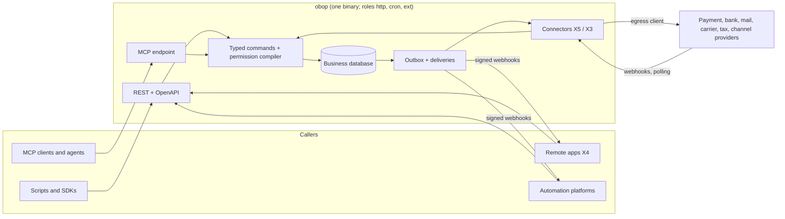
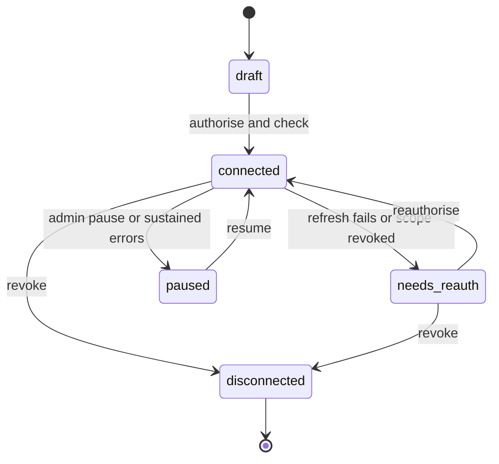

# Integrations, API and portability

- **Status:** Draft 0.1
- **Date:** 2026-10-01
- **Scope:** How obop is reached and how data moves in and out: the free generated API, webhooks, the MCP surface, connector tiers and catalogue, the package marketplace, SDKs, rate-limit and abuse policy, and portability (importers, full business export, Data Act switching).

**How to read.** Tiers (T0-T3), waves (W0-W4) and the calendar are Proposed (D25, D26); the open/paid list is Proposed (D2); the 24-month deprecation floor is Proposed (D16). The API shape, outbox, extension tiers, Odoo-compatibility surface, security invariants and Data Act terms are Binding (D6, D7, D9, D10, D11, D18, D22, D27, D30, D31, D32, D33, D35, D37, D38, D39). Anything resting on D1 (licences), D3 (name), D4 (first market), D12 (expression storage), D13 (offline), D17 (compliance model) or D20 is written "Proposed". "(target)" and "(estimate)" mark unmeasured numbers; "Proposed" marks design choices that neither the research nor DECISIONS.md settles. Versions and dates are as of 2026-10-01. Entity names and field lists in section 4 are Proposed unless they cite D27, D28, D32 or R23. In the "Odoo parity note" column, Community and Enterprise mean Odoo Community and Odoo Enterprise (Odoo's words, D24); obop has one open edition. Nothing here is legal advice. Vocabulary follows D24: where the research says "tenant export" this document says business export. Spellings of events, permission groups, data classes, states and ports follow [CONVENTIONS.md](../CONVENTIONS.md), which ranks below DECISIONS.md.

## 1. Purpose and scope

### 1.1 What this area is

Everything outside obop's own screens reaches the one shared data model through the surfaces specified here, and bulk data enters or leaves through the import and export paths specified here. The organising rule: every outside surface (REST, OpenAPI, MCP tools, webhook payloads, exports) is generated from the runtime registry (D29) and runs through the same permission compiler (D10). An integration can therefore never do what its principal cannot do, and no surface can be sold back as a plan upgrade (D2, D31). Odoo gates its external API to the Custom plan, has scheduled its legacy RPC services (`common`, `object`) for removal in Online 21.1 (winter 2027) and Odoo 22 (fall 2028), and gives no atomic multi-step call [R21 s2.1, R03 s3.3]; this area answers those grievances.

### 1.2 Modules and surfaces

| Surface or module | Tier | Wave | Open or paid |
|---|---|---|---|
| Public REST API and per-business OpenAPI (`obop-http`, registry-generated) | T0 | W1 | Open, every plan (D31) |
| API credentials and OAuth 2.1 provider (`base` principals) | T0 | Hashed keys W0, integrator contract and OAuth provider W1 ([security-privacy.md](security-privacy.md)) | Open |
| Webhooks and inbound event pipeline (`automation`) | T0 | W1 | Open |
| MCP endpoint (details in [ai.md](ai.md)) | T0 | W1 | Open; hosted AI credits are a separate paid convenience (D18) |
| Connector framework: ports in `*-api` crates, X5 adapters, X4 remote apps | T0 | W1 | Open |
| Wasm connectors (`obop-wasm-host`, `obop-ext-sdk`, `obop-compat`) | T0 | W2 | Open |
| Package registry service and client; marketplace listing | T0; commerce not listed, so T3 | package registry W2; commerce W4 | Client and sideloading open; the registry server's status is unsettled (BQ11, Q19); take rate Proposed (D2) |
| Import engine (`base`, engine entities owned by [platform.md](platform.md) 4.16); CSV importer | T0 | engine W0; CSV at 0.3 (2027-04-06) | Open |
| Odoo and QuickBooks importers; Xero and ERPNext; Shopify | T0; Shopify not listed, T3 | W1 at 0.6 (2027-09-07); W2; Shopify Proposed W3 | Open |
| Full business export and restore | T0 | W1, by 0.5 (2027-07-06) (Proposed) | Open, never sold (D38) |
| Payment connectors (`payment`) | T1 | W1 manual, SEPA, Stripe plus one; more W2-W3 | Adapters open; provider fees are the provider's |
| Bank files and feeds (`bank`) | T1 | files W1; aggregator feeds W2 | Open |
| E-invoice transports (`edi`) | T1 | W1 Peppol via partner access point; French platform and KSeF beta W2, KSeF stable with the Polish pack W3 ([finance.md](finance.md)) | Adapters open; hosted gateways paid (section 6 of DECISIONS.md) |
| Mail and calendar connectors (`mail`, `calendar`) | T0 / T1 | W1 / W2 | Open |
| Carrier connectors (`delivery`) | T1 | W3 | Open |
| Channel and marketplace connectors | T2 (D25); Amazon, Shopee, Lazada, TikTok T3 | framework W3 (`ecommerce`); connectors W4 | Open |
| Tax-engine connectors; automation-platform apps | not listed, T3 | Proposed W3 (US sales-tax adapters, after [finance.md](finance.md)); Proposed W2-W3 | Open |
| SMS, WhatsApp, lookup, OCR and routing connectors (`SmsProvider`, `MessagingProvider`, `LookupProvider`, `OcrEngine`, `RoutingProvider`) | not listed, T3 | Lookups W2-W3; SMS, OCR, routing W3; WhatsApp W4 (as the owning specs, Proposed) | Adapters open; providers bill the business directly, no obop credit wall (D18) |
| CLI v0, generated clients, extension SDKs | T0 | CLI W1; SDKs W2 | SDKs and templates Apache-2.0 (D1, Proposed); the CLI ships with the core |

### 1.3 Boundaries with neighbouring areas

| Neighbour | It owns | This document owns |
|---|---|---|
| [platform.md](platform.md), [ux.md](ux.md) | Registry-backed apps; the generic import engine (`import_run`, `import_mapping`, `import_row`, staging, run states) and what each model and user must satisfy for import and export (`importable`, `import_mode`, excluded fields, export permission) in platform.md 4.16; the wizard and export screens | Source-system importers (Odoo, QuickBooks, Xero, ERPNext, Shopify), the `external_ref` identity ledger, the accounting diff and separate posting step, full-export and restore guarantees, external contracts (platform.md 1.2 and 4.16 assign these here) |
| [security-privacy.md](security-privacy.md) | Authentication primitives, audit log, encryption, the SSRF-hardened egress client | How integrators obtain, scope and lose credentials; rate and abuse policy |
| [ai.md](ai.md) | Agent principals, write protocol, approval policy, MCP specifics | The shared REST/MCP surface |
| [finance.md](finance.md) | Ledger, tax, payment and bank semantics, e-invoice content | Provider contracts (`PaymentProvider`, `BankFeed`, `EDocTransport`, `TaxProvider`) and the catalogue |
| [retail-commerce-marketing.md](retail-commerce-marketing.md), [supply-chain.md](supply-chain.md), [people.md](people.md), [services.md](services.md) | POS terminals, carriers' business rules, payroll engine, appointments | Channel-sync, `CarrierProvider`, payroll-provider and calendar-sync connector contracts; catalogue entries for the SMS, messaging, OCR and routing providers whose traits the owning specs define (4.5) |
| [LOCALIZATION](../LOCALIZATION.md), [BUSINESS](../BUSINESS.md), [ENGINEERING](../ENGINEERING.md), [ARCHITECTURE](../ARCHITECTURE.md) | Packs; pricing and marketplace terms; CI, release, docs; runtime roles | Transport interfaces packs plug into; limits pricing may scale; compatibility requirements |

### 1.4 Surface overview

## 2. Personas and roles

| Persona | Job | Main surfaces |
|---|---|---|
| Business administrator | Decides what connects, approves consents, owns the full export | Connections, API clients, export |
| Integration developer | Builds syncs, scripts, dashboards | REST, `$batch`, webhooks, SDKs, sandbox business |
| Accountant or bookkeeper (free seats, D2) | Loads opening balances and bank files, connects bank feeds | Importers, `bank`, `payment` |
| Implementer or certified partner | Migrates customers, ships customisation packages | Odoo importer, packages |
| Extension publisher | Builds and lists X1-X4 packages | Package registry, SDKs |
| Operator (self-hosting) | Sets egress allow-list, limits, brokers | Deployment configuration, not a permission group |
| AI agent or MCP client | Acts as a principal with scoped delegation | MCP, REST |

Default permission groups (Proposed names, registered in [CONVENTIONS.md](../CONVENTIONS.md) section 4; they are to be added to the seed list of [security-privacy.md](security-privacy.md) 2):

| Group | Grants | Default members |
|---|---|---|
| `api.client_admin` | Create and revoke API clients, keys, OAuth grants | Business administrator |
| `api.webhook_admin` | Endpoints, secrets, replay, event filters | Business administrator, implementer |
| `api.connection_admin` | Connect and disconnect external accounts other than mailboxes (`mail.account_admin`, [platform.md](platform.md)); sees status, never secrets | Business administrator, accountant (bank only) |
| `api.import_operator` | The `import_data` capability row plus staging, dry-run, commit and rollback for foreign-source importers; cannot post | Accountant, implementer |
| `api.export_owner` | Full business export job and archive download (step-up authentication); the per-model `export` operation is separate (security-privacy.md AZ10) | Business owner only; how "owner only" is held is open, because `base.admin` covers both owner and administrator ([CONVENTIONS.md](../CONVENTIONS.md) 4, 9.2) |
| `api.extension_admin` | Install, upgrade, remove packages; approve capability diffs | Business administrator, implementer |
| `audit.reader` | Read-only on logs, health, deprecation usage | Auditor (defined in [security-privacy.md](security-privacy.md)) |

## 3. Capability map

| Capability | Description | Wave | Odoo parity note |
|---|---|---|---|
| Generated REST API with per-business OpenAPI 3.1 | Resource and action endpoints for every registry model, custom fields and packages included; RFC 9457 errors; cursor pagination with `updated_since` and tombstones | W1 | Beyond: JSON-2 is RPC-style and Custom-plan only, Odoo `/doc` has no OpenAPI, errors are exception names [R21 s2.1] |
| Domain-language filters | Odoo domain syntax compiled to SQL | W1 | Matches Community syntax (D22) |
| Atomic `$batch`, idempotency keys | Multi-operation changeset in one transaction; replay-safe mutations | W1 | Beyond: each JSON-2 call is its own transaction |
| Dated version header, deprecation floor | `Obop-Version`, at least 24 months (Proposed, D16) | W1 | Beyond: Odoo breaks ORM yearly [R24 s2.1] |
| Scoped API keys, OAuth 2.1 provider | Hashed expiring keys; code plus PKCE, client credentials, metadata-document registration | W1 | Matches Community keys; beyond on scopes and OAuth |
| Outbound webhooks | Standard Webhooks signing, retries, replay log | W1 | Beyond: Odoo webhooks have no documented signing or retries [R21 s2.1] |
| MCP endpoint | MCP 2026-07-28, tools generated from the registry | W1 | Beyond: Odoo 20 `/mcp` uses a static key with five default tools [R21 s2.1; R16 s2], and its AI features are metered through IAP credits [R03 s3.3] |
| Connector ports, X5 adapters, X4 remote apps; Wasm connectors (X3) | Traits in `*-api` crates; remote apps over OAuth; sandboxed components with capability manifests | W1; X3 W2 | Beyond: Odoo modules run in-process with full database access; Odoo Online takes only data-only third-party modules [R24 s2.1] |
| Package registry, sideloading, compatibility runs; marketplace commerce | Signed OCI artefacts, trust levels, kill switch; paid listings | package registry W2; commerce W4 | Beyond: no capability model in Odoo Apps; 0% at launch, cap 15% against its 30% (D2) |
| Payments: manual, SEPA, Stripe plus one | Provider trait, hosted fields only; Adyen, PayPal and others W2-W3 (Proposed) | W1 | Narrower than Community's 21 providers plus demo [R21 s2.1], deliberately (as [finance.md](finance.md)) |
| Bank files | camt.053, MT940 and CSV mapping in W1; OFX and QIF W2 (Proposed, after [finance.md](finance.md)) | W1 | Odoo edition of file import not verified |
| Aggregator bank feeds | BYO credentials, decoupled from reconciliation | W2 | Matches Enterprise (Odoo sync needs a subscription [R09 s6]) |
| Mail and calendar | Gmail API, Graph, IMAP XOAUTH2, OAuth-only (D39); calendar sync and iCal feed W2; CalDAV server later | W1 / W2 | Matches Community; server is beyond (Odoo has none [R15 s5]) |
| E-invoice transports | Peppol via partner access point W1; KSeF, French platform, Veri*Factu per pack W2+ | W1 / W2+ | Matches Community for Peppol (Odoo relays through its own proxy [R09 s5.3]); Community or Enterprise by country |
| Carriers | Aggregator-first `CarrierProvider` | W3 | Matches Enterprise (no carrier modules in Odoo 20.0 public tree [R10]) |
| Channel connectors | Orders in; stock, price, tracking out: Shopify and WooCommerce W4 (D25), Amazon, Etsy, eBay later; framework W3 | W3 / W4 | Beyond for Shopify (third-party connector sells for EUR 549 [R21 s7.1]); matches Enterprise for Amazon |
| Tax-engine and automation-platform connectors | Avalara, Stripe Tax behind `TaxProvider`; Zapier first, Make, n8n node | Proposed W3 (after [finance.md](finance.md)); Proposed W2-W3 | Tax matches Enterprise (`account_avatax` absent from Community [R09 s3]); automation is beyond |
| CSV and Excel import | Mapping, dry-run, templates | 0.3 | Matches Community |
| Odoo and QuickBooks importers; Xero, ERPNext, Shopify | External ids, identity ledger, saved mappings, dry-run, batch rollback, diff report; file first, API second | 0.6; W2; Shopify Proposed W3 | Beyond: Odoo imports are irreversible [R19 s2.5] |
| Full business export | NDJSON, attachments, audit log, configuration package; round-trip test published per release | W1 | Beyond |
| Rate limits, quotas, abuse controls | Layered, published, never zero | W1 | Beyond: Odoo treats missing rate limiting as non-qualifying [R18 s10] |
| CLI v0, generated clients, extension SDKs | Rust and TypeScript first-party | CLI W1; SDKs W2 | Beyond |
| SMS, WhatsApp, lookup, OCR and routing connectors | Provider traits with bring-your-own keys: Twilio first for SMS; registry, address and enrichment lookups; OCRmyPDF sidecar; routing engines as optional sidecars; WhatsApp as a package | Lookups W2-W3; SMS, OCR, routing W3; WhatsApp W4 (Proposed) | Beyond: Odoo meters lookups, enrichment and OCR through IAP credits and gates WhatsApp to Enterprise (PRODUCT.md 5.5) |
| Payroll-provider connectors; telephony CTI, KYC | Finch, Check, Employment Hero pattern; provider APIs, no softphone stack | W3-W4; W4+ | Payroll matches Enterprise (Odoo delegates UK, MY, NZ, SG [R13 s5]); telephony stack deliberately skipped (Odoo Phone is Enterprise [R15 s13]) |
| OData, GraphQL, A2A, CloudEvents | Optional surfaces | later | Deliberately skipped in W1 (D31) |

## 4. Per-app specification

### 4.1 Public REST API and OpenAPI (`obop-http`, T0, W1)

**Purpose.** One generated API over the registry, free on every plan, calling the same command layer as the web client [D29, D31; R08 s12].

| Concern | Rule |
|---|---|
| Base and versions | `/api/v1`; `Obop-Version: YYYY-MM-DD` pins behaviour per API client, defaulting to the date the client was created (Proposed). Stable endpoints are never removed within a major (D31) [R27 C2] |
| Resources | `GET/POST /api/v1/{model}`, `GET/PATCH/DELETE /api/v1/{model}/{id}`, record actions `POST /api/v1/{model}/{id}/{action}` and model actions `POST /api/v1/{model}/{action}` ([ARCHITECTURE](../ARCHITECTURE.md) 8.1). No per-model routes, so custom models appear without a restart [R08 s12] |
| Business and company | `BusinessRouter` (D6) picks the business, from the host name (Proposed); there is no database-name header. From W2 an `Obop-Company` header selects the company, defaulting to the principal's default (Proposed) |
| Representation | JSON; ids UUIDv7; timestamps RFC 3339 UTC; money as integer minor units plus currency code, prices and quantities as decimal strings, never floats (D9) (Proposed shape) |
| Fields | `fields=` nested spec modelled on Odoo's `web_read` spec [R08 s12]; one serializer for API, export and webhook (D10) |
| Filtering | `domain=` as a JSON AST; Odoo prefix lists and an object form parse to the same AST (D22 syntax, D12 storage, Proposed). Operators are Odoo's standard set plus `child_of`/`parent_of`; relational paths become `any` sub-domains [R08 s7]. `POST /api/v1/{model}/$search` carries long domains (Proposed). The compiler type-checks against the registry, enforces node, depth and list budgets, and rejects filter, sort or group on unreadable fields [D10] |
| Pagination | Opaque cursor; default page 50, maximum 200 (Proposed). `updated_since` takes a timestamp or a `sync_token`; responses carry `next_sync_token`; deletions appear as tombstones (default retention 90 days, Proposed). Tokens rest on the commit-safe change feed (`xid8` below the snapshot xmin), not on timestamps or sequence ids [R22 s7; R21 MUST 1] |
| Concurrency | `row_version` is the `ETag`; `If-Match` on PATCH, DELETE and actions; mismatch returns 412 [R08 s10] |
| Idempotency | See below |
| Batch | `POST /api/v1/$batch` |
| Errors | RFC 9457 `application/problem+json` with `type` (stable URI under the docs site), `title`, `status`, `detail`, `instance`, `code`, `retryable`, `errors[]` of `{pointer, code, detail}`, `request_id`, `trace_id`. Unreadable foreign ids return 404, not 403 [R18 s10]. Database refusals surface as typed codes such as `lock_date_violation`, `unbalanced_entry`, `posted_immutable` (D30) |
| Dry run | `?dry_run=true` (Proposed spelling) on any mutation returns the diff, validation errors and a digest-bound `plan_id`; the contract is shared with agents, and a `$batch` dry-runs as one plan [D18; R16; [ai.md](ai.md)] |
| Stability | Operations are marked `stable`, `beta` or `experimental` in OpenAPI; experimental ones need an opt-in header and carry no deprecation promise (Proposed, after [R27 C4]) |
| Documents | `/api/v1/openapi.json` per business from `utoipa` 6.0.0, which emits OpenAPI 3.1.0 by default and OpenAPI 3.2.0 on opt-in (`OpenApiBuilder::openapi(OpenApiVersion::Version32)` or `#[openapi(version = "3.2.0")]`; checked against the crate on 2026-10-01); it never writes 3.2.1, the patch release of OAS 3.2 published 2026-09-10. obop emits 3.1 until the generator chain (`openapi-typescript`, Scalar) is checked against 3.2; the `QUERY` method and `additionalOperations` are available in `utoipa` when that switch is made ([ARCHITECTURE](../ARCHITECTURE.md) 8.1, D31) [R21 s3], plus an explorer |

**Atomic batch.** `atomic: true` runs the operations in order inside one `BusinessTx`; the batch counts as one composite command, so D27's "one command, one transaction" holds. Operations may reference earlier results (`$ref:op1.id`). Durable events are written on commit only. Any failure rolls everything back and returns one problem document whose `errors[]` points at the failing operation. `atomic: false` commits each operation separately and returns a per-operation status array. Limits: 100 operations and a body cap (Proposed). The design borrows OData changeset semantics [R21 s3].

**Idempotency.** Every mutating call from an API client or agent carries `Idempotency-Key` (up to 255 characters); a missing key returns `idempotency_key_required`, and the web client generates keys itself (Proposed, after [ai.md](ai.md)). The record stores status and body of the first execution, including 5xx, under `(principal, key)` with a request fingerprint. The same key with another fingerprint returns 422; an in-flight duplicate returns 409; validation failures and concurrency conflicts are not stored. Retention is at least 24 hours, default 48 (Proposed); replays carry `Idempotency-Replayed: true` (Proposed). The IETF draft expired at -07, so obop defines the contract itself [R21 s5]. A UUID key becomes the domain `command_id` (D9) (Proposed).

**Versioning and deprecation.** A new `Obop-Version` date is cut per release series (Proposed); removals happen only at `N.0`, after a deprecation of at least 24 months (Proposed, D16), so the effective window is 24-48 months. Odoo's roughly three-year notice for XML-RPC is the benchmark [R21 s2.1]. Use of a deprecated operation returns `Deprecation` (RFC 9745, March 2025) and `Sunset` (RFC 8594) headers (R27 C4 left the RFC numbers unverified; checked against the RFC editor on 2026-10-01), writes an audit entry and appears in a per-client usage report. Clients must ignore unknown fields and enum values.

| First wave (W1) | Later |
|---|---|
| All rules above; keys and OAuth (4.2); rate limits (4.10) | switching the emitted document to OpenAPI 3.2 (opt-in in `utoipa` 6.0.0) and the `QUERY` method for long filters, once the generator chain is checked against 3.2; read-only OData subset and GraphQL (COULD, not in W1, D31); CloudEvents payload option (COULD); `/json/2/` compatible endpoint (DEFERRED until three design partners ask or fall 2028, D22) |

**Entities.**

| Entity | Purpose | Key fields | States |
|---|---|---|---|
| `idempotency_record` | Stored first result | principal, key, fingerprint, status, response, expiry | in_flight, completed, expired |
| `deprecation_usage` | Who still calls deprecated operations | client, operation, first/last seen, count | open, resolved |

**Workflow: first call.** 1. Create a service principal and a scoped key (4.2). 2. Download the business OpenAPI and generate a client (4.11). 3. Call with `Idempotency-Key` and `Obop-Version`; errors arrive as problem documents with `retryable`. 4. Poll `updated_since` with the stored `sync_token`, or subscribe to webhooks (4.3).

**Flows.** Emits none itself; every mutation emits the owning app's events (for example `SaleOrderConfirmed`, `InvoicePosted`). Consumes `RegistryVersionChanged` to rebuild the OpenAPI cache. **Permissions.** Default-deny; scopes only narrow (4.2). **Reports.** Usage by client and version, error and 429 rates, deprecation usage. **Configuration.** API on/off per business, maximum key lifetime, page caps, CORS origin list (off by default, Proposed). **Compliance.** Responses carry personal data; the hosted DPA covers them [R28 E.1]. **Open or paid.** Open on every plan and self-hosted.

### 4.2 Credentials, OAuth provider and connected apps (`base`, T0, W1)

**Purpose.** Give integrations identities that are revocable, scoped and auditable. Primitives (hashing, step-up, sessions) belong to [security-privacy.md](security-privacy.md); this section fixes the integrator-facing contract.

| Credential | Use | Rules |
|---|---|---|
| API key | Server-to-server | Permission is the principal's grants intersected with key scopes; shown once; hashed with an identifying prefix; mandatory expiry, default 90 days (Proposed; Odoo caps at three months [R21 s2.1]); creation needs step-up |
| OAuth 2.1 access token | Apps, MCP clients | Authorization code plus PKCE S256, client credentials for service accounts, exact redirect match, RFC 9207 `iss`, access tokens of one hour or less, refresh rotation with reuse detection, optional DPoP [R21 s7.3; R24 s3.4] |
| Agent delegation | Agents acting for a user | `agent_delegation(agent, on_behalf_of, scopes, expires)` [R23 B.1] |

Scopes read `<model>:<operation>` (for example `party:read`, `invoice:write`, `invoice:create_draft`) with an optional company restriction (Proposed syntax), the same vocabulary as package manifests (`[scopes]`, D32) [R24 s5.1]. OAuth 2.1 is still an Internet-Draft (`-16`, 2026-09-03), as is the Client ID Metadata Document draft (`-02`, 2026-07-06). Clients register through metadata documents or pre-registration; dynamic client registration, deprecated in MCP 2026-07-28, is not offered (Proposed) [R21 s7.3]. A consent screen lists exact scopes and companies. The connected-clients inventory offers one-click revoke and per-client audit. A package-registry kill switch disables a package version everywhere [R24 s9].

**Entities.** `principal`, `api_key` and `agent_delegation` are owned by [security-privacy.md](security-privacy.md); `oauth_client` and `consent_grant` are owned here ([CONVENTIONS.md](../CONVENTIONS.md) section 6), and [ai.md](ai.md) uses the same names and states. This section adds the integrator-facing fields.

| Entity | Purpose | Key fields | States |
|---|---|---|---|
| `api_client` | Integrator-facing extension of a `principal` of kind API client (security-privacy.md 4.1); not a second identity | principal, owner, ip_allowlist (later) | None of its own: the principal's (invited, active, suspended, deactivated; [CONVENTIONS.md](../CONVENTIONS.md) section 6) |
| `api_key` | Machine credential (security-privacy.md) | principal, prefix, hashed secret, scopes, expiry; adds `last_used` | active, expired, revoked |
| `oauth_client` | Registered client (also used in ai.md); revoking a client revokes its grants | client id (URL), redirect URIs, scopes, trust level | active, suspended, revoked |
| `consent_grant` | OAuth consent (also used in ai.md); unrelated to `consent_record`, the privacy ledger of security-privacy.md 4.6 | principal, client, scopes, companies | active, revoked, expired |

**Workflow: connect a remote app (X4).** 1. The app presents its metadata document. 2. The administrator sees requested scopes and the trust level. 3. Consent creates a grant; the remote app receives a code, then tokens. 4. A manifest diff adding a scope forces re-consent. 5. Revocation kills the refresh family within the next request.

**First wave and later.** W1: keys, authorization code plus PKCE, client credentials, consent, connected-clients inventory. Later: DPoP, per-client IP allow-lists, company-scoped grants once multi-company ships (W2). **Flows.** Emits `OAuthConsentGranted` and `OAuthConsentRevoked` into the security log (`security_event`; names as [CONVENTIONS.md](../CONVENTIONS.md) 3.4, Proposed until the generated catalogue exists). `ApiKeyCreated` and `ApiKeyRevoked` are emitted by [security-privacy.md](security-privacy.md) 4.1, which owns `api_key` (CONVENTIONS 3.1 rule 3: only the aggregate owner emits); this section cites them and emits neither. Today sec-priv 4.1 lists only `ApiKeyCreated` and CONVENTIONS 3.5 names no emitter for either, so sec-priv 4.1 is to add `ApiKeyRevoked` and 3.5 is to record the emitter (Proposed). **Sensitive data.** Secrets (data class `secret`, Proposed, security-privacy.md 4.1) never appear in logs, exports, webhooks or error bodies. **Reports.** Stale keys, keys expiring within 14 days (Proposed), clients by scope. **Configuration.** Maximum key lifetime, app allow-list, consent policy. **Open or paid.** Open; native SAML and full SCIM are paid and specified elsewhere (D2).

### 4.3 Webhooks and event delivery (`automation`, T0, W1)

**Purpose.** Push committed changes to subscribers reliably, in Standard Webhooks format, without `NOTIFY` in business transactions (D7).

**Delivery.** An endpoint is an outbox subscriber: one `outbox_delivery` row per endpoint, claimed with `SKIP LOCKED` and a lease (D27) [R23 D.2]. Event types are dotted lowercase, derived from state-machine `emits` and opt-in record events: `sale_order.confirmed`, `invoice.posted`, `payment.reconciled`, generated from the PascalCase events `SaleOrderConfirmed`, `InvoicePosted` and `PaymentReconciled` ([CONVENTIONS.md](../CONVENTIONS.md) 2.1, 3.4). Payloads are thin by default (`id`, `type`, `data.object_id`, `api_version`), with an opt-in snapshot rendered once per endpoint and never re-rendered on retry, within about 20 kB [R21 s4.2].

| Rule | Value |
|---|---|
| Headers and signing | `webhook-id` (stable across retries), `webhook-timestamp` (per attempt), `webhook-signature` (space-separated list); signed content `id.timestamp.body`; HMAC-SHA256 secrets `whsec_` (24-64 bytes) or ed25519 `whsk_`/`whpk_` [R21 s4.2] |
| Success and failure | 2xx succeeds; 3xx fails (no redirects); 410 disables the endpoint; `Retry-After` is honoured; timeout 20 s inside the spec's 15-30 s range (Proposed) |
| Retries | Jittered, starting from the spec's example delays 5 s, 5 min, 30 min, 2 h, 5 h, 10 h, 14 h, 20 h, 24 h, about 76 hours in total (estimate) (Proposed default; Stripe retries live events for up to three days [R21 s4.1]) |
| Rotation | Signature list carries old and new secrets for 24 hours (Proposed) |
| Ordering | None across aggregates; `aggregate_version` lets consumers detect gaps [R23 D.2 R2]; consumers dedupe on `webhook-id` |
| Disabling | After a configurable count of consecutive events with all attempts failed (default 10, Proposed), the endpoint is disabled and administrators are told through chatter and mail |
| Replay | Delivery log kept 30 days (Proposed); manual replay resends the stored bytes |
| Permission | Dispatch applies the owning principal's read check; unreadable events are suppressed and logged (D10) |
| Egress | One SSRF-hardened client: resolve A and AAAA, require public addresses, pin the resolved IP, no redirects, HTTP(S) only, block loopback, private, link-local and metadata ranges [R18 s10]. Cloud requires HTTPS; self-hosted operators may allow named private hosts (Proposed) |

**Entities.**

| Entity | Purpose | Key fields | States |
|---|---|---|---|
| `webhook_endpoint` | Subscription | url, secrets (vault), event filter, api_version pin, payload mode | active, paused, disabled |
| `webhook_attempt` | Append-only attempt log | delivery, n, status, latency, response excerpt | n/a |
| `outbox_delivery` | Delivery state (D27) | event, subscriber, attempts, lease, next_run | pending, in_flight, succeeded, exhausted, cancelled |

**Workflow: subscribe.** 1. Create an endpoint; the URL is validated at save and again at every delivery. 2. Copy the secret once. 3. Send a test event. 4. Verify the signature over the raw body with the official `standardwebhooks` 1.0.1 or `svix` 2.6.1 libraries [R21 s4.2]. 5. Fetch current state by id rather than trusting the payload. 6. Watch the delivery log.

**First wave and later.** W1: signed thin-payload webhooks, delivery log, replay, inbound inbox. Later: snapshot schemas per API date, CloudEvents format (COULD). **Flows.** Consumes every durable event. Emits `WebhookEndpointDisabled` and `WebhookDeliveryExhausted`. **Configuration.** Endpoints, event filters, log retention, disable threshold, operator egress allow-list. **Compliance.** Delivered webhooks cannot be recalled ([security-privacy.md](security-privacy.md) keeps a ledger of them); thin payloads limit what leaves, and erasure also scrubs stored payloads in the 30-day log (Proposed). **Reports.** Success rate, latency, backlog, suppressed events. **Open or paid.** Open; SIEM streaming of the audit log is paid and separate.

### 4.4 MCP endpoint (T0, W1)

**Purpose.** A second surface over the same command layer for agents. Agent semantics (principals, write protocol, approval policy, tool kill switches) are specified in [ai.md](ai.md); this section covers only what it shares with the API.

- MCP 2026-07-28 over stateless Streamable HTTP with mandatory `server/discover`, through `rmcp` 3.5.0 (2026-09-28), compatible with 2025-11-25 clients [D18; R16 s3]. Tools are generated from the registry's operation metadata; annotations are advertised but never enforced, and tool lists vary per principal.
- Authorization is OAuth 2.1 with RFC 9728 metadata, RFC 8707 audience validation, pre-registered clients then metadata documents, and no token passthrough. Static keys are an opt-in, scoped, expiring fallback only [R16 s3].
- Sampling, Roots, Logging and HTTP+SSE are not implemented; long work uses the Tasks extension [R16 s3].
- Odoo 20 exposes `/mcp` with a static key and five default tools [R21 s2.1; R16 s2]; its AI features are metered through IAP credits [R03 s3.3]. obop has no credit wall (BYOK, D18). obop ships and documents no stdio bridge, so no JavaScript tooling is a prerequisite for connecting: the endpoint is plain Streamable HTTP, and a client that can only speak stdio uses its own bridge.

**Flows and configuration.** Plan events and policy settings are in [ai.md](ai.md); MCP on/off and the client allow-list are per business. **Open or paid.** Open on every plan.

### 4.5 Connector framework (T0, W1; Wasm W2)

**Purpose.** One way to talk to the outside world, in three trust levels, behind ports owned by the apps that need them (D27).

| Code tier | What | Runs | Authors | Wave |
|---|---|---|---|---|
| X5 native | Protocol adapters (IMAP, SMTP, CalDAV), bank-file parsers, core payment adapters, tax rules, OAuth broker | In-process Rust, reviewed like core | obop team only | W1 |
| X4 remote app | Any language, zero trust in vendor code | Over OAuth 2.1, REST, webhooks, MCP; eventually consistent | Vendors, partners | W1 |
| X3 Wasm component | HTTP/JSON connectors, hooks | `ext` role, wasmtime v48 LTS via `obop-wasm-host`, fuel plus epoch plus memory limits | Vetted and third parties | W2 |

Numbering follows D11 (R21 says Tier 0, 1, 2). The `connector` world exports `spec`, `check`, `discover`, `read(state)`, `write` and `handle-webhook`, and imports a host-mediated `http` (allow-listed hosts with purpose strings, SSRF-filtered), `secrets.get(scope)`, `kv`, `log` and `clock`; no filesystem or raw sockets [R21 s7.2; R24 s3.3]. Its shape follows Airbyte's protocol with opaque checkpointed state [R21 s6.9]. Each port open to third parties publishes a WIT interface beside its Rust trait, and `obop-wasm-host` wraps a component as `Arc<dyn Port>` (Proposed). Pin wasmtime v48 (49.0.1 is current; next LTS v60 about 2027-08-20), patch within 7 days (24 hours for High), never rely on fuel alone [D11]. Worlds avoid `async func` until `wasm32-wasip3` is stable in Rust 1.100 (about 2026-11-12, estimate) [R24 s3.3].

Provider adapters sit behind obop-owned traits: `PaymentProvider`, `BankFeed`, `CarrierProvider`, `TaxProvider`, `MailProvider`, `EDocTransport`, `TerminalDriver`, `PayrollProvider` [R21 MUST 8; R09 s8; R12; [people.md](people.md)]. Other specs define further traits for connector classes that PRODUCT.md 5.5 assigns to the "Connector" disposition: `SmsProvider` ([retail-commerce-marketing.md](retail-commerce-marketing.md) 4.5), `OcrEngine` ([platform.md](platform.md) 4.9) and `RoutingProvider` ([services.md](services.md) 4.5). Three names are Proposed here because no sibling names the trait yet ([CONVENTIONS.md](../CONVENTIONS.md) 7.3): `MessagingProvider` (WhatsApp and other chat channels for `livechat` and `helpdesk`), `LookupProvider` (partner registry and address lookups, lead enrichment; [platform.md](platform.md) section 3, [sales-crm.md](sales-crm.md) 4.3) and `CalendarProvider` (behind `calendar_sync_link`). The owning app defines each trait; this document lists them so that one framework (vault, limiter, inbox, egress client) applies to all. VIES stays finance.md's `VatIdValidator` pack hook. Vendor crates are pinned exactly, or clients are generated from vendor OpenAPI with `progenitor` 0.15.0 (MPL-2.0; check its output) where no maintained crate exists [R21 s6.1].

**Entities.** App-owned records such as `sales_channel` ([retail-commerce-marketing.md](retail-commerce-marketing.md)), `payment_provider` ([finance.md](finance.md)), `mail_account` ([platform.md](platform.md) 4.7) and `calendar_sync_link` (platform.md 4.8) reference a `connection` for credentials, state and limiter (Proposed); apps may add typed inboxes such as `channel_event_inbox` that follow the same rules.

| Entity | Purpose | Key fields | States |
|---|---|---|---|
| `connection` | One link to one external account | provider, kind, tier, company, api_version pin, settings | draft, connected, needs_reauth, paused, disconnected (the diagram; the only connection state) |
| `connection_credential` | Vault entry, envelope-encrypted, per-business key | connection, kind, expiry | active, revoked |
| `connection_sync_state` | Cursor and limiter state | connection, cursor, backoff, provider limits | n/a |
| `external_mapping` | External id to local record | connection, record_ref, external id, etag, hash | n/a |
| `sync_run` | One checkpointed run | connection, direction, counts, error | running, succeeded, failed |
| `inbound_event` | Inbox for provider webhooks | provider, provider_event_id (unique), hash, state | received, verified, processed, ignored, failed |

**One connection state (Proposed).** `connection` state is the only state a connection has. A record that references a `connection` holds no connectivity state of its own and shows the linked one, as `sales_channel` does in retail-commerce-marketing.md. Health labels that app specs still carry map onto it: `active` is `connected`; `degraded` is not a state but a health indicator derived from recent failed `sync_run` rows and limiter headroom (a Report below), and sustained errors move the connection to `paused`; `error` on a `calendar_sync_link` is `needs_reauth` when a refresh failed or a scope was revoked and `paused` otherwise; `disconnected` is `disconnected`. The owners of `mail_account` and `calendar_sync_link` (platform.md 4.7, 4.8), whose tables list `active, degraded, disconnected` and `active, degraded, error, disconnected`, are to drop those copies or display this mapping. [CONVENTIONS.md](../CONVENTIONS.md) section 6 has no row for `connection` yet; the row (owner integrations 4.5, states as the diagram) is to be added there.

**Inbound pipeline.** 1. Verify the signature on the raw body. 2. Insert into `inbound_event`, unique on `(provider, provider_event_id)`. 3. Return 2xx fast and enqueue. 4. The handler fetches current state from the provider rather than trusting the payload (Mollie's model, the safest). 5. A scheduled reconciliation sweep repairs lost events (Shopify's advice) [R21 s4.1]. Providers differ, so adapters declare their scheme:

- Stripe: `Stripe-Signature` HMAC over `timestamp.body`, 5-minute tolerance, retries up to three days, duplicates and reordering possible.
- Shopify: `X-Shopify-Hmac-Sha256`; dedupe on `X-Shopify-Webhook-Id`, order by `X-Shopify-Triggered-At`.
- Mollie: no signature; the body is only an id, so authenticity is an authenticated re-fetch.
- Microsoft Graph and Google Calendar: validation token plus `clientState` (recalled, unverified) and a channel token; Google pings carry no body and subscriptions expire (see below).

**Outbound rules.** Derive each provider idempotency key from an obop operation id, persisting the operation first; retry only on network error, 5xx and 429 with jittered backoff. Keep a per-connection adaptive limiter that reads provider headers and persists state: Shopify GraphQL is cost-based (100, 200, 1,000 or 2,000 points per second by plan; 1,000 points maximum per query); Xero allows 1,000 (Starter) or 5,000 (paid) calls per day per organisation; some banks allow as few as 4 calls per day per account; Graph allows 1,000 subscriptions per mailbox across all apps [R21 s5]. Store each connection's upstream API version and run contract tests in CI against every new version (Shopify versions quarterly, each supported at least 12 months) [R21 s6.3].

**OAuth as a client.** A token vault per connection (envelope encryption, D33), single-flight refresh, incremental scope upgrades, revocation on disconnect, and a documented bring-your-own-app path. Gmail restricted scopes need verification and a security assessment when data is stored on servers [R21 s6.5]; whether a paid assessment applies to `https://mail.google.com/` is unverified [R15 s4]. Hence a project-operated broker is attractive; its place on the open/paid list is open question 6.

**First wave and later.** W1: ports, X5 adapters, X4 apps, vault. W2: X3 host and connector world, compatibility runs. Later: an Extism-backed simpler path if component churn proves costly (COULD) [R24]. **Flows.** Emits `ConnectionConnected`, `ConnectionNeedsReauth`, `SyncRunFailed`. Consumes `InvoicePosted` (e-invoice send), `SaleOrderConfirmed` and `TransferDone` (channel stock and tracking out). **Permissions.** `api.connection_admin` for the other connections (mailbox connections belong to `mail.account_admin`, [platform.md](platform.md)); credentials are data class `secret` (Proposed, security-privacy.md 4.1). **Reports.** Connection age, cursor lag, errors, limiter headroom. **Open or paid.** All adapters open; hosted gateways and operated brokers: see 4.6 and open question 6.

### 4.6 Connector catalogue by priority

Priority P1 serves the W1 loop and the first market (D4); P2 is W2; P3 is W3; P4 is W4 or later. Waves marked Proposed are not in D25.

| Category | Connector | Tier | Priority | Facts that constrain it |
|---|---|---|---|---|
| Payments | SEPA files (pain.001, pain.008), manual; Stripe | X5 | P1 | Card data via hosted fields or redirect only, PAN never touches obop [R12 s4.3]. Stripe API `2026-09-30.endive`; no official Rust SDK; `async-stripe` 0.41.0 pinned exactly (1.0.0-rc.9 exists), fallback generated from `stripe/openapi` [R21 s6.1] |
| Payments | Second PSP: Mollie (Proposed) | X5 | P1 | Payment-id-only webhooks force re-fetch; `mollie-rs` 0.8.1 is community |
| Payments | Adyen, PayPal | X5 or X3 | P2-P3 | Only unofficial or stale Rust crates; thin generated clients [R21 s6.1] |
| Banks | camt.053, MT940, CSV mapping; OFX and QIF W2 | X5 | P1 | Schema-tolerant parsers (SWIFT retirement dates and EPC rulebook versions unverified [R09 s6]) |
| Banks | GoCardless Bank Account Data, Enable Banking, Plaid, TrueLayer | X3 or X4 | P2 | Bring your own credentials; GoCardless 90-day access, sign-up status unverified; Enable Banking 2,700+ banks in 30 countries; PSR awaits the Council (indicative plenary 2026-12-14) [R21 s6.2] |
| E-invoicing | Peppol via partner access point | X5 | P1 | Own access point only near 250 businesses (Proposed, D17); AP-only fees EUR 1,050 + 1,850/yr + 1,500 [R09 s5.4] |
| E-invoicing | KSeF, French platform (PA), SDI, Veri*Factu, ZATCA | X5 or X3 (X4 if the provider mandates its own SDK or private network, [LOCALIZATION](../LOCALIZATION.md)) | P2+ | Per pack; integrate with a PA, do not accredit; Spain gated behind counsel (Proposed, D17); raw XML, hash and receipt stored immutably [R09] |
| Mail | Gmail API, Microsoft Graph, IMAP/SMTP XOAUTH2 | X5 | P1 | EWS is default-disabled from 2026-10-01 and off 2027-04-01; SMTP AUTH basic is off by default end of 2026 (D39) [R21 s6.5] |
| Calendar | Google, Outlook, iCal feed | X5 | P2 | Google push is a hint; Graph subscriptions last at most 10,080 minutes [R15 s5] |
| Automation | Zapier app (Proposed P2); n8n node, Make app (Proposed P3) | X4 | P2-P3 | REST hooks plus polling fallback over public OAuth and stable webhooks [R21 s6.9]; n8n's licence forbids bundling, Activepieces is Node-based, so integrate over the API. Any JavaScript in these artefacts (the Zapier app, the n8n node, helper code in a Make app) is built, tested and published only through `vp` and pnpm, like the SDKs (F2, 4.11); vendor CLIs are pinned development dependencies run as `vp run` tasks, and vendor scaffolding that assumes another package manager is not used |
| Shipping | Sendcloud, EasyPost, Shippo-class aggregators | X3 | P3 | Aggregator-first; `CarrierProvider` covers `rate`, `create_label`, `cancel`, `track`, `manifest`, `pickup` ([supply-chain.md](supply-chain.md); [R21 s6.4]) |
| Shipping | DHL Express (MyDHL v3.3.2), UPS, FedEx | X3 | P3-P4 | FedEx direct is probably gated by a partner programme (inference) [R10] |
| Channels | Shopify (GraphQL, pinned), WooCommerce REST v3 | X3 or X4 | P4 (W4, D25) | Orders in; stock, price, tracking out; Shopify REST Admin is legacy [R12 s4.4] |
| Channels | Amazon SP-API, Etsy, eBay | X3 or X4 | P4 | Orders v0 removed 2027-03-27; Etsy needs approval tiers; eBay unverified [R12 s4.4] |
| Tax | Avalara, Stripe Tax, TaxJar behind `TaxProvider` | X3 | Proposed P3 (W3, [finance.md](finance.md)) | Calculate on draft, commit on post, void on cancel; no Rust crates for Avalara or TaxJar [R21 s6.7] |
| Messaging | SMS gateways behind `SmsProvider`: Twilio first, bring-your-own keys | X3 | P3 (W3) | No obop credit wall for provider keys (a choice of [retail-commerce-marketing.md](retail-commerce-marketing.md) 4.5, extending D18); inbound STOP handling; US A2P 10DLC registration; TCPA and other national rules unchecked [R12 s6.1] |
| Messaging | WhatsApp Business and other chat channels behind `MessagingProvider` (Proposed name) | X3 or X4 | P4 (W4) | A package, not core (PRODUCT.md 5.5; Enterprise in Odoo); WhatsApp Business terms and pricing are not researched |
| Lookups | Partner registry and address lookups, lead enrichment behind `LookupProvider` (Proposed name) | X3 | P2-P3 | Registry lookups W2 ([platform.md](platform.md) section 3, merge and VAT id row), enrichment W3 ([sales-crm.md](sales-crm.md) 4.3); the business's own provider keys, off by default, no credit wall (D18; Odoo meters these through IAP credits); transfers to such providers need counsel. VIES stays with finance.md's `VatIdValidator` |
| OCR | OCRmyPDF plus Tesseract behind `OcrEngine`; extraction engines for [ai.md](ai.md) | X5 | P3 (W3) | Optional sidecar outside the default install (I-1); Rust-native OCR is a Latin-only preview [R15 s6]; the self-hosted AI profile names Docling, PaddleOCR and olmOCR |
| Routing | Routing and travel-time engines behind `RoutingProvider` | X5 or X3 | P3 (W3) | No bundled vendor; OSRM, Valhalla or VROOM are optional sidecars outside the default install (Proposed, I-1), and without one travel time is straight-line distance ([services.md](services.md) 4.5) |
| Payroll, KYC, telephony | Finch, Check, Employment Hero pattern; Stripe Identity-class; Twilio, Telnyx, Vonage, 3CX-class CTI | X3 or X4 | P3-P4 | No payroll filing in core (D19); Finch Starter USD 65/month per connection [R13 s5]; click-to-call and call logs, no SIP stack [R21 s6.6, s6.8] |

**Microsoft and Google.** Graph offers delta queries and change notifications; `calendarView/delta` needs a fixed window; subscriptions last at most 10,080 minutes (1,440 with resource data) and need renewal and `lifecycleNotificationUrl` handling. Google sync tokens return 410 on expiry, forcing a full re-sync [R15 s5]. Hosted gateways (Peppol, KSeF, Veri*Factu) are paid operated services; adapters and parsers stay open (DECISIONS.md section 6).

### 4.7 Package registry and marketplace (T0 W2; commerce W4)

**Purpose.** Make extensions a safe, compatible product. Format and trust belong to D32; this section states the listing and commercial model.

- **Trust levels:** private, community (automated gates only, hidden from the default "Vetted only" view), reviewed, partner, core. Sideloading is always allowed; on shared cloud it covers X1-X4 only [D32; R24 s9].
- **Gates per version:** manifest lint, licence allow-list, SBOM and advisory scan, capability diff (a new scope or host forces re-consent), Wasm import-versus-capability check, secret scan, name reservation, size caps, and a compatibility run: `obop-compat` runs nightly and per release candidate; failing 30 days earns a warning and 90 days holds installation on that version [R24 s5.3].
- **Verified publisher:** domain proof plus six months of good standing. Packages with no release for 12 months and two failed compatibility runs are flagged unmaintained, and hidden six months later unless re-certified.
- **Kill switch:** disables a version everywhere, about an hour (target) [R24 s9].
- **Take rate:** 0% at launch, cap 15%, any rate announced 12 months ahead, never on free packages or sideloads (D2, Proposed); R26 A3's "first EUR 50k free, then 15%" is a hypothesis that D2 does not adopt ([BUSINESS](../BUSINESS.md) 7.3). Odoo takes 30% (25% on in-app purchases); Shopify 0% to USD 1M, then 15% [R03 s6.2; R24 s9].
- **Naming:** "<Name> for obop", never "obop <Name>" [R28 A.6].

**First wave and later.** W2: package registry alpha, private, community and reviewed tiers, sideloading. W3: partner tier, F3 listings. W4: paid listings. **Entities (owned by D32).** `package`, `package_version`, `package_install`, `compat_result`. **Open or paid.** Package registry client and sideloading open; partner white-label is paid (D2); the registry server's own status is unsettled ([BUSINESS](../BUSINESS.md), BQ11; DECISIONS.md Q19).

### 4.8 Import engine and migration importers (`base`, T0; W0 engine)

**Purpose.** Switching cost is the main acquisition lever (D22). Odoo's import engine (external ids, savepoint dry-run, saved mappings, CSV/XLS/XLSX/ODS) is the design to match; its gaps are irreversibility and no diff [R21 s9.1; R19 s2.5]. [platform.md](platform.md) 4.16 owns the generic engine: the entities `import_run`, `import_mapping` and `import_row`, the run states, and what each model and user must satisfy (`importable` natural keys, `import_mode`, excluded fields, export permission); [ux.md](ux.md) 4.14 draws the screens. This section owns what the foreign-source importers add to that engine: source adapters, the `external_ref` identity ledger, the accounting diff and the separate posting step. The pipeline below restates the engine so those additions read in one place; where it differs from platform.md, platform.md wins.

**Pipeline.**

1. **Source adapter** yields typed rows per source model: file reader, API client or dump reader.
2. **Mapping, staging, validation:** suggestions from saved mappings, exact name, then type-compatible fuzzy match (Odoo: difflib distance below 0.2, types guessed from the first ten rows [R21 s9.1]); `COPY` into an unlogged schema without row-level security, because `COPY FROM` is rejected on such tables [R22; R23 DR-4], with no `BYPASSRLS` role (D10); set-based validation with references resolved through the ledger. Every drag has a keyboard path (D35). Documents use `command` mode (drafts only) and masters use `bulk` mode, as declared per model in platform.md.
3. **Dry-run** (Proposed mechanics) applies the whole run inside one transaction, issues `SET CONSTRAINTS ALL IMMEDIATE` so the deferred balanced-entry trigger fires (D30), then rolls back. No durable event survives and no external I/O runs, since I/O lives only in durable handlers (D27). The outcome is stored on the run as its dry-run result (ok or failed), and a passing dry run moves the run to `validated`; a failed one stays in `mapped` for a corrected file or mapping (platform.md 4.16, ux.md 4.14). Very large runs dry-run per chunk (Proposed).
4. **Commit** in dependency order, in resumable chunks, each writing identity-ledger rows.
5. **Diff report:** counts, downloadable row errors, and for accounting a trial-balance and open-item diff.
6. **Rollback by run id** until records are posted or referenced by other documents: created records are removed, together with their ledger rows, and updates revert from the `audit_change` rows tagged with the run id (platform.md 4.16, ux.md 4.14). Because `audit_change` capture is opt-in per field, an import run records every field it changes, with the run id as the cause (Proposed; open question 12). All-or-nothing is the default; an explicit "unreferenced only" rollback ends in `partially_rolled_back` (ux.md).

**Identity ledger (`external_ref`).** Columns: `system` (for example `odoo:<db>`, `quickbooks:<realm>`, `shopify:<shop>`), source `model`, `source_id`, `xml_module`, `xml_name`, `obop_id`, content `hash`, `run_id`, `imported_at`. Re-runs upsert by `(system, model, source id)` or external id; an unchanged hash is skipped, and a record edited in obop since import follows the mapping's conflict policy (`obop_wins` default, `source_wins`, `ask`) (Proposed). Both the numeric id and the external id are kept so links reconcile later [R21 s9.2]. It is distinct from `external_id` (module-shipped records, D9) [R23 B.1].

**Odoo importer (W1, 0.6).** Odoo files are read as-is: `id` is the external id, `field/id` references by external id, `field/.id` by source id resolved through the ledger; one-to-many lines are continuation rows; many-to-many are comma lists [R21 s9.1].

| Source adapter | Coverage |
|---|---|
| Export files CSV, XLSX, ODS | Any Odoo version, including Online plans without API access, because Odoo gates its external API to Custom [R21 s2.1] |
| JSON-2 | Odoo 19 and 20 with a bearer key; `fields_get`, `search_read`, `ir.model.data`, attachments (D22) |
| Legacy RPC client, Odoo 14-18 | R21 proposes; D22 lists only JSON-2 and exports, so open question 3 |
| Read-only database dump | Later (Proposed) |

| Odoo | obop |
|---|---|
| `res.partner` | `party` (person or organisation), typed addresses, per-company `party_profile` for customer and vendor (D28) |
| `res.company`; `product.template`, `product.product` | `company` plus its legal-entity party; `product_template`, `product_variant`, `product_profile` |
| `account.account`, `account.tax`, `account.journal` | account via the chart pack, `tax` with repartition lines, journal |
| `account.move` | Invoices and bills (open items), opening balances as dated entries |
| `stock.quant`; `ir.attachment` | Opening stock adjustment; `attachment` plus `blob`, checksum verified |
| `res.users` | Invitations; passwords and keys are never imported |

Order: currencies and rates, companies, partners, products and units, taxes and fiscal positions, accounts, journals, payment terms, open documents, payments and reconciliations, opening balances, attachments. The default posture is master data, open items and opening balances rather than full history, as for most small businesses [R19 s13]; history is open question 4. The opening entry is created as a draft (Proposed). The trial-balance diff per account and per receivable or payable partner at the cut-off date must be zero in minor units per currency before an explicit, separate posting step (lock dates, hash chain and numbering apply, D30). Clean room (F3): no Enterprise, OCA or OpenUpgrade code; a running Odoo is only a black-box oracle in CI, with a round-trip test (D22).

**QuickBooks importer (W1, 0.6).** Files first: chart of accounts, customer and vendor lists, items, open receivable and payable agings, trial balance. The Online API through the customer's own Intuit app (OAuth 2.0, per-realm throttling, change-data-capture) is recalled, not verified, as are Intuit's partner terms [R21 s9.3]; verify before scoping. Desktop is file-only (IIF, QBXML).

**Xero importer (W2).** Files first. API through the customer's own Xero app on the free Starter tier: 5 connections, 1,000 calls per day per organisation; the API has been metered since 2026-03-02. Xero's terms forbid using API data to train AI or ML, so imported records carry provenance and are excluded from AI pipelines by default (Proposed). Xero's MIT OpenAPI specs make a generated client cheap [R21 s9.3].

**ERPNext importer (W2, D26).** Through its REST API (`/api/resource/:doctype`, token auth); no GPL code is copied [R21 s2.2].

**Shopify importer (Proposed W3).** The merchant creates a custom app and an Admin GraphQL token (no App Store registration); bulk operations with JSONL for large stores (recalled), or CSV exports. Products, variants, customers, open orders, inventory levels and redirects map; payment history does not. A pinned quarterly API version and the adaptive limiter apply [R21 s9.3].

**Excel and CSV (0.3).** `csv` 1.4.0, `calamine` 0.36.1 (reader), `rust_xlsxwriter` 0.99.1 (templates, writer); encoding and separator detection; registry-generated templates per model. Guards: size and decompressed-size limits, no formula execution, URL fetching off by default and routed through the egress client [R18 s10].

**Entities.**

| Entity | Purpose | Key fields | States |
|---|---|---|---|
| `import_run` (owned by platform.md 4.16) | One upload through commit; this section adds the accounting importers' `posted` flag, set only by the separate posting step | as platform.md: source, target models, mapping, counts, `created_by`, dry-run result (ok or failed) | platform.md's list: uploaded, mapped, validated, committing, paused, committed, failed, rolled_back, partially_rolled_back |
| `import_mapping`, `import_row` (owned by platform.md 4.16) | Saved mapping; run items and row errors; saved mappings for foreign sources carry the source system | as platform.md | n/a |
| `external_ref` | Identity ledger | as above | n/a |

**First wave and later.** 0.3 CSV and Excel; 0.6 Odoo and QuickBooks; W2 Xero and ERPNext; Proposed W3 Shopify; later a database-dump adapter and history import. **Flows.** Consumes `ImportRunCommitted` and `ImportRunRolledBack`, which platform.md 4.16 emits (the importers finalise the diff report and offer the posting step on commit, and drop the run's ledger rows on rollback, Proposed); emits none of its own for the run. Imports call ordinary commands; the posting step emits the accounting events. **Permissions.** `api.import_operator`; posting needs the accounting groups. **Reports.** Run history, error heat map, diff report. **Configuration.** Default conflict policy, size limits, URL fetching. **Localization.** Charts and tax mapping come from country packs. **Open or paid.** Free, no caps.

### 4.9 Export and portability (`base`, T0, W1)

**Purpose.** No lock-in: a complete, verifiable copy on every edition, and a legal duty on hosted plans. The guarantees here are normative; [platform.md](platform.md) section 4.16 carries the screens and formats.

**Guarantees, published and tested (Proposed shape after [R21 s10]).**

1. Full business export on every plan including Free and self-hosted, asynchronous and resumable, with no fee and no throttle below the business's API limit (D38).
2. Archive contents: NDJSON per model with UUIDv7 ids, external ids and relations; JSON Schema and OpenAPI of the export; attachments addressed by SHA-256; audit log and security events; the `erasure_ledger`; posted entries with legal numbers and hash-chain values; the business customisation as an `obop.toml` package (D32); `manifest.json` with series, modules, counts and file digests.
3. Secrets are excluded (keys, tokens, webhook secrets, connection credentials, password hashes, passkeys); connections restore as `needs_reauth`.
4. Per-model CSV and XLSX in import-compatible form, with an `id` column (Odoo's pattern) [R21 s10].
5. Standards exports: iCalendar and vCard; original EN 16931 XML; audit files (SAF-T, FEC, DATEV) as pack exports ([finance.md](finance.md), [LOCALIZATION](../LOCALIZATION.md)).
6. Self-hosters also get `pg_dump` per business beside PITR [R22].
7. Full export runs under a typed elevation, owner-only (`api.export_owner`), with step-up and read-audit; partial exports need the per-model `export` operation, follow the caller's read permissions and take step-up for the sensitive data classes (Proposed, after D10 and [security-privacy.md](security-privacy.md) AZ10; [CONVENTIONS.md](../CONVENTIONS.md) 5).
8. A CI round-trip test (export, wipe, import, empty diff) is published with every release [R21 s10].

**Restore.** `obop restore` loads an archive into an empty business of the same or a later series, keeping ids, external ids, legal numbers and the hash chain, then re-verifies the chain and the balanced-entry check at commit. The `erasure_ledger` is replayed before the business reports ready, so an old archive cannot bring erased personal data back (Proposed, after [security-privacy.md](security-privacy.md) and [platform.md](platform.md) 5.7). Interaction with D30's immutability and numbering triggers is open question 5.

**Data Act switching (hosted).** Regulation (EU) 2023/2854 applies since 2025-09-12; SaaS is in scope [R28 E.4].

| Rule | obop commitment |
|---|---|
| Art. 25: notice at most 2 months; 30-day transition (up to 7 months only if technically unfeasible, declared within 14 working days); exhaustive exportable-data list; at least 30 days of retrieval; erasure; exit support | In the hosted contract before the first paid plan (paid beta 2027-07-06) (D38, D26); an exportable-data catalogue generated from the registry |
| Art. 29: no switching charges from 2027-01-12 (cost-based charges were allowed 2024-01-11 to 2027-01-12; egress for parallel use is excepted [R21 s10]) | Never charged; free parallel-use egress is a stronger commitment (Proposed) |
| Art. 30: open interfaces, equal and free of charge; structured, commonly used, machine-readable export | The API and export are these interfaces |
| Art. 23: no obstacles, including after a free tier | Free plan gets the same export |

Self-hosted open source is likely outside Chapter VI (inference [R21 s10]); the same tools serve it. Scope wording is for counsel.

**Workflow: switch away.** 1. The administrator requests switching. 2. Exports run as often as needed. 3. Parallel use continues through the 30-day transition. 4. A retrieval window of at least 30 days follows. 5. Database, blobs and backups are erased on schedule with a certificate.

**First wave and later.** W1: archive, per-model files, restore, Data Act terms. Later: scheduled exports to customer object storage (Proposed). **Entities.** `export_job` (scope, format, state, manifest hash, expiry, requester; states queued, running, ready, expired, failed). **Flows.** Emits `ExportReady` (named consumer: ux, [CONVENTIONS.md](../CONVENTIONS.md) 3.4); `ExportRequested` is the security event owned by [security-privacy.md](security-privacy.md). **Reports.** Export history, archive verification results. **Configuration.** Archive retention; optional encryption to a customer key (Proposed). **Localization.** Audit files by country pack. **Open or paid.** Open and never sold (D2, D38).

### 4.10 Rate limiting and abuse policy (`obop-http`, W1)

Limits are capacity controls, never feature gates (D2, D31): published, never zero, and scaled by plan size (Proposed).

| Layer | Mechanism |
|---|---|
| Pre-auth | Per-IP buckets; per-account login throttling |
| Per principal | Token bucket per `(principal, business)` with `governor` 0.10.4 behind a facade (`tower_governor` 0.8.0 is pre-1.0) [R18 s11; R21 s5] |
| Per business | Business cap and daily quota; shared counter in PostgreSQL only for quotas (Proposed) |
| Per cell | Protection so one business cannot starve 250 neighbours (D6) |
| Cost-based | Batch cost is one plus the extra operations; large pages, search, reports, imports and exports have weights and concurrency caps (Proposed) |
| Bodies | Request and decompression limits, pagination caps |

Responses use 429 with `Retry-After` always, `RateLimit` and `RateLimit-Policy` additively (IETF draft-11, expires 2026-11-24 unless renewed) [R21 s3]. R26 proposes 50 requests per minute on the Free plan as a price-test hypothesis [R26 A3], which [BUSINESS](../BUSINESS.md) treats as a hosted capacity control, not a feature gate; open question 1 asks the owner to confirm. Self-hosted limits are operator-configurable and generous by default (Proposed). Bulk and export endpoints are governed by concurrency caps rather than request counts (Proposed).

**Abuse.** Enumeration and scraping meet non-leaking 404s and anomaly alerts; leaked keys are detectable by prefix (Proposed) and revoked on report. An escalation ladder (warning, throttle, key suspension, business API suspension) gives notice and an appeal path (Proposed, counsel). Webhook targets face the SSRF rules in 4.3. Sanctions screening for ERP services to Russia and the acceptable-use policy are counsel items [R28 E.6].

**Open or paid.** Open; higher capacity may be sold as hosting, but the published floor stays.

### 4.11 SDKs and developer experience (T0; CLI W1, SDKs W2)

| Artefact | Language | Licence | Notes |
|---|---|---|---|
| Generated REST clients | TypeScript via `openapi-typescript` 7.13 and `openapi-fetch` 0.17, or Hey API 0.99.0 (pre-1.0, pin); Rust via `progenitor` 0.15.0 | Apache-2.0 (D1, Proposed) | From the per-business OpenAPI, so custom fields are typed [R24 s6; R07] |
| `obop-ext-sdk` | Rust, `wit-bindgen` 0.62.0, `#[obop::hook]` | Apache-2.0 | W2 |
| `@obop/ext-sdk`, `@obop/ui-sdk`, `@obop/vite-plugin-ext`; WIT package `obop:ext@1` | TypeScript under scope `@obop/*` because `obop` is taken on the npm registry (D3, Proposed); WIT | Apache-2.0 | Installed with `vp add`; semver, N and N-1 majors for at least 24 months (F2, F3); WIT additive within a major |
| `obop` CLI | Rust binary: `obop ext`, `obop upgrade`, `obop diag`, `obop restore` | With the core (AGPL), templates Apache-2.0 (Proposed) | CLI v0 at W1 (D26) |

Other languages use OpenAPI generators; first-party clients are Rust and TypeScript only (Proposed). The Application Exception keeps API, webhook, manifest and SDK use outside copyleft (D1) [R24 s8]. Publishing uses `vp pm publish` with OIDC trusted publishing and provenance, and staged approval with `vp pm stage` (pnpm 11.3 or later) [R24 s6]. CI templates pin `voidzero-dev/setup-vp` by SHA and run `vp install --frozen-lockfile`, `vp check`, `vp test`, `vp build`. The sandbox is a seeded dev business from `obop dev up`. Reference docs are generated from the registry (VitePress 2, D38); CI fails if a model, field, action or error code lacks a description, and every `curl` snippet is replayed against a seeded business; `llms.txt` and a docs MCP server are Proposed [R28 B; ENGINEERING]. Targets (not measurements): first successful API call under 15 minutes [R28 B.5]; local extension setup under 10 minutes and edit-to-effect under 5 s [R24 s6].

## 5. Cross-app golden paths

**GP1. Atomic batch with idempotency (W1).**
- *Given* client `acme-sync` holds `sale_order:write`; DESK-120 costs EUR 250.00, VAT 19%.
- *When* it posts `$batch` (`atomic: true`, key `b-000123`) creating an order, a line of 2 x 250.00 and a line of 1 x 80.00 with an unknown tax id,
- *then* the call returns 422 with `errors[2].pointer` at that line, zero orders exist, no outbox row exists, and resending after the fix returns 200 with net 580.00, VAT 110.20, gross 690.20 and one `sale_order.created` event; the same key and body return the stored result with `Idempotency-Replayed: true`; the same key with quantity 3 returns 422 `idempotency_key_reuse`.

**GP2. Webhook retries and verification (W1).**
- *Given* endpoint E subscribed to `invoice.posted`, and the receiver returns 500 twice.
- *When* INV/2027/0042 (net 1,000.00, VAT 190.00, gross 1,190.00) posts,
- *then* three attempts carry one `webhook-id` and three timestamps (log: 500, 500, 200), the receiver verifies the HMAC, dedupes a replayed id and fetches the invoice to read `total_minor` 119000; had the posting failed on a lock date, no event would exist.

**GP3. Duplicate and reordered PSP events (W1).**
- *Given* invoice INV/2027/0042 (EUR 1,190.00) and a Stripe connection pinned to `2026-09-30.endive`.
- *When* `payment_intent.succeeded` (evt_A) arrives twice and a partial `charge.refunded` of 190.00 (evt_B) arrives before the second evt_A,
- *then* the inbox processes evt_A once, re-fetches provider state, registers 1,190.00 once, and turns evt_B into a draft credit note of 190.00 awaiting a human (Proposed); the payment is reconciled only when a matching bank line is matched.

**GP4. Odoo import, dry-run to posting (W1, 0.6).**
- *Given* a JSON-2 source with 1,200 partners, 340 products, 37 open invoices totalling EUR 48,250.00, 22 open bills totalling 31,900.00, bank 120,000.00, cut-off 2027-01-01.
- *When* the dry-run reports 7 row errors (5 unmapped taxes, 2 duplicate VAT ids), the user fixes the saved mapping, the dry-run passes and the user commits,
- *then* nothing was written by the dry-run; the opening entry is a draft with debits 168,250.00 (receivables 48,250.00, bank 120,000.00) and credits 168,250.00 (payables 31,900.00, equity 136,350.00); the diff shows 0.00 per account; rerunning the same source writes nothing; rollback works until posting and is refused with 409 afterwards.

**GP5. Export, wipe, restore (W1).**
- *Given* fixture `fx-1k`: 1,000 records in 12 models, 25 attachments, posted invoices INV/2027/0001-0012.
- *When* it is exported, loaded into an empty business and both are normalised,
- *then* the deep diff is empty, ids, external ids and legal numbers are identical, the hash chain verifies, archive digests match, the erasure ledger is replayed, and no key or token is present; CI publishes the result.

**GP6. Data Act switch (hosted, Free plan).**
- *Given* a switch request on 2027-02-01 whose transition starts that day.
- *When* the customer exports five times,
- *then* each export costs EUR 0.00, the transition ends 2027-03-03, retrieval stays open until at least 2027-04-02, and erasure follows with a certificate.

**GP7. Microsoft 365 mailbox after EWS (W1).**
- *Given* `billing@acme.example` connected through Graph OAuth on 2027-04-02.
- *When* a 3-hour outage spans the renewal time of the mailbox subscription (lifetime at most 10,080 minutes) and the subscription lapses,
- *then* the stored delta link recovers every message and replies thread by the last 32 references; a revoked refresh token instead sets `needs_reauth` and notifies administrators.

**GP8. Agent dry-run and commit (W1; protocol in [ai.md](ai.md)).**
- *Given* an agent delegated by user U with scope `invoice:write` and a policy requiring confirmation above EUR 1,000.
- *When* it dry-runs a supplier bill of 2,400.00 over REST or MCP,
- *then* the response carries diff, risk, `approval: confirm` and a `plan_id`; a commit before U confirms is refused; after confirmation one draft bill exists, never posted by the agent; a repeat commit returns the same result; an edit to the bill in between returns 409 `plan_stale`; the audit shows user, agent and client.

**GP9. Limits and SSRF (W1).**
- *Given* a principal limited to 50 requests per minute (Proposed Free default) and an endpoint URL `http://169.254.169.254/latest/meta-data`.
- *When* it sends 60 requests within one second and saves the URL,
- *then* 50 succeed and 10 return 429 with `Retry-After`; the URL is refused with 422 `endpoint_url_not_allowed`; a hostname that later resolves to a private address fails at delivery with nothing sent.

## 6. Non-functional requirements

| Area | Requirement |
|---|---|
| Atomicity, idempotency | An atomic batch commits all operations or none, with no durable events on failure; one execution per `(principal, key, fingerprint)` under concurrent duplicates; property- and race-tested |
| Delivery | Webhooks at least once; events written in the business transaction; per-aggregate order only [R23 D.2] |
| Permission parity, secrets | Identical answers from list, by-id, export, webhook payload and MCP read (D10 property test); secrets absent from exports, logs, webhooks, error bodies and AI reads (golden-file redaction tests) |
| Import, export | Second import run writes nothing; rollback restores before-images exactly; trial-balance diff zero; export round-trip diff empty per release; chain verified on restore |
| Concurrency | `If-Match` 412; retry on `40001` and `40P01` [R08 s10]; single-flight token refresh; one sync run per connection |
| Audit | Append-only events for keys, grants, endpoints, connections, imports, exports, with the principal chain on every write |
| Accessibility | Consent screens, mapping UI, explorer and docs meet WCAG 2.2 AA; every drag has a keyboard path (D35) |
| Offline | The public API is online; edge clients replay `pos-api` commands by `command_id` (D37; offline scope is Proposed, D13); sync tokens let mobile clients resume |
| Performance (target, Proposed) | p95 single-record read under 100 ms; 50-row list under 300 ms; event commit to first webhook attempt under 5 s. No comparison with Odoo is published until the harness runs (D21) |

## 7. Where obop deliberately differs from Odoo, and why

| Odoo | obop | Pain addressed |
|---|---|---|
| External API only on Custom [R21 s2.1] | Free on every plan (D31) | Gated integration surface [R03 s3.3; R04 s4.10] |
| XML-RPC to JSON-RPC to JSON-2; removal Online 21.1 and Odoo 22 | One versioned REST, no XML-RPC, at least 24 months (Proposed) | Abrupt removals [R04 s4.1, s4.10] |
| Each JSON-2 call its own transaction | Atomic `$batch` | Integrators write server methods to get atomicity [R21 s2.1] |
| Exception-name errors; per-database `/doc` lists models and methods but no OpenAPI document | RFC 9457 with stable codes; per-business OpenAPI including custom fields | Untyped errors, poor API docs [R02 s10; R04 s4.10] |
| Webhooks with no documented signing or retries; static key per user with a three-month cap | Standard Webhooks with replay log; OAuth 2.1, scoped keys, agents as principals | Unreliable glue, over-broad credentials [R21 s2.1; R16] |
| AI features behind IAP credits; MCP by static key | BYOK, generated tools, OAuth, no credit wall (D18) | Metered AI, over-broad credentials [R03 s3.3; R16] |
| Imports irreversible, no diff | Dry-run, batch rollback, diff report [R19 s2.5, s13] | "Imports are permanent" |
| In-process third-party modules (only data-only ones on Online); Apps store 30% commission | Wasm or remote, sideloading, 24-month windows; 0% at launch, cap 15% (D2) | Module quality, upgrade breakage, ecosystem economics [R04 s4.6; R03 s6.2] |
| Bank sync, carriers, Avalara, Amazon in Enterprise [R09, R10, R03] | Open connectors | Open-core surprises [R04 s4.2] |
| Self-hosted upgrade needs a database copy sent to the vendor; portability is per-model files | Full business export on every plan; upgrade rehearsed locally [R27 C6] | Vendor-controlled data [R04 s4.1] |

## 8. Out of scope, non-goals and later

- XML-RPC and JSON-RPC (D22); a `/json/2/` compatible endpoint (DEFERRED, D22); GraphQL in W1 (D31); gRPC and JSON:API [R21 s3].
- A2A and the Agentic Commerce Protocol (COULD; `a2a-lf` 0.4.1); CloudEvents payloads (COULD).
- Acting as a bank aggregator or payment-initiation licensee; licensed aggregators are used with bring-your-own credentials [R21 s6.2].
- Statutory payroll filing in core (D19); a softphone or SIP stack; bundling n8n or Activepieces; an iPaaS or ETL product (Airbyte's protocol shape is borrowed, not its platform).
- An own Peppol access point before about 250 businesses (Proposed, D17); an own AS4 stack [R09 s5.4].
- Marketplace commerce before W4 (D26); third-party in-process Rust (D11); an export in Odoo's own import shape (COULD).
- Not planned for W1-W3, from [R05]: Hyperswitch (Apache-2.0, Rust; R05 SHOULD 12) as an optional payment-orchestration adapter behind `PaymentProvider` (Proposed), and a Beancount or plain-text accounting import-export bridge (COULD 16; `rustledger` is GPL-3.0, so interoperate rather than embed).
- Later: emitting OpenAPI 3.2 and `QUERY` (section 4.1); read-only OData and GraphQL subsets; a CalDAV/CardDAV server; PSD3 and CFPB 1033 adaptations once final (the PSR awaits the Council).

## 9. Open questions

1. **Free-plan API limits.** BUSINESS.md lists 50 requests per minute on Free as a capacity control. Does the owner agree this is compatible with "API never gated" (D2, D31), or should limits be fair-use only?
2. **The "plus one" PSP in W1.** Mollie is proposed; PayPal or Adyen are alternatives. D25 names none.
3. **Legacy Odoo sources.** D22 lists JSON-2 and exports; should a client-side RPC adapter for Odoo 14-18 exist, since "no XML-RPC" means not serving it?
4. **Historical posted documents.** Import as a read-only archive or as entries in a locked period? Needs a D30-compatible path and legal-number handling.
5. **Restore versus D30 triggers.** Proposal: an `obop_restore` role permitting already-posted rows in an empty business, verified by chain and balanced-entry checks. Confirm with the ledger owner.
6. **Operated brokers.** The OAuth broker (Gmail, Xero certification) and a bank-feed broker are operated services. Free or paid? The ratchet only moves paid to open, so settle before the list is published (DECISIONS.md Q3, Q19).
7. **QuickBooks Online.** API limits and partner terms are unverified; verify before 0.6 scope.
8. **Gmail restricted scope.** Does the paid security assessment apply to `https://mail.google.com/`? R15 and R21 differ in confidence.
9. **Shopify timing.** D25 and [retail-commerce-marketing.md](retail-commerce-marketing.md) place Shopify and WooCommerce connectors in W4 while the importer here is Proposed W3; should DTC design partners pull connectors forward?
10. **Counsel items.** Data Act scope and wording; package registry operator's CRA role and takedown liability; Wasm and AGPL exception [R24 s8]; sanctions screening.
11. **Small API choices.** Is `Idempotency-Key` required on all API-client mutations or optional on plain CRUD? In W2, an `Obop-Company` header or per-company credentials?
12. **Import before-images.** Names and owners are settled ([CONVENTIONS.md](../CONVENTIONS.md) section 6; retired spellings in its rename map, section 8): platform.md 4.16 owns the engine (`import_run`, `import_mapping`, `import_row`, the nine run states, `ImportRunCommitted` and `ImportRunRolledBack`), with `dry_run_result` (ok, failed) a field of the run; this document owns `external_ref`, the foreign-source adapters, the accounting diff and the `posted` flag. Still open, for the owner and the security-privacy.md author ([CONVENTIONS.md](../CONVENTIONS.md) 9.2): before-images are `audit_change` rows tagged with the run id, but `audit_change` is opt-in per field and its key fields carry no run tag, so import runs need forced capture of every changed field and the run id as the cause reference (Proposed; security-privacy.md 4.4 is to add the cause reference). If that is refused, a separate `import_change` before-image table, owned by platform.md 4.16, is the fallback.
13. **Trait names.** `MessagingProvider`, `LookupProvider` and `CalendarProvider` (4.5) are Proposed names; the owning specs ([services.md](services.md), [sales-crm.md](sales-crm.md), [platform.md](platform.md)) should adopt or rename them when they specify those adapters.

## 10. Sources

Tags map to files relative to `docs/spec/`; "D" identifiers refer to [DECISIONS.md](../DECISIONS.md). Facts are as of 2026-10-01 and carry the research files' own verification tags; choices made here are labelled Proposed in the text.

| Tag | File |
|---|---|
| R02 | [research/02-odoo-architecture.md](../research/02-odoo-architecture.md) |
| R03 | [research/03-odoo-business-model.md](../research/03-odoo-business-model.md) |
| R04 | [research/04-odoo-voice-of-customer.md](../research/04-odoo-voice-of-customer.md) |
| R05 | [research/05-competitive-landscape.md](../research/05-competitive-landscape.md) |
| R07 | [research/07-vite-plus-frontend.md](../research/07-vite-plus-frontend.md) |
| R08 | [research/08-metadata-platforms-dynamic-orm.md](../research/08-metadata-platforms-dynamic-orm.md) |
| R09 | [research/09-accounting-finance-compliance.md](../research/09-accounting-finance-compliance.md) |
| R10 | [research/10-supply-chain-manufacturing.md](../research/10-supply-chain-manufacturing.md) |
| R12 | [research/12-retail-pos-ecommerce-marketing.md](../research/12-retail-pos-ecommerce-marketing.md) |
| R13 | [research/13-hr-payroll.md](../research/13-hr-payroll.md) |
| R15 | [research/15-platform-collaboration-documents.md](../research/15-platform-collaboration-documents.md) |
| R16 | [research/16-ai-native-erp.md](../research/16-ai-native-erp.md) |
| R18 | [research/18-security-compliance-deployment-ops.md](../research/18-security-compliance-deployment-ops.md) |
| R19 | [research/19-ux-design-system.md](../research/19-ux-design-system.md) |
| R21 | [research/21-integrations-interoperability-api.md](../research/21-integrations-interoperability-api.md) |
| R22 | [research/22-data-layer-sync-realtime-performance.md](../research/22-data-layer-sync-realtime-performance.md) |
| R23 | [research/23-kernel-model-architecture-decisions.md](../research/23-kernel-model-architecture-decisions.md) |
| R24 | [research/24-extension-platform-sdk.md](../research/24-extension-platform-sdk.md) |
| R26 | [research/26-business-model-pricing-risk.md](../research/26-business-model-pricing-risk.md) |
| R27 | [research/27-quality-release-engineering.md](../research/27-quality-release-engineering.md) |
| R28 | [research/28-docs-community-support-brand.md](../research/28-docs-community-support-brand.md) |
| D1-D39, Q1-Q20 | [DECISIONS.md](../DECISIONS.md) |
| CONVENTIONS | [CONVENTIONS.md](../CONVENTIONS.md) (spelling of cross-document names; subordinate to DECISIONS.md) |
