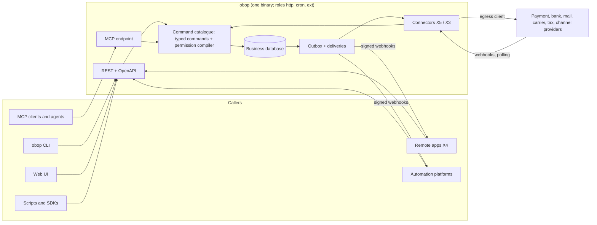
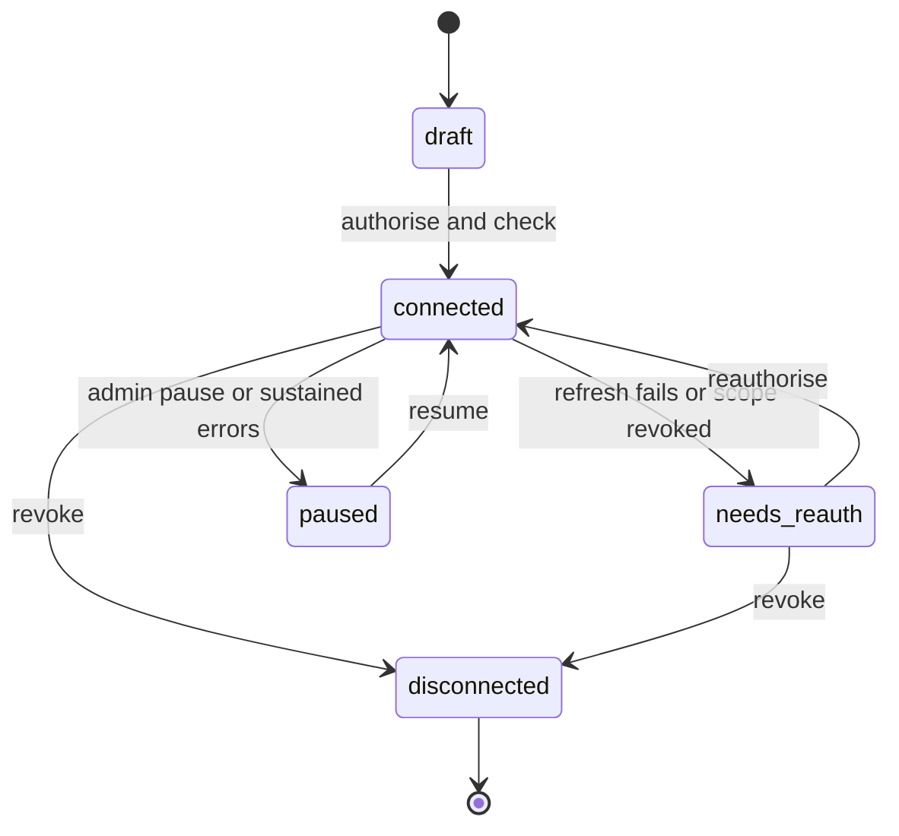

# Integrations, API and portability

- **Status:** Draft 0.1
- **Date:** 2026-10-01
- **Scope:** How obop is reached and how data moves in and out: the command catalogue and its three equal surfaces (the `obop` CLI, the generated REST API and MCP), webhooks, connector tiers and catalogue, the free plugin registry, SDKs, rate-limit and abuse policy, and portability (importers, full business export). The CLI itself is specified in [cli.md](cli.md).

**How to read.** Everything here is open and free under Apache-2.0: there is no paid list, no plan, no price, no commission and no proprietary layer (OR-1, OR-2; D1, D2), so nothing in this document is gated. The API is never gated, which is now trivially true. Agentic first, CLI for everything (OR-4, D80): every capability is a typed command reachable through the CLI, the REST API and MCP, and the web UI is a client of the same commands. The wave windows, the German pack date and the 1.0 target are RATIFIED (OR-13, D26); the W1 cut is D86 (RATIFIED, OR-13 and OR-15: its shape and the in and out calls of DECISIONS 5.3; the slip order, its checkpoints and the landing waves of displaced items stay Proposed); the per-module placements, tiers (T0-T3) and the T0 list are Proposed (D25). Deprecation windows follow D85: 12 months before 1.0 (RATIFIED, OR-12), and after 1.0 the same window unless the owner rules otherwise (Proposed, Q28); the 24-month floor of the earlier drafts is withdrawn. The API shape, outbox, extension tiers, Odoo-compatibility surface, security invariants and the no-hosting posture, with its one exception, the free hosted sandbox at the public beta (OR-11, OR-20), are Binding or RATIFIED (D6, D7, D9, D10, D11, D18, D22, D27, D30, D31, D32, D33, D35, D37, D38, D39, D83); the sandbox details (terms and data policy, host and cost ceiling, abuse approach) are Proposed (Q34 to Q36). The agentic-first surface (D80) and the free plugin registry (D81) are RATIFIED (OR-3, OR-4, OR-16, OR-17), including literal UI parity with an owner-approved exemption list and the rule that only plugins with an OSI-approved licence are listed; their details (grammar, staging, who operates the index, copy-mode provenance, and each exemption-list entry) are Proposed until Q22, Q24 and Q25 are answered and the owner approves the entries. Anything resting on D12 (expression storage), D13 (offline), D20 or the Proposed details of D80, D81 and D85 is written "Proposed". "(target)" and "(estimate)" mark unmeasured numbers; "Proposed" marks design choices that neither the research nor DECISIONS.md settles. Versions and dates are as of 2026-10-01. Entity names and field lists in section 4 are Proposed unless they cite D27, D28, D32 or R23. In the "Odoo parity note" column, Community and Enterprise mean Odoo Community and Odoo Enterprise (Odoo's words, D24); obop has one edition, open and free. Nothing here is legal advice. Vocabulary follows D24, whose renames and X and L tier prefixes the owner ratified on 2026-10-01 (OR-14): where the research says "tenant export" this document says business export; "plugin" is the owner's word (OR-3) for a registry package and is used in commands and user-facing text, while architecture and data-model text says "package". Spellings of events, permission groups, data classes, states and ports follow [CONVENTIONS.md](../CONVENTIONS.md), which ranks below DECISIONS.md.

## 1. Purpose and scope

### 1.1 What this area is

Everything outside obop's own screens reaches the one shared data model through the surfaces specified here, and bulk data enters or leaves through the import and export paths specified here. The organising rule (OR-4, D80): every capability is one typed command in a catalogue generated from the runtime registry (D29); the `obop` CLI, the REST API and MCP are three equal surfaces over that catalogue, and the web UI is a client of the same commands. Webhook payloads, OpenAPI and exports are generated from the registry too, and everything runs through the same permission compiler (D10). An integration can therefore never do what its principal cannot do, and no surface is gated, because there are no plans to gate it by (OR-2, D31). A feature is not done until it exists in CLI, API and MCP (D80). Odoo gates its external API to the Custom plan, has scheduled its legacy RPC services (`common`, `object`) for removal in Online 21.1 (winter 2027) and Odoo 22 (fall 2028), and gives no atomic multi-step call [R21 s2.1, R03 s3.3]; this area answers those grievances.

### 1.2 Modules and surfaces

| Surface or module | Tier | Wave | Open and free |
|---|---|---|---|
| Command catalogue and the `obop` CLI, the first of three equal surfaces ([cli.md](cli.md)) | T0 | Catalogue skeleton and grammar W0; the commands of every shipped module W1 | Open; the CLI gates nothing (OR-4, D80) |
| Public REST API and per-business OpenAPI (`obop-http`, registry-generated) | T0 | W1 | Open, never gated (D31) |
| API credentials and OAuth 2.1 provider (`base` principals) | T0 | Hashed keys W0, integrator contract and OAuth provider W1 ([security-privacy.md](security-privacy.md)) | Open |
| Webhooks and inbound event pipeline | T0 | W1, with the API (`automation` rules are W2, D86) | Open |
| MCP endpoint (details in [ai.md](ai.md)) | T0 | W1 | Open; bring your own key, no credit wall (D18) |
| Connector framework: ports in `*-api` crates and X5 adapters | T0 | W1 | Open |
| X4 remote-app model (consent UX for remote apps, connected-apps inventory) | T0 | W3 (D86); OAuth client authentication stays W1 | Open |
| Wasm connectors (`obop-wasm-host`, `obop-ext-sdk`, `obop-compat`) | T0 | W3 (D86) | Open |
| Plugin registry, stage 1: a git-backed index and the `plugin` commands (search, install, copy) | T0 | W2; sideloading from W1 | Open; free, no payments (OR-3, D81) |
| Plugin registry, stage 2: a registry service | T0, Proposed | W3 or W4, on demand | Open; needs an owner decision that amends D83 (Q24) |
| Import engine (`base`, engine entities owned by [platform.md](platform.md) 4.16); CSV importer | T0 | engine W0; CSV at 0.3 (2027-04-06) | Open |
| Odoo importer | T0 | W1 at 0.6 (2027-09-07) (an in call of the ratified W1 cut, OR-15; its place in the slip order, item 14, is Proposed) | Open |
| QuickBooks importer | T0 | W2 | Open |
| Xero and ERPNext importers; Shopify importer | T0; Shopify not listed, T3 | W3; Shopify Proposed W3 | Open |
| Full business export and restore | T0 | W1, by 0.5 (2027-07-06) (Proposed) | Open; a right of every install, never gated (D38) |
| Payment connectors (`payment`) | T1 | Manual registration W1; SEPA files and Stripe plus one W2; more W3 or later (Proposed) | Adapters open; provider fees are the provider's |
| Bank files and feeds (`bank`) | T1 | camt.053 and MT940 files W1; aggregator feeds W3 | Open |
| E-invoice transports (`edi`) | T1 | Email or file W1; Peppol through an access point the user chooses W2; French platform and KSeF beta W2 (Proposed, first to slip); KSeF stable with the Polish pack W3 ([finance.md](finance.md)) | Adapters open; SpaceCorps operates no access point and no gateway (D17, D83) |
| Mail and calendar connectors (`mail`, `calendar`) | T0 / T1 | Outbound email W1; OAuth mailbox connectors with the inbound gateway W2; calendar sync W3 | Open |
| Carrier connectors (`delivery`) | T1 | W3 | Open |
| Channel and marketplace connectors | T2 (D25); Amazon, Shopee, Lazada, TikTok T3 | framework W3 (`ecommerce`); connectors W4 | Open |
| Tax-engine connectors; automation-platform apps | not listed, T3 | Proposed W3 (US sales-tax adapters, after [finance.md](finance.md)); Proposed W3 | Open |
| SMS, WhatsApp, lookup, OCR and routing connectors (`SmsProvider`, `MessagingProvider`, `LookupProvider`, `OcrEngine`, `RoutingProvider`) | not listed, T3 | Lookups W2-W3; SMS, OCR, routing W3; WhatsApp W4 (as the owning specs, Proposed) | Adapters open; providers bill the business directly, no obop credit wall (D18) |
| Generated REST clients, extension SDKs | T0 | The OpenAPI document W1; published clients and SDKs W3 (D86 slip item 1) | Apache-2.0 (D1) |

### 1.3 Boundaries with neighbouring areas

| Neighbour | It owns | This document owns |
|---|---|---|
| [platform.md](platform.md), [ux.md](ux.md) | Registry-backed apps; the generic import engine (`import_run`, `import_mapping`, `import_row`, staging, run states) and what each model and user must satisfy for import and export (`importable`, `import_mode`, excluded fields, export permission) in platform.md 4.16; the wizard and export screens | Source-system importers (Odoo, QuickBooks, Xero, ERPNext, Shopify), the `external_ref` identity ledger, the accounting diff and separate posting step, full-export and restore guarantees, external contracts (platform.md 1.2 and 4.16 assign these here) |
| [security-privacy.md](security-privacy.md) | Authentication primitives, audit log, encryption, the SSRF-hardened egress client | How integrators obtain, scope and lose credentials; rate and abuse policy |
| [cli.md](cli.md) | The `obop` grammar, global flags, output and exit-code contracts, the command catalogue tables, the plugin registry client (`plugin` commands, `obop.lock`, install versus copy), distribution of the binary | The REST API, OAuth provider, importers and export that the CLI calls; the registry's trust levels and gates as external contracts (4.7); the CLI as the third surface (4.12) |
| [ai.md](ai.md) | Agent principals, write protocol, approval policy, MCP specifics | The shared CLI/REST/MCP surface |
| [finance.md](finance.md) | Ledger, tax, payment and bank semantics, e-invoice content | Provider contracts (`PaymentProvider`, `BankFeed`, `EDocTransport`, `TaxProvider`) and the catalogue |
| [retail-commerce-marketing.md](retail-commerce-marketing.md), [supply-chain.md](supply-chain.md), [people.md](people.md), [services.md](services.md) | POS terminals, carriers' business rules, payroll engine, appointments | Channel-sync, `CarrierProvider`, payroll-provider and calendar-sync connector contracts; catalogue entries for the SMS, messaging, OCR and routing providers whose traits the owning specs define (4.5) |
| [LOCALIZATION](../LOCALIZATION.md), [BUSINESS](../BUSINESS.md), [ENGINEERING](../ENGINEERING.md), [ARCHITECTURE](../ARCHITECTURE.md) | Packs; licensing, governance and the community model of the registry (BUSINESS); CI, release, docs; runtime roles | Transport interfaces packs plug into; default limits; compatibility requirements |

### 1.4 Surface overview

The CLI and the web UI call the same `/api/v1` operations as any other client, so authentication, rate limits, idempotency keys, the permission compiler and the audit trail are identical for every caller; the CLI has no direct-database mode. Only the bootstrap commands (`init`, `up`, `serve`, `migrate`, `upgrade`) run in process ([cli.md](cli.md) 1.3).

## 2. Personas and roles

| Persona | Job | Main surfaces |
|---|---|---|
| Business administrator | Decides what connects, approves consents, owns the full export | Connections, API clients, export |
| Integration developer | Builds syncs, scripts, dashboards | CLI, REST, `$batch`, webhooks, SDKs, local demo business (`obop dev up`) or the free hosted sandbox (OR-20) |
| Script or CI job | Runs typed commands, gates upgrades, exports data | CLI (`--json`, exit codes), REST |
| Accountant or bookkeeper | Loads opening balances and bank files; connects bank feeds once they ship (W3) | Importers, `bank`, `payment` |
| Implementer (any third party; there is no partner programme, OR-2) | Migrates customers, ships customisation plugins | Odoo importer, plugins, CLI |
| Plugin publisher | Builds and lists plugins (W2: X1 and X2 packs; W3: X3, X4) | Plugin registry, CLI, SDKs |
| Operator (self-hosting, or hosting for others) | Sets egress allow-list, limits and the OAuth app registrations of the mailbox connectors | Deployment configuration, not a permission group |
| AI agent or MCP client | Acts as a principal with scoped delegation | CLI, MCP, REST |

Default permission groups (Proposed names, registered in [CONVENTIONS.md](../CONVENTIONS.md) section 4; they are to be added to the seed list of [security-privacy.md](security-privacy.md) 2):

| Group | Grants | Default members |
|---|---|---|
| `api.client_admin` | Create and revoke API clients, keys, OAuth grants | Business administrator |
| `api.webhook_admin` | Endpoints, secrets, replay, event filters | Business administrator, implementer |
| `api.connection_admin` | Connect and disconnect external accounts other than mailboxes (`mail.account_admin`, [platform.md](platform.md)); sees status, never secrets | Business administrator, accountant (bank only) |
| `api.import_operator` | The `import_data` capability row plus staging, dry-run, commit and rollback for foreign-source importers; cannot post | Accountant, implementer |
| `api.export_owner` | Full business export job and archive download (step-up authentication); the per-model `export` operation is separate (security-privacy.md AZ10) | Business owner only; how "owner only" is held is open, because `base.admin` covers both owner and administrator ([CONVENTIONS.md](../CONVENTIONS.md) 4, 9.2) |
| `api.extension_admin` | Install, copy, upgrade, remove plugins; approve capability diffs (CONVENTIONS section 4) | Business administrator, implementer |
| `audit.reader` | Read-only on logs, health, deprecation usage | Auditor (defined in [security-privacy.md](security-privacy.md)) |

## 3. Capability map

| Capability | Description | Wave | Odoo parity note |
|---|---|---|---|
| One command catalogue, three equal surfaces (CLI, REST, MCP) | Every capability is a typed command generated from the registry; CLI, REST and MCP agree on input, output, permissions, dry-run and idempotency; the UI is a client; a feature is done when it exists on all three (OR-4, D80) | Skeleton W0; every shipped module W1 | Beyond (owner ruling OR-4); not an Odoo parity item |
| Generated REST API with per-business OpenAPI 3.1 | Resource and action endpoints for every registry model, custom fields and packages included; RFC 9457 errors; cursor pagination with `updated_since` and tombstones | W1 | Beyond: JSON-2 is RPC-style and Custom-plan only, Odoo `/doc` has no OpenAPI, errors are exception names [R21 s2.1] |
| Domain-language filters | Odoo domain syntax compiled to SQL | W1 | Matches Community syntax (D22) |
| Atomic `$batch`, idempotency keys | Multi-operation changeset in one transaction; replay-safe mutations | W1 | Beyond: each JSON-2 call is its own transaction |
| Dated version header, deprecation window | `Obop-Version`; a deprecation window of 12 months (D85: RATIFIED before 1.0, Proposed after, Q28) | W1 | Beyond: Odoo breaks ORM yearly [R24 s2.1] |
| Scoped API keys, OAuth 2.1 provider | Hashed expiring keys; code plus PKCE, client credentials, metadata-document registration | W1 | Matches Community keys; beyond on scopes and OAuth |
| Outbound webhooks | Standard Webhooks signing, retries, replay log | W1 | Beyond: Odoo webhooks have no documented signing or retries [R21 s2.1] |
| MCP endpoint | MCP 2026-07-28, tools generated from the registry | W1 | Beyond: Odoo 20 `/mcp` uses a static key with five default tools [R21 s2.1; R16 s2], and its AI features are metered through IAP credits [R03 s3.3] |
| Connector ports and X5 adapters; X4 remote apps and Wasm connectors (X3) | Traits in `*-api` crates; remote apps over OAuth; sandboxed components with capability manifests | Ports and X5 adapters W1; X3 host, connector world and the X4 app model W3 (OAuth client authentication stays W1) | Beyond: Odoo modules run in-process with full database access; Odoo Online takes only data-only third-party modules [R24 s2.1] |
| Plugin registry: search, install (version-pinned) or copy; sideloading; compatibility runs | A free, open registry that lists only plugins with an OSI-approved licence (OR-17); signed OCI artefacts, trust levels (private, community, verified, core), kill switch; no payments (OR-3, D81) | Sideloading W1; stage 1 (git-backed index and CLI) W2; stage 2 (service) on demand W3 or W4; compatibility runs W3 | Beyond: no capability model in Odoo Apps, and no commission here against Odoo's 30% [R03 s6.2] |
| Payments: manual, SEPA, Stripe plus one | Provider trait, hosted fields only; manual registration W1; SEPA files and Stripe plus one W2; Adyen, PayPal and others W3 or later (Proposed) | W1 / W2 | Narrower than Community's 21 providers plus demo [R21 s2.1], deliberately (as [finance.md](finance.md)) |
| Bank files | camt.053 and MT940 in W1 (D86); CSV mapping, OFX and QIF W2 (Proposed, after [finance.md](finance.md)) | W1 | Odoo edition of file import not verified |
| Aggregator bank feeds | BYO credentials, decoupled from reconciliation | W3 | Matches Enterprise (Odoo sync needs a subscription [R09 s6]) |
| Mail and calendar | Outbound email through the operator's SMTP relay or a provider API in W1; Gmail API, Graph, IMAP XOAUTH2, OAuth-only (D39) with the inbound gateway W2; calendar sync and iCal feed W3; CalDAV server later | W1 / W2 / W3 | Matches Community; server is beyond (Odoo has none [R15 s5]) |
| E-invoice transports | Email or file in W1; Peppol through a certified access point the user chooses, with the user's own credentials, W2 (SpaceCorps runs none, D17); KSeF, French platform, Veri*Factu per pack W2+ | W1 / W2+ | Matches Community for Peppol (Odoo relays through its own proxy [R09 s5.3]); Community or Enterprise by country |
| Carriers | Aggregator-first `CarrierProvider` | W3 | Matches Enterprise (no carrier modules in Odoo 20.0 public tree [R10]) |
| Channel connectors | Orders in; stock, price, tracking out: Shopify and WooCommerce W4 (D25), Amazon, Etsy, eBay later; framework W3 | W3 / W4 | Beyond for Shopify (third-party connector sells for EUR 549 [R21 s7.1]); matches Enterprise for Amazon |
| Tax-engine and automation-platform connectors | Avalara, Stripe Tax behind `TaxProvider`; Zapier first, Make, n8n node | Proposed W3 (after [finance.md](finance.md)); Proposed W3 | Tax matches Enterprise (`account_avatax` absent from Community [R09 s3]); automation is beyond |
| CSV and Excel import | Mapping, dry-run, templates | 0.3 | Matches Community |
| Odoo and QuickBooks importers; Xero, ERPNext, Shopify | External ids, identity ledger, saved mappings, dry-run, batch rollback, diff report; file first, API second | Odoo 0.6 (W1); QuickBooks W2; Xero and ERPNext W3; Shopify Proposed W3 | Beyond: Odoo imports are irreversible [R19 s2.5] |
| Full business export | NDJSON, attachments, audit log, configuration package; round-trip test published per release; a right of every install | W1 | Beyond |
| Rate limits, quotas, abuse controls | Layered, operator-configurable, published defaults, never zero | W1 | Beyond: Odoo treats missing rate limiting as non-qualifying [R18 s10] |
| Generated clients, extension SDKs | Rust and TypeScript first-party; the `obop` CLI needs neither | OpenAPI document W1; SDKs W3 | Beyond |
| SMS, WhatsApp, lookup, OCR and routing connectors | Provider traits with bring-your-own keys: Twilio first for SMS; registry, address and enrichment lookups; OCRmyPDF sidecar; routing engines as optional sidecars; WhatsApp as a package | Lookups W2-W3; SMS, OCR, routing W3; WhatsApp W4 (Proposed) | Beyond: Odoo meters lookups, enrichment and OCR through IAP credits and gates WhatsApp to Enterprise (PRODUCT.md 5.5) |
| Payroll-provider connectors; telephony CTI, KYC | Finch, Check, Employment Hero pattern; provider APIs, no softphone stack | W3-W4; W4+ | Payroll matches Enterprise (Odoo delegates UK, MY, NZ, SG [R13 s5]); telephony stack deliberately skipped (Odoo Phone is Enterprise [R15 s13]) |
| OData, GraphQL, A2A, CloudEvents | Optional surfaces | later | Deliberately skipped in W1 (D31) |

## 4. Per-app specification

### 4.1 Public REST API and OpenAPI (`obop-http`, T0, W1)

**Purpose.** One generated API over the registry, free and never gated (there are no plans, OR-2), calling the same command layer as the CLI, MCP and the web client (D29, D31, D80) [R08 s12].

| Concern | Rule |
|---|---|
| Command catalogue | Every operation below is one entry of the command catalogue (D80). `GET /api/v1/catalogue` publishes the catalogue, from which the CLI builds its command tree at run time (Proposed, [cli.md](cli.md) 2.1); REST routes, MCP tools and CLI commands are generated from the same entry and must agree (parity test, [cli.md](cli.md) 6) |
| Base and versions | `/api/v1`; `Obop-Version: YYYY-MM-DD` pins behaviour per API client, defaulting to the date the client was created (Proposed). Stable endpoints are never removed within a major (D31) [R27 C2] |
| Resources | `GET/POST /api/v1/{model}`, `GET/PATCH/DELETE /api/v1/{model}/{id}`, record actions `POST /api/v1/{model}/{id}/{action}` and model actions `POST /api/v1/{model}/{action}` ([ARCHITECTURE](../ARCHITECTURE.md) 8.1). No per-model routes, so custom models appear without a restart [R08 s12] |
| Business and company | `BusinessRouter` (D6) picks the business, from the host name (Proposed); there is no database-name header. From W2 an `Obop-Company` header selects the company, defaulting to the principal's default (Proposed) |
| Representation | JSON; ids UUIDv7; timestamps RFC 3339 UTC; money as integer minor units plus currency code, prices and quantities as decimal strings, never floats (D9) (Proposed shape) |
| Fields | `fields=` nested spec modelled on Odoo's `web_read` spec [R08 s12]; one serializer for API, export and webhook (D10) |
| Filtering | `domain=` as a JSON AST; Odoo prefix lists and an object form parse to the same AST (D22 syntax, D12 storage, Proposed). Operators are Odoo's standard set plus `child_of`/`parent_of`; relational paths become `any` sub-domains [R08 s7]. `POST /api/v1/{model}/$search` carries long domains (Proposed). The compiler type-checks against the registry, enforces node, depth and list budgets, and rejects filter, sort or group on unreadable fields [D10] |
| Pagination | Opaque cursor; default page 50, maximum 200 (Proposed). `updated_since` takes a timestamp or a `sync_token`; responses carry `next_sync_token`; deletions appear as tombstones (default retention 90 days, Proposed). Tokens rest on the commit-safe change feed (`xid8` below the snapshot xmin), not on timestamps or sequence ids [R22 s7; R21 MUST 1] |
| Concurrency | `row_version` is the `ETag`; `If-Match` on PATCH, DELETE and actions; mismatch returns 412 [R08 s10] |
| Idempotency | See below |
| Batch | `POST /api/v1/$batch` |
| Errors | RFC 9457 `application/problem+json` with `type` (stable URI under the docs site), `title`, `status`, `detail`, `instance`, `code`, `retryable`, `errors[]` of `{pointer, code, detail}`, `request_id`, `trace_id`. Unreadable foreign ids return 404, not 403 [R18 s10]. Database refusals surface as typed codes such as `lock_date_violation`, `unbalanced_entry`, `posted_immutable` (D30) |
| Dry run | `?dry_run=true` (Proposed spelling) on any mutation returns the diff, validation errors and a digest-bound `plan_id`; the contract is shared with agents and with the CLI's `--dry-run` and `--plan`, and a `$batch` dry-runs as one plan [D18; R16; [ai.md](ai.md); [cli.md](cli.md) 2.7] |
| Stability | Operations are marked `stable`, `beta` or `experimental` in OpenAPI; experimental ones need an opt-in header and carry no deprecation promise (Proposed, after [R27 C4]) |
| Documents | `/api/v1/openapi.json` per business from `utoipa` 6.0.0, which emits OpenAPI 3.1.0 by default and OpenAPI 3.2.0 on opt-in (`OpenApiBuilder::openapi(OpenApiVersion::Version32)` or `#[openapi(version = "3.2.0")]`; checked against the crate on 2026-10-01); it never writes 3.2.1, the patch release of OAS 3.2 published 2026-09-10. obop emits 3.1 until the generator chain (`openapi-typescript`, Scalar) is checked against 3.2; the `QUERY` method and `additionalOperations` are available in `utoipa` when that switch is made ([ARCHITECTURE](../ARCHITECTURE.md) 8.1, D31) [R21 s3], plus an explorer |

**Atomic batch.** `atomic: true` runs the operations in order inside one `BusinessTx`; the batch counts as one composite command, so D27's "one command, one transaction" holds. Operations may reference earlier results (`$ref:op1.id`). Durable events are written on commit only. Any failure rolls everything back and returns one problem document whose `errors[]` points at the failing operation. `atomic: false` commits each operation separately and returns a per-operation status array. Limits: 100 operations and a body cap (Proposed). The design borrows OData changeset semantics [R21 s3].

**Idempotency.** Every mutating call from an API client or agent carries `Idempotency-Key` (up to 255 characters); a missing key returns `idempotency_key_required`, and the web client generates keys itself (Proposed, after [ai.md](ai.md)). The record stores status and body of the first execution, including 5xx, under `(principal, key)` with a request fingerprint. The same key with another fingerprint returns 422; an in-flight duplicate returns 409; validation failures and concurrency conflicts are not stored. Retention is at least 24 hours, default 48 (Proposed); replays carry `Idempotency-Replayed: true` (Proposed). The IETF draft expired at -07, so obop defines the contract itself [R21 s5]. A UUID key becomes the domain `command_id` (D9) (Proposed).

**Versioning and deprecation.** A new `Obop-Version` date is cut per release series (Proposed); removals happen only at the first release of a series (`N.0`, Proposed, D85), after a deprecation window of 12 months, which is RATIFIED before 1.0 (OR-12) and stays 12 months after 1.0 unless the owner rules otherwise (Proposed, Q28). The 24-month floor of the earlier drafts (D16) is withdrawn; the same window covers the CLI command catalogue, MCP, `obop.toml` and the pack schema (D85). Odoo's roughly three-year notice for XML-RPC is the comparison, not the target [R21 s2.1]. Use of a deprecated operation returns `Deprecation` (RFC 9745, March 2025) and `Sunset` (RFC 8594) headers (R27 C4 left the RFC numbers unverified; checked against the RFC editor on 2026-10-01), writes an audit entry and appears in a per-client usage report. Clients must ignore unknown fields and enum values.

| First wave (W1) | Later |
|---|---|
| All rules above; keys and OAuth (4.2); rate limits (4.10); the same operations as CLI commands and MCP tools (4.4, 4.12) | switching the emitted document to OpenAPI 3.2 (opt-in in `utoipa` 6.0.0) and the `QUERY` method for long filters, once the generator chain is checked against 3.2; read-only OData subset and GraphQL (COULD, not in W1, D31); CloudEvents payload option (COULD); `/json/2/` compatible endpoint (DEFERRED until three design partners ask or fall 2028, D22) |

**Entities.**

| Entity | Purpose | Key fields | States |
|---|---|---|---|
| `idempotency_record` | Stored first result | principal, key, fingerprint, status, response, expiry | in_flight, completed, expired |
| `deprecation_usage` | Who still calls deprecated operations | client, operation, first/last seen, count | open, resolved |

**Workflow: first call.** 1. Create a service principal and a scoped key (4.2). 2. Download the business OpenAPI and generate a client (4.11), or skip the client and call the same operations as typed CLI commands (`obop <model> list`, `obop api`; 4.12). 3. Call with `Idempotency-Key` and `Obop-Version`; errors arrive as problem documents with `retryable`. 4. Poll `updated_since` with the stored `sync_token`, or subscribe to webhooks (4.3).

**Flows.** Emits none itself; every mutation emits the owning app's events (for example `SaleOrderConfirmed`, `InvoicePosted`). Consumes `RegistryVersionChanged` to rebuild the OpenAPI cache. **Permissions.** Default-deny; scopes only narrow (4.2). **Reports.** Usage by client and version, error and 429 rates, deprecation usage. **Configuration.** API on/off per business, maximum key lifetime, page caps, CORS origin list (off by default, Proposed). **Compliance.** Responses carry personal data; the data-processing duties of a host lie with whoever operates the instance, not with SpaceCorps, which hosts none for others today apart from the sandbox, where only sample data is allowed (D83, OR-20); the hosting service of OR-22 would put them on SpaceCorps for its customers. **Open and free.** Never gated; there are no plans.

### 4.2 Credentials, OAuth provider and connected apps (`base`, T0, W1)

**Purpose.** Give integrations identities that are revocable, scoped and auditable. Primitives (hashing, step-up, sessions) belong to [security-privacy.md](security-privacy.md); this section fixes the integrator-facing contract.

| Credential | Use | Rules |
|---|---|---|
| API key | Server-to-server | Permission is the principal's grants intersected with key scopes; shown once; hashed with an identifying prefix; mandatory expiry, default 90 days (Proposed; Odoo caps at three months [R21 s2.1]); creation needs step-up |
| OAuth 2.1 access token | Apps, MCP clients, the `obop` CLI | Authorization code plus PKCE S256, client credentials for service accounts, exact redirect match, RFC 9207 `iss`, access tokens of one hour or less, refresh rotation with reuse detection, optional DPoP [R21 s7.3; R24 s3.4]. The CLI logs in as a pre-registered first-party public client (`obop-cli`, trust level `core`) with code plus PKCE on a loopback redirect; a device authorization grant (RFC 8628) for headless logins is a Proposed addition ([cli.md](cli.md) 2.11, open question 4) |
| Agent delegation | Agents acting for a user | `agent_delegation(agent, on_behalf_of, scopes, expires)` [R23 B.1] |

Scopes read `<model>:<operation>` (for example `party:read`, `invoice:write`, `invoice:create_draft`) with an optional company restriction (Proposed syntax), the same vocabulary as package manifests (`[scopes]`, D32) [R24 s5.1]. OAuth 2.1 is still an Internet-Draft (`-16`, 2026-09-03), as is the Client ID Metadata Document draft (`-02`, 2026-07-06). Clients register through metadata documents or pre-registration; dynamic client registration, deprecated in MCP 2026-07-28, is not offered (Proposed) [R21 s7.3]. A consent screen lists exact scopes and companies. The connected-clients inventory offers one-click revoke and per-client audit. The plugin-registry kill switch, a revocation list that the CLI checks and a running server reads on a schedule, disables a plugin version on every instance that polls it (D32, D81) [R24 s9].

**Entities.** `principal`, `api_key` and `agent_delegation` are owned by [security-privacy.md](security-privacy.md); `oauth_client` and `consent_grant` are owned here ([CONVENTIONS.md](../CONVENTIONS.md) section 6), and [ai.md](ai.md) uses the same names and states. This section adds the integrator-facing fields.

| Entity | Purpose | Key fields | States |
|---|---|---|---|
| `api_client` | Integrator-facing extension of a `principal` of kind API client (security-privacy.md 4.1); not a second identity | principal, owner, ip_allowlist (later) | None of its own: the principal's (invited, active, suspended, deactivated; [CONVENTIONS.md](../CONVENTIONS.md) section 6) |
| `api_key` | Machine credential (security-privacy.md) | principal, prefix, hashed secret, scopes, expiry; adds `last_used` | active, expired, revoked |
| `oauth_client` | Registered client (also used in ai.md); revoking a client revokes its grants | client id (URL), redirect URIs, scopes, trust level | active, suspended, revoked |
| `consent_grant` | OAuth consent (also used in ai.md); unrelated to `consent_record`, the privacy ledger of security-privacy.md 4.6 | principal, client, scopes, companies | active, revoked, expired |

**Workflow: connect a remote app (X4; the app model is W3, the same OAuth consent serves MCP clients and the CLI from W1).** 1. The app presents its metadata document. 2. The administrator sees requested scopes and the trust level. 3. Consent creates a grant; the remote app receives a code, then tokens. 4. A manifest diff adding a scope forces re-consent. 5. Revocation kills the refresh family within the next request.

**First wave and later.** W1: keys, authorization code plus PKCE, client credentials, consent, and `oauth_client` and `consent_grant` list and revoke through CLI, API and MCP. W3: the consent UX and connected-apps inventory screen for X4 remote apps (the X4 app model, D86). Later: DPoP, per-client IP allow-lists, company-scoped grants once multi-company ships (W2). **CLI.** `obop login`, `logout`, `whoami`, `access check`, `api_key create|list|revoke`, `oauth_client` and `consent_grant list|revoke` ([cli.md](cli.md) 2.11, 3.7); creating a key needs step-up, so a person creates it. **Flows.** Emits `OAuthConsentGranted` and `OAuthConsentRevoked` into the security log (`security_event`; names as [CONVENTIONS.md](../CONVENTIONS.md) 3.4, Proposed until the generated catalogue exists). `ApiKeyCreated` and `ApiKeyRevoked` are emitted by [security-privacy.md](security-privacy.md) 4.1, which owns `api_key` (CONVENTIONS 3.1 rule 3: only the aggregate owner emits); this section cites them and emits neither. Today sec-priv 4.1 lists only `ApiKeyCreated` and CONVENTIONS 3.5 names no emitter for either, so sec-priv 4.1 is to add `ApiKeyRevoked` and 3.5 is to record the emitter (Proposed). **Sensitive data.** Secrets (data class `secret`, Proposed, security-privacy.md 4.1) never appear in logs, exports, webhooks or error bodies. **Reports.** Stale keys, keys expiring within 14 days (Proposed), clients by scope. **Configuration.** Maximum key lifetime, app allow-list, consent policy. **Open and free.** Native multi-IdP SAML and full SCIM are ordinary backlog items, neither withheld nor promised (DECISIONS section 6).

### 4.3 Webhooks and event delivery (`automation`, T0, W1)

Webhooks and the inbound event pipeline ship with the API in W1; the `automation` rules module is W2 (D86 slip item 6).

**Purpose.** Push committed changes to subscribers reliably, in Standard Webhooks format, without `NOTIFY` in business transactions (D7).

**Delivery.** An endpoint is an outbox subscriber: one `outbox_delivery` row per endpoint, claimed with `SKIP LOCKED` and a lease (D27) [R23 D.2]. Event types are dotted lowercase, derived from state-machine `emits` and opt-in record events: `sale_order.confirmed`, `invoice.posted`, `payment.reconciled`, generated from the PascalCase events `SaleOrderConfirmed`, `InvoicePosted` and `PaymentReconciled` ([CONVENTIONS.md](../CONVENTIONS.md) 2.1, 3.4). Payloads are thin by default (`id`, `type`, `data.object_id`, `api_version`), with an opt-in snapshot rendered once per endpoint and never re-rendered on retry, within about 20 kB [R21 s4.2].

| Rule | Value |
|---|---|
| Headers and signing | `webhook-id` (stable across retries), `webhook-timestamp` (per attempt), `webhook-signature` (space-separated list); signed content `id.timestamp.body`; HMAC-SHA256 secrets `whsec_` (24-64 bytes) or ed25519 `whsk_`/`whpk_` [R21 s4.2] |
| Success and failure | 2xx succeeds; 3xx fails (no redirects); 410 disables the endpoint; `Retry-After` is honoured; timeout 20 s inside the spec's 15-30 s range (Proposed) |
| Retries | Jittered, starting from the spec's example delays 5 s, 5 min, 30 min, 2 h, 5 h, 10 h, 14 h, 20 h, 24 h, about 76 hours in total (estimate) (Proposed default; Stripe retries live events for up to three days [R21 s4.1]) |
| Rotation | Signature list carries old and new secrets for 24 hours (Proposed) |
| Ordering | None across aggregates; `aggregate_version` lets consumers detect gaps [R23 D.2 R2]; consumers dedupe on `webhook-id` |
| Disabling | After a configurable count of consecutive events with all attempts failed (default 10, Proposed), the endpoint is disabled and administrators are told through chatter and mail |
| Replay | Delivery log kept 30 days (Proposed); manual replay resends the stored bytes |
| Permission | Dispatch applies the owning principal's read check; unreadable events are suppressed and logged (D10) |
| Egress | One SSRF-hardened client: resolve A and AAAA, require public addresses, pin the resolved IP, no redirects, HTTP(S) only, block loopback, private, link-local and metadata ranges [R18 s10]. HTTPS is required by default; operators may allow named private hosts (Proposed) |

**Entities.**

| Entity | Purpose | Key fields | States |
|---|---|---|---|
| `webhook_endpoint` | Subscription | url, secrets (vault), event filter, api_version pin, payload mode | active, paused, disabled |
| `webhook_attempt` | Append-only attempt log | delivery, n, status, latency, response excerpt | n/a |
| `outbox_delivery` | Delivery state (D27) | event, subscriber, attempts, lease, next_run | pending, in_flight, succeeded, exhausted, cancelled |

**Workflow: subscribe.** 1. Create an endpoint; the URL is validated at save and again at every delivery. 2. Copy the secret once. 3. Send a test event. 4. Verify the signature over the raw body with the official `standardwebhooks` 1.0.1 or `svix` 2.6.1 libraries [R21 s4.2]. 5. Fetch current state by id rather than trusting the payload. 6. Watch the delivery log.

**First wave and later.** W1: signed thin-payload webhooks, delivery log, replay, inbound inbox. Later: snapshot schemas per API date, CloudEvents format (COULD). **Flows.** Consumes every durable event. Emits `WebhookEndpointDisabled` and `WebhookDeliveryExhausted`. **Configuration.** Endpoints, event filters, log retention, disable threshold, operator egress allow-list. **Compliance.** Delivered webhooks cannot be recalled ([security-privacy.md](security-privacy.md) keeps a ledger of them); thin payloads limit what leaves, and erasure also scrubs stored payloads in the 30-day log (Proposed). **Reports.** Success rate, latency, backlog, suppressed events. **CLI.** `webhook_endpoint create|list|pause|rotate_secret|delete`, `webhook test|deliveries|replay`, `outbox tail --follow` and `audit tail --follow` are the command-line forms of the same operations ([cli.md](cli.md) 3.8). **Open and free.** SIEM streaming of the audit log is an ordinary backlog item, neither withheld nor promised (DECISIONS section 6).

### 4.4 MCP endpoint (T0, W1)

**Purpose.** A surface over the same command catalogue for agents, equal to the CLI and the REST API (D80). Agent semantics (principals, write protocol, approval policy, tool kill switches) are specified in [ai.md](ai.md); this section covers only what it shares with the API.

- MCP 2026-07-28 over stateless Streamable HTTP with mandatory `server/discover`, through `rmcp` 3.5.0 (2026-09-28), compatible with 2025-11-25 clients [D18; R16 s3]. Tools are generated from the registry's operation metadata, and the tool name is the catalogue wire id, the same one the CLI and REST use ([cli.md](cli.md) 2.1); annotations are advertised but never enforced, and tool lists vary per principal.
- Authorization is OAuth 2.1 with RFC 9728 metadata, RFC 8707 audience validation, pre-registered clients then metadata documents, and no token passthrough. Static keys are an opt-in, scoped, expiring fallback only [R16 s3].
- Sampling, Roots, Logging and HTTP+SSE are not implemented; long work uses the Tasks extension [R16 s3].
- Odoo 20 exposes `/mcp` with a static key and five default tools [R21 s2.1; R16 s2]; its AI features are metered through IAP credits [R03 s3.3]. obop has no credit wall (BYOK, D18). obop ships no JavaScript bridge, so no JavaScript tooling is a prerequisite for connecting: the endpoint is plain Streamable HTTP. A client that can only speak stdio can use `obop mcp bridge`, a Rust stdio-to-Streamable-HTTP bridge that reuses the CLI's credentials (W2, Proposed; [cli.md](cli.md) 3.9 and open question 3), or its own bridge; `obop mcp tools` lists the tools of the calling principal.

**Flows and configuration.** Plan events and policy settings are in [ai.md](ai.md); MCP on/off and the client allow-list are per business. **Open and free.** MCP is never gated; bring your own key, no credit wall (D18).

### 4.5 Connector framework (T0, W1; X3 and the X4 app model W3)

**Purpose.** One way to talk to the outside world, in three trust levels, behind ports owned by the apps that need them (D27).

**Built so far (D54).** A first slice runs today as the built-in `connectors` app: generic webhook, REST pull and CSV engines, signed inbound webhooks, OAuth2 with PKCE, the one hardened egress client and a policy gate by data class with consent, a flow log and a processing register. It is documented in [CONNECTORS.md](../CONNECTORS.md); the X3 Wasm tier, the typed provider ports below and the named adapters beyond the generic ones are not built.

| Code tier | What | Runs | Authors | Wave |
|---|---|---|---|---|
| X5 native | Protocol adapters (IMAP, SMTP, CalDAV), bank-file parsers, core payment adapters, tax rules, OAuth client and token vault | In-process Rust, reviewed like core | The core team only | Framework W1; each adapter in its own wave (4.6) |
| X4 remote app | Any language, zero trust in vendor code | Over OAuth 2.1, REST, webhooks, MCP; eventually consistent | Any publisher | App model W3 (D86); OAuth client authentication W1 |
| X3 Wasm component | HTTP/JSON connectors, hooks | `ext` role, a wasmtime LTS via `obop-wasm-host`, fuel plus epoch plus memory limits | Vetted and third-party publishers | W3 (D86) |

Numbering follows D11 (R21 says Tier 0, 1, 2); the X prefix is RATIFIED (OR-14). The `connector` world exports `spec`, `check`, `discover`, `read(state)`, `write` and `handle-webhook`, and imports a host-mediated `http` (allow-listed hosts with purpose strings, SSRF-filtered), `secrets.get(scope)`, `kv`, `log` and `clock`; no filesystem or raw sockets [R21 s7.2; R24 s3.3]. Its shape follows Airbyte's protocol with opaque checkpointed state [R21 s6.9]. Each port open to third parties publishes a WIT interface beside its Rust trait, and `obop-wasm-host` wraps a component as `Arc<dyn Port>` (Proposed). Pin a wasmtime LTS (v48 is the LTS line of the internal connector spike; 49.0.1 is current; the next LTS, v60, is due about 2027-08-20). Because X3 moves to W3 (2028-07 onward), the host should start on v60, whose support outlasts v48's end (about 2028-08), and an ADR amends D11 when X3 starts (D86). Patch within 7 days (24 hours for High) and never rely on fuel alone [D11]. Worlds avoid `async func` until `wasm32-wasip3` is stable in Rust 1.100 (about 2026-11-12, estimate) [R24 s3.3].

Provider adapters sit behind obop-owned traits: `PaymentProvider`, `BankFeed`, `CarrierProvider`, `TaxProvider`, `MailProvider`, `EDocTransport`, `TerminalDriver`, `PayrollProvider` [R21 MUST 8; R09 s8; R12; [people.md](people.md)]. Other specs define further traits for connector classes that PRODUCT.md 5.5 assigns to the "Connector" disposition: `SmsProvider` ([retail-commerce-marketing.md](retail-commerce-marketing.md) 4.5), `OcrEngine` ([platform.md](platform.md) 4.9) and `RoutingProvider` ([services.md](services.md) 4.5). Three names are Proposed here because no sibling names the trait yet ([CONVENTIONS.md](../CONVENTIONS.md) 7.3): `MessagingProvider` (WhatsApp and other chat channels for `livechat` and `helpdesk`), `LookupProvider` (partner registry and address lookups, lead enrichment; [platform.md](platform.md) section 3, [sales-crm.md](sales-crm.md) 4.3) and `CalendarProvider` (behind `calendar_sync_link`). The owning app defines each trait; this document lists them so that one framework (vault, limiter, inbox, egress client) applies to all. VIES stays finance.md's `VatIdValidator` pack hook. Vendor crates are pinned exactly, or clients are generated from vendor OpenAPI with `progenitor` 0.15.0 (MPL-2.0; check its output) where no maintained crate exists [R21 s6.1].

**Entities.** App-owned records such as `sales_channel` ([retail-commerce-marketing.md](retail-commerce-marketing.md)), `payment_provider` ([finance.md](finance.md)), `mail_account` ([platform.md](platform.md) 4.7) and `calendar_sync_link` (platform.md 4.8) reference a `connection` for credentials, state and limiter (Proposed); apps may add typed inboxes such as `channel_event_inbox` that follow the same rules.

| Entity | Purpose | Key fields | States |
|---|---|---|---|
| `connection` | One link to one external account | provider, kind, tier, company, api_version pin, settings | draft, connected, needs_reauth, paused, disconnected (the diagram; the only connection state) |
| `connection_credential` | Vault entry, envelope-encrypted, per-business key | connection, kind, expiry | active, revoked |
| `connection_sync_state` | Cursor and limiter state | connection, cursor, backoff, provider limits | n/a |
| `external_mapping` | External id to local record | connection, record_ref, external id, etag, hash | n/a |
| `sync_run` | One checkpointed run | connection, direction, counts, error | running, succeeded, failed |
| `inbound_event` | Inbox for provider webhooks | provider, provider_event_id (unique), hash, state | received, verified, processed, ignored, failed |

**One connection state (Proposed).** `connection` state is the only state a connection has. A record that references a `connection` holds no connectivity state of its own and shows the linked one, as `sales_channel` does in retail-commerce-marketing.md. Health labels that app specs still carry map onto it: `active` is `connected`; `degraded` is not a state but a health indicator derived from recent failed `sync_run` rows and limiter headroom (a Report below), and sustained errors move the connection to `paused`; `error` on a `calendar_sync_link` is `needs_reauth` when a refresh failed or a scope was revoked and `paused` otherwise; `disconnected` is `disconnected`. The owners of `mail_account` and `calendar_sync_link` (platform.md 4.7, 4.8), whose tables list `active, degraded, disconnected` and `active, degraded, error, disconnected`, are to drop those copies or display this mapping. [CONVENTIONS.md](../CONVENTIONS.md) section 6 has no row for `connection` yet; the row (owner integrations 4.5, states as the diagram) is to be added there.

**Inbound pipeline.** 1. Verify the signature on the raw body. 2. Insert into `inbound_event`, unique on `(provider, provider_event_id)`. 3. Return 2xx fast and enqueue. 4. The handler fetches current state from the provider rather than trusting the payload (Mollie's model, the safest). 5. A scheduled reconciliation sweep repairs lost events (Shopify's advice) [R21 s4.1]. Providers differ, so adapters declare their scheme:

- Stripe: `Stripe-Signature` HMAC over `timestamp.body`, 5-minute tolerance, retries up to three days, duplicates and reordering possible.
- Shopify: `X-Shopify-Hmac-Sha256`; dedupe on `X-Shopify-Webhook-Id`, order by `X-Shopify-Triggered-At`.
- Mollie: no signature; the body is only an id, so authenticity is an authenticated re-fetch.
- Microsoft Graph and Google Calendar: validation token plus `clientState` (recalled, unverified) and a channel token; Google pings carry no body and subscriptions expire (see below).

**Outbound rules.** Derive each provider idempotency key from an obop operation id, persisting the operation first; retry only on network error, 5xx and 429 with jittered backoff. Keep a per-connection adaptive limiter that reads provider headers and persists state: Shopify GraphQL is cost-based (100, 200, 1,000 or 2,000 points per second by plan; 1,000 points maximum per query); Xero allows 1,000 (Starter) or 5,000 (paid) calls per day per organisation; some banks allow as few as 4 calls per day per account; Graph allows 1,000 subscriptions per mailbox across all apps [R21 s5]. Store each connection's upstream API version and run contract tests in CI against every new version (Shopify versions quarterly, each supported at least 12 months) [R21 s6.3].

**OAuth as a client.** A token vault per connection (envelope encryption, D33), single-flight refresh, incremental scope upgrades, revocation on disconnect, and a documented bring-your-own-app path. Gmail restricted scopes need verification and a security assessment when data is stored on servers [R21 s6.5]; whether a paid assessment applies to `https://mail.google.com/` is unverified [R15 s4]. SpaceCorps operates no broker (D83), so every business or operator registers its own Google, Microsoft and Xero app (the bring-your-own-app path); whether that is practical for small self-hosters, and whether a third party may run a shared broker, is open question 6.

**First wave and later.** W1: ports, the X5 adapters that 4.6 marks P1, the vault, OAuth client authentication. W3: X3 host and connector world, the X4 app model, compatibility runs (all displaced from W1 and W2 by the cut, D86 slip item 1). Later: an Extism-backed simpler path if component churn proves costly (COULD) [R24]. **CLI.** Connections, sync runs and inbound events are registry models, so `obop connection list|get`, `obop sync_run list` and their generated actions exist on CLI, REST and MCP like any other command (names Proposed; [cli.md](cli.md) 2.1). **Flows.** Emits `ConnectionConnected`, `ConnectionNeedsReauth`, `SyncRunFailed`. Consumes `InvoicePosted` (e-invoice send), `SaleOrderConfirmed` and `TransferDone` (channel stock and tracking out). **Permissions.** `api.connection_admin` for the other connections (mailbox connections belong to `mail.account_admin`, [platform.md](platform.md)); credentials are data class `secret` (Proposed, security-privacy.md 4.1). **Reports.** Connection age, cursor lag, errors, limiter headroom. **Open and free.** All adapters are open and free; SpaceCorps operates no gateway, access point or broker (D17, D83); see 4.6 and open question 6.

### 4.6 Connector catalogue by priority

Priority P1 serves the W1 loop (the D86 cut) and the first market (D4); P2 is W2; P3 is W3; P4 is W4 or later. Waves marked Proposed are not in D25. Every connector here is open and free; the provider bills the business directly, and obop sits in between with no fee or credit wall.

| Category | Connector | Tier | Priority | Facts that constrain it |
|---|---|---|---|---|
| Payments | Manual registration (no connector, inside `account`); SEPA files (pain.001, pain.008); Stripe | X5 | P1 (manual); P2 (SEPA, Stripe) | Card data via hosted fields or redirect only, PAN never touches obop [R12 s4.3]. Stripe API `2026-09-30.endive`; no official Rust SDK; `async-stripe` 0.41.0 pinned exactly (1.0.0-rc.9 exists), fallback generated from `stripe/openapi` [R21 s6.1] |
| Payments | Second PSP: Mollie (Proposed) | X5 | P2 | Payment-id-only webhooks force re-fetch; `mollie-rs` 0.8.1 is community |
| Payments | Adyen, PayPal | X5 or X3 | P3 | Only unofficial or stale Rust crates; thin generated clients [R21 s6.1] |
| Banks | camt.053 and MT940 files; CSV mapping, OFX and QIF (Proposed) | X5 | P1 (camt.053, MT940); P2 (CSV mapping, OFX, QIF) | Schema-tolerant parsers (SWIFT retirement dates and EPC rulebook versions unverified [R09 s6]); file import needs no partner or network (D86 call 5) |
| Banks | GoCardless Bank Account Data, Enable Banking, Plaid, TrueLayer | X3 or X4 | P3 | Bring your own credentials; GoCardless 90-day access, sign-up status unverified; Enable Banking 2,700+ banks in 30 countries; PSR awaits the Council (indicative plenary 2026-12-14) [R21 s6.2] |
| E-invoicing | EN 16931 XML (XRechnung, Factur-X) sent and received by email or file | X5 | P1 | The W1 transport; receiving e-invoices has been mandatory in Germany since 2025-01-01 (D86 call 6) |
| E-invoicing | Peppol transport adapter through a certified access point the user chooses | X5 | P2 | The user brings the access point and its credentials; SpaceCorps operates no access point and no AS4 stack (D17, D83). Optional for German B2B (the accountant confirms at sign-off); returns before 2028-01-01 if capacity allows (D86 slip item 12) [R09 s5.4] |
| E-invoicing | KSeF, French platform (PA), SDI, Veri*Factu, ZATCA | X5 or X3 (X4 if the provider mandates its own SDK or private network, [LOCALIZATION](../LOCALIZATION.md)) | P2+ | Per pack; integrate with a PA, do not accredit; Spain gated behind counsel (D17); raw XML, hash and receipt stored immutably [R09] |
| Mail | Outbound email through the operator's SMTP relay or a provider API | X5 | P1 | The W1 path (DECISIONS 5.2); SMTP AUTH basic is off by default end of 2026 (D39) [R21 s6.5] |
| Mail | Gmail API, Microsoft Graph, IMAP/SMTP XOAUTH2 (OAuth-only mailbox connectors, inbound gateway) | X5 | P2 | EWS is default-disabled from 2026-10-01 and off 2027-04-01 (D39) [R21 s6.5]; each business or operator registers its own OAuth app (4.5, open question 6) |
| Calendar | Google, Outlook, iCal feed | X5 | P3 | `calendar` ships in W3 (D25); Google push is a hint; Graph subscriptions last at most 10,080 minutes [R15 s5] |
| Automation | Zapier app, n8n node, Make app (Proposed) | X4 | P3 | REST hooks plus polling fallback over the public API, OAuth and stable webhooks, all W1 [R21 s6.9]; n8n's licence forbids bundling, Activepieces is Node-based, so integrate over the API. Any JavaScript in these artefacts (the Zapier app, the n8n node, helper code in a Make app) is built, tested and published only through `vp` and pnpm, like the SDKs (F2, 4.11); vendor CLIs are pinned development dependencies run as `vp run` tasks, and vendor scaffolding that assumes another package manager is not used |
| Shipping | Sendcloud, EasyPost, Shippo-class aggregators | X3 | P3 | Aggregator-first; `CarrierProvider` covers `rate`, `create_label`, `cancel`, `track`, `manifest`, `pickup` ([supply-chain.md](supply-chain.md); [R21 s6.4]) |
| Shipping | DHL Express (MyDHL v3.3.2), UPS, FedEx | X3 | P3-P4 | FedEx direct is probably gated by a partner programme (inference) [R10] |
| Channels | Shopify (GraphQL, pinned), WooCommerce REST v3 | X3 or X4 | P4 (W4, D25) | Orders in; stock, price, tracking out; Shopify REST Admin is legacy [R12 s4.4] |
| Channels | Amazon SP-API, Etsy, eBay | X3 or X4 | P4 | Orders v0 removed 2027-03-27; Etsy needs approval tiers; eBay unverified [R12 s4.4] |
| Tax | Avalara, Stripe Tax, TaxJar behind `TaxProvider` | X3 | Proposed P3 (W3, [finance.md](finance.md)) | Calculate on draft, commit on post, void on cancel; no Rust crates for Avalara or TaxJar [R21 s6.7] |
| Messaging | SMS gateways behind `SmsProvider`: Twilio first, bring-your-own keys | X3 | P3 (W3) | No obop credit wall for provider keys (a choice of [retail-commerce-marketing.md](retail-commerce-marketing.md) 4.5, extending D18); inbound STOP handling; US A2P 10DLC registration; TCPA and other national rules unchecked [R12 s6.1] |
| Messaging | WhatsApp Business and other chat channels behind `MessagingProvider` (Proposed name) | X3 or X4 | P4 (W4) | A package, not core (PRODUCT.md 5.5; Enterprise in Odoo); WhatsApp Business terms and pricing are not researched |
| Lookups | Partner registry and address lookups, lead enrichment behind `LookupProvider` (Proposed name) | X5 (registry lookups, W2); X3 (enrichment, W3) | P2-P3 | Registry lookups W2 ([platform.md](platform.md) section 3, merge and VAT id row), enrichment W3 ([sales-crm.md](sales-crm.md) 4.3); the business's own provider keys, off by default, no credit wall (D18; Odoo meters these through IAP credits); transfers to such providers need counsel. VIES stays with finance.md's `VatIdValidator` |
| OCR | OCRmyPDF plus Tesseract behind `OcrEngine`; extraction engines for [ai.md](ai.md) | X5 | P3 (W3) | Optional sidecar outside the default install (I-1); Rust-native OCR is a Latin-only preview [R15 s6]; the self-hosted AI profile names Docling, PaddleOCR and olmOCR |
| Routing | Routing and travel-time engines behind `RoutingProvider` | X5 or X3 | P3 (W3) | No bundled vendor; OSRM, Valhalla or VROOM are optional sidecars outside the default install (I-1, RATIFIED, OR-14), and without one travel time is straight-line distance ([services.md](services.md) 4.5) |
| Payroll, KYC, telephony | Finch, Check, Employment Hero pattern; Stripe Identity-class; Twilio, Telnyx, Vonage, 3CX-class CTI | X3 or X4 | P3-P4 | No payroll filing in core (D19); Finch Starter USD 65/month per connection [R13 s5]; click-to-call and call logs, no SIP stack [R21 s6.6, s6.8] |

**Microsoft and Google.** Graph offers delta queries and change notifications; `calendarView/delta` needs a fixed window; subscriptions last at most 10,080 minutes (1,440 with resource data) and need renewal and `lifecycleNotificationUrl` handling. Google sync tokens return 410 on expiry, forcing a full re-sync [R15 s5]. SpaceCorps operates no gateway (Peppol, KSeF, Veri*Factu): the user brings an access point or platform of their choice and its credentials, and the adapters and parsers are open and free (D17, D83).

### 4.7 Plugin registry (T0; stage 1 W2, stage 2 on demand)

**Purpose.** A free, open registry of plugins that makes extensions safe and compatible, reachable from the CLI (OR-3, D81). The CLI can search it, install a plugin (version-pinned) or copy its source into the user's own instance. obop handles no payments: no price, licence-key or entitlement field exists in the manifest schema, and there is no listing fee, commission, take rate or payout (OR-2). Format and trust belong to D32 and the registry with its two CLI modes to D81; the commands, `obop.lock`, the install-versus-copy comparison and the signing details are specified in [cli.md](cli.md) 4, and this section states what the integration surface guarantees. "Plugin" is the owner's word and is used in commands and user text; architecture and data-model text says "package" (D24).

- **Two modes.** `obop plugin install` fetches a signed, version-pinned package by digest and records version and digest in `obop.lock`; updates are explicit (`plugin update`, with the capability diff as the plan). `obop plugin copy` puts the plugin's source into the business's own instance as business-own code, with a recorded provenance (source, version, digest, SPDX licence, signature check at copy time, date) and no automatic updates; copying adds no privilege (Q25). `plugin search` reads the local index snapshot and needs no server.
- **Trust levels:** `private` (business-own: authored, copied or sideloaded; never listed), `community` (automated gates only, labelled unreviewed, hidden from the default search), `verified` (a verified publisher plus the automated gates: signatures, SBOM and the capability manifest; RATIFIED, OR-17) and `core` (first-party, `obop.*`). The registry tiers are `community` and `verified`, and both list only plugins with an OSI-approved licence (RATIFIED, OR-17). The earlier `reviewed` and `partner` levels are retired: `reviewed` merged into `verified`, and `partner` went with the partner programme (OR-2, D32, D81). Sideloading is always allowed; where one operator hosts many businesses it covers X1-X4 only (D32) [R24 s9].
- **Gates per version (the full list is Proposed detail of D81; the OSI-approved licence rule and the signature, SBOM and capability-manifest gates are fixed by OR-17):** manifest lint, signature check, licence check (an OSI-approved SPDX licence is required to be listed, in either tier, while closed plugins can be sideloaded but not listed and copy mode needs source, so copy mode stays legally clean; RATIFIED, OR-17), SBOM and OSV advisory scan, capability diff (a new scope or host forces re-consent), secret scan, name reservation (`obop.*` is reserved) and size caps. From W3 come the Wasm import-versus-capability check and the `obop-compat` compatibility runs: failing 30 days earns a warning and 90 days holds installation on that version [R24 s5.3]. Manual security review is best effort and never promised (D81).
- **Verified publisher:** domain or GitHub-organisation proof plus good standing; how a publisher is verified, the period of good standing and anything more are Proposed detail of D81, which OR-17 does not fix.
- **Kill switch:** a revocation entry in the index (id, versions, reason class, date, advisory link). The CLI refuses to install a revoked version, `plugin audit` flags installed ones, and a running server reads the list on a schedule and can disable the version, in about an hour (target) [R24 s9]; no service level is promised. A copy is business-own code, so revocation does not disable it; `plugin audit` warns instead.
- **Unmaintained:** a plugin with no release for 12 months is flagged; from W3, two failed compatibility runs also count.
- **Naming:** "<Name> for obop", never "obop <Name>" [R28 A.6]; the trademark policy is Q26 (Proposed).

**Delivery in two stages (Proposed, D81).** Stage 1 (W2) is a git-backed static index in a public repository under the SpaceCorps GitHub organisation (one manifest per plugin version, digests, signatures, tier and revocations), with CI running the gates on every pull request, a signed snapshot published as static files, and the CLI reading the snapshot. Artefacts stay in the publishers' own OCI registries, referenced by digest, so SpaceCorps serves only the index. Stage 1 lists `pack` plugins (X1 and X2) only; the other kinds arrive with the extension platform in W3. Stage 2 (W3 or W4, on demand) is a registry service with API, search, publishing and review tooling, built only when stage 1's volume justifies it; because it would be a hosted service for other people and SpaceCorps hosts none beyond the sample-data sandbox (OR-11, OR-20; the hosting service of OR-22 covers dedicated obop servers only), it needs an owner decision that amends D83 ([cli.md](cli.md) open question 7). A public index announces the name, so it waits for the G0 checklist (OR-5).

**Not planned.** A partner tier, white-label licences, paid listings, payouts, a take rate or any marketplace commerce (OR-2, OR-3); the earlier W3 partner tier and W4 paid listings are deleted.

**Settled and open (DECISIONS section 8).** Q23, admission, is closed (OR-17): an OSI-approved licence is required for listing and "verified" means a verified publisher plus the automated gates, as above. Still open: Q24, who operates what (the index operator's CRA, takedown and terms role goes to counsel with Q5), and Q25, copy-mode provenance and trust.

**First wave and later.** W1: sideloading from a path or URL (`plugin install ./dir --sideload`) and `plugin verify`. W2: stage 1, with the community and verified tiers and the CLI commands search, install, copy, fork, publish, audit and diff. W3: the wasm, remote and theme kinds (UI tiers F2 and F3) and compatibility runs. Stage 2 on demand. **Entities (owned by D32).** `package`, `package_version` and `compat_result` on the registry side (in stage 1, files in the index); `package_install` per business (platform.md 4.18), with the attributes `trust_level`, `mode` (install or copy), `sideloaded` and `capability_digest` ([CONVENTIONS.md](../CONVENTIONS.md) section 6). **CLI.** `plugin search|info|install|copy|fork|update|remove|publish|publisher|verify|audit|diff` and `plugin lock export|sync` ([cli.md](cli.md) 4.3). **Permissions.** `api.extension_admin` for install, copy, update, remove and capability diffs; the read-only registry commands need no group. **Open and free.** The client, the index and sideloading are open and free; nothing is sold.

### 4.8 Import engine and migration importers (`base`, T0; W0 engine)

**Purpose.** Switching cost is the main acquisition lever (D22). Odoo's import engine (external ids, savepoint dry-run, saved mappings, CSV/XLS/XLSX/ODS) is the design to match; its gaps are irreversibility and no diff [R21 s9.1; R19 s2.5]. [platform.md](platform.md) 4.16 owns the generic engine: the entities `import_run`, `import_mapping` and `import_row`, the run states, and what each model and user must satisfy (`importable` natural keys, `import_mode`, excluded fields, export permission); [ux.md](ux.md) 4.14 draws the screens. This section owns what the foreign-source importers add to that engine: source adapters, the `external_ref` identity ledger, the accounting diff and the separate posting step. The pipeline below restates the engine so those additions read in one place; where it differs from platform.md, platform.md wins.

**Pipeline.**

1. **Source adapter** yields typed rows per source model: file reader, API client or dump reader.
2. **Mapping, staging, validation:** suggestions from saved mappings, exact name, then type-compatible fuzzy match (Odoo: difflib distance below 0.2, types guessed from the first ten rows [R21 s9.1]); `COPY` into an unlogged schema without row-level security, because `COPY FROM` is rejected on such tables [R22; R23 DR-4], with no `BYPASSRLS` role (D10); set-based validation with references resolved through the ledger. Every drag has a keyboard path (D35). Documents use `command` mode (drafts only) and masters use `bulk` mode, as declared per model in platform.md.
3. **Dry-run** (Proposed mechanics) applies the whole run inside one transaction, issues `SET CONSTRAINTS ALL IMMEDIATE` so the deferred balanced-entry trigger fires (D30), then rolls back. No durable event survives and no external I/O runs, since I/O lives only in durable handlers (D27). The outcome is stored on the run as its dry-run result (ok or failed), and a passing dry run moves the run to `validated`; a failed one stays in `mapped` for a corrected file or mapping (platform.md 4.16, ux.md 4.14). Very large runs dry-run per chunk (Proposed).
4. **Commit** in dependency order, in resumable chunks, each writing identity-ledger rows.
5. **Diff report:** counts, downloadable row errors, and for accounting a trial-balance and open-item diff.
6. **Rollback by run id** until records are posted or referenced by other documents: created records are removed, together with their ledger rows, and updates revert from the `audit_change` rows tagged with the run id (platform.md 4.16, ux.md 4.14). Because `audit_change` capture is opt-in per field, an import run records every field it changes, with the run id as the cause (Proposed; open question 12). All-or-nothing is the default; an explicit "unreferenced only" rollback ends in `partially_rolled_back` (ux.md).

**Identity ledger (`external_ref`).** Columns: `system` (for example `odoo:<db>`, `quickbooks:<realm>`, `shopify:<shop>`), source `model`, `source_id`, `xml_module`, `xml_name`, `obop_id`, content `hash`, `run_id`, `imported_at`. Re-runs upsert by `(system, model, source id)` or external id; an unchanged hash is skipped, and a record edited in obop since import follows the mapping's conflict policy (`obop_wins` default, `source_wins`, `ask`) (Proposed). Both the numeric id and the external id are kept so links reconcile later [R21 s9.2]. It is distinct from `external_id` (module-shipped records, D9) [R23 B.1].

**Odoo importer (W1, 0.6; an in-loop call of the ratified W1 cut, OR-15, D86 5.3 call 13; its place in the slip order, item 14, is Proposed).** The W1 scope is partners, products, taxes, the chart, open invoices and bills and opening balances (D86 5.3 call 13); the rest of the order below follows the modules as they ship. Odoo files are read as-is: `id` is the external id, `field/id` references by external id, `field/.id` by source id resolved through the ledger; one-to-many lines are continuation rows; many-to-many are comma lists [R21 s9.1].

| Source adapter | Coverage |
|---|---|
| Export files CSV, XLSX, ODS | Any Odoo version, including Online plans without API access, because Odoo gates its external API to Custom [R21 s2.1] |
| JSON-2 | Odoo 19 and 20 with a bearer key; `fields_get`, `search_read`, `ir.model.data`, attachments (D22) |
| Legacy RPC client, Odoo 14-18 | R21 proposes; D22 lists only JSON-2 and exports, so open question 3 |
| Read-only database dump | Later (Proposed) |

| Odoo | obop |
|---|---|
| `res.partner` | `party` (person or organisation), typed addresses, per-company `party_profile` for customer and vendor (D28) |
| `res.company`; `product.template`, `product.product` | `company` plus its legal-entity party; `product_template`, `product_variant`, `product_profile` |
| `account.account`, `account.tax`, `account.journal` | account via the chart pack, `tax` with repartition lines, journal |
| `account.move` | Invoices and bills (open items), opening balances as dated entries |
| `stock.quant`; `ir.attachment` | Opening stock adjustment; `attachment` plus `blob`, checksum verified |
| `res.users` | Invitations; passwords and keys are never imported |

Order: currencies and rates, companies, partners, products and units, taxes and fiscal positions, accounts, journals, payment terms, open documents, payments and reconciliations, opening balances, attachments. The default posture is master data, open items and opening balances rather than full history, as for most small businesses [R19 s13]; history is open question 4. The opening entry is created as a draft (Proposed). The trial-balance diff per account and per receivable or payable partner at the cut-off date must be zero in minor units per currency before an explicit, separate posting step (lock dates, hash chain and numbering apply, D30). Clean room (F3): no Enterprise, OCA or OpenUpgrade code; a running Odoo is only a black-box oracle in CI, with a round-trip test (D22).

**QuickBooks importer (W2).** Moved from 0.6 by the W1 cut (D86 slip item 7). Files first: chart of accounts, customer and vendor lists, items, open receivable and payable agings, trial balance. The Online API through the customer's own Intuit app (OAuth 2.0, per-realm throttling, change-data-capture) is recalled, not verified, as are Intuit's partner terms [R21 s9.3]; verify before W2 scoping. Desktop is file-only (IIF, QBXML).

**Xero importer (W3).** Files first. API through the customer's own Xero app on the free Starter tier: 5 connections, 1,000 calls per day per organisation; the API has been metered since 2026-03-02. Xero's terms forbid using API data to train AI or ML, so imported records carry provenance and are excluded from AI pipelines by default (Proposed). Xero's MIT OpenAPI specs make a generated client cheap [R21 s9.3].

**ERPNext importer (W3, D86 slip item 4).** Through its REST API (`/api/resource/:doctype`, token auth); no GPL code is copied [R21 s2.2].

**Shopify importer (Proposed W3).** The merchant creates a custom app and an Admin GraphQL token (no App Store registration); bulk operations with JSONL for large stores (recalled), or CSV exports. Products, variants, customers, open orders, inventory levels and redirects map; payment history does not. A pinned quarterly API version and the adaptive limiter apply [R21 s9.3].

**Excel and CSV (0.3).** `csv` 1.4.0, `calamine` 0.36.1 (reader), `rust_xlsxwriter` 0.99.1 (templates, writer); encoding and separator detection; registry-generated templates per model. Guards: size and decompressed-size limits, no formula execution, URL fetching off by default and routed through the egress client [R18 s10].

**Entities.**

| Entity | Purpose | Key fields | States |
|---|---|---|---|
| `import_run` (owned by platform.md 4.16) | One upload through commit; this section adds the accounting importers' `posted` flag, set only by the separate posting step | as platform.md: source, target models, mapping, counts, `created_by`, dry-run result (ok or failed) | platform.md's list: uploaded, mapped, validated, committing, paused, committed, failed, rolled_back, partially_rolled_back |
| `import_mapping`, `import_row` (owned by platform.md 4.16) | Saved mapping; run items and row errors; saved mappings for foreign sources carry the source system | as platform.md | n/a |
| `external_ref` | Identity ledger | as above | n/a |

**First wave and later.** 0.3 CSV and Excel; 0.6 Odoo (W1); W2 QuickBooks; W3 Xero and ERPNext; Proposed W3 Shopify; later a database-dump adapter and history import. **Flows.** Consumes `ImportRunCommitted` and `ImportRunRolledBack`, which platform.md 4.16 emits (the importers finalise the diff report and offer the posting step on commit, and drop the run's ledger rows on rollback, Proposed); emits none of its own for the run. Imports call ordinary commands; the posting step emits the accounting events. **Permissions.** `api.import_operator`; posting needs the accounting groups. **Reports.** Run history, error heat map, diff report. **Configuration.** Default conflict policy, size limits, URL fetching. **Localization.** Charts and tax mapping come from country packs. **CLI.** `obop data import <file> --model m` (upload, map, dry-run, commit through `import_run`), `obop data import odoo --from-export <dir>` or `--json2 <url> --key-file f`, `obop data import quickbooks|xero|erpnext`, and `obop import_run rollback <id>` ([cli.md](cli.md) 3.4); each has the REST and MCP form of the same command. **Open and free.** No caps.

### 4.9 Export and portability (`base`, T0, W1)

**Purpose.** No lock-in: a complete, verifiable copy for every install, as a right of the user that no tier, plan or agreement can withhold (D38). There are no plans (OR-2), so export is not a plan feature. The guarantees here are normative; [platform.md](platform.md) section 4.16 carries the screens and formats.

**Guarantees, published and tested (Proposed shape after [R21 s10]).**

1. Full business export in every install, asynchronous and resumable, with no fee and no throttle below the business's API limit (D38).
2. Archive contents: NDJSON per model with UUIDv7 ids, external ids and relations; JSON Schema and OpenAPI of the export; attachments addressed by SHA-256; audit log and security events; the `erasure_ledger`; posted entries with legal numbers and hash-chain values; the business customisation as an `obop.toml` package (D32); `manifest.json` with series, modules, counts and file digests.
3. Secrets are excluded (keys, tokens, webhook secrets, connection credentials, password hashes, passkeys); connections restore as `needs_reauth`.
4. Per-model CSV and XLSX in import-compatible form, with an `id` column (Odoo's pattern) [R21 s10].
5. Standards exports: iCalendar and vCard; original EN 16931 XML; audit files (SAF-T, FEC, DATEV) as pack exports ([finance.md](finance.md), [LOCALIZATION](../LOCALIZATION.md)).
6. Self-hosters also get `pg_dump` per business beside PITR [R22].
7. Full export runs under a typed elevation, owner-only (`api.export_owner`), with step-up and read-audit; partial exports need the per-model `export` operation, follow the caller's read permissions and take step-up for the sensitive data classes (Proposed, after D10 and [security-privacy.md](security-privacy.md) AZ10; [CONVENTIONS.md](../CONVENTIONS.md) 5).
8. A CI round-trip test (export, wipe, import, empty diff) is published with every release [R21 s10].

**Restore.** `obop business import` (the former `obop restore`, renamed in [cli.md](cli.md) N8) loads an archive into an empty business of the same or a later series, keeping ids, external ids, legal numbers and the hash chain, then re-verifies the chain and the balanced-entry check at commit. The `erasure_ledger` is replayed before the business reports ready, so an old archive cannot bring erased personal data back (Proposed, after [security-privacy.md](security-privacy.md) and [platform.md](platform.md) 5.7). Interaction with D30's immutability and numbering triggers is open question 5.

**Data Act switching (guidance for hosts).** Regulation (EU) 2023/2854 applies since 2025-09-12; SaaS is in scope [R28 E.4]. SpaceCorps operates no hosted obop for others today (OR-11, D83), apart from the free sandbox, which holds sample data only and no customer data or customer contracts (OR-20), so these switching duties are not a SpaceCorps contract and this document makes no commitment on SpaceCorps' behalf. Anyone who hosts obop for others (a partner, a cooperative, a cloud reseller) carries them as a provider of data processing services; so would SpaceCorps once its planned hosting service is offered (OR-22 lists the Data Act switching duties among the matters to settle first). The table shows what the software already provides to such a host; the notice periods, retrieval window, erasure certificate and any charges belong to the host's own contract.

| Rule | What obop provides to a host |
|---|---|
| Art. 25: notice at most 2 months; 30-day transition (up to 7 months only if technically unfeasible, declared within 14 working days); exhaustive exportable-data list; at least 30 days of retrieval; erasure; exit support | An exportable-data catalogue generated from the registry; exports that can run as often as needed during parallel use; the host supplies the contract terms, the retrieval window and the erasure of database, blobs and backups |
| Art. 29: no switching charges from 2027-01-12 (cost-based charges were allowed 2024-01-11 to 2027-01-12; egress for parallel use is excepted [R21 s10]) | The software never meters or charges for export; whether a host charges for egress is the host's decision under the regulation |
| Art. 30: open interfaces, equal and free of charge; structured, commonly used, machine-readable export | The API, the CLI and the export are these interfaces (D31, D38) |
| Art. 23: no obstacles to switching | Export is identical for every install; no tier exists that could restrict it |

Self-hosted open source is likely outside Chapter VI (inference [R21 s10]); the same tools serve it. Scope wording is for counsel. The sandbox (OR-20) holds no customer data and no customer contracts, so it brings no switching duty; counsel confirms (Q5, Q34).

**Workflow: leave or move.** 1. The owner runs `obop business export` (step-up authentication; the CLI exits 12 with `step_up_required` and a URL until a human completes it). 2. Exports run as often as needed; `obop business verify <archive>` checks manifest digests, hash chains and the absence of secrets. 3. `obop business import <archive>` loads the archive into an empty business on the new instance and re-verifies the chain. 4. The old instance is retired by whoever operates it; a host adds the Data Act transition and retrieval steps in its own contract.

**First wave and later.** W1: archive, per-model files, restore. Later: scheduled exports to customer object storage (Proposed). **Entities.** `export_job` (scope, format, state, manifest hash, expiry, requester; states queued, running, ready, expired, failed). **Flows.** Emits `ExportReady` (named consumer: ux, [CONVENTIONS.md](../CONVENTIONS.md) 3.4); `ExportRequested` is the security event owned by [security-privacy.md](security-privacy.md). **Reports.** Export history, archive verification results. **Configuration.** Archive retention; optional encryption to a customer key (Proposed). **Localization.** Audit files by country pack. **CLI.** `obop business export|verify|import|delete`, `obop data export <model>` and `obop audit_file export` ([cli.md](cli.md) 3.2, 3.4, 3.5); `business export` needs `api.export_owner` and step-up, and `business delete` is not exposed to agents. **Open and free.** A right of every install, never gated (D38).

### 4.10 Rate limiting and abuse policy (`obop-http`, W1)

Limits are capacity controls, never feature gates (D31): operator-configurable, with published defaults, and never zero (Proposed). There are no plans (OR-2), so nothing scales by plan.

| Layer | Mechanism |
|---|---|
| Pre-auth | Per-IP buckets; per-account login throttling |
| Per principal | Token bucket per `(principal, business)` with `governor` 0.10.4 behind a facade (`tower_governor` 0.8.0 is pre-1.0) [R18 s11; R21 s5] |
| Per business | Business cap and daily quota; shared counter in PostgreSQL only for quotas (Proposed) |
| Per cell | For an operator that runs many businesses: protection so one business cannot starve 250 neighbours (D6) |
| Cost-based | Batch cost is one plus the extra operations; large pages, search, reports, imports and exports have weights and concurrency caps (Proposed) |
| Bodies | Request and decompression limits, pagination caps |

Responses use 429 with `Retry-After` always, `RateLimit` and `RateLimit-Policy` additively (IETF draft-11, expires 2026-11-24 unless renewed) [R21 s3]. R26's 50 requests per minute on a Free plan was a price-test hypothesis [R26 A3] and is withdrawn with the plans (OR-2); there is no Free plan, and the one SpaceCorps-hosted capacity to protect is the sandbox, which has its own stricter profile (below). Limits are operator-configurable and generous by default, and the published default values are examples until the performance harness has measured them (Proposed; open question 1). The CLI backs off on 429, honours `Retry-After` and exits 75 after `--retry` ([cli.md](cli.md) 2.4). Bulk and export endpoints are governed by concurrency caps rather than request counts (Proposed).

**Abuse.** Enumeration and scraping meet non-leaking 404s and anomaly alerts; leaked keys are detectable by prefix (Proposed) and revoked on report. An operator who hosts others may run an escalation ladder (warning, throttle, key suspension, business API suspension) with notice and an appeal path (Proposed guidance, counsel). Webhook targets face the SSRF rules in 4.3. Sanctions screening for ERP services to Russia and an acceptable-use policy are duties of whoever hosts [R28 E.6]. The sandbox exists (OR-20) and SpaceCorps runs it, so for the sandbox they are SpaceCorps' duties, listed in D83: terms of use (Q34) and sanctions screening (BUSINESS CN-20), with the scope for counsel (Q36); whether they touch the plugin index is for counsel (Q24).

**Sandbox profile (Proposed, Q36).** The sandbox (D83, OR-20) is the same single binary with a stricter configuration of the limits above, not a separate code path: per-address and per-session rate limits and resource quotas, a per-cell cap so that one session business cannot starve the others, webhooks and URL imports off, no plugin install or sideloading, small upload limits and a kill switch. These restrictions are set by configuration on that one instance, as any operator may, and are not a feature gate by plan. The egress and outbound-mail blocking of its abuse approach (default-deny egress through the SSRF-hardened client of 4.3, outbound mail to a log-only sink) belongs to the same profile; the values are tuned under Q36.

**Open and free.** Capacity is the operator's to configure; SpaceCorps sells no hosting yet (the hosting service of OR-22 is planned, D83).

### 4.11 SDKs and developer experience (T0; CLI W0-W1, SDKs W3)

The first developer surface is the CLI and the OpenAPI document, both W1; published SDKs are W3 (D86 slip item 1). Everything is Apache-2.0 and free (D1).

| Artefact | Language | Licence | Notes |
|---|---|---|---|
| Generated REST clients | TypeScript via `openapi-typescript` 7.13 and `openapi-fetch` 0.17, or Hey API 0.99.0 (pre-1.0, pin); Rust via `progenitor` 0.15.0 | Apache-2.0 (D1) | From the per-business OpenAPI, so custom fields are typed [R24 s6; R07]. The UI's own generated types come from the same document (D15) and are W1; published clients are W3 |
| `obop-ext-sdk` | Rust, `wit-bindgen` 0.62.0, `#[obop::hook]` | Apache-2.0 | W3 |
| `@obop/ext-sdk`, `@obop/ui-sdk`, `@obop/vite-plugin-ext`; WIT package `obop:ext@1` | TypeScript packages named `@obop/*` (names Proposed; `obop` itself is taken on the npm registry, D3); WIT | Apache-2.0 | W3. Delivered as versioned tarballs on GitHub releases and OCI artefacts, installed by URL with `vp add <url>` (the Q32 default, Proposed: obop publishes nothing to the npm registry until the owner rules at W2, OR-19; [cli.md](cli.md) 3.10). Semver; N and N-1 majors stay supported for at least the 12-month deprecation window (D85; after 1.0 Proposed, Q28); WIT additive within a major |
| `obop` CLI | Rust binary: the command tree is generated from the catalogue (`obop plugin`, `obop upgrade`, `obop diag`, `obop business import` and every business command; [cli.md](cli.md)) | Apache-2.0, with the core | Skeleton W0; the commands of every shipped module W1 (D80, D86). Never distributed through npm (Q32) |

Other languages use OpenAPI generators; first-party clients are Rust and TypeScript only (Proposed). The SDKs, templates and WIT worlds are Apache-2.0 like the rest, so using the API, webhooks, manifests and SDKs raises no licence question (OR-1, D1). Whether obop publishes anything to the npm registry is decided at W2 (OR-19, Q32); the default is none. If the owner rules in favour, publishing would use `vp pm publish` with OIDC trusted publishing and provenance, and staged approval with `vp pm stage` (pnpm 11.3 or later) [R24 s6]; until then releases are tarballs and OCI artefacts. CI templates pin `voidzero-dev/setup-vp` by SHA and run `vp install --frozen-lockfile`, `vp check`, `vp test`, `vp build`. Evaluation uses the free hosted sandbox (D83, OR-20; ephemeral, sample data only, under the stricter limits of 4.10) or a seeded local business from `obop dev up`. Agents learn the surface from the catalogue itself: `obop schema <wire-id>`, `obop catalogue list` and `obop agent guide`, and a plugin may ship an `AGENTS.md` and skills ([cli.md](cli.md) 2.9, 5.4). Reference docs are generated from the registry (VitePress 2, D38); CI fails if a model, field, action or error code lacks a description, and every `curl` snippet and CLI transcript is replayed against a seeded business; `llms.txt` and a docs MCP server are Proposed [R28 B; ENGINEERING]. Targets (not measurements): first successful API call under 15 minutes [R28 B.5]; local extension setup under 10 minutes and edit-to-effect under 5 s [R24 s6].

### 4.12 The `obop` CLI: the third surface (T0, W0-W1)

**Purpose.** OR-4 and D80 make the CLI the first of three equal surfaces over one command catalogue: a capability exists when it is reachable as `obop <subject> <action>`, as a REST operation and as an MCP tool, with the same input and output schemas, the D10 permission check, a dry-run with a digest-bound `plan_id`, an idempotency key, an audit entry, generated reference documentation and a passing parity test. The web UI is a client of the same commands and reaches parity with them before 1.0, and that parity is literal (OR-16, D80). The grammar, flags, output and exit-code contracts, the full command tables and the registry client are specified in [cli.md](cli.md); this section records how the CLI meets the integration surfaces and lists the commands of this area.

- **A thin client.** Business commands are HTTP calls to `/api/v1`, so authentication, rate limits, idempotency, the permission compiler and the audit trail are those of every other caller; there is no direct-database mode. Bootstrap commands (`init`, `up`, `serve`, `migrate`, `upgrade`) run in process and are CLI-only, as are the local commands (`version`, `api`, `completion`, `man`, `config`, `diag`, `business verify`, `mcp bridge` and the local `plugin` developer actions); the exemptions are owner-approved entries on the exemption list, each with a written reason (OR-16, D80); the entries proposed in [cli.md](cli.md) 1.1 are proposals until the owner approves them one by one.
- **Generated tree.** The command tree is built at run time from the catalogue the server publishes, so custom fields, custom models and installed plugins appear without upgrading the binary (4.1).
- **Contracts.** JSON output is one envelope with sorted keys; failures carry the RFC 9457 `code` and a coarse exit class (Proposed, [cli.md](cli.md) 2.4: 0 ok, 2 usage, 6 conflict, 7 refused, 9 unreachable, 10 approval pending, 11 partial, 12 auth, 13 denied, 14 invalid, 75 busy; 3, 4 and 5 are already the built statuses of the backup family); `--dry-run`, `--plan` and `--idempotency-key` are global ([cli.md](cli.md) 2.2 to 2.7). The grammar is Proposed until Q22 is answered and is frozen before 0.3 (to be confirmed).
- **No lock-in and no telemetry.** The CLI gates nothing, makes no background network call and sends no usage data ([cli.md](cli.md) 2.13); it is distributed as a static binary (GitHub releases first, [cli.md](cli.md) 7), never through npm (Q32).

| Area | Main commands (cli.md section) | Wave |
|---|---|---|
| Introspection and raw API | `catalogue list`, `schema <wire-id>` (`--openapi`, `--mcp-tools`), `api <METHOD> <path>`, `batch run --file ops.json [--atomic]` (2.8, 2.9) | W0-W1 |
| Credentials and access | `login`, `logout`, `whoami`, `access check`, `api_key`, `oauth_client`, `consent_grant`, `principal`, `agent create\|list\|suspend\|revoke` (2.11, 3.7, 3.9) | W1 |
| Webhooks, events, jobs | `webhook_endpoint`, `webhook test\|deliveries\|replay`, `outbox tail --follow`, `job list\|get\|wait\|cancel` (3.8) | W1 |
| MCP | `mcp tools`; `mcp bridge` (3.9) | W1; W2 |
| Plans and approvals | `plan list\|show\|commit\|reject\|wait`; `approval` (3.9) | W1; W2 |
| Connections | Generated commands for `connection`, `sync_run`, `inbound_event` (names Proposed; 2.1) | with each connector |
| Plugins | `plugin search\|info\|install\|copy\|fork\|update\|remove\|publish\|verify\|audit\|diff`, `plugin lock export\|sync` (4.3) | sideload W1; index W2 |
| Import and export | `data import`, `import_run rollback`, `data export`, `business export\|verify\|import\|delete`, `audit_file export` (3.2, 3.4, 3.5) | 0.3 (CSV), 0.5 (export), 0.6 (Odoo) |
| Operations | `upgrade --dry-run`, `backup create\|verify\|list\|restore`, `doctor`, `diag`, `dev up\|parity` (3.1, 3.10) | W0-W1 |

**Open and free.** The CLI, its catalogue and its registry client are Apache-2.0 and gate nothing (OR-1, OR-2).

## 5. Cross-app golden paths

**GP1. Atomic batch with idempotency (W1).**
- *Given* client `acme-sync` holds `sale_order:write`; DESK-120 costs EUR 250.00, VAT 19%.
- *When* it posts `$batch` (`atomic: true`, key `b-000123`) creating an order, a line of 2 x 250.00 and a line of 1 x 80.00 with an unknown tax id,
- *then* the call returns 422 with `errors[2].pointer` at that line, zero orders exist, no outbox row exists, and resending after the fix returns 200 with net 580.00, VAT 110.20, gross 690.20 and one `sale_order.created` event; the same key and body return the stored result with `Idempotency-Replayed: true`; the same key with quantity 3 returns 422 `idempotency_key_reuse`.

**GP2. Webhook retries and verification (W1).**
- *Given* endpoint E subscribed to `invoice.posted`, and the receiver returns 500 twice.
- *When* INV/2027/0042 (net 1,000.00, VAT 190.00, gross 1,190.00) posts,
- *then* three attempts carry one `webhook-id` and three timestamps (log: 500, 500, 200), the receiver verifies the HMAC, dedupes a replayed id and fetches the invoice to read `total_minor` 119000; had the posting failed on a lock date, no event would exist.

**GP3. Duplicate and reordered PSP events (W2; `payment` providers beyond manual registration leave W1, D86).**
- *Given* invoice INV/2027/0042 (EUR 1,190.00) and a Stripe connection pinned to `2026-09-30.endive`.
- *When* `payment_intent.succeeded` (evt_A) arrives twice and a partial `charge.refunded` of 190.00 (evt_B) arrives before the second evt_A,
- *then* the inbox processes evt_A once, re-fetches provider state, registers 1,190.00 once, and turns evt_B into a draft credit note of 190.00 awaiting a human (Proposed); the payment is reconciled only when a matching bank line is matched.

**GP4. Odoo import, dry-run to posting (W1, 0.6).**
- *Given* a JSON-2 source with 1,200 partners, 340 products, 37 open invoices totalling EUR 48,250.00, 22 open bills totalling 31,900.00, bank 120,000.00, cut-off 2027-01-01.
- *When* the dry-run reports 7 row errors (5 unmapped taxes, 2 duplicate VAT ids), the user fixes the saved mapping, the dry-run passes and the user commits,
- *then* nothing was written by the dry-run; the opening entry is a draft with debits 168,250.00 (receivables 48,250.00, bank 120,000.00) and credits 168,250.00 (payables 31,900.00, equity 136,350.00); the diff shows 0.00 per account; rerunning the same source writes nothing; rollback works until posting and is refused with 409 afterwards.

**GP5. Export, wipe, restore (W1).**
- *Given* fixture `fx-1k`: 1,000 records in 12 models, 25 attachments, posted invoices INV/2027/0001-0012.
- *When* it is exported (`obop business export`, then `obop business verify`), loaded into an empty business (`obop business import`) and both are normalised,
- *then* the deep diff is empty, ids, external ids and legal numbers are identical, the hash chain verifies, archive digests match, the erasure ledger is replayed, and no key or token is present; CI publishes the result.

**GP6. One command, three surfaces (W1; Proposed acceptance test for the parity rule of D80).**
- *Given* a draft invoice INV-D-0007 (net 1,000.00, VAT 19% 190.00, gross 1,190.00) and a principal holding `invoice:write`.
- *When* the same dry-run runs as `obop invoice post <id> --dry-run`, as `POST /api/v1/invoice/{id}/post?dry_run=true` and as the MCP tool `invoice.post` with `dry_run`,
- *then* all three return the same diff and the same plan digest; committing the plan through any one surface posts the invoice once, and a repeat commit through another surface returns the same result, because a commit is idempotent on `plan_id` ([cli.md](cli.md) 2.7); a principal without `invoice:write` gets exit 13 on the CLI, a 403 or 404 on REST (indistinguishable by design) and no such tool in its MCP list; and the parity test reports `invoice.post` present on CLI, REST and MCP.

**GP7. Microsoft 365 mailbox after EWS (W2, with the inbound gateway).**
- *Given* `billing@acme.example` connected through Graph OAuth on 2027-11-02, with EWS off since 2027-04-01 and the business's own Microsoft app registration (4.5).
- *When* a 3-hour outage spans the renewal time of the mailbox subscription (lifetime at most 10,080 minutes) and the subscription lapses,
- *then* the stored delta link recovers every message and replies thread by the last 32 references; a revoked refresh token instead sets `needs_reauth` and notifies administrators.

**GP8. Agent dry-run and commit (W1; protocol in [ai.md](ai.md), CLI form in [cli.md](cli.md) 8.4).**
- *Given* an agent delegated by user U with scope `invoice:write` and a policy requiring confirmation above EUR 1,000.
- *When* it dry-runs a supplier bill of 2,400.00 over the CLI, REST or MCP,
- *then* the response carries diff, risk, `approval: confirm` and a `plan_id` (on the CLI, exit 10 when it tries to commit without the plan); a commit before U confirms is refused; after confirmation one draft bill exists, never posted by the agent; a repeat commit returns the same result; an edit to the bill in between returns 409 `plan_stale`; the audit shows user, agent and client.

**GP9. Limits and SSRF (W1).**
- *Given* a principal whose operator-configured limit is 50 requests per minute (an example value, not a product default) and an endpoint URL `http://169.254.169.254/latest/meta-data`.
- *When* it sends 60 requests within one second and saves the URL,
- *then* 50 succeed and 10 return 429 with `Retry-After` (the CLI exits 75 after its retries); the URL is refused with 422 `endpoint_url_not_allowed`; a hostname that later resolves to a private address fails at delivery with nothing sent.

## 6. Non-functional requirements

| Area | Requirement |
|---|---|
| Atomicity, idempotency | An atomic batch commits all operations or none, with no durable events on failure; one execution per `(principal, key, fingerprint)` under concurrent duplicates; property- and race-tested |
| Delivery | Webhooks at least once; events written in the business transaction; per-aggregate order only [R23 D.2] |
| Surface parity | Every shipped command exists on CLI, REST and MCP with identical input and output schemas and identical `data` for the same input; a route, tool or command absent from the catalogue fails the build; the UI parity test is green before 1.0 for every command not on the owner-approved exemption list (OR-4, OR-16, D80; [cli.md](cli.md) 6) |
| Permission parity, secrets | Identical answers from list, by-id, export, webhook payload, MCP read and CLI (D10 property test); secrets absent from exports, logs, webhooks, error bodies and AI reads (golden-file redaction tests) |
| Import, export | Second import run writes nothing; rollback restores before-images exactly; trial-balance diff zero; export round-trip diff empty per release; chain verified on restore |
| Concurrency | `If-Match` 412; retry on `40001` and `40P01` [R08 s10]; single-flight token refresh; one sync run per connection |
| Deprecation | A deprecated operation, command or tool keeps working for at least 12 months (D85; after 1.0 Proposed, Q28) and returns `Deprecation` and `Sunset` headers or a `warnings[]` entry; removals only at the first release of a series |
| Audit | Append-only events for keys, grants, endpoints, connections, imports, exports, with the principal chain on every write |
| Accessibility | Consent screens, mapping UI, explorer and docs meet WCAG 2.2 AA; every drag has a keyboard path (D35) |
| Offline | The public API is online; edge clients replay `pos-api` commands by `command_id` (D37; offline scope is Proposed, D13); sync tokens let mobile clients resume |
| Performance (target, Proposed) | p95 single-record read under 100 ms; 50-row list under 300 ms; event commit to first webhook attempt under 5 s. No comparison with Odoo is published until the harness runs (D21) |

## 7. Where obop deliberately differs from Odoo, and why

| Odoo | obop | Pain addressed |
|---|---|---|
| External API only on Custom [R21 s2.1] | Free and never gated; there are no plans (D31, OR-2) | Gated integration surface [R03 s3.3; R04 s4.10] |
| XML-RPC to JSON-RPC to JSON-2; removal Online 21.1 and Odoo 22 | One versioned REST, no XML-RPC, a 12-month deprecation window (D85) | Abrupt removals [R04 s4.1, s4.10] |
| Each JSON-2 call its own transaction | Atomic `$batch` | Integrators write server methods to get atomicity [R21 s2.1] |
| Exception-name errors; per-database `/doc` lists models and methods but no OpenAPI document | RFC 9457 with stable codes; per-business OpenAPI including custom fields | Untyped errors, poor API docs [R02 s10; R04 s4.10] |
| Webhooks with no documented signing or retries; static key per user with a three-month cap | Standard Webhooks with replay log; OAuth 2.1, scoped keys, agents as principals | Unreliable glue, over-broad credentials [R21 s2.1; R16] |
| AI features behind IAP credits; MCP by static key | BYOK, generated tools, OAuth, no credit wall (D18) | Metered AI, over-broad credentials [R03 s3.3; R16] |
| Imports irreversible, no diff | Dry-run, batch rollback, diff report [R19 s2.5, s13] | "Imports are permanent" |
| In-process third-party modules (only data-only ones on Online); Apps store 30% commission | Wasm or remote plugins, sideloading, a free registry with install and copy from the CLI, no commission and no payments (D81), 12-month deprecation windows (D85) | Module quality, upgrade breakage, ecosystem economics [R04 s4.6; R03 s6.2] |
| Bank sync, carriers, Avalara, Amazon in Enterprise [R09, R10, R03] | Open and free connectors; no paid tier exists | Open-core surprises [R04 s4.2] |
| Self-hosted upgrade needs a database copy sent to the vendor; portability is per-model files | Full business export in every install; `obop upgrade --dry-run` rehearses an upgrade locally [R27 C6] | Vendor-controlled data [R04 s4.1] |

## 8. Out of scope, non-goals and later

- XML-RPC and JSON-RPC (D22); a `/json/2/` compatible endpoint (DEFERRED, D22); GraphQL in W1 (D31); gRPC and JSON:API [R21 s3].
- A2A and the Agentic Commerce Protocol (COULD; `a2a-lf` 0.4.1); CloudEvents payloads (COULD).
- Acting as a bank aggregator or payment-initiation licensee; licensed aggregators are used with bring-your-own credentials [R21 s6.2].
- Statutory payroll filing in core (D19); a softphone or SIP stack; bundling n8n or Activepieces; an iPaaS or ETL product (Airbyte's protocol shape is borrowed, not its platform).
- An own Peppol access point or AS4 stack: SpaceCorps operates none (D17, D83); the user chooses a certified access point [R09 s5.4].
- Marketplace commerce of any kind: paid listings, payouts, a take rate, a partner tier, white-label licences (OR-2, OR-3); third-party in-process Rust (D11); an export in Odoo's own import shape (COULD).
- Operated services: a hosted obop for others, hosted gateways or brokers, hosted AI credits, a DPA, SLA or Data Act contract on SpaceCorps' side (OR-2, OR-11, D83); the one exception is the free, ephemeral, sample-data sandbox at the public beta (OR-20), which carries no DPA, SLA or switching contract because it holds no customer data. A JavaScript MCP bridge (4.4).
- Not planned for W1-W3, from [R05]: Hyperswitch (Apache-2.0, Rust; R05 SHOULD 12) as an optional payment-orchestration adapter behind `PaymentProvider` (Proposed), and a Beancount or plain-text accounting import-export bridge (COULD 16; `rustledger` is GPL-3.0, so interoperate rather than embed).
- Later: emitting OpenAPI 3.2 and `QUERY` (section 4.1); read-only OData and GraphQL subsets; a CalDAV/CardDAV server; PSD3 and CFPB 1033 adaptations once final (the PSR awaits the Council).

## 9. Open questions

Questions marked Q are DECISIONS questions (section 8 of DECISIONS.md) and are not restated beyond what this document needs.

1. **Default API limits.** The Free-plan limit is gone with the plans (OR-2). Which default per-principal rate and daily quota ships, and should a single-business self-hosted install be limited at all by default? Proposed: generous, documented defaults that an operator can raise or disable, tuned after the performance harness runs (D21). "API never gated" (D31) holds either way.
2. **The "plus one" PSP in W2.** SEPA files and Stripe plus one are W2 (D86); Mollie is proposed, PayPal or Adyen are alternatives. D25 names none.
3. **Legacy Odoo sources.** D22 lists JSON-2 and exports; should a client-side RPC adapter for Odoo 14-18 exist, since "no XML-RPC" means not serving it?
4. **Historical posted documents.** Import as a read-only archive or as entries in a locked period? Needs a D30-compatible path and legal-number handling.
5. **Restore versus D30 triggers.** Proposal: an `obop_restore` role permitting already-posted rows in an empty business, verified by chain and balanced-entry checks. Confirm with the ledger owner.
6. **OAuth app registrations without a broker.** SpaceCorps operates no OAuth broker (D83), so each business or operator registers its own Google, Microsoft and Xero app. Is that practical for small self-hosters, given Gmail's restricted-scope verification (question 8), and may a third party run a shared broker? Proposed: documented bring-your-own-app for Microsoft Graph, IMAP XOAUTH2 and Google, with any shared broker left to third parties.
7. **QuickBooks Online.** API limits and partner terms are unverified; verify before W2 scope.
8. **Gmail restricted scope.** Does the paid security assessment apply to `https://mail.google.com/`? R15 and R21 differ in confidence.
9. **Shopify timing.** D25 and [retail-commerce-marketing.md](retail-commerce-marketing.md) place Shopify and WooCommerce connectors in W4 while the importer here is Proposed W3; should design partners pull connectors forward?
10. **Counsel items.** Data Act scope (guidance for hosts; counsel confirms that the sandbox, which holds no customer data and no customer contracts, brings no switching duty, Q5, Q34); the plugin index operator's CRA role, takedown role and terms (Q5, Q24); for the sandbox (OR-20), its terms of use, privacy notice and sanctions screening (Q34, Q36; BUSINESS CN-20) and whether it changes the CRA analysis (Q5); sanctions screening for the index; dependency licence compatibility with Apache-2.0 (CN-08).
11. **Small API choices.** Is `Idempotency-Key` required on all API-client mutations or optional on plain CRUD? In W2, an `Obop-Company` header or per-company credentials?
12. **Import before-images.** Names and owners are settled ([CONVENTIONS.md](../CONVENTIONS.md) section 6; retired spellings in its rename map, section 8): platform.md 4.16 owns the engine (`import_run`, `import_mapping`, `import_row`, the nine run states, `ImportRunCommitted` and `ImportRunRolledBack`), with `dry_run_result` (ok, failed) a field of the run; this document owns `external_ref`, the foreign-source adapters, the accounting diff and the `posted` flag. Still open, for the owner and the security-privacy.md author ([CONVENTIONS.md](../CONVENTIONS.md) 9.2): before-images are `audit_change` rows tagged with the run id, but `audit_change` is opt-in per field and its key fields carry no run tag, so import runs need forced capture of every changed field and the run id as the cause reference (Proposed; security-privacy.md 4.4 is to add the cause reference). If that is refused, a separate `import_change` before-image table, owned by platform.md 4.16, is the fallback.
13. **Trait names.** `MessagingProvider`, `LookupProvider` and `CalendarProvider` (4.5) are Proposed names; the owning specs ([services.md](services.md), [sales-crm.md](sales-crm.md), [platform.md](platform.md)) should adopt or rename them when they specify those adapters.
14. **Owner questions this document relies on.** Q22 (CLI name and grammar freeze), Q24 and Q25 (who operates the index, copy-mode provenance), Q28 (release cadence and the deprecation window after 1.0), Q32 (whether obop publishes anything to the npm registry, decided at W2, OR-19, default none; it decides how the `@obop/*` SDKs ship), the sandbox details Q34 to Q36 (terms and data policy, host and cost ceiling, abuse and egress approach; Proposed) and the open questions of [cli.md](cli.md) section 11 (the stdio bridge, the device grant, bootstrap credentials, and the owner's entry-by-entry approval of the parity exemption list). Q23 (registry admission and what "verified" means) and Q30 (scope of UI parity) are closed by OR-17 and OR-16.

## 10. Sources

Tags map to files relative to `docs/spec/`; "D" identifiers refer to [DECISIONS.md](../DECISIONS.md). Facts are as of 2026-10-01 and carry the research files' own verification tags; choices made here are labelled Proposed in the text. Where R24 (section 8 to 11) and R26 conflict with the owner rulings of 2026-10-01 (OR-1 to OR-21), the rulings win (DECISIONS section 7).

| Tag | File |
|---|---|
| R02 | [research/02-odoo-architecture.md](../research/02-odoo-architecture.md) |
| R03 | [research/03-odoo-business-model.md](../research/03-odoo-business-model.md) |
| R04 | [research/04-odoo-voice-of-customer.md](../research/04-odoo-voice-of-customer.md) |
| R05 | [research/05-competitive-landscape.md](../research/05-competitive-landscape.md) |
| R07 | [research/07-vite-plus-frontend.md](../research/07-vite-plus-frontend.md) |
| R08 | [research/08-metadata-platforms-dynamic-orm.md](../research/08-metadata-platforms-dynamic-orm.md) |
| R09 | [research/09-accounting-finance-compliance.md](../research/09-accounting-finance-compliance.md) |
| R10 | [research/10-supply-chain-manufacturing.md](../research/10-supply-chain-manufacturing.md) |
| R12 | [research/12-retail-pos-ecommerce-marketing.md](../research/12-retail-pos-ecommerce-marketing.md) |
| R13 | [research/13-hr-payroll.md](../research/13-hr-payroll.md) |
| R15 | [research/15-platform-collaboration-documents.md](../research/15-platform-collaboration-documents.md) |
| R16 | [research/16-ai-native-erp.md](../research/16-ai-native-erp.md) |
| R18 | [research/18-security-compliance-deployment-ops.md](../research/18-security-compliance-deployment-ops.md) |
| R19 | [research/19-ux-design-system.md](../research/19-ux-design-system.md) |
| R21 | [research/21-integrations-interoperability-api.md](../research/21-integrations-interoperability-api.md) |
| R22 | [research/22-data-layer-sync-realtime-performance.md](../research/22-data-layer-sync-realtime-performance.md) |
| R23 | [research/23-kernel-model-architecture-decisions.md](../research/23-kernel-model-architecture-decisions.md) |
| R24 | [research/24-extension-platform-sdk.md](../research/24-extension-platform-sdk.md) |
| R26 | [research/26-business-model-pricing-risk.md](../research/26-business-model-pricing-risk.md) |
| R27 | [research/27-quality-release-engineering.md](../research/27-quality-release-engineering.md) |
| R28 | [research/28-docs-community-support-brand.md](../research/28-docs-community-support-brand.md) |
| D1-D90, OR-1 to OR-37, Q1-Q61 | [DECISIONS.md](../DECISIONS.md) |
| CLI | [cli.md](cli.md) (the agentic-first command surface and the plugin registry client) |
| CONVENTIONS | [CONVENTIONS.md](../CONVENTIONS.md) (spelling of cross-document names; subordinate to DECISIONS.md) |
