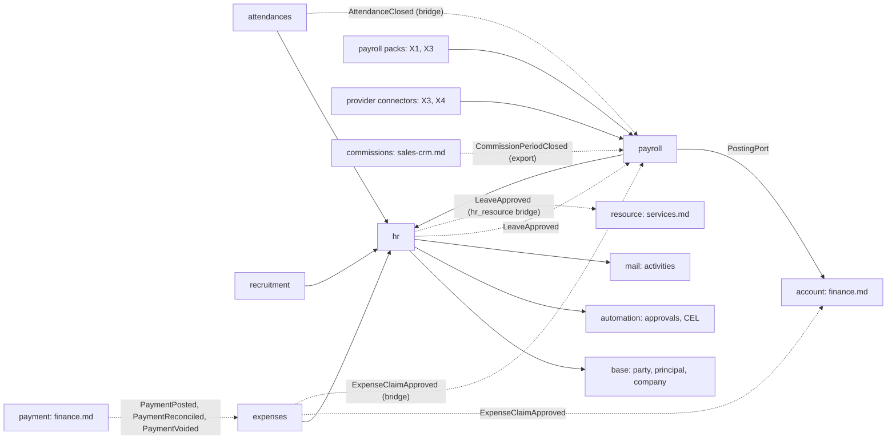
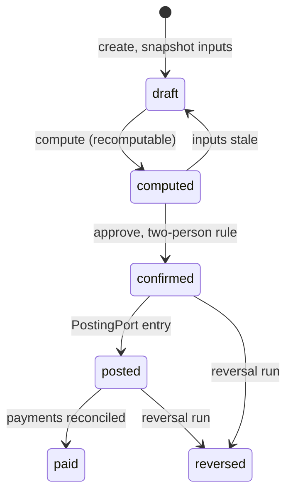

# People: HR core, recruitment, time off, attendance, expenses, appraisals, payroll strategy

**Status:** Draft 0.1  
**Date:** 2026-10-01  
**Scope:** Functional and data specification for obop's HR apps, expenses (HR side), appraisals and payroll strategy, including the sensitive-data model, the AI constraints and the CLI, API and MCP surface (OR-4, D80). Everything in it is Apache-2.0 and completely free (OR-1, OR-2).

Nothing here is legal advice. "Proposed" marks anything the owner has yet to ratify; (target) and (estimate) mark design intent, not measurements. Decisions are cited by ID (D19), the owner rulings of 2026-10-01 as OR-n (RATIFIED; they override every Proposed position, see "Owner rulings" in [DECISIONS](../DECISIONS.md)), research by tag ([R13 s4]). Versions are as of 2026-10-01. Spellings of events, permission groups, data classes, states and ports follow [CONVENTIONS](../CONVENTIONS.md); event, port, module and command names not fixed by [DECISIONS](../DECISIONS.md), CONVENTIONS, the [CLI spec](cli.md) or a sibling spec are proposals. "Community" and "Enterprise" always name Odoo's editions; obop has one edition under Apache-2.0, completely free, with no `ee` tree and no paid layer (OR-1, OR-2, D24). Tiers rely on D25 (Proposed, Q8); the wave windows are RATIFIED (D26, OR-13) and so is the W1 cut, D86 (OR-13, OR-15), which keeps People out of W1 and puts `project` and `timesheet` (the services variant) in W3; that the employee core and `resource` ship with them in W3 is a D25 placement (Proposed, Q8).

## 1. Purpose and scope

### 1.1 What this area is

People manages a company's employees: who they are and what they are contracted to do (Employees), when they are away or at work (Time off, Attendance), who is joining (Recruitment, Onboarding), what they claim back (Expenses), how they develop (Skills, Appraisals) and what they are paid (Payroll). It reproduces the Odoo Community HR surface [R13 s2], adds what Odoo keeps in Enterprise (payroll, appraisals) [R01 s5] as free software, and adds what Odoo Community lacks natively: a read audit and data-layer enforcement of field protection for special-category data [R13 s9.2].

Users are every employee (self-service), line managers, HR, recruiters, payroll officers, finance, external candidates, and the operators and AI agents who drive every capability through the `obop` CLI, the REST API and MCP (4.13).

### 1.2 Modules

| App | Module | Tier | Wave | Main command subjects (4.13) |
|---|---|---|---|---|
| Employees: versions, org chart, contracts, departures | `hr` (employee core first, D86) | T1 | W3 | `employee`, `employee_version`, `employment_contract`, `departure` |
| Time off | `hr` (same module, D25) | T1 | W3 | `leave_type`, `leave_allocation`, `leave_request` |
| Skills; Onboarding/offboarding | `hr` (Proposed: inside the module) | T1 via `hr` | W3 | `employee_skill`, `plan_template`, `plan_instance` |
| Expenses (HR side) | `expenses` | T1 | W3 | `expense_claim`, `expense_line` |
| Recruitment/ATS | `recruitment` | T2 | W3 | `job_opening`, `application`, `offer` |
| Attendance | `attendances` | T2 | W3 | `attendance`, `attendance_correction` |
| Payroll engine | `payroll` | T2 | W3 | `pay_run`, `payslip`, `pay_input` |
| Payroll reference pack | `payroll_<cc>` (Proposed name) | T2 | W4 | `pack` ([CLI](cli.md) 3.3) |
| Appraisals/OKRs | `appraisals` (Proposed name) | T3 | W4 or later, or community | `appraisal_cycle`, `appraisal` |
| Employee self-service | `portal` shell (T0, W2) plus pages contributed by each module | n/a | W3 | The same commands, in scope `hr.self` |

Every module above is Apache-2.0 and free (OR-1, OR-2); there is no paid tier, seat or service in this area. Tier and placement are Proposed (D25, Q8), the wave windows are RATIFIED (D26, OR-13) and the W1 cut is RATIFIED (D86, OR-13, OR-15). Skills and onboarding are not listed in D25 (unlisted modules default to T3), so placing them in `hr` is a proposal. W1 ships none of People (D86). **Employee core with the services variant.** The services variant opens W3 (D86; that `project` and `timesheet` go to W3 is RATIFIED, OR-15): `timesheet`, `project` and the employee core of `hr` (employee, version, department, job, calendar) come first, together with `resource` (T0, W3), because `timesheet` needs an employee and a working calendar; the placement of the employee core and `resource` in that opening is Proposed (D25, Q8). The rest of `hr` (contracts, departures, time off, skills, onboarding), `expenses`, `recruitment`, `attendances` and `payroll` follow in W3 in demand order, each needing a design partner (D25); the payroll reference pack is W4 and appraisals are W4 or later. W3 runs 2028-07-01 to 2029-06-30. The team is the owner plus AI agents (D84), so People breadth is paced by what that team can build and verify, not by funding or headcount; it is an ordered backlog, not a promise (DECISIONS 5.1). Consumed from [Platform](platform.md): the approvals engine (in `automation`, T0, W2), `portal` (T0, W2) and, in W3, `sign`, `documents`, `calendar` and `analytics`. Consumed from [Retail](retail-commerce-marketing.md): `website` (T2, W3).

Bridges (D27, `auto_install`; names Proposed): `expenses_payroll`, `expenses_sales` (via `InvoiceableSource`; `expenses` as an implementer of that port is Proposed, CONVENTIONS 7.1), `attendances_time_off`, `attendances_payroll`, `recruitment_website`, and `hr_resource`, which [Services](services.md) 4.1 owns and which writes approved time off into `resource_leave` (W3, when `resource` ships).

### 1.3 Boundaries

| Neighbour | Stays there | Interface (names Proposed) |
|---|---|---|
| [Finance](finance.md) | Vendor bills, journal entries, payments, SEPA files, lock dates, tax; the financial side of `expenses` (finance.md 4.11) | `PostingPort` [R23 D.2] (payroll lines carry pack-mapped chart accounts, 4.10); `ExpenseClaimApproved` (finance creates the draft bill) and `PaymentPosted`, `PaymentReconciled` and `PaymentVoided` (people follows the payout and marks the claim reimbursed) |
| [Services](services.md) | `resource` calendars and leaves, timesheets (analytic lines), planning, field service, helpdesk assignment | `EmployeePort` (with `cost_rate(employee, date)`, Proposed in services.md), `SkillPort` (Later); `LeaveApproved` and `LeaveCancelled` through the `hr_resource` bridge |
| [Platform](platform.md) | Party, principal, company, chatter, activities, approvals engine, documents, sign, calendar, portal shell | Ports and durable events (D27) |
| [Security and privacy](security-privacy.md) | Permission algebra (D10), encryption, audit log, erasure | People declares data classes and purposes (4.11) |
| [AI](ai.md) | Agent surface, approval policy engine | People declares AI features and defaults (4.12) |
| [CLI](cli.md) | Grammar, global flags, output and exit-code contracts, the parity test, the plugin registry client | People registers its commands in the catalogue (4.13) and restates none of those rules |
| [Localization](../LOCALIZATION.md) | Pack operating model and gates | People consumes packs |

### 1.4 Open and free

Everything in this area is Apache-2.0 and completely free to use and to self-host (OR-1, OR-2; DECISIONS section 6): every app above, the payroll engine, the `PayrollProvider` interface, provider connectors (import, push, pull; not filing connectors), country pack rule content, the audit log, and employee self-service for any number of employees (there are no seats and no light-user ratio). There is no payroll service, no warranty, no legal-change service, no hosted AI credits and no filing gateway; SpaceCorps sells, warrants and operates none of them (OR-2, OR-11, D17, D19). Pack content is provided as is under the Apache-2.0 disclaimer (D38) and earns trust through golden cases and oracles (4.10). Filing connectors are not built or promised; a third party may publish one as a plugin (D81) and the user runs it with their own credentials. Native multi-IdP SAML and full SCIM are unpromised backlog items (DECISIONS section 6); HR provisioning uses the open SCIM subset (D33). AI is bring-your-own-key or local (D18). The earlier EUR 4 per employee per month payroll-service hypothesis (R26 A3) is superseded and no price of any kind exists.

### 1.5 Module map

Solid arrows point from a module to the `*-api` crates or ports it uses (D27); dotted arrows run from publisher to consumer of a durable event, through a bridge where marked. Every module in the map registers its commands in the command catalogue (D29, D80); the CLI, REST and MCP surfaces are generated from it (4.13).

## 2. Personas and roles

Permission group names are proposals, spelled as in [CONVENTIONS](../CONVENTIONS.md) 4. This table uses the HR seed names listed in [Security and privacy](security-privacy.md) 2 (`hr.officer`, `hr.admin`, `hr.special_reader`, `hr.line_manager`, `hr.self`, `payroll.preparer`, `payroll.approver`) and defines them for that document. Retired: `hr.manager`, `hr.user` and `hr.auditor` (now `hr.admin`, `hr.officer` and `audit.reader`; [CONVENTIONS](../CONVENTIONS.md) 8). `hr.retro_change` and `hr.correct` (4.1) are named actions granted by rows of a group, not groups. Every grant follows the D10 algebra: default-deny, an explicit scope, data-class grants separate from record grants. Widening a data-class grant is an audited event.

| Persona | Permission group | Scope | Data classes readable by default | Notable limits |
|---|---|---|---|---|
| Employee | `hr.self`, in addition to `base.user` | own | all data classes of own record, own payslips | Sensitive edits need approval |
| Line manager | `hr.line_manager` (derived from the reporting line, never granted by hand) | domain: reports | `public_directory`, `internal`; leave dates (type hidden if private) | No `confidential_hr`, `special_category`, `financial` |
| HR officer | `hr.officer` | company | `public_directory`, `internal`; `confidential_hr` open (question 14) | `special_category` and `financial` need separate grants. Whether `confidential_hr` is readable by default or needs an explicit grant is an open owner decision (question 14; security-privacy.md open question 17); neither reading is adopted here |
| HR administrator | `hr.admin` | company | as officer, same open point (question 14), plus configuration | Can grant classes to others, audited; owns HR AI switches with `ai.hr_feature_owner` ([AI](ai.md) 2) |
| HR business partner | `hr.hrbp` | domain: assigned departments | as officer, in scope, same open point (question 14) | |
| Special-category reader | `hr.special_reader` | domain or company | special_category | Every read audited with a purpose |
| Recruiter | `recruitment.recruiter` | domain: own openings | candidate and application data | No diversity fields |
| Interviewer, hiring manager | `recruitment.interviewer` | domain: assigned applications | limited application fields | No expected salary, no diversity fields |
| Payroll preparer | `payroll.preparer` | company | financial, internal | Cannot approve own run |
| Payroll approver | `payroll.approver` | company | financial | Differs from the preparer |
| Kiosk device | `attendances.kiosk`, held by an API client principal registered to the device (Proposed; D28 has no device principal kind) | own, via badge or PIN | none | Check-in and check-out only |
| Auditor, data protection officer | `audit.reader`, `privacy.officer` (security-privacy.md 2) | company | metadata and audit log | Read-only; data only through grants |
| Candidate | guest principal with capability token [R23 B.1] | own | own application | |
| AI agent | agent principal (D18) | intersection of user and token scopes | none of the sensitive classes by default (Proposed) | Drafts only; cannot approve or pay; uses the same typed commands as people (D80) |

## 3. Capability map

Waves follow D25 and D26 (the windows are RATIFIED by OR-13; placements are Proposed). "Later" means after the app's first wave. The Odoo parity column compares features: "Community" and "Enterprise" are Odoo's editions, and every capability here is free in obop. Each row is a set of typed commands reachable through the CLI, the API and MCP (4.13); a capability is not done until it has all three (D80).

| Capability | Description | Wave | Odoo parity |
|---|---|---|---|
| Employee master, directory, departures | Person-linked identity, narrow public read model, dated exits | W3 (employee core first, with `timesheet`) | Matches Community |
| Effective-dated versions | Change versus correction, DB-enforced non-overlap, retro flag | W3 | Matches Community in concept (`hr.version`); beyond on guarantees |
| Org chart | Reporting tree with as-of-date view | W3 | Matches Community; as-of beyond |
| Employment contracts | Period, probation, signed document | W3 | Matches Community; e-signature matches Enterprise (Sign) |
| Onboarding/offboarding plans | Dated checklists, responsibles, triggers | W3 | Matches Community (activity plans) |
| Skills and resume | Types, levels, history, job requirements | W3 | Matches Community |
| Leave requests and approval | Half-days, multi-step approval, calendar | W3 | Matches Community |
| Allocations, accruals, holidays | Levels, caps, carry-over, append-only ledger, pack holidays | W3 | Matches Community; ledger beyond |
| Attendance and overtime rules | Kiosk, web, mobile; time rules; corrections by approval | W3 | Matches Community (Odoo 20 rules) |
| Geo, IP, photo capture; biometric feeds | Off by default with DPIA gate; biometrics only as extensions | W3; later | Matches Community; default-off beyond; biometrics deliberately skipped |
| Openings, pipeline, applications | Stages, refusal reasons, sources, alias, talent pool | W3 | Matches Community |
| Interviews, feedback, offers, consent timers | Structured feedback, e-signed offer, purpose-bound consent and expiry | W3 | Matches Enterprise in part (Sign); consent timers beyond |
| Candidate ranking, auto-reject | High-risk AI | Not shipped | Deliberately skipped (4.12) |
| Expense claims and policies | Lines, receipts, limits, per diem, mileage | W3 | Matches Community |
| Reimbursement via payroll | Payslip reimbursement | W3 | Matches Enterprise; free here |
| Receipt extraction | Optional AI, drafts only | Later | Beyond (BYOK, no credits) |
| Appraisals, 360, goals | Cycles, templates, key results from measures | W4 or later | Matches Enterprise; free here |
| Employee self-service | Profile, payslips, leave, expenses, directory | W3 | Beyond (no seats, for every employee) |
| Payroll rule engine | Structures, rules, dated parameters, categories, inputs, CEL | W3 | Matches Enterprise in concept; explainable, CEL beyond |
| Payslips, pay runs, posting, payment files | Regular, off-cycle, correction, forecast; posting templates; pain.001; basic garnishments and advances | W3 | Matches Enterprise; retro and forecast beyond |
| Provider connectors, bureau export | Import runs, push employees, pull payslips; time by external code | W3 first connector | Matches Enterprise (Employment Hero, ADP, SD Worx) |
| Country payroll packs | Signed, versioned, golden-case-gated | W4 first | Enterprise ships about two dozen; obop one reference, then third-party maintainers (L2) |
| Statutory filing | RTI, DSN, Dimona, ELSTER and similar | Not in core | Deliberately skipped (D19) |
| Command surface | Every capability above as a typed command in CLI, API and MCP (4.13) | With each app (D80) | Beyond: Odoo gates its external API by plan (D31) |

## 4. Per-app specification

### 4.0 Conventions

- "MVP" is the cut shipped in an app's first wave (W3 here, W4 for appraisals); "Later" is anything after.
- Every row has a UUIDv7 id and `company_id` (D6, D9, D28); employees are company-owned, branch optional [R23 C.3].
- Domain states below map to the kernel lifecycle (draft, confirmed, cancelled) plus derived progress fields; approval state comes from the approvals engine [R23 B.2].
- Conditions and formulas are CEL (D11); storage as source plus compiled form, and filters as Domain AST, are Proposed (D12). TxEvents run in the publisher's transaction; durable events use the outbox (D27). Every event named under Flows is a durable event unless marked TxEvent. Webhooks for People events are thin (ids and type only); consumers re-fetch under their own permissions (Proposed, [R21 s4]).
- Effective dating uses date ranges with `EXCLUDE ... gist` on PostgreSQL 17; temporal keys sit behind `requires_pg = 18` (D8).
- Every capability is a typed command (D80). Section 4.13 lists the main commands of this area; each is generated into the CLI, the REST API and MCP from one catalogue entry, runs the D10 permission check, and, when it mutates, has a dry-run with a digest-bound `plan_id` and an idempotency key. The web UI is a client of these commands and holds no HR logic.

### 4.1 Employees

**Purpose.** One effective-dated record of a person's employment, the source for every other People app.

**MVP.** Employee master, versions, departments, jobs, work locations, types, tags, contracts, org chart (as-of date), public read model, bank accounts with trusted flag, departures. The employee core (employee, version, department, job, calendar) ships first, with `resource`, `timesheet` and the services variant at the start of W3 (D25, D86; Proposed, Q8), and the rest follows in W3. **Later.** Concurrent contracts, cross-company secondment.

| Entity | Purpose | Key fields | States |
|---|---|---|---|
| `employee` | Identity | `party_id` (person, required), `principal_id` (nullable), `company_id`, `branch_id`, badge and PIN hashes, `resource_id` | active, archived |
| `employee_version` | Time-varying data | `valid_during`, department, job, title, manager, coach, work location, calendar, type, `employment_contract_id`, pay structure type, wage (`financial`), hourly cost (`financial`, because wage can be recomputed from it; served by `EmployeePort::cost_rate`, Proposed in services.md, with `timesheet.cost_viewer` as the extra field permission; Odoo keeps `hourly_cost` on the employee [R14 s4.1]), `kind` (change or correction), reason | scheduled, current, past (derived) |
| `employment_contract` | Legal agreement | type, start, end, trial end, fixed term, document ref | draft, running, ended, cancelled |
| `employee_private` | Classed personal data | national id (encrypted), birth date, passport, dependants, private address, emergency contact | confidential_hr |
| `employee_bank_account` | Payout target, kept apart from the party's `party_bank_account` [R23 B.1] so the class stays separate | IBAN (encrypted), `trusted`, split | financial |
| `departure` | Exit | reason, notice date, effective date, apply (now or on date) | planned, effective |
| `hr_employee_public` | SQL view | Directory fields only | n/a |
| `employee_reporting_closure` | Derived | ancestor, descendant, depth, `valid_during` | derived |

The employee's party holds only name and work contact; everything else sits in classified tables, and a restriction row hides employee-linked parties from non-HR search beyond those fields (Proposed) [R23 B.1, R13 s3.1].

**Workflow: change versus correction (Proposed).**
1. HR picks an effective date and edits. The current version is split at that date; the new version has `kind = change`; history is preserved.
2. An effective date earlier than the end of the latest confirmed pay run is retroactive: it needs the named action `hr.retro_change` and a reason, and marks affected runs stale (4.10).
3. A correction fixes wrongly entered data in place: the named action `hr.correct`, old and new values written to the audit log, same stale rule for payroll fields.
4. Departure: on the effective date the contract ends, the principal is disabled and sessions revoked, future leave is cancelled, the offboarding plan runs and the retention clock starts.

**Invariants.** No overlapping versions per employee; no gaps between first start and departure (deferred trigger); no reporting cycles.

**Flows.** Emits `EmployeeCreated`, `EmployeeVersionChanged` (changed classes, effective date, change or correction), `EmployeeReportingLineChanged`, `EmployeeDeparted`. Consumes `PrincipalDeactivated`, `PartyErased` (scrubs contact snapshots, ARCHITECTURE 4.3; Proposed addition), `SignRequestCompleted` (contract), `ApprovalDecided` (profile change requests), `PackActivated` (identifier formats). Provides `EmployeePort` (public lookup, manager chain, scope test, `create_draft` for `recruitment`, and `cost_rate(employee, date)` as [Services](services.md) proposes).

**Permissions and sensitive data.** Classes per 4.11. Changes to wage, bank account and contract need approval; a bank account change resets `trusted` and blocks payouts until an approver trusts it [R13 s3.1, R16 s5]. Chatter tracking is used only for `public_directory` and `internal` fields; other classes go to the audit log, not to followers.

**Reports.** Headcount by department, type and date; turnover; contract, probation and work-permit expiries; org chart as of a date.

**Configuration.** Types, locations, required fields by country, identifier formats (pack), custom properties (class tag mandatory), who may backdate, manager-chain depth.

**Localization.** Identifier validation, works-council switches and retention classes come from packs [R13 s9.1]. **Commands.** `employee`, `employee_version`, `employment_contract`, `departure` (4.13).

### 4.2 Time off

**Purpose.** Leave entitlements, requests and balances, feeding calendars, timesheets and payroll.

**MVP.** Types, allocations, accrual plans with levels and carry-over, requests with half-days and hours, approval rules, mandatory days, public holidays (pack), team calendar, balances report, attachment rules. **Later.** Encashment rules, blackout periods.

| Entity | Purpose | Key fields | States |
|---|---|---|---|
| `leave_type` | Policy | unit (day or hour), approval policy ([Platform](platform.md) 4.12), needs allocation, negative limit, `sensitivity` (normal or private), work entry type, document required | active |
| `leave_allocation` | Grant | target (employee, department, tag, all), amount, validity, plan, carry-over | draft, approved, closed |
| `accrual_plan`, `accrual_level` | Accrual rules | start, milestone, added value, frequency, caps, carry-over, validity [R13 s3.2] | active |
| `leave_ledger_entry` | Balance source | employee, type, delta, effective date, source, ref, `idempotency_key` | immutable |
| `leave_request` | Request | employee, type, `tstzrange` in employee time zone, half-day flags, duration (computed), attachment, approval ref | draft, requested, approved, refused, cancelled |
| `mandatory_day` | Company calendar | region, date, name, validity | active |

Public holidays are not an `hr` table: a country pack loads them as `resource_leave` rows of kind `public_holiday` ([Services](services.md) 4.1), and `hr` reads them for duration arithmetic.

The balance is the sum of ledger entries, append-only (Frappe also models leave as a ledger entry [R13 s7.1]); cancelling approved leave appends a reversal. Available balance is balance minus requested-but-undecided days. States: draft, requested (balance reserved), approved, refused, cancelled; "taken" is derived from the date.

**Workflow.**
1. The employee picks type and dates; the form shows computed duration and projected balance (a dry run of the same command, `obop leave_request submit --dry-run`, or its API and MCP equivalents).
2. Submit (`SubmitLeaveRequest`, wire id `leave_request.submit`, idempotent by `command_id`) locks the employee-type balance row, checks overlap (`EXCLUDE` on live requests) and balance, and creates the approval request from the policy matched for the type; CEL conditions add steps ([Platform](platform.md) 4.12).
3. Approvers decide in the inbox, or with `obop approval decide` ([CLI](cli.md) 3.9; only humans decide); exclusive approval prevents one user approving two steps; delegation covers absences [R15 s9].
4. Final approval appends the ledger entry and emits `LeaveApproved`.
5. Refusal or withdrawal releases the reservation; cancelling approved leave appends a reversal.

**Flows.** Emits `LeaveRequested`, `LeaveApproved`, `LeaveRefused`, `LeaveCancelled`, `AllocationGranted`, `BalanceExpired`. Consumed by `payroll` (classified intervals) and, through the `hr_resource` bridge, by `resource`, which re-emits `LeaveRecorded` for `planning`, `helpdesk` (skip absent assignees), `appointments`, `project` scheduling and expected timesheet hours [R14 s5.3, s7]; `calendar` shows team leave. Time-off entries inside timesheets are not specified in services.md and are not promised here. Consumes `EmployeeVersionChanged` (schedule), `EmployeeDeparted` (cancel future leave, final balance to payroll input), `AttendanceClosed` (bridge), `PackActivated`. An approval after the pay run was confirmed becomes deferred time off in the next run [R13 s3.2].

**Permissions and sensitive data.** A `private` type shows to managers and colleagues as "Absent"; type and certificates are special_category. Managers cannot filter or group by type (the query compiler rejects it, D10).

**Reports.** Who is out, balances, accrued-unused liability, requests by status, mandatory-day coverage. **Configuration.** Types, plans, calendars, approval policies, negative limits, unit. **Localization.** Entitlement templates, carry-over conventions and holiday calendars ship as effective-dated pack data; the core holds mechanism, not law. **Commands.** `leave_type`, `leave_allocation`, `leave_request` (4.13).

### 4.3 Attendance

**Purpose.** Record when people are at work, derive overtime, and feed payroll and compensatory time.

**MVP.** Kiosk, web and mobile check-in and out, one open attendance per employee, corrections by approval, time rules for overtime classification, hours-versus-expected report. **Later.** Device feeds (extension packages), geofencing, shift-aware rules with `planning`.

| Entity | Key fields | States |
|---|---|---|
| `attendance` | employee, check-in, check-out, source, method, `client_uuid`, device time, server time, stale flag; optional geo, IP, photo (off by default, confidential_hr) | open, closed |
| `attendance_correction` | original ref, proposed times, reason, approval ref | requested, approved, refused |
| `time_rule` | country or company filter, threshold, period, weekdays, window, tolerance, source and target work entry type, premium (basis points) [R13 s3.3] | active |
| `overtime_entry` | employee, period, hours by class, approval ref | computed, approved, converted |

**Workflow.** Check-in creates an open attendance (partial unique index); check-out closes it; the classifier applies time rules in sequence order to produce classified intervals; overtime above tolerance goes to approval; approved overtime becomes payroll input or compensatory allocation per configuration. Closed attendances are never edited; corrections are records.

**Flows.** Emits `AttendanceOpened`, `AttendanceClosed`, `OvertimeApproved`. Consumes `EmployeeVersionChanged`, `LeaveApproved` (expected hours), `PrincipalDeactivated`. The work entry types and the classifier live in `hr`, so time off and payroll do not depend on `attendances`; the attendance source is an optional port (D27), and the `attendances_time_off` and `attendances_payroll` bridges carry the two consumers.

**Permissions and sensitive data.** Geo, IP and photo capture are off by default and need a per-company switch, a recorded DPIA acknowledgement and, where the pack says so, a works-council flag; first-party code stores no biometric templates [R13 s9.1, Implications #17]. **Offline.** Check-ins are queued-write candidates with client UUIDs and both device and server times (D13, Proposed; R19 s11 lists timesheets, stock counts, expenses and CRM notes, so check-ins are this document's addition). **Reports.** Presence, hours versus expected, overtime. **Localization.** Working-time recording duties and monitoring limits differ by country (GDPR Art. 88); packs ship defaults and switches, and no national rule is asserted here. **Commands.** `attendance`, `attendance_correction`, `time_rule` (4.13).

### 4.4 Recruitment

**Purpose.** Fill positions with a pipeline that is explainable, consented and time-limited.

**MVP.** Openings, candidates, applications, stages, refusal reasons, sources, email alias per opening, careers page (with `website`), interviews and structured feedback (via `calendar`), offers with e-signature (`sign`), talent pool with consent, hire-to-employee. **Later.** Job-board connectors (extensions), requisition workflow.

| Entity | Key fields | States |
|---|---|---|
| `job_opening` | position, openings count, recruiter, hiring manager, pay range (min, max, currency, period), alias, published | draft, open, paused, closed |
| `candidate` | person party, contact, source, `retention_until` | active, anonymized |
| `consent_record` (ledger of `base`, owned by [Security and privacy](security-privacy.md) 4.6; not a People table) | Candidate consent as rows written through `ConsentPort`: subject, purpose, basis, time, kind (`grant` or `withdrawal`) and an expiry that People needs the ledger to carry (Proposed; replaces the former `candidate_consent` table, and security-privacy.md 4.6 lists no expiry field yet) | append-only; active, withdrawn and expired are derived from the rows |
| `application` | opening, candidate, stage, refusal reason, expected salary (`confidential_hr`) | open, hired, refused, withdrawn |
| `interview`, `interview_feedback` | schedule, interviewers, criteria ratings, comments | scheduled, done; submitted |
| `offer` | application, proposed version fields, expiry, signature ref | draft, sent, accepted, declined, expired |

Stage is a user-defined column (sequence, fold, hired flag, mail template); state is a fixed enum, as for tasks [R14 s3.1]. Reviewers see others' feedback only after submitting their own (Proposed).

**Workflow.**
1. An opening is published (careers page, alias, connectors). Pay range is a field on the opening; application forms carry no salary-history question (lint, Proposed, pay-transparency rules unverified in [R13 s9.1]).
2. A candidate applies; consent is written to the consent ledger through `ConsentPort`, per purpose and with an expiry (Proposed); duplicates are detected deterministically by contact fingerprint.
3. Humans move stages; stage entry sends templated mail.
4. Interviews are scheduled; feedback is structured.
5. An offer is drafted from a version template, approved (CEL on salary band), signed as a simple electronic signature (D39) and accepted.
6. On hire (`ApplicationHired`), recruitment calls `EmployeePort::create_draft`: party, employee, first version, draft contract, onboarding plan. Only mapped fields are copied; the rest stays here under its timer.
7. A refusal needs a reason, may send a template, and starts the retention timer.

**Flows.** Emits `ApplicationReceived`, `ApplicationStageChanged`, `OfferAccepted`, `ApplicationHired`, `ApplicationRefused`. Consumes `SignRequestCompleted`, `EmployeeCreated` and `PartyErased` (scrubs candidate contact snapshots, ARCHITECTURE 4.3; Proposed addition). Calls `ConsentPort` and `EmployeePort::create_draft`. Interviews are scheduled through `calendar`; recruitment has no `appointments` edge.

**Permissions and sensitive data.** Voluntary diversity fields are special_category, collected only where a pack enables them, hidden from recruiters and interviewers, and reported only in aggregate. Expected salary is `confidential_hr`. Candidates act through capability tokens (status, withdraw, delete my data).

**Ranking.** No first-party ranking, scoring or auto-reject (4.12). Skill overlap against required skills is shown only as a count of required skills met (not a score, not a default sort); it is deterministic and user-configurable, never triggers an action and can be switched off. It is not the matching score Odoo 20 added, whose AI basis is unverified [R01 s3.6], and which [AI](ai.md) does not ship. **Reports.** Funnel, time to hire, source effectiveness, openings versus target, offer acceptance. **Localization.** Applicant retention and consent defaults, pay-transparency fields and reporting come from packs; the EU directive's transposition status is unverified in the research [R13 s9.1]. **Commands.** `job_opening`, `application`, `interview`, `offer` (4.13); no command ranks or scores.

### 4.5 Expenses (HR side)

**Purpose.** Capture, police and approve out-of-pocket costs, then hand a clean draft bill to finance or a reimbursement input to payroll. Accounting is in [Finance](finance.md).

**MVP.** Claims with lines, receipts, categories, per diem and mileage via rate tables, policy checks, approval, draft vendor bill, bank or payroll reimbursement, project and customer re-invoicing (bridge). **Later.** Company-card feeds, cash advances, OCR of receipts (optional AI).

| Entity | Key fields | States |
|---|---|---|
| `expense_claim` | employee, title, period, currency, total (derived), reimbursement method, bill ref | draft, submitted, approved, refused, cancelled |
| `expense_line` | date, category, amount (minor units), tax config, paid by (employee or card), receipts, attendees, quantity and unit, analytic distribution, duplicate fingerprint, policy flags | n/a |
| `expense_category` | account role, default tax, kind (`standard`, `per_diem`, `mileage`), limits, receipt threshold, rate table | active |
| `rate_table` | unit, rate `NUMERIC(24,8)`, `valid_during` | pack data |

Progress `reimbursement_state` (`not_due`, `to_reimburse`, `in_payroll`, `reimbursed`) is derived from links, not written. A claim header is kept because approval and payout batch are per claim; Odoo 19 removed expense reports [R01 s3.2], so this is a Proposed difference (open question 4), and [Finance](finance.md) 4.11 already assumes the claim states draft, submitted, approved, refused.

**Workflow.**
1. Capture on web or mobile (share-to-create from camera or PDF [R19 s10]) or by email alias.
2. Submit runs deterministic checks: totals, duplicate fingerprint, receipt rules, dates, category limits. Warnings and blocks are rule severities.
3. Approval by rule (manager; CEL adds finance above a threshold). The engine may auto-approve under policy; it never auto-refuses.
4. On approval `ExpenseClaimApproved` is emitted. The financial side of `expenses` ([Finance](finance.md) 4.11) consumes it and creates the draft vendor bill in the expense journal with the employee's party as vendor (lines by account role, analytic distribution); a unique source ref means a redelivery makes no second bill. In the payroll path an `expense_reimbursement` input is also consumed by the next confirmed run; how payroll clears the bill's payable is for Finance to agree (open question 7).
5. Finance posts the bill; payout uses the trusted IBAN. The payment events carry the invoice refs, which `expenses` matches to the claim's bill ref: `PaymentPosted` records that a payout exists (the claim stays `to_reimburse`), `PaymentReconciled` sets the claim reimbursed, and `PaymentVoided` drops the payout so the claim is `to_reimburse` again and can go into a new batch.

**Flows.** Emits `ExpenseClaimSubmitted`, `ExpenseClaimApproved`, `ExpenseClaimRefused`, `ExpenseClaimReimbursed`. Consumes `PaymentPosted`, `PaymentReconciled` and `PaymentVoided` (step 5), `PayRunConfirmed`, `EmployeeDeparted` (block new claims, final reimbursement).

**Permissions and sensitive data.** Receipts can reveal health or religion; attachments inherit the strictest class of any tagged content. **Reports.** Spend by category, project, employee; policy violations; approval ageing; unreimbursed liability. **Localization.** Tax-free limits, mileage and per diem rates, VAT recoverability per category and receipt retention come from packs; the receipt becomes the bill's accounting attachment, so accounting retention applies. **Commands.** `expense_claim`, `expense_line` (4.13).

### 4.6 Skills

**Purpose.** A shared skills graph for recruitment matching, planning, helpdesk routing and appraisals.

**MVP.** The entities below, certification-expiry reminders, skill matrix. **Later.** Manager validation flows, skill evolution reports (with appraisals).

| Entity | Key fields |
|---|---|
| `skill_type`, `skill`, `skill_level` | type with ordered levels; numeric progress per level [R13 s3.4] |
| `employee_skill` | employee, skill, level, `valid_from`, source (self, manager, certification), `certified_until` |
| `resume_line` | typed entries (experience, education, certification), dates |
| `job_skill` | position, skill, required level |

**Workflow.**
1. The employee or manager records a skill and level.
2. The previous row is closed, so history is kept.
3. Expiry of `certified_until` raises an activity for the employee and manager.

**Flows.** Emits `EmployeeSkillChanged`; consumes `EmployeeDeparted`. `SkillPort` serves `recruitment` first; `planning` and `helpdesk` routing follow later, because [Services](services.md) lists skills as Later and routes helpdesk by tag. **Permissions.** Internal class; manager chain and HR can edit. **Reports.** Skill matrix, coverage gaps, expiring certifications. **Configuration.** Types and level scales. **Localization.** None. **Commands.** `employee_skill`, `resume_line` (4.13).

### 4.7 Onboarding and offboarding

**Purpose.** Checklists that start themselves and chase their owners.

**MVP.** Plan templates and instances backed by `mail` activities [R13 s3.1]. **Later.** Equipment return tracking with assets.

| Entity | Key fields | States |
|---|---|---|
| `plan_template` | type (onboarding, offboarding), applicability by company, department, job or employee type | active |
| `plan_template_item` | title; responsible (employee, manager, HR business partner, named user or permission group); offset in days from start or departure date; kind (`todo`, `document_request`, `signature`, `principal_provisioning`); CEL condition | n/a |
| `plan_instance`, task | employee, anchor date, progress | active, completed, cancelled |

**Workflow.**
1. `EmployeeCreated` instantiates the matching onboarding plan, and `EmployeeDeparted` (emitted when a departure is recorded, carrying its effective date) the offboarding plan, so items can sit before the effective date.
2. Each item creates an activity for its responsible person at anchor plus offset.
3. Document requests and signatures run through `documents` and `sign`; provisioning creates the principal disabled until the start date.
4. Overdue items escalate through automation rules; progress shows on the employee form.

**Flows.** Emits `PlanCompleted`; consumes the two employee events and `SignRequestCompleted`. **Permissions.** Tasks are visible to responsibles and HR; offboarding reasons are confidential_hr. **Reports.** Open plans, overdue items by owner. **Configuration.** Templates and resolvers. **Localization.** Pack-supplied templates for mandatory documents. **Commands.** `plan_template`, `plan_instance` (4.13).

### 4.8 Appraisals and OKRs

**Purpose.** Review cycles and goals, open where Odoo gates them [R01 s5]. T3 (D25): W4 or later, or community. W3 only reserves names and classes.

**MVP (W4).** Cycles, templates, self and manager review, calibration, objectives with key results. **Later.** 360 feedback with anonymity thresholds, skill-evolution links.

| Entity | Key fields | States |
|---|---|---|
| `appraisal_cycle` | period, scope, template | draft, open, closed |
| `appraisal` | employee, cycle, reviewers | draft, self_review, manager_review, calibration, shared, done |
| `objective`, `key_result` | owner, weight, metric source (manual or an `analytics` measure), start, target, current | open, met, dropped |
| `feedback_request` (later) | reviewers, anonymity threshold | open, closed |

**Workflow.**
1. HR opens a cycle for a scope.
2. Employees and managers complete reviews.
3. HR calibrates across a department.
4. Results are shared, then the appraisal is immutable.

**Flows.** Emits `AppraisalShared`, `ObjectiveClosed`; consumes `EmployeeVersionChanged`, `EmployeeDeparted`. **Permissions.** confidential_hr; the employee sees nothing until `shared`. AI does no scoring (4.12). **Reports.** Completion, goal progress, skill evolution. **Configuration.** Templates, scales, calibration groups. **Commands.** `appraisal_cycle`, `appraisal`, `objective`, `key_result` (4.13).

### 4.9 Employee self-service

**Purpose.** Everything an employee does for themselves, for any number of employees at no cost (there are no seats, OR-2). Each page is a UI client of the commands of its backing module (4.13).

**MVP.** The pages below. **Later.** Native mobile shells.

| Page | Backing module | Scope |
|---|---|---|
| Profile and change requests | `hr` | own |
| Payslips (PDF/UA from `obop-report`, stored in `documents`) | `payroll` | own |
| Leave: request, balances, team calendar | `hr` | own, team |
| Expenses: capture, submit, status | `expenses` | own |
| Timesheets, check-in | `timesheet`, `attendances` | own |
| Directory and org chart | `hr` (public view) | company |
| Documents to sign or read | `documents`, `sign` | own |
| Approvals inbox (managers) | `automation` | assigned |

**Workflow.** Sensitive profile edits (bank account, legal name, contract terms) create a change request, routed by approval rule, and apply as a new version on approval. Payslip notifications carry a link, never content.

**Permissions.** An ESS principal is a `user` principal restricted to `hr.self` (Proposed; open question 3): own scope on every row, directory read on the public view. **Configuration.** Which pages each module contributes; editable fields. **Offline and accessibility.** WCAG 2.2 AA (D35), mobile PWA baseline, timesheets and expenses as queued-write candidates (D13, Proposed).

### 4.10 Payroll strategy

**Purpose.** Compute pay correctly, explainably and reproducibly from data, without owning any country's law or filing (D19).

**Three layers.**

| Layer | Content | Licence and warranty |
|---|---|---|
| Engine (core, `payroll`) | Rule evaluation, runs, payslips, posting, payment files, trace, golden-case harness | Apache-2.0, free, as is |
| Country packs | Signed, versioned, effective-dated rules, parameters, categories, inputs, templates; optional Wasm for statutory algorithms; filing payload builders | Rule content open and free, no warranty, no payroll service (OR-2, D19) |
| Provider connectors | `PayrollProvider`: import pay runs and journals, push employees and deductions, pull payslips | Interface and connectors open and free |

Core contains no country tax code [R13 Implications #3]. Core never transmits a statutory filing; packs may build and validate payloads, and transmission is a provider's job, or an adapter that a third party publishes as a plugin (D81) and the user runs with their own credentials; SpaceCorps operates no filing gateway (D19, D17, OR-11). Pack code is X1 declarative, X3 Wasm (the host arrives in W3 after the OR-13 cut, D86) or X4 remote (D11); a payroll pack is installed and verified with the same typed commands as a localisation pack (`obop pack install`, `obop pack verify`, [CLI](cli.md) 3.3; Proposed); the manifest is `obop.toml` with `valid_from`, `valid_to`, `requires_core` and oracle versions (D32, [R25 B5]).

**Rule model** (the six blocks practitioners know [R13 s4.1]).

| Entity | Purpose | Key fields |
|---|---|---|
| `pay_structure_type`, `pay_structure` | Groups and ordered rule sets | frequency, wage type, default calendar, rules |
| `pay_rule` | One line | code, category, sequence, condition (CEL), amount mode (percentage, fixed, input, CEL), display, posting template, content hash |
| `pay_rule_category` | Totals addressable by code | parent, code |
| `pay_parameter` | Dated values | name, value, `valid_during` (`EXCLUDE` overlap) |
| `pay_input_type`, `pay_input` | One-off typed lines | type, employee, date, amount or quantity, source ref, state (pending, consumed, void) |
| `pay_run`, `payslip`, `payslip_line`, `payslip_trace` | Runs | period, kind, inputs digest, pack and engine versions; line amount, quantity, rate, total, category, YTD |
| `salary_attachment` | Garnishment, loan, advance | priority, cap, schedule |

Rules run in ascending sequence; later rules see earlier results. `total = amount * quantity * rate / 100`. The CEL context exposes the payslip, employee version, prior results and categories, classified intervals, inputs, dated parameters and YTD, with no clock and no I/O, under the D11 limits (4 KB, AST depth 32, step budget, deadline). [R24 s3.2] documents no decimal type for the `cel` crate (0.14.5, 2026-09-07, as of 2026-10-01), yet payroll needs exactness and floats are banned (D9); the W1 CEL spike must choose a host decimal type or scaled integers with explicit rounding modes (open question 5). Amounts persist as minor-unit integers plus currency, quantities as `NUMERIC(24,6)` [R23 DR-5].

**Inputs.** Classified time intervals (work entry types, time rules), versioned employee data, typed inputs, dated parameters [R13 Implications #5]. Approved commission statements from [Sales and CRM](sales-crm.md) arrive as typed inputs through an export: payroll consumes `CommissionPeriodClosed` and turns the period's statements into `pay_input` lines with the statement as source ref; no payroll logic lives there (D19). At run creation the intervals and inputs are snapshotted into the run with a digest, because Odoo 20 appears to derive them at compute time (an inference, [R13 s3.3]) and a late edit must not silently change a closed run.

**Run lifecycle.**

States are the stored values of `pay_run`. Kinds are `regular`, `off_cycle`, `correction` (retro deltas), `termination` and `forecast` (never posted). Confirmed runs and payslips are immutable by trigger (extending D30, Proposed); corrections are correction runs or reversals. Preparer and approver differ (Proposed). A run holds an advisory lock per company, period and kind while computing.

**Explainability.** Every line stores rule id and content hash, parameter values with their effective dates, the inputs digest, the evaluation trace, and engine and pack versions (D38, [R13 Implications #8]). Re-running the same digest and versions must give identical lines (property test).

**Accounting and payment.** Rule-level debit and credit templates, with split-by-name, excluded-from-net, employee-on-line, analytic and optional batching, post through `PostingPort` [R23 D.2, R13 s4.3] and respect accounting lock dates. The account role registry ([CONVENTIONS](../CONVENTIONS.md) 6, [Finance](finance.md) 4.1.1) has no salary or payroll role, and an account that is not a role stays a chart account. A template therefore names a payroll-local account key (for example salary expense or net pay payable) that the pack maps to a chart account per company, never an account id typed into a rule, and the line reaches `PostingPort` with that explicit account ([Finance](finance.md) 4.1.2 rule 4). Registering payroll roles instead is Proposed and for Finance to decide (open question 7). SEPA pain.001 comes from the batches of `payment` ([Finance](finance.md) 4.5), released by an `account.payment_approver`; payslips render through `obop-report` (Typst, D20, Proposed).

**Reference pack (D19).** The first reference pack is decided on 2029-04-01 (M30) between France via `modele-social` (MIT) as a rules source and US federal following IRS Pub. 15-T; it need not match the first accounting country, and Germany and the UK are poor first packs [R13 Implications #12]. Until then: provider connectors and bureau export. To avoid designing around a guess, a synthetic test pack (cumulative tax, contribution ceiling, YTD) exercises the interface in CI (Proposed). A pack without golden cases cannot be `stable`; cases come from regulator examples [R13 Implications #11, R25 B3].

**Flows.** Emits `PayRunComputed`, `PayRunConfirmed`, `PayslipConfirmed`, `PayRunPosted`. Consumes `LeaveApproved`, `AttendanceClosed`, `OvertimeApproved`, `ExpenseClaimApproved` (bridge), `EmployeeVersionChanged` (retro detection), `EmployeeDeparted` (termination run), `CommissionPeriodClosed` (typed inputs), `PackActivated`, `PaymentReconciled`.

**Permissions and sensitive data.** financial class; exports go through the outbox with approval and logging [R13 s9.3]. **Reports.** Payroll register, journal preview, variance against the previous run with line-level explanation, cost by department and analytic, YTD. **Configuration.** Frequency, structures, rounding profile, YTD reset date, payroll account keys mapped to chart accounts, batching, pack channel (`stable` default), two-person rule, deferred time off. **Localization.** Everything statutory lives in packs. **Liability.** The Apache-2.0 warranty disclaimer applies to engine and pack content alike; there is no payroll service, no capped warranty and no legal-change service (OR-2, D17, D19, D38). Correctness for a country rests on the pack's golden cases and oracles, and every payslip stores the pack and engine versions and the inputs digest, so a result can be reproduced by its user or their accountant.

### 4.11 Sensitive-data model

**Data classes** (tag on every column; untagged columns are denied by default-deny, D10) [R13 s9.3, R23 DR-4]. The registry is [CONVENTIONS](../CONVENTIONS.md) 5; this table assigns the HR fields.

| Class | Examples | Read by default | Protection |
|---|---|---|---|
| `public_directory` | name, work contact, department, title, manager | all internal principals, via `hr_employee_public` | none |
| `internal` | type, schedule, skills | manager chain, HR | audit on change |
| `confidential_hr` | contract terms, national id, birth date, dependants, appraisals, disciplinary | self; `hr.officer` is open (question 14, security-privacy.md open question 17) | separate tables behind `obop_cls_*` roles; audit on change; reads audited on record open and export |
| `special_category` | sick-leave type and certificates, union data, diversity, disability, work-permit data as the pack decides | self, `hr.special_reader` | field encryption, every read audited with purpose, DPIA gate before enabling |
| `financial` | wage, hourly cost and cost rate, timesheet cost snapshots, bank accounts, tax ids, payslips | self, payroll groups | field encryption, read audit, export approval |

A value from which wage can be recomputed takes wage's class, so hourly cost, cost rate and timesheet cost snapshots are `financial`; `timesheet.cost_viewer` stays the extra field permission ([CONVENTIONS](../CONVENTIONS.md) 5; Proposed until services.md and sales-crm.md adopt it). `secret` (Proposed, security-privacy.md 4.1) covers credentials and holds no HR field.

GDPR Art. 9 prohibits processing special categories unless an exception applies; the employment exception (Art. 9(2)(b)) needs authorisation by law or collective agreement with safeguards, Art. 9(4) lets states add conditions for genetic, biometric and health data, and Art. 88 lets them set employment rules, including on monitoring at work [R13 s9.1]. Which field is Art. 9 data in which country is for counsel; the classes are the design response.

**Access.** The D10 algebra is one path for list, by-id, export, webhook and AI reads; the query compiler rejects filter, sort and group on unreadable fields, closing inference channels. Relationship-based access is a `domain` scope over `employee_reporting_closure` (manager chains, HR-business-partner departments), compiled to SQL in the application; RLS stays the coarse company and class gate, because hierarchy subselects in RLS are slow and racy [R23 DR-4 #6]. Aggregates over special_category or financial suppress groups below a configurable minimum size (proposal: 5).

**Read audit.** Reads of confidential_hr (record open, export), special_category and financial write a `DataRead` event to the append-only, hash-chained security log (`security_event`): principal, subject, class, field set, channel (UI, API, export, AI), purpose (required for special_category and break-glass), request id [R18 s6]. List reads log a query fingerprint, classes touched and row count, as [Security and privacy](security-privacy.md) 4.4 proposes; directory-only list views are not logged. Break-glass is a typed elevation with reason and alert (D10). Retention is the audit log's 13 months (register section 6); whether HR needs longer is open (question 9). Actors are pseudonymous ids so erasure does not break the chain [R18 s6].

**Encryption and erasure.** Envelope encryption for national ids, bank accounts, health data and tax ids, with AAD bound to business, table, column and row, HMAC blind indexes for lookup, and crypto-shredding [R18 s5, s8.1]. Erasure anonymises in place, driven by per-model personal-data flags; payroll and accounting rows inside retention keep pseudonymised references; an erasure ledger replays after any restore [R18 s8.1]. The DSAR exporter uses the same flags and answers within one month, extendable [R18 s8.1]. Retention is chosen at install (no silent default, Proposed) and defaults from packs.

**Purposes.** `processing_purpose` records legal basis, data classes and retention class per activity, feeding the exporter and the consent screens (Proposed).

### 4.12 AI constraints and switches

EU AI Act Annex III high-risk obligations (recruitment, CV sorting, worker management, creditworthiness) apply from 2027-12-02, and Annex I product-embedded systems from 2028-08-02, under Regulation (EU) 2026/1744 of 8 July 2026 (the Digital Omnibus on AI; OJ L, 2026/1744, 24.7.2026; in force 2026-07-27), which replaced Art. 113(c) of Regulation (EU) 2024/1689 (verified against the EUR-Lex record; [R13 s9.1] cites the Commission page). Not to be confused with the separate Digital Omnibus proposal COM(2025) 837 on GDPR, ePrivacy and the Data Act (status not checked). A corrigendum to Regulation 2026/1744 was published 2026-09-29 (OJ L 2026/90810); its content was not retrieved. Whether a given feature falls in scope stays with counsel (question 8). D18 makes HR features AI-optional.

**Switches.** A business master switch, then one switch per module (`hr`, `recruitment`, `attendances`, `expenses`, `payroll`, `appraisals`), then one per feature. HR modules ship with all AI off (Proposed). An AI-originated command in a switched-off module is refused and audited; its tools are absent from the agent's tool list (per-principal lists [R16 s5]). Data classes carry an `agent_readable` flag that defaults to false for all but `public_directory` and `internal`. Following the egress default of [AI](ai.md) 4.5 (Proposed), the three sensitive classes (`confidential_hr`, `special_category` and `financial`) never go to a non-local route unless an impact-assessment acknowledgement is recorded (egress policy by class, [R16 s12]). Enabling an HR AI feature needs two keys, `ai.admin` and `hr.admin`, with a recorded reason (ai.md 2; `ai.hr_feature_owner` holds the switches). The switches are records of `ai_feature_switch` ([AI](ai.md)) changed by typed commands that need the same two keys on every surface (D80).

| Feature | Module | Status |
|---|---|---|
| Candidate ranking, scoring, auto-reject | `recruitment` | Not shipped first party; an extension must register as high-risk |
| Performance scoring | `appraisals` | Not shipped |
| Attendance anomaly flags | `attendances` | Deterministic rules only |
| CV parsing to fields | `recruitment` | Optional, off; counsel on classification |
| Drafting job ads, policy Q&A over knowledge | `recruitment`, `hr` | Optional, off; respects field permissions |
| Receipt extraction | `expenses` | Optional, off; draft only, human validates [R16 s7] |
| Payroll variance narrative | `payroll` | Optional, off; text over a finished run only, never in rule evaluation or results (ai.md) |

Rules: agents create drafts and never approve or pay; no automation auto-refuses a leave, claim or candidate; an approval policy may auto-approve inside limits. For any AI an extension adds, obop supplies a deployer's scaffolding: suggestion log, human decision record (accepted, edited, rejected), explanation surface and kill switch. R16 marks GDPR Art. 22 unverified; the design assumes it covers refusals.

### 4.13 CLI, API and MCP surface

**Rule (OR-4, D80).** Every capability in this document is a typed command in the one command catalogue generated from the runtime registry (D29). The `obop` CLI, the REST API (`/api/v1/{model}/...`) and MCP expose it with the same input and output schemas. The wire id is `<model>.<action>` (CONVENTIONS 2.1) and the CLI form is `obop <model> <action> [<id>] [options]` ([CLI](cli.md) 2.1). A People feature is not done until its commands exist in all three surfaces with the D10 permission check, a dry-run with a digest-bound `plan_id` and an idempotency key for mutating commands, an audit entry, generated reference documentation and a passing parity test (D80, D36). The web UI (the pages of 4.9, the org chart, the approvals inbox and the payslip views) is a client of these commands and reaches literal parity with them before the first stable release, 1.0 (OR-4, OR-16); there is no UI-only HR feature. Agents are principals and use the same commands as people, with scopes of the form `<model>:<operation>` (D18). Command names below are Proposed: they are generated from the entities of 4.1 to 4.10, and a name that neither [CLI](cli.md) nor CONVENTIONS fixes can change until the grammar is frozen (Q22).

| Area | Main commands (Proposed) | Notes |
|---|---|---|
| Employees (4.1) | `obop employee list\|get\|create\|update`; `employee_version create` (a change) and `employee_version correct` (named action `hr.correct`); `departure create\|cancel`; `employment_contract create\|end`; `employee_bank_account create\|trust`; `hr_employee_public list` (the directory read model, read-only) | A change dated before the latest confirmed pay run needs `hr.retro_change` and a reason. Wage, bank account and contract changes go through the approvals engine. `trust` needs an approver and is not offered to agents |
| Time off (4.2) | `leave_type`, `accrual_plan`, `mandatory_day`: `create\|list\|get\|update`; `leave_allocation create\|list`; `leave_request create\|submit\|withdraw\|cancel\|list\|get`; `leave_ledger_entry list` | `submit` is idempotent by `command_id`, and `--dry-run` returns duration, projected balance and approval steps. Decisions use `obop approval decide`, by humans only |
| Attendance (4.3) | `attendance check_in\|check_out\|list`; `attendance_correction create\|list`; `time_rule create\|list`; `overtime_entry list` | Kiosk and mobile call the same API through the kiosk client principal. Corrections are records, never edits |
| Recruitment (4.4) | `job_opening create\|publish\|pause\|close`; `candidate create\|anonymize`; `application create\|move_stage\|refuse\|withdraw\|hire`; `interview schedule`; `interview_feedback submit`; `offer create\|send` | No `rank`, `score` or auto-reject command exists (4.12). `hire` calls `EmployeePort::create_draft`. Consent is written through `ConsentPort`, not a People command |
| Expenses (4.5) | `expense_claim create\|submit\|cancel\|list\|get`; `expense_line create\|update` | Approval goes through `approval decide`. Agents may create and dry-run draft claims and never approve or pay |
| Skills and onboarding (4.6, 4.7) | `employee_skill create` (closes the previous row); `resume_line create`; `plan_template create`; `plan_instance list\|get\|cancel` | |
| Appraisals (4.8, W4 or later) | `appraisal_cycle create\|open\|close`; `appraisal share`; `objective`, `key_result`: `create\|update` | |
| Payroll (4.10) | `pay_structure`, `pay_rule`, `pay_parameter`, `pay_input_type`: `create\|list\|get\|update`; `pay_input create\|void`; `pay_run create\|compute\|confirm\|post\|reverse\|list\|get`; `payslip list\|get`; `salary_attachment create` | `confirm` enforces that the approver differs from the preparer; a dry-run `compute` leaves nothing behind; `payslip get` can return the evaluation trace. `confirm`, `post` and payouts are not offered to agents |
| Payroll packs and connectors (4.10) | `obop pack install\|verify payroll_<cc>` ([CLI](cli.md) 3.3); the `import`, `push` and `pull` actions that each provider connector package registers (D81) | `pack verify` prints the gate reached; a pack without golden cases cannot be `stable` |
| Read audit (4.11) | `obop audit tail` streams `DataRead` and other `security_event` rows to `audit.reader` ([CLI](cli.md) 3.7) | A special_category read states a purpose on every surface |
| AI switches (4.12) | `ai_feature_switch` set by `ai.admin` and `hr.admin` together ([AI](ai.md)) | Tools vanish from the agent's list when a switch is off |

**Agents and plans.** An agent's write at `commit` effect or above yields a plan and exit 10, not an effect ([CLI](cli.md) 5.5). Commands of the effect classes `money_and_payee` and `destructive` are fail-closed for agents until approve-by-role exists (W2, [CLI](cli.md) 5.5). People keeps the stricter rule of 4.12 beyond that: approval decisions, pay-run confirmation and posting, payouts and bank-account trust are human-only, so `pay_run.confirm`, `pay_run.post`, payouts and `employee_bank_account.trust` are not offered to agents (Proposed, open question 17).

**Sensitive data on every surface.** All three surfaces read through the one D10 path: a field of a class in 4.11 that the principal cannot read is absent from the output, cannot be requested with `--fields`, and cannot be filtered, sorted or grouped on. A CLI read is an API read ([CLI](cli.md) 1.3) and is audited as one; an MCP read is audited as an agent read.

**Parity test.** The parity matrix ([CLI](cli.md) 6) lists every wire id of this section against CLI, REST, MCP and UI. People is 100% CLI, REST and MCP from the wave in which each app ships (W3), or has an owner-approved exemption-list entry (OR-16); none is proposed.

## 5. Cross-app golden paths

All names and amounts are illustrative; each is an acceptance test. Dates are fixtures inside the W3 window, not delivery dates: the order inside W3 is demand order (D25). Payroll lines here are gross only; statutory lines come from a pack. Each path runs through the typed commands of 4.13 on the CLI, the API and MCP alike (D80); 5.7 shows one as a transcript.

### 5.1 Leave request to approval to payroll input

- **Given** Acme GmbH (EUR), employee E-104 with current version wage 4,200.00 per month, Monday to Friday 8 h, a company holiday on Wed 2028-08-16, type "Paid leave" (day unit, a second approval step when `request.days > 3`), balance 12.0 days, manager M-07, HR officer H-02.
- **When** E-104 requests Mon 2028-08-14 to Fri 2028-08-18, **then** duration is 4.0 days, available balance shows 8.0, two approval steps are created, and a second request overlapping 2028-08-17 is rejected by the database.
- **When** M-07 approves, and H-02 approves, **then** the request is approved, a ledger entry of -4.0 is effective 2028-08-14, balance is 8.0, `LeaveApproved` is emitted and the team calendar shows E-104 absent. M-07 cannot approve both steps.
- **When** the August 2028 run is created, **then** its snapshot holds PAID_LEAVE 4.0 days and worked time 18.0 days (22 working days less 4.0) and no deduction. For an unpaid type, the deduction is -round(4,200.00 x 4.0 / 22, 2) = -763.64, gross 3,436.36, and the trace shows the proration parameter and version id. If approval came after the run was confirmed, the effect appears as a correction line in September.

### 5.2 Expense claim to vendor bill to reimbursement

- **Given** E-104 claims CL-0031: train 86.40, hotel 214.00, client dinner 118.60, total 419.00, project P-22; policy requires attendees above 100.00 and receipts above 25.00; one-step approval up to 500.00.
- **When** E-104 submits without attendees, **then** submit is blocked; after adding them it succeeds.
- **When** M-07 approves, **then** `ExpenseClaimApproved` is emitted and, once delivered, finance's side of `expenses` has created a draft bill to E-104's party totalling 419.00 with analytic P-22; the claim shows as billed, and a redelivery creates no second bill.
- **When** Finance posts the bill, **then** expense and recoverable-tax accounts (split by category tax config) total 419.00 against payable 419.00, and the legal number is assigned at posting (D30).
- **When** the payment batch runs, **then** payout goes to the trusted IBAN only; if the IBAN changed yesterday it is blocked until an approver trusts it. After bank reconciliation, `PaymentReconciled` sets the claim reimbursed and payable is cleared.

### 5.3 Hire to onboarding

- **Given** opening "Backend Engineer" (2 openings) with pay range 68,000.00 to 80,000.00 per year, candidate C-311 with consent for this application only.
- **When** two interviews are done, **then** each reviewer saw the other's feedback only after submitting their own.
- **When** an offer of 72,000.00 is sent, approved (within band, one step), signed and accepted, **then** `ApplicationHired` creates employee E-233 with a first version from 2029-01-08, wage 6,000.00 per month, a draft contract and an onboarding plan with items at -10, -5 and 0 days.
- **When** 2029-01-03 arrives, **then** a disabled principal exists; it is enabled on 2029-01-08. No ranking or auto-rejection occurred.

### 5.4 Retroactive raise

- **Given** E-104 at 4,200.00 and a July 2028 run confirmed on 2028-07-28.
- **When** on 2028-08-10 HR enters 4,410.00 effective 2028-07-01, **then** it is flagged retroactive and needs the named action `hr.retro_change` and a reason; the July run is marked stale and not altered.
- **When** the August run is computed, **then** it contains August at 4,410.00 and a RETRO line of 210.00 (4,410.00 less 4,200.00), gross 4,620.00, and the trace cites both version ids. The posting uses the pack-mapped salary expense account (4.10) and the audit log shows who entered the change and when.

### 5.5 Sensitive leave

- **Given** E-104's sick leave 2028-09-04 to 2028-09-06 on a `private` type with a certificate.
- **When** M-07 opens the team calendar, **then** it shows "Absent"; a query filtering by type is rejected by the compiler.
- **When** H-02 (no special_category grant) opens the request, **then** dates show and type and certificate are masked.
- **When** H-05 (with the grant) opens the certificate and states a purpose, **then** one `DataRead` event records principal, class and purpose for the auditor.
- **When** retention lapses after departure, **then** the record is anonymised in place; payroll rows still in retention keep a pseudonymised reference.

### 5.6 AI switch

- **Given** the business AI master switch is on, `recruitment` AI is off, and agent "scout" holds scope `application:read` (the `model:action` form of [AI](ai.md) 4.1).
- **When** scout lists tools, **then** none from `recruitment` appear; a direct call is refused with the error code `ai_disabled_for_module` (name Proposed) and audited.
- **When** `ai.admin` and `hr.admin` together enable `recruitment.draft_job_ad`, with a recorded reason and impact-assessment acknowledgement (ai.md 2), **then** scout can produce a dry-run draft but cannot publish, read candidate personal fields, or rank. No first-party command named rank or score exists.

### 5.7 Leave through the CLI, the API and MCP

Illustrative; flag spellings are Proposed ([CLI](cli.md) 2.2). The path is a golden transcript ([CLI](cli.md) 6) replayed in a seeded business.

- **Given** the data of 5.1, the employee profile of E-104 (group `hr.self`) and agent `scout` (5.6) holding the scope `leave_request:read` only.
- **When** E-104 runs `obop leave_request submit --body @leave.json --dry-run`, **then** the exit code is 0 and `data.plan` shows duration 4.0 days, available balance 8.0 and two approval steps, with nothing written; the same body through the REST action `POST /api/v1/leave_request/submit` as a dry run and through the MCP tool `leave_request.submit` returns an identical `data`.
- **When** E-104 runs the command for real and the connection drops, **then** the retry with the same idempotency key creates no second request and reports `meta.replayed`.
- **When** M-07 and H-02 each run `obop approval decide` for their step, **then** `obop leave_request get` shows `approved`; a second decision by M-07 on the same request is refused (exit 7).
- **When** `scout` runs `obop leave_request submit`, **then** the exit code is 13 and the wire id is absent from its `tools/list`; `obop payslip list` by `scout` also exits 13, because `financial` data is not agent-readable by default (4.11).

## 6. Non-functional requirements

**Integrity (database-enforced where possible, D30).**
- No overlapping versions or running contracts per employee; no overlapping live leave requests; one open attendance per employee.
- The leave ledger is append-only; balance equals the ledger sum; serialised per employee and type.
- Confirmed pay runs and payslips are immutable; corrections are new rows.
- Payslip totals equal line sums; integer minor units with currency, no floats, `overflow-checks` on (D9, D33).
- One approved claim yields at most one bill (unique source ref); handlers are idempotent (`inbox_processed`, D27).
- Every HR column has a class tag; a CI lint fails untagged columns (Proposed; D10, D33).

**Parity (D80).** Every command of 4.13 passes the CLI/API/MCP parity test and the golden transcripts of [CLI](cli.md) 6 from the wave in which its app ships; the D10 permission property test also runs through the CLI; the UI parity test gates 1.0 (OR-4, OR-16).

**Concurrency.** Optimistic `row_version`; row lock on the employee-type balance at request; advisory lock per payroll run; accrual jobs idempotent per employee, plan, level and period; idempotent approval decisions.

**Audit.** Change log for every HR field, read audit for classes (4.11), payroll digests and versions, all on the shared hash chain (D33).

**Accessibility and i18n.** WCAG 2.2 AA is a release gate (D35): the org chart uses treegrid semantics with a non-drag way to reassign a manager, kiosk targets are large, payslips are PDF/UA (D20, Proposed). Time zones use `jiff` (D29); PO and ICU MessageFormat 1 (D34); statutory labels are never machine-translated.

**Offline.** Queued writes only for the allow-list (timesheets, expenses, possibly check-ins), W3 or later (D13, Proposed); no other HR write is queued.

**Performance (target, unmeasured; D21 bars comparative claims).** Employee lists meet the D35 100k-row budget. Payroll compute for 250 employees finishes within one minute on the reference node, and leave balance reads are constant time via a maintained per-period balance; both are proposals awaiting a benchmark.

## 7. Where obop deliberately differs from Odoo

| Area | Odoo | obop | Why |
|---|---|---|---|
| Payroll | Enterprise only; open payroll left Community in 13.0 [R13 s1] | Engine and pack rule content open and free; no payroll service and no warranty (OR-2, D19) | Open-core surprise is pain 2 [R04 s4.2] |
| Payroll rules | Python expressions in rule records, `safe_eval` in the OCA backport [R13 s4.2] | CEL plus Wasm for statutory algorithms, no code in data | Code in the database is a security and maintenance weakness [R13 s4.2]; customisation debt is pain 3 [R04 s4.3] |
| Versions | Dated `hr.version` snapshots [R13 s3.1] | Date ranges with DB-enforced non-overlap, change versus correction, retro flag (Proposed) | Payroll correctness [R13 Implications #2] |
| Field security | Groups skip related fields; no read audit in Community [R13 s9.2] | Data-layer classes, compiler rejection, read audit | Enforce below the UI |
| Self-service | Internal or Light User seats [R13 s2] | No seats: self-service for every employee at no cost (OR-2) | ESS count equals headcount |
| Appraisals, approvals | Enterprise [R01 s5, R15 s9] | Open and free; one generic approvals engine | Gating is pain 2 |
| Statutory filing | Country reports, exports and some automated submission (Belgium Dimona) [R13 s5.2] | None in core; packs, providers, adapters a third party may publish (D81) | Liability and accreditation [R13 s6] |
| AI | IAP-credit metered [R16 s2.1] | BYOK, off by default in HR, switchable per module (D18) | AI Act exposure, no credit wall |
| Upgrades | Breaking yearly, partner-dependent [R04 s4.1] | Customisation as data, packs versioned apart from core, N-1 upgrades and a 12-month deprecation window before 1.0 (D85, OR-12; the window after 1.0 is Proposed, Q28) | Pain 1 |
| Surfaces | UI first; the external API is gated by plan (D31) | Command first: every HR capability is a typed command in CLI, API and MCP, and the UI is a client (D80) | Agents and scripts get the same capabilities as people |

## 8. Out of scope, non-goals and later

- Statutory filing, money movement, holding funds and tax remittance in core; the licences those need are a provider's [R13 s6].
- A payroll service, a paid or warranted HR service of any kind, a filing gateway, and any hosted HR or payroll operation by SpaceCorps for other people's real data (OR-2, OR-11, D83; the free sandbox that SpaceCorps runs from the public beta holds sample data only, OR-20); a third party may offer them.
- Employer-of-record and global payroll; benefits administration; learning management (T3).
- First-party candidate ranking, performance scoring and biometric capture.
- Shift planning and field work ([Services](services.md)); fleet, lunch, referrals, frontdesk (T3).
- Native mobile apps (PWA baseline); hardware clocks beyond extensions.
- Later: concurrent contracts, cross-company secondment, headcount budgets, company cards, cash advances.

## 9. Open questions

1. **Employee core with `timesheet` (W3).** After the OR-13 cut `timesheet` and `hr` are both W3 (D25, D86), so the earlier W2 proposal is withdrawn. Proposal: ship the employee core (employee, version, department, job, calendar) at the start of W3 with `timesheet`, `project` and `resource` (the services variant); the rest of `hr` follows in W3. That the services variant is in W3 is RATIFIED (OR-15); the employee core's place in it is Proposed (Q8).
2. **Working-time calendars.** Time off, SLA and planning need a `resource` module. DECISIONS 5.1 lists it as T0 in W3 (Proposed, Q8), moved from W2 by the OR-13 cut. Proposal: it ships at the start of W3 with the employee core, specified in [Services](services.md) 4.1.
3. **Self-service principal.** A restricted `user` or a `portal` kind? There are no seats to count (OR-2); the choice changes inbox access and how the portal shell (T0, W2) is exposed.
4. **Claim header.** Keep `expense_claim`, or line-level as Odoo 19?
5. **Payroll arithmetic.** Host decimal type versus scaled integers in CEL; decided by the W1 CEL spike (D11).
6. **Contracts.** Are concurrent contracts for one employee and company needed?
7. **Payroll-path expense settlement.** How payroll clears the expense payable needs agreement with [Finance](finance.md), as does whether Finance registers payroll account roles or payroll keeps pack-mapped chart accounts (4.10).
8. **Counsel.** Whether skill overlap, CV parsing, job-ad drafting or attendance photos fall in scope of the AI Act high-risk obligations (the date and instrument are identified in 4.12); works-council consent; Pay Transparency Directive transposition (unverified in [R13 s9.1]).
9. **Read-audit retention.** Is 13 months enough for HR evidence?
10. **Retention defaults.** Which pack supplies them, and what does the core require at install?
11. **Payroll content and connectors (service closed).** The payroll service, its price and warranty cap, and the ratification of register ruling 34 are closed: no payroll service exists and pack rule content is open and free without warranty (OR-2; DECISIONS section 3, row 34). Still open: the first provider connector and who builds it as a plugin (D81); Check and Gusto need commercial onboarding [R13 Implications #13].
12. **Reference pack.** France or US federal, due 2029-04-01 (D19); timing of the synthetic interface pack.
13. **Minimum aggregate size (5).** The group-suppression threshold in 4.11 is this document's proposal: ratify, change or drop.
14. **Class of pay data; default HR read.** Pay data is settled as a Proposed ruling: wage, bank accounts, payslips, hourly cost, cost rate and timesheet cost snapshots are `financial`, and commission period results are `financial` too ([CONVENTIONS](../CONVENTIONS.md) 5 and 9.2); 4.11 adopts it, and [Services](services.md) 2 and [Sales and CRM](sales-crm.md) 4.7 adopt it when next edited. Still open (owner decision, [CONVENTIONS](../CONVENTIONS.md) 9.1): whether `hr.officer` reads `confidential_hr` by default or each class needs an explicit grant. Section 2, 4.11, [Security and privacy](security-privacy.md) 2 and [CONVENTIONS](../CONVENTIONS.md) 4 all leave it open (security-privacy.md open question 17); neither reading is adopted and every description of it says the question is open.
15. **Leave path (closed).** This spec routes leave to planning, helpdesk and project through the `hr_resource` bridge and `resource_leave`, and [Services](services.md) 4.1 and its open question 4 (closed there) use the same path. The number is kept because other documents cite it.
16. **HR group names (closed).** Settled by the seed list of [Security and privacy](security-privacy.md) 2 and [CONVENTIONS](../CONVENTIONS.md) 4; the retired spellings are noted under section 2.
17. **Effect classes of HR commands.** The names and effect classes of 4.13 are Proposed. Confirm with [AI](ai.md) 4.3 which are `money_and_payee` or `destructive` and so are withheld from agents (`pay_run.confirm`, `pay_run.post`, payouts, `employee_bank_account.trust`, and `departure.create`, which disables a principal), and which commands need a UI exemption: none proposed; literal parity applies (OR-16) and the owner approves any exemption-list entry. OR-16 speaks of the modules shipped before the first stable release; People ships in W3, after 1.0 (2028-04-18), and whether UI parity also gates a module at its own release after 1.0 is not ruled and stays open; this spec plans the UI pages (4.9) in the same wave as their commands (Proposed).

## 10. Sources

Decision IDs (D19, D25, D80 and others) and owner rulings (OR-n) refer to [DECISIONS](../DECISIONS.md). Spellings of events, permission groups, data classes, states and ports follow [CONVENTIONS](../CONVENTIONS.md).

| Tag | File |
|---|---|
| R01 | [Odoo app catalog](../research/01-odoo-app-catalog.md) |
| R04 | [Voice of customer](../research/04-odoo-voice-of-customer.md) |
| R13 | [HR and payroll](../research/13-hr-payroll.md) |
| R14 | [Services](../research/14-services-project-helpdesk-field.md) |
| R15 | [Platform, collaboration, documents](../research/15-platform-collaboration-documents.md) |
| R16 | [AI-native ERP](../research/16-ai-native-erp.md) |
| R18 | [Security, compliance, operations](../research/18-security-compliance-deployment-ops.md) |
| R19 | [UX and design system](../research/19-ux-design-system.md) |
| R21 | [Integrations and API](../research/21-integrations-interoperability-api.md) |
| R23 | [Kernel model and architecture decisions](../research/23-kernel-model-architecture-decisions.md) |
| R24 | [Extension platform](../research/24-extension-platform-sdk.md) |
| R25 | [Localization operating model](../research/25-localization-operating-model.md) |
| R26 | [Business model and pricing](../research/26-business-model-pricing-risk.md) (historical; its pricing and funding material is superseded by OR-2 and OR-6) |
| CLI | [CLI and the agentic command surface](cli.md) |
| Rulings | OR-1 to OR-21, "Owner rulings (2026-10-01)" in [DECISIONS](../DECISIONS.md) |
