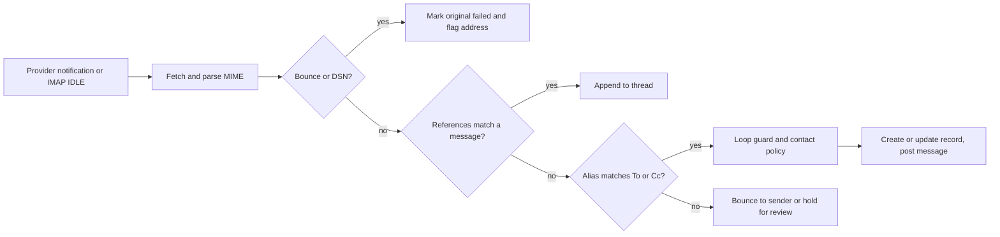
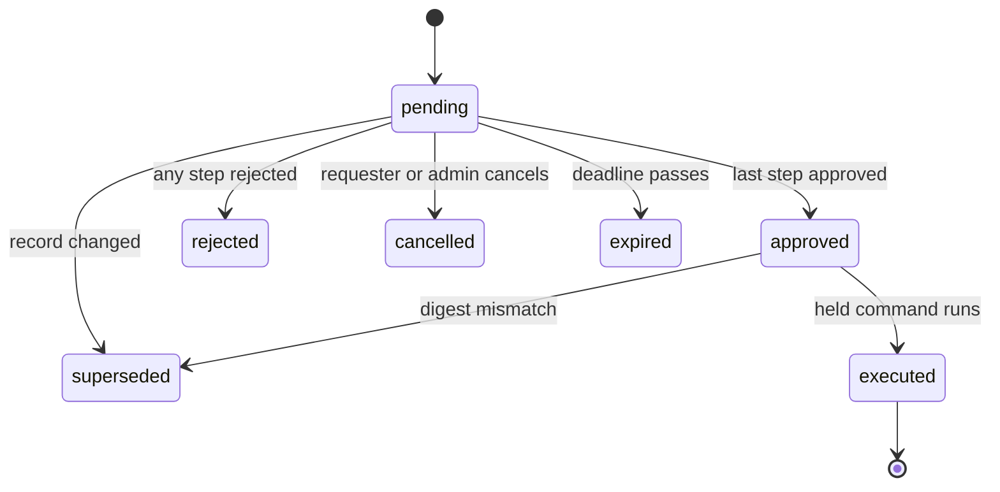

# Platform and kernel apps: contacts, companies, chatter, mail, calendar, documents, knowledge, sign, approvals, automation, customization, search, import/export, reporting

- **Status:** Draft 0.1
- **Date:** 2026-10-01
- **Scope:** Product-level specification of the obop kernel entities and the horizontal platform apps that every other area builds on, including the commands through which each is reached (4.20); ports, events and crates are in [ARCHITECTURE.md](../ARCHITECTURE.md), and the command grammar, output contracts and plugin registry client are in [cli.md](cli.md). Everything here is Apache-2.0 and free (OR-1, OR-2).

## 1. Purpose and scope

### 1.1 What this area is

The platform layer is present in every business and reused by every other app: parties and companies, the record thread (messages, followers, activities), email in and out, files, approvals, automation, customization, search, import and export, reporting, and the machinery that installs, upgrades and translates modules and plugins. It answers the top pain themes in the voice-of-customer research: customization debt, upgrade pain and open-core surprises [R04 s1]. Odoo is the functional reference; obop is a clean-room re-implementation (F3): behaviour comes from public documentation and from Community source read for understanding, never from Enterprise code [R01 s8].

Users: every internal user daily; portal users (from W2) and external signers occasionally, through scoped capability tokens; administrators and implementers for configuration; integrators and AI agents through the same typed command surface, which is one catalogue reachable through the `obop` CLI, the REST API and MCP (D18, D80).

**Agentic first (OR-4, D80).** Every capability in this document is a typed command before it is a screen. Each app below declares its models and actions as registry metadata; the command catalogue, the CLI, the REST API with its OpenAPI document and the MCP tools are generated from it, and the web UI is a client of the same commands and holds no business logic. A platform feature is done when its commands exist in CLI, API and MCP with the same schemas, permission check, dry-run, idempotency key, audit entry and parity test (section 4.20; [cli.md](cli.md) 1.1); the UI reaches literal parity before 1.0, the first stable release (OR-16).

Conventions. "OR-n" cites an owner ruling of 2026-10-01 (RATIFIED, [DECISIONS.md](../DECISIONS.md)). "Proposed (Dn)" marks reliance on a decision the owner has not ratified. "Proposed" alone marks a design choice of this document that neither DECISIONS.md nor the research settles; those that need an owner or counsel answer are listed in section 9. "(target)" and "(estimate)" label numbers that are design goals, not measurements. "MVP" means the first shipped cut of an app in its own wave. Waves follow the re-cut of DECISIONS 5.1 to 5.3 (OR-13 ratifies the wave windows, the German pack date and the 1.0 target, and OR-13 and OR-15 ratify the W1 cut, that is the in and out calls of DECISIONS 5.3; the slip order, the individual placements of displaced items and every other date are Proposed, D25, D26, D86). Versions are as of 2026-10-01 [R00 s3]. The toolchain is Rust and Vite+ driven through `vp` with pnpm only (F1, F2); UI bundles are prebuilt and no Node runs on customer servers (D37). Names of events, entities, states and permission groups follow [CONVENTIONS.md](../CONVENTIONS.md). A command name marked `*` is a working name of this document, following the rule `<model>.<action>` (CONVENTIONS 2.1, cli.md 2.1), and is Proposed. Nothing here is legal advice.

### 1.2 Boundaries with neighbouring areas

| Neighbour | This document owns | The neighbour owns |
|---|---|---|
| [security-privacy.md](security-privacy.md) | How platform apps consume principals, audit and erasure | Authentication, permission algebra, audit internals, DSAR, retention holds |
| [finance.md](finance.md) | Attachments, PDF rendering, approvals, sequences, the host for report engines (drill descriptors) | Ledger, legal numbers, invoices, e-invoice archive rules, financial report definitions and catalogue (4.13 there) |
| [sales-crm.md](sales-crm.md) | Email-to-record, share grants | Leads, quotes, portal pages, quote acceptance |
| [services.md](services.md) | Calendar events and sync | Working-time calendars, appointments, SLAs |
| [people.md](people.md) | Principals and parties | Employees, time off, recruitment |
| [retail-commerce-marketing.md](retail-commerce-marketing.md) | Transactional mail | Mass mailing, website |
| [ux.md](ux.md) | Delivery, query and collaboration engines behind the Inbox, search bar and editor | Screens, view layers and patches, saved views, command palette, design system |
| [ai.md](ai.md) | Approvals engine, semantic-layer declarations | Agents, write protocol, extraction |
| [integrations.md](integrations.md) | The generic import and export engine (`import_run`, mapping, staging, run states, export formats), per-model import and export rules, automation actions | Foreign-system importers and the identity ledger (`external_ref`), full business export and restore, API, webhooks, MCP, connectors |
| [cli.md](cli.md) | The data side of apps management (`module_state`, `package_install`, `setting`, the migration ledger, 4.18) and the per-area command lists (4.20) | The command grammar, global flags, output and exit contracts, the catalogue tables, the free plugin registry client (search, install, copy, trust tiers, `obop.lock`), parity testing and distribution of the binary |

### 1.3 Apps and modules in scope

Tiers and placements are Proposed (D25, D86), except the in and out calls of the W1 cut, which are RATIFIED (OR-13, OR-15); the wave windows, the German pack date and the 1.0 target are RATIFIED (OR-13). Every row is open and free under Apache-2.0 (OR-1, OR-2): there is no paid column because nothing is paid, and the last column lists the command subjects of each app (4.20). Module names in bold are this document's proposals.

| Area | Module | Tier | Wave | Command subjects (CLI, REST, MCP) |
|---|---|---|---|---|
| Parties (Contacts app) | `base` | T0 | W0 model, W1 app | `party`, `party_address`, `party_bank_account` |
| Companies, branches, company groups | `base` (one company), `base` multi-company, `intercompany`, `consolidation` | T0, T1, T2, T2 | W1, W2, W3, W4 | `company`, `branch`, `ownership_interest`, `fiscal_unit` |
| Principals, permission groups | `base`; `portal` (the app that uses portal principals) | T0 | `base` W0 to W1; `portal` W2 | `principal`, `permission_group`, `api_key`, `agent` ([cli.md](cli.md) 3.7, 3.9) |
| Chatter and notifications | `mail` | T0 | W1 (Web Push W2) | `message`, `activity`, `follower`, `notification`, `push_device` (W2) |
| Discuss channels | `discuss` | T1 | W3 | `channel`, `channel_member` |
| To-do (personal tasks) | **`todo`** | T1 | W3 | `todo_item` |
| Outbound email and templates | `mail` | T0 | W1 | `mail_template`, `outbound_mail` |
| Inbound gateway, aliases, OAuth mailboxes | `mail` | T0 | W2 | `mail_account`, `mail_alias_domain`, `mail_alias`, `inbound_mail` |
| Calendar and sync | `calendar` | T1 | W3 | `calendar`, `calendar_event` |
| Attachments | `base` | T0 | W0 to W1 | `attachment` |
| Documents (DMS) | `documents` | T1 | W3 | `doc_folder`, `doc_file`, `doc_request` |
| Knowledge | `knowledge` | T2 | W3 | `article` |
| Sign | `sign` | T2 | W3 | `sign_template`, `sign_request` |
| Approvals engine | inside `automation` | T0 | W2 | `approval`, `approval_policy` ([cli.md](cli.md) 3.9) |
| Automation | `automation` | T0 | W2 | `automation_rule`, `automation_run`, `schedule` |
| Customization | **`customize`** | T0 | W1 custom fields; W3 custom models and editors | `custom_field`, `customize`, `custom_model` ([cli.md](cli.md) 3.6) |
| Search | kernel and `base` | T0 | W1 | `search*`, and `--where` on every list |
| Import and export | `base` | T0 | W0 engine, W1 CSV | `data`, `import_run`, `import_mapping` ([cli.md](cli.md) 3.4) |
| Reporting | `obop-report` (Typst documents, report definitions); `analytics` (semantic layer) | T0 | `obop-report` W1; pivot and graph views W2; `analytics` W3; dashboards W3 | `report_definition`, `print_template`, `report_run`, `aggregate`, `analytics` |
| Apps management and the plugin registry | `base`; plugin registry, stage 1 git-backed index | T0 | Install and upgrade dry-run W1; registry stage 1 W2; a registry service later, on demand | `module*`, `setting*`, `upgrade`, `pack`, `plugin` ([cli.md](cli.md) 3.1, 3.3, 4.3) |
| Multi-language | `obop-i18n`, `base` | T0 | W0 to W1 | `language`, `translation_override` |

## 2. Personas and roles

| Persona | Jobs in the platform | Default permission groups (Proposed) |
|---|---|---|
| Business administrator | Installs apps and plugins, invites users, connects mailboxes (W2), sets retention, runs upgrades and backups | `base.admin` (implies no data permission groups) |
| Implementer | Builds custom fields, views, automations, packages; copies and modifies plugins; imports data | `customize.designer`, `automation.designer`, `base.user` |
| Salesperson, service agent | Works records, chatter, activities, calendar (W3); sends mail | `base.user` plus app permission groups |
| Accountant | Reads and files documents, approves, exports | `base.user`, `documents.user`, finance permission groups |
| Approver | Decides approval tasks, delegates | None; named per policy |
| Knowledge author | Writes and shares articles | `knowledge.editor` |
| Portal customer, vendor (from W2), external signer (W3) | Views and accepts shared documents; signs one request without an account | `base.portal`, or a single-use `share_grant` |
| Integrator, AI agent | Reads and writes through the CLI, the generated REST API and MCP | `base.api_client`, `base.agent` (permissions are the intersection of delegator and token scopes, D18) |
| Auditor | Reads audit trail and evidence | `audit.reader` |

Group names follow [security-privacy.md](security-privacy.md) (`base.admin`, `base.user`, `base.portal`, `base.public`). Module permission groups are seeded by their modules; everything is default-deny (D10). Other platform permission groups (Proposed): `contacts.manager` (merge, archive), `mail.account_admin` (mailboxes, aliases, domains), `documents.manager`, `knowledge.admin`, `sign.user`, `sign.admin`, `approvals.designer`, `analytics.designer`. "Role" appears only in UI copy (D24).

## 3. Capability map

Parity: "Community" and "Enterprise" are Odoo's editions [R01 s5]; they describe what Odoo gates, not an obop split (obop has one open edition, OR-1, OR-2). Waves follow the re-cut of DECISIONS 5.1 (Proposed placements, D25, D86; the W1 cut is RATIFIED, OR-13, OR-15). Every capability is a typed command on CLI, REST and MCP (4.20).

| Capability | Description | Wave | Odoo parity |
|---|---|---|---|
| Party model | Person or organisation; typed addresses, identifiers, bank accounts; customer and vendor as per-company `party_profile` | W0 model, W1 app | Matches Community; beyond on typed addresses and roles |
| Merge, VAT id validation | Dry-run merge with external-id aliasing; VIES check through a pack validator and a connector, no credit wall | W1 | Matches Community merge and VIES check [R01 s3.1, R09 s1.2]; beyond on dry-run. Odoo's partner autocomplete (Dun & Bradstreet since 19) is the credit-metered part; obop's registry lookups are connectors with the business's own keys (W2) |
| Flat company and branch | One company in W1, dormant branch | W1 | Beyond (Odoo overloads one tree) |
| Multi-company | Selector, per-company books, shared and per-company masters; among the first W2 items to slip to W3 if time is short (DECISIONS 5.3) | W2 | Matches Community; Odoo Online gates it to Custom |
| Intercompany mirrors | Async mirrored documents with reject step | W3 | Matches Enterprise (inferred from absence in the Community tree [R23 C.1]) |
| Consolidation, VAT groups | Eliminations in a separate ledger, ownership edges; VAT groups as `fiscal_unit` | W4 (VAT groups W3, Proposed) | Matches Enterprise for consolidation; beyond on edges |
| Record threads | Messages, internal notes, followers, subtypes | W1 | Matches Community |
| Activities and plans | To-dos on any record, assignable to a user (W1) or a permission group (W2) | W1, W2 | Matches Community; group assignment follows Odoo 20 roles |
| To-do app | Private memos and tasks per person with due dates, an optional record link and conversion to a project task (4.5.1); until then a personal reminder is an activity | W3 | Matches Community (Odoo To-do, personal tasks) |
| Field change log | Tracked fields rendered in chatter from `audit_change` | W1 | Beyond (Odoo 20 builds the tracking message on the fly and keeps stored tracking values only in the opt-in `mail_tracking` module [R02 s0]; obop reads the kernel audit log) |
| Discuss channels, calls | Channels, DMs, polls (W3); voice and video through an optional SFU later | W3, later | Matches Community; calls integrate, not build |
| Reactions, canned responses, absence replies | Message reactions and canned responses (shortcodes) with `discuss` (W3); an absence reply is an automation rule with the loop guard (W2, after the automation engine and the inbound gateway). Link previews, Mail Groups and mail plugins are not scheduled (4.5, 4.7) | W2, W3 | Matches Community for reactions, canned responses and the `out_of_office` message type [R02 s5]; `mail_group` and `mail_plugin` skipped [R15 s2] |
| Notifications | Inbox, email, preference matrix (W1); Web Push and the approvals lane (W2); digests, quiet hours and SMS through a connector later, not scheduled (Proposed; neither D25 nor D26 places them) | W1, W2, later | Matches Community. Odoo's Digest (KPI email) is a different feature: it maps to scheduled report delivery (W2, 4.17) |
| Outbound email and templates | Sandboxed per-language templates, a durable outbound queue with retries through the operator's SMTP relay or a provider API, per-domain DKIM, each message logged on its record | W1 | Matches Community; beyond on the durable queue and sandboxed templates |
| Email routing, OAuth mailboxes | Threading, aliases, catch-all, bounce, loop guard; Gmail API, Graph, IMAP with XOAUTH2 | W2 | Matches Community; EWS skipped |
| Sender-domain health | SPF, DKIM, DMARC checker | W1 | Beyond |
| Calendar and sync | Events, attendees, recurrence, alarms, iMIP, feeds; Google and Microsoft sync with push as a hint | W3 | Matches Community |
| CalDAV and CardDAV server | Standards-based device sync | Later | Beyond (not in Odoo) |
| Attachments | Content-addressed blobs on any record | W0 to W1 | Matches Community |
| Document management, OCR | Folders, tags, versions, lock, trash, requests; searchable PDF/A through an optional sidecar | W3 | Matches Enterprise (OCR uses IAP credits in Odoo) |
| Retention | Classes from packs, purge jobs, holds | W1 | Beyond |
| Knowledge | Article tree, inherited access, templates, embeds | W3 | Matches Enterprise |
| Collaborative editing | CRDT with live cursors | W3 | Beyond (Odoo uses a commit log) |
| Acceptance evidence | Portal signature with evidence bundle; it belongs to `portal`, so it arrives with it. In W1 documents reach customers as email with PDF and XML and the salesperson confirms | W2 | Matches Community |
| Sign app | Templates, envelopes, OTP, hash-chained trail | W3 | Matches Enterprise |
| QTSP connectors | Advanced or qualified signatures from a provider | W3 to W4 | Matches Enterprise (Odoo 20 via itsme) |
| Approvals | One engine on any guarded command, digest-bound, decided from the Inbox ([ux.md](ux.md) 4.8) | W2 | Matches Enterprise; beyond on agents and inbox |
| Automation rules, schedules | Triggers, CEL conditions, actions (any typed command the designer may run), run log; leader-less schedules on the kernel `job` and `schedule_fire` queue (W0). In W1 the API and outbound webhooks cover event-driven integrations | W2 | Matches Community engine; beyond on dry-run |
| Custom fields, package export | Typed, promoted or JSONB properties as a typed command (`custom_field`) with an admin screen; customizations exported as a package | W1 | Matches Enterprise (Odoo's Properties are Community) |
| Custom models, editors | Custom models with a generated menu entry and action, and a layout editor for form, list and kanban; form builder, print-template designer and an app and menu editor; editors for other view types later (4.14) | W3 | Matches Enterprise |
| Registry inspector | Read-only admin screen over models, fields, effective views, jobs, schedules, sequences and access rows (4.18, Proposed) | W2 | Matches Community developer mode and Technical menu in intent; beyond on read-only, audited access |
| Industry bundles | Data packs (X1) plus a customization export; no first-party bundles before W4 (4.14) | W4+ | Deferred (Odoo Industries, Enterprise) |
| Customization report | Deltas from stock with upgrade risk, specified with view layers in [ux.md](ux.md) 4.3 (W2 there) | W2 | Beyond |
| Global search, saved views | Records, navigation, commands in one grammar; four view scopes, shareable URLs | W1 | Matches Community palette and favorites; beyond |
| Import and export | Shared engine with per-model rules: mapping, dry-run, rollback by run, external ids; import-compatible export; foreign importers and full business export in [integrations.md](integrations.md) | W1 | Matches Community; beyond on rollback and export |
| Grouped reads, drill-through | A generated `aggregate` command (group and sum under the caller's access) for people and agents, and a `drill` descriptor on every report cell | W1 | Matches Community `read_group`; beyond on drill descriptors |
| Pivot and graph views | Views over `aggregate` (Proposed reading, open question 17) | W2 | Matches Community |
| Semantic layer | One governed query model (`SemanticQuery`) with measures, dimensions and cubes | W3 (DECISIONS 5.3, slip item 2) | Matches Community `read_group` in intent; beyond |
| PDF documents | Typst, PDF/A-3b and PDF/UA-1 | W1 | Beyond (Odoo defaults to wkhtmltopdf) |
| Dashboards | Shareable widget boards | W3 | Matches Community engine; editing is Enterprise |
| Apps management | Per-business install, dry-run upgrade, backup and diagnostics as typed commands, sideloading and `plugin verify` (W1) | W1 | Beyond on dry-run and packages |
| Plugin registry | A free, open registry: search, install (version-pinned) or copy the source into your own instance; `community` and `verified` tiers; only plugins with an OSI-approved licence are listed (OR-17); no payments. Stage 1 is a git-backed static index with the CLI; a registry service only on demand (4.18, [cli.md](cli.md) 4) | W2; service later | Beyond (the Odoo Apps store takes a 30% commission and its apps cannot run on Odoo Online [R03 s6.2]) |
| Commands for everything | One command catalogue generated from the registry; CLI, REST, OpenAPI and MCP are generated from it, the UI is a client (4.20) | W1 | Beyond (Odoo gates its external API to the Custom plan and removes RPC in 2028 [R02 s10, D31]) |
| Translation | PO plus ICU MessageFormat 1, data fields per language; en and de in W1, other locales as reviewed community translations (Proposed, D86) | W0 to W1 | Matches Community |
| VoIP softphone | Not built; connector only | Skipped | Deliberately skipped (Enterprise) |

## 4. Per-app specification

Each app lists MVP and later capabilities, entities, workflows, events (working names; ARCHITECTURE.md is authoritative), permissions, reports, configuration, localization and its command surface (the subjects are in 1.3, the commands in 4.20). Every app is open and free under Apache-2.0 (OR-1, OR-2); the last line of each app says so.

### 4.1 Kernel entities and the module integration contract

**Purpose.** Define what every record has and what every module must do to plug in.

**Every record.** UUIDv7 `id` (D9), `company_id` (NULL only on business-wide masters), `row_version`, audit stamps, `active`; module records carry external ids `module.name`. Polymorphic references exist only as `RecordRef(model_id, record_id)` for thread, attachment, audit and external id, with orphan collection [R23 B].

| Entity | Purpose | Key fields |
|---|---|---|
| `party`, `principal`, `company`, `branch` | Who the business deals with, who logs in, who owns the books | kind, `party_id`, currency, country |
| `attachment`, `blob` | Files on any record; content-addressed | `record_ref`, `sha256`, `storage_key`, pending or committed |
| `thread` | One per record with messages, followers or activities; created lazily | `record_id` (PK), `model_id`, `company_id` |
| `sequence` | Internal references and legal numbers | scope, pattern, `gapless`, `next_value` |
| `external_id` | Stable addresses of module and imported records | module, name, `record_ref`, origin, `content_hash` |
| `property_definition` | Sparse custom fields on a container record | container, JSON definition |
| `audit_change`, `security_event` | Field diffs; append-only security log | pseudonymous actor id, cause id |
| `outbox_event`, `outbox_delivery`, `inbox_processed` | Durable events, per-subscriber delivery | aggregate, version, lease, state |
| `job`, `schedule_fire` | Durable jobs, leader-less schedules | queue, `run_at`, lease, idempotency key |

**Model capabilities (Proposed).** A model switches platform behaviour on through registry metadata, not by inheriting a base class: `threaded`, `attachable`, `activities`, `aliasable`, `shareable`, `searchable`, `importable`, `tracked`, `retention_class`, `personal_data`, `translatable`. First-party and custom models use the same switches. This replaces Odoo's 5,446-line `mail.thread` mixin [R02 s5] and lets a business turn chatter on for a custom model without code. The record-level primitives that are not capability flags (duplicate, display name and name search, typed dialogs, scoped defaults) are registry metadata too, specified in [ARCHITECTURE.md](../ARCHITECTURE.md) 5.8.

**Integration contract (D27).** Mechanisms in order: port call, `TxEvent`, extension point, durable event; rules R1 to R7 apply (one command one transaction, per-aggregate ordering, at-least-once with `inbox_processed`, compensation by reversal documents, implementation crates depend only on `*-api` crates). Platform ports (working names): `ThreadPort` (post, note, activity, follower), `AttachmentPort`, `TemplatePort` and `RenderPort` (mail and PDF templates; PDF in an isolated worker), `ApprovalPort`, `SignPort`, `SearchPort`, `NotifyPort`, and `ConsentPort` (in `base-api`, over the `consent_record` of [security-privacy.md](security-privacy.md), so marketing, POS and website forms write one ledger). Optional ports are `Option<Arc<dyn Port>>`, so `sales` offers "require signature" only when `sign` is installed, with no bridge module. Sending mail, webhooks and other external I/O happen only in durable-event handlers, never inside the command transaction [R23 D.2]. Realtime to browsers follows D7: outbox, in-process wake-up and a coalescing notifier; R15's `LISTEN/NOTIFY` bus is superseded.

**What a module declares.** Dependencies and `auto_install` conditions; models and capability flags; permission rows seeded default-deny; views as slot-addressed JSON; automations and approval policies as data; state machines; print templates; settings; translations; migrations with expand, backfill and contract tags. Every model, state transition and declared action it adds is a typed command of the generated catalogue, so it is reachable through the CLI, the REST API and MCP without further work (D29, D80); a module is not done until that holds and the parity test is green. First-party modules compile into the binary and register per business when installed; plugins (packages, D24) use one `obop.toml` (D32).

**Documents and state machines.** Business documents follow a header-and-line pattern with a three-value kernel lifecycle (draft, confirmed, cancelled) plus derived progress fields; state machines are registry data with transitions, guards and emitted events, run only by command handlers [R23 B.2]. Automation triggers and approval policies attach to these transitions, so a new module gets both without code.

**Permissions, configuration, localization.** Every model declares permission rows default-deny and a scope (D10); the capability flags above are set per model in the registry and editable per business for custom models. Translatable fields store `{lang: value}` and personal-data flags drive erasure (section 4.19, [security-privacy.md](security-privacy.md)). **Events.** Working names are listed per app below; names are PascalCase and past tense, defined in the publisher's `*-api` crate, and the catalogue is generated from those crates ([ARCHITECTURE.md](../ARCHITECTURE.md) 4.3, Proposed). Emits `AttachmentCommitted` (Proposed) when a blob goes from pending to committed.

**Commands and licence.** The registry-generated CRUD and actions of every kernel model (4.20); open and free, Apache-2.0.

### 4.2 Contacts (parties)

**Purpose.** One identity table for every person and organisation the business deals with. Customer and vendor are per-company roles; users are principals, not parties (D28).

**MVP (W1).** Person and organisation parties; typed addresses (invoice, delivery, other) kept apart from contact persons, avoiding Odoo's `_fields_sync` tangle [R11 s2]; identifiers (VAT id, company register number, Peppol id, DUNS); bank accounts; per-company `party_profile` (receivable and payable accounts, terms, pricelist, credit limit, fiscal position; columns owned by finance and sales); tags; duplicate detection on normalised email, VAT id and name; merge; archive; VIES validation of EU VAT ids [R25]; vCard and CSV import. **Later.** Registry-lookup connectors behind `LookupProvider` (W2; a Proposed trait name of [integrations.md](integrations.md) 4.5); opt-in contact sync (section 4.8).

| Entity | Purpose | Key fields | States |
|---|---|---|---|
| `party` | Person or organisation | kind, names, language, `commercial_party_id` (materialised), personal-data flags | active, archived |
| `party_address` | Typed address | kind, lines, country | active, archived |
| `party_identifier` | Tax and registry ids | scheme, value, country | unverified, verified, invalid |
| `party_bank_account` | Bank details | IBAN, BIC, holder (encrypted number) | unverified, verified |
| `party_contact` (Proposed) | Links a person to an organisation | title, primary flag, valid range | active, ended |
| `party_profile` | Customer or vendor role per company | accounts, terms, pricelist, credit limit | active, archived |
| `merge_log` (Proposed) | What a merge rewrote | winner, losers, counts | committed |

**Workflow: merge.** (1) Select two or more parties. (2) Dry-run lists referencing records per model from the registry's relation graph and field conflicts, such as two VAT ids. (3) Choose the winning value per field. (4) Commit in one transaction: references rewritten, losers archived with a redirect, their external ids re-pointed so later imports stay idempotent, `PartyMerged` emitted. (5) Only a restore undoes it.

**Events.** Emits `PartyCreated`, `PartyUpdated` (TxEvent, so commercial fields propagate to contact persons in the same transaction; also durable, for mail and POS snapshots), `PartyMerged`, `PartyArchived` and `PartyBankAccountChanged` (Proposed; party id, bank account id and change kind; `account` uses it for approval and payment blocks). Consumes `MailBounced` (flags the address), `ImportRunCommitted` (duplicate scan on the new rows, Proposed) and `PartyErased` (emitted by [security-privacy.md](security-privacy.md) after the party is anonymised in place; the apps holding contact snapshots scrub their copies).

**Permissions.** `contacts.manager` merges and archives. Bank numbers and national ids are in the field-encryption catalog [R18 s5]; party bank account numbers, IBANs and natural persons' tax ids are data class `financial` ([security-privacy.md](security-privacy.md) 4.2); credit limit is readable by finance permission groups only; a portal principal sees its own party and children. Personal-data flags drive DSAR and erasure by anonymising in place [R18 s8.1]. **Reports.** Duplicate candidates; parties without country or VAT id. **Configuration.** Identifier schemes and validators and address formats per country, as data from packs [R19 s9]. **Localization.** VAT formats and validators come from country packs ([LOCALIZATION.md](../LOCALIZATION.md)). **Commands and licence.** `party` commands and the merge (4.20); open and free.

### 4.3 Companies, branches and company groups

**Purpose.** Model legal entities and their books correctly from the first row so groups grow without rewriting keys (D28).

**Capabilities.** W1: one `company` (`company_id NOT NULL`, composite FKs, one-element `Env.companies`), dormant `branch`, currencies and rates. W2: multi-company with selector, per-company books and grants. W3: `intercompany`. W4: `consolidation`. VAT groups (`fiscal_unit`) arrive in W3 with intercompany (Proposed, as [finance.md](finance.md) 4.12).

| Entity | Purpose | Key fields | States |
|---|---|---|---|
| `company` | Ledger scope of one legal entity | `party_id` (unique), currency, country, fiscal calendar | active, archived |
| `branch` | Subdivision without books | company, address, defaults | active, archived |
| `ownership_interest` | Group edge (single definition in [finance.md](finance.md) 4.1.1; structure in 4.12) | parent, child, `pct_bp`, `method`, `valid_during` (no overlap) | valid-time |
| `fiscal_unit` | VAT group | country, representative company, members | active, ended |
| `interco_link` | Mirror of a document across companies (single definition in [finance.md](finance.md) 4.1.1; flow in 4.12) | `src_ref`, `mirror_ref`, idempotency key | as finance.md 4.1.1 (pending, mirrored, rejected, failed) |
| `principal_company` | Grant of a principal to a company | principal, company | active, revoked |

**Workflow: add a subsidiary (W2).** (1) Create the organisation party with tax registrations. (2) Create the company from the country pack templates (chart, taxes, journals, sequences, lock dates). (3) Grant principals per company. (4) Add `ownership_interest`. (5) Switch company in the selector. (6) Verify the empty trial balance.

**Rules.** The active company set is explicit in every request, validated against grants. Reads span the set plus shared rows; a write needs exactly one active company. Restriction: `company_id IS NULL OR company_id = ANY(env.companies)`. Per company: accounts, journals, taxes, fiscal positions, sequences, lock dates. Shared: parties, products, pricelists, analytic plans [R23 C.3].

**Events.** Emits `CompanyCreated` (packs seed templates) and `FxRatesUpdated` (Proposed; `base` publishes it when an `ExchangeRateSource` ([finance.md](finance.md) 4.7) stores new rates; payload rate type, date and currencies). Consumes `InvoicePosted` toward a party that represents another company: a draft bill is created asynchronously and may be rejected; the receiver's lock date never blocks the sender's posting [R23 C.4].

**Permissions.** The selector shows only granted companies. **Reports.** Per-company and consolidated reports live in [finance.md](finance.md). **Configuration.** Default company, rounding profile, rate source. **Localization.** Tax registrations per company; packs follow the company country; branches follow their company. **Commands and licence.** `company`, `branch`, `ownership_interest` commands and the global `--company` flag (4.20); open and free, multi-company included (DECISIONS section 6).

### 4.4 Principals and permission groups

**Purpose.** Only what platform apps need; depth is in [security-privacy.md](security-privacy.md).

**Capabilities.** W0 to W1: principal kinds (user, portal, guest, API client, agent, system); permission groups with transitive implied groups; permission rows (OR) and restriction rows (AND) with mandatory scope `all`, `own`, `company` or `domain` (D10); field security; typed elevation; invitations; portal principals attached to a party and capability tokens (`share_grant`), whose first users are the `portal` app (W2), `sign` and document sharing (W3); agent delegation, scoped agent tokens and API keys (W1, so agents and the CLI authenticate from the first release, D18). W2: activities and approval tasks assignable to a permission group.

Entities: `principal` (invited, active, suspended, deactivated, for every kind), `credential`, `session` and `api_key` (states in [security-privacy.md](security-privacy.md) 4.1); `permission_group`, `group_membership`, `principal_company`; `share_grant` (active, used, expired, revoked; `used` applies to single-use scope); `agent_delegation` (active, suspended, expired, revoked).

**Workflow: invite.** (1) Admin enters email and permission groups. (2) A single-use expiring invitation is mailed. (3) The user sets a credential that meets the password policy, or registers a passkey or TOTP. (4) First login is audited.

**Events.** Platform emits no principal or permission event. Base principal management ([security-privacy.md](security-privacy.md) 4.1) emits `PrincipalInvited`, `PrincipalDeactivated` and `PrincipalSuspended`, and base authorization (security-privacy.md 4.2) emits `PermissionChanged` (payload kind: membership, permission group or access row; [ux.md](ux.md) consumes it). Platform shares the three principal names and reacts to them: on deactivation, activities and approval tasks are reassigned and live sockets close. **Permissions and sensitive data.** Default permission groups are in section 2. Credentials are never readable, API keys are stored hashed, and `share_grant` stores a token hash only. **Reports.** The effective-access report belongs to [security-privacy.md](security-privacy.md). **Configuration.** Invitation lifetime, default permission groups for new users. **Localization.** Invitation and sign-in emails render in the invitee's language. **Commands and licence.** `principal`, `permission_group`, `api_key` and `agent` commands (4.20; [cli.md](cli.md) 3.7, 3.9). Password, TOTP, passkeys, OIDC, LDAP bind and RBAC are open and free. Native multi-IdP SAML and full SCIM are not withheld and not promised: they are ordinary open backlog items, built when someone builds them (DECISIONS section 6).

### 4.5 Chatter and Discuss channels (`mail`, `discuss`)

**Purpose.** One conversation and task log per record, so every app shares messages, followers and activities.

**MVP (W1).** The `mail` module is cut to chatter, activities, followers, outbound email and templates (DECISIONS 5.3, call 3). Messages of kinds `comment`, `note` (internal), `email_out` and `system`; replies to a specific message; attachments; mentions; followers with subtype subscriptions and auto-follow (creator, assignee, mentioned); activities (type, due date, assignee user, chained plans); the `is_internal` flag that later gives portal visibility. **W2.** The kind `email_in` arrives with the inbound gateway (4.7); assignment of activities to a permission group; CC recipients, pinned and scheduled messages. **W3.** Channels, DMs and polls in `discuss`. **Later.** Voice and video through an optional Apache-2.0 SFU such as LiveKit (W4, Proposed) [R15 s3].

| Entity | Purpose | Key fields | States |
|---|---|---|---|
| `thread` | Container per record | `record_id`, `model_id`, `company_id` | n/a |
| `message` | One post | thread, kind, subtype, author, body (sanitised HTML), parent, RFC `message_id`, `is_internal` | posted, redacted |
| `message_subtype` | Event type per model | internal, default, hidden, parent relation | active |
| `follower` | Subscription | thread, party or principal, subtypes | active |
| `activity` | To-do on a record | type, summary, due date, assignee | open, done, cancelled |
| `activity_type`, `activity_plan` | Templates and chains | delay, default assignee | active |
| `channel`, `channel_member` | Discuss (W3) | kind, parent channel, read-only | active, archived |

An activity's overdue, today and planned labels are derived from the due date, not stored. Messages are immutable once posted; an edit stores a revision and a privacy deletion leaves a redacted tombstone (Proposed).

**Odoo chatter extras (dispositions, Proposed).** Message reactions and canned responses (shortcodes; Odoo's `mail.canned_response` [R15 s2]) arrive with `discuss` in W3 as plain records with the composer reading them under the author's own access. Odoo's `out_of_office` message type [R02 s5] becomes an absence reply written as an automation rule (section 4.13) with the loop guard of section 4.7 (W2, after the automation engine and the inbound gateway). Link previews are not scheduled; if added, the server fetches them through the SSRF-hardened egress client of section 6 and never the browser, so a reader's address is not disclosed to the linked site. Mail Groups and mail plugins are in section 4.7.

**Workflow.** (1) A user posts a note or a command logs a system message in its own transaction, so no log line survives a rolled-back change. (2) Recipients are the followers whose subtype matches, plus mentions. (3) `MessagePosted` (durable) feeds `NotifyPort`. (4) Browsers receive it over the WebSocket, resuming from `(xid8, event_id)` (D7). (5) Tracked field changes are not stored as messages: the chatter renders them from `audit_change` on the fly, so no per-field tracking rows live in the thread (Odoo 20 likewise builds the tracking message on the fly and keeps stored tracking values only in the opt-in `mail_tracking` module [R02 s0]; field-level change logs are opt-in per field [R08 s10]).

**Events.** Emits `MessagePosted`, `ActivityScheduled`, `ActivityDone`, `FollowerAdded`. Consumes every tracked `TxEvent`, `MailReceived` (W2) and `PartyErased` (message bodies naming the subject are scrubbed, security-privacy.md).

**Permissions.** A message is readable only if its record is, through the single query path (D10); portal and external followers never see internal notes. Mentioning a principal who cannot read the record notifies them that access is missing and grants nothing (Proposed). No ambient elevation: posting as the system is a typed, audited `Env<Elevated>` (D10; Odoo's `mail` module has 433 `.sudo(` calls [R02 s2.6]). **Reports.** Activity matrix by record and type; overdue activities per assignee. **Configuration.** Subtypes, activity types and plans, default followers, per-user preferences. **Localization.** Business correspondence may fall under retention rules (German commercial letters 6 years [R18 s8.1]); packs supply classes. **Commands and licence.** `message`, `activity`, `follower` commands (4.20); open and free.

#### 4.5.1 To-do (`todo`, T1, W3)

**Purpose.** A private list of memos and tasks for one person, apart from activities, which belong to a record and its followers. Odoo's To-do (`project_todo`) is personal tasks on top of project tasks [R01 s3.1]; obop keeps them in their own entity so the app works without `project`. Until W3 a personal reminder is an activity on a record (section 4.5, W1).

**MVP (W3).** Quick add of an item with a title, an optional note and a due date; a done flag; an optional link to any record the owner can read (`record_ref`); overdue, today and later groupings derived from the due date, as for activities; a due-date reminder through `NotifyPort` as one `notification` per owner and channel (section 4.6); and conversion to a `task` in a chosen project ([services.md](services.md) 4.2), which marks the item done and keeps a link to the task. Conversion is offered only when `project` is installed (optional port, no bridge module, D27).

| Entity | Purpose | Key fields | States |
|---|---|---|---|
| `todo_item` | Personal memo or task | owner (principal), title, note, due date, `record_ref` (optional), converted `task` ref (optional) | open, done, archived |

**Privacy.** Owner only: read and write scope `own` (D10). No other principal, including `base.admin`, reads an item through lists, search, API or agents, and the record link never widens access, because opening the record applies the record's own permissions. Items are personal data of the owner and follow DSAR and erasure with the principal ([security-privacy.md](security-privacy.md)). **Events.** Emits `TodoItemCompleted`, `TodoItemConverted`; consumes `PrincipalDeactivated` (open items are archived, Proposed). **Permissions.** `base.user`; no module permission group. **Reports.** None. **Configuration.** The reminder channel is a row of the per-user notification matrix. **Localization.** Due dates follow the user's locale and time zone. **Commands and licence.** `todo_item` commands (4.20); open and free (T1, W3, D25).

### 4.6 Notifications

**Purpose.** Tell the right person once, in the channel they chose. The in-app inbox is the source of truth; email and Web Push are delivery channels [R19 s4]. The Inbox and notification-centre screens are in [ux.md](ux.md) 4.8; this section owns delivery.

**MVP (W1).** In-app and email channels, a preference matrix (event class by channel), mentions, activities and alerts. **W2.** Web Push (RFC 8030, 8291, 8292 [R15 s12]) and the approvals lane. **Later, not scheduled (Proposed; neither D25 nor D26 places them).** Notification digests, quiet hours, and SMS through a connector, reusing the provider trait of [retail-commerce-marketing.md](retail-commerce-marketing.md) 4.5. Odoo's Digest (KPI email) is a different feature: it maps to scheduled report delivery (W2, section 4.17), not to notification digests [R01 s3.1].

Entities: `notification` (one row per recipient and channel; `delivery_status` pending, sent, failed with a `failure_reason`, as in Odoo's `mail.notification` [R15 s2]; `inbox_state` unread, read, snoozed, done, with `snoozed_until`; and `lane` mention, activity, alert), `notification_preference` (the preference matrix), `push_device` (endpoint and keys; dead ones are deleted). There is no separate inbox entity: the Inbox screens of [ux.md](ux.md) 4.8 read the `notification` row, while approval tasks (`approval_task`, section 4.12) and agent proposals (`command_plan`, [ai.md](ai.md) 4.3) reach the Inbox from their own records, not from notification rows.

**Flow.** `MessagePosted`, `ActivityScheduled` or `ApprovalRequested` reaches `NotifyPort`; one row per recipient and channel is written with `inbox_processed` dedupe, so a redelivered event notifies nobody twice. **Events.** Emits `NotificationCreated` (the Inbox badge listens, ux.md); consumes `MessagePosted`, `ActivityScheduled`, `ApprovalRequested` and `PrincipalDeactivated` (push devices removed). **Permissions.** Email and push carry a link and minimal metadata unless the business opts in to content (Proposed, as in ux.md), because mail leaves the trust boundary; VAPID keys live in the secret store. iOS push needs a Home Screen web app and a tap-initiated permission [R19 s4]. **Reports.** Delivery failures by channel and reason. **Configuration.** Business default matrix, per-user preferences, quiet hours and digests (later, not scheduled, Proposed). **Localization.** Text renders in the recipient's language. **Commands and licence.** `notification` and `notification_preference` commands and, from W2, `push_device` commands (4.20); open and free. A Web Push subscription needs the browser's permission prompt, which only a person can answer; it is not an exemption from parity (OR-16, D80): `push_device register*` starts the step and returns the VAPID public key the browser subscribes with, `push_device list*` reads the state, and `remove*` undoes it (working names, Proposed; [cli.md](cli.md) 1.1). SMS, if it is ever added, is a connector with the business's own provider keys; SpaceCorps operates no messaging service (OR-11).

### 4.7 Email gateway and templates (`mail`)

**Purpose.** Email is a transport for threads: inbound mail becomes messages or records, outbound mail is logged on the record. Built on `mail-parser` 0.11.9, `mail-builder`, `mail-auth` 0.13.3, `lettre` 0.11.23 and `async-imap` 0.12.0; never on the AGPL Stalwart server (D39). User mailboxes connect by OAuth only, behind `MailProvider` ([integrations.md](integrations.md) 4.5), through the Gmail API and Microsoft Graph, with IMAP XOAUTH2 for other hosts that support it; no EWS and no basic SMTP AUTH (D39).

**Split between W1 and W2 (DECISIONS 5.3: call 3, RATIFIED with the W1 cut, OR-15, and slip order item 11, Proposed).** W1 ships only the outbound half: templates, the outbound queue, DKIM and the sender-domain checker, with messages logged on the record. The inbound gateway, aliases, bounce processing and the OAuth mailbox connectors (Gmail API, Microsoft Graph, IMAP XOAUTH2) are out of W1, which is RATIFIED (OR-15); they come in W2 (the landing wave is Proposed, slip order item 11). Outbound email in W1 uses the operator's SMTP relay or a provider API with service credentials, never a user's mailbox (open question 1).

**MVP (W1): outbound.** Outbound queue with retries; per-domain DKIM; sandboxed per-language templates (`minijinja`); a sender-domain checker (SPF, DKIM, DMARC, PTR); opt-out and consent suppression. **W2: inbound and mailboxes.** Routing in Odoo's order [R15 s4]: bounce detection, then threading by `In-Reply-To` and the last 32 `References`, then alias lookup on `To`, `Cc` and `Delivered-To`, then the fallback. Aliases with target model, defaults, contact policy (everyone, known parties, followers) and optional forced thread; alias domains with catch-all (replies only) and bounce aliases; loop guard; VERP bounce addresses; OAuth mailbox connectors; CC and scheduled send. **Later.** Optional Stalwart integration (W4). **Not built.** Personal-mailbox capture: the W2 gateway ingests only alias and system mailboxes (Proposed). Mail Groups (`mail_group`, Odoo's mailing lists [R15 s2]) are not planned: an alias with a forced thread, or a `discuss` channel, covers the need. The Gmail and Outlook add-ins (`mail_plugin` [R15 s2]) would be an X4 remote app, not scheduled.

Inbound routing (W2):



| Entity | Purpose | Key fields | States | Wave |
|---|---|---|---|---|
| `mail_account` | Connected mailbox | provider, `connection` ref, OAuth grant in the token vault, scopes | the `connection` state (Proposed; [integrations.md](integrations.md) 4.5: draft, connected, needs_reauth, paused, disconnected) | W2 |
| `mail_alias_domain` | Domain settings | bounce alias, catch-all, default from, DKIM selector | unverified, verified | W1 for default from and DKIM; W2 for alias, catch-all and bounce settings |
| `mail_alias` | Inbound route | name, domain, target model, defaults, contact policy, forced thread | active, disabled | W2 |
| `mail_template` | Outbound content | model, language variants, sandbox limits | active | W1 |
| `outbound_mail` | Durable queue | message_id, references, scheduled time, attempts | queued, sending, sent, failed, bounced, cancelled | W1 (`bounced` from W2) |
| `inbound_mail` | Raw MIME blob and route result | headers, SPF/DKIM/DMARC results | appended, created, bounced, rejected, parked | W2 |
| `mail_blocklist` | Opt-out, hard bounces, complaints (ARF) | normalised email, reason | active | W1 for opt-outs; W2 for bounces and complaints |

**Workflow: send (W1).** (1) A user sends with a template; `outbound_mail` is written in the command transaction. (2) A durable handler claims it (`SKIP LOCKED`, lease), records `message_id` and submits through the operator's SMTP relay or a provider API; delivery is at-least-once (R3), so a crash between submission and commit can repeat a send, and the handler checks the provider's sent items on retry where the API allows it (Proposed). (3) A relay that rejects the recipient at submission marks the message `failed` with the reason, and the chatter shows it. (4) Bounces that arrive later as mail return with the inbound gateway (W2).

**Workflow: connect and receive (W2).** (1) An admin consents to minimal scopes, using the business's own Google Cloud project and Microsoft app registration; refresh tokens go to the envelope-encrypted token vault [R21 s7.3]. (2) Watch or delta subscriptions are hints with a poll fallback; Graph subscriptions last at most 10,080 minutes and are renewed. (3) Sending through a connected mailbox uses the same queue. (4) Bounces return to the VERP address and mark the original `bounced`.

**External constraints (W2 gateway).** Microsoft starts default-disabling EWS in Exchange Online in stages from 2026-10-01 (admins can re-enable it until the permanent shutdown on 2027-04-01) [R21 s6.5]. The gateway and the OAuth connectors land in W2, from 2027-10-01, after that shutdown, so nothing in W1 or W2 depends on EWS and it is never built. Microsoft disables Basic authentication for SMTP AUTH by default for existing Exchange Online tenants at the end of December 2026 (admins can re-enable it), makes it unavailable by default for tenants created after December 2026, and will announce the final removal date in the second half of 2027 [R21 s6.5]; this is not an obop design issue for mailboxes, because they are OAuth-only (D39), but an operator relay that used Exchange Online basic authentication for W1 outbound mail would be affected (inference), so operators choose a relay or provider API with other authentication. Gmail's `https://mail.google.com/` scope is restricted and needs verification, with a security assessment where data is stored on servers; a self-hoster therefore needs its own Google Cloud project, and SpaceCorps operates no shared OAuth broker (OR-11, D83; inference from [R21 s6.5]). The EWS dates and the Gmail scope classification were re-read on the vendors' pages on 2026-10-01; the SMTP AUTH date is confirmed on Microsoft's Exchange Team Blog post of 2026-01-27 (updated 2026-01-29), [Updated Exchange Online SMTP AUTH Basic Authentication Deprecation Timeline](https://techcommunity.microsoft.com/blog/exchange/updated-exchange-online-smtp-auth-basic-authentication-deprecation-timeline/4489835).

**In the hosted sandbox (OR-20; Proposed, Q36).** Outbound mail goes to a log-only sink and leaves nothing to a real recipient, and no mailbox or calendar connectors are offered, so the sandbox needs no Google Cloud project or Microsoft app registration (open question 2). The sandbox profile is in 4.18.

**Events.** Emits `MailSent` (W1), `MailReceived` and `MailBounced` (W2; marketing consumes `MailBounced`, [retail-commerce-marketing.md](retail-commerce-marketing.md)). Consumes `MessagePosted` (send flag), `PartyUpdated`, `ConsentWithdrawn` (suppression), `PartyErased` (raw MIME and bodies naming the subject are scrubbed; a suppression entry may keep a hash of the address, Proposed) and the credential events of [security-privacy.md](security-privacy.md) (user notices).

**Permissions.** `mail.account_admin` connects mailboxes; credentials are write-only. Inbound HTML is sanitised and remote images are not auto-loaded; attachments pass the upload pipeline (section 6). SPF/DKIM/DMARC results are stored and the `known parties` policy requires a pass (W2). **Reports.** Deliverability (bounce and failure rates), alias traffic. **Configuration.** Domains, catch-all and bounce aliases, allowed domains, loop thresholds, retention of raw MIME. **Localization.** Templates render in the recipient's language. **Commands and licence.** `mail_template`, `outbound_mail` (W1) and `mail_account`, `mail_alias_domain`, `mail_alias`, `inbound_mail` (W2) commands (4.20); open and free. Connecting a mailbox needs a browser consent step that only a person can give; it is not an exemption from parity (OR-16, D80): `mail_account connect*` starts the step and returns the consent URL, and `mail_account list|get*` reads the connection state (4.20; [cli.md](cli.md) 1.1).

### 4.8 Calendar and contact sync (`calendar`)

**Purpose.** Shared time: meetings on any record and the foundation for appointments. Working-time calendars belong to [services.md](services.md).

**MVP (W3, with the services variant; DECISIONS 5.1).** Events linkable to any record; attendees with `PARTSTAT`; recurrence as an RRULE plus exception rows keyed by `recurrence_id`, expanded on read with a hard cap; alarms; UTC plus IANA tzid, never offsets; `iCalUID` and `SEQUENCE` for idempotent updates; iMIP invitations (RFC 5546, 6047); read-only `.ics` feed; several calendars per principal; a free/busy query with a staleness bound and on-demand refresh, and an idempotent `write_event`, as appointments need ([services.md](services.md)); Google and Microsoft sync behind `CalendarProvider` (a Proposed trait name of [integrations.md](integrations.md) 4.5). **Later.** CalDAV and CardDAV server on `dav-server` and `calcard` 0.3.14, or by integrating Stalwart (COULD) [R15 s5].

| Entity | Purpose | States |
|---|---|---|
| `calendar`, `calendar_event` | Container; event with start, end, tzid, RRULE, `iCalUID`, `SEQUENCE`, visibility | tentative, confirmed, cancelled |
| `calendar_attendee` | Party or principal with `PARTSTAT` | needs-action, accepted, declined, tentative, delegated |
| `calendar_alarm` | Reminder | active |
| `calendar_sync_link`, `calendar_sync_map` | Provider account (a `connection` ref), sync token or delta link, event id and etag map | the `connection` state, as `mail_account`; a failed sync is a `sync_run` row of [integrations.md](integrations.md) 4.5, not a link state |

**Sync rules.** Google: incremental by sync token; HTTP 410 wipes and re-syncs; channels are per calendar, carry no payload, are not auto-renewed and may drop messages, so push is a hint and polling remains. Microsoft: `calendarView/delta` needs a fixed window (Proposed: one month back to twelve ahead), opaque delta links, and renewed subscriptions [R15 s5]. A periodic reconciliation sweep is the correctness mechanism. The provider owns events it organises; conflicts resolve by etag with last-writer-wins (Proposed). **Contact sync (Proposed).** Opt-in per principal, one way from the provider into a personal contacts scope; nothing becomes a shared party until the user promotes it, because a company database must not swallow private address books.

**Events.** Emits `CalendarEventChanged`, `CalendarEventCancelled`. Consumes `ActivityScheduled` (meeting-type activities), `PartyMerged` and `PartyErased` (attendee snapshots are scrubbed). **Permissions.** Private events show as busy; a linked record's visibility follows the record. Tokens are secrets. **Reports.** None beyond the calendar view ([ux.md](ux.md)). **Configuration.** Default calendars, sync window, invitation templates. **Localization.** Week start, time zones (`jiff`); public holidays come from working-time calendars. **Commands and licence.** `calendar`, `calendar_event` and `calendar_sync_link` commands (4.20); open and free. Google and Microsoft sync use the business's own OAuth application, as for mailboxes (4.7). As there, the browser consent is part of `calendar_sync_link connect*`, which returns the consent URL while `list*` reads the state, so it is not an exemption from parity (OR-16, D80); the hosted sandbox offers no calendar connector (Proposed, Q36).

### 4.9 Documents (attachments W1, DMS W3)

**Purpose.** Files that belong to the business, filed automatically from records and retention-aware. Odoo's Documents is Enterprise [R15 s6].

**MVP (W1): attachments.** Upload and download on any `attachable` record; SHA-256 content-addressed blobs behind an `object_store` trait (local disk or S3-compatible); pending-to-committed with garbage collection; authorisation through the parent record; generated PDFs archived with a retention class; the upload pipeline of section 6 (optional antivirus sidecar, I-1). **W3: DMS.** Folders, tags, immutable versions, lock, trash (30 days by default, Proposed), share links, document requests with reminders, "centralization" that links accounting or HR attachments into folders without copying, PDF split and merge, preview, retention rules, OCR, folder email aliases. (R23's SHA-256 governs over R15's BLAKE3.)

| Entity | Purpose | States |
|---|---|---|
| `attachment`, `blob` | Kernel file link and storage | blob: pending, committed, orphaned, deleted |
| `doc_folder`, `doc_tag`, `doc_access` | Tree, labels, folder access entries inherited by children | active, archived |
| `doc_file`, `doc_version` | File with current version; immutable version | active, locked, trashed, purged |
| `doc_request` | Ask someone for a document | open, fulfilled, cancelled, expired |
| `doc_retention_rule` | Class by folder or tag | active |
| `share_grant` | Link with expiry, password, download limit | active, used (single-use scope), expired, revoked |

Retention classes come from packs and `retention_hold` from [security-privacy.md](security-privacy.md); this app enforces them on documents.

**Workflow: upload with OCR.** (1) Upload passes the pipeline. (2) Blob committed, version row written. (3) An optional job sends the PDF to an OCRmyPDF (MPL-2.0, 17.x) plus Tesseract 5.5 sidecar behind an `OcrEngine` trait, as of 2026-10-01; Rust-native OCR is Latin-only preview [R15 s6]. (4) The searchable PDF/A is stored as a new version derived from the original. (5) Extracted text is indexed for search.

**Retention.** `retain_until` is computed from the class (for example 8 years from the end of the issue year for German invoices, section 14b UStG [R09 s4]) and blocks hard deletion in a database trigger, like posted-row immutability (D30 pattern, Proposed). The e-invoice XML is kept in its received format (secondary-source statement; the pack confirms) [R09 s4]. Erasure anonymises in place and backups replay the erasure ledger [R18 s8.1].

**Events.** Emits `DocumentFiled`, `DocumentVersionAdded`, `DocumentTrashed`, `DocumentPurged`, `OcrCompleted`. Consumes `InvoicePosted` (archive PDF/A-3b and XML), `MailReceived` (folder alias), `SignRequestCompleted`, `PartyMerged` and `PartyErased` (non-retained copies are scrubbed; retained artefacts stay under `retention_hold`, security-privacy.md).

**Permissions.** Folder access entries compile into permission and restriction rows on the single query path, so list, search, export and AI reads agree (D10). Views and downloads in sensitive folders are read-audited. **Reports.** Storage, upcoming expiries, open requests. **Configuration.** Folder templates, retention classes, storage backend, upload limits. **Localization.** Retention periods and e-invoice archive rules come from country packs. **Commands and licence.** `attachment` (W1) and `doc_folder`, `doc_file`, `doc_request` (W3) commands (4.20); open and free. A plain retention hold is part of the retention design (open question 6, closed). Object-lock (WORM) audit checkpoints and audit-tier legal hold are ordinary open backlog items, neither withheld nor promised (DECISIONS section 6).

### 4.10 Knowledge (`knowledge`, W3)

**Purpose.** A wiki tied to the business: articles with inherited access, templates and embedded live views, edited collaboratively.

**MVP (W3).** Article tree; sections derived from access (Odoo's are Favorites, Workspace, Shared and Private; obop's section labels are UI copy, Proposed); nested inheritance; templates; a `/` menu to insert headings, callouts, file embeds, article links and saved record views (gated by the viewer's own access); version history with named snapshots; lock; comments anchored to text; PDF export; command-bar search. **Later.** Publishing to a portal audience for the help center through an optional `KnowledgeSearchPort` ([services.md](services.md)); offline editing (first candidate for queued writes, Proposed), Loro behind a `DocEngine` trait.

**Engine.** Tiptap 3.31 on ProseMirror with Yjs 13.6.33 on the client and `yrs` 0.28.0 on the server, pinned together (D39, as of 2026-10-01); Yjs 14 is release-candidate only and Tiptap requires `yjs ^13`. obop writes a thin y-protocol WebSocket handler over `yrs::sync` (sync steps, update, awareness) because `yrs-axum`, `yrs-warp` and `y-sweet` are stale. CI runs a cross-implementation fuzz for the known Yjs/yrs divergence (y-crdt#632) [R15 s7]. BlockNote XL (GPL-3.0) and HyperFormula (GPL-3.0) are excluded by the licence gate (D39); Tiptap Cloud and Tiptap's paid platform products are commercial and excluded by the no-commercial-runtime-dependency rule (D15).

| Entity | Purpose | States |
|---|---|---|
| `article` | Metadata, parent, position, access mode, favorites | active, archived; locked flag |
| `article_ydoc` | Binary snapshots plus append-only updates with compaction | n/a |
| `article_render` | Derived HTML or JSON for search, PDF, read-only | current, stale |
| `article_access` | Principal or permission group with read, comment, edit, manage | active |
| `article_comment` | Anchor as relative position, resolved flag | open, resolved |
| `article_template` | Starter content | active |

**Workflow.** (1) The browser opens a WebSocket. (2) The handshake authorises against article access through the single query path; an unreadable article answers 404, not 403 [R18 s10]. (3) Snapshot plus updates load and sync. (4) Edits persist on debounce. (5) A permission change ends sessions by durable event. The PDF export needs a ProseMirror-JSON to Typst converter inside `obop-report` for a fixed node set (open question 5).

**Events.** Emits `ArticleUpdated` (debounced, durable), `ArticleCommentPosted`. Consumes `PermissionChanged` (security-privacy.md), `PrincipalDeactivated`. **Permissions.** `knowledge.editor` writes, `knowledge.admin` manages. Comments and mentions are plain records, not CRDT content. **Reports.** Articles not edited for a period. **Configuration.** Templates, default access mode, compaction policy. **Localization.** `dir="auto"`, IME-safe editing, CJK search capability. **Commands and licence.** `article` commands, including a snapshot read and write of an article's content through the same permission path, so an agent can edit without the WebSocket (4.20; the write path is Proposed); open and free.

<a id="411-sign-sign-w3-acceptance-evidence-w1"></a>

### 4.11 Sign (`sign`, W3; acceptance evidence W2)

**Purpose.** Honest electronic signatures: simple signatures with evidence, and advanced or qualified ones only through a QTSP (D39). The quote acceptance primitive belongs to `portal` ([sales-crm.md](sales-crm.md) 4.8: document-hash binding, typed or drawn signature, IP, user agent, optional OTP, a PDF sealed with an obop-held certificate), so it arrives with `portal` in W2 (DECISIONS 5.1, 5.3 call 8); `sign` reuses it (Proposed).

Levels. **Simple:** evidence bundle, hash chain and a sealed PDF; the seal covers the document, not the person. **Advanced or qualified:** three-phase remote signing (prepare hash, sign at the provider, finalize) through a QTSP connector, shown as the provider reports it; obop never labels its own crypto advanced or qualified.

**MVP (W3).** Templates with drag-and-drop items and roles; envelopes of several documents; ordered signers; email link plus optional OTP (SMS through a connector, as signer evidence only); reminders; delegation; decline; expiry; sealing. **Later (W3 to W4).** QTSP connectors (`underskrift` 0.1.4, BSD-2, is immature with 13 stars; EU DSS 6.5 (LGPL-2.1, Java) only as a CI oracle or optional validation sidecar, I-1); PAdES B-T and B-LT with a timestamp authority. `pdf_signer` is GPL-3.0 and excluded.

| Entity | Purpose | States |
|---|---|---|
| `sign_template`, `sign_role`, `sign_item` | Reusable layout; named signer slots (`sign_role` is a template's signer, not a permission group); fields (signature, initials, text, date, checkbox) | active |
| `sign_request`, `sign_envelope`, `sign_document` | What is being signed | draft, sent, in_progress, completed, declined, expired, cancelled |
| `sign_signer` | Person and method | pending, viewed, verified, signed, declined, delegated |
| `sign_event` | Append-only, hash-chained trail | immutable |
| `sign_certificate` | Seal certificate and chain; QTSP references | active, revoked |

**Workflow.** (1) Create from a template or a record. (2) Send; each signer gets a single-use `share_grant`. (3) The signer views, passes OTP if required, fills items and signs by drawing, typing or uploading; a typed alternative is mandatory for accessibility (WCAG 2.1.1, 2.5.7). (4) When the last signer finishes, the final PDF is hashed, sealed, and an evidence page is appended. (5) The signed PDF and evidence bundle are filed in Documents. Signers can decline with a reason.

**Events.** Emits `SignRequestSent`, `SignRequestCompleted`, `SignRequestDeclined`, `SignRequestExpired`. Consumes `ApprovalDecided` ("approve then sign"). **Permissions.** `sign.user` creates requests for records they can read; `sign.admin` manages templates and certificates; IP, user agent and consented geolocation are personal data under the document's retention. **Reports.** Pending, turnaround, expiring. **Configuration.** OTP policy, seal certificate, reminders. **Localization.** Typed signatures need fonts covering Latin, Cyrillic, Devanagari and Arabic scripts (Odoo 20's Sign added the Cyrillic, Devanagari and Arabic signature alphabets [R19 s9]). **Compliance.** The validity of a simple signature varies by jurisdiction and document type; eIDAS distinguishes simple, advanced and qualified [R15 s8]; counsel decides any claim. **Commands and licence.** `sign_template` and `sign_request` commands (4.20); open and free. QTSP fees, if any, are the provider's and are paid to it directly; obop handles no payments. A signer's own acts (view, OTP, sign, decline) are performed by the signer on the share-grant page, but they are not an exemption from parity (OR-16, D80): `sign_request send*` starts the step by issuing each signer's single-use link, `sign_request get*` reads every signer's state (pending, viewed, verified, signed, declined, delegated) and `cancel*` ends it, all on CLI, REST and MCP. An agent stops at the link and cannot sign for a person; the browser-only act class is not adopted ([cli.md](cli.md) 1.1).

### 4.12 Approvals (engine inside `automation`, W2)

**Purpose.** One engine for every "needs approval" case, human or agent, replacing Odoo's separate app and Studio rules [R15 s9]. It is also the approval policy engine that D18 names a W2 deliverable (modes `auto`, `confirm` and `approve_by_role`); [ai.md](ai.md) 4.3 uses it. An Odoo-style approvals app with free-form request types is T3 (D25). In W1 there is no approvals engine (DECISIONS 5.3, call 17): agents work through the plan-and-confirm protocol of [ai.md](ai.md) 4.3 with scoped tokens, dry-run and drafts, and a human commits the plan (`obop plan commit`, [cli.md](cli.md) 2.7); `approve_by_role` policies and the approvals lane arrive here in W2.

**MVP (W2).** Policies on any guarded command or transition; ordered steps; approvers as principals, permission groups or expressions; minimum approvals; exclusive approval; delegation with an end date; escalation and timeout; comments; inbox with inline approve and reject.

| Entity | Purpose | Key fields | States |
|---|---|---|---|
| `approval_policy` | Rule (R15 called it `approval_rule`) | match (command or model), CEL condition, mode (`auto`, `confirm`, `approve_by_role`), steps | active, disabled |
| `approval_step` | One stage | order, approvers, minimum, exclusive flag, escalation | per task below |
| `approval_request` | One approval case | record ref, command, `plan_digest`, requester | pending, approved, executed, rejected, cancelled, expired, superseded |
| `approval_task` | Step per approver | request, step, approver | waiting, active, approved, rejected, delegated, skipped, expired |
| `approval_decision` | Append-only record | actor, on behalf of, decision, comment | immutable |
| `approval_delegation` | Temporary hand-over | from, to, valid range | active, ended |



**Workflow.** (1) A guarded command runs its dry-run and asks `ApprovalPort`. (2) The CEL conditions of matching policies are evaluated; with no match, or mode `auto`, the command proceeds; mode `confirm` asks the acting human to re-confirm the dry-run diff ([ai.md](ai.md) 4.3). For agents, hard floors from operation metadata override any policy, so an `auto` policy never lets an agent commit (Proposed, ai.md). (3) For `approve_by_role` the request is created in the same transaction with the plan digest (command, canonical arguments, touched `row_version`s), the command answers with an RFC 9457 problem naming the request, and the record is unchanged. (4) Step 1 tasks open as activities and appear in the approvers' Inbox approvals lane, read from `approval_task` rather than from `notification` rows. (5) An approver decides; the requester never approves their own request and no principal approves two steps of one request where exclusive approval is set; agents never approve (D18). (6) After the last approval the held command is released with the plan id (`commit(plan_id)`, [ai.md](ai.md) 4.3): a human requester re-runs it, or a durable job may do so automatically (Proposed); an agent's `commit` only releases the approved plan, which [ai.md](ai.md) proposes to execute as the approving human with the agent recorded as proposer. (7) If the record changed, the digest no longer matches and the request becomes `superseded`; nothing carries over (Proposed).

Example condition for EUR 5,000.00 in a EUR company (notation and field name illustrative):

```
record.amount_total_company_minor >= 500000
```

Thresholds compare company-currency minor units (D9); foreign-currency thresholds are open question 8. When several policies match, their steps combine and identical approver sets merge (Proposed).

**Events.** Emits `ApprovalRequested`, `ApprovalTaskDecided`, `ApprovalDecided` (final; [ai.md](ai.md) consumes it). Consumes `PrincipalDeactivated` and `PrincipalSuspended` (open tasks are reassigned or escalated). **Permissions.** `approvals.designer` writes policies and every policy change is a security event; decisions are append-only; requester, approvers and admins see a request. **Reports.** Pending by age, turnaround, rejection reasons. **Configuration.** Thresholds, step approvers, minimum approvals, escalation and expiry times, delegation defaults. **Localization.** None beyond translated labels. **Commands and licence.** `approval`, `approval_policy` commands (4.20; [cli.md](cli.md) 3.9): `obop approval list|show|decide|delegate`, decided only by humans, and an agent that calls `decide` is refused (D18); open and free.

<a id="413-automation-automation-w1"></a>

### 4.13 Automation (`automation`, W2)

**Purpose.** Business users express "when X, do Y" as data; it replaces Odoo's three overlapping concepts (server action, automated action, cron) with one engine [R02 s6]. The engine moved from W1 to W2 in the re-cut (DECISIONS 5.3, slip order item 6): in W1, outbound webhooks and the API cover event-driven integrations, and the kernel `job` and `schedule_fire` queue it later runs on already exists (W0).

**MVP (W2).** Triggers (Proposed catalogue): created, updated (fields), state entered, archived or deleted, time-based (date field plus offset), message received, message sent, tag changed, webhook received, scheduled, manual button, approval decided. Scope filter as a Domain (JSON AST, SQL-compilable; storage format is Proposed, D12); condition as CEL; ordered actions: set fields, create or update records, log note, schedule activity, send email from template, add follower, run a typed command (any catalogue entry the designer may run, the same catalogue as the CLI, REST and MCP, D80), request approval, call webhook, enqueue job, notify. **W3.** `call_component` for X3 Wasm behind `obop-wasm-host` (X3 moved to W3 with the extension platform, DECISIONS 5.3 call 20; D11 names wasmtime v48, but with X3 in W3 the host should start on the wasmtime LTS then current, v60 about 2027-08-20, and an ADR amends D11 when X3 starts, D86). Rhai is not shipped in W1 to W2 (D11). Illustrative rule (notation and field names, not a final syntax; [sales-crm.md](sales-crm.md) calls the field `expected_revenue`):

```
trigger: state_entered  stage = "won"
when:    record.expected_revenue_minor >= 1000000
actions: schedule_activity("Send onboarding pack", due = today() + duration("72h"),
                           assignee = record.salesperson)
```

**CEL.** Stored as source plus a type-checked compiled form (Proposed, D12). Save-time limits of 4 KB source and AST depth 32, a runtime step budget and a deadline, and only host functions `today()`, `company()`, `user()`; the `cel` crate 0.14.5 documents no cost limit, so a W1 spike adds one [R24 s3.2].

| Entity | Purpose | States |
|---|---|---|
| `automation_rule` | Trigger, scope, condition, actions, run-as, version | active, disabled, auto_disabled |
| `automation_run` | One execution: event id, record, outcome, duration, error | ok, failed, skipped |
| `schedule` | Cron or interval, timezone, target | active, paused |
| `job`, `schedule_fire` | Kernel queue; a unique insert per tick wins, so no leader election | queued, leased, done, dead |

**Execution.** In-transaction actions are cheap declared ones and run as `TxEvent` handlers, so an error aborts the command by default (`on_error: abort`, or `log`, Proposed); mail, webhooks and jobs run as durable events after commit. Each run carries a chain id and depth; a configurable maximum (Proposed default 5) stops loops. A rule can be tested on a chosen record and shows the actions and diffs without committing. A rule that fails repeatedly is auto-disabled with a notice (Odoo deactivates cron jobs after at least 5 consecutive failures spanning at least 7 days [R02 s6]; obop's threshold for rules is Proposed).

**Events.** Emits `AutomationRunFailed`, `RuleAutoDisabled`. Consumes registry `TxEvent`s, `MailReceived`, `ApprovalDecided`.

**Permissions.** `automation.designer`. A rule runs as the triggering principal; "run as system" needs `base.admin` and is an audited elevation; a rule cannot do more than its designer could at save time, and rules referencing unreadable fields are rejected (Proposed). **Reports.** Run log, failure rate, slowest rules. **Configuration.** Enable or disable, maximum chain depth, CEL budgets per business. **Localization.** Email actions respect blocklists and consent. **Commands and licence.** `automation_rule` (`create`, `test`, `enable`, `disable`), `automation_run` and `schedule` commands (4.20; [cli.md](cli.md) 3.6); open and free.

### 4.14 Customization (`customize`, Proposed)

**Purpose.** Odoo's Studio equivalent, free and metadata-first: business users change fields, models, automations and templates, and the result is data that migrates and exports. It works only because built-in behaviour is also metadata [R15 s11]; it answers the customization-debt pain [R04 s4.3]. View patches, layers, the layout editor, the form builder and the customization report are specified with the view AST in [ux.md](ux.md) 4.3; this section owns the data side.

**Capabilities.** W1: custom fields in three tiers (typed columns, promoted columns, JSONB properties; no EAV; D29) [R08 s3] as the typed command `custom_field` plus an admin screen (Proposed; the screen is the last W1 item to slip, DECISIONS 5.3 order 15, and the command stays), business overlay packs (X1), export as a package (`obop customize export --as-package`, [cli.md](cli.md) 3.6). W2: the customization report (ux.md) and the approval designer that comes with the approvals engine (4.12). W3: custom models, each with a generated menu entry and action so a new model is reachable without a separate step; the layout editor for form, list and kanban; a permission-row designer (Proposed); the form builder, the print-template designer and an app and menu editor (DECISIONS 5.1). Editors for the other view types Studio covers (search, activity, calendar, pivot, graph, gantt, cohort, map [R02 s13]) follow in W3 or later, each after its view type ships (Proposed). Data layers: module-owned (immutable at runtime), business overlay, user-personal (D32). Odoo's Industries (60 plus bundles, Enterprise) map to X1 packs plus the customization export, T3 and W4+ ([PRODUCT.md](../PRODUCT.md) 5.5); there are no first-party industry bundles before W4.

| Entity | Purpose | States |
|---|---|---|
| `custom_field` | Registry row with stable id, label, type, tier, physical name `x_<slug>` | draft, applying, active, hidden, dropping, dropped |
| `custom_model` | `x_` model with capability flags | active, archived |
| `meta_migration_log` | Append-only DDL and data steps | n/a |

**Schema manager.** It diffs the registry against `pg_catalog`, classifies steps as `Instant`, `Rewrite`, `Blocking` or `Concurrent`, runs under `lock_timeout` with retry, builds indexes concurrently outside the transaction, refuses `Rewrite` on large tables except as expand, backfill, contract jobs, and sets `DDL_LOCKED` during upgrades. Drops are two-phase (rename to `_dropped_<id>`, hard drop after a grace period, Proposed) [R08 s4]. PostgreSQL allows 1,600 columns per table and 63-byte names [R08 s3]; per-model caps are set after the schema-manager spike. Promotion from a property to a column is built in.

**Security.** A new field is default-deny: the designer picks readable and writable permission groups, defaulting to the model's write permission group, and is asked whether it holds personal data so DSAR and erasure cover it (Proposed). The UI permission row `customize_views` (ux.md) is bundled with schema rights in `customize.designer`.

**Events.** Emits `CustomFieldAdded`, `CustomFieldChanged`, `CustomFieldDropped`, and triggers `RegistryVersionChanged` (defined in [ARCHITECTURE.md](../ARCHITECTURE.md) 5.1; peers reload by the D7 ladder); OpenAPI and MCP schemas update per business at once (D31). **Reports.** The customization report (W2, ux.md) lists every difference from stock with upgrade-risk flags [R04 s4.3]. **Configuration.** Who may customize, change windows. **Localization.** Labels are translatable per language. **Commands and licence.** `custom_field` (`create`, `list`, `hide`, `drop`), `customize` (`export`, `report`) and `custom_model` commands (4.20; [cli.md](cli.md) 3.6); open and free (DECISIONS section 6). The plan of `custom_field create` classifies schema steps as Instant, Rewrite, Blocking or Concurrent and asks the personal-data question, so an agent sees the same consequences as the admin screen. Code beyond the declarative tiers is X3 to X5 ([integrations.md](integrations.md)); a business may also copy a plugin's source into its own instance and own it (4.18).

### 4.15 Search (kernel and `base`, W1)

**Purpose.** The engine behind the omni-bar and every list filter. Grammar, saved-view scopes (`saved_view`) and the command palette (`command_definition`) are specified in [ux.md](ux.md) 4.6, together with `view_override`; this section owns the engine behind them.

**MVP (W1).** Each model registers searchable fields and weights through `SearchPort`; a business can edit them in the Customization app. Search is a query, not a second datastore: per-model `tsvector`, `pg_trgm` and `unaccent` with ICU collations are compiled by the query compiler, so the caller's access domain is ANDed in SQL and results equal what the list would show (Proposed). Messages, OCR text and article renders expose searchable columns the same way. Capability detection: PGroonga 4.0.9 or `pg_bigm` for CJK where installed (W3), otherwise `ILIKE`; NFKC normalisation at write [R25]; ParadeDB `pg_search` is AGPL and avoided [R22 s4]. A future `tantivy` index would over-fetch and re-check each hit through the normal path (D10 pattern).

**Permissions.** Filter, sort or group on an unreadable field is rejected by the compiler, and an inaccessible record answers 404 (D10, [R18 s10]). Cost-weighted rate limits apply [R18 s11]. **Entities.** No index tables in W1; the searchable fields and weights are registry metadata per model (business edits are overlay rows, Proposed). **Events.** Consumes `RegistryVersionChanged` and `PartyErased` (derived search columns such as OCR text and message bodies are recomputed or cleared). **Reports.** Slow queries. **Configuration.** Searchable fields and weights per model, search capability in use (`ILIKE`, trigram, PGroonga). **Localization.** Accent and width folding per language. **Commands and licence.** A global `search*` command and the `--where` and `--filter` options of every generated `list` (4.20; [cli.md](cli.md) 2.6), both compiled by the same query compiler, so an agent's search and a person's omni-bar return the same rows; open and free.

### 4.16 Import and export (`base`)

**Purpose.** The generic import and export engine that every importable model shares, for everyday users and as the base of the foreign-system importers. Foreign-source adapters (Odoo, QuickBooks, Xero, ERPNext), the identity ledger (`external_ref`), the accounting diff and the full business export with restore are specified in [integrations.md](integrations.md) 4.8 and 4.9; the screens and the pipeline diagram are in [ux.md](ux.md) 4.14. Odoo's imports are "permanent and cannot be undone" [R19 s2.5] and run row by row through the ORM [R22 s8]; obop's stage, validate in bulk and roll back by run (D35 calls this batch rollback). This section owns the engine contract and what a model and a user must satisfy.

**MVP (W1).** CSV at 0.3, then XLSX, XLS and ODS through `calamine`; raw ZIP archive uploads are refused (R18 s10 advises avoiding ZIP; Proposed). The Odoo importer is a W1 call at 0.6 (in loop, slip order item 14), QuickBooks follows in W2, and Xero and ERPNext in W3 (DECISIONS section 3, ruling 31; Proposed). The user path is the typed commands `obop data import` and `obop import_run rollback` ([cli.md](cli.md) 3.4); the import screens are a client of them.

**A model declares (Proposed).** `importable` with natural keys so re-imports update instead of duplicate; `import_mode: bulk` (masters such as parties and products, `INSERT ... SELECT` from staging) or `command` (documents, through domain services, drafts only, never posted); and fields excluded from import (`state`, foreign `company_id`).

**Engine entities (Proposed names, after ux.md and integrations.md).**

| Entity | Purpose | Key fields | States |
|---|---|---|---|
| `import_run` | One upload through commit; its run id tags every record it creates or updates | source, target models, mapping, counts, `created_by`, `dry_run_result` (ok, failed), `posted` flag (accounting importers only) | uploaded, mapped, validated, committing, paused, committed, failed, rolled_back, partially_rolled_back |
| `import_mapping` | Saved mapping per source and model | name, model, columns, scope | n/a |
| `import_row` | Run item and row errors | run, row number, action (created, updated, skipped, rejected), target `record_ref`, per-cell errors | n/a |

The nine states above are the whole state list. `dry_run_result` and `posted` are fields of the run, not states: the accounting importers' separate posting step, owned by [integrations.md](integrations.md) 4.8, sets `posted` (open question 13 is closed on this set).

**Rules.** Relations resolve by name, external id or id. An import never exceeds the importer's write rights or field security; users, permission groups and credentials are not importable. Bulk mode stages through non-RLS tables and never runs under `BYPASSRLS` (D10). Rollback by run id is all-or-nothing by default, works until a created record is posted or referenced (the blockers are listed), and reverts updates from `audit_change` rows tagged with the run id; ux.md adds an explicit "unreferenced only" rollback ending in `partially_rolled_back`. Export writes CSV, XLSX or NDJSON with field selection and an import-compatible mode that includes external ids; it uses the same query path as lists, needs a separate export permission (security-privacy.md AZ10), is audited and rate-limited, and neutralises CSV cells beginning `=`, `+`, `-` or `@` [R18 s10]; large exports run as an `export_job`. The full business export is a user right for every install: it is never gated and carries no credentials (D38). The Data Act's prohibition of switching charges from 2027-01-12 [R28 E.4] is a legal duty of whoever hosts obop for others; SpaceCorps hosts none for others today (OR-11, D83): the free sandbox holds no customer data and its data is discarded at its time to live (OR-20), so for SpaceCorps it is not an obligation.

**Events.** Emits `ImportRunCommitted` and `ImportRunRolledBack` (ux.md and integrations.md consume them); progress arrives as `JobProgressed` frames on the WebSocket (job runner progress, a realtime frame and not an outbox event; the definition is Proposed), which `--wait` on the CLI streams to standard error ([cli.md](cli.md) 2.6). `ExportRequested` is a security event emitted by authorization ([security-privacy.md](security-privacy.md) 4.2) and `ExportReady` is emitted by the `export_job` of [integrations.md](integrations.md) 4.9. **Permissions.** The UI permission row is `import_data` plus create or write on each target model, checked per row (ux.md); uploaded files are stored and encrypted like attachments and deleted a configurable period after commit (ux.md, Proposed). **Reports.** Run history and error files. **Configuration.** Row limits, staging retention. **Localization.** Decimal separators `.` and `,`, locale date formats, Windows-1252 and UTF-8. **Commands and licence.** `data import`, `data export`, `import_run` and `import_mapping` commands, and `business export`, `verify` and `import` for the full export (4.20); open and free, importers and export included (D2, D38).

### 4.17 Reporting and BI (`analytics`, `obop-report`)

**Purpose.** Declarative reports, a governed semantic layer, drill-through and PDF documents.

**Split by wave (DECISIONS 5.1, 5.3).** `obop-report` (report definitions, PDF documents) is W1; the pivot and graph views are W2; the `analytics` semantic layer is W3 (slip order item 2: it needs the catalogue and real data first).

**MVP (W1).** The generated `aggregate` command (group and sum under the caller's access, [cli.md](cli.md) 3.4) serves grouped reads for people and agents, so agents can answer questions while `analytics` is not yet built. Every aggregate cell of a report carries a `drill` descriptor (model, domain, grouping) that opens the source list by URL [R19 s4]. PDF documents through `obop-report`: Typst 0.15.1 (as of 2026-10-01) with PDF/A-3b and PDF/UA-1; user-designed templates through `minijinja` (autoescape, fuel and recursion limits) feeding Typst; an isolated worker with no network or file access (Proposed, D20). No wkhtmltopdf and no browser renderer (R15's Chromium pool is superseded). **W2.** Pivot and graph views over `aggregate` (Proposed reading, open question 17); scheduled report delivery (Proposed), the counterpart of Odoo's Digest (KPI email) [R01 s3.1], not of notification digests (section 4.6). **W3.** The `analytics` semantic layer: registry-declared `Measure`, `Dimension` and `Cube`, and one `SemanticQuery{measures, dimensions, filters, grain, target_currency, rate_type, company_scope}` that serves pivot, graph, reports and agents, compiled through the Domain AST plus the caller's access domain [R23 B.3] (details in [ai.md](ai.md) 4.4; the command is `obop analytics query`). Dashboards and the print-template designer are W3 as well (ux.md asks in its open question 10 whether a minimal dashboard container ships earlier, in W2). **Later, not scheduled.** An embedded spreadsheet behind a `SpreadsheetHost` interface. The default candidate is Univer core (Apache-2.0, without Univer Pro, which the licence gate excludes, D15), as in [ux.md](ux.md) 4.4. o-spreadsheet (LGPL-3), which R15 s10 recommended, is Odoo-authored and OWL-coupled, so it is excluded until an owner or counsel ruling under F3 (open question 14); HyperFormula is GPL-3.0 and excluded.

| Entity | Purpose | States |
|---|---|---|
| `report_definition` | Declarative report: columns, lines, comparison periods, drill descriptors. One format shared with [finance.md](finance.md) 4.13, which owns the financial catalogue and its expressions | active, archived |
| `print_template` | Document type, engine, paper, variable schema, language variants | draft, published |
| `report_run` | Template version, input hash, output blob, duration | ok, failed |
| `dashboard`, `dashboard_widget` (W3) | Widgets refer to saved views and queries, evaluated as the viewer | private, shared |
| `scheduled_report` (W2) | Recipients, cadence, format | active, paused |

No raw SQL endpoint exists, because RLS cannot express the full algebra (D10); R15's read-only SQL endpoint is superseded, and BI tools use the API or exports. **Permissions.** Dashboards never widen access; export is separate. **Events.** Emits `ReportGenerated`. **Configuration.** Default rate type, templates per company, business branding (logo, colours). **Localization.** Packs supply legally required invoice content and DIN 5008 letter layouts for Germany (Odoo's German package ships them [R01 s4]; obop authors its own, F3); PDF/A-3b carries Factur-X attachments [R15 s14]. **Commands and licence.** `report_definition`, `print_template`, `report_run`, `aggregate` and (W3) `analytics query` commands (4.20); open and free. BI tools use the API, the CLI or exports.

### 4.18 Apps management (`base`)

**Purpose.** Install, upgrade and configure modules and plugins per business; upgrades are a feature, not a project [R04 s4.1]. Every operation here is a typed command (OR-4, D80): the Settings screens are clients of the commands listed below and in [cli.md](cli.md) 3.1 to 3.3, so an operator, a CI job and an agent do exactly what the screen does.

**MVP (W1).** Settings app with search; install with dependency resolution and `auto_install` bridges (D27 R7); module data with external ids and an ownership flag separating module data from business edits; append-only migration ledger with expand, backfill and contract tags; `obop upgrade --dry-run` and an N-1 guarantee from 0.3 (D26, D85); uninstall after an export with an `archive`, `drop_after_days` or `keep` data policy [R24 s5.1]; a sample-data toggle in `obop init` and the setup wizard, demo data off by default [R19 s13, R02 s11]. Sideloading (a plugin from a local path or URL, `--sideload`; an unsigned one needs `--allow-unsigned`) and `obop plugin verify` work in W1 for packs ([cli.md](cli.md) 4.1, 4.3).

**Platform operations are typed commands (parity requirement).** Install, upgrade and the rest of the operator lifecycle are catalogue commands like any business command, with `--dry-run` and a digest-bound plan where they mutate ([cli.md](cli.md) 2.7). Main commands: `obop init`, `serve`, `up`, `down`, `status`, `version`; `obop doctor` and `obop diag` (a local, redacted file; nothing is uploaded); `obop backup create|verify|list|restore`; `obop migrate`; `obop upgrade` (`--dry-run` prints the plan, `--plan <file>` applies a reviewed one); `obop module install|uninstall|list*` and `obop setting get|set*` (working names, Proposed); `obop pack install|update|verify|list|status`; `obop plugin search|info|install|copy|fork|update|remove|audit|verify|diff|publish`; `obop business export|verify|import|delete`. The bootstrap commands (`init`, `up`, `down`, `serve`, `migrate`, `upgrade`, `self`) must work without a running server and the local commands (`version`, `diag`, `business verify`, `plugin new|lint|test|package|dev|fork|diff|publish`) act on the user's machine, so both classes are CLI-only, as proposed entries of the exemption list that take effect only when the owner approves them one by one ([cli.md](cli.md) 1.1; OR-16). Every other platform operation exists in CLI, REST and MCP and reaches the UI before 1.0, because UI parity is literal (OR-16, D80): an operator-only command such as `backup`, `doctor` or `pack verify` goes without a UI only if the owner approves it as CLI-only with a written reason.

**W2: the free plugin registry, stage 1 (OR-3, D81).** A git-backed static index (one manifest per plugin version, digests, signatures, tier and revocations) plus the CLI commands above; artefacts stay in the publishers' OCI registries, referenced by digest, and SpaceCorps runs no artefact store and no service. There are no fees, no paid listings, no payouts, no take rate and no payments of any kind. The index lists only plugins with an OSI-approved licence (an SPDX identifier on the OSI list), in either tier (RATIFIED, OR-17): `plugin search` and `plugin install` work on the index, so they show and fetch only such plugins, and the licence check that `plugin publish` runs is one of the automated gates (the gate list is Proposed detail of D81). A closed plugin can be sideloaded but never listed. Plugins are signed OCI packages with capability diffs on upgrade (D32); sideloading is always allowed; where one operator hosts many businesses, sideloaded packages are limited to X1 to X4 [R24 s9]. Stage 1 therefore lists only declarative `pack` plugins: the Wasm host, the extension SDK and the compatibility runs (`obop-wasm-host`, `obop-ext-sdk`, `obop-compat`) are W3 (DECISIONS 5.1), and the `wasm`, `remote` and `theme` kinds arrive with them ([cli.md](cli.md) 4.1). Stage 2, a registry service with API, search and review tooling, is W3 or W4 and only on demand; it would be a hosted service for others, which OR-11 excludes, so it needs an owner decision amending D83 ([cli.md](cli.md) open question 7). The staging is Proposed (D81).

**Trust levels (D32, D81).** `private` (business-own: authored here, copied, or sideloaded), `community` (automated gates only, labelled unreviewed), `verified` (a verified publisher plus automated gates: signatures, SBOM and the capability manifest; RATIFIED, OR-17) and `core` (first-party). The registry tiers are `community` and `verified`, and both list only plugins with an OSI-approved licence (OR-17); how a publisher is verified and the full gate list are Proposed detail of D81, and manual security review is best effort and never promised. Search defaults to `verified`; installing a `community` plugin needs `--tier community` and an accepted "unreviewed" notice.

**Install and copy modes with provenance (D81; the listing rule is RATIFIED, OR-17; provenance, Q25, and the index operator, Q24, are Proposed).** `obop plugin install` fetches a signed, version-pinned package by digest, shows the capability diff as the plan and records the exact version and digest in `obop.lock`; updates are explicit (`plugin update`). `obop plugin copy` fetches and verifies the source, registers it as business-own code (`private`) with a provenance record (source, version, digest, SPDX licence, signature check at copy time, date), writes a working tree for editing and never updates automatically; copying adds no privilege, and raising capabilities or moving UI to F1 is a separate audited command needing `api.extension_admin` and step-up (Q25). `plugin fork` re-identifies a copy under the user's namespace so a derivative can be published. Because every listed plugin has an OSI-approved licence, copy mode stays legally clean (OR-17). Side-by-side detail: [cli.md](cli.md) 4.4. The kill switch is a revocation list in the index that the CLI and a running server check (D32).

**Registry inspector (Proposed, W2).** A read-only admin screen over the per-business registry: models and fields, effective views and their layers, jobs and schedules, sequences, access rows and external ids. It stands in for Odoo's developer mode and Technical menu (the `group_no_one` debug group [R02 s3]) and edits nothing, because changes go through the Customization app (section 4.14) and packages. It is a client of commands that already exist (`obop catalogue list`, `schema`, `view list|get`, `job list|get`, `access check`, [cli.md](cli.md) 2.9, 3.6 to 3.8) plus read commands for sequences and external ids (`sequence list*`, `external_id list*`); it is reserved to `base.admin`, and opening it is audited.

**Sandbox profile (Proposed, Q36; OR-20, D83).** From the public beta (0.5) SpaceCorps runs one free, hosted sandbox where people can try obop. Each visitor session is a short-lived business cloned from a seeded template, holds sample data only (from the seed set that the optional local demo, `obop dev up`, also uses) and is dropped at its time to live. The sandbox is the ordinary binary with a restrictive profile of settings and operator configuration, not a SpaceCorps-only code path and not a W1 module (D83). A feature the profile switches off is refused on CLI, REST and MCP alike, so parity is unaffected. Switched off (Proposed): outbound mail, which goes to a log-only sink (4.7); outbound webhooks and URL import, through default-deny egress with an empty allow-list (section 6); mailbox and calendar connectors (4.7, 4.8); plugin install and sideloading; large uploads (small size limits, section 6); and, only if the owner wants it, API-key creation (not decided). Session settings (the numbers are Proposed, Q36): a session business is dropped after 2 hours idle or 24 hours at most, a full reset runs every night, and a banner tells visitors that the data is sample data and will be reset. The duties this creates (terms of use, privacy notice, abuse and rate controls, sanctions screening, cost, on-call burden, counsel review) are listed once in [DECISIONS.md](../DECISIONS.md) D83 and are not restated here; this document defines only the switches.

| Entity | Purpose | States |
|---|---|---|
| `module_state` | Per business: module, version, auto-installed flag | uninstalled, to_install, installed, to_upgrade, to_remove |
| `package_install` | Package id, version, mode (`install` or `copy`, Proposed), trust level, capability digest, sideloaded flag, provenance (source, digest, licence; Proposed). `obop.lock` is its reviewable, diffable projection; the table is authoritative at run time ([cli.md](cli.md) 4.2) | active, disabled, removed |
| `setting` | Typed key with scope business, company or user | n/a |
| `migration_ledger` | Applied steps with checksums | applied, failed |

**Events.** Emits `ModuleInstalled`, `ModuleUpgraded`, `ModuleUninstalled` (TxEvents that rebuild the per-business registry; Proposed: plugin install, update and removal emit the same three) and `PackActivated` (durable, Proposed; on pack install and at each effective date of a pack version, with pack id, version, kind and company; distinct from `LanguageActivated`, [LOCALIZATION.md](../LOCALIZATION.md)). **Permissions.** `base.admin`; installing shows new capabilities and egress hosts, and committing the plan consents to exactly that capability digest. `plugin.install` is a high-risk `commit` effect, so an agent gets a plan and a human confirms it ([cli.md](cli.md) 4.5). **Reports.** Installed modules and plugins, pending upgrades, revoked or unmaintained plugins (`plugin audit`), customization report. **Localization.** Country packs update on their own signed channel, separate from core (D34). **Licence.** Everything here is open and free: `base`, the plugin registry client, the index and (if ever built) the service, sideloading, and the fleet control plane and release tooling, which are ordinary open operator tooling for whoever runs many businesses (D2, D81, D83). The former open question whether the registry server is open or `ee` (BQ11) is resolved: Apache-2.0, no `ee` tree (OR-1; Q19 closed), and open question 15 is closed.

### 4.19 Multi-language

**Purpose.** Every surface in the user's language, with correct direction and formats (D34).

**MVP (W0 to W1).** PO catalogues with an ICU MessageFormat 1 subset (Lingui 6.8 on TypeScript; PO parser and `icu` 2.3.1 in Rust), Weblate, 12 target locales at first pack stable (D34); R25 suggests de, fr, pl, en, nl, es, it, pt, sv, da, nb, fi (Proposed list). The W1 commitment is en and de; the other locales arrive as community translations that pass review (Proposed, D86). Machine translation is a suggestion and banned for statutory labels. Translatable data fields store `{lang: value}` as JSONB. `dir` on `<html>`, logical CSS only, RTL and CJK fixtures in CI [R19 s9]. Emails render in the recipient's language and documents in the party's language. **W2.** In-context translation mode.

| Entity | Purpose |
|---|---|
| `language` | Code, direction, active, CLDR 48 formats |
| `translation_override` (Proposed) | Business-level string overrides |

**Events.** Emits `LanguageActivated` (loads catalogues and pack strings). **Localization.** Statutory terms come from the authority's vocabulary in each pack; MessageFormat 2 is reviewed in 2027-H2 (D34). **Commands and licence.** `language` and `translation_override` commands (4.20); open and free. Translation is community work, not a paid service (OR-2).

### 4.20 CLI, API and MCP surface and the parity rule

**Purpose.** State, for the platform area, what OR-4 ("agentic first, CLI for everything") requires: the main commands of each app, through the grammar of [cli.md](cli.md), and the rule that decides when a platform feature is done. The grammar is `obop <subject> <action> [<id>] [options]`; the subject is the model id verbatim, the wire id is `<subject>.<action>` and the REST form is `/api/v1/{subject}/[{id}/]{action}` (cli.md 2.1). The lists below give the main commands, not every generated one; every registry model also has `list`, `get`, `create`, `update`, `delete` and `aggregate` with `--where`, `--filter`, `--fields` and cursor paging (cli.md 2.6, 3.4). The grammar itself stays Proposed until Q22 is answered.

**Parity rule (RATIFIED, OR-4, OR-16, D80).**
1. The command catalogue is generated from the runtime registry; the CLI, the REST API with its OpenAPI document, and the MCP tools are generated from it, so no surface holds a definition of its own (cli.md 5.3).
2. A platform feature is done when its commands exist in CLI, REST and MCP with the same input and output schemas, the D10 permission check, a `--dry-run` that returns a digest-bound `plan_id` and an idempotency key for every mutating command, an audit entry, generated reference documentation and a passing CLI/API/MCP parity test (D80, D36). Nothing ships as UI-only.
3. The web UI (React on Vite+, driven through `vp` with pnpm) is a client of these commands, holds no business logic and reaches parity before 1.0, the first stable release (D15, D35, D80). Parity is literal (RATIFIED, OR-16): every command of every shipped module gets a UI, except operator-only commands that the owner approves as CLI-only with a written reason, and 1.0 does not ship until the UI parity test is green for every command that is not on that exemption list.
4. The CLI is a thin typed client of `/api/v1`, not a second implementation and not a way around permissions (cli.md 1.3). Agents are principals and use the same commands as people; an agent's write at `commit` effect or above yields a plan a human commits, agents never decide approvals (D18), and destructive or payee-changing commands are not exposed to agents in W1 (cli.md 5.5).
5. Exemptions are the entries of the owner-approved exemption list, each recorded in the catalogue with its reason and the surfaces it lacks (OR-16, D80; cli.md 1.1). Nothing is exempt until the owner approves the entry. This document expects only the bootstrap and local commands of 4.18 (CLI-only; proposed entries). Steps that only a person can perform are not exemptions, and the browser-only act class is not adopted (D80): the browser consent of a mailbox or calendar connection (4.7, 4.8), a signer's own acts (4.11) and a Web Push subscription (4.6) are each part of a catalogue command that exists on all three surfaces, starts the step and lets a status command read its state, and an agent that reaches the step stops there. The live co-editing socket (4.10) is a transport, not a capability, and its content stays readable and writable as commands. Open question 16 is closed on this reading.

| Area (section) | Main commands | Wave | Notes |
|---|---|---|---|
| Parties (4.2) | `obop party list\|get\|create\|update\|delete`; `obop party merge*` (`--dry-run` lists referencing records and field conflicts, `--plan <id>` commits); `obop party archive*`; `obop data import contacts.csv --model party` | W1 | Merge is one transaction and only a restore undoes it; `PartyMerged` is emitted |
| Companies (4.3) | `obop company create\|list\|get\|update`; `obop branch create\|list*`; the global `--company <id>` flag; `obop ownership_interest create\|list*` | W1; `--company` and multi-company W2 | One company in W1 with a dormant branch |
| Principals, access (4.4) | `obop principal invite\|list\|get\|suspend\|deactivate`; `obop permission_group list\|grant\|revoke`; `obop api_key create\|list\|revoke`; `obop agent create\|list\|suspend\|revoke`; `obop access check <wire-id>` | W1 | [cli.md](cli.md) 3.7, 3.9; creating an API key needs step-up, so a person does it |
| Chatter (4.5) | `obop message post --record invoice:<id> --kind note --body @file*`; `obop activity schedule\|done\|list*`; `obop follower add\|remove\|list*` | W1 | Posting as the system is a typed, audited elevation (4.5), not an ambient right |
| Discuss (4.5) | `obop channel create\|list\|archive*`; `obop message post --channel <id>*` | W3 | |
| To-do (4.5.1) | `obop todo_item create\|list\|complete\|convert*` | W3 | Owner-only scope: no other principal, agents included, reads another person's items |
| Notifications (4.6) | `obop notification list\|read\|snooze\|done*`; `obop notification_preference get\|set*`; W2: `obop push_device register\|list\|remove*` | W1; W2 | Web Push (W2): `register` starts the subscription and the person answers the browser prompt, `list` reads the state; not an exemption (4.6, OR-16) |
| Outbound mail (4.7) | `obop mail_template create\|list\|get\|update\|render*`; `obop outbound_mail list\|get\|cancel\|retry*`; `obop mail_alias_domain check <domain>*` (SPF, DKIM, DMARC, PTR) | W1 | Sending is a durable job after commit, never inside the command transaction |
| Inbound mail (4.7) | `obop mail_account connect\|list\|pause\|disconnect*`; `obop mail_alias_domain create\|verify*`; `obop mail_alias create\|list\|update\|disable*`; `obop inbound_mail list\|get\|reroute*` (parked mail) | W2 | Connecting uses the business's own OAuth application; `connect` starts the browser consent and returns its URL, `list` reads the state; not an exemption (4.7, OR-16) |
| Calendar (4.8) | `obop calendar_event create\|list\|get\|update\|cancel*`; `obop calendar_sync_link connect\|list\|disconnect*` | W3 | `connect` starts the browser consent and returns its URL, as for mailboxes (4.8, OR-16) |
| Attachments, documents (4.9) | `obop attachment create\|list\|get\|delete*` (for example `--record invoice:<id> --file RE-0412.pdf`); W3: `obop doc_folder create\|list*`, `obop doc_file list\|get\|lock\|trash*`, `obop doc_request create\|list\|cancel*` | W1; W3 | Deleting before `retain_until` is refused by the database |
| Knowledge (4.10) | `obop article list\|get\|create\|update\|archive*` | W3 | Content read and write as a snapshot through the same permission path (Proposed) |
| Sign (4.11) | `obop sign_template create\|list*`; `obop sign_request create\|send\|cancel\|list\|get*` | W3 | `send` issues each signer's single-use link and `get` reads every signer's state; the signer's own acts happen on that link and are not exempt (4.11, OR-16) |
| Approvals (4.12) | `obop approval list\|show\|decide\|delegate`; `obop approval_policy create\|list\|update\|disable*` | W2 | Only humans decide; in W1 a human commits an agent's plan with `obop plan commit <id>` |
| Automation (4.13) | `obop automation_rule create\|list\|test\|enable\|disable`; `obop automation_run list\|get*`; `obop schedule list\|pause\|resume*` | W2 | `test --record <id>` shows actions and diffs without committing |
| Customization (4.14) | `obop custom_field create\|list\|hide\|drop`; `obop customize export --as-package <dir>`; W2: `obop customize report`; W3: `obop custom_model create`, `obop view_override create\|reset`; `obop view list\|get` | W1; W2; W3 | `obop plugin install ./dir` applies an exported package to another business |
| Search (4.15) | `obop search <query> [--model m]*`; `--where` and `--filter` on every `list` | W1 | Same query compiler and access domain as the omni-bar |
| Import, export (4.16) | `obop data import <file> --model m [--dry-run]`; `obop data export <model>`; `obop import_run list\|get\|rollback`; `obop import_mapping create\|list*`; `obop business export\|verify\|import` | W1 (CSV at 0.3, Odoo importer 0.6, full export by 0.5) | `data import odoo` is W1; QuickBooks W2; Xero and ERPNext W3 (cli.md 3.4) |
| Reporting (4.17) | `obop report_definition list\|get`; `obop report_run create\|get*`; `obop print_template list\|get`; `obop <model> aggregate`; W2: `obop scheduled_report create\|list\|pause*`; W3: `obop analytics query`, `obop dashboard ...*` | W1; W2; W3 | A `report_run` renders through the isolated Typst worker |
| Apps and plugins (4.18) | `obop module install\|uninstall\|list*`; `obop upgrade`; `obop pack install\|update\|verify\|list\|status`; `obop plugin search\|info\|install\|copy\|fork\|update\|remove\|audit\|verify\|diff\|publish`; `obop backup`, `obop doctor`, `obop diag` | W1; the registry commands W2 | [cli.md](cli.md) 3.1, 3.3, 4.3; `plugin install` is a high-risk effect; `plugin search` and `plugin install` reach only plugins with an OSI-approved licence (OR-17); the bootstrap and local commands are proposed exemption-list entries (OR-16) |
| Languages (4.19) | `obop language list\|activate*`; `obop translation_override create\|list\|delete*` | W1 | |

**Done means all three surfaces.** Each row above is a W-placed deliverable of its app: an app that lands in a wave without its commands has not landed. The parity test (`obop dev parity`, [cli.md](cli.md) 6) is a W1 exit criterion for every shipped module and is extended to each later app as it ships (DECISIONS 5.2). The golden paths of section 5 are written as command transcripts where that helps.

## 5. Cross-app golden paths

### 5.1 Email to signed quotation (W2, with a W1 variant)

This path needs the inbound gateway, the OAuth mailbox connector, the automation engine and the portal, all W2 (DECISIONS 5.1); the W1 variant at the end of the section is the outbound-only loop.

- **Given** business "Nordlicht Beratung GmbH" (EUR, German pack), alias `sales@nordlicht.example` on CRM team "Sales DE" (contact policy `everyone`, verified domain, connected Gmail mailbox), salesperson Mia, and a service "Consulting hour" at EUR 120.00 net with 19% VAT.
- **When** Anna Weber emails `sales@` "Quote for 40 hours" with a 200 KB PDF.
- **Then** there is no bounce and no `References` match; the alias matches; SPF/DKIM/DMARC results are stored; one lead is created in stage New with Anna's address and one thread; the message is stored once by `message_id`; the PDF is a committed blob with its SHA-256.
- **And** the rule "lead created, activity due in one day" (calendar days; working-day arithmetic needs the W3 `resource` calendars of [services.md](services.md)) schedules "Call customer" for Mia; Mia gets exactly one in-app notification even if the event is redelivered.
- **When** Mia creates and sends the quotation: 40 x 120.00 = 4,800.00 net, VAT 912.00, total 5,712.00, rendered by Typst.
- **Then** an `outbound_mail` is queued and sent by the Gmail API; the message is logged `email_out` with its `message_id`; the PDF is archived with the pack's retention class.
- **When** Anna replies with `In-Reply-To` set, **Then** the reply joins the same thread and no second lead exists.
- **When** Anna opens the portal link, reviews and accepts with a typed name, **Then** evidence (time, IP, user agent, document hash) is stored, `QuoteAccepted` and `SaleOrderConfirmed` fire, the order is numbered, `crm` marks the opportunity won, the thread shows "Signed online by Anna Weber", and the sealed PDF is archived. Changing the id in the URL returns 404.

**W1 variant (outbound only).**

- **Given** the same business with an operator SMTP relay configured, salesperson Mia and the service "Consulting hour".
- **When** Mia creates the quotation (40 x 120.00 = 4,800.00 net, VAT 912.00, total 5,712.00, rendered by Typst) and sends it with a template.
- **Then** an `outbound_mail` is queued in the command transaction and submitted by a durable handler through the relay; the message is logged `email_out` with its `message_id`; the PDF is archived with the pack's retention class. The same steps run as commands, for a person or an agent: create the quotation, `obop mail_template render*` to preview, `obop outbound_mail list` to see the state.
- **When** Anna replies by email, **Then** nothing is threaded automatically, because the inbound gateway is W2; Mia posts the reply as a note on the record. When Anna agrees, Mia confirms the order; no portal acceptance evidence exists before W2, and the sent PDF is the record of what was offered.

### 5.2 Approval of an agent-drafted bill (W2)

- **Given** policy "vendor bill with company-currency total of at least 500,000 minor units (EUR 5,000.00) needs Finance Manager approval", Jonas as Finance Manager with a delegation to Lena from 2028-03-01 to 2028-03-15, and agent `ap-intake` (display name "AP Assistant") allowed to create draft bills.
- **When** the agent drafts a bill of EUR 7,200.00 (720,000 minor units) from an emailed PDF and dry-runs `PostInvoice` on it (one command for invoices and bills, [finance.md](finance.md)).
- **Then** the plan requires approve-by-role approval and names an approval request with its plan digest, and a `commit` before approval answers with an RFC 9457 problem naming that request; the bill stays draft and no ledger entry exists; Jonas has an approval task in his Inbox and an activity.
- **When** the agent tries to approve, **Then** it is refused; **when** Lena approves on 2028-03-03 with a comment, **Then** the decision is recorded "on behalf of Jonas", the request is `approved`, and when the plan is then committed ([ai.md](ai.md) 4.3 defines the executing principal) posting runs once with the number assigned at posting.
- **When** instead the bill is edited to EUR 7,250.00 after approval, **Then** the digest mismatches, the request is `superseded`, and posting is refused.
- **Command form.** The agent's `obop invoice post <id>` prints the plan and exits 10 ([cli.md](cli.md) 2.4, 8.4); Jonas or Lena runs `obop approval show <request>` and `obop approval decide <request>` (flags illustrative) and then `obop plan commit <plan>`; the same calls exist as REST and MCP, and an agent's `approval decide` is refused.

### 5.3 Import, dry-run and rollback (W1)

- **Given** a CSV of 1,200 customers with a `customer_no` column mapped to the external id, of which 20 rows carry an unknown country code.
- **When** the user runs the dry-run, **Then** 1,180 rows validate and 20 produce row-level errors with row numbers and no record exists yet.
- **When** the user commits the valid rows, **Then** 1,180 parties are created tagged with the run id; re-importing the same file creates 0 and updates 0.
- **When** the user rolls the run back the same day, **Then** all 1,180 are removed; **when** one party already has an invoice, **Then** the rollback is refused and names that party.
- **Command form.** `obop data import customers.csv --model party --dry-run` prints the row errors and exits 0 for a valid dry-run; the commit and `obop import_run rollback <run>` follow the plan protocol of [cli.md](cli.md) 2.7, and `--wait` streams the job progress; the import screens call the same commands.

<a id="54-custom-field-from-ui-to-api-w1"></a>

### 5.4 Custom field from command to every surface (W1)

- **Given** 1,000 existing quotations (`sale_order`) and designer Sven.
- **When** Sven adds the text field "Customer PO", readable and writable by `sales.user`, with `obop custom_field create` (flags illustrative) and commits the reviewed plan, or on the admin screen, which calls the same command.
- **Then** the plan classifies the schema step as `Instant` and asks the personal-data question; a nullable column is added; after `RegistryVersionChanged` the field appears at once in the CLI (`obop schema`, `obop sale_order get`), the REST API, the OpenAPI document, the MCP tool schemas, the form slot and import mappings; a principal outside `sales.user` cannot read it, filter on it or export it, through any of those surfaces.
- **When** PO numbers are imported for the 1,000 quotations with two quotations sharing "PO-7781", and Sven then switches on "unique per company", **Then** the concurrent unique-index build fails, uniqueness is not applied, and the command result (and the UI) lists the two conflicting quotations.
- **When** Sven runs `obop customize export --as-package ./pkg`, **Then** a package with `origin = business` applies cleanly to a second business with `obop plugin install ./pkg`, and (from W2) the customization report (`obop customize report`) lists one field and no raw-column dependencies.

### 5.5 Knowledge access and concurrent edits (W3)

- **Given** article "Onboarding checklist" inherits access from "People Playbook", restricted to HR and Managers; Ana (HR) and Ben (Manager) edit; Carl (sales) has no access.
- **When** Ben's connection drops for ten minutes while his editor tab stays open and he keeps typing in paragraph 5 (the open tab buffers the updates; durable offline editing is later, section 4.10), and Ana edits paragraph 2, **Then** on reconnect both edits merge without loss or duplication and Ana's comment anchor on paragraph 2 survives an insertion above it.
- **When** Carl opens the WebSocket, **Then** the handshake answers 404 and his search never finds the text; his `obop article get` and `obop search` answer the same way (exit 13, not distinguishable from absence).
- **When** an admin removes Ben from Managers while he is connected, **Then** his socket closes within 5 seconds (target); his earlier edits remain attributed to him.

### 5.6 Retention and erasure (W1)

- **Given** an invoice issued 2027-03-15 archived as PDF/A-3b with its XML and the German class of 8 years from the end of the issue year.
- **Then** `retain_until` is 2035-12-31; a hard-delete attempt on 2030-05-01 is refused by the database trigger.
- **When** contact Karl requests erasure, **Then** his party is anonymised in place, the invoice and ledger lines stay, the archived PDF and XML keep the buyer's identity as part of the retained record under `retention_hold` until 2035-12-31 ([finance.md](finance.md) INV-17; security-privacy.md), an `erasure_ledger` row exists and a restore replays it before reopening.
- **When** the purge job runs on 2036-01-01, **Then** the PDF and XML are deleted and an audit tombstone remains.

### 5.7 Business export round trip (W1)

- **Given** a business with 3,000 parties, 12,000 messages and 2,500 attachments, on any install (self-hosted, or run by a third party).
- **When** the business owner runs `obop business export --output ./export --wait` (a non-interactive call first exits 12 with `step_up_required` and a URL, and the owner completes the step-up in a browser), **Then** an asynchronous job produces NDJSON per model, the schema, checksummed attachments, the audit log and configuration, without OAuth tokens; the export is a user right and is never gated. `obop business verify ./export` checks the manifest digests, the hash chains and the absence of secrets.
- **When** the bundle is imported into an empty business of the same version (`obop business import ./export`), **Then** the deep diff of ids, relations, external ids and checksums is empty and connections show `needs_reauth`.

### 5.8 Bounce and loop guard (W2)

This path needs the inbound gateway (W2); in W1 only a relay that rejects the recipient at submission marks the `outbound_mail` `failed`, and the chatter shows the reason (4.7).

- **Given** Mia sends a quote to a mistyped address, and `sales@` has a loop threshold of 20 messages per 10 minutes per sender (Proposed default).
- **When** the DSN reaches the VERP address, **Then** the message becomes `bounced`, the chatter shows the failure, the party's address is flagged and Mia is notified.
- **When** an auto-responder sends 25 messages in 10 minutes, **Then** 20 are processed and the rest dropped with one notice and a log entry.

### 5.9 Multi-company visibility (W2)

- **Given** Lena holds grants to Company A (DE) and Company B (PL) with A active.
- **When** she lists invoices, **Then** rows of A and B appear; **when** she edits a B invoice, **Then** the edit is refused until she switches to B; **when** a user without B's grant lists invoices, **Then** B rows never appear, including in search, export and chatter.

## 6. Non-functional requirements

**Data-integrity invariants.**

| # | Invariant | Enforcement |
|---|---|---|
| 1 | At most one thread per record; references resolve or are collected | Real FKs on `thread`; orphan job |
| 2 | A message is never visible to a principal who cannot read its record | One query path; property test (D10) |
| 3 | Inbound mail is processed once | Unique `message_id` per thread; `inbox_processed` |
| 4 | Blobs are immutable; attachments point to committed blobs | Content addressing; pending TTL |
| 5 | No hard delete before `retain_until` | Database trigger (Proposed) |
| 6 | Approval decisions append-only; a request executes at most once | Insert-only table; unique execution marker |
| 7 | Sign events are hash-chained; final PDF hash equals the last event | Chain verify job |
| 8 | Custom-field ids are stable; DDL only through the schema manager | Registry; `DDL_LOCKED` |
| 9 | An import run applies once; rollback never touches referenced records | Run state; reference check |
| 10 | Automation chains are bounded; runs are idempotent per event and record | Depth limit; `automation_run` key |
| 11 | Search and export results are subsets of the list for the same principal | Property test over four paths (D10) |
| 12 | Every platform command exists on CLI, REST and MCP with the same schemas and permission check; no surface holds a definition of its own | Catalogue generation; CLI/API/MCP parity test (D80, D36; section 4.20) |

**Concurrency.** Optimistic `row_version` with ETag; retries on SQLSTATE 40001, 40P01 and 55P03; approval decisions serialise per request by row lock; CRDT merges commute; calendar sync uses etags; legal numbering is finance's row-locked counter.

**Audit.** Field change log on tracked fields; security events for exports, imports, elevation, mailbox connection and policy changes; approval decisions and sign events append-only; read-audit for sensitive folders and classes ([security-privacy.md](security-privacy.md)).

**Security hygiene [R18 s10].** Upload pipeline (extension allow-list, server-generated names, size and decompressed-size limits, image re-encode); sanitised rich text with strict CSP; one SSRF-hardened egress client for webhooks, link previews and URL imports (D33); sandboxed templates with no I/O; CSV neutralisation; hashed capability tokens.

**Accessibility.** WCAG 2.2 AA is a release gate (D35) with manual screen-reader passes on composer, inbox, editor and import. Drawn signatures have a typed alternative; calendar and kanban drags have a non-drag path (2.5.7); sticky chatter must not hide focus (2.4.11); status messages use live regions (4.1.3); targets are at least 24 px (2.5.8).

**Offline (D13, Proposed).** 1.0 targets Odoo-19 parity: a read cache of visited views and an explicit degraded-feature list, with no queued writes for platform records. D13 places POS order capture with `pos` in W3 (D25), after 1.0, the first stable release (2028-04-18), unless the owner pulls a slice into W2 ([DECISIONS.md](../DECISIONS.md) Q11, open; [ARCHITECTURE.md](../ARCHITECTURE.md) 16.3); this document counts no POS capture in its 1.0 list and the POS offline contract is in [retail-commerce-marketing.md](retail-commerce-marketing.md). Queued writes for allow-listed models start W3+ ([ux.md](ux.md)).

**Performance (targets, to be validated by the harness; no multiple over Odoo is claimed, D21).**
- Post a chatter message: 150 ms server time at p95 (target); delivery to online followers within 1 s (target).
- Provider notification to thread append (W2 gateway): 60 s at p95 (target), bounded by the poll fallback.
- Global search: 300 ms at p95 for 100,000 records per searchable model (target).
- One-page PDF render: 2 s at p95 (target).

## 7. Where obop deliberately differs from Odoo, and why

Rank numbers refer to the pain themes in [R04 s1].

| Difference | Odoo today | obop | Pain tied to |
|---|---|---|---|
| Customization is free and exportable | Studio needs the Custom plan; XPath-inherited XML is fragile across upgrades [R01 s3.9, R02 s4] | Metadata-first customization, free for everyone; patches by slot; package export; customization report | Customization debt (3), pricing surprises (2) |
| Approvals, Documents, Knowledge, Sign are open | Enterprise apps [R01 s5] | First-party, Apache-2.0 and free; signatures honest about their level | Open-core surprises (2) |
| Upgrade as a product | Enterprise upgrade service; OpenUpgrade 20.0 holds no scripts [R02 s11] | Dry-run, N-1 chain tests, customization as migratable data | Upgrades (1) |
| Chatter without a god mixin | 5,446-line `mail.thread`, 433 `.sudo(` calls in `mail`, polymorphic references without integrity [R02 s5] | Capability flags, `thread` with real FKs, typed elevation | Customization debt (3), security (12) |
| Mail | IMAP and POP polled by cron; Gmail and Outlook OAuth modules (`google_gmail`, `microsoft_outlook`) exist in the Community tree [R15 s2, s4] | Outbound through the operator's relay in W1; from W2 OAuth-only Gmail API, Graph and XOAUTH2 with push as a hint plus polling | Ops burden (9) |
| Collaboration | Commit-log editor [R15 s7] | CRDT | UX (8) |
| Import | Permanent and row by row [R19 s2.5, R22 s8] | Dry-run, staged COPY, rollback by run (engine in section 4.16, foreign importers in integrations.md) | UX (8), upgrades (1) |
| API, CLI and export | External API on Custom plans only [R02 s10] | API, CLI, MCP and business export free and ungated; export is a user right on every install (D38) | Pricing (2), docs and API (10) |
| Agents and automation surface | Odoo 20 exposes `/mcp` with API-key auth and server actions as tools (DECISIONS section 3, ruling 19); the external API is on Custom plans only and RPC is removed in 2028 [R02 s10, D31] | One command catalogue generated from the registry and reachable through CLI, REST and MCP; plan, confirm and approve protocol; the UI is a client (D80, D18) | Docs and API (10), security (12) |
| Extensions and third-party apps | The Odoo Apps store is a paid storefront (30% commission, price parity) and third-party apps cannot run on Odoo Online [R03 s6.2] | A free, open plugin registry: search, install version-pinned or copy the source into your own instance; `community` and `verified` tiers; only plugins with an OSI-approved licence are listed; no payments (OR-3, OR-17, D81) | Open-core surprises (2), customization debt (3) |
| Automation | `safe_eval` Python stored in the database [R02 s6] | CEL in data, Wasm for code | Security (12) |
| Reports | wkhtmltopdf default, upstream archived [R02 s7] | Typst in an isolated worker (Proposed, D20) | Hosting (9), security (12) |
| Multi-company | Gated on Online; one tree for branch and subsidiary [R02 s9, R23 C.1] | Open and free; flat company plus ownership edges | Pricing (2), customization (3) |
| Translation | PO files per module, synced from Weblate [R25] | Same format plus an ICU MessageFormat 1 subset shared by Rust and TypeScript; machine translation is suggestion-only and banned for statutory labels (D34) | Localization (5) |

## 8. Out of scope, non-goals and later

- Softphone or PBX (connector only), IoT box and hardware drivers ([retail-commerce-marketing.md](retail-commerce-marketing.md)), a Matrix bridge, embedded Metabase or Superset, a raw SQL endpoint.
- A mail server (Stalwart stays an optional integration), EWS, basic SMTP AUTH for user mailboxes, plain-password IMAP, personal-mailbox capture (W1 has no inbound mail at all; the W2 gateway ingests alias and system mailboxes only).
- Anything SpaceCorps would operate for others: a hosted OAuth broker, hosted mail relays or SMS routing, and a plugin registry service (stage 2 needs an owner decision amending D83, 4.18); payments of any kind in the plugin registry (OR-3); licence keys, entitlements or plan limits (OR-2). The one hosted thing is the free, ephemeral sample-data sandbox (OR-20, D83), which uses none of these: its mail goes to a log-only sink and it has no connectors (4.7, 4.18).
- Self-labelled advanced or qualified signatures; obop as a QTSP.
- In-process third-party code, Rhai in W1 to W2, third-party UI in the main realm (D11); local-first sync engines (D13).
- Later: CalDAV and CardDAV server, voice and video calls, spreadsheet editing, queued offline writes.
- Owned elsewhere: mass mailing, live chat, appointments, helpdesk, website, consolidation accounting ([finance.md](finance.md) 4.12) and franchise accounting across businesses (out of scope there too, [R23 C.4]).

## 9. Open questions

| # | Question | Proposed default |
|---|---|---|
| 1 | D39 says mailboxes are OAuth-only, but R21 keeps IMAP and SMTP for generic hosts. How do password-only hosts work, and what sends mail in W1, before the OAuth connectors exist? | W1 is outbound only, through an operator relay or provider API with service credentials, never a user's mailbox; user mailboxes are OAuth-only from W2; password-only hosts are not supported |
| 2 | Who registers the OAuth application that holds the restricted Gmail scope, and who pays for the security assessment, now that SpaceCorps operates no hosted broker today (OR-11, D83)? Google's scopes page says restricted scopes with server-side data need a security assessment (R21 s6.5; re-read on 2026-10-01, R15 s4 could not confirm it); cost and lead time are unknown | Each self-hoster or third-party host registers its own Google Cloud project and Microsoft app; the docs explain the steps; SpaceCorps operates no broker and plans no assessment. The sandbox (OR-20) offers no Gmail or Graph connector, so no OAuth app is needed for it |
| 3 | Do live Yjs sessions need one owning node per article, because a cell always has several app nodes and D7 defers a cross-node message bus (NATS JetStream) until measured wake-up lag or polling-fallback rate crosses its threshold (DECISIONS section 2.3)? | Route by article id to one node; others read-only |
| 4 | Do the W2 acceptance primitive (`portal`) and W3 `sign` share one evidence model, and is a typed name with optional OTP enough for quotes? | Yes, shared; counsel confirms |
| 5 | Who writes the ProseMirror-JSON to Typst converter for article PDFs? | `obop-report`, fixed node set |
| 6 | Closed by OR-2 (nothing is paid). The former question was whether a paid "legal hold" covered document holds. A plain retention hold is part of the retention design (`retention_hold`, [security-privacy.md](security-privacy.md)); audit-tier WORM (object-lock) publication is an open backlog item, neither withheld nor promised (DECISIONS section 6). The number is kept so that references hold | None needed |
| 7 | Seal certificate: issuer, key type, per-business or per-operator? | Per-business key under the key-custody option; ES256 if PDF readers accept it |
| 8 | How do approval thresholds treat foreign currencies? | Company currency at the posting-date rate |
| 9 | Are CEL cost limits enough for untrusted rule designers? | W1 spike decides; Domains stay JSON AST (Q9, D12) |
| 10 | How large may custom-field counts grow per model? | Cap after the schema-manager spike |
| 11 | Contact sync scope and GDPR basis | Opt-in, personal scope, one way |
| 12 | Can D20 (Typst only) cover user-designed templates? | Yes via minijinja; the owner decides Q12 by 2027-09-30 |
| 13 | Closed. Import run states: the nine states of 4.16 are the canonical set; the dry-run result is the field `dry_run_result` (ok, failed) and `posted` is the accounting importers' flag ([CONVENTIONS.md](../CONVENTIONS.md) section 6, for this spec, [ux.md](ux.md) 4.14 and [integrations.md](integrations.md) 4.8). The number is kept so that references hold | None needed |
| 14 | May obop depend on Odoo's LGPL-3 o-spreadsheet behind `SpreadsheetHost` (R15 s10, implication 12)? It is Odoo-authored and OWL-coupled, so F3 needs an owner or counsel ruling first ([ux.md](ux.md) open question 16); an LGPL dependency under Apache-2.0 also goes to counsel (D1, CN-08) | No: Univer core (Apache-2.0) is the default candidate; record any ruling in DECISIONS when made |
| 15 | Closed by OR-1, OR-2 and the closure of Q19. The former question was whether the package registry server is open or `ee` (BQ11): the whole project is Apache-2.0 with no `ee` tree. What stays open is only the operator of a stage 2 service ([cli.md](cli.md) open question 7, Q24). The number is kept so that references hold | None needed |
| 16 | Closed by OR-16 and D80. The former question was which platform commands are exempt from CLI, MCP or UI parity, and who approves the exemptions. UI parity is literal, and the exemptions are the owner-approved entries of the exemption list; this document expects only the bootstrap and local commands of 4.18 as proposed entries ([cli.md](cli.md) 1.1). The browser consent of a mailbox or calendar connection, a signer's own acts and a Web Push subscription are not exemptions: each is part of a catalogue command on all three surfaces that starts the step and reads its state (4.6, 4.7, 4.8, 4.11, 4.20). The live co-editing socket is a transport, not a capability. The number is kept so that references hold | None needed here; the owner approves each exemption-list entry one by one (D80; proposed timing: before the UI parity work starts in W2, 2027-10-01) |
| 17 | DECISIONS 5.1 places pivot and graph views in W2 and the `analytics` semantic layer in W3. May the W2 views be built on the generated `aggregate` command? | Yes: `aggregate` (group and sum under the caller's access) backs pivot and graph in W2; `SemanticQuery` with currency conversion and cubes follows in W3; confirm with Q8 |

## 10. Sources

Decisions are cited by ID from [DECISIONS.md](../DECISIONS.md); names follow [CONVENTIONS.md](../CONVENTIONS.md). Sibling specs are linked inline.

| Tag | File |
|---|---|
| R00 | [research/README.md](../research/README.md) |
| R01 | [research/01-odoo-app-catalog.md](../research/01-odoo-app-catalog.md) |
| R02 | [research/02-odoo-architecture.md](../research/02-odoo-architecture.md) |
| R03 | [research/03-odoo-business-model.md](../research/03-odoo-business-model.md) |
| R04 | [research/04-odoo-voice-of-customer.md](../research/04-odoo-voice-of-customer.md) |
| R08 | [research/08-metadata-platforms-dynamic-orm.md](../research/08-metadata-platforms-dynamic-orm.md) |
| R09 | [research/09-accounting-finance-compliance.md](../research/09-accounting-finance-compliance.md) |
| R11 | [research/11-crm-sales-subscriptions.md](../research/11-crm-sales-subscriptions.md) |
| R15 | [research/15-platform-collaboration-documents.md](../research/15-platform-collaboration-documents.md) |
| R18 | [research/18-security-compliance-deployment-ops.md](../research/18-security-compliance-deployment-ops.md) |
| R19 | [research/19-ux-design-system.md](../research/19-ux-design-system.md) |
| R21 | [research/21-integrations-interoperability-api.md](../research/21-integrations-interoperability-api.md) |
| R22 | [research/22-data-layer-sync-realtime-performance.md](../research/22-data-layer-sync-realtime-performance.md) |
| R23 | [research/23-kernel-model-architecture-decisions.md](../research/23-kernel-model-architecture-decisions.md) |
| R24 | [research/24-extension-platform-sdk.md](../research/24-extension-platform-sdk.md) |
| R25 | [research/25-localization-operating-model.md](../research/25-localization-operating-model.md) |
| R28 | [research/28-docs-community-support-brand.md](../research/28-docs-community-support-brand.md) |
| Rulings | OR-1 to OR-21, "Owner rulings (2026-10-01)" in [DECISIONS.md](../DECISIONS.md) |
| CLI | [cli.md](cli.md), the agentic-first command surface and the plugin registry client |
| Licence | [../../LICENSE](../../LICENSE) (Apache-2.0) and [../../NOTICE](../../NOTICE) |
