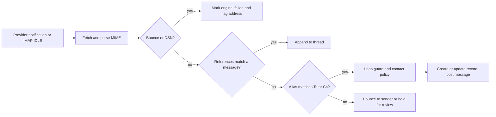
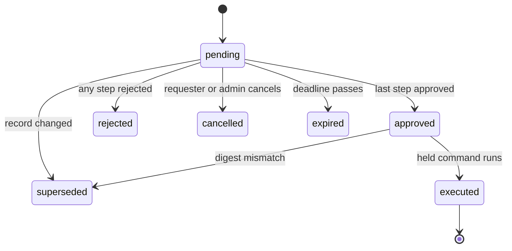

# Platform and kernel apps: contacts, companies, chatter, mail, calendar, documents, knowledge, sign, approvals, automation, customization, search, import/export, reporting

- **Status:** Draft 0.1
- **Date:** 2026-10-01
- **Scope:** Product-level specification of the obop kernel entities and the horizontal platform apps that every other area builds on; ports, events and crates are in [ARCHITECTURE.md](../ARCHITECTURE.md).

## 1. Purpose and scope

### 1.1 What this area is

The platform layer is present in every business and reused by every other app: parties and companies, the record thread (messages, followers, activities), email in and out, files, approvals, automation, customization, search, import and export, reporting, and the machinery that installs, upgrades and translates modules. It answers the top pain themes in the voice-of-customer research: customization debt, upgrade pain and open-core surprises [R04 s1]. Odoo is the functional reference; obop is a clean-room re-implementation (F3): behaviour comes from public documentation and from Community source read for understanding, never from Enterprise code [R01 s8].

Users: every internal user daily; portal users and external signers occasionally, through scoped capability tokens; administrators and implementers for configuration; integrators and AI agents through the same typed command surface (D18).

Conventions. "Proposed (Dn)" marks reliance on a decision the owner has not ratified. "Proposed" alone marks a design choice of this document that neither DECISIONS.md nor the research settles; those that need an owner or counsel answer are listed in section 9. "(target)" and "(estimate)" label numbers that are design goals, not measurements. "MVP" means the first shipped cut of an app in its own wave. Versions are as of 2026-10-01 [R00 s3]. The toolchain is Rust and Vite+ driven through `vp` with pnpm only (F1, F2); UI bundles are prebuilt and no Node runs on customer servers (D37). Names of events, entities, states and permission groups follow [CONVENTIONS.md](../CONVENTIONS.md). Nothing here is legal advice.

### 1.2 Boundaries with neighbouring areas

| Neighbour | This document owns | The neighbour owns |
|---|---|---|
| [security-privacy.md](security-privacy.md) | How platform apps consume principals, audit and erasure | Authentication, permission algebra, audit internals, DSAR, retention holds |
| [finance.md](finance.md) | Attachments, PDF rendering, approvals, sequences, the host for report engines (drill descriptors) | Ledger, legal numbers, invoices, e-invoice archive rules, financial report definitions and catalogue (4.13 there) |
| [sales-crm.md](sales-crm.md) | Email-to-record, share grants | Leads, quotes, portal pages, quote acceptance |
| [services.md](services.md) | Calendar events and sync | Working-time calendars, appointments, SLAs |
| [people.md](people.md) | Principals and parties | Employees, time off, recruitment |
| [retail-commerce-marketing.md](retail-commerce-marketing.md) | Transactional mail | Mass mailing, website |
| [ux.md](ux.md) | Delivery, query and collaboration engines behind the Inbox, search bar and editor | Screens, view layers and patches, saved views, command palette, design system |
| [ai.md](ai.md) | Approvals engine, semantic-layer declarations | Agents, write protocol, extraction |
| [integrations.md](integrations.md) | The generic import and export engine (`import_run`, mapping, staging, run states, export formats), per-model import and export rules, automation actions | Foreign-system importers and the identity ledger (`external_ref`), full business export and restore, API, webhooks, MCP, connectors, marketplace |

### 1.3 Apps and modules in scope

Tiers and waves are Proposed (D25, D26); open or paid is Proposed (D2). Module names in bold are this document's proposals.

| Area | Module | Tier | Wave | Open or paid |
|---|---|---|---|---|
| Parties (Contacts app) | `base` | T0 | W0 model, W1 app | Open |
| Companies, branches, company groups | `base` (one company), `base` multi-company, `intercompany`, `consolidation` | T0, T1, T2, T2 | W1, W2, W3, W4 | Open; multi-company never gated |
| Principals, permission groups | `base`, `portal` | T0 | W0 to W1 | Open; native SAML and full SCIM paid |
| Chatter and notifications | `mail` | T0 | W1 (Web Push W2) | Open |
| Discuss channels | `discuss` | T1 | W2 | Open |
| To-do (personal tasks) | **`todo`** | T1 | W3 | Open |
| Email gateway and templates | `mail` | T0 | W1 | Open |
| Calendar and sync | `calendar` | T1 | W2 | Open |
| Attachments | `base` | T0 | W0 to W1 | Open |
| Documents (DMS) | `documents` | T1 | W3 | Open |
| Knowledge | `knowledge` | T2 | W3 | Open |
| Sign | `sign` | T2 | W3 | Open |
| Approvals engine | inside `automation` | T0 | W2 | Open |
| Automation | `automation` | T0 | W1 | Open |
| Customization | **`customize`** | T0 | W1 fields, W2 editors | Open |
| Search | kernel and `base` | T0 | W1 | Open |
| Import and export | `base` | T0 | W0 engine, W1 CSV | Open |
| Reporting and BI | `analytics`, `obop-report` | T0 | W1; dashboards W3 | Open |
| Apps management | `base`, package registry service | T0 | W1; registry W2 | Client and sideloading open; the registry server's open-or-`ee` status is unsettled (BQ11, section 9); fleet control plane paid |
| Multi-language | `obop-i18n`, `base` | T0 | W0 to W1 | Open |

## 2. Personas and roles

| Persona | Jobs in the platform | Default permission groups (Proposed) |
|---|---|---|
| Business administrator | Installs apps, invites users, connects mailboxes, sets retention | `base.admin` (implies no data permission groups) |
| Implementer | Builds custom fields, views, automations, packages; imports data | `customize.designer`, `automation.designer`, `base.user` |
| Salesperson, service agent | Works records, chatter, activities, calendar; sends mail | `base.user` plus app permission groups |
| Accountant (free seats, Proposed D2) | Reads and files documents, approves, exports | `base.user`, `documents.user`, finance permission groups |
| Approver | Decides approval tasks, delegates | None; named per policy |
| Knowledge author | Writes and shares articles | `knowledge.editor` |
| Portal customer, vendor, external signer | Views and accepts shared documents; signs one request without an account | `base.portal`, or a single-use `share_grant` |
| Integrator, AI agent | Reads and writes through the generated API | `base.api_client`, `base.agent` (permissions are the intersection of delegator and token scopes, D18) |
| Auditor | Reads audit trail and evidence | `audit.reader` |

Group names follow [security-privacy.md](security-privacy.md) (`base.admin`, `base.user`, `base.portal`, `base.public`). Module permission groups are seeded by their modules; everything is default-deny (D10). Other platform permission groups (Proposed): `contacts.manager` (merge, archive), `mail.account_admin` (mailboxes, aliases, domains), `documents.manager`, `knowledge.admin`, `sign.user`, `sign.admin`, `approvals.designer`, `analytics.designer`. "Role" appears only in UI copy (D24).

## 3. Capability map

Parity: "Community" and "Enterprise" are Odoo's editions [R01 s5]. Waves are Proposed (D26).

| Capability | Description | Wave | Odoo parity |
|---|---|---|---|
| Party model | Person or organisation; typed addresses, identifiers, bank accounts; customer and vendor as per-company `party_profile` | W0 model, W1 app | Matches Community; beyond on typed addresses and roles |
| Merge, VAT id validation | Dry-run merge with external-id aliasing; VIES check through a pack validator and a connector, no credit wall | W1 | Matches Community merge and VIES check [R01 s3.1, R09 s1.2]; beyond on dry-run. Odoo's partner autocomplete (Dun & Bradstreet since 19) is the credit-metered part; obop's registry lookups are connectors with the business's own keys (W2) |
| Flat company and branch | One company in W1, dormant branch | W1 | Beyond (Odoo overloads one tree) |
| Multi-company | Selector, per-company books, shared and per-company masters | W2 | Matches Community; Odoo Online gates it to Custom |
| Intercompany mirrors | Async mirrored documents with reject step | W3 | Matches Enterprise (inferred from absence in the Community tree [R23 C.1]) |
| Consolidation, VAT groups | Eliminations in a separate ledger, ownership edges; VAT groups as `fiscal_unit` | W4 (VAT groups W3, Proposed) | Matches Enterprise for consolidation; beyond on edges |
| Record threads | Messages, internal notes, followers, subtypes | W1 | Matches Community |
| Activities and plans | To-dos on any record, assignable to a user (W1) or a permission group (W2) | W1, W2 | Matches Community; group assignment follows Odoo 20 roles |
| To-do app | Private memos and tasks per person with due dates, an optional record link and conversion to a project task (4.5.1); until then a personal reminder is an activity | W3 | Matches Community (Odoo To-do, personal tasks) |
| Field change log | Tracked fields rendered in chatter from `audit_change` | W1 | Beyond (Odoo 20 builds the tracking message on the fly and keeps stored tracking values only in the opt-in `mail_tracking` module [R02 s0]; obop reads the kernel audit log) |
| Discuss channels, calls | Channels, DMs, polls (W2); voice and video through an optional SFU later | W2, later | Matches Community; calls integrate, not build |
| Reactions, canned responses, absence replies | Message reactions and canned responses (shortcodes) with `discuss`; an absence reply is an automation rule with the loop guard. Link previews, Mail Groups and mail plugins are not scheduled (4.5, 4.7) | W2 | Matches Community for reactions, canned responses and the `out_of_office` message type [R02 s5]; `mail_group` and `mail_plugin` skipped [R15 s2] |
| Notifications | Inbox, email, preference matrix (W1); Web Push and the approvals lane (W2); digests, quiet hours and SMS through a connector later, not scheduled (Proposed; neither D25 nor D26 places them) | W1, W2, later | Matches Community. Odoo's Digest (KPI email) is a different feature: it maps to scheduled report delivery (W2, 4.17) |
| Email routing, OAuth mailboxes | Threading, aliases, catch-all, bounce, loop guard; Gmail API, Graph, IMAP with XOAUTH2 | W1 | Matches Community; EWS skipped |
| Sender-domain health | SPF, DKIM, DMARC checker | W1 | Beyond |
| Calendar and sync | Events, attendees, recurrence, alarms, iMIP, feeds; Google and Microsoft sync with push as a hint | W2 | Matches Community |
| CalDAV and CardDAV server | Standards-based device sync | Later | Beyond (not in Odoo) |
| Attachments | Content-addressed blobs on any record | W0 to W1 | Matches Community |
| Document management, OCR | Folders, tags, versions, lock, trash, requests; searchable PDF/A through an optional sidecar | W3 | Matches Enterprise (OCR uses IAP credits in Odoo) |
| Retention | Classes from packs, purge jobs, holds | W1 | Beyond |
| Knowledge | Article tree, inherited access, templates, embeds | W3 | Matches Enterprise |
| Collaborative editing | CRDT with live cursors | W3 | Beyond (Odoo uses a commit log) |
| Acceptance evidence | Portal signature with evidence bundle | W1 | Matches Community |
| Sign app | Templates, envelopes, OTP, hash-chained trail | W3 | Matches Enterprise |
| QTSP connectors | Advanced or qualified signatures from a provider | W3 to W4 | Matches Enterprise (Odoo 20 via itsme) |
| Approvals | One engine on any guarded command, digest-bound, decided from the Inbox ([ux.md](ux.md) 4.8) | W2 | Matches Enterprise; beyond on agents and inbox |
| Automation rules, schedules | Triggers, CEL conditions, actions, run log; leader-less schedules | W1 | Matches Community engine; beyond on dry-run |
| Custom fields, package export | Typed, promoted or JSONB properties; customizations exported as a package | W1 | Matches Enterprise (Odoo's Properties are Community) |
| Custom models, editors | Custom models with a generated menu entry and action, and a layout editor for form, list and kanban (W2); form builder, print-template designer and an app and menu editor (W3); editors for other view types later (4.14) | W2, W3 | Matches Enterprise |
| Registry inspector | Read-only admin screen over models, fields, effective views, jobs, schedules, sequences and access rows (4.18, Proposed) | W2 | Matches Community developer mode and Technical menu in intent; beyond on read-only, audited access |
| Industry bundles | Data packs (X1) plus a customization export; no first-party bundles before W4 (4.14) | W4+ | Deferred (Odoo Industries, Enterprise) |
| Customization report | Deltas from stock with upgrade risk, specified with view layers in [ux.md](ux.md) 4.3 (W2 there) | W2 | Beyond |
| Global search, saved views | Records, navigation, commands in one grammar; four view scopes, shareable URLs | W1 | Matches Community palette and favorites; beyond |
| Import and export | Shared engine with per-model rules: mapping, dry-run, rollback by run, external ids; import-compatible export; foreign importers and full business export in [integrations.md](integrations.md) | W1 | Matches Community; beyond on rollback and export |
| Semantic layer, pivot, graph | One query model with drill-through | W1 | Matches Community; beyond |
| PDF documents | Typst, PDF/A-3b and PDF/UA-1 | W1 | Beyond (Odoo defaults to wkhtmltopdf) |
| Dashboards | Shareable widget boards | W3 | Matches Community engine; editing is Enterprise |
| Apps management | Per-business install, dry-run upgrade (W1); signed packages, sideloading, registry service (W2; the registry server's open-or-`ee` status is unsettled, BQ11) | W1, W2 | Beyond on dry-run and packages |
| Translation | PO plus ICU MessageFormat 1, data fields per language | W0 to W1 | Matches Community |
| VoIP softphone | Not built; connector only | Skipped | Deliberately skipped (Enterprise) |

## 4. Per-app specification

Each app lists MVP and later capabilities, entities, workflows, events (working names; ARCHITECTURE.md is authoritative), permissions, reports, configuration, localization and open or paid status.

### 4.1 Kernel entities and the module integration contract

**Purpose.** Define what every record has and what every module must do to plug in.

**Every record.** UUIDv7 `id` (D9), `company_id` (NULL only on business-wide masters), `row_version`, audit stamps, `active`; module records carry external ids `module.name`. Polymorphic references exist only as `RecordRef(model_id, record_id)` for thread, attachment, audit and external id, with orphan collection [R23 B].

| Entity | Purpose | Key fields |
|---|---|---|
| `party`, `principal`, `company`, `branch` | Who the business deals with, who logs in, who owns the books | kind, `party_id`, currency, country |
| `attachment`, `blob` | Files on any record; content-addressed | `record_ref`, `sha256`, `storage_key`, pending or committed |
| `thread` | One per record with messages, followers or activities; created lazily | `record_id` (PK), `model_id`, `company_id` |
| `sequence` | Internal references and legal numbers | scope, pattern, `gapless`, `next_value` |
| `external_id` | Stable addresses of module and imported records | module, name, `record_ref`, origin, `content_hash` |
| `property_definition` | Sparse custom fields on a container record | container, JSON definition |
| `audit_change`, `security_event` | Field diffs; append-only security log | pseudonymous actor id, cause id |
| `outbox_event`, `outbox_delivery`, `inbox_processed` | Durable events, per-subscriber delivery | aggregate, version, lease, state |
| `job`, `schedule_fire` | Durable jobs, leader-less schedules | queue, `run_at`, lease, idempotency key |

**Model capabilities (Proposed).** A model switches platform behaviour on through registry metadata, not by inheriting a base class: `threaded`, `attachable`, `activities`, `aliasable`, `shareable`, `searchable`, `importable`, `tracked`, `retention_class`, `personal_data`, `translatable`. First-party and custom models use the same switches. This replaces Odoo's 5,446-line `mail.thread` mixin [R02 s5] and lets a business turn chatter on for a custom model without code. The record-level primitives that are not capability flags (duplicate, display name and name search, typed dialogs, scoped defaults) are registry metadata too, specified in [ARCHITECTURE.md](../ARCHITECTURE.md) 5.8.

**Integration contract (D27).** Mechanisms in order: port call, `TxEvent`, extension point, durable event; rules R1 to R7 apply (one command one transaction, per-aggregate ordering, at-least-once with `inbox_processed`, compensation by reversal documents, implementation crates depend only on `*-api` crates). Platform ports (working names): `ThreadPort` (post, note, activity, follower), `AttachmentPort`, `TemplatePort` and `RenderPort` (mail and PDF templates; PDF in an isolated worker), `ApprovalPort`, `SignPort`, `SearchPort`, `NotifyPort`, and `ConsentPort` (in `base-api`, over the `consent_record` of [security-privacy.md](security-privacy.md), so marketing, POS and website forms write one ledger). Optional ports are `Option<Arc<dyn Port>>`, so `sales` offers "require signature" only when `sign` is installed, with no bridge module. Sending mail, webhooks and other external I/O happen only in durable-event handlers, never inside the command transaction [R23 D.2]. Realtime to browsers follows D7: outbox, in-process wake-up and a coalescing notifier; R15's `LISTEN/NOTIFY` bus is superseded.

**What a module declares.** Dependencies and `auto_install` conditions; models and capability flags; permission rows seeded default-deny; views as slot-addressed JSON; automations and approval policies as data; state machines; print templates; settings; translations; migrations with expand, backfill and contract tags. First-party modules compile into the binary and register per business when installed; third-party packages use one `obop.toml` (D32).

**Documents and state machines.** Business documents follow a header-and-line pattern with a three-value kernel lifecycle (draft, confirmed, cancelled) plus derived progress fields; state machines are registry data with transitions, guards and emitted events, run only by command handlers [R23 B.2]. Automation triggers and approval policies attach to these transitions, so a new module gets both without code.

**Permissions, configuration, localization.** Every model declares permission rows default-deny and a scope (D10); the capability flags above are set per model in the registry and editable per business for custom models. Translatable fields store `{lang: value}` and personal-data flags drive erasure (section 4.19, [security-privacy.md](security-privacy.md)). **Events.** Working names are listed per app below; names are PascalCase and past tense, defined in the publisher's `*-api` crate, and the catalogue is generated from those crates ([ARCHITECTURE.md](../ARCHITECTURE.md) 4.3, Proposed). Emits `AttachmentCommitted` (Proposed) when a blob goes from pending to committed.

**Open or paid.** Open.

### 4.2 Contacts (parties)

**Purpose.** One identity table for every person and organisation the business deals with. Customer and vendor are per-company roles; users are principals, not parties (D28).

**MVP (W1).** Person and organisation parties; typed addresses (invoice, delivery, other) kept apart from contact persons, avoiding Odoo's `_fields_sync` tangle [R11 s2]; identifiers (VAT id, company register number, Peppol id, DUNS); bank accounts; per-company `party_profile` (receivable and payable accounts, terms, pricelist, credit limit, fiscal position; columns owned by finance and sales); tags; duplicate detection on normalised email, VAT id and name; merge; archive; VIES validation of EU VAT ids [R25]; vCard and CSV import. **Later.** Registry-lookup connectors behind `LookupProvider` (W2; a Proposed trait name of [integrations.md](integrations.md) 4.5); opt-in contact sync (section 4.8).

| Entity | Purpose | Key fields | States |
|---|---|---|---|
| `party` | Person or organisation | kind, names, language, `commercial_party_id` (materialised), personal-data flags | active, archived |
| `party_address` | Typed address | kind, lines, country | active, archived |
| `party_identifier` | Tax and registry ids | scheme, value, country | unverified, verified, invalid |
| `party_bank_account` | Bank details | IBAN, BIC, holder (encrypted number) | unverified, verified |
| `party_contact` (Proposed) | Links a person to an organisation | title, primary flag, valid range | active, ended |
| `party_profile` | Customer or vendor role per company | accounts, terms, pricelist, credit limit | active, archived |
| `merge_log` (Proposed) | What a merge rewrote | winner, losers, counts | committed |

**Workflow: merge.** (1) Select two or more parties. (2) Dry-run lists referencing records per model from the registry's relation graph and field conflicts, such as two VAT ids. (3) Choose the winning value per field. (4) Commit in one transaction: references rewritten, losers archived with a redirect, their external ids re-pointed so later imports stay idempotent, `PartyMerged` emitted. (5) Only a restore undoes it.

**Events.** Emits `PartyCreated`, `PartyUpdated` (TxEvent, so commercial fields propagate to contact persons in the same transaction; also durable, for mail and POS snapshots), `PartyMerged`, `PartyArchived` and `PartyBankAccountChanged` (Proposed; party id, bank account id and change kind; `account` uses it for approval and payment blocks). Consumes `MailBounced` (flags the address), `ImportRunCommitted` (duplicate scan on the new rows, Proposed) and `PartyErased` (emitted by [security-privacy.md](security-privacy.md) after the party is anonymised in place; the apps holding contact snapshots scrub their copies).

**Permissions.** `contacts.manager` merges and archives. Bank numbers and national ids are in the field-encryption catalog [R18 s5]; party bank account numbers, IBANs and natural persons' tax ids are data class `financial` ([security-privacy.md](security-privacy.md) 4.2); credit limit is readable by finance permission groups only; a portal principal sees its own party and children. Personal-data flags drive DSAR and erasure by anonymising in place [R18 s8.1]. **Reports.** Duplicate candidates; parties without country or VAT id. **Configuration.** Identifier schemes and validators and address formats per country, as data from packs [R19 s9]. **Localization.** VAT formats and validators come from country packs ([LOCALIZATION.md](../LOCALIZATION.md)). **Open or paid.** Open.

### 4.3 Companies, branches and company groups

**Purpose.** Model legal entities and their books correctly from the first row so groups grow without rewriting keys (D28).

**Capabilities.** W1: one `company` (`company_id NOT NULL`, composite FKs, one-element `Env.companies`), dormant `branch`, currencies and rates. W2: multi-company with selector, per-company books and grants. W3: `intercompany`. W4: `consolidation`. VAT groups (`fiscal_unit`) arrive in W3 with intercompany (Proposed, as [finance.md](finance.md) 4.12).

| Entity | Purpose | Key fields | States |
|---|---|---|---|
| `company` | Ledger scope of one legal entity | `party_id` (unique), currency, country, fiscal calendar | active, archived |
| `branch` | Subdivision without books | company, address, defaults | active, archived |
| `ownership_interest` | Group edge (single definition in [finance.md](finance.md) 4.1.1; structure in 4.12) | parent, child, `pct_bp`, `method`, `valid_during` (no overlap) | valid-time |
| `fiscal_unit` | VAT group | country, representative company, members | active, ended |
| `interco_link` | Mirror of a document across companies (single definition in [finance.md](finance.md) 4.1.1; flow in 4.12) | `src_ref`, `mirror_ref`, idempotency key | as finance.md 4.1.1 (pending, mirrored, rejected, failed) |
| `principal_company` | Grant of a principal to a company | principal, company | active, revoked |

**Workflow: add a subsidiary (W2).** (1) Create the organisation party with tax registrations. (2) Create the company from the country pack templates (chart, taxes, journals, sequences, lock dates). (3) Grant principals per company. (4) Add `ownership_interest`. (5) Switch company in the selector. (6) Verify the empty trial balance.

**Rules.** The active company set is explicit in every request, validated against grants. Reads span the set plus shared rows; a write needs exactly one active company. Restriction: `company_id IS NULL OR company_id = ANY(env.companies)`. Per company: accounts, journals, taxes, fiscal positions, sequences, lock dates. Shared: parties, products, pricelists, analytic plans [R23 C.3].

**Events.** Emits `CompanyCreated` (packs seed templates) and `FxRatesUpdated` (Proposed; `base` publishes it when an `ExchangeRateSource` ([finance.md](finance.md) 4.7) stores new rates; payload rate type, date and currencies). Consumes `InvoicePosted` toward a party that represents another company: a draft bill is created asynchronously and may be rejected; the receiver's lock date never blocks the sender's posting [R23 C.4].

**Permissions.** The selector shows only granted companies. **Reports.** Per-company and consolidated reports live in [finance.md](finance.md). **Configuration.** Default company, rounding profile, rate source. **Localization.** Tax registrations per company; packs follow the company country; branches follow their company. **Open or paid.** Open; multi-company is never gated (DECISIONS section 6).

### 4.4 Principals and permission groups

**Purpose.** Only what platform apps need; depth is in [security-privacy.md](security-privacy.md).

**Capabilities.** W0 to W1: principal kinds (user, portal, guest, API client, agent, system); permission groups with transitive implied groups; permission rows (OR) and restriction rows (AND) with mandatory scope `all`, `own`, `company` or `domain` (D10); field security; typed elevation; invitations; portal principals attached to a party; capability tokens (`share_grant`); agent delegation. W2: activities and approval tasks assignable to a permission group.

Entities: `principal` (invited, active, suspended, deactivated, for every kind), `credential`, `session` and `api_key` (states in [security-privacy.md](security-privacy.md) 4.1); `permission_group`, `group_membership`, `principal_company`; `share_grant` (active, used, expired, revoked; `used` applies to single-use scope); `agent_delegation` (active, suspended, expired, revoked).

**Workflow: invite.** (1) Admin enters email and permission groups. (2) A single-use expiring invitation is mailed. (3) The user sets a credential that meets the password policy, or registers a passkey or TOTP. (4) First login is audited.

**Events.** Platform emits no principal or permission event. Base principal management ([security-privacy.md](security-privacy.md) 4.1) emits `PrincipalInvited`, `PrincipalDeactivated` and `PrincipalSuspended`, and base authorization (security-privacy.md 4.2) emits `PermissionChanged` (payload kind: membership, permission group or access row; [ux.md](ux.md) consumes it). Platform shares the three principal names and reacts to them: on deactivation, activities and approval tasks are reassigned and live sockets close. **Permissions and sensitive data.** Default permission groups are in section 2. Credentials are never readable, API keys are stored hashed, and `share_grant` stores a token hash only. **Reports.** The effective-access report belongs to [security-privacy.md](security-privacy.md). **Configuration.** Invitation lifetime, default permission groups for new users. **Localization.** Invitation and sign-in emails render in the invitee's language. **Open or paid.** Password, TOTP, passkeys, OIDC, LDAP bind, RBAC open; native SAML and full SCIM paid (Proposed D2, DECISIONS section 6).

### 4.5 Chatter and Discuss channels (`mail`, `discuss`)

**Purpose.** One conversation and task log per record, so every app shares messages, followers and activities.

**MVP (W1).** Messages of kinds `comment`, `note` (internal), `email_in`, `email_out`, `system`; replies to a specific message; attachments; mentions; followers with subtype subscriptions and auto-follow (creator, assignee, mentioned); activities (type, due date, assignee user, chained plans); portal visibility by `is_internal`. **Later.** Assignment to a permission group, CC recipients, pinned and scheduled messages, channels, DMs and polls in `discuss` (W2); voice and video through an optional Apache-2.0 SFU such as LiveKit (W4, Proposed) [R15 s3].

| Entity | Purpose | Key fields | States |
|---|---|---|---|
| `thread` | Container per record | `record_id`, `model_id`, `company_id` | n/a |
| `message` | One post | thread, kind, subtype, author, body (sanitised HTML), parent, RFC `message_id`, `is_internal` | posted, redacted |
| `message_subtype` | Event type per model | internal, default, hidden, parent relation | active |
| `follower` | Subscription | thread, party or principal, subtypes | active |
| `activity` | To-do on a record | type, summary, due date, assignee | open, done, cancelled |
| `activity_type`, `activity_plan` | Templates and chains | delay, default assignee | active |
| `channel`, `channel_member` | Discuss (W2) | kind, parent channel, read-only | active, archived |

An activity's overdue, today and planned labels are derived from the due date, not stored. Messages are immutable once posted; an edit stores a revision and a privacy deletion leaves a redacted tombstone (Proposed).

**Odoo chatter extras (dispositions, Proposed).** Message reactions and canned responses (shortcodes; Odoo's `mail.canned_response` [R15 s2]) arrive with `discuss` in W2 as plain records with the composer reading them under the author's own access. Odoo's `out_of_office` message type [R02 s5] becomes an absence reply written as an automation rule (section 4.13) with the loop guard of section 4.7 (W2). Link previews are not scheduled; if added, the server fetches them through the SSRF-hardened egress client of section 6 and never the browser, so a reader's address is not disclosed to the linked site. Mail Groups and mail plugins are in section 4.7.

**Workflow.** (1) A user posts a note or a command logs a system message in its own transaction, so no log line survives a rolled-back change. (2) Recipients are the followers whose subtype matches, plus mentions. (3) `MessagePosted` (durable) feeds `NotifyPort`. (4) Browsers receive it over the WebSocket, resuming from `(xid8, event_id)` (D7). (5) Tracked field changes are not stored as messages: the chatter renders them from `audit_change` on the fly, so no per-field tracking rows live in the thread (Odoo 20 likewise builds the tracking message on the fly and keeps stored tracking values only in the opt-in `mail_tracking` module [R02 s0]; field-level change logs are opt-in per field [R08 s10]).

**Events.** Emits `MessagePosted`, `ActivityScheduled`, `ActivityDone`, `FollowerAdded`. Consumes every tracked `TxEvent`, `MailReceived` and `PartyErased` (message bodies naming the subject are scrubbed, security-privacy.md).

**Permissions.** A message is readable only if its record is, through the single query path (D10); portal and external followers never see internal notes. Mentioning a principal who cannot read the record notifies them that access is missing and grants nothing (Proposed). No ambient elevation: posting as the system is a typed, audited `Env<Elevated>` (D10; Odoo's `mail` module has 433 `.sudo(` calls [R02 s2.6]). **Reports.** Activity matrix by record and type; overdue activities per assignee. **Configuration.** Subtypes, activity types and plans, default followers, per-user preferences. **Localization.** Business correspondence may fall under retention rules (German commercial letters 6 years [R18 s8.1]); packs supply classes. **Open or paid.** Open.

#### 4.5.1 To-do (`todo`, T1, W3)

**Purpose.** A private list of memos and tasks for one person, apart from activities, which belong to a record and its followers. Odoo's To-do (`project_todo`) is personal tasks on top of project tasks [R01 s3.1]; obop keeps them in their own entity so the app works without `project`. Until W3 a personal reminder is an activity on a record (section 4.5, W1).

**MVP (W3).** Quick add of an item with a title, an optional note and a due date; a done flag; an optional link to any record the owner can read (`record_ref`); overdue, today and later groupings derived from the due date, as for activities; a due-date reminder through `NotifyPort` as one `notification` per owner and channel (section 4.6); and conversion to a `task` in a chosen project ([services.md](services.md) 4.2), which marks the item done and keeps a link to the task. Conversion is offered only when `project` is installed (optional port, no bridge module, D27).

| Entity | Purpose | Key fields | States |
|---|---|---|---|
| `todo_item` | Personal memo or task | owner (principal), title, note, due date, `record_ref` (optional), converted `task` ref (optional) | open, done, archived |

**Privacy.** Owner only: read and write scope `own` (D10). No other principal, including `base.admin`, reads an item through lists, search, API or agents, and the record link never widens access, because opening the record applies the record's own permissions. Items are personal data of the owner and follow DSAR and erasure with the principal ([security-privacy.md](security-privacy.md)). **Events.** Emits `TodoItemCompleted`, `TodoItemConverted`; consumes `PrincipalDeactivated` (open items are archived, Proposed). **Permissions.** `base.user`; no module permission group. **Reports.** None. **Configuration.** The reminder channel is a row of the per-user notification matrix. **Localization.** Due dates follow the user's locale and time zone. **Open or paid.** Open (T1, W3, D25).

### 4.6 Notifications

**Purpose.** Tell the right person once, in the channel they chose. The in-app inbox is the source of truth; email and Web Push are delivery channels [R19 s4]. The Inbox and notification-centre screens are in [ux.md](ux.md) 4.8; this section owns delivery.

**MVP (W1).** In-app and email channels, a preference matrix (event class by channel), mentions, activities and alerts. **W2.** Web Push (RFC 8030, 8291, 8292 [R15 s12]) and the approvals lane. **Later, not scheduled (Proposed; neither D25 nor D26 places them).** Notification digests, quiet hours, and SMS through a connector, reusing the provider trait of [retail-commerce-marketing.md](retail-commerce-marketing.md) 4.5. Odoo's Digest (KPI email) is a different feature: it maps to scheduled report delivery (W2, section 4.17), not to notification digests [R01 s3.1].

Entities: `notification` (one row per recipient and channel; `delivery_status` pending, sent, failed with a `failure_reason`, as in Odoo's `mail.notification` [R15 s2]; `inbox_state` unread, read, snoozed, done, with `snoozed_until`; and `lane` mention, activity, alert), `notification_preference` (the preference matrix), `push_device` (endpoint and keys; dead ones are deleted). There is no separate inbox entity: the Inbox screens of [ux.md](ux.md) 4.8 read the `notification` row, while approval tasks (`approval_task`, section 4.12) and agent proposals (`command_plan`, [ai.md](ai.md) 4.3) reach the Inbox from their own records, not from notification rows.

**Flow.** `MessagePosted`, `ActivityScheduled` or `ApprovalRequested` reaches `NotifyPort`; one row per recipient and channel is written with `inbox_processed` dedupe, so a redelivered event notifies nobody twice. **Events.** Emits `NotificationCreated` (the Inbox badge listens, ux.md); consumes `MessagePosted`, `ActivityScheduled`, `ApprovalRequested` and `PrincipalDeactivated` (push devices removed). **Permissions.** Email and push carry a link and minimal metadata unless the business opts in to content (Proposed, as in ux.md), because mail leaves the trust boundary; VAPID keys live in the secret store. iOS push needs a Home Screen web app and a tap-initiated permission [R19 s4]. **Reports.** Delivery failures by channel and reason. **Configuration.** Business default matrix, per-user preferences, quiet hours and digests (later, not scheduled, Proposed). **Localization.** Text renders in the recipient's language. **Open or paid.** Open.

### 4.7 Email gateway and templates (`mail`)

**Purpose.** Email is a transport for threads: inbound mail becomes messages or records, outbound mail is logged on the record. Built on `mail-parser` 0.11.9, `mail-builder`, `mail-auth` 0.13.3, `lettre` 0.11.23 and `async-imap` 0.12.0; never on the AGPL Stalwart server (D39). Mailboxes connect by OAuth only, behind `MailProvider` ([integrations.md](integrations.md) 4.5), through the Gmail API and Microsoft Graph, with IMAP XOAUTH2 for other hosts that support it; no EWS and no basic SMTP AUTH (D39).

**MVP (W1).** Routing in Odoo's order [R15 s4]: bounce detection, then threading by `In-Reply-To` and the last 32 `References`, then alias lookup on `To`, `Cc` and `Delivered-To`, then the fallback. Aliases with target model, defaults, contact policy (everyone, known parties, followers) and optional forced thread; alias domains with catch-all (replies only) and bounce aliases; loop guard; VERP bounce addresses; outbound queue with retries; per-domain DKIM; sandboxed per-language templates (`minijinja`); a sender-domain checker (SPF, DKIM, DMARC, PTR). **Later.** CC and scheduled send (W2); optional Stalwart integration (W4). **Not built.** Personal-mailbox capture: W1 ingests only alias and system mailboxes (Proposed). Mail Groups (`mail_group`, Odoo's mailing lists [R15 s2]) are not planned: an alias with a forced thread, or a `discuss` channel, covers the need. The Gmail and Outlook add-ins (`mail_plugin` [R15 s2]) would be an X4 remote app, not scheduled.



| Entity | Purpose | Key fields | States |
|---|---|---|---|
| `mail_account` | Connected mailbox | provider, `connection` ref, OAuth grant in the token vault, scopes | the `connection` state (Proposed; [integrations.md](integrations.md) 4.5: draft, connected, needs_reauth, paused, disconnected) |
| `mail_alias_domain` | Domain settings | bounce alias, catch-all, default from, DKIM selector | unverified, verified |
| `mail_alias` | Inbound route | name, domain, target model, defaults, contact policy, forced thread | active, disabled |
| `mail_template` | Outbound content | model, language variants, sandbox limits | active |
| `outbound_mail` | Durable queue | message_id, references, scheduled time, attempts | queued, sending, sent, failed, bounced, cancelled |
| `inbound_mail` | Raw MIME blob and route result | headers, SPF/DKIM/DMARC results | appended, created, bounced, rejected, parked |
| `mail_blocklist` | Opt-out, hard bounces, complaints (ARF) | normalised email, reason | active |

**Workflow: connect and send.** (1) An admin consents to minimal scopes; refresh tokens go to the envelope-encrypted token vault [R21 s7.3]. (2) Watch or delta subscriptions are hints with a poll fallback; Graph subscriptions last at most 10,080 minutes and are renewed. (3) A user sends with a template; `outbound_mail` is written in the command transaction. (4) A durable handler claims it (`SKIP LOCKED`, lease), records `message_id` and submits through the provider API or relay; delivery is at-least-once (R3), so a crash between submission and commit can repeat a send, and the handler checks the provider's sent items on retry where the API allows it (Proposed). (5) Bounces return to the VERP address and mark the original failed.

**External constraints.** Microsoft starts default-disabling EWS in Exchange Online in stages from 2026-10-01 (admins can re-enable it until the permanent shutdown on 2027-04-01) [R21 s6.5]. Microsoft disables Basic authentication for SMTP AUTH by default for existing Exchange Online tenants at the end of December 2026 (admins can re-enable it), makes it unavailable by default for tenants created after December 2026, and will announce the final removal date in the second half of 2027 [R21 s6.5]; this is not an obop design issue, because mailboxes are OAuth-only (D39). Gmail's `https://mail.google.com/` scope is restricted and needs verification, with a security assessment where data is stored on servers; a self-hoster would need its own Google Cloud project or a hosted OAuth broker (inference) [R21 s6.5]. The EWS dates and the Gmail scope classification were re-read on the vendors' pages on 2026-10-01; the SMTP AUTH date is confirmed on Microsoft's Exchange Team Blog post of 2026-01-27 (updated 2026-01-29), [Updated Exchange Online SMTP AUTH Basic Authentication Deprecation Timeline](https://techcommunity.microsoft.com/blog/exchange/updated-exchange-online-smtp-auth-basic-authentication-deprecation-timeline/4489835).

**Events.** Emits `MailReceived`, `MailSent`, `MailBounced` (marketing consumes it, [retail-commerce-marketing.md](retail-commerce-marketing.md)). Consumes `MessagePosted` (send flag), `PartyUpdated`, `ConsentWithdrawn` (suppression), `PartyErased` (raw MIME and bodies naming the subject are scrubbed; a suppression entry may keep a hash of the address, Proposed) and the credential events of [security-privacy.md](security-privacy.md) (user notices).

**Permissions.** `mail.account_admin` connects mailboxes; credentials are write-only. Inbound HTML is sanitised and remote images are not auto-loaded; attachments pass the upload pipeline (section 6). SPF/DKIM/DMARC results are stored and the `known parties` policy requires a pass. **Reports.** Deliverability (bounce and failure rates), alias traffic. **Configuration.** Domains, catch-all and bounce aliases, allowed domains, loop thresholds, retention of raw MIME. **Localization.** Templates render in the recipient's language. **Open or paid.** Open; a hosted OAuth broker is operated hosting, paid (Proposed).

### 4.8 Calendar and contact sync (`calendar`)

**Purpose.** Shared time: meetings on any record and the foundation for appointments. Working-time calendars belong to [services.md](services.md).

**MVP (W2).** Events linkable to any record; attendees with `PARTSTAT`; recurrence as an RRULE plus exception rows keyed by `recurrence_id`, expanded on read with a hard cap; alarms; UTC plus IANA tzid, never offsets; `iCalUID` and `SEQUENCE` for idempotent updates; iMIP invitations (RFC 5546, 6047); read-only `.ics` feed; several calendars per principal; a free/busy query with a staleness bound and on-demand refresh, and an idempotent `write_event`, as appointments need ([services.md](services.md)); Google and Microsoft sync behind `CalendarProvider` (a Proposed trait name of [integrations.md](integrations.md) 4.5). **Later.** CalDAV and CardDAV server on `dav-server` and `calcard` 0.3.14, or by integrating Stalwart (COULD) [R15 s5].

| Entity | Purpose | States |
|---|---|---|
| `calendar`, `calendar_event` | Container; event with start, end, tzid, RRULE, `iCalUID`, `SEQUENCE`, visibility | tentative, confirmed, cancelled |
| `calendar_attendee` | Party or principal with `PARTSTAT` | needs-action, accepted, declined, tentative, delegated |
| `calendar_alarm` | Reminder | active |
| `calendar_sync_link`, `calendar_sync_map` | Provider account (a `connection` ref), sync token or delta link, event id and etag map | the `connection` state, as `mail_account`; a failed sync is a `sync_run` row of [integrations.md](integrations.md) 4.5, not a link state |

**Sync rules.** Google: incremental by sync token; HTTP 410 wipes and re-syncs; channels are per calendar, carry no payload, are not auto-renewed and may drop messages, so push is a hint and polling remains. Microsoft: `calendarView/delta` needs a fixed window (Proposed: one month back to twelve ahead), opaque delta links, and renewed subscriptions [R15 s5]. A periodic reconciliation sweep is the correctness mechanism. The provider owns events it organises; conflicts resolve by etag with last-writer-wins (Proposed). **Contact sync (Proposed).** Opt-in per principal, one way from the provider into a personal contacts scope; nothing becomes a shared party until the user promotes it, because a company database must not swallow private address books.

**Events.** Emits `CalendarEventChanged`, `CalendarEventCancelled`. Consumes `ActivityScheduled` (meeting-type activities), `PartyMerged` and `PartyErased` (attendee snapshots are scrubbed). **Permissions.** Private events show as busy; a linked record's visibility follows the record. Tokens are secrets. **Reports.** None beyond the calendar view ([ux.md](ux.md)). **Configuration.** Default calendars, sync window, invitation templates. **Localization.** Week start, time zones (`jiff`); public holidays come from working-time calendars. **Open or paid.** Open.

### 4.9 Documents (attachments W1, DMS W3)

**Purpose.** Files that belong to the business, filed automatically from records and retention-aware. Odoo's Documents is Enterprise [R15 s6].

**MVP (W1): attachments.** Upload and download on any `attachable` record; SHA-256 content-addressed blobs behind an `object_store` trait (local disk or S3-compatible); pending-to-committed with garbage collection; authorisation through the parent record; generated PDFs archived with a retention class; the upload pipeline of section 6 (optional antivirus sidecar, I-1). **W3: DMS.** Folders, tags, immutable versions, lock, trash (30 days by default, Proposed), share links, document requests with reminders, "centralization" that links accounting or HR attachments into folders without copying, PDF split and merge, preview, retention rules, OCR, folder email aliases. (R23's SHA-256 governs over R15's BLAKE3.)

| Entity | Purpose | States |
|---|---|---|
| `attachment`, `blob` | Kernel file link and storage | blob: pending, committed, orphaned, deleted |
| `doc_folder`, `doc_tag`, `doc_access` | Tree, labels, folder access entries inherited by children | active, archived |
| `doc_file`, `doc_version` | File with current version; immutable version | active, locked, trashed, purged |
| `doc_request` | Ask someone for a document | open, fulfilled, cancelled, expired |
| `doc_retention_rule` | Class by folder or tag | active |
| `share_grant` | Link with expiry, password, download limit | active, used (single-use scope), expired, revoked |

Retention classes come from packs and `retention_hold` from [security-privacy.md](security-privacy.md); this app enforces them on documents.

**Workflow: upload with OCR.** (1) Upload passes the pipeline. (2) Blob committed, version row written. (3) An optional job sends the PDF to an OCRmyPDF (MPL-2.0, 17.x) plus Tesseract 5.5 sidecar behind an `OcrEngine` trait, as of 2026-10-01; Rust-native OCR is Latin-only preview [R15 s6]. (4) The searchable PDF/A is stored as a new version derived from the original. (5) Extracted text is indexed for search.

**Retention.** `retain_until` is computed from the class (for example 8 years from the end of the issue year for German invoices, section 14b UStG [R09 s4]) and blocks hard deletion in a database trigger, like posted-row immutability (D30 pattern, Proposed). The e-invoice XML is kept in its received format (secondary-source statement; the pack confirms) [R09 s4]. Erasure anonymises in place and backups replay the erasure ledger [R18 s8.1].

**Events.** Emits `DocumentFiled`, `DocumentVersionAdded`, `DocumentTrashed`, `DocumentPurged`, `OcrCompleted`. Consumes `InvoicePosted` (archive PDF/A-3b and XML), `MailReceived` (folder alias), `SignRequestCompleted`, `PartyMerged` and `PartyErased` (non-retained copies are scrubbed; retained artefacts stay under `retention_hold`, security-privacy.md).

**Permissions.** Folder access entries compile into permission and restriction rows on the single query path, so list, search, export and AI reads agree (D10). Views and downloads in sensitive folders are read-audited. **Reports.** Storage, upcoming expiries, open requests. **Configuration.** Folder templates, retention classes, storage backend, upload limits. **Localization.** Retention periods and e-invoice archive rules come from country packs. **Open or paid.** Open. Object-lock checkpoints and audit-tier legal hold are paid (Proposed D2, DECISIONS section 6); a plain retention hold is open (open question 6).

### 4.10 Knowledge (`knowledge`, W3)

**Purpose.** A wiki tied to the business: articles with inherited access, templates and embedded live views, edited collaboratively.

**MVP (W3).** Article tree; sections derived from access (Odoo's are Favorites, Workspace, Shared and Private; obop's section labels are UI copy, Proposed); nested inheritance; templates; a `/` menu to insert headings, callouts, file embeds, article links and saved record views (gated by the viewer's own access); version history with named snapshots; lock; comments anchored to text; PDF export; command-bar search. **Later.** Publishing to a portal audience for the help center through an optional `KnowledgeSearchPort` ([services.md](services.md)); offline editing (first candidate for queued writes, Proposed), Loro behind a `DocEngine` trait.

**Engine.** Tiptap 3.31 on ProseMirror with Yjs 13.6.33 on the client and `yrs` 0.28.0 on the server, pinned together (D39, as of 2026-10-01); Yjs 14 is release-candidate only and Tiptap requires `yjs ^13`. obop writes a thin y-protocol WebSocket handler over `yrs::sync` (sync steps, update, awareness) because `yrs-axum`, `yrs-warp` and `y-sweet` are stale. CI runs a cross-implementation fuzz for the known Yjs/yrs divergence (y-crdt#632) [R15 s7]. BlockNote XL (GPL-3.0) and HyperFormula (GPL-3.0) are excluded by the licence gate (D39); Tiptap Cloud and Tiptap's paid platform products are commercial and excluded by the no-commercial-runtime-dependency rule (D15).

| Entity | Purpose | States |
|---|---|---|
| `article` | Metadata, parent, position, access mode, favorites | active, archived; locked flag |
| `article_ydoc` | Binary snapshots plus append-only updates with compaction | n/a |
| `article_render` | Derived HTML or JSON for search, PDF, read-only | current, stale |
| `article_access` | Principal or permission group with read, comment, edit, manage | active |
| `article_comment` | Anchor as relative position, resolved flag | open, resolved |
| `article_template` | Starter content | active |

**Workflow.** (1) The browser opens a WebSocket. (2) The handshake authorises against article access through the single query path; an unreadable article answers 404, not 403 [R18 s10]. (3) Snapshot plus updates load and sync. (4) Edits persist on debounce. (5) A permission change ends sessions by durable event. The PDF export needs a ProseMirror-JSON to Typst converter inside `obop-report` for a fixed node set (open question 5).

**Events.** Emits `ArticleUpdated` (debounced, durable), `ArticleCommentPosted`. Consumes `PermissionChanged` (security-privacy.md), `PrincipalDeactivated`. **Permissions.** `knowledge.editor` writes, `knowledge.admin` manages. Comments and mentions are plain records, not CRDT content. **Reports.** Articles not edited for a period. **Configuration.** Templates, default access mode, compaction policy. **Localization.** `dir="auto"`, IME-safe editing, CJK search capability. **Open or paid.** Open.

### 4.11 Sign (`sign`, W3; acceptance evidence W1)

**Purpose.** Honest electronic signatures: simple signatures with evidence, and advanced or qualified ones only through a QTSP (D39). The W1 quote acceptance primitive belongs to `portal` ([sales-crm.md](sales-crm.md) 4.8: document-hash binding, typed or drawn signature, IP, user agent, optional OTP, a PDF sealed with an obop-held certificate); `sign` reuses it (Proposed).

Levels. **Simple:** evidence bundle, hash chain and a sealed PDF; the seal covers the document, not the person. **Advanced or qualified:** three-phase remote signing (prepare hash, sign at the provider, finalize) through a QTSP connector, shown as the provider reports it; obop never labels its own crypto advanced or qualified.

**MVP (W3).** Templates with drag-and-drop items and roles; envelopes of several documents; ordered signers; email link plus optional OTP (SMS through a connector, as signer evidence only); reminders; delegation; decline; expiry; sealing. **Later (W3 to W4).** QTSP connectors (`underskrift` 0.1.4, BSD-2, is immature with 13 stars; EU DSS 6.5 (LGPL-2.1, Java) only as a CI oracle or optional validation sidecar, I-1); PAdES B-T and B-LT with a timestamp authority. `pdf_signer` is GPL-3.0 and excluded.

| Entity | Purpose | States |
|---|---|---|
| `sign_template`, `sign_role`, `sign_item` | Reusable layout; named signer slots (`sign_role` is a template's signer, not a permission group); fields (signature, initials, text, date, checkbox) | active |
| `sign_request`, `sign_envelope`, `sign_document` | What is being signed | draft, sent, in_progress, completed, declined, expired, cancelled |
| `sign_signer` | Person and method | pending, viewed, verified, signed, declined, delegated |
| `sign_event` | Append-only, hash-chained trail | immutable |
| `sign_certificate` | Seal certificate and chain; QTSP references | active, revoked |

**Workflow.** (1) Create from a template or a record. (2) Send; each signer gets a single-use `share_grant`. (3) The signer views, passes OTP if required, fills items and signs by drawing, typing or uploading; a typed alternative is mandatory for accessibility (WCAG 2.1.1, 2.5.7). (4) When the last signer finishes, the final PDF is hashed, sealed, and an evidence page is appended. (5) The signed PDF and evidence bundle are filed in Documents. Signers can decline with a reason.

**Events.** Emits `SignRequestSent`, `SignRequestCompleted`, `SignRequestDeclined`, `SignRequestExpired`. Consumes `ApprovalDecided` ("approve then sign"). **Permissions.** `sign.user` creates requests for records they can read; `sign.admin` manages templates and certificates; IP, user agent and consented geolocation are personal data under the document's retention. **Reports.** Pending, turnaround, expiring. **Configuration.** OTP policy, seal certificate, reminders. **Localization.** Typed signatures need fonts covering Latin, Cyrillic, Devanagari and Arabic scripts (Odoo 20's Sign added the Cyrillic, Devanagari and Arabic signature alphabets [R19 s9]). **Compliance.** The validity of a simple signature varies by jurisdiction and document type; eIDAS distinguishes simple, advanced and qualified [R15 s8]; counsel decides any claim. **Open or paid.** Open; QTSP fees are the provider's.

### 4.12 Approvals (engine inside `automation`, W2)

**Purpose.** One engine for every "needs approval" case, human or agent, replacing Odoo's separate app and Studio rules [R15 s9]. It is also the approval policy engine that D18 names a W2 deliverable (modes `auto`, `confirm` and `approve_by_role`); [ai.md](ai.md) 4.3 uses it. An Odoo-style approvals app with free-form request types is T3 (D25).

**MVP (W2).** Policies on any guarded command or transition; ordered steps; approvers as principals, permission groups or expressions; minimum approvals; exclusive approval; delegation with an end date; escalation and timeout; comments; inbox with inline approve and reject.

| Entity | Purpose | Key fields | States |
|---|---|---|---|
| `approval_policy` | Rule (R15 called it `approval_rule`) | match (command or model), CEL condition, mode (`auto`, `confirm`, `approve_by_role`), steps | active, disabled |
| `approval_step` | One stage | order, approvers, minimum, exclusive flag, escalation | per task below |
| `approval_request` | One approval case | record ref, command, `plan_digest`, requester | pending, approved, executed, rejected, cancelled, expired, superseded |
| `approval_task` | Step per approver | request, step, approver | waiting, active, approved, rejected, delegated, skipped, expired |
| `approval_decision` | Append-only record | actor, on behalf of, decision, comment | immutable |
| `approval_delegation` | Temporary hand-over | from, to, valid range | active, ended |



**Workflow.** (1) A guarded command runs its dry-run and asks `ApprovalPort`. (2) The CEL conditions of matching policies are evaluated; with no match, or mode `auto`, the command proceeds; mode `confirm` asks the acting human to re-confirm the dry-run diff ([ai.md](ai.md) 4.3). For agents, hard floors from operation metadata override any policy, so an `auto` policy never lets an agent commit (Proposed, ai.md). (3) For `approve_by_role` the request is created in the same transaction with the plan digest (command, canonical arguments, touched `row_version`s), the command answers with an RFC 9457 problem naming the request, and the record is unchanged. (4) Step 1 tasks open as activities and appear in the approvers' Inbox approvals lane, read from `approval_task` rather than from `notification` rows. (5) An approver decides; the requester never approves their own request and no principal approves two steps of one request where exclusive approval is set; agents never approve (D18). (6) After the last approval the held command is released with the plan id (`commit(plan_id)`, [ai.md](ai.md) 4.3): a human requester re-runs it, or a durable job may do so automatically (Proposed); an agent's `commit` only releases the approved plan, which [ai.md](ai.md) proposes to execute as the approving human with the agent recorded as proposer. (7) If the record changed, the digest no longer matches and the request becomes `superseded`; nothing carries over (Proposed).

Example condition for EUR 5,000.00 in a EUR company (notation and field name illustrative):

```
record.amount_total_company_minor >= 500000
```

Thresholds compare company-currency minor units (D9); foreign-currency thresholds are open question 8. When several policies match, their steps combine and identical approver sets merge (Proposed).

**Events.** Emits `ApprovalRequested`, `ApprovalTaskDecided`, `ApprovalDecided` (final; [ai.md](ai.md) consumes it). Consumes `PrincipalDeactivated` and `PrincipalSuspended` (open tasks are reassigned or escalated). **Permissions.** `approvals.designer` writes policies and every policy change is a security event; decisions are append-only; requester, approvers and admins see a request. **Reports.** Pending by age, turnaround, rejection reasons. **Configuration.** Thresholds, step approvers, minimum approvals, escalation and expiry times, delegation defaults. **Localization.** None beyond translated labels. **Open or paid.** Open.

### 4.13 Automation (`automation`, W1)

**Purpose.** Business users express "when X, do Y" as data; it replaces Odoo's three overlapping concepts (server action, automated action, cron) with one engine [R02 s6].

**MVP (W1).** Triggers (Proposed catalogue): created, updated (fields), state entered, archived or deleted, time-based (date field plus offset), message received, message sent, tag changed, webhook received, scheduled, manual button, approval decided. Scope filter as a Domain (JSON AST, SQL-compilable; storage format is Proposed, D12); condition as CEL; ordered actions: set fields, create or update records, log note, schedule activity, send email from template, add follower, run a registry command, request approval, call webhook, enqueue job, notify. **W2.** `call_component` for X3 Wasm (wasmtime v48 LTS behind `obop-wasm-host`, D11). Rhai is not shipped in W1 to W2 (D11). Illustrative rule (notation and field names, not a final syntax; [sales-crm.md](sales-crm.md) calls the field `expected_revenue`):

```
trigger: state_entered  stage = "won"
when:    record.expected_revenue_minor >= 1000000
actions: schedule_activity("Send onboarding pack", due = today() + duration("72h"),
                           assignee = record.salesperson)
```

**CEL.** Stored as source plus a type-checked compiled form (Proposed, D12). Save-time limits of 4 KB source and AST depth 32, a runtime step budget and a deadline, and only host functions `today()`, `company()`, `user()`; the `cel` crate 0.14.5 documents no cost limit, so a W1 spike adds one [R24 s3.2].

| Entity | Purpose | States |
|---|---|---|
| `automation_rule` | Trigger, scope, condition, actions, run-as, version | active, disabled, auto_disabled |
| `automation_run` | One execution: event id, record, outcome, duration, error | ok, failed, skipped |
| `schedule` | Cron or interval, timezone, target | active, paused |
| `job`, `schedule_fire` | Kernel queue; a unique insert per tick wins, so no leader election | queued, leased, done, dead |

**Execution.** In-transaction actions are cheap declared ones and run as `TxEvent` handlers, so an error aborts the command by default (`on_error: abort`, or `log`, Proposed); mail, webhooks and jobs run as durable events after commit. Each run carries a chain id and depth; a configurable maximum (Proposed default 5) stops loops. A rule can be tested on a chosen record and shows the actions and diffs without committing. A rule that fails repeatedly is auto-disabled with a notice (Odoo deactivates cron jobs after at least 5 consecutive failures spanning at least 7 days [R02 s6]; obop's threshold for rules is Proposed).

**Events.** Emits `AutomationRunFailed`, `RuleAutoDisabled`. Consumes registry `TxEvent`s, `MailReceived`, `ApprovalDecided`.

**Permissions.** `automation.designer`. A rule runs as the triggering principal; "run as system" needs `base.admin` and is an audited elevation; a rule cannot do more than its designer could at save time, and rules referencing unreadable fields are rejected (Proposed). **Reports.** Run log, failure rate, slowest rules. **Configuration.** Enable or disable, maximum chain depth, CEL budgets per business. **Localization.** Email actions respect blocklists and consent. **Open or paid.** Open.

### 4.14 Customization (`customize`, Proposed)

**Purpose.** Odoo's Studio equivalent, free and metadata-first: business users change fields, models, automations and templates, and the result is data that migrates and exports. It works only because built-in behaviour is also metadata [R15 s11]; it answers the customization-debt pain [R04 s4.3]. View patches, layers, the layout editor, the form builder and the customization report are specified with the view AST in [ux.md](ux.md) 4.3; this section owns the data side.

**Capabilities.** W1: custom fields in three tiers (typed columns, promoted columns, JSONB properties; no EAV; D29) [R08 s3] with an admin screen (Proposed), business overlay packs (X1), export as a package. W2: custom models, each with a generated menu entry and action so a new model is reachable without a separate step; the layout editor for form, list and kanban and the customization report (ux.md); permission and approval designers. W3: form builder, print-template designer and an app and menu editor. Editors for the other view types Studio covers (search, activity, calendar, pivot, graph, gantt, cohort, map [R02 s13]) follow in W3 or later, each after its view type ships (Proposed). Data layers: module-owned (immutable at runtime), business overlay, user-personal (D32). Odoo's Industries (60 plus bundles, Enterprise) map to X1 packs plus the customization export, T3 and W4+ ([PRODUCT.md](../PRODUCT.md) 5.5); there are no first-party industry bundles before W4.

| Entity | Purpose | States |
|---|---|---|
| `custom_field` | Registry row with stable id, label, type, tier, physical name `x_<slug>` | draft, applying, active, hidden, dropping, dropped |
| `custom_model` | `x_` model with capability flags | active, archived |
| `meta_migration_log` | Append-only DDL and data steps | n/a |

**Schema manager.** It diffs the registry against `pg_catalog`, classifies steps as `Instant`, `Rewrite`, `Blocking` or `Concurrent`, runs under `lock_timeout` with retry, builds indexes concurrently outside the transaction, refuses `Rewrite` on large tables except as expand, backfill, contract jobs, and sets `DDL_LOCKED` during upgrades. Drops are two-phase (rename to `_dropped_<id>`, hard drop after a grace period, Proposed) [R08 s4]. PostgreSQL allows 1,600 columns per table and 63-byte names [R08 s3]; per-model caps are set after the schema-manager spike. Promotion from a property to a column is built in.

**Security.** A new field is default-deny: the designer picks readable and writable permission groups, defaulting to the model's write permission group, and is asked whether it holds personal data so DSAR and erasure cover it (Proposed). The UI permission row `customize_views` (ux.md) is bundled with schema rights in `customize.designer`.

**Events.** Emits `CustomFieldAdded`, `CustomFieldChanged`, `CustomFieldDropped`, and triggers `RegistryVersionChanged` (defined in [ARCHITECTURE.md](../ARCHITECTURE.md) 5.1; peers reload by the D7 ladder); OpenAPI and MCP schemas update per business at once (D31). **Reports.** The customization report (W2, ux.md) lists every difference from stock with upgrade-risk flags [R04 s4.3]. **Configuration.** Who may customize, change windows. **Localization.** Labels are translatable per language. **Open or paid.** Open (DECISIONS section 6). Code beyond the declarative tiers is X3 to X5 ([integrations.md](integrations.md)).

### 4.15 Search (kernel and `base`, W1)

**Purpose.** The engine behind the omni-bar and every list filter. Grammar, saved-view scopes (`saved_view`) and the command palette (`command_definition`) are specified in [ux.md](ux.md) 4.6, together with `view_override`; this section owns the engine behind them.

**MVP (W1).** Each model registers searchable fields and weights through `SearchPort`; a business can edit them in the Customization app. Search is a query, not a second datastore: per-model `tsvector`, `pg_trgm` and `unaccent` with ICU collations are compiled by the query compiler, so the caller's access domain is ANDed in SQL and results equal what the list would show (Proposed). Messages, OCR text and article renders expose searchable columns the same way. Capability detection: PGroonga 4.0.9 or `pg_bigm` for CJK where installed (W3), otherwise `ILIKE`; NFKC normalisation at write [R25]; ParadeDB `pg_search` is AGPL and avoided [R22 s4]. A future `tantivy` index would over-fetch and re-check each hit through the normal path (D10 pattern).

**Permissions.** Filter, sort or group on an unreadable field is rejected by the compiler, and an inaccessible record answers 404 (D10, [R18 s10]). Cost-weighted rate limits apply [R18 s11]. **Entities.** No index tables in W1; the searchable fields and weights are registry metadata per model (business edits are overlay rows, Proposed). **Events.** Consumes `RegistryVersionChanged` and `PartyErased` (derived search columns such as OCR text and message bodies are recomputed or cleared). **Reports.** Slow queries. **Configuration.** Searchable fields and weights per model, search capability in use (`ILIKE`, trigram, PGroonga). **Localization.** Accent and width folding per language. **Open or paid.** Open.

### 4.16 Import and export (`base`)

**Purpose.** The generic import and export engine that every importable model shares, for everyday users and as the base of the foreign-system importers. Foreign-source adapters (Odoo, QuickBooks, Xero, ERPNext), the identity ledger (`external_ref`), the accounting diff and the full business export with restore are specified in [integrations.md](integrations.md) 4.8 and 4.9; the screens and the pipeline diagram are in [ux.md](ux.md) 4.14. Odoo's imports are "permanent and cannot be undone" [R19 s2.5] and run row by row through the ORM [R22 s8]; obop's stage, validate in bulk and roll back by run (D35 calls this batch rollback). This section owns the engine contract and what a model and a user must satisfy.

**MVP (W1).** CSV at 0.3, then XLSX, XLS and ODS through `calamine`; raw ZIP archive uploads are refused (R18 s10 advises avoiding ZIP; Proposed). Odoo and QuickBooks importers at 0.6, Xero and ERPNext in W2 (DECISIONS section 3, ruling 31).

**A model declares (Proposed).** `importable` with natural keys so re-imports update instead of duplicate; `import_mode: bulk` (masters such as parties and products, `INSERT ... SELECT` from staging) or `command` (documents, through domain services, drafts only, never posted); and fields excluded from import (`state`, foreign `company_id`).

**Engine entities (Proposed names, after ux.md and integrations.md).**

| Entity | Purpose | Key fields | States |
|---|---|---|---|
| `import_run` | One upload through commit; its run id tags every record it creates or updates | source, target models, mapping, counts, `created_by`, `dry_run_result` (ok, failed), `posted` flag (accounting importers only) | uploaded, mapped, validated, committing, paused, committed, failed, rolled_back, partially_rolled_back |
| `import_mapping` | Saved mapping per source and model | name, model, columns, scope | n/a |
| `import_row` | Run item and row errors | run, row number, action (created, updated, skipped, rejected), target `record_ref`, per-cell errors | n/a |

The nine states above are the whole state list. `dry_run_result` and `posted` are fields of the run, not states: the accounting importers' separate posting step, owned by [integrations.md](integrations.md) 4.8, sets `posted` (open question 13 is closed on this set).

**Rules.** Relations resolve by name, external id or id. An import never exceeds the importer's write rights or field security; users, permission groups and credentials are not importable. Bulk mode stages through non-RLS tables and never runs under `BYPASSRLS` (D10). Rollback by run id is all-or-nothing by default, works until a created record is posted or referenced (the blockers are listed), and reverts updates from `audit_change` rows tagged with the run id; ux.md adds an explicit "unreferenced only" rollback ending in `partially_rolled_back`. Export writes CSV, XLSX or NDJSON with field selection and an import-compatible mode that includes external ids; it uses the same query path as lists, needs a separate export permission (security-privacy.md AZ10), is audited and rate-limited, and neutralises CSV cells beginning `=`, `+`, `-` or `@` [R18 s10]; large exports run as an `export_job`. The business export is on every edition, carries no credentials, and switching charges are prohibited from 2027-01-12 [R28 E.4].

**Events.** Emits `ImportRunCommitted` and `ImportRunRolledBack` (ux.md and integrations.md consume them); progress arrives as `JobProgressed` frames on the WebSocket (job runner progress, a realtime frame and not an outbox event; the definition is Proposed). `ExportRequested` is a security event emitted by authorization ([security-privacy.md](security-privacy.md) 4.2) and `ExportReady` is emitted by the `export_job` of [integrations.md](integrations.md) 4.9. **Permissions.** The UI permission row is `import_data` plus create or write on each target model, checked per row (ux.md); uploaded files are stored and encrypted like attachments and deleted a configurable period after commit (ux.md, Proposed). **Reports.** Run history and error files. **Configuration.** Row limits, staging retention. **Localization.** Decimal separators `.` and `,`, locale date formats, Windows-1252 and UTF-8. **Open or paid.** Open; importers are on the free list (D2).

### 4.17 Reporting and BI (`analytics`, `obop-report`)

**Purpose.** Declarative reports, a governed semantic layer, drill-through and PDF documents.

**MVP (W1).** Registry-declared `Measure`, `Dimension` and `Cube`; one `SemanticQuery{measures, dimensions, filters, grain, target_currency, rate_type, company_scope}` serves pivot, graph, reports and agents, compiled through the Domain AST plus the caller's access domain [R23 B.3]; details in [ai.md](ai.md) 4.4. Every aggregate cell carries a `drill` descriptor (model, domain, grouping) that opens the source list by URL [R19 s4]. PDF documents through `obop-report`: Typst 0.15.1 (as of 2026-10-01) with PDF/A-3b and PDF/UA-1; user-designed templates through `minijinja` (autoescape, fuel and recursion limits) feeding Typst; an isolated worker with no network or file access (Proposed, D20). No wkhtmltopdf and no browser renderer (R15's Chromium pool is superseded). **W2.** Scheduled report delivery (Proposed); it is the counterpart of Odoo's Digest (KPI email) [R01 s3.1], not of notification digests (section 4.6). **W3.** Dashboards and the print-template designer (ux.md asks in its open question 10 whether a minimal dashboard container ships earlier, in W2). **Later, not scheduled.** An embedded spreadsheet behind a `SpreadsheetHost` interface. The default candidate is Univer core (Apache-2.0, without Univer Pro, which the licence gate excludes, D15), as in [ux.md](ux.md) 4.4. o-spreadsheet (LGPL-3), which R15 s10 recommended, is Odoo-authored and OWL-coupled, so it is excluded until an owner or counsel ruling under F3 (open question 14); HyperFormula is GPL-3.0 and excluded.

| Entity | Purpose | States |
|---|---|---|
| `report_definition` | Declarative report: columns, lines, comparison periods, drill descriptors. One format shared with [finance.md](finance.md) 4.13, which owns the financial catalogue and its expressions | active, archived |
| `print_template` | Document type, engine, paper, variable schema, language variants | draft, published |
| `report_run` | Template version, input hash, output blob, duration | ok, failed |
| `dashboard`, `dashboard_widget` (W3) | Widgets refer to saved views and queries, evaluated as the viewer | private, shared |
| `scheduled_report` (W2) | Recipients, cadence, format | active, paused |

No raw SQL endpoint exists, because RLS cannot express the full algebra (D10); R15's read-only SQL endpoint is superseded, and BI tools use the API or exports. **Permissions.** Dashboards never widen access; export is separate. **Events.** Emits `ReportGenerated`. **Configuration.** Default rate type, templates per company, business branding (logo, colours). **Localization.** Packs supply legally required invoice content and DIN 5008 letter layouts for Germany (Odoo's German package ships them [R01 s4]; obop authors its own, F3); PDF/A-3b carries Factur-X attachments [R15 s14]. **Open or paid.** Open.

### 4.18 Apps management (`base`)

**Purpose.** Install, upgrade and configure modules and packages per business; upgrades are a feature, not a project [R04 s4.1].

**MVP (W1).** Settings app with search; install with dependency resolution and `auto_install` bridges (D27 R7); module data with external ids and an ownership flag separating module data from business edits; append-only migration ledger with expand, backfill and contract tags; `obop upgrade --dry-run` and an N-1 guarantee from 0.3 (D26); uninstall after an export with an `archive`, `drop_after_days` or `keep` data policy [R24 s5.1]; a sample-data toggle in the setup wizard, demo data off by default [R19 s13, R02 s11]. **W2.** Package registry service, signed OCI packages with capability diffs on upgrade, trust levels, sideloading always allowed (D32); on shared cloud, sideloaded packages are limited to X1 to X4 [R24 s9]. A registry inspector (Proposed, W2) is a read-only admin screen over the per-business registry: models and fields, effective views and their layers, jobs and schedules, sequences, access rows and external ids. It stands in for Odoo's developer mode and Technical menu (the `group_no_one` debug group [R02 s3]) and edits nothing, because changes go through the Customization app (section 4.14) and packages; it is reserved to `base.admin`, and opening it is audited.

| Entity | Purpose | States |
|---|---|---|
| `module_state` | Per business: module, version, auto-installed flag | uninstalled, to_install, installed, to_upgrade, to_remove |
| `package_install` | Package id, version, trust level, capability digest, sideloaded flag | active, disabled, removed |
| `setting` | Typed key with scope business, company or user | n/a |
| `migration_ledger` | Applied steps with checksums | applied, failed |

**Events.** Emits `ModuleInstalled`, `ModuleUpgraded`, `ModuleUninstalled` (TxEvents that rebuild the per-business registry) and `PackActivated` (durable, Proposed; on pack install and at each effective date of a pack version, with pack id, version, kind and company; distinct from `LanguageActivated`, [LOCALIZATION.md](../LOCALIZATION.md)). **Permissions.** `base.admin`; installing shows new capabilities and egress hosts. **Reports.** Installed modules, pending upgrades, customization report. **Localization.** Country packs update on their own signed channel, separate from core (D34). **Open or paid.** Open for `base`, the registry client and sideloading (D2); the registry server's own status, open or `ee`, is unsettled (BQ11 in [BUSINESS.md](../BUSINESS.md), open question 15); the fleet control plane is paid.

### 4.19 Multi-language

**Purpose.** Every surface in the user's language, with correct direction and formats (D34).

**MVP (W0 to W1).** PO catalogues with an ICU MessageFormat 1 subset (Lingui 6.8 on TypeScript; PO parser and `icu` 2.3.1 in Rust), Weblate, 12 target locales at first pack stable; R25 suggests de, fr, pl, en, nl, es, it, pt, sv, da, nb, fi (Proposed list). Machine translation is a suggestion and banned for statutory labels. Translatable data fields store `{lang: value}` as JSONB. `dir` on `<html>`, logical CSS only, RTL and CJK fixtures in CI [R19 s9]. Emails render in the recipient's language and documents in the party's language. **W2.** In-context translation mode.

| Entity | Purpose |
|---|---|
| `language` | Code, direction, active, CLDR 48 formats |
| `translation_override` (Proposed) | Business-level string overrides |

**Events.** Emits `LanguageActivated` (loads catalogues and pack strings). **Localization.** Statutory terms come from the authority's vocabulary in each pack; MessageFormat 2 is reviewed in 2027-H2 (D34). **Open or paid.** Open.

## 5. Cross-app golden paths

### 5.1 Email to signed quotation (W1)

- **Given** business "Nordlicht Beratung GmbH" (EUR, German pack), alias `sales@nordlicht.example` on CRM team "Sales DE" (contact policy `everyone`, verified domain, connected Gmail mailbox), salesperson Mia, and a service "Consulting hour" at EUR 120.00 net with 19% VAT.
- **When** Anna Weber emails `sales@` "Quote for 40 hours" with a 200 KB PDF.
- **Then** there is no bounce and no `References` match; the alias matches; SPF/DKIM/DMARC results are stored; one lead is created in stage New with Anna's address and one thread; the message is stored once by `message_id`; the PDF is a committed blob with its SHA-256.
- **And** the rule "lead created, activity due in one day" (calendar days; working-day arithmetic needs the W2 `resource` calendars of [services.md](services.md)) schedules "Call customer" for Mia; Mia gets exactly one in-app notification even if the event is redelivered.
- **When** Mia creates and sends the quotation: 40 x 120.00 = 4,800.00 net, VAT 912.00, total 5,712.00, rendered by Typst.
- **Then** an `outbound_mail` is queued and sent by the Gmail API; the message is logged `email_out` with its `message_id`; the PDF is archived with the pack's retention class.
- **When** Anna replies with `In-Reply-To` set, **Then** the reply joins the same thread and no second lead exists.
- **When** Anna opens the portal link, reviews and accepts with a typed name, **Then** evidence (time, IP, user agent, document hash) is stored, `QuoteAccepted` and `SaleOrderConfirmed` fire, the order is numbered, `crm` marks the opportunity won, the thread shows "Signed online by Anna Weber", and the sealed PDF is archived. Changing the id in the URL returns 404.

### 5.2 Approval of an agent-drafted bill (W2)

- **Given** policy "vendor bill with company-currency total of at least 500,000 minor units (EUR 5,000.00) needs Finance Manager approval", Jonas as Finance Manager with a delegation to Lena from 2028-03-01 to 2028-03-15, and agent `ap-intake` (display name "AP Assistant") allowed to create draft bills.
- **When** the agent drafts a bill of EUR 7,200.00 (720,000 minor units) from an emailed PDF and dry-runs `PostInvoice` on it (one command for invoices and bills, [finance.md](finance.md)).
- **Then** the plan requires approve-by-role approval and names an approval request with its plan digest, and a `commit` before approval answers with an RFC 9457 problem naming that request; the bill stays draft and no ledger entry exists; Jonas has an approval task in his Inbox and an activity.
- **When** the agent tries to approve, **Then** it is refused; **when** Lena approves on 2028-03-03 with a comment, **Then** the decision is recorded "on behalf of Jonas", the request is `approved`, and when the plan is then committed ([ai.md](ai.md) 4.3 defines the executing principal) posting runs once with the number assigned at posting.
- **When** instead the bill is edited to EUR 7,250.00 after approval, **Then** the digest mismatches, the request is `superseded`, and posting is refused.

### 5.3 Import, dry-run and rollback (W1)

- **Given** a CSV of 1,200 customers with a `customer_no` column mapped to the external id, of which 20 rows carry an unknown country code.
- **When** the user runs the dry-run, **Then** 1,180 rows validate and 20 produce row-level errors with row numbers and no record exists yet.
- **When** the user commits the valid rows, **Then** 1,180 parties are created tagged with the run id; re-importing the same file creates 0 and updates 0.
- **When** the user rolls the run back the same day, **Then** all 1,180 are removed; **when** one party already has an invoice, **Then** the rollback is refused and names that party.

### 5.4 Custom field from UI to API (W1)

- **Given** 1,000 existing quotations and designer Sven.
- **When** Sven adds the text field "Customer PO", readable and writable by `sales.user`.
- **Then** a nullable column is added as an `Instant` step; after `RegistryVersionChanged` the field appears in the form slot, the API, the OpenAPI document and import mappings; a principal outside `sales.user` cannot read it, filter on it or export it.
- **When** PO numbers are imported for the 1,000 quotations with two quotations sharing "PO-7781", and Sven then switches on "unique per company", **Then** the concurrent unique-index build fails, uniqueness is not applied, and the UI lists the two conflicting quotations.
- **When** Sven exports the customization, **Then** a package with `origin = business` applies cleanly to a second business with `obop ext apply`, and (from W2) the customization report lists one field and no raw-column dependencies.

### 5.5 Knowledge access and concurrent edits (W3)

- **Given** article "Onboarding checklist" inherits access from "People Playbook", restricted to HR and Managers; Ana (HR) and Ben (Manager) edit; Carl (sales) has no access.
- **When** Ben's connection drops for ten minutes while his editor tab stays open and he keeps typing in paragraph 5 (the open tab buffers the updates; durable offline editing is later, section 4.10), and Ana edits paragraph 2, **Then** on reconnect both edits merge without loss or duplication and Ana's comment anchor on paragraph 2 survives an insertion above it.
- **When** Carl opens the WebSocket, **Then** the handshake answers 404 and his search never finds the text.
- **When** an admin removes Ben from Managers while he is connected, **Then** his socket closes within 5 seconds (target); his earlier edits remain attributed to him.

### 5.6 Retention and erasure (W1)

- **Given** an invoice issued 2027-03-15 archived as PDF/A-3b with its XML and the German class of 8 years from the end of the issue year.
- **Then** `retain_until` is 2035-12-31; a hard-delete attempt on 2030-05-01 is refused by the database trigger.
- **When** contact Karl requests erasure, **Then** his party is anonymised in place, the invoice and ledger lines stay, the archived PDF and XML keep the buyer's identity as part of the retained record under `retention_hold` until 2035-12-31 ([finance.md](finance.md) INV-17; security-privacy.md), an `erasure_ledger` row exists and a restore replays it before reopening.
- **When** the purge job runs on 2036-01-01, **Then** the PDF and XML are deleted and an audit tombstone remains.

### 5.7 Business export round trip (W1)

- **Given** a Free-plan business with 3,000 parties, 12,000 messages and 2,500 attachments.
- **When** the business owner requests a business export after a step-up check, **Then** an asynchronous job produces NDJSON per model, the schema, checksummed attachments, the audit log and configuration, at no charge and without OAuth tokens.
- **When** the bundle is imported into an empty business of the same version, **Then** the deep diff of ids, relations, external ids and checksums is empty and connections show `needs_reauth`.

### 5.8 Bounce and loop guard (W1)

- **Given** Mia sends a quote to a mistyped address, and `sales@` has a loop threshold of 20 messages per 10 minutes per sender (Proposed default).
- **When** the DSN reaches the VERP address, **Then** the message becomes `bounced`, the chatter shows the failure, the party's address is flagged and Mia is notified.
- **When** an auto-responder sends 25 messages in 10 minutes, **Then** 20 are processed and the rest dropped with one notice and a log entry.

### 5.9 Multi-company visibility (W2)

- **Given** Lena holds grants to Company A (DE) and Company B (PL) with A active.
- **When** she lists invoices, **Then** rows of A and B appear; **when** she edits a B invoice, **Then** the edit is refused until she switches to B; **when** a user without B's grant lists invoices, **Then** B rows never appear, including in search, export and chatter.

## 6. Non-functional requirements

**Data-integrity invariants.**

| # | Invariant | Enforcement |
|---|---|---|
| 1 | At most one thread per record; references resolve or are collected | Real FKs on `thread`; orphan job |
| 2 | A message is never visible to a principal who cannot read its record | One query path; property test (D10) |
| 3 | Inbound mail is processed once | Unique `message_id` per thread; `inbox_processed` |
| 4 | Blobs are immutable; attachments point to committed blobs | Content addressing; pending TTL |
| 5 | No hard delete before `retain_until` | Database trigger (Proposed) |
| 6 | Approval decisions append-only; a request executes at most once | Insert-only table; unique execution marker |
| 7 | Sign events are hash-chained; final PDF hash equals the last event | Chain verify job |
| 8 | Custom-field ids are stable; DDL only through the schema manager | Registry; `DDL_LOCKED` |
| 9 | An import run applies once; rollback never touches referenced records | Run state; reference check |
| 10 | Automation chains are bounded; runs are idempotent per event and record | Depth limit; `automation_run` key |
| 11 | Search and export results are subsets of the list for the same principal | Property test over four paths (D10) |

**Concurrency.** Optimistic `row_version` with ETag; retries on SQLSTATE 40001, 40P01 and 55P03; approval decisions serialise per request by row lock; CRDT merges commute; calendar sync uses etags; legal numbering is finance's row-locked counter.

**Audit.** Field change log on tracked fields; security events for exports, imports, elevation, mailbox connection and policy changes; approval decisions and sign events append-only; read-audit for sensitive folders and classes ([security-privacy.md](security-privacy.md)).

**Security hygiene [R18 s10].** Upload pipeline (extension allow-list, server-generated names, size and decompressed-size limits, image re-encode); sanitised rich text with strict CSP; one SSRF-hardened egress client for webhooks, link previews and URL imports (D33); sandboxed templates with no I/O; CSV neutralisation; hashed capability tokens.

**Accessibility.** WCAG 2.2 AA is a release gate (D35) with manual screen-reader passes on composer, inbox, editor and import. Drawn signatures have a typed alternative; calendar and kanban drags have a non-drag path (2.5.7); sticky chatter must not hide focus (2.4.11); status messages use live regions (4.1.3); targets are at least 24 px (2.5.8).

**Offline (D13, Proposed).** 1.0 targets Odoo-19 parity: a read cache of visited views and an explicit degraded-feature list, with no queued writes for platform records. D13 places POS order capture with `pos` in W3 (D25), after the 1.0 LTS (2028-04-18), unless the owner pulls a slice into W2 ([DECISIONS.md](../DECISIONS.md) Q11, open; [ARCHITECTURE.md](../ARCHITECTURE.md) 16.3); this document counts no POS capture in its 1.0 list and the POS offline contract is in [retail-commerce-marketing.md](retail-commerce-marketing.md). Queued writes for allow-listed models start W3+ ([ux.md](ux.md)).

**Performance (targets, to be validated by the harness; no multiple over Odoo is claimed, D21).**
- Post a chatter message: 150 ms server time at p95 (target); delivery to online followers within 1 s (target).
- Provider notification to thread append: 60 s at p95 (target), bounded by the poll fallback.
- Global search: 300 ms at p95 for 100,000 records per searchable model (target).
- One-page PDF render: 2 s at p95 (target).

## 7. Where obop deliberately differs from Odoo, and why

Rank numbers refer to the pain themes in [R04 s1].

| Difference | Odoo today | obop | Pain tied to |
|---|---|---|---|
| Customization is free and exportable | Studio needs the Custom plan; XPath-inherited XML is fragile across upgrades [R01 s3.9, R02 s4] | Metadata-first customization open to all; patches by slot; package export; customization report | Customization debt (3), pricing surprises (2) |
| Approvals, Documents, Knowledge, Sign are open | Enterprise apps [R01 s5] | First-party and open; signatures honest about their level | Open-core surprises (2) |
| Upgrade as a product | Enterprise upgrade service; OpenUpgrade 20.0 holds no scripts [R02 s11] | Dry-run, N-1 chain tests, customization as migratable data | Upgrades (1) |
| Chatter without a god mixin | 5,446-line `mail.thread`, 433 `.sudo(` calls in `mail`, polymorphic references without integrity [R02 s5] | Capability flags, `thread` with real FKs, typed elevation | Customization debt (3), security (12) |
| Mail | IMAP and POP polled by cron; Gmail and Outlook OAuth modules (`google_gmail`, `microsoft_outlook`) exist in the Community tree [R15 s2, s4] | OAuth-only Gmail API, Graph and XOAUTH2; push as a hint plus polling | Ops burden (9) |
| Collaboration | Commit-log editor [R15 s7] | CRDT | UX (8) |
| Import | Permanent and row by row [R19 s2.5, R22 s8] | Dry-run, staged COPY, rollback by run (engine in section 4.16, foreign importers in integrations.md) | UX (8), upgrades (1) |
| API and export | External API on Custom plans only [R02 s10] | API and business export on every edition; Data Act terms (D38) | Pricing (2), docs and API (10) |
| Automation | `safe_eval` Python stored in the database [R02 s6] | CEL in data, Wasm for code | Security (12) |
| Reports | wkhtmltopdf default, upstream archived [R02 s7] | Typst in an isolated worker (Proposed, D20) | Hosting (9), security (12) |
| Multi-company | Gated on Online; one tree for branch and subsidiary [R02 s9, R23 C.1] | Free; flat company plus ownership edges | Pricing (2), customization (3) |
| Translation | PO files per module, synced from Weblate [R25] | Same format plus an ICU MessageFormat 1 subset shared by Rust and TypeScript; machine translation is suggestion-only and banned for statutory labels (D34) | Localization (5) |

## 8. Out of scope, non-goals and later

- Softphone or PBX (connector only), IoT box and hardware drivers ([retail-commerce-marketing.md](retail-commerce-marketing.md)), a Matrix bridge, embedded Metabase or Superset, a raw SQL endpoint.
- A mail server (Stalwart stays an optional integration), EWS, basic SMTP AUTH, plain-password IMAP, personal-mailbox capture in W1.
- Self-labelled advanced or qualified signatures; obop as a QTSP.
- In-process third-party code, Rhai in W1 to W2, third-party UI in the main realm (D11); local-first sync engines (D13).
- Later: CalDAV and CardDAV server, voice and video calls, spreadsheet editing, queued offline writes.
- Owned elsewhere: mass mailing, live chat, appointments, helpdesk, website, consolidation accounting ([finance.md](finance.md) 4.12) and franchise accounting across businesses (out of scope there too, [R23 C.4]).

## 9. Open questions

| # | Question | Proposed default |
|---|---|---|
| 1 | D39 says mailboxes are OAuth-only, but R21 keeps IMAP and SMTP for generic hosts. How do password-only hosts work? | Not supported in W1; operator relays may use service credentials, never user mailboxes |
| 2 | Who operates the OAuth broker for Gmail restricted scopes? Google's scopes page says restricted scopes with server-side data need a security assessment (R21 s6.5; re-read on 2026-10-01, R15 s4 could not confirm it); cost and lead time are unknown | Hosted broker as operated hosting; self-hosters bring their own app; budget the assessment before promising hosted Gmail |
| 3 | Do live Yjs sessions need one owning node per article, because a cell always has several app nodes and D7 defers a cross-node message bus (NATS JetStream) until measured wake-up lag or polling-fallback rate crosses its threshold (DECISIONS section 2.3)? | Route by article id to one node; others read-only |
| 4 | Do the W1 acceptance primitive and W3 `sign` share one evidence model, and is a typed name with optional OTP enough for quotes? | Yes, shared; counsel confirms |
| 5 | Who writes the ProseMirror-JSON to Typst converter for article PDFs? | `obop-report`, fixed node set |
| 6 | Does D2's paid "legal hold" cover document holds? | No: plain retention hold is open; audit-tier WORM hold is paid (same reading as security-privacy.md) |
| 7 | Seal certificate: issuer, key type, per-business or per-operator? | Per-business key under the key-custody option; ES256 if PDF readers accept it |
| 8 | How do approval thresholds treat foreign currencies? | Company currency at the posting-date rate |
| 9 | Are CEL cost limits enough for untrusted rule designers? | W1 spike decides; Domains stay JSON AST (Q9, D12) |
| 10 | How large may custom-field counts grow per model? | Cap after the schema-manager spike |
| 11 | Contact sync scope and GDPR basis | Opt-in, personal scope, one way |
| 12 | Can D20 (Typst only) cover user-designed templates? | Yes via minijinja; the owner decides Q12 by 2027-09-30 |
| 13 | Closed. Import run states: the nine states of 4.16 are the canonical set; the dry-run result is the field `dry_run_result` (ok, failed) and `posted` is the accounting importers' flag ([CONVENTIONS.md](../CONVENTIONS.md) section 6, for this spec, [ux.md](ux.md) 4.14 and [integrations.md](integrations.md) 4.8). The number is kept so that references hold | None needed |
| 14 | May obop depend on Odoo's LGPL-3 o-spreadsheet behind `SpreadsheetHost` (R15 s10, implication 12)? It is Odoo-authored and OWL-coupled, so F3 needs an owner or counsel ruling first ([ux.md](ux.md) open question 16) | No: Univer core (Apache-2.0) is the default candidate; record any ruling in DECISIONS when made |
| 15 | Is the package registry server (not only the client) open or `ee` (BQ11 in [BUSINESS.md](../BUSINESS.md); D2 names only the client and sideloading as free)? The answer is one-way once the paid list is published | Open code, with the company operating the hosted registry as a service; decided with Q3 and Q19 of DECISIONS (2026-10-20) |

## 10. Sources

Decisions are cited by ID from [DECISIONS.md](../DECISIONS.md); names follow [CONVENTIONS.md](../CONVENTIONS.md). Sibling specs are linked inline.

| Tag | File |
|---|---|
| R00 | [research/README.md](../research/README.md) |
| R01 | [research/01-odoo-app-catalog.md](../research/01-odoo-app-catalog.md) |
| R02 | [research/02-odoo-architecture.md](../research/02-odoo-architecture.md) |
| R04 | [research/04-odoo-voice-of-customer.md](../research/04-odoo-voice-of-customer.md) |
| R08 | [research/08-metadata-platforms-dynamic-orm.md](../research/08-metadata-platforms-dynamic-orm.md) |
| R09 | [research/09-accounting-finance-compliance.md](../research/09-accounting-finance-compliance.md) |
| R11 | [research/11-crm-sales-subscriptions.md](../research/11-crm-sales-subscriptions.md) |
| R15 | [research/15-platform-collaboration-documents.md](../research/15-platform-collaboration-documents.md) |
| R18 | [research/18-security-compliance-deployment-ops.md](../research/18-security-compliance-deployment-ops.md) |
| R19 | [research/19-ux-design-system.md](../research/19-ux-design-system.md) |
| R21 | [research/21-integrations-interoperability-api.md](../research/21-integrations-interoperability-api.md) |
| R22 | [research/22-data-layer-sync-realtime-performance.md](../research/22-data-layer-sync-realtime-performance.md) |
| R23 | [research/23-kernel-model-architecture-decisions.md](../research/23-kernel-model-architecture-decisions.md) |
| R24 | [research/24-extension-platform-sdk.md](../research/24-extension-platform-sdk.md) |
| R25 | [research/25-localization-operating-model.md](../research/25-localization-operating-model.md) |
| R28 | [research/28-docs-community-support-brand.md](../research/28-docs-community-support-brand.md) |
