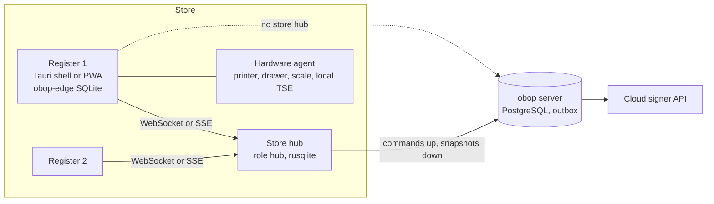
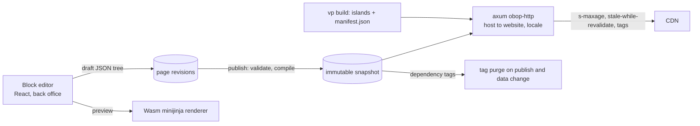

# Retail, commerce and marketing: POS, eCommerce, website builder, marketing suite

**Status:** Draft 0.1  

**Date:** 2026-10-01  

**Scope:** Point of sale, eCommerce, website builder and the marketing suite (email, SMS, loyalty, coupons, deliverability), with explicit dispositions for live chat, blog, forum, eLearning, events, surveys, social and automation.

Nothing here is legal advice. "Proposed (Dn)" marks reliance on a decision the owner has not ratified (D2, D4, D5, D12, D13, D14, D16, D17, D20, D23, D25 and D26 are Proposed on this date); "[RPn]" marks a design choice that neither the research nor [DECISIONS.md](../DECISIONS.md) settles (see 9.2); "(target)" and "(estimate)" mark numbers that are not measurements. Names of events, permission groups, data classes, states and ports follow [CONVENTIONS.md](../CONVENTIONS.md), which wins on a name. Platform facts, as of 2026-10-01: Rust 1.98.1 and `vite-plus` 1.0.0 as Proposed pins (D23; Q10); Vite+ driven only through the `vp` CLI with pnpm as the only package manager (constraint F2); PostgreSQL 17 and 18, 18 as reference (D8) [R00 s3].

## 1. Purpose and scope

### 1.1 What this area is

Four customer-facing surfaces on the shared data model: the store counter (POS), the online shop (eCommerce), the public web presence (website builder) and audience communication (email, SMS, loyalty, coupons). They reuse `product`, `pricing`, `tax`, `payment`, `stock`, `portal` and `mail` rather than owning parallel copies, which is the reason to build them inside one platform [R01 s2; R23 D.2].

Users are store staff, merchandisers, fulfilment staff, website editors, marketers and owners; outside the business, shoppers and recipients. Odoo is the functional reference; its Enterprise-only behaviour (marketing automation, social, WhatsApp, referrals, marketplace connectors, several fiscal POS modules) is specified from public documentation and our own design, never from Enterprise code (constraint F3; [R12 s2]).

### 1.2 Boundaries with neighbouring areas

| Neighbour | Owns | Contract with this area |
|---|---|---|
| [Finance](./finance.md) | `account`, `tax`, `invoicing`, `payment`, `edi`, `l10n` | POS and eCommerce post only through `PostingPort` (by account role, or the explicit account of its resolution order; see 4.1) and `InvoiceableSource`; payments use `PaymentProvider`; VAT returns and OSS filing stay in Finance |
| [Sales and CRM](./sales-crm.md) | `product`, `pricing`, `sales`, `crm`, `portal`, `subscriptions` | Shop orders are sales orders; the pricing crate is shared by POS, cart and quotes; forms create leads |
| [Supply chain](./supply-chain.md) | `stock`, `delivery`, barcode | Availability, reservation, carriers; POS raises consolidated demand via `DemandPort` |
| [Platform](./platform.md) | `base`, `mail`, `automation`, search | Chatter, mail gateway, automation rules, external ids, consent capability |
| [Services](./services.md) | `helpdesk`, `appointments` | Chat hand-off to tickets; restaurant bookings |
| [UX](./ux.md), [AI](./ai.md), [Integrations](./integrations.md), [Security and privacy](./security-privacy.md) | Design system, agents, connector tiers, identity and audit | Referenced, not restated |

### 1.3 Modules, tiers, waves, open/paid

Tier and wave follow DECISIONS section 5 (Proposed D25, D26); open/paid follows section 6 (Proposed D2). Country-pack detail is in [LOCALIZATION.md](../LOCALIZATION.md).

| Module or app | Content | Tier | Wave | Open/paid |
|---|---|---|---|---|
| `obop-edge`, `hub` role, hardware agent | SQLite edge store, store hub, native hardware bridge | T0 | W3 | Open |
| `pos` (retail) | Sessions, orders, cash control, fiscal adapters (DE TSE via cloud signer per D25; a hardware `LocalDevice` TSE is added here because a cloud signer cannot work offline, Proposed [RP8]), terminals | T2 | W3 | Open; fiscal-signer contracts belong to the merchant; operated Assurance is paid |
| `pos_stock`, `pos_account` (bridges) | Consolidated transfer at session close via `DemandPort`; session entry via `PostingPort`; both specified from [R23 D.4] | T2 | W3 | Open |
| `pos` restaurant mode | Floors, tables, courses, kitchen display, split bills, QR self-order | T2 | W3 end or W4 [RP1] | Open |
| `loyalty` | Coupons, gift cards, points, eWallet, promotions (shared by POS, web, sales) | T2 (with `ecommerce`) | W3 | Open |
| `website` with block page builder | Block pages, themes, forms, multi-website, multilingual | T2 | W3 | Open; partner white-label is paid |
| `ecommerce` | Catalogue, cart, checkout, returns, SEO, headless API; channel-sync framework [RP2] | T2 | W3 | Open |
| Channel connectors | Shopify, WooCommerce as X3 or X4 packages [RP2] | T2 | W4 (D25) | Open; Amazon, Shopee, Lazada, TikTok, Gelato, eBay, Etsy are T3 (community; unlisted means T3) |
| `marketing` | Email and SMS marketing, lists, segments, tracking | T2 | W3 | Open; a hosted relay and hosted SMS credits would be paid convenience, listed in DECISIONS section 6 only as a Proposed addition to D2's closed paid list (Q3, Q19) [RP19] |
| Deliverability core (in `mail`) | Sending domains, DKIM, DNS checker, bounce and complaint handling, suppression | T0 | W1 for the core, W3 for bulk features [RP3] | Open |
| `livechat` | Website chat, operators, chatbot scripts | T2 | W3 | Open |
| Marketing automation, social, marketing card, referrals, events, surveys, blog, forum, eLearning | See 4.6 | T3 | W4+ or community | Open |
| WhatsApp | Messaging connector | T2 | W4, X3 or X4 package | Open |

Supplied by other specs: `product`, `pricing`, `tax`, `payment`, `portal`, `mail`, `automation`, `stock` (W1); `discuss` channels (W2); `delivery` (T1), `helpdesk`, `appointments`, `subscriptions` (T2) (W3).

### 1.4 Wave statement

None of POS, eCommerce, website builder or marketing is in the first delivery (W1) or the first stable release: R20 keeps POS, eCommerce, manufacturing, payroll and multi-country tax out of the MVP, and Proposed (D4) repeats it for POS, payroll, manufacturing and multi-country tax [R20 s9]. They sit in W3 (2028-07-01 to 2029-06-30), "T2 apps in demand order (`mrp`, `pos` first)", each needing a design partner, and W3 breadth is paced by ARR, not the calendar (Proposed D5, D26). Dates here are windows, not promises.

W0 to W2 must still do five things so W3 is not a rewrite [RP25]:

1. Keep `pricing`, tax, rounding and promotion logic pure Rust with no SQL, compilable to Wasm (D37; [R12 MUST 5]); [ARCHITECTURE](../ARCHITECTURE.md) proposes the crate name `obop-calc`.
2. Carry a unique `command_id` on every mutating command (D9) and key the API on `Idempotency-Key` (D31).
3. Ship the deliverability core, DKIM and bounce handling in `mail` in W1.
4. Ship the theme pipeline (DTCG tokens, portal theme packs) in W1 [R24 s11].
5. Define the `PaymentProvider` trait with transaction, token, refund, payout and dispute entities in W1 [R21 s6.1].

## 2. Personas and roles

Permission groups are seed data; every permission row declares a scope (`all`, `own`, `company`, `domain`) and default is deny (D10). A store is a `branch` (D28), so store-level scope is a `domain` on `branch_id`. The group names are registered in [CONVENTIONS.md](../CONVENTIONS.md) section 4.

| Persona | Jobs | Default permission groups |
|---|---|---|
| Cashier | Sell, take payment, print, open the drawer | `pos.cashier` (scope `own`: own session) |
| Shift supervisor, store manager | Approve overrides, refunds, voids; open and close sessions, cash movements, exceptions queue | `pos.supervisor`, `pos.manager` (scope `domain` on `branch_id`) |
| POS administrator | Registers, payment methods, fiscal profile, hardware | `pos.admin` (scope `company`) |
| Merchandiser | Publish products, categories, prices, promotions | `ecommerce.merchandiser`, `loyalty.manager` |
| Fulfilment clerk, shop manager | Pick, pack, label, returns; channels, payments, delivery, discounts, reports | `ecommerce.fulfillment`; `ecommerce.manager` |
| Website editor, publisher | Draft and preview; publish, unpublish, roll back | `website.editor`; `website.publisher` |
| Website designer, administrator | Themes, code and tag blocks; domains, tracking, redirects, consent texts | `website.designer`; `website.admin` |
| Marketer | Compose, send to lists | `marketing.user`, `marketing.manager` (schedule, segments, imports) |
| Deliverability administrator, chat operator | Sending domains, keys, transports, thresholds; answer chats | `marketing.deliverability_admin`; `livechat.operator` |
| Shopper, recipient | Buy, return, subscribe | Guest with capability token, portal principal; never a permission group |
| AI agent | Draft copy, mailings, product text | A principal; permissions are the intersection of user and token scopes, drafts only, no send, publish, refund or payment without approval (D18) |

## 3. Capability map

Odoo parity values: matches Odoo Community, matches Odoo Enterprise (both words always mean Odoo's editions; obop has one open edition and `ee`), beyond, deliberately skipped. Waves are W3 unless stated.

| Capability | Description | Wave | Odoo parity |
|---|---|---|---|
| Offline POS order capture | Edge store, edge command outbox, idempotent sync | W3 | Matches Community (client UUID, IndexedDB); append-only ledger beyond |
| Store hub, hardware agent | LAN authority for registers and kitchens; printers, drawer, scale, serial fiscal devices without a paid box | W3 | Beyond (Odoo's production IoT box needs a subscription) |
| Fiscal adapter trait | `LocalDevice`, `CloudSigner`, `ChainedSoftware`; DE first | W3 | Matches Enterprise (inferred: fiscal POS modules absent from the Community tree) |
| Terminals, cash control | `TerminalDriver` (Stripe, Adyen first); float, movements, session entry | W3 | Matches Community |
| Restaurant mode | Floors, tables, courses, KDS, split, tips, QR order | W3 end or W4 | Matches Community; LAN resilience beyond |
| Loyalty engine | Coupons, gift cards, points, eWallet, promotions on one schema | W3 | Matches Community; ledger and explain trace beyond |
| Catalogue, cart, checkout, payments | Variants, categories, guest checkout, abandoned cart, hosted payment fields | W3 | Matches Community |
| Shipping, tax, SEO | Rules, pickup, carrier labels; destination VAT, tax display per pricelist; sitemap, structured data, Merchant feed | W3 | Carrier modules absent from Odoo 20's public tree (inferred Enterprise) [R10 s1]; rest matches Community |
| Returns and withdrawal | Portal return request, consumer withdrawal function | W3 | Matches Community (Odoo 20 return requests) |
| Channel sync | Orders in; stock, price, tracking out; Shopify and WooCommerce packages in W4 | W3 framework, W4 connectors | Matches Enterprise for Amazon (a T3 community package here); Shopify beyond |
| Headless storefront | Versioned OpenAPI projection, typed client; reference React storefront in W4 | W3, W4 | Beyond |
| Block page builder, themes | JSON blocks, immutable snapshots, islands; DTCG-token theme packages | W3 | Matches Community in concept; versioning and tokens beyond |
| Multi-website, multilingual, forms | Host routing, locale routes, redirects, CRM leads | W3 | Matches Community |
| Website import, AI assistant | Pull pages from an existing site; BYOK drafting | W4 | Matches Odoo 20 docs; AI without credits beyond |
| Email and SMS marketing | Lists, segments, composer, tracking; `SmsProvider`, BYO Twilio first | W3 | Matches Community; no credit wall beyond |
| Deliverability subsystem | DKIM, SPF/DMARC checks, one-click unsubscribe, bounces, suppression, warm-up | W1 core, W3 bulk | Beyond |
| Live chat | Widget, operators, chatbot scripts | W3 | Matches Community |
| Marketing automation, social | Journeys; multi-network posting | W4+ | Matches Enterprise |
| Events, surveys, blog, forum, eLearning, marketing card, referrals | Long tail | W4+ or community | Community, except referrals (Enterprise) |

## 4. Per-app specification

Reference versions, observed on 2026-10-01 and not yet pinned (pins follow D23) [R12 s1; R15; R23]: Tauri 2.12.1, `rusqlite` 0.40.2, `lettre` 0.11.23, `mail-auth` 0.13.3, `mrml` 6.0.1, `minijinja` 2.24.0, `escpos` 0.20.0, `async-stripe` 0.41.0 (1.0.0-rc.9 exists), Shopify Admin API `2026-07`.

### 4.1 Point of sale (`pos`, `obop-edge`, store hub, hardware agent)

**Purpose.** Retail counters that keep selling without internet. Every sale is an immutable fact; stock, accounting, loyalty and invoices are derived from it.

**First release (W3, retail).** Sessions and cash control; sales, refunds, exchanges; cash, other, customer-account, terminal, gift-card and loyalty tenders; pricelists, promotions, taxes and fiscal positions through the shared engine; discount limits and supervisor overrides; barcode and weighed items; receipts (thermal, email, PDF via Typst, Proposed D20); drawer, customer display; quick customer capture; invoice request; store hub for two or more registers; DE fiscal via `CloudSigner` or hardware `LocalDevice`; X and session reports; consolidated stock and accounting at close.

**Later.** Restaurant mode (below); FR `ChainedSoftware`; ES, IT and BE adapters with their W4 packs (L2 partners, D25); AT RKSV through a cloud signer with the AT pack (W3, L2, [LOCALIZATION.md](../LOCALIZATION.md)); cash machines; electronic shelf labels; multi-currency checkout; delivery-platform integrations; POS without `stock` (Odoo 20 direction [R01 s2.1]).

**Topology** (D37, binding; offline scope is Proposed D13; Tauri 2 shell plus Rust agent is baseline for sites with hardware, PWA for no-hardware use, sqlite-wasm with `opfs-sahpool` in a SharedWorker for browser-only). iPad Safari has no WebUSB, Web Serial, WebHID or Web Bluetooth and is a poor offline host [R12 s3.4].



**Edge store [RP5].** At most 15 tables, fixed schema, `PRAGMA user_version`, never a projection of the server schema (D37): `device`, `snapshot_meta`, `snapshot_row` (kind, id, JSON for catalogue, price rules, taxes, customers, floor layout, programs), `loyalty_balance`, `order`, `order_line`, `order_payment`, `course_ticket`, `receipt`, `cash_movement`, `fiscal_record`, `print_queue`, `command_outbox`, `inbox_ack`, `event_log`.

**Entities (server side).**

| Entity | Purpose | Key fields | States |
|---|---|---|---|
| `pos_config` | A register | branch, pricelist, payment methods, fiscal profile, hardware, offline policy | active, archived |
| `pos_device` | Enrolled shell or store hub | UUIDv7 id, public key, highest `device_seq`, config | registered, revoked |
| `pos_session` | Cash period | config, cashier, opening float (minor units), counted cash, difference | open, closing_control, closed |
| `pos_command_inbox` | Idempotency of edge commands | `command_id` and `(device_id, device_seq)` unique, kind, digest | applied, duplicate, quarantined, rejected |
| `pos_order` | A sale or refund | client UUIDv7 id, session, device, receipt number, totals (`bigint`), tax breakdown, refund-of | paid, cancelled; derived refunded_partial, refunded |
| `pos_order_line` | Line | product, qty, unit price, discount, taxes, promotion trace | immutable once paid |
| `pos_payment` | Tender | method, amount, tendered and change, terminal reference | captured, refunded |
| `pos_cash_movement` | Float, in, out | reason, actor, approver | recorded |
| `pos_fiscal_record` | Signature evidence | archetype, counter, signature, signer time | pending, signed, failed |
| `pos_receipt` | Printed document | number per register, kind (sale, refund, copy), print count | issued |
| `pos_exception` | Reconciliation queue | type (totals_mismatch, late_session, negative_stock, unknown_product, loyalty_overdraft, sequence_gap) | open, resolved, waived |

**State machines.** Session: `open` to `closing_control` to `closed`; the close is one transaction that posts the session entry, so a locked period leaves the session in `closing_control` (R23 D.4). Order: edge `draft` (never stored on the server) to `paid` (fiscal record present where the profile demands one) or `cancelled`. Paid rows are immutable (DB trigger, D30); corrections are refund orders referencing original lines.

**Offline contract** (published in the product, as Odoo documents its limits [R12 s3.1]):

| Function | Offline behaviour |
|---|---|
| Catalogue, prices, promotions, taxes, rounding | Works from the versioned snapshot; the UI shows snapshot age |
| Cash and other tenders, change, drawer | Works |
| Printing, scales, scanners, customer display | Works on local network or USB through the agent |
| Fiscal signing | `LocalDevice` and `ChainedSoftware` work; `CloudSigner` fails closed [RP8] |
| Card payment | Blocked for cloud-driven readers (Stripe server-driven does not support offline collection [R12 s3.2]); allowed only where the `TerminalDriver` declares `offline_capable` |
| Loyalty and gift cards | Redeem against the cached balance per program `offline_policy` (`deny`, `allow_up_to_snapshot`, `allow_capped`) [RP11]; issuing gift cards is online only |
| New customer | Queued as `CaptureParty`, de-duplicated by email on sync [RP26] |
| Invoice request | Queued; legal number assigned at posting after sync (D30) |
| Live stock, online orders | Unavailable; last stock shown with its age |
| Refund of an unknown or remote order | Blocked until online |

The unsynced count is always visible and the shell refuses to clear storage with unsynced orders. Offline limits (duration, unsynced orders) are per-register settings; defaults come from the pilot (open question 11).

**Sync protocol.**

1. Every command carries `command_id` (UUIDv7) and a gapless per-device `device_seq`; the server enforces both unique keys (D9; [R12 MUST 1]).
2. The server replays commands through normal domain services and answers each with applied, duplicate, quarantined or rejected (shape or permission only).
3. A completed, paid, signed sale is a fact. Business-rule failures (closed session, negative stock, unknown product) are quarantined into `pos_exception`, not rejected; the server verifies totals and raises `totals_mismatch` on any difference, but posted amounts follow the signed receipt [RP6].
4. Catalogue, price and customer deltas use the commit-safe feed resuming from `(xid8, event_id)` below the snapshot xmin (D7; [R22 s7.2]).
5. Device clocks are untrusted; the server stamps receipt time, and a signer's clock is authoritative for signed receipts.
6. Receipt numbers are gapless per register (`REG01-000041`); a missing number raises `sequence_gap` and is never renumbered [RP7]. Legal invoice numbers are assigned at posting, not at the counter.
7. Orders have one owner at a time (register or store hub); transfer is a command. No CRDTs for orders (R12 s3.2). Sync-engine products (PowerSync, Electric, Zero) are not used (Proposed D13; [R22 s7.2]).
8. The command and snapshot schema (`pos-api`) is a public contract with the 24-month deprecation floor (Proposed D16) so a register that missed an update still syncs [RP22].

**Main workflow (sale).**

1. Cashier signs in (PIN verified against a per-device salted hash snapshot; lockout after repeated failures [RP26]) and opens a session with a counted float.
2. Lines are added by scan, search or quick keys; the engine prices, applies promotions and taxes, with an explain trace on request.
3. Overrides above a limit need a supervisor PIN and are audit events.
4. Tender: cash, terminal (`TerminalDriver`: Stripe server-driven and JS SDK, Adyen cloud and LAN NEXO first, then Mollie, Viva.com, SumUp-class [R12 SHOULD 12]), gift card or points.
5. `FiscalAdapter::finish` signs; the record is stored; the order becomes `paid`.
6. Receipt prints, the drawer opens, the command enters the edge command outbox and syncs.
7. Close: count cash, record difference, `ClosePosSession` posts the session entry and raises consolidated demand.

**Fiscal adapter trait** (illustrative, lives in `pos-api`; async ports use boxed futures per D27):

```rust
pub trait FiscalAdapter: Send + Sync {
    fn archetype(&self) -> FiscalArchetype;        // LocalDevice, CloudSigner, ChainedSoftware
    fn capabilities(&self) -> FiscalCapabilities;  // offline_capable, forbidden_features, needs_registration
    fn begin(&self, ctx: &RegisterCtx, order: &OrderDraft) -> BoxFuture<'_, Result<FiscalTx, FiscalError>>;
    fn finish(&self, tx: FiscalTx, order: &PaidOrder) -> BoxFuture<'_, Result<FiscalRecord, FiscalError>>;
    fn cancel(&self, tx: FiscalTx) -> BoxFuture<'_, Result<(), FiscalError>>;
    fn export(&self, period: Period) -> BoxFuture<'_, Result<ExportArtifact, FiscalError>>; // e.g. DSFinV-K
}
```

`forbidden_features` lets a certified profile restrict the register the way Belgium's FDM mode disables global discounts, loyalty, reprints and price edits [R12 s3.6]. Receipts reprinted are marked as copies.

**Hardware** [R12 s3.3-3.4]. Printers: ESC/POS over TCP 9100, USB or serial (`escpos` 0.20.0), Epson ePOS, Star CloudPRNT. Drawer: kick pulse through the printer. Scanners: USB HID keyboard wedge first. Scales: serial (`serialport`) or USB (`nusb`); legal-for-trade settings per country. Customer display: second window. Fiscal devices: serial bridge in the agent. Browser-only sites with LAN printers meet Chrome 142's Local Network Access prompt.

**Automatic flows.**

| Event | Kind | Emitted by, consumed by | Effect |
|---|---|---|---|
| `PosOrderPaid`, `PosOrderRefunded` | TxEvent | `pos`, consumed by `loyalty`, `pos_stock` | Earn, redeem, reverse; `pos_stock` records a pending quantity that lowers online availability until the consolidated transfer at close [RP10] |
| `PosInvoiceRequested` | Durable | `pos` (a Proposed `InvoiceableSource` implementer, D27 note), consumed by `invoicing` via `InvoiceableSource` | Draft invoice, numbered on posting |
| `PosSessionClosed` | TxEvent | `pos`, consumed by `pos_stock`, `pos_account` | One consolidated transfer via `DemandPort`; session entry via `PostingPort`: revenue lines resolve through the product or category profile and the fiscal position, tax lines through the repartition lines' account roles, gift-card sales to `gift_card_liability`, and the cash, per-method clearing, cash difference and tips lines carry the chart accounts set on the register as the explicit account of [Finance](./finance.md) 4.1.2 rule 4; POS registers no account roles of its own |
| `PosExceptionRaised` | Durable | `pos`, consumed by notifications | Manager inbox item |
| `ProductChanged`, `PriceRuleChanged`, `TaxRuleChanged` (Proposed, emitted by `tax`; listed in [Finance](./finance.md) 4.4 and 4.15; open question 17), `PartyUpdated`, `LoyaltyCardChanged` (`loyalty`, added to its emitted list) | Durable | Owning modules, consumed by `pos` | Snapshot deltas |
| `TransferDone`, `InvoicePosted` | Durable | `stock`, `invoicing`, consumed by `pos` | Stock display; attach invoice to order |

**Permissions and sensitive data.** Sensitive actions need `pos.supervisor` or higher: price override, discount above limit, void, refund without receipt, no-sale drawer open, cash movement, session reopen, manual card adjustment. Card data is never held; only PSP tokens (PCI scoping; [R18 s8.2]). Edge stores hold PIN hashes and a customer cache, encrypted at rest with the OS keystore in Tauri; PWA mode can disable the customer cache [RP26]. Personal-data flags drive erasure (D33). Every override, void, refund and drawer event is an audit entry.

**Reports.** X and session reports (Z-style); sales by product, category, cashier, hour, branch; tenders; discounts, overrides, refunds, voids; cash variance; exceptions; DSFinV-K export (DE). Measures are declared in the semantic layer [R23 B.3].

**Configuration.** Per register: pricelist, fiscal profile, payment methods with their cash, clearing, difference and tips accounts, receipt layout (minijinja to ESC/POS; Typst for PDF, Proposed D20), offline policy and limits, hardware mapping, cash rounding, tips.

**Localization and compliance.** Germany first (Proposed D4, D25): certified TSE, hardware or cloud, per KassenSichV; registration with the tax authority within one month; DSFinV-K export; fines up to EUR 25,000 under section 379(6) AO for distributing non-compliant systems; the cloud-signer route uses a fiskaly-class service [R25 A6, B4; R12 s3.6]. France second: NF525 needs a certificate or publisher attestation (counsel decides); LNE handed issuance to BYCYB, price and lead time unknown [R25 B4]. Spain's Veri*Factu is producer self-declaration with EUR 150,000 per year per system type exposure [R25 B4]. BE FDM and IT RT printers follow their partner-led W4 packs; AT RKSV follows the AT pack (W3, cloud signer); the Polish POS regime is not researched (unverified [R12 s3.6]) and unscheduled. Counsel precedes any conformance claim [R25 MUST 6]. The POS front end meets WCAG 2.2 AA (D38) with 48 px touch targets [R19 s10].

**Open vs paid.** Open, including the hardware agent and fiscal traits. Paid only as operation and assurance: the per-country Assurance service and hosted gateways where they apply (Proposed D2, D17).

#### 4.1.1 Restaurant mode (later) [RP1]

Floors and tables with occupancy; courses with manual or automatic allocation and fire; merge, transfer, split by item or equal shares; tips including after payment; routing by category to printers and kitchen displays with stages and alert timers; QR and kiosk self-order with pay-after-meal; bookings through `appointments`. The store hub owns open-table state, so tablets and kitchen screens survive internet loss (an upgrade over Odoo's per-browser model [R12 s3.2]); a table is leased to one device at a time. Entities: `pos_floor`, `pos_table`, `pos_course`, `pos_prep_ticket` (new, preparing, ready, served, cancelled), `pos_prep_display`. The 15-table edge cap is tight; a design needing more requires amending D37 (open question 1).

### 4.2 Loyalty, coupons and gift cards (`loyalty`)

**Purpose.** One schema and one pure-Rust engine for POS, web and sales, compiled native and to Wasm [R12 MUST 5, SHOULD 14].

**First release.** Eight program types as data: coupons, gift cards, loyalty points, promotions, eWallet, promo codes, buy-X-get-Y, next-order coupons; rewards as discount, free product or free shipping with a points cost; expiry.

| Entity | Purpose | Key fields | States |
|---|---|---|---|
| `loyalty_program` | Behaviour | type, scopes (pos, web, sales), validity, currency, stack policy, `offline_policy` | draft, active, closed |
| `loyalty_rule` | Earn condition | domain, points per currency unit, per item or fixed, minimum | active |
| `loyalty_reward` | Benefit | kind, cost, discount type, cap, product scope | active |
| `loyalty_card` | Instrument | code, party, program, expiry | active, exhausted, expired, voided, blocked |
| `loyalty_ledger_entry` | Append-only truth | card, delta (`bigint` points or minor units), kind (earn, spend, expire, adjust, issue, void), source reference | immutable |

The engine is `apply(programs, order_snapshot, cards) -> Applied{lines, rewards, explain}`; deterministic; property-tested (total never negative, idempotent, stable under reordering within a stacking class). Balance is a rollup row updated in the transaction; redemption is an atomic conditional update (`WHERE balance >= n`), the same pattern as stock reservation [R22 s6]. Unique promo-code use is a unique constraint; discount stacking is bounded by DB checks [R18 s10].

**Flows.** Emits `LoyaltyPointsEarned`, `LoyaltyRewardRedeemed`, `GiftCardIssued`, `LoyaltyOverdraftRecorded`, `LoyaltyCardChanged` (balance or state change; feeds edge snapshot deltas). Consumes `PosOrderPaid`, `PosOrderRefunded`, `SaleOrderConfirmed`, `InvoiceReversed`.

**Accounting [RP11].** Gift-card sales post to the `gift_card_liability` account role (Proposed in [Finance](./finance.md) 4.1.1), redemption releases it; points create no entries in the first release and the reward is a price reduction at redemption. Deferred-revenue and multi-purpose voucher treatment is not researched (open question 9).

**Permissions.** `loyalty.manager` creates programs; manual adjustments and gift-card issuance are audited and need approval above a configured amount. **Reports.** Issued, redeemed, expired, liability outstanding, overdrafts. **Configuration.** Programs per scope, stacking order, expiry, offline policy. **Localization.** Gift-card and voucher tax treatment, expiry limits and unclaimed-balance rules differ by country and are not researched (open question 9); messages and receipts render in the customer's language. **Open vs paid.** Open.

### 4.3 eCommerce (`ecommerce`, channel sync, headless API)

**Purpose.** A Rust-served shop on the same catalogue, pricing, stock and ledger as the back office, with no copy of the data.

**First release (W3).** Published catalogue (public categories, ribbons, variants in the always, dynamic and never modes with an explosion guard, combos, optional products as lines [R11 s3, s6.1]); pricelists per website, country, currency and customer group; guest or account checkout with configurable steps and extra fields; typed addresses; delivery methods (rules, pickup points, click and collect, carriers via `CarrierProvider`); destination fiscal positions; promo codes and gift cards; hosted payment fields or redirect; portal history and invoices; returns and the withdrawal function; stock policy, notifications, auto-unpublish; abandoned-cart email; SEO; Merchant feed; reviews; wishlist; B2B basics (tax-excluded display per pricelist, minimum quantity).

**Later.** Shopify and WooCommerce connectors (W4), reference headless storefront (W4), donations, subscription selling (needs `subscriptions`), WhatsApp cart follow-up (W4 package), AI product copy (BYOK, drafts).

| Entity | Purpose | Key fields | States |
|---|---|---|---|
| `website_product` | Publication of a product on a website | product, website, categories, ribbon, SEO per locale, stock policy, minimum quantity | published, unpublished |
| `cart` | Extension row, one per `sale_order` with `order_kind = cart` [RP9]; the kernel lifecycle stays on the order | website, token, pricelist, lines, TTL | open, checkout, pending_payment, abandoned, expired, converted |
| `sales_channel` | External shop or marketplace | kind, `connection` (credentials, state, limiter, API version pin), mapping policy, stock allocation | none of its own; the linked `connection` state (draft, connected, needs_reauth, paused, disconnected; [Integrations](./integrations.md) 4.5) |
| `sales_channel_product_map`, `sales_channel_party_map` | External id to local record | sales channel, external id, local id | active |
| `sales_channel_event_inbox` | Deduplicated inbound events | sales channel, provider event id unique, raw body digest | received, applied, failed |
| `return_request` | Return or withdrawal | order, lines, reason, type (return, withdrawal) | requested, approved, declined, received, refunded |
| `checkout_step`, `checkout_extra_field`, `product_feed` | Flow and feed configuration | order, required, visibility expression (CEL, Proposed D12), locale filters | active |

**Cart as sales order [RP9].** A cart is a draft `sale_order` with `order_kind = cart`, no number until confirm (header pattern, R23 B.2), hidden from the Sales list by a restriction row, with TTL purge for anonymous carts; this reuses pricing, tax, promotions and shipping. [Sales and CRM](./sales-crm.md) accepts it on three conditions, which this spec adopts: the restriction row, no `number` or `quote_status` on carts, and confirmation through the same `ConfirmSaleOrder` command. Guests hold a capability token (`share_grant`, R23 B.1), never an id.

**Workflow (web order).**

1. Shopper browses cached pages; price and availability come from fragments keyed by website, locale and pricelist; the cart is an uncached island.
2. Add to cart calls `PricingPort::price`; checkout computes delivery rate, tax (fiscal position by destination) and promotions.
3. The final button is labelled as an order with obligation to pay; a payment session is created with an `Idempotency-Key`.
4. The shopper pays at the PSP; the redirect return and the webhook race. Confirmation is idempotent on `(order, transaction)`; the handler fetches current provider state rather than trusting payload state [R21 s4].
5. `SaleOrderConfirmed` reserves stock through `DemandPort` (no cart-time reservation).
6. Fulfilment creates a label through `CarrierProvider`; `TransferDone`, `ShipmentTrackingUpdated` and `ShipmentDelivered` notify the shopper.
7. Invoicing follows the product policy; `PaymentReconciled` updates payment state.
8. Returns and withdrawals open a `return_request`; approval creates a return transfer and a credit note.

**Channel sync.** Scope equals Odoo's first scope: orders in; available quantity, price and tracking out; no listing push [R12 s4.4]. The W3 framework [RP2] builds on the `connection` (credentials, state, limiter) and the inbound-event pipeline of [Integrations](./integrations.md), which are not restated here, and provides: a token vault per connection (encrypted, single-flight refresh); an importer writing `sale_order` with `ecommerce__sales_channel_id` and `ecommerce__external_order_id`, unique on the pair; pushers that coalesce stock changes and respect rate limits; webhook receivers with raw-body signature checks and an inbox table; a scheduled reconciliation sweep, because webhooks are at-least-once, unordered and can be lost [R21 s4]; the API version stored per connection with CI contract tests; a "field unavailable" model for withheld buyer data; channel settlement posted to a clearing account (Finance). Connectors are X3 (Wasm `connector` world with allow-listed egress) or X4 (remote app) packages (D11). Research order [R12 SHOULD 13]: Shopify (GraphQL Admin, `2026-07` pinned, REST Admin is legacy), WooCommerce (REST v3, batch endpoints), Amazon SP-API (never Orders v0, removed 2027-03-27), Etsy (manual approval lead time), eBay after verification [R12 s4.4; R21 s6.3]. D25 schedules only the first two (W4); Amazon, Etsy and eBay connectors are T3 community packages, later (unlisted means T3).

**Headless API.** The storefront API is a public-scoped projection of the registry (D31): cacheable catalogue reads, cart actions under a capability token, checkout actions with `Idempotency-Key`, order webhooks (Standard Webhooks), per-business OpenAPI including custom fields, generated typed client. Agentic-commerce protocols are a COULD [R21 s3]. Bot defence must satisfy WCAG 3.3.8 (no puzzle-only CAPTCHA) [RP27].

**Automatic flows.**

| Event | Kind | Emitted by, consumed by | Effect |
|---|---|---|---|
| `CartCheckoutStarted`, `CartAbandoned` | Durable | `ecommerce`, consumed by `marketing`, `automation` | Recovery email after the configured delay |
| `SaleOrderConfirmed` | TxEvent | `sales`, consumed by `sale_stock`, `ecommerce`, `loyalty`, `crm` | Reserve, convert cart, earn, mark opportunity |
| `PaymentTransactionDone`, `PaymentReconciled` | Durable | `payment`, consumed by `ecommerce`, `sales` | Confirm order, optional auto-invoice |
| `StockLevelChanged`, `TransferDone` | Durable | `stock`, consumed by `ecommerce`, channel pushers | Availability, unpublish, push |
| `ShipmentTrackingUpdated`, `ShipmentDelivered` | Durable | `delivery` ([Supply chain](./supply-chain.md) 4.9), consumed by `ecommerce`, channel pushers | Shopper notice and order tracking; tracking out to the channel |
| `ReturnRequested`, `WithdrawalRequested` | Durable | `ecommerce`, consumed by `stock`, `invoicing` | Return transfer, credit note |
| `ChannelOrderImported`, `ChannelSyncFailed` | Durable | channel framework, consumed by `sales`, notifications | Import, alert |

**Permissions and sensitive data.** Guests reach an order by capability token only, portal users by principal; an IDOR matrix is generated from the registry (D36). Stored: addresses, order history, PSP token references, never card data. **Reports.** Sales by channel, website, category, pricelist; consent-gated funnel; abandoned-cart recovery; stock-outs; payment success by provider; returns; channel lag and drift. **Configuration.** Websites, pricelists, delivery and payment per country and amount, steps, stock policy, tax display, cart TTL, abandoned delay, feeds.

**Localization and compliance.** EAA: the default storefront and checkout meet WCAG 2.2 AA and an accessibility-statement template ships; service microenterprises are exempt (Art. 4(5)) [R28 E.5]. The consumer withdrawal function (Directive 2023/2673, Art. 11a) applies from 2026-06-19 and ships in the default checkout and portal (D38). Omnibus prior-price and review rules, the 14-day withdrawal period and GDPR/ePrivacy consent shape checkout defaults; counsel reviews them [R28 E.7]. PCI DSS v4.0.1: hosted fields or redirect only; checkout pages use a locked script allow-list and CSP because editors can add scripts (PCI SSC FAQ 1588 names requirements 6.4.3 and 11.6.1) [R12 s4.3]. VAT: destination fiscal positions and the EUR 10,000 OSS threshold; the OSS return is a Finance export; ViDA platform rules apply 2028-07-01, postponable to 2030-01-01 [R09 s3; R12 s4.3].

**Open vs paid.** Open. Paid: hosting, support, Assurance (D2).

### 4.4 Website builder (`website`)

**Purpose.** Editors build pages from blocks; the server renders them in Rust; interactivity ships as small Vite-built islands; no Node runs in production (Proposed D14).



**First release.** Pages as versioned JSON block trees with slots and per-locale translation maps; a first-party block catalogue (hero, rich text, image and gallery, columns, product grid and card, cart island, form, accordion, menu, footer, video embed with consent gate, newsletter signup, tag block); themes as `theme` packages (DTCG 2025.10 tokens plus block templates, R24 s10); menus; redirects; forms into `crm` or `helpdesk`; multi-website by host; multilingual with locale-prefixed routes, canonical and hreflang; sitemaps; cookie and consent banner; first-party visitor analytics gated by consent; link tracker and UTM; custom domains with ACME and DNS-TXT proof.

**Later.** Website import (JSON-LD, Open Graph, Shopify, WooCommerce, PrestaShop as Odoo 20 does [R12 s2.3]); BYOK page assistant (W4); A/B tests.

| Entity | Purpose | Key fields | States |
|---|---|---|---|
| `website` | Site | domains, locales, theme, consent and tracking settings | active |
| `website_page` | Page per locale path | path, type, SEO, current snapshot | draft, in_review, scheduled, published, unpublished, archived |
| `page_revision` | Editor history | JSON tree, author, parent | immutable |
| `page_snapshot` | Published result | rendered content per locale, dependency tags, renderer and theme versions | immutable |
| `block_type` | Registry entry | schema, template, island entry, accessibility rules | active |
| `website_redirect`, `website_menu` | Routing and navigation | from, to, status code | active |
| `form_definition`, `form_submission` | Lead capture | fields, target, consent text version | active |
| `custom_domain` | TLS and routing | host, proof, certificate state | pending_dns, validating, active, failing |

**Publish pipeline.** Validate (schema, missing alt text, heading order, token contrast, link names, broken links, SEO fields); compile; store an immutable snapshot; swap the page pointer atomically; purge cache tags. Rollback repoints to a previous snapshot. Content in a snapshot is immutable; data-bound blocks (prices, availability) are rendered per website, locale and pricelist and tag-purged on `PriceRuleChanged` and `StockLevelChanged` [RP12]. Cache keys never include cookies; cart, account and checkout are never cached [R12 s7.3].

**Renderer and islands.** `minijinja` renders snapshots and is also built to Wasm so the editor preview uses the same renderer (Proposed D14). Islands are React components built by `vp build`; Rust injects preload, CSS and script tags from `manifest.json`, walking `imports` recursively [R12 s7.2]. The island and manifest build is `vp build` only. As D14 states, Astro, Leptos or Dioxus would each need an explicit owner waiver of the Vite+ rule (constraint F2), because none is part of Vite+ or driven by `vp`; none is used here, and the storefront question is Q14. A Node SSR sidecar is rejected.

**Editor [RP13].** In-house editor over the JSON schema; Puck (MIT, pre-1.0) and GrapesJS (BSD-3-Clause) are prior art only (inferred, not verified: the research gives their licence and state but not their rendering model, and this spec needs the editor to use the Wasm renderer). Every drag has a non-drag path ("Move to...", keyboard reorder), per WCAG 2.5.7.

**Scripts and code.** Custom HTML or JS blocks need `website.designer`; CSS is sanitised (no external `@import`, allow-listed `url()`); JS only as a reviewed trusted-theme script with CSP nonce and SRI, or as UI tier F2 or F3 (D11); none on checkout pages. The storefront lives on a different origin from the admin [R24 s10].

**Flows.** Emits `PagePublished`, `PageUnpublished`, `FormSubmitted` (consumed by `marketing`, `crm` and `helpdesk`), `CustomDomainActivated`. Banner and form consents are written through the `ConsentPort`; the consent ledger, not this module, emits `ConsentRecorded` ([Security and privacy](./security-privacy.md)). Consumes `ProductChanged`, `PriceRuleChanged`, `StockLevelChanged`, `PartyErased`; menu edits purge their own cache tags.

**Permissions.** Editors cannot publish; publishers cannot change code blocks; domain and tracking changes are audited. Visitor data is consent-gated personal data with retention classes.

**Reports.** Traffic (consent-gated), form conversion, field Core Web Vitals (external thresholds at p75: LCP 2.5 s, INP 200 ms, CLS 0.1 [R12 s5]), SEO audit, publish history. **Configuration.** Locales, hreflang, robots, sitemap, llms.txt toggle, banner texts, tag block, TTLs.

**Localization and compliance.** Logical CSS, RTL and CJK fixtures in CI (D34, D35); machine translation is a suggestion; privacy, terms and withdrawal page templates ship per country pack as starting points, not legal advice; WCAG 2.2 AA default theme (D38).

**Open vs paid.** Open, including themes, forms and the website or portal custom domain (section 6); partner white-label is paid.

### 4.5 Marketing suite (`marketing`): email, SMS, deliverability

**Purpose.** Reach consenting people with mail that authenticates, can be unsubscribed in one click, and protects the sender's reputation.

**First release (W3).** Lists and dynamic segments (Domain AST over parties and orders, Proposed D12); block composer rendered through MJML (`mrml`) to inlined HTML plus a text part; template library; personalisation in sandboxed `minijinja` with fuel and recursion limits (Proposed D20); scheduling; click tracking with UTM; unsubscribe and preference centre; SMS through `SmsProvider` (BYO Twilio first, as `sms_twilio` does [R12 s6.4]); abandoned-cart, welcome and review-request flows as template automations on `automation` [RP20].

**Later.** A/B subjects, journey builder (T3), social posting (T3), WhatsApp (W4 package), KumoMTA as an optional sending service.

| Entity | Purpose | Key fields | States |
|---|---|---|---|
| `mailing` | Email or SMS campaign | kind, blocks, sender identity, stream, audience, schedule, stats | draft, pending_approval, scheduled, sending, paused, done, cancelled |
| `mailing_list`, `mailing_subscription` | Membership | list, address or party, opt-out reason | subscribed, unsubscribed |
| `audience_segment` | Dynamic audience | Domain AST, refresh mode | active |
| `mailing_trace` | Recipient outcome | mailing, `address_hash` (unique with mailing), provider message id | outgoing, process, pending, sent, open, reply, bounce, error, cancel |
| `link_tracker`, `link_click` | Click tracking | target, campaign, source, medium | active |
| `sending_domain` | Identity; extends Platform's `mail_alias_domain` (which holds the DKIM selector and verification state) [RP3] | domain, DKIM selector, key reference, DNS status (SPF, DKIM, DMARC, reverse DNS), warm-up state | unverified, dns_pending, verified, warming, healthy, restricted |
| `email_suppression` | Never-send list; extends Platform's `mail_blocklist` (opt-outs and hard bounces) with scope and HMAC keys [RP3] | HMAC of normalised address, scope, reason, source | active |
| `consent_record` | Append-only consent ledger (owned by `base`, specified in Security and privacy) | subject, purpose, basis, source, text version, channel, time, evidence, kind (grant or withdrawal); marketing adds double opt-in state | written (immutable) |
| `bounce_event`, `complaint_event` | Feedback | class (hard, soft), DSN or ARF, mailing | immutable |
| `sms_message`, `sms_sender_registration` | SMS | provider id, segments, US 10DLC brand and campaign references | queued, sent, delivered, failed |

**Workflow (send).**

1. Compose and choose audience; preflight: sending domain verified and DNS passing, postal address present where the pack requires it, unsubscribe link in body, text part present, consent basis present for each recipient.
2. Agent-initiated sends and audiences above the configured size enter `pending_approval` under the approval policy (D18) [RP23].
3. Schedule; traces materialise in batches, unique on `(mailing, address_hash)`.
4. Send jobs (durable queue, `SKIP LOCKED` leases, D27) check suppression and consent at send time, not only at scheduling, and obey per-recipient-domain throttles and warm-up caps.
5. Provider events, DSNs and complaints update traces, suppression and metrics; a mailing moves to `paused` on threshold breach.
6. Reports attribute clicks and orders through UTM and order links.

#### 4.5.1 Deliverability subsystem [RP3]

Ownership: `mail` (W1) owns sending domains, DNS checks, bounce and complaint handling, suppression; `marketing` (W3) adds bulk features. [Platform](./platform.md) 4.7 already specifies, for W1, per-domain DKIM, VERP bounces, a sender-domain checker, `mail_alias_domain`, `mail_blocklist` and the `MailBounced` event; this section adds ARF complaint handling, warm-up, thresholds and bulk streams on top of them rather than parallel entities (open question 16). The consent ledger is the `consent_record` that [Security and privacy](./security-privacy.md) proposes in `base`, reached through a `ConsentPort` in `base-api` so POS sign-ups, checkout opt-ins, website forms and marketing write one ledger [RP4]; its fields already include basis and source, so marketing needs only one more, double opt-in state (open question 3).

| Requirement | Source | Design |
|---|---|---|
| SPF and DKIM for all senders; DKIM at least 1024-bit, 2048 recommended; DMARC with From alignment; TLS; valid reverse DNS | Google bulk-sender rules (5,000 per day) [R12 s6.1] | DKIM 2048 per business and sending domain, keys envelope-encrypted, signing with `mail-auth` 0.13.3; checker for SPF, DKIM, DMARC, PTR; full compliance applies to all marketing mail regardless of volume |
| One-click unsubscribe | RFC 8058; Google, Yahoo [R12 s6.1] | Every bulk message carries `List-Unsubscribe` with one HTTPS URI and `List-Unsubscribe-Post: List-Unsubscribe=One-Click`, both covered by the DKIM signature (RFC 8058 ss3.1, 4; https://www.rfc-editor.org/rfc/rfc8058); public POST endpoint with an HMAC token, idempotent, rate-limited; applied before the next send job; visible body link too |
| Processing time | Yahoo 2 days; CAN-SPAM 10 business days [R12 s6.1] | Immediate |
| DMARCbis | RFC 9989 (May 2026) obsoletes RFC 7489 [R12 s6.1] | Checker implements tree walk, `np` and `t`, no `pct`; whether `mail-auth` does is unverified (open question 10) |
| Microsoft | SPF, DKIM, DMARC above 5,000 per day to Outlook.com from 2025-05-05 [R12 s6.1] | Same bulk profile |
| Bounces and complaints | VERP, DSN, ARF [R12 s6.3; R15 s4] | Bounce subdomain return path, inbound through the mail gateway (bounce detection first); hard bounces suppress at once; soft bounces escalate after a configurable count; ARF complaints suppress and count |
| Spam rate | Below 0.10%, never 0.30% (Google); Yahoo under 0.3% [R12 s6.1] | Rolling rate per sending domain; warn at 0.10%, pause at 0.20% [RP17] |
| Warm-up and ramp | Google: ramp gradually [R12 s6.1] | Per-domain daily caps from a pack-shipped ramp table; excess stays `deferred` [RP18] |
| Streams | Deliverability practice | Transactional and bulk use separate identities so a campaign cannot damage invoice mail [RP14] |
| Consent | GDPR/ePrivacy standard practice, not re-verified [R12 s6.1]; purpose-scoped records [R18 s8.1] | Append-only ledger (a withdrawal is a new row); imports need an attestation and create records with source "import", with batch rollback (D35) |
| Suppression vs erasure | GDPR | Suppression keyed by an HMAC of the normalised address so an erased contact is not re-mailed if re-imported; whether keeping the hash is lawful after erasure is a counsel question (unverified) [RP15] |
| Opens unreliable | Image prefetching, unverified in R12 [R12 s6.3] | Click and conversion are primary; opens optional, off by default for EU businesses pending counsel [RP16] |

Transports: SMTP relay through `lettre` is the default; KumoMTA (Apache-2.0) is an optional sidecar (I-1, Proposed); the AGPL Stalwart server is never embedded (D39); user mailboxes through Gmail API or Graph serve 1:1 mail (D39), not bulk (their limits are not researched). The dashboard shows per domain: sent, delivered, bounces, complaints, unsubscribes, spam rate against thresholds, DNS health.

**SMS.** `SmsProvider` trait (send, status webhook, inbound, opt-out); BYO provider keys; no obop credit wall for them (D18 sets this for AI; extending it to SMS is this spec's choice, [RP19]); STOP keyword handled on inbound; replies go to chatter; US traffic needs A2P 10DLC brand and campaign registration (unregistered traffic incurs carrier fees) [R12 s6.1]; shortened links tracked; segment counting in the composer; the same consent ledger. TCPA and other national rules are unchecked [R12].

**Automatic flows.** Emits `MailingScheduled`, `MailingSent`, `EmailComplaintReceived`, `UnsubscribeReceived`, `SuppressionAdded`, `SendingDomainStatusChanged`. Consumes `MailBounced` (Platform; hard bounces add suppression), `CartAbandoned`, `SaleOrderConfirmed`, `FormSubmitted`, `ConsentWithdrawn`, `PartyErased`.

**Permissions and sensitive data.** Subscriber lists are personal data: export is restricted and audited; imports need `marketing.manager`; sending keys are visible only to `marketing.deliverability_admin`; agents draft, humans approve sends. **Reports.** Campaign performance, list growth and churn, consent coverage, suppression growth, deliverability, revenue attribution. **Configuration.** Streams, sender identities, postal address, thresholds, ramp table, tracking defaults, double opt-in per pack [RP16].

**Localization and compliance.** CAN-SPAM (10 business days, postal address, up to USD 53,088 per violating email); GDPR and ePrivacy consent and soft opt-in rules not re-verified; preference centre in the recipient's language; statutory texts never machine-translated (D34) [R12 s6.1].

**Open vs paid.** Open, with BYO relay and BYO SMS. Hosted sending relay, managed IP reputation and hosted SMS credits are operated convenience and would be paid; D2's list is closed, and DECISIONS section 6 adds them only as a Proposed addition, so they need ratification (Q3, Q19) [RP19].

### 4.6 Live chat and long-tail dispositions

**Live chat (`livechat`, T2, W3).** Website widget starts a conversation that is a chatter thread on a `discuss` channel; operator routing by availability; chatbot scripts are declarative X1 steps with CEL conditions (Proposed D12); hand-off creates a lead (`crm`) or ticket (`helpdesk`). AI live-chat agents are deliberately skipped through W3 and revisited in W4 ([AI](./ai.md) section 3). Entities `livechat_channel`, `livechat_conversation` (waiting, active, closed, abandoned), `chatbot_script`. Visitor identity is consent-gated; transcript retention follows policy; out of hours falls back to email.

| Item | Disposition | Tier, wave |
|---|---|---|
| Blog | `website` ships generic collection blocks (list and detail pages from a content model), so a blog is an X1 pack with scheduled publishing and RSS [RP21] | T3, W4+ or community |
| Forum | Community-maintained X1 plus X4 package; needs moderation and karma | T3 |
| eLearning | Community-maintained package; shares surveys and certificates; courses sell through `ecommerce` | T3 |
| Events | X1 pack: ticket products in `ecommerce` plus registrations; booths and tracks out | T3 |
| Surveys | The form block covers simple forms; scoring and certification are community-maintained | T3 |
| Marketing automation | Fixed flow templates on `automation` until a builder exists; Odoo Enterprise behaviour specified from public docs only | T3, W4+ |
| Social marketing | X4 remote apps; platform API terms gate it [R12 s6.4] | T3 |
| Marketing card, referrals, Amazon, Shopee, Lazada, TikTok, Gelato | Not planned first-party; community or partner packages | T3 |
| WhatsApp | X3 or X4 connector package | T2, W4 |

## 5. Cross-app golden paths

These double as acceptance tests. Money is EUR; prices are tax-included; rounding is `per_group`; keys follow D9.

**GP-1 Offline retail sale, local TSE, sync, close.**
- *Given* a DE retail business, register REG01 with a hardware TSE through the agent, last receipt `REG01-000040`, session S-1 opened with float 100.00, internet down.
- *When* order A (2 mugs at 12.90, 19%; 1 book at 18.00, 7%) is paid with 50.00 cash and order B (1 book) in cash; the internet returns and the shell is killed (`kill -9`) halfway through sync, then restarted.
- *Then* order A totals 43.80, change 6.20; the 19% group has net 21.68 and tax 4.12, the 7% group net 16.82 and tax 1.18; receipts are `REG01-000041` and `REG01-000042`, each with a signed fiscal record; the server holds exactly two orders and two `applied` inbox rows, no exception. Closing with counted cash 161.80 gives difference 0.00; the balanced session entry debits cash 61.80 and credits revenue 21.68 (19%) and 33.64 (7%) and tax 4.12 and 2.36, equal to the sum of persisted order amounts; one consolidated transfer removes 2 mugs and 2 books.

**GP-2 Cloud signer outage fails closed.**
- *Given* register REG02 on a `CloudSigner` profile and a 12.90 mug in the cart.
- *When* the signer is unreachable at the tender step and comes back five minutes later.
- *Then* no receipt prints, the drawer stays shut and the order stays `draft` ("fiscal signer unreachable"); after recovery the sale completes with the signer's time and no number gap. Whether a documented fallback is lawful in DE is a counsel question (open question 2).

**GP-3 Web order to cash.**
- *Given* a DE shop, 10 mugs on hand at 12.90 (19%), code `SPRING10` (10% off merchandise), parcel shipping 4.90 (19%), Stripe hosted checkout.
- *When* a guest buys 2 mugs with the code and pays; the PSP webhook is delivered twice, before the redirect returns.
- *Then* 25.80 less 2.58 = 23.22, plus shipping 4.90 = 28.12 (net 23.63, tax 4.49); the order confirms once, 2 mugs are reserved (available 8), one `payment` record exists, the invoice posts 28.12 and reconciles to it, the capability token opens the order page, and no cart data came from cache.

**GP-4 Channel order and stock push.**
- *Given* a connected Shopify store (API `2026-07`), SKU MUG-01 mapped, on hand 10.
- *When* Shopify sends `orders/create` for 3 units (repeated with the same webhook id), then a POS session syncs 2 units of MUG-01.
- *Then* one `sale_order` with the channel reference exists and 3 are reserved; the pusher sets Shopify to 7, then to 5 once the POS sync records its availability commitment [RP10]; order #1002, whose webhook never arrived, is imported by the next reconciliation sweep; pushes respect rate limits.

**GP-5 Offline redemption overdraft.**
- *Given* card C-77 with 230 points in the register snapshot, policy `allow_up_to_snapshot`, 100 points = 5.00 off.
- *When* at 10:30 the cardholder redeems 200 points online (balance 30), then at 10:45 the offline register redeems 100 points on order A (43.80 less 5.00 = 38.80 paid, 38 points earned at one point per full euro).
- *Then* on sync the ledger shows spend 100 and earn 38, balance 30 - 100 + 38 = -32; the sale stands; `LoyaltyOverdraftRecorded` and a `loyalty_overdraft` exception appear; the card is `blocked` for redemption until its balance is non-negative [RP11].

**GP-6 Campaign with warm-up, unsubscribe, bounce, complaint.**
- *Given* a verified sending domain with 2048-bit DKIM, 12,000 addresses of which 300 are suppressed and 200 lack valid consent (11,500 eligible), and a day-1 warm-up cap of 1,000.
- *When* the mailing is scheduled; 12 messages hard-bounce; 5 recipients use one-click unsubscribe; 2 complaints arrive by ARF among 988 delivered.
- *Then* 1,000 are sent and 10,500 stay `deferred`; every message carries `List-Unsubscribe` and `List-Unsubscribe-Post`, both DKIM-covered; the 12 and the 5 are suppressed before the next job; the first complaint (0.10%) raises a warning and the second (0.20%) moves the mailing to `paused` with an alert.

**GP-7 Publish a page.**
- *Given* page `/de/kaffee` on a two-locale website, snapshot v7 live.
- *When* an editor changes the hero text and a publisher publishes.
- *Then* validation passes (alt text, heading order, contrast); immutable snapshot v8 is live with hreflang alternates and a sitemap entry; the page and menu cache tags are purged and the next request returns v8; the cart island fetches uncached; rollback repoints to v7 without a rebuild.

**GP-8 Consumer withdrawal.**
- *Given* the GP-3 order delivered 2026-10-08.
- *When* the shopper presses the always-visible "withdraw from contract" control on 2026-10-20 and confirms.
- *Then* a withdrawal `return_request` is created and acknowledged by mail; approval creates a return transfer and a credit note (merchandise 23.22; whether the 4.90 standard shipping is also refunded and who pays return shipping follow the country pack and counsel, unverified in the research); a request after the standard window is flagged for merchant decision, not refused.

**GP-9 Agent drafts, human approves.**
- *Given* an agent principal with marketing draft scope and an approval policy "approve-by-role" for audiences above 1,000.
- *When* it drafts a mailing to the 11,500 eligible recipients and calls send.
- *Then* the mailing is `pending_approval`; a `marketing.manager` approves; the audit entry records agent, user and token scopes.

## 6. Non-functional requirements

### 6.1 Data-integrity invariants

| ID | Invariant | Enforced by |
|---|---|---|
| POS-1 | Paid order, line and payment rows are immutable; corrections are refund orders | DB trigger (D30) |
| POS-2 | `command_id` and `(device_id, device_seq)` are unique | Unique indexes |
| POS-3 | Receipt numbers are gapless per register; gaps raise an exception | Server check |
| POS-4 | Session entry equals the sum of persisted order amounts, balanced, no re-rounding | Deferred balance trigger (D30) |
| POS-5 | A refund never exceeds the remaining quantity and amount of the original line | CHECK over rollup |
| POS-6 | An order reaches `paid` only with a fiscal record where the profile requires one | Command handler plus constraint |
| ECO-1 | Order confirmation is idempotent per `(order, transaction)` | Unique key |
| ECO-2 | Refunds never exceed captured amounts; channel orders are unique on `(ecommerce__sales_channel_id, ecommerce__external_order_id)` | CHECK, unique |
| ECO-3 | Checkout totals equal persisted order totals under the company rounding profile | Property test |
| LOY-1 | Ledger is append-only; balance equals its sum; redemption is atomic | Trigger, conditional update |
| MKT-1 | `(mailing, address_hash)` unique; suppressed or withdrawn addresses are never sent to | Unique key; send-time check |
| MKT-2 | Consent history is append-only (withdrawal is recorded, never deleted); unsubscribe is idempotent | Trigger |

Money and quantities follow D9 (`bigint` minor units for ledger and totals, `NUMERIC(24,8)` prices, `NUMERIC(24,6)` quantities, no floats, `overflow-checks` on). Property tests cover totals (edge engine equals server engine), rounding, promotions and loyalty (D36).

### 6.2 Concurrency, audit, security

Hot rows (quantities, card balances, counters) use atomic SQL with a bounded retry on 40001, 40P01 and 55P03; session close is flagged `SERIALIZABLE` [RP24] [R22 s6]. The hash-chained audit log (D33) records overrides, voids, refunds, drawer events, cash movements, gift-card issuance, manual loyalty adjustments, sends and approvals, publishes, domain and key changes, consent and unsubscribe events. Outbound calls (channels, webhooks, SMS, relays) use the SSRF-hardened egress client; inbound provider events verify signatures over the raw body.

### 6.3 Accessibility

WCAG 2.2 AA is a release gate for storefront, checkout, portal and POS (D35, D38) [R19 s8]: keyboard-only checkout and sale; focus never hidden by sticky bars (2.4.11); 24 px targets, 48 px in touch density (2.5.8); every drag in the editor, table layout and kitchen board has a non-drag twin (2.5.7); no re-asking of known data (3.3.7); accessible authentication (3.3.8); live-region status messages (4.1.3); remappable single-key shortcuts (2.1.4). Manual NVDA and VoiceOver passes cover checkout and the POS sale, in addition to the five flows in [UX](./ux.md).

### 6.4 Offline

D13 (Proposed): 1.0 targets Odoo-19 parity for the apps that ship by then (a read cache of visited views and a published degraded-feature list); POS order capture with post-reconnect invoicing ships with `pos` and `obop-edge` in W3 (D25), after the 1.0 LTS (2028-04-18), unless the owner pulls a POS-capture slice into W2 (Q11); POS and warehouse get the edge command outbox from W3; queued writes for allow-listed back-office models are later. This document follows that reading, so the 1.0 offline scope is the read cache and the degraded-feature list (open question 18; [ARCHITECTURE](../ARCHITECTURE.md#163-open-questions) 16.3 item 2). The offline contract in 4.1 is the published list. Acceptance spike (R23 DR-7): two tablets and a store hub offline for an hour, 10,000 orders queued, `kill -9` mid-sync, exactly-once on `unique(command_id)`.

### 6.5 Performance

No multiple over Odoo is claimed (D21). Targets, not measurements: the web-vitals thresholds in 4.4; posting p95 under 400 ms and 10 POS terminals on a 2 vCPU, 4 GB box (target, [R22 s10]); scan-to-line echo under 100 ms on the reference tablet (target, Proposed); published content served from a snapshot without a database round trip (design target); queue headroom of 1 to 2 thousand jobs per second per cell (estimate, [R22 s10]), while real send rates are set by warm-up caps and the relay.

## 7. Where obop deliberately differs from Odoo, and why

Pain numbers are the ranks in [R04 s1].

| Topic | Odoo | obop | Pain addressed |
|---|---|---|---|
| Fiscal POS | Country modules partly outside Community | Open fiscal trait, per-country pack, counsel-gated claims | 2 open-core surprises, 5 localization |
| Hardware | Production IoT box needs a subscription | Open hardware agent | 2, 9 hosting and ops |
| Offline | Browser cache; terminals, customer registration and live stock do not work offline | Edge store, store hub, append-only ledger, explicit contract | 7, 8 |
| Marketplace connectors | Amazon connector Enterprise; carrier connectors not in the public tree | Open framework, packages on X3 or X4 | 2, 6 third-party quality |
| Messaging and AI | SMS, AI through IAP credits | BYO provider keys, no credit wall | 2 |
| Website content | Pages are views, so content and templates share one mechanism (inferred fragile on upgrade) | Versioned JSON blocks and immutable snapshots, rollback | 1 upgrades, 3 customisation debt |
| Customisation | Studio is a paid Custom-plan feature | Themes, packs, forms and view layers in the open edition | 3 |
| Deliverability | SPF and DKIM set-up steps, DMARC guidance; one-click URL and bounce aliases exist [R15 s4; R12 s6.3] | Built-in checker, thresholds, suppression, warm-up | Not a ranked pain; sender rules now enforce it |
| Upgrade safety | Yearly breakage | 24-month deprecation floor (Proposed D16) on storefront API, `pos-api`, pack schema | 1 |

## 8. Out of scope, non-goals and later

- Not in W1 or W2, nor in the first stable release: POS, eCommerce, the website builder and the marketing suite (R20 s9; Proposed D4), apart from the W0 to W2 groundwork in 1.4. D13 places POS order capture with `pos` in W3, unless the owner pulls a slice into W2 (Q11; 6.4; open question 18).
- Non-goals: a multi-vendor marketplace (DSA exposure); a PIM; full WMS and 3PL (W4); a customer data platform or ad-tech; an obop-operated fiscal signer, payment processor or large-scale MTA; Node SSR in production (Proposed D14); Qwik 1.x (peer range excludes Vite 8); commercially licensed grids and editors (D15); SMS one-time passwords (TOTP and passkeys instead).
- Later (detail in section 4): restaurant mode, FR, AT, ES, IT and BE fiscal adapters (the Polish POS regime is unresearched), cash machines, Shopify and WooCommerce connectors, reference headless storefront, website import, journey builder, WhatsApp, A/B tests, donations, subscription selling.

## 9. Open questions

### 9.1 Questions

1. **Restaurant wave and edge budget.** D25 lists only retail `pos`; is restaurant W3 end or W4, and does the 15-table edge cap hold (else amend D37)?
2. **Cloud signer offline.** Is a documented fallback lawful in DE, and does the signer vendor offer one? Not researched; counsel and vendor.
3. **Consent field.** Add double opt-in state to `consent_record` (basis and source are already in [Security and privacy](./security-privacy.md)); the `ConsentPort` in `base-api` is named by both that spec and [Platform](./platform.md), still Proposed.
4. **Paid list.** DECISIONS section 6 lists hosted sending relay, managed IP reputation and SMS credits only as a Proposed addition to the closed paid list; they stay unratified until the owner answers Q3 and Q19.
5. **Editor.** Build in-house or adopt Puck or GrapesJS behind the Wasm renderer; effort not estimated.
6. **Cart as sales order.** [Sales and CRM](./sales-crm.md) accepts it on three Proposed conditions; both specs need the owner's ratification together.
7. **Multi-channel stock.** Does POS reduce online availability on sync (RP10) or only at session close? Confirm with [Supply chain](./supply-chain.md).
8. **Withdrawal on POS.** D38 lists POS beside the storefront for the withdrawal function; does it mean pickup or self-order flows?
9. **Vouchers and points accounting.** Deferred revenue and multi-purpose voucher treatment; [Finance](./finance.md) and counsel.
10. **DMARCbis in `mail-auth`.** Does 0.13.3 implement the RFC 9989 tree walk? If not, implement or contribute upstream.
11. **Offline limits.** Default maximum duration and unsynced orders, from pilot data with design partners.
12. **Tracking defaults.** Legal basis for open and click tracking by country; GDPR/ePrivacy and the Digital Omnibus are unchecked.
13. **France NF525.** Attestation or certificate; BYCYB price and lead time unknown.
14. **Shopify timing.** The e-commerce brand persona fits only if connector-first [R20 s3]; pull Shopify and WooCommerce into W3 if design partners ask?
15. **Unverified vendor and infrastructure items.** Terminal SDK licences and offline-capable LAN terminals; ACME rate limits for many custom domains.
16. **Deliverability entity overlap.** Confirm with [Platform](./platform.md) that `sending_domain` extends `mail_alias_domain` and `email_suppression` extends `mail_blocklist`, and that `MailBounced` feeds suppression, so `mail` has one set of sender-domain and blocklist entities.
17. **Tax changes for POS snapshots.** `TaxRuleChanged` (POS snapshot deltas for taxes and fiscal positions) is Proposed in [Finance](./finance.md) 4.4 and 4.15; ratify it as the trigger, or have the snapshot builder read tax tables by `row_version`.
18. **Wave of POS order capture.** D13 places POS order capture with `pos` in W3, after the 1.0 LTS (2028-04-18), unless the owner pulls a POS-capture slice into W2. This document follows W3 (6.4); the owner answers Q11 ([ARCHITECTURE](../ARCHITECTURE.md#163-open-questions) 16.3 item 2).

### 9.2 Design proposals

The markers [RP1] to [RP27] (retail proposal; the prefix avoids the clash with the planning principles PR1 to PR8 in [ROADMAP](../ROADMAP.md) and the priority levels P0 to P2 in D33) are the choices this document makes that neither the research nor DECISIONS.md settles. Each is specified in the section named below (sections 1 and 3 use the markers earlier); the owner or the relevant spec ratifies or rejects them.

| Marker | Proposal | Section |
|---|---|---|
| RP1 | Restaurant mode lands at the end of W3 or in W4 | 4.1.1 |
| RP2 | Channel-sync framework in W3; Shopify and WooCommerce connectors as X3 or X4 packages in W4 | 4.3 |
| RP3 | Deliverability core in `mail` (W1); `sending_domain` and `email_suppression` extend Platform's `mail_alias_domain` and `mail_blocklist` | 4.5.1 |
| RP4 | One consent ledger reached through a `ConsentPort` in `base-api` | 4.5.1 |
| RP5 | Edge store of at most 15 fixed-schema tables | 4.1 |
| RP6 | Posted amounts follow the signed receipt; server totals differences raise `totals_mismatch` | 4.1 |
| RP7 | Gapless receipt numbers per register, never renumbered; legal invoice numbers assigned at posting | 4.1 |
| RP8 | Hardware `LocalDevice` TSE added to the W3 POS; `CloudSigner` fails closed offline | 4.1 |
| RP9 | A cart is a draft `sale_order` with `order_kind = cart` | 4.3 |
| RP10 | POS pending quantity lowers online availability until the consolidated transfer at close | 4.1 |
| RP11 | Loyalty `offline_policy` values, gift-card liability accounting, no entries for points, blocked card on overdraft | 4.2 |
| RP12 | Data-bound blocks rendered per website, locale and pricelist and tag-purged on data change | 4.4 |
| RP13 | In-house block editor over the JSON schema | 4.4 |
| RP14 | Transactional and bulk mail use separate sending identities | 4.5.1 |
| RP15 | Suppression keyed by an HMAC of the normalised address | 4.5.1 |
| RP16 | Open tracking optional and off by default for EU businesses; double opt-in per pack | 4.5.1 |
| RP17 | Spam-rate thresholds: warn at 0.10%, pause at 0.20% | 4.5.1 |
| RP18 | Per-domain warm-up caps from a pack-shipped ramp table; excess stays `deferred` | 4.5.1 |
| RP19 | BYO SMS keys with no obop credit wall; hosted relay and SMS credits paid only once ratified | 4.5 |
| RP20 | Abandoned-cart, welcome and review-request flows as template automations on `automation` | 4.5 |
| RP21 | Blog as an X1 pack over generic collection blocks | 4.6 |
| RP22 | `pos-api` is a public contract with the 24-month deprecation floor | 4.1 |
| RP23 | Agent-initiated sends and large audiences enter `pending_approval` | 4.5 |
| RP24 | POS session close flagged `SERIALIZABLE` | 6.2 |
| RP25 | Five W0 to W2 groundwork items so W3 is not a rewrite | 1.4 |
| RP26 | Edge PIN hashes, encrypted customer cache (optional in PWA mode), `CaptureParty` de-duplicated by email | 4.1 |
| RP27 | Bot defence satisfies WCAG 3.3.8 (no puzzle-only CAPTCHA) | 4.3 |

## 10. Sources

Research tags map to files (links are relative to this file). "D", "F" and "Q" identifiers refer to [DECISIONS.md](../DECISIONS.md); names of events, permission groups, data classes, states and ports follow [CONVENTIONS.md](../CONVENTIONS.md). RFC 8058 was checked directly at https://www.rfc-editor.org/rfc/rfc8058 on 2026-10-01 for the DKIM-coverage and header requirements.

| Tag | File |
|---|---|
| Conventions | [CONVENTIONS.md](../CONVENTIONS.md) |
| R00 | [research/README.md](../research/README.md) |
| R01 | [01-odoo-app-catalog.md](../research/01-odoo-app-catalog.md) |
| R04 | [04-odoo-voice-of-customer.md](../research/04-odoo-voice-of-customer.md) |
| R09 | [09-accounting-finance-compliance.md](../research/09-accounting-finance-compliance.md) |
| R10 | [10-supply-chain-manufacturing.md](../research/10-supply-chain-manufacturing.md) |
| R11 | [11-crm-sales-subscriptions.md](../research/11-crm-sales-subscriptions.md) |
| R12 | [12-retail-pos-ecommerce-marketing.md](../research/12-retail-pos-ecommerce-marketing.md) |
| R15 | [15-platform-collaboration-documents.md](../research/15-platform-collaboration-documents.md) |
| R18 | [18-security-compliance-deployment-ops.md](../research/18-security-compliance-deployment-ops.md) |
| R19 | [19-ux-design-system.md](../research/19-ux-design-system.md) |
| R20 | [20-market-personas-mvp-gtm.md](../research/20-market-personas-mvp-gtm.md) |
| R21 | [21-integrations-interoperability-api.md](../research/21-integrations-interoperability-api.md) |
| R22 | [22-data-layer-sync-realtime-performance.md](../research/22-data-layer-sync-realtime-performance.md) |
| R23 | [23-kernel-model-architecture-decisions.md](../research/23-kernel-model-architecture-decisions.md) |
| R24 | [24-extension-platform-sdk.md](../research/24-extension-platform-sdk.md) |
| R25 | [25-localization-operating-model.md](../research/25-localization-operating-model.md) |
| R28 | [28-docs-community-support-brand.md](../research/28-docs-community-support-brand.md) |
