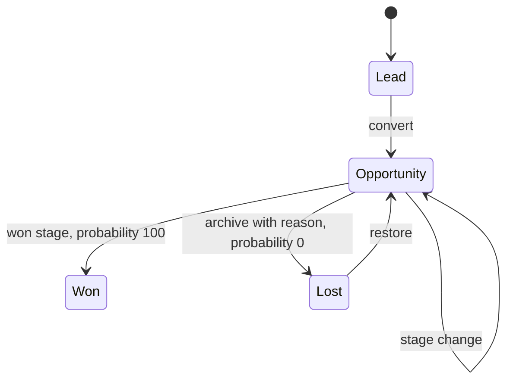
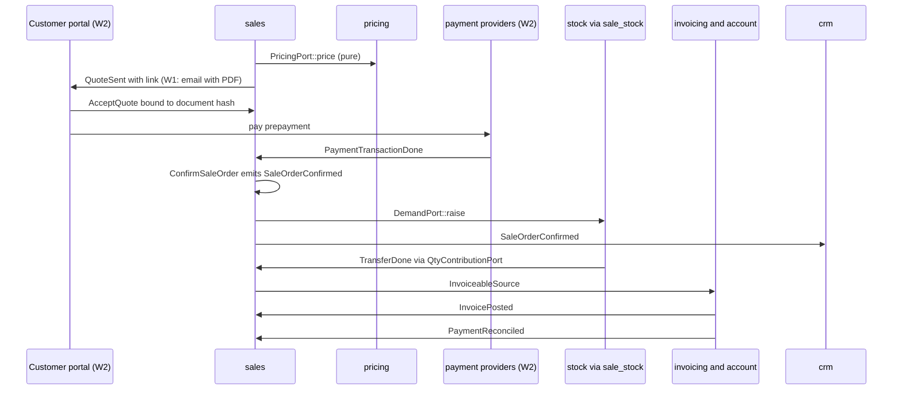
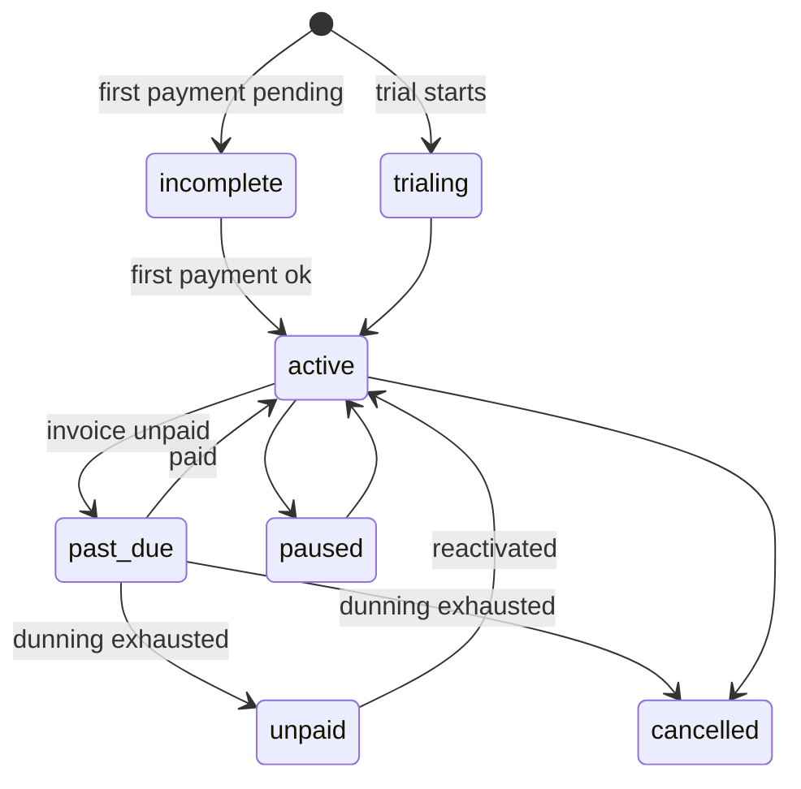

# Sales and CRM: product catalog, pricing, CRM, quotations and orders, subscriptions, rental, customer portal

**Status:** Draft 0.1  
**Date:** 2026-10-01  
**Scope:** Functional specification of the catalog, pricing, CRM, sales, subscription, rental, commission and customer-portal modules, including the order-to-cash flow into inventory and accounting, and the typed commands (CLI, REST API and MCP) through which every capability of this area is reached (4.9).

Conventions. D-IDs point to the binding register [DECISIONS](../DECISIONS.md); OR-n is an owner ruling of 2026-10-01 (RATIFIED) recorded there; names of events, permission groups, data classes, states, ports and commands follow [CONVENTIONS](../CONVENTIONS.md); the grammar, flags, output and exit codes of the `obop` command line are in [cli](cli.md); R-tags cite the research corpus (section 10). "Proposed" marks anything the owner has not ratified, including every tier (D25) and every wave call except the W1 cut of D86: the in and out calls of that cut are RATIFIED (OR-13, OR-15; the services variant in W3 included), while its slip order and the landing waves of the displaced items are Proposed; the wave windows and the German pack date are RATIFIED (OR-13, D26). The same applies wherever this document relies on D4 (ICP and T0 list), D13, D14 or D20, which are also Proposed. The licence and price are settled: the whole project is Apache-2.0 and completely free, with no paid tier, plan or price list (OR-1, OR-2; D1, D2). Targets are labelled (target) and estimates (estimate). "Odoo Community" and "Odoo Enterprise" always mean Odoo's editions and prices (competitor facts only); obop has one edition, open and free (D24). Odoo 20 means "September 2026 (release commit 2026-09-17)". Numbers in section 5 are test fixtures, not statutory rates or price points. Nothing here is legal advice.

## 1. Purpose and scope

### 1.1 What this area is

The commercial front of the business: who we might sell to (CRM), what we sell (catalog), at what price (pricing), the commercial document from quote to order (sales), recurring revenue (subscriptions), time-bound hire (rental), what salespeople earn (commissions) and the surface customers touch (portal). It is the commercial half of the W1 loop of D86 (kernel, invoicing, accounting with German e-invoicing, CRM and sales, basic stock): Contacts and Products, CRM, Sales and `sale_stock` ship in W1, and it feeds Inventory, Invoicing and Accounting through ports and events (D27). `portal` and `purchase` are not in W1 (RATIFIED, OR-15): they come back in W2, in the order of the slip list of DECISIONS 5.3 (the landing wave and the order are Proposed), and in W1 quotes and invoices reach customers by email with PDF (and XML for invoices). The sale line is the join point: delivery, invoicing, projects and payments each contribute a quantity to it, and line status is a function of those quantities, never a separately edited field [R11 s7]. Every capability is a typed command on the CLI, the REST API and MCP, and the web UI is a client of those commands (OR-4, D80; 4.9).

### 1.2 Modules

Tier is Proposed (D25). Waves are the re-cut of OR-13 and D86: the W1 loop and its in and out calls are RATIFIED (OR-13, OR-15), and so is the services variant in W3; the landing waves of the items displaced from W1 and the placements after W1 are Proposed.

| Module (app) | Covers | Tier | Wave |
|---|---|---|---|
| `product` (Product catalog) | templates, variants, attributes, UoM, categories, combos | T0 | W1 |
| `pricing` (Pricing) | W1, reduced: list price, variant extra and line discount through `PricingPort`. W2: price lists and rules, deterministic engine with full explain trace, simulator, ambiguity lint | T0 | W1 (reduced); W2 (lists and rules) |
| `portal` (Customer portal) | capability links, portal accounts, acceptance primitive | T0 | W2 |
| `crm` (CRM) | leads, pipeline, teams, forecast; kanban in W1, pivot, graph and calendar views in W2; scoring and auto-assignment in W2 | T1 | W1 |
| `sales` (Sales) | quotations, orders, optional lines, down payments, margins | T1 | W1 |
| `sale_stock` (bridge) | order to delivery; specified in [supply-chain](supply-chain.md) | T1 | W1 |
| `sale_project`, `sale_timesheet` | service lines to tasks and billable time; see [services](services.md) | T1 | W3 (the services variant, D86; RATIFIED, OR-15) |
| `subscriptions` | plans, proration, dunning, MRR ledger | T2 | W3 |
| `rental` | period reservations, duration pricing, deposits | T3 | W4 or community |
| `commissions` | plans, targets, periods, clawback | T3 (unlisted modules default to T3) | W4 or community (Proposed) |

Bridges that depend on `portal` and on the payment providers (`sale_payment`, Proposed) follow them to W2. `purchase` (W2) joins the loop as a second implementer of `QtyContributionPort` for purchase lines (Proposed, D27); until then vendor bills cover the W1 loop.

Everything above is open and free under Apache-2.0 (OR-1, OR-2; D1, D2): no module here is gated by plan, edition or user count, because no plan or edition exists. Nothing in this area is sold or operated by SpaceCorps, apart from the free sandbox at the public beta, which holds sample data only and sends no mail or e-invoice outside (D83, OR-20): no hosted Peppol, KSeF or Veri*Factu gateway (transmission goes through an access point the user chooses, with the user's own credentials, D17, D83), no Assurance or legal-change service, no hosted AI credits (bring your own key, D18), no support plan, and no payment-processing margin. Any future service would be separate and could never restrict this software (D2).

### 1.3 Boundaries

| Neighbour | Owns | Interaction here |
|---|---|---|
| Contacts and companies ([platform](platform.md)) | party, `party_profile` (pricelist, terms, credit limit, fiscal position), typed addresses, principals | referenced, never duplicated; customer is a role, not a table (D28) |
| Finance ([finance](finance.md)) | invoices, tax, payments, posting, e-invoicing, lock dates | `sales` is an `InvoiceableSource`; totals computed once and equal to postings |
| Supply chain ([supply-chain](supply-chain.md)) | moves, reservations, valuation, kits | `sale_stock` bridge; `DemandPort`, `QtyContributionPort` (`sales` implements it for sale lines; `purchase` from W2 for purchase lines, Proposed, D27) |
| Services ([services](services.md)) | projects, timesheets, planning | `sale_project`, `sale_timesheet` (W3, the services variant, D86) |
| Retail and commerce ([retail-commerce-marketing](retail-commerce-marketing.md)) | POS, cart, loyalty, campaigns | reuse the pricing crate; loyalty engine not specified here |
| Platform services ([platform](platform.md)) | chatter, mail, documents, sign, approvals, automation, semantic layer | consumed, not re-specified |
| People ([people](people.md)) | payroll | commission statements hand off; no payroll in this area (D19) |
| Integrations, AI, security, UX ([integrations](integrations.md), [ai](ai.md), [security-privacy](security-privacy.md), [ux](ux.md)) | API, agents, identity and audit, views | this area supplies entities, commands and permission rows; views are clients of the commands (D80) |
| CLI ([cli](cli.md)) | grammar, global flags, JSON envelope, exit codes, the catalogue and the parity test | this area defines what each command does (4.9); `cli.md` defines how it is invoked and tested |

## 2. Personas and roles

The ICP is a 5-50 person services or light-trade firm (Proposed, D4) [R20 s3, s9.2]. Distributors need lead to quote to delivery to invoice, served in W1 without purchase orders (vendor bills cover the loop; purchase orders return in W2, D86); agencies add project and timesheet billing with the services variant, served in W3 (D86).

| Persona | Jobs | Default permission group (Proposed names; scope, D10) |
|---|---|---|
| Salesperson | own leads, quotes, follow-ups | `crm.user`, `sales.user` (`own`) |
| Team leader | pipeline review, assignment, approvals | `crm.team_lead`, `sales.team_lead` (`domain`: team) |
| Sales manager | all pipelines, forecast, discount policy | `crm.manager`, `sales.manager` (`company`) |
| Sales operations | catalog, pricelists, templates, plans | `product.manager`, `pricing.manager`, `subscriptions.manager` (`company`) |
| Margin reader | sees cost and margin | `product.cost_viewer` (`company`, field permission); not in the salesperson default |
| Billing clerk | invoices from orders, payment chasing | `sales.invoicing` plus finance groups |
| Customer success | renewals, dunning holds, plan changes | `subscriptions.user` (`domain`) |
| Rental coordinator | reservations, pickups, returns | `rental.user` (`company`) |
| Commission administrator | plans, period close, adjustments | `commissions.manager`; salespeople get `commissions.self` (`own`, read only) |
| Customer | view, accept, pay, self-service (W2); in W1 the customer receives quotes and invoices by email | principal kind portal, or a capability link (both from W2) |
| Agent | drafts, lookups, plans for a human to commit | agent principal; permissions are the intersection of user and token scopes (D18); the same typed commands as people (D80) |
| Integrator | sync, automation, scripts | API-client principal with scoped keys; CLI, REST and MCP |

All permission groups are default-deny; a permission row without a declared scope is a lint error (D10). The group names are registered in [CONVENTIONS](../CONVENTIONS.md) section 4 and stay Proposed until the seed list of [security-privacy](security-privacy.md) 2 carries them.

## 3. Capability map

Wave values are the D86 re-cut: the W1 in and out placements are RATIFIED (OR-13, OR-15); the landing waves of displaced items (portal, pricing rules, inbound mail gateway, pivot, graph and calendar views) remain Proposed, with the slip order in DECISIONS 5.3, and so do the placements after W1 that 5.3 does not state (D25). Every row is a typed command or a set of commands on CLI, REST and MCP (4.9). In the last column "Community" and "Enterprise" are Odoo's editions [R01 s5].

| # | Capability | Description | Wave | Odoo parity |
|---|---|---|---|---|
| 1 | Template and variant model | three variant modes, exclusions, price extra, explosion guard | W1 | matches Community |
| 2 | Units and packagings | UoM tree, per-UoM rounding, packaging barcodes | W1 | beyond (Odoo uses one global precision [R10 s3.3]) |
| 3 | Combo products | pick one item per combo; parent and child lines | W1 | matches Community |
| 4 | Typed custom properties | JSONB values, definitions on a container | W1 | matches Community |
| 5 | Pricelist rules | fixed, discount, markup; list, cost or other-list base | W2 (slip order 10); out of W1 RATIFIED (OR-15) | matches Community |
| 6 | Explain trace and price simulator | every price reproducible with reasons; in W1 the reduced engine returns a three-step trace (list, variant extra, discount) and the simulator and `pricing.explain` arrive with the rules | W2 | beyond |
| 7 | Ambiguity lint | save-time warning for tied or shadowed rules | W2 | beyond |
| 8 | Negotiated prices per party | pricelist on the customer profile | W2 | matches Community |
| 9 | Order discount and promotions | discount lines; loyalty via retail doc | W2 and W3 | matches Community |
| 10 | Lead and opportunity in one table | type flag, per-team stages, rotting flag | W1 | matches Community |
| 11 | Email intake and activities | chatter and activities (W1); alias to lead with the inbound mail gateway (W2, slip order 11) | W1 and W2 (the alias is out of W1, RATIFIED, OR-15) | matches Community |
| 12 | Duplicate detection and merge | email match, merge 2 to 5 records | W1 | matches Community |
| 13 | Forecast | expected revenue times probability by month; recurring revenue | W1 | matches Community |
| 14 | Predictive scoring | naive Bayes per team with explanation | W2 | matches Community |
| 15 | Capacity-based assignment | 30-day quota, domains, opt-out | W2 | matches Community |
| 16 | Lead mining and enrichment | provider connectors, user keys, no credit wall | W3 | deliberately skipped (Odoo's IAP service) |
| 17 | Quotation lifecycle | templates, sections, notes, optional lines; sent by email with a PDF | W1 | matches Community |
| 18 | Online acceptance and prepayment | signature evidence, percent to confirm; needs `portal` and a payment provider | W2 (slip order 8 and 9); out of W1 RATIFIED (OR-15) | matches Community |
| 19 | Down payments | percent or fixed; deducted on the final invoice; in W1 paid by manual payment registration or bank statement | W1 | matches Community |
| 20 | Invoice policies | ordered or delivered quantity, partial invoicing | W1 | matches Community |
| 21 | Service policies | prepaid, manual, timesheet, milestone | W3 | matches Community |
| 22 | Margin visibility | cost and margin behind field-level permission | W1 | matches Community, plus field security |
| 23 | Upsell flag | delivered above ordered on ordered-policy lines | W1 | matches Community |
| 24 | Quote revisions and alternatives | revision chain, alternative sets | W2 | alternatives match Community [R11 COULD 21]; revision chain beyond (Proposed) |
| 25 | Approval rules | discount and amount thresholds | W2 | matches Enterprise |
| 26 | PDF quote with embedded documents | Typst render (Proposed, D20) in W1; attached PDFs embedded in the quote in W2 | W1 and W2 | matches Community |
| 27 | Subscription aggregate and plans | separate from the sales order | W3 | matches Enterprise; beyond in model |
| 28 | Proration, anchors, trials | pure billing function with preview | W3 | matches Enterprise |
| 29 | Dunning | retry ladder, notices, terminal action, hold | W3 | beyond (Odoo only flags the contract) |
| 30 | MRR movement ledger | append-only; MRR, ARR, churn, NRR | W3 | matches Enterprise reports; beyond as ledger |
| 31 | Usage-based billing | metered charges | later | beyond |
| 32 | Rental reservations and tiers | period lines, overlap guard, deposits | W4 or community | matches Enterprise |
| 33 | Rental late fees | explicit documented rule | W4 or community | beyond |
| 34 | Commission plans | targets, levels, metrics, roll-ups | W4 or community | matches Enterprise (Enterprise-only in Odoo 20, section 7) [R11 s10] |
| 35 | Clawback and period freeze | frozen results, adjustment lines | W4 or community | beyond |
| 36 | Portal access | capability links and portal accounts | W2 (slip order 8); out of W1 RATIFIED (OR-15) | matches Community |
| 37 | Subscription self-service | close, upsell, switch plan, payment method | W3 | matches Enterprise |
| 38 | CLI, API, webhooks and MCP for every entity and action | one generated command catalogue, one definition per command, parity test; ungated, there are no plans (D31, D80) | W1 | beyond (Odoo Online gates its API to the Custom plan [R21 s2.1]) |
| 39 | Agent-safe commands | dry-run and plan id (W1); approval policy engine (W2) | W1 and W2 | beyond |
| 40 | List price and line discount | the W1 reduced pricing: list price plus variant `price_extra`, manual line discount within a per-group limit, through `PricingPort` | W1 | matches Community |
| 41 | Quote and order documents by email | Typst PDF sent as email with chatter; invoices go by email with PDF and e-invoice XML (finance) | W1 | matches Community |

## 4. Per-app specification

Event, port and extension-point names: `SaleOrderConfirmed`, `TransferDone`, `InvoicePosted`, `PaymentReconciled`, `DemandPort`, `QtyContributionPort`, `InvoiceableSource`, `PostingPort` and `PricingPort` come from [R23 D.2-D.4], as does `BeforeInvoicePost`, an extension point that `invoicing` runs and not an event. Credit notes reach sales as `InvoiceReversed`, the name used by [finance](finance.md) (Proposed); the credit note document is itself a posted invoice and emits `InvoicePosted`. The name [R11 MUST 6] used for this fact is retired (see [CONVENTIONS](../CONVENTIONS.md) section 8). Every other event name below is registered in [CONVENTIONS](../CONVENTIONS.md) section 3.4 (adopted there, Proposed until the generated event catalogue replaces that table); `PaymentTransactionDone` and `PaymentTransactionFailed` are emitted by `payment` as listed in [finance](finance.md) 4.5 and 4.15, and `PartyErased` is emitted by [security-privacy](security-privacy.md) 4.6. Events for modules that arrive later than W1 (`portal`, price rules, `subscriptions`, `rental`, `commissions`) are emitted only once their module is installed; the wave column of the event table in [CONVENTIONS](../CONVENTIONS.md) section 3.4 follows the waves of section 1.2.

Commands. Every app below ends with a pointer to section 4.9, which lists its typed commands with the CLI, REST and MCP forms. The flow tables name the command by its Rust type (CONVENTIONS 2.1); 4.9 gives the wire ids.

### 4.1 Product catalog (`product`)

**Purpose.** One definition of what the business sells and buys, shared by Sales, Purchase, Stock, POS and the shop.

**Capabilities.** MVP (W1): rows 1-4 of section 3, plus categories (tree), archive instead of delete, images, optional-product and upsell links. Later: variant grid entry on quotes (W2, Proposed); kits through `mrp` (W3, phantom BoM in [supply-chain](supply-chain.md)).

| Entity | Purpose | Key fields | States |
|---|---|---|---|
| `product_template` | what is sold | kind (goods, service, combo), `is_storable`, category, uom, `list_price` NUMERIC(24,8), `invoice_policy` (order or delivery), `sale_ok`, `purchase_ok`, `properties`, translated name | active, archived |
| `product_variant` | SKU | template, sku, barcode, `combination_key`, `price_extra`; unique (template, key) where active | active, archived |
| `attribute`, `attribute_value` | option dimension | `create_mode` (always, dynamic, never), display type | none |
| `template_attribute_line`, `template_attribute_value` | values on a template | `price_extra`, excluded values | none |
| `product_profile` | per-company facts | cost, cost method, accounts, default taxes (with finance) | none |
| `uom`, `product_uom` | units, packagings | relative uom and factor, rounding; packaging barcode | none |
| `product_combo`, `product_combo_item` | bundle choices | combo product, item product, `extra_price` | none |
| `product_optional` | upsell links | template to template | none |

Rules. Create modes are immutable once the attribute is used on a template [R11 s3.1]; "always" is bounded by a guard (default 1,000 variants per template, mirroring Odoo's `product.dynamic_variant_limit` [R11 s3.1]; configurable). Combination validity is checked in the command, so API and agent calls cannot create an excluded combination. Cost lives in `product_profile`, not on the template [R23 B.1]. Service fields (policy, tracking, project and task templates) are added by `sale_project` in W3 ([services](services.md), D86). Quantities are stored in base UoM with entry quantity and UoM kept; conversion rounds half-up [R23 DR-5].

**Workflows.** (1) Define template and attributes. (2) System generates variants per mode; dynamic variants appear on first order (`VariantCreated`). (3) Quote-time configuration evaluates exclusions. (4) Archive hides from pickers; documents keep the reference.

**Flows.** Emits `ProductChanged`, `VariantCreated` (edge snapshots and shop feeds subscribe). Consumes nothing; it is foundation.

**Permissions and sensitive data.** `product.user` reads; `product.manager` writes. Cost fields are read through the field permission `product.cost_viewer` and carry no data class, as in [supply-chain](supply-chain.md) (section 9, question 17 is closed); the class `financial` stays for pay data, bank data and customer payment token references ([CONVENTIONS](../CONVENTIONS.md) section 5). Unreadable fields cannot be filtered, sorted or grouped (D10).

**Reports.** Catalog completeness (missing category, tax or cost), variant counts, products without price rule.

**Configuration.** Variant guard, default UoM, barcode nomenclature (owned by stock).

**Localization and compliance.** Names and descriptions are per-language values (D34). Base-unit price display and prior-price indication for consumers are storefront duties; the consumer-law baseline is in [R28 E.7] and needs counsel.

**Commands and licence.** Typed commands in 4.9 (CLI, REST and MCP from one catalogue). Open and free, Apache-2.0; no gated module, field or feature (OR-1, OR-2).

### 4.2 Pricing (`pricing`)

**Purpose.** Compute the price of a product for a context, identically in quote, cart, POS, subscription, rental and API, and explain it. Pricing bugs are the most expensive class of ERP defect [R11 s4.3].

**Capabilities.** W1, reduced (D86; the in and out calls are RATIFIED, OR-15, and the slip order 10 is Proposed): row 40, meaning list price plus variant `price_extra` and a manual line discount within a per-group limit, computed through `PricingPort`, with the pure-function contract below and a three-step trace (list, variant extra, discount). W2: rows 5-8 (price lists and rules, the full explain trace with rejected candidates, `pricing.explain` and the simulator, the ambiguity lint, the pricelist on the party profile) and order-level discount lines. Later: promotion hooks (W3, retail doc); subscription plan prices and rental duration tiers reuse the same rule table (W3, W4).

**Engine contract.** `PricingPort::price(ctx) -> PriceResult` is a pure function: no I/O, no clock, no database. The caller passes a rules snapshot, variant, quantity, UoM, `as_of`, currency and an FX snapshot. The crate is pure Rust with no SQL, compiled natively and to Wasm so POS, cart and server agree on totals [R23 DR-7, R12 s3.2]. The port and this contract are W1; the rules snapshot is empty in W1, so steps 1 to 5 below collapse to list price plus `price_extra` and the line discount, while steps 6 and 7 (currency and output) apply from W1. Full resolution (W2):

1. Pricelist: explicit on the document, else the party profile, else the default list, which in Odoo is the first active list without a country group, by sequence [R11 s4.1]; preferring a country-group list that matches the party's country and currency is Proposed.
2. Candidates: active rules whose validity contains `as_of`, with `min_quantity` met after UoM conversion, applicable to the variant, product, category chain or globally.
3. Order (total, deterministic): specificity (variant, product, category by depth, global); larger `min_quantity`; explicit `priority` (lower wins, Proposed); newer `created_at`; rule id. First wins [R11 s4.1].
4. Base: list price plus variant `price_extra`, cost, or another pricelist. Cycles are rejected at save; depth is limited to 8 (Proposed).
5. Formula: `base - base*d/100` (markup is a negative discount), round to a multiple of `price_round` half-up, add surcharge, clamp to `[base+min_margin, base+max_margin]` [R11 s4.1].
6. Currency: convert at the stored rate (NUMERIC(28,14)) for `as_of`; the rate is recorded, never re-derived [R23 DR-5].
7. Output: unit price NUMERIC(24,8), `discount_pct` when the rule is a plain discount (the customer sees a struck-through list price, not a silently lowered price [R11 s4.2]), rule id, pricelist id, trace.

From W2 the trace is an ordered list of steps with inputs, result and reason, including every rejected candidate (`expired`, `not_yet_valid`, `min_qty`, `wrong_uom`, `not_applicable`, `shadowed_by:<rule>`). Lines always store the rule id; a full trace snapshot is stored when a quote is sent and when an order is confirmed (Proposed). Rules used by a document are versioned, not edited in place, so any past `as_of` is reproducible (Proposed).

| Entity | Purpose | Key fields | Wave |
|---|---|---|---|
| `pricelist` | named list | currency, company, country groups, sequence, active | W2 |
| `pricelist_rule` | one rule | applied-on, target, `min_quantity`, UoM, `valid_from/to`, compute (fixed, discount, markup), base, amounts, `price_round`, surcharge, margins, `priority` | W2 |
| `price_evaluation` | audit snapshot | document and line ref, context hash, result, trace JSON | W2 |

In W1 the sale line stores `price_unit`, `price_source` (`manual` when a human overrides the computed price) and `discount_pct`; the rule id stays empty, and the pricelist fields of `sale_order` and `party_profile` stay unused until `pricelist` ships in W2 (expand-only, so no key is rewritten).

**Workflows.** W2: (1) Author a rule. (2) Lint it for ties, unreachable rules and cycles. (3) Publish with an effective date. (4) Test in the simulator (`pricing.explain`, `POST /api/v1/pricing/explain`, an MCP tool and `obop pricing explain`). (5) Documents use it through `PricingPort`. In W1 only step 5 exists, with the reduced engine.

**Flows.** Emits `PriceRuleChanged` on any pricelist or rule change (W2; durable; shop cache purge and POS snapshot deltas subscribe, see [retail-commerce-marketing](retail-commerce-marketing.md)); in W1 a list-price change is a `ProductChanged`. Consumes `FxRatesUpdated` (Proposed; `base` emits it through `ExchangeRateSource`, [finance](finance.md) 4.7). Called through `PricingPort` by sales from W1 and by subscriptions, rental, shop and POS when they ship.

**Permissions and sensitive data.** `pricing.manager` edits rules (W2); the list price is edited by `product.manager`. A rule with cost as base reveals cost through price, so editing it needs `product.cost_viewer`. Party-specific prices are confidential: portal users see only their own result.

**Reports.** Manual-override rate and discount depth by salesperson (W1, from the sale lines); margin leakage and rules never used (W2).

**Configuration.** Company rounding profile (`per_line` or `per_group`, D9), per-group line-discount limits, tax display mode per document (tax excluded or included, as Odoo 20's `document_tax_mode` [R11 s4.2]); default pricelist (W2).

**Localization and compliance.** Currency exponents are data (JPY 0, KWD 3) [R23 DR-5]. Tax-included B2C display per pricelist. Each tax computation stores the rule-pack version and inputs (D38).

**Commands and licence.** Typed commands in 4.9. Open and free, Apache-2.0; no price list of obop exists, and the price lists described here belong to the business using it (OR-2).

### 4.3 CRM (`crm`)

**Purpose.** Track prospects to won or lost, forecast revenue, and turn an opportunity into a quotation on the same database and party [R11 s5.4].

**Capabilities.** MVP (W1): rows 10, 12-13 and the chatter and activities half of row 11, teams, per-team stages with `is_won`, `fold` and `rot_days`, priority, tags, lost reasons, UTM attribution, team-defined properties, quotation creation from an opportunity; views are list, form, kanban and search (D86). W2: rows 14-15, the email alias half of row 11 (inbound mail gateway) and the pivot, graph and calendar views (slip order 5). W3: connector-based enrichment (row 16) and AI assistance ([ai](ai.md)).

| Entity | Purpose | Key fields | States |
|---|---|---|---|
| `lead` | lead or opportunity | `type`, party plus contact snapshot, team, salesperson, stage, priority, tags, `expected_revenue`, `probability`, `probability_auto`, `recurring_revenue`, recurring plan, `expected_close`, lost reason, `properties`, UTM | open, won, lost (derived) |
| `stage` | pipeline step | teams, sequence, `is_won`, `fold`, `rot_days` | none |
| `team`, `team_member` | sales teams | leader, alias (W2), `use_leads`, `auto_win_on_order`, member capacity (30 days, W2), domain, opt-out | none |
| `recurring_plan` | months for recurring revenue | months | none |
| `lead_scoring_frequency` | scoring table | team, variable, value, won count, lost count | none |



Invariants: probability is within [0,100]; a won stage forces 100 (database CHECK) and manual entry of 100 is refused; lost requires a reason [R11 s5.1].

**Workflows.**

1. Capture by form, API, CLI (`lead.create`), CSV import or, from W2, email alias.
2. Dedupe by email; score (W2); assign (manual or round-robin in W1, capacity rules in W2).
3. Convert: match or create the party.
4. Work the pipeline, with a "Move to" action as the non-drag alternative (WCAG 2.5.7); drag and "Move to" are both the same update command (D80).
5. `CreateQuote` from the opportunity.
6. Win on `SaleOrderConfirmed` when `auto_win_on_order` is set (default on, Proposed), otherwise manually; lose with a reason.
7. Review the forecast by expected month.

**Scoring (W2).** Per-team naive Bayes. Stage and team are always variables; optional ones are state, country, phone quality, email quality, source, language and tags. Score is win/(win+lost) over per-variable likelihoods with 0.1 added to every frequency; frequencies are incremented when a lead changes state; a start date bounds training; a manual override holds until reset [R11 s5.2]. The UI shows the top contributing variables. No ML runtime is needed; the result is reproducible from the frequency table.

**Flows.**

| Direction | Name | Effect |
|---|---|---|
| emits | `LeadCreated`, `LeadConverted`, `OpportunityStageChanged`, `OpportunityWon`, `OpportunityLost`, `LeadsMerged` | webhooks, timeline, analytics |
| consumes | `SaleOrderConfirmed` | raise expected revenue to the order's untaxed total when lower and currencies match, never lower it [R11 s5.3]; mark won per [R23 D.4] (Odoo 20's `sale_crm` only raises revenue and does not mark won, checked in the 20.0 source, so auto-win is an obop addition, Proposed) |
| consumes | `QuoteSent`; `QuoteViewed`, `QuoteAccepted`, `QuoteDeclined` (W2, emitted by `portal`) | activity and timeline entries |
| consumes | `FormSubmitted` (W3) | capture a lead from a website form (workflow step 1), with the same dedupe and assignment; emitted by `website` ([retail-commerce-marketing](retail-commerce-marketing.md) 4.4) |
| consumes | `PartyMerged`, `PartyErased` | relink; anonymise the contact snapshot |

`crm` subscribes to `sales-api` events directly; no bridge is needed [R23 D.4].

**Permissions and sensitive data.** Salespeople default to `own`, team leaders to the team domain. Email, phone and address are personal data with registry flags that drive export and erasure (D33) [R18 s8.1].

**Reports.** Pipeline by stage, team and source; forecast by expected month; prorated revenue (expected times probability, rounded to the minor unit [R11 s5.3]); pipeline MRR; conversion and win rate; days in stage; rotting deals; lost reasons. All are registry-declared measures. In W1 they are answered by the list and kanban views and by the `lead.aggregate` command (CLI, REST and MCP, grouped and summed under the caller's access); pivot and graph views arrive in W2, and the semantic layer with drill-through with `analytics` in W3 (DECISIONS 5.3, slip orders 2 and 5).

**Configuration.** `use_leads` per team, stages, lost reasons, scoring variables and start date (W2), assignment cron, alias (W2), `rot_days`, `auto_win_on_order`.

**Localization and compliance.** Record purpose and legal basis per lead; blacklist and opt-out are shared with `mail`; lost leads can be anonymised after a configurable retention period (Proposed); erasure is anonymise-in-place [R18 s8.1]. Enrichment and mining sit behind provider traits with user-supplied keys and are off by default; transfers to such providers need counsel.

**Commands and licence.** Typed commands in 4.9. Open and free, Apache-2.0. AI assistance (W3) is bring-your-own-key or local; obop sells no credits (D18, OR-2).

### 4.4 Sales (`sales`)

**Purpose.** The commercial document from quotation to confirmed order, and the join point of fulfilment and billing.

**Capabilities.** MVP (W1): rows 17, 19-20, 22-23, 40-41, plus addresses, payment terms, fiscal position, currency with stored rate, PDF by Typst (Proposed, D20) sent by email, explicit human confirmation, lock, chatter, and the CLI, REST and MCP commands of 4.9. The customer agrees by replying to the email, and a person (or an agent under the confirm policy) confirms the order. W2: rows 18 and 36 (portal view, online acceptance, prepayment), 24-26, consolidated billing across orders. W3: row 21 (service policies with `sale_project`), subscriptions from order lines, loyalty on orders, shop orders.

| Entity | Purpose | Key fields |
|---|---|---|
| `sale_order` | header | company, `order_kind` (quote, cart), `number`, `state`, `locked`, derived statuses, party, invoice and shipping address, currency and rate, pricelist (W2), payment term, fiscal position, tax display mode, rounding profile, `validity_date`, team, salesperson, opportunity, template, terms version, `require_signature` and `prepayment_percent` (both W2, with `portal` and the payment providers), totals (bigint minor), `row_version` |
| `sale_order_line` | line tree | `display_type` (product, section, subsection, note), `parent_line_id`, `is_optional`, `is_downpayment`, `combo_item_id`, variant, qty, uom, `price_unit`, `price_source`, `discount_pct`, rule id, taxes, cost snapshot, derived `qty_delivered`, `qty_invoiced`, `qty_to_invoice`, analytic distribution |
| `sale_order_template` | reusable quote | lines, validity days, signature and prepayment defaults, terms |
| `quote_acceptance` (W2) | evidence | order, document hash, signer, signature image, method, time, IP, user agent, OTP flag |
| `sale_line_qty_contribution` | delivered quantity | line, source ref, qty; unique (line, source) [R23 B.2] |
| `invoice_line_source` | billing link | invoice line, sale line, qty, kind; makes `qty_invoiced` recomputable |

Optional products are ordinary lines under a section flagged `is_optional`, the Odoo 19/20 design, with no side table [R11 s6.1]. In W1 the salesperson adds or removes them on the quote; the customer edits them on the portal from W2. Quantity of optional lines before the customer adds them is undecided (section 9).

Shop carts. The shop models a cart as a draft `sale_order` with `order_kind = cart` ([retail-commerce-marketing](retail-commerce-marketing.md), itself Proposed). This spec accepts it on three conditions (Proposed): a restriction row hides carts from quote lists and reports; carts never get a `number` or a `quote_status`; confirmation uses the same `ConfirmSaleOrder` command.

**State.** Kernel lifecycle `draft -> confirmed -> cancelled` plus a `locked` flag (D28, [R23 B.2]). Derived, never user-written: `quote_status` (draft, sent, viewed, accepted, declined, expired; `viewed`, `accepted` and `declined` are driven by portal events and so appear from W2, while in W1 a sent quote stays `sent` until it is confirmed, cancelled or expired), `delivery_status` (pending, started, partial, full), `invoice_status` (`nothing_to_invoice`, `to_invoice`, `upselling`, `invoiced`), `payment_state` (`unpaid`, `partial`, `paid`). `number` is assigned (Proposed) when the quote is first sent or confirmed, from a sequence; this deliberately departs from the header pattern, where the number stays NULL until confirmation [R23 B.2], so that a sent quote can be referenced. Gaps are allowed because legal gapless numbering belongs to invoices (D30).

| Transition | Guard |
|---|---|
| draft to confirmed | lines present; not expired unless overridden; signature or prepayment satisfied when required (W2, with `portal`), else explicit human confirm (the only path in W1); approval rule passed (W2) |
| confirmed line edit | may add or raise quantity; may not lower below delivered or invoiced; invoiced lines keep `price_unit`; all audited |
| to cancelled | no posted invoice; open deliveries cancelled through `SaleOrderCancelled` |

Upsell: a line on the ordered policy whose delivered quantity exceeds the ordered quantity sets `invoice_status` to `upselling` [R11 s6.2]. The sales team is the same `team` entity as in CRM (and the shop) [R11 s10].

**Workflows.**

1. Create from an opportunity, template or copy (`CreateQuote`).
2. Lines get price (and, from W2, the rule) from `PricingPort`; a manual override sets `price_source = manual`, needs `sales.price_override` and respects a per-group discount limit (approval rules in W2).
3. Send (`SendQuote`): W1, the Typst PDF goes out as an email (`QuoteSent`); from W2 the email also carries a capability link to the portal.
4. Customer: W1, replies by email and a human records the agreement by confirming the order; W2, views (`QuoteViewed`), edits optional lines, signs and pays the prepayment on the portal.
5. Confirm: `ConfirmSaleOrder`, one transaction.
6. Fulfil and invoice (next flow).
7. Lock.

Each step is one typed command on CLI, REST and MCP (4.9). The web form buttons call the same commands and hold no logic of their own (D80).

**Order-to-cash automatic flow.** All steps follow the integration contract (D27): one command, one transaction; handlers in the same transaction for atomic invariants; durable events for external I/O. The diagram shows the W2 path with `portal` and online prepayment; in W1 the customer and `payment` lifelines are absent: `sales` sends the quote by email, a human confirms, and payments are registered manually or reconciled from a bank statement.



| Step | Command (transaction) | Same-transaction handlers (TxEvent) and extension points | Durable events |
|---|---|---|---|
| Send | `SendQuote` (`sale_order.send`) | none | `QuoteSent`: email with PDF (W1) and link (W2), webhook |
| Accept (W2) | `AcceptQuote` (`sale_order.accept`, portal) | rejects if the document hash changed | `QuoteAccepted` |
| Prepay (W2) | PSP webhook recorded by `payment` | none | `PaymentTransactionDone`: the `sale_payment` bridge (Proposed) confirms the order when the amount is at least `prepayment_percent` and optionally raises the down-payment invoice; the handler is idempotent |
| Confirm | `ConfirmSaleOrder` (`sale_order.confirm`) | `sale_stock` calls `DemandPort::raise`; `crm` updates the opportunity; `sale_project` creates tasks (W3); `loyalty` earns points (W3) | `SaleOrderConfirmed`: webhook, email, analytics, AI index |
| Deliver | `ValidateTransfer` (stock) | `sale_stock` calls `QtyContributionPort::set(('transfer', id), line, qty)`; `stock_account` posts per company policy | `TransferDone` |
| Invoice | `CreateInvoice` from `InvoiceableSource`, then `PostInvoice` (`invoice.create_draft`, `invoice.post`; finance) | extension point `BeforeInvoicePost` (invoicing runs it): `stock_account` adds COGS lines; `InvoicePosted`: `sales` updates `qty_invoiced` | `InvoicePosted`: e-invoice by email or file (W1; Peppol is a W2 adapter), email |
| Collect | `RegisterPayment` (`payment.register`) or a statement line (W1); PSP webhook (W2) | none | `PaymentReconciled`, `PaymentVoided`: `sales` updates the derived `payment_state` (no atomic invariant) |
| Correct | credit note (a posted invoice; emits `InvoicePosted` and `InvoiceReversed`) or return transfer | `InvoiceReversed`, `TransferDone` adjust quantities through the same ports | mirrors |

Also consumed by `sales` ([CONVENTIONS](../CONVENTIONS.md) section 3.4): `QuoteViewed`, `QuoteAccepted` and `QuoteDeclined`, emitted by `portal` (4.8, W2), which drive the derived `quote_status`; and, from W3, `ChannelOrderImported` and `ChannelSyncFailed` from the channel framework ([retail-commerce-marketing](retail-commerce-marketing.md) 4.3), where an import creates one `sale_order` carrying the channel reference and a sync failure is logged on that order's chatter (Proposed).

Inventory side: `DemandPort::raise` creates moves and reservations per route and warehouse policy; a validated transfer is immutable and corrected only by new moves ([supply-chain](supply-chain.md), D30). Accounting side: `PostInvoice` takes lock dates, assigns the gapless legal number late in the transaction, and the deferred balanced-entry trigger and hash chain run at commit (D30); valuation entries follow the company posting policy (perpetual at invoicing, per transfer, or periodic) [R10 s6.4]. A locked period rolls back the whole posting transaction and the user sees the error; the coupling is intended [R23 D.4].

Invoice policy is per product: ordered or delivered quantity; service policies arrive in W3 with `sale_project` [R14 s4.2]. Down payments are percent or fixed; the invoice is posted on a `down_payment` account role (Proposed), the line is flagged `is_downpayment`, and the final invoice adds a "Down Payments" section with negative lines, becoming a credit note if the balance is negative [R11 s6.3]. In W1 a down payment is an ordinary invoice that the billing clerk raises and whose payment is registered manually or reconciled from a bank statement; from W2 a portal prepayment can raise it automatically. Prepayment VAT timing is a country-pack matter (section 9).

**Open and free along the flow.** Every step above is open and free: pricing, approvals, portal, PSP connectors, reservation, valuation, posting, and the commands that drive them. SpaceCorps sells and warrants nothing at any step and operates nothing for other people's data today; its only hosted obop is the free sample-data sandbox (a paid hosting service is planned, OR-22), where outbound mail goes to a sink (D83, OR-20). E-invoices travel by email or file in W1; Peppol, KSeF and Veri*Factu transmission goes through an adapter with the user's own credentials or through an access point the user chooses, and SpaceCorps runs none (D17, D83). The country pack that governs tax, numbering and e-invoice formats at the Invoice step is open content provided as is, with no Assurance or legal-change service (D17, D38). AI drafting uses the user's own key or a local model (D18). Nothing is gated by user count, plan or edition.

**Permissions and sensitive data.** Permission groups: `sales.user`, `sales.team_lead`, `sales.manager`, `sales.invoicing`. Named actions, granted by rows of those groups and not groups themselves: `sales.price_override`, `sales.unlock_order`. Cost and margin are read through the field permission `product.cost_viewer`, not a data class (section 9, question 17, closed). Signature evidence (IP, user agent) is personal data retained with the contract. Payment transactions hold customer payment token references only (class `financial`); card data never enters obop [R18 s8.2, R12 s4.3]. Agents may create and edit drafts; confirming an order defaults to a human-approved policy, never `auto` (D18, [R16 s5]): in W1 the agent receives a plan (CLI exit 10) that a human commits, and from W2 the policy engine can route it as a durable `approve_by_role` approval item. Sending a quote is an `external` effect (an email leaves the system), so an agent's send also needs confirmation ([ai](ai.md) 4.3). Proposed.

**Agent, CLI and API surface.** Business commands rather than CRUD sequences, listed in 4.9: `sale_order.create_quote`, `.send`, `.confirm`, `.cancel`, `lead.convert`, and `pricing.explain` (W2). They exist on the CLI, REST and MCP from one definition, so an agent with a shell and an MCP client call the same command with the same schema and permission check (OR-4, D80). Each takes `Idempotency-Key` (W1); `dry_run` with a digest-bound `plan_id` is W1 ([ai](ai.md) 3; D18, D31); only the approval policy engine is a W2 deliverable (D18; row 39).

**Reports.** Quoted, ordered, delivered and invoiced quantity and amount by product, team, salesperson, customer and country; quote conversion and time to close; expected margin (before invoice) and realised margin (after COGS); backlog; to-invoice; upsell candidates; expiring quotes; discount analysis. In W1 these are list and kanban views plus the `sale_order.aggregate` and `sale_order_line.aggregate` commands; pivot and graph views are W2 and the semantic layer W3 (DECISIONS 5.3).

**Configuration.** Validity days, lock on confirm, default signature and prepayment (W2), auto-invoice on payment (W2), down-payment invoice on prepayment (W2), discount limits per group, default invoice policy, tax display mode, terms versions.

**Localization and compliance.** Documents render in the customer's language; en and de are the W1 commitment and other locales arrive as reviewed community translations (DECISIONS 5.3, Proposed). Terms are versioned and the accepted version hash is stored. A consumer flag on the order drives the withdrawal function (D38, [R28 E.7]). Signatures (W2, with `portal`) are simple electronic signatures with an evidence bundle, labelled honestly; qualified signatures need a QTSP connector in `sign` (W3) (D39, [R15 s8]). Invoice numbering and EN 16931 output are in [finance](finance.md).

**Commands and licence.** Typed commands in 4.9. Open and free, Apache-2.0; nothing in the order-to-cash flow is paid, gated or operated by SpaceCorps (OR-1, OR-2).

### 4.5 Subscriptions (`subscriptions`)

**Purpose.** Recurring billing with a first-class subscription aggregate. Odoo models a subscription as a confirmed sales order with a plan, which makes upsell, renewal and state reporting multi-document [R11 s8.3].

**Capabilities.** MVP (W3; T2, stays in W3 under D25): rows 27-30 and 37. It builds on `portal` and the payment providers, both W2 (D86), for self-service and automatic collection by token. Later: usage-based billing (row 31) with Kill Bill's consumable and capacity distinction as the minimal design [R11 COULD 20]; goods delivered with each invoice through a `subscription_stock` bridge (Proposed).

| Entity | Purpose | Key fields |
|---|---|---|
| `plan` | billing shape | interval unit and count, trial days, anchor rule, in advance or arrears, proration policy, renewal notice days, auto-close days, self-service flags |
| `plan_price` | price per plan | plan, product or variant, pricelist, currency, amount, min quantity |
| `subscription` | aggregate | party, status, plan, start, anchor day, current period, `next_invoice_at`, `cancel_at`, `pause_until`, collection method (automatic or manual), payment token ref, source order |
| `subscription_item` | what is billed | product, qty, price snapshot |
| `subscription_event` | append-only history | kind, reason, MRR delta, actor |
| `mrr_movement` | ledger | subscription, kind, delta (subscription currency and company currency at the movement date), effective date |
| `dunning_policy`, `dunning_run` | recovery | ordered steps; run state per invoice |
| `subscription_invoice_link` | one invoice per period | unique (subscription, period start) |



Vocabulary follows Stripe (trialing, active, past_due, unpaid, paused, incomplete) [R11 MUST 7], except that the terminal state is `cancelled`, the kernel spelling (D28; [CONVENTIONS](../CONVENTIONS.md) section 6). "Scheduled" and "to renew" are derived labels, not states.

**Billing engine.** `bill(subscription_state, catalog_version, as_of) -> invoice lines` is pure, and `preview` uses the same code [R11 s8.3]. Periods use civil dates in the business time zone (`jiff` 0.2.37 as of 2026-10-01 [R00 s3]); an anchor day past the end of a short month clamps to its last day. Proration (Proposed defaults): by calendar days of the actual period; applies to recurring service charges only, never to goods [R11 s8.1]; a change credits the amount actually billed for the unused time (Stripe's "flexible" rule [R11 s8.3]); each amount is rounded once, half-up. Upgrades apply immediately; downgrades at period end. Existing subscriptions keep their price until an explicit price-change action with notice. Tax is computed at each invoice from the fiscal position and rules of that date, so rate changes need no plan edit.

**Dunning (Proposed defaults).** A policy is an ordered list of steps: retry, send notice, create activity, terminal action (cancel, mark unpaid, leave past due, pause). Default: eight attempts in 14 days (day 0, then +1, +2, +3, +5, +7, +9, +11), a notice after each failure, terminal action at +14, which mirrors Stripe's recommended shape [R11 s8.2] but is deterministic. Declines are classed soft or hard (and authentication-required); hard declines stop retrying until the customer updates the payment method. A manual hold stops automation. Entitlement is separate from billing state, with configurable grace days [R11 s8.2]. Retries carry PSP idempotency keys derived from (invoice, attempt) [R21 s5]. The step-list policy engine is shared with invoice reminders in [finance](finance.md).

**MRR ledger.** Append-only movements: new, expansion, contraction, churn, reactivation. MRR is the plan amount normalised to a month by a documented rational factor (year /12, quarter /3, week x52/12, day x365/12; Proposed), not the prorated amount; trials add no MRR until the first paid period (Proposed). History is never re-derived from current rates. Metrics: MRR, ARR, net new MRR by kind, active count, trial conversion, logo and revenue churn, NRR and GRR, ARPA, cohorts (cohort view W3, D25), recovery rate of dunning.

**Workflows.**

1. Sell: confirmed order lines with a plan create the subscription on `SaleOrderConfirmed`.
2. Bill: a durable job claims due subscriptions (`SKIP LOCKED`), calls `bill`, creates the invoice through `InvoiceableSource`, posts it and collects by token, portal payment or SEPA.
3. Failure enters dunning.
4. Change, pause, renew, or cancel at period end or immediately. Every change writes an event and an MRR movement in the same transaction.

**Flows.** Emits `SubscriptionStarted`, `SubscriptionInvoiceDue`, `SubscriptionChanged`, `SubscriptionStatusChanged`, `DunningStepExecuted`, `MrrMovementRecorded`, `SubscriptionCancelled`. Consumes `SaleOrderConfirmed`, `InvoicePosted`, `PaymentReconciled`, `PaymentTransactionDone`, `PaymentTransactionFailed` (both Proposed), `PartyErased`.

**Permissions and sensitive data.** `subscriptions.user`, `.manager`; portal self-service is governed by plan flags. Customer payment token references (PSP references) are class `financial` (token references only), encrypted; card numbers are never stored [R18 s8.2]. PSP credentials are a different thing: class `secret` (Proposed, [security-privacy](security-privacy.md) 4.1), vault entries handled as `financial` until it is ratified.

**Reports.** The metrics above plus upcoming renewals, failed-payment queue, MRR by plan, salesperson and country.

**Configuration.** Plans, dunning policies, close reasons, grace days, notice templates, proration and rounding defaults.

**Localization and compliance.** Consumer subscriptions sold online show the withdrawal function in the portal (D38, [R28 E.7]); price-change notice periods and SEPA mandates are country matters for counsel; every period's invoice follows the e-invoicing rules of its pack.

**Commands and licence.** Typed commands in 4.9. Open and free, Apache-2.0; Odoo keeps Subscriptions in Enterprise (section 7), obop gates nothing. Payment-provider connectors and e-invoice transmission are as in 4.4.

### 4.6 Rental (`rental`)

**Purpose.** Sell time-bound hire of serial-tracked or quantity-tracked goods and services. T3, specified so the pricing and order models do not block it.

**Capabilities.** MVP (first release): row 32, meaning period-aware order lines, availability check at quote (soft) and confirm (hard), duration pricing, deposits, pickup and return, calendar view. Later: row 33 (late fees), portal extension requests, maintenance blocks per asset.

| Entity | Purpose | Key fields |
|---|---|---|
| rental period on `sale_order_line` | the hire window | `rental_start`, `rental_end` (tstzrange) |
| `rental_reservation` | blocks a unit | line, variant, unit (serial or lot) or qty, blocked range (period plus padding), status |
| `deposit_rule` | security deposit | paired service product, amount or percent |
| `late_fee_rule` | overdue charge | grace period, rate per period, cap |

Reservation states: `reserved -> picked_up -> returned`; `reserved -> cancelled`; `overdue` is derived when now passes `rental_end`.

Rules. Serial-tracked units are protected by `EXCLUDE USING gist (unit WITH =, blocked_range WITH &&)` over active reservations, which works on PostgreSQL 17 (D8); `btree_gist` supports uuid [R23 DR-3]. Quantity-tracked stock sums overlapping quantity under a row lock [R11 s9]. Pricing reuses the engine with quantity = line qty x duration in the periodicity unit, and the default applies one tier to the whole duration, the one with the lowest total, as Odoo documents (only one price line is used and the cheapest wins; see section 5.4) [R11 s9]. Padding time applies to hourly rentals only. Late fees are an explicit rule because Odoo's docs show none (Proposed).

**Workflows.**

1. Quote with a soft availability check.
2. Confirm (`SaleOrderConfirmed`): hard reservation.
3. Pickup wizard scans serials and raises a transfer through a `rental_stock` bridge (Proposed).
4. Return wizard receives stock.
5. Fees are invoiced and the deposit is refunded by credit note. Service rentals (rooms) skip stock.

**Flows.** Emits `RentalReserved`, `RentalPickedUp`, `RentalReturned`, `RentalOverdue`. Consumes `SaleOrderConfirmed`, `TransferDone`.

**Permissions and sensitive data.** `rental.user`, `rental.manager`. Deposits are money held and post to a liability account role via `PostingPort`.

**Reports.** Utilisation, revenue per asset, overdue returns, availability calendar.

**Configuration.** Periodicity per product, padding time, pickup and return times, duration tiers, deposit and late-fee rules.

**Localization and compliance.** Deposit and damage-charge VAT follow the country pack; insurance is out of scope.

**Commands and licence.** Typed commands in 4.9. Open and free, Apache-2.0; Odoo keeps Rental in Enterprise (section 7), obop gates nothing. It is T3: built when a design partner needs it (W4), or supplied by the community as a plugin through the free registry (D81, OR-3).

### 4.7 Commissions (`commissions`)

**Purpose.** Compute what salespeople and teams earn from orders, invoices or payments.

**Capabilities.** MVP (first release): row 34. Plans based on targets or achievements, per salesperson or team, monthly, quarterly or yearly; target plans have periods, target values, on-target commission and levels from 0% to 300% of target; metrics are amount sold, amount invoiced, quantity sold, quantity invoiced, margin and MRR when `subscriptions` is installed, filterable by product or category [R11 s10]. Later (Proposed): row 35, a selectable basis event (order confirmed, invoice posted or payment reconciled) and manager roll-ups.

| Entity | Purpose | Key fields |
|---|---|---|
| `commission_plan` | rules | basis, scope, frequency, levels, metric, filters, basis event |
| `commission_assignment` | who | plan, salesperson or team, valid range |
| `commission_period_result` | frozen result | assignment, period, metric values, amount, status (open, closed, paid) |
| `commission_adjustment` | manual or clawback line | result, amount, reason, source ref |

**Workflows.**

1. An incremental job accumulates metrics from `SaleOrderConfirmed`, `InvoicePosted`, `PaymentReconciled` and `InvoiceReversed`.
2. On close the result is frozen; only adjustment lines change it afterwards.
3. Clawback (Proposed): a credit note before close reduces the metric; after close it creates a negative adjustment in the next open period.
4. Approved statements go to an export for [people](people.md) payroll, or to a draft vendor bill for external agents. No payroll logic lives here (D19).

**Flows.** Emits `CommissionPeriodClosed`. Consumes the events above.

**Permissions and sensitive data.** Period results, payouts and adjustments are pay data tied to a person; store them in the `financial` class behind the `obop_cls_*` database roles (D10; the class assignment is Proposed). The payroll preparer reads `financial`, and approved statements hand off to payroll. Salespeople read only their own (`commissions.self`).

**Reports.** Attainment by plan, payout by period, open adjustments, clawbacks.

**Configuration.** Plans, levels, metrics, basis events, close day.

**Localization and compliance.** Employment-law treatment of variable pay is for counsel.

**Commands and licence.** Typed commands in 4.9. Open and free, Apache-2.0; Enterprise-only in Odoo 20 (section 7), ungated in obop. Like rental it is T3: built with a design partner (W4), or supplied by the community as a plugin through the free registry (D81).

### 4.8 Customer portal (`portal`)

**Purpose.** A token-scoped read-and-act surface for customers, not a special user type [R11 s11].

**Capabilities.** MVP (W2, Proposed; slip order 8 of DECISIONS 5.3): view, download, accept or decline a quote, edit optional lines, pay (prepayment percent or full, through a payment provider from W2), comment to the salesperson, follow delivery status, see invoices and payments. In W1 there is no portal: quotes and invoices reach customers by email with PDF (and XML for invoices), which needs no public exposure and no payment flow. W3: subscription self-service per plan flags (close, add products, switch plan, renew, update payment method). Later: rental extension requests.

| Entity | Purpose | Key fields |
|---|---|---|
| `share_grant` | capability link | token hash, record ref, scope (view, accept, pay), expiry, revoked [R23 B.1] |
| `principal` (kind portal) | portal account | linked party, status, credentials |

Two access modes. A capability link opens one document. A portal account shows every document of the customer's commercial party. Both run through the single query path with default-deny; a wrong id returns 404, not 403 (D10, [R18 s10]). Link states: active, expired, revoked (plus "used" for single-use grants, see [platform](platform.md)).

**Workflows.**

1. Sales sends a quote (`SendQuote`); the email now carries a link that is stored hashed and expires (Proposed), and a resend issues a new link.
2. On first visit the token is exchanged for a session cookie and the browser is redirected to a clean URL, with `Referrer-Policy: no-referrer` and no indexing (Proposed).
3. The customer reviews, edits optional lines, comments, declines or accepts.
4. The customer pays the prepayment or the invoice.
5. Later, a portal account (created on request) shows orders, invoices, deliveries and, from W3, subscriptions.
6. Cancelling the document revokes its links.

**Acceptance.** `AcceptQuote` stores a `quote_acceptance` row bound to a SHA-256 hash of the canonical document; if the quote changed since the customer loaded it, the call fails with 409 and the customer sees the new version. Evidence: signer name, typed or drawn signature, server time, IP, user agent, optional OTP. The PDF is sealed with an obop-held certificate, which seals the document, not the person; obop never labels this advanced or qualified [R15 s8]. The W3 `sign` app reuses the primitive. `AcceptQuote` (`sale_order.accept`) records the customer's own signature, so it is not exposed to agent principals (Proposed); like every command it is a typed command on CLI, REST and MCP (4.9).

**Payments.** Hosted fields or redirect only; PAN stays out of scope; checkout pages carry a locked script allow-list and CSP [R12 s4.3]. PSP API versions are pinned per connector (Stripe `2026-09-30.endive` as of 2026-10-01 [R09 s6]).

**Flows.** Emits `QuoteViewed`, `QuoteAccepted`, `QuoteDeclined`, `PortalPaymentStarted` (all W2, with the module). Consumes `QuoteSent`, `SaleOrderCancelled`, `InvoicePosted`.

**Permissions and sensitive data.** Portal principals see only their party's records and their own price results. IDOR tests are generated from the registry for every endpoint, role and foreign id (D36, [R27 A2]).

**Reports.** Quote views, time to accept, portal payment success, abandoned acceptances.

**Configuration.** Link lifetime, required OTP, consumer withdrawal text; branding and a custom domain arrive with the theme and branding packs and custom domains of W3 (DECISIONS 5.1 and 5.2, Proposed) and are free like everything else.

**Localization and compliance.** Portal pages render in the party's language. Default portal is WCAG 2.2 AA and ships the consumer withdrawal function (D35, D38). Rendering follows the storefront decision: Rust-rendered blocks plus Vite islands, no Node in production (Proposed, D14). Only strictly necessary cookies are set (Proposed).

**Commands and licence.** Typed commands in 4.9. Open and free, Apache-2.0, including branding and custom domain; there is no white-label licence (OR-2), and forks follow the trademark policy (Q26).

### 4.9 CLI, API and MCP surface

**The rule (OR-4, D80).** Every capability of sections 4.1 to 4.8 is a typed command, defined once in the command catalogue generated from the runtime registry (D29) and reachable through three equal surfaces: the `obop` CLI, the REST API (`/api/v1/{model}/[{id}/]{action}`) and MCP, where the tool name is the wire id. The web UI (React on Vite+, driven through `vp` with pnpm) is a client of the same commands: a form button, a kanban drag and the "Move to" alternative each call a command, and none holds business logic. A feature of this area is not done until its command exists on CLI, REST and MCP with the same input and output schemas, the D10 permission check, a dry-run with a digest-bound `plan_id` and an `Idempotency-Key` for every mutating command (D18), an audit entry (D33), reference documentation generated from the registry (D38) and a passing CLI/API/MCP parity test (D36). The UI reaches literal parity with these commands before 1.0 (D80, OR-16). No command of this area is proposed for the exemption list ([cli](cli.md) 1.1). Grammar, global flags, the JSON envelope and exit codes (for example exit 10 when a plan waits for a human) are owned by [cli](cli.md).

**Naming.** The wire id is `<model>.<action>` and the Rust type `<Verb><Noun>` (CONVENTIONS 2.1); the CLI form is `obop <model> <action> [<id>] [options]` with the model id verbatim ([cli](cli.md) 2.1, N1), so `obop sale_order confirm <id>` equals the wire id and the MCP tool name. There is no `quote` model: a quote is a `sale_order` with `order_kind = quote` (CONVENTIONS 2.2), so quote commands are actions of `sale_order` (open question 20). CONVENTIONS registers the Rust command types `CreateQuote`, `SendQuote`, `AcceptQuote` and `ConfirmSaleOrder` and the wire id `sale_order.confirm`; every other wire id below is Proposed until the generated catalogue replaces this table. Input is a JSON body (`--body @file`); typed flags are sugar. The effect column is the class of [ai](ai.md) 4.3 (Proposed) and decides what an agent principal may do alone: `read` and `draft` run under `auto`, while `commit` and `external` make the agent produce a plan that a human commits.

| App | Command (Rust type) and wire id | CLI form | Effect | Wave |
|---|---|---|---|---|
| `product` | CRUD and `archive` for `product_template`, `product_variant`, `attribute`, `uom`, `product_combo` | `obop product_template list\|get\|create\|update\|archive` | read, draft | W1 |
| `pricing` | `PricingPort::price` is a pure port, not a command; sales calls it when a line is created or changed | none | n/a | W1 (reduced) |
| `pricing` | `pricing.explain` | `obop pricing explain --body @ctx.json` (REST `POST /api/v1/pricing/explain`) | read | W2 |
| `pricing` | CRUD for `pricelist`, `pricelist_rule`; `pricelist_rule.lint`, `pricelist_rule.publish` | `obop pricelist_rule lint <id>` | draft; publish is commit | W2 |
| `crm` | `lead.create`, `lead.update` (a stage change is an update, so the kanban drag and "Move to" are one command), `lead.list`, `lead.get`, `lead.aggregate` | `obop lead create --body @lead.json`, `obop lead aggregate ...` | draft, read | W1 |
| `crm` | `ConvertLead` (`lead.convert`), `lead.mark_lost` (reason required), `lead.restore` | `obop lead convert <id>` | draft | W1 |
| `crm` | `MergeLeads` (`lead.merge`, 2 to 5 records) | `obop lead merge --body @merge.json` | commit | W1 |
| `crm` | CRUD for `team`, `team_member`, `stage`, `recurring_plan`; read of `lead_scoring_frequency` | `obop team list` | draft, read | W1; scoring W2 |
| `sales` | `CreateQuote` (`sale_order.create_quote`), from a lead, a template or a copy | `obop sale_order create_quote --body @quote.json` | draft | W1 |
| `sales` | `sale_order.update`, `sale_order_line.create\|update\|delete` (lines take their price from `PricingPort`) | `obop sale_order_line create --body @line.json` | draft | W1 |
| `sales` | `SendQuote` (`sale_order.send`): emails the Typst PDF, plus a link from W2 | `obop sale_order send <id>` | external (agent: confirm) | W1 |
| `sales` | `AcceptQuote` (`sale_order.accept`): records the customer's signature; not exposed to agents | `obop sale_order accept <id> --body @acceptance.json` | commit | W2 |
| `sales` | `ConfirmSaleOrder` (`sale_order.confirm`) | `obop sale_order confirm <id>` | commit (agent: plan, exit 10; `approve_by_role` from W2) | W1 |
| `sales` | `sale_order.cancel`, `sale_order.lock`, `sale_order.unlock` (named action `sales.unlock_order`) | `obop sale_order cancel <id>` | commit | W1 |
| `sales` | CRUD for `sale_order_template`; `sale_order.aggregate`, `sale_order_line.aggregate` | `obop sale_order aggregate ...` | draft, read | W1 |
| order to cash | `invoice.create_draft`, `invoice.post`, `payment.register` (owned by [finance](finance.md)); `stock_transfer.validate` (owned by [supply-chain](supply-chain.md)) | `obop invoice post <id>` | per their owners | W1 |
| `subscriptions` | CRUD for `plan`, `plan_price`, `dunning_policy`; `subscription.preview_bill` (read, the pure `bill` function); `subscription.change`, `.pause`, `.resume`, `.renew`, `.cancel`; read of `mrr_movement` | `obop subscription preview_bill <id>` | read, commit | W3 |
| `rental` | CRUD for `deposit_rule`, `late_fee_rule`; `rental_reservation.pick_up`, `.return`, `.cancel` | `obop rental_reservation pick_up <id>` | commit | W4 or community |
| `commissions` | CRUD for `commission_plan`, `commission_assignment`; `commission_period_result.close`; `commission_adjustment.create`; export of approved statements | `obop commission_period_result close <id>` | commit | W4 or community |
| `portal` | `share_grant.create`, `share_grant.revoke`; portal accounts are principals of kind portal, invited on request (`principal.invite`, [security-privacy](security-privacy.md) 4.1, Proposed) | `obop share_grant revoke <id>` | external, commit | W2 |

```sh
# W1: an opportunity to a confirmed order, by a person or by an agent (placeholders in angle brackets)
obop lead convert <lead-id>
obop sale_order create_quote --body @quote.json --dry-run      # prints the plan, exit 0
obop sale_order create_quote --body @quote.json
obop sale_order send <order-id>                                 # an agent: exit 10, the plan waits for a human
obop plan commit <plan-id>                                      # the human commits it
obop sale_order confirm <order-id>                              # an agent: exit 10 again; a person: confirmed
```

**UI binding.** Each view action names its command, as in the order form of [ux](ux.md) (the Confirm button is bound to `sale_order.confirm`). The parity matrix of [cli](cli.md) 6 lists every wire id above against CLI, REST, MCP and UI, and a route, tool or command absent from the catalogue fails the build.

## 5. Cross-app golden paths

Fixture tax T20 is 20% and is not a statutory rate. These scenarios are acceptance tests. Each runs on the CLI as well as in the UI, because both call the same commands (4.9); the agent limits of 5.6 are checked through the CLI exit codes.

### 5.1 Lead to cash by email with a manual down payment (W1)

- **Given** product A "Desk lamp" (list 100.00, cost 40.00), product B "Lamp stand" (list 15.00, cost 6.00), no pricelist (W1 reduced pricing), a per-group line-discount limit of 10% for the salesperson, perpetual-at-invoicing valuation, stock of 12 A and 12 B, and lead "Acme GmbH" converted to an opportunity with expected revenue 1,000.00.
- **When** a quote for 12 A with a 10% line discount and 12 B at list price is created, **Then** unit price of A is 100.00 with `discount_pct` 10, line net 1,080.00, B's net is 180.00, and the three-step trace shows list price, variant extra and discount.
- **When** the quote is sent by email, **Then** it is numbered, `QuoteSent` fires, the email carries the Typst PDF and `quote_status` is `sent`; no portal link exists.
- **When** the customer agrees by replying and a person confirms the order, **Then** net is 1,260.00, tax 252.00, total 1,512.00; the order is confirmed and `SaleOrderConfirmed` fires; demand for 12 A and 12 B is raised; the opportunity revenue becomes 1,260.00 and it is won.
- **When** the billing clerk raises a down-payment invoice of 30% (453.60: 378.00 net, 75.60 tax), posts it and registers the bank payment, **Then** the payment is reconciled to that invoice.
- **When** the warehouse validates 12 A and 12 B, **Then** `qty_delivered` is 12 for both, `delivery_status` is `full`, `invoice_status` is `to_invoice`.
- **When** the final invoice is created and posted, **Then** it shows 1,080.00 and 180.00, a Down Payments section of -378.00, net 882.00, tax 176.40, total 1,058.40; COGS lines of 480.00 and 72.00 are added; it is sent by email with its PDF and e-invoice XML.
- **When** a bank line of 1,058.40 is reconciled, **Then** `payment_state` is `paid` and `invoice_status` is `invoiced`; realised margin is 708.00, 56.19% of net.
- **And** every step above runs from the CLI with the commands of 4.9 and the finance and supply-chain commands they name, and the same transcript gives the same results through REST and MCP.

### 5.1b Lead to cash with portal acceptance and prepayment (W2)

- **Given** the W1 data of 5.1 plus optional product B flagged `is_optional`, pricelist "Trade" (A: discount 10% from quantity 10; no rule for B), prepayment 30%, a payment provider, company flag "down-payment invoice on prepayment", and the portal installed.
- **When** a quote for 12 A is created, **Then** unit price is 100.00 with 10% discount, line net 1,080.00, and the trace names the Trade rule.
- **When** the customer adds 12 B on the portal, signs, and pays 30%, **Then** net is 1,260.00, tax 252.00, total 1,512.00, prepayment 453.60; the order is confirmed, numbered, and `SaleOrderConfirmed` fires; demand for 12 A and 12 B is raised; the opportunity revenue becomes 1,260.00 and it is won; a down-payment invoice of 453.60 (378.00 net, 75.60 tax) is posted and reconciled to the payment.
- **Then** delivery, final invoice and collection continue exactly as in 5.1.

### 5.2 Price resolution and explanation (W2; 5.1 covers the W1 reduced engine)

- **Given** list price 100.00 and rules P1 global -5%; P2 category Lighting -8%; P3 Desk lamp, from quantity 10, fixed 90.00, valid 2026-10-01 to 2027-03-31; P4 Desk lamp, from quantity 10, fixed 85.00, valid to 2026-06-30.
- **When** pricing 12 lamps as of 2027-01-15, **Then** the result is 90.00 from P3; the trace lists P4 as `expired` and P1, P2 as `shadowed_by:P3`; a second call returns the identical result and trace.
- **When** the same call uses `as_of` 2026-05-01, **Then** P4 wins with 85.00 and the trace lists P3 as `not_yet_valid`.
- **When** cost is 40.00 and a rule applies markup 25% on cost, **Then** price is 50.00. **When** base is 12.34, rounding is 1.00 and surcharge -0.01, **Then** price is 11.99.
- **When** a second rule identical to P3 in specificity, quantity and validity is saved without `priority`, **Then** the lint reports an ambiguous pair.

### 5.3 Subscription, proration, upgrade, dunning (W3)

- **Given** plan Pro 50.00 per month and plan Business 80.00 per month, in advance, anchored to the first of the month, default dunning policy.
- **When** a customer starts Pro on 2027-08-10, **Then** the first invoice is 22/31 x 50.00 = 35.48 (the same figure as Lago's documented example [R11 s8.2]), and the ledger has `new` +50.00.
- **When** the customer upgrades to Business on 2027-09-16, **Then** the credit is 50.00 x 15/30 = 25.00, the charge is 80.00 x 15/30 = 40.00, the net is 15.00, and the ledger has `expansion` +30.00.
- **Variant A, when** the renewal invoice of 80.00 (2027-10-01) fails softly on 10-01, 10-02 and 10-03 and succeeds on 10-04, **Then** status is `past_due` from 10-01 to 10-04, three notices were sent, MRR is unchanged and the status returns to `active`.
- **Variant B, when** all eight attempts fail, **Then** on 2027-10-15 status is `cancelled` with reason non-payment, the ledger has `churn` -80.00 (ledger sum 0), entitlement ends and the invoice stays open for finance.
- **Variant C, when** the first attempt is a hard decline and the customer updates the payment method on 10-03, **Then** retrying resumes immediately and succeeds.
- **When** the billing job runs twice for the same period, **Then** exactly one invoice exists.

### 5.4 Rental (W4 or community)

- **Given** serial-tracked projector SN-001; tiers 1 day 100.00, 3 days 250.00, 1 week 500.00 (Odoo's documented example [R11 s9]); deposit product 300.00; late-fee rule one day at the 1-day tier.
- **When** an 8-day rental is priced, **Then** one tier applies to the whole period and the price is 3 x 250.00 = 750.00 (1-day tier 800.00, week tier 1,000.00 are dearer). Mixing tiers (one week plus one day, 600.00) is not done by default, matching Odoo's documented rule.
- **When** a second order books SN-001 inside the window, **Then** the exclusion constraint rejects it and the user sees the conflict.
- **When** the unit is returned one day late, **Then** a 100.00 late-fee line is invoiced and a credit note refunds the 300.00 deposit; total rental revenue is 850.00.

### 5.5 CRM forecast, won rule, merge (W1)

- **Given** opportunities O1 10,000.00 at 20%, O2 20,000.00 at 50%, O3 5,000.00 at 80%, all expected 2027-03-20, O2 with recurring revenue 1,200.00 over a 12-month plan.
- **Then** the March 2027 prorated forecast is 2,000.00 + 10,000.00 + 4,000.00 = 16,000.00 (read with `obop lead aggregate` grouped by expected month, or in the kanban and list views) and O2's monthly recurring revenue is 100.00.
- **When** O3 is moved to the won stage, **Then** its probability is 100 and open prorated revenue falls to 12,000.00.
- **When** probability 100 is typed on an open-stage opportunity, **Then** the change is refused.
- **When** O1 is lost with reason "Price", **Then** it is archived, probability 0 and excluded from the forecast.
- **When** two leads share one email and are merged, **Then** the head keeps all activities and attachments of both and a merge log exists; merging six records is refused.

### 5.6 Portal safety (W2) and agent limits (W1)

- **Given** customers A and B with quotes Q-A and Q-B and a link for Q-A (W2, with `portal`).
- **When** the Q-A link is used against Q-B, **Then** the response is 404.
- **When** sales edits Q-A after the customer loaded it and the customer accepts, **Then** the response is 409 and no order is confirmed.
- **When** Q-A is cancelled, **Then** its link stops working.
- **When** an agent principal calls `sale_order.confirm` (`obop sale_order confirm <id>` or the MCP tool), **Then** the order is not confirmed: the call returns a plan (CLI exit 10) and the order stays draft until a human with the right permission commits it (`obop plan commit <plan-id>`); from W2 the plan can instead be a durable approval item under `approve_by_role`. A committed plan runs as that human with the agent recorded as proposer, and a second commit returns the same result.
- **When** an agent principal without the `sale_order:confirm` scope calls the command, **Then** the exit is 13 (denied) and nothing changes; the same call through REST and MCP is refused identically.
- **When** an agent principal calls `sale_order.accept`, **Then** the command is not offered to it (W2).

## 6. Non-functional requirements

| Area | Requirement |
|---|---|
| Money and quantity | No floats. Unit prices NUMERIC(24,8); quantities NUMERIC(24,6) in base UoM; document totals bigint minor units; FX NUMERIC(28,14); `rust_decimal` 1.43.0 as of 2026-10-01 (D9, [R00 s3]). Rounding profile is per company. |
| Order integrity | Totals equal line sums and equal postings at the same rounding profile. `qty_invoiced` and `qty_delivered` are recomputable from `invoice_line_source` and `sale_line_qty_contribution`; unique (line, source). Progress statuses are derived, never written. |
| Surface parity | Every command of 4.9 is defined once and reachable on the CLI, REST and MCP with identical input and output schemas, permission check, dry-run and plan, idempotency and audit; a CLI/API/MCP parity test runs from the first commands and is green for every shipped module of this area at the W1 exit; the UI holds no business logic and reaches literal parity before 1.0 (OR-4, OR-16, D36, D80, [cli](cli.md) 6). |
| Pricing | Deterministic and idempotent: same inputs, same output and trace; proptest invariants plus golden traces before the crate leaves alpha (D36, [R27 A2]); the reduced W1 engine and the full W2 engine are one crate behind one port. |
| Subscriptions | Unique (subscription, period start); the sum of MRR movements equals current MRR, checked by a job; dunning steps and PSP calls are idempotent. |
| Rental | No overlapping active reservations per unit, enforced by the database. |
| CRM | Won stage implies probability 100; merges conserve activities and attachments; the scoring table equals a full recomputation (checker job). |
| Concurrency | Optimistic `row_version` on documents (409 on conflict). Confirmation and payment handlers are idempotent on `command_id` and inbox dedupe (D27 R3). Portal acceptance binds to the document hash. Quantity contributions use set semantics on a unique key, so replays and duplicates are harmless. |
| Multi-company | `company_id NOT NULL` and composite foreign keys from W1 with one company; selector in W2; mirrored interco orders are durable events in W3 (D28, [R23 C.4]). |
| Audit | Append-only, hash-chained audit (D33) of price overrides, discounts beyond limit, confirmation of expired quotes, post-confirmation edits, pricelist edits, subscription events, dunning actions, commission adjustments and acceptance evidence. |
| Accessibility | Back office and portal meet WCAG 2.2 AA as a release gate (D35); every kanban drag has a non-drag path (2.5.7) [R19 s8]; front-end tests and axe checks run through `vp test`. |
| Offline | 1.0 targets Odoo-19 parity (Proposed, D13): read cache of visited quotes and leads. Queued lead and note creation is an allow-list candidate for W3+ (Proposed). POS price snapshots are in the retail doc. |
| Performance | Targets, unmeasured: price a 100-line quote in under 50 ms (target, Proposed); create an order with 3 to 10 SQL statements (estimate [R22 s3.2], against Odoo's pinned 34 for an empty order [R22 s3.1]); p95 under 150 ms for reads and 400 ms for posting on R22's 2 vCPU, 4 GB small-business profile (target [R22 s10]). No multiple over Odoo is claimed (D21). |
| Security | Default-deny with one query path; portal links hashed; PSP credentials in the vault (class `secret`, Proposed; handled as `financial` until ratified); no card data; SSRF-hardened egress for webhooks and enrichment (D33). |

## 7. Where obop deliberately differs from Odoo, and why

| Odoo | obop | Pain addressed [R04] |
|---|---|---|
| Subscriptions, Rental and approvals are Enterprise. Sales Commissions (`sale_commission`) is Enterprise-only in Odoo 20: the module is absent from the public Community tree and Community `sale` shows its setting only as an Enterprise upgrade toggle (`upgrade_boolean`), the same mechanism as the Amazon Connector; it is not listed on Odoo's editions page; Enterprise code was not read [odoo/odoo 20.0 addons/sale/wizard/res_config_settings_views.xml; R11 s1] | all open and free under Apache-2.0; there is no paid list, no plan and no `ee` tree (OR-1, OR-2, D2) | open-core surprises (rank 2) |
| Subscription is a sales order; a failed payment only flags "contract in exception" [R11 s8.1] | first-class aggregate, Stripe vocabulary, dunning in core, append-only MRR ledger | gaps that partners patch (ranks 3-4) |
| Pricelist result is a stored number | pure engine with explain trace, versioned rules, ambiguity lint (the reduced engine in W1, the rules in W2) | customization debt, opaque pricing (rank 3) |
| IAP credits for lead mining, enrichment, AI | provider traits, user keys, no credit wall (D18) | pricing surprises (rank 2) |
| Float quantities, one global UoM precision [R10 s3.3] | exact decimals, per-UoM rounding | correctness |
| Partner table mixes contact and address | typed addresses, customer as a profile role (D28) | sync complexity [R11 s2] |
| External API gated to the Custom plan on Odoo Online; RPC removal in Odoo 22 (fall 2028) [R21 s2.1] | one command catalogue generated into the CLI, REST, MCP and `$batch`, ungated because no plans exist (D31, D80) | documentation and API (rank 10) |
| AI tools are server actions that "run unconditionally" unless their code blocks them [R16 s2.1] | agents are principals using the same typed commands as people, with dry-run, a digest-bound plan, idempotency and human approval for commits (D18, D80) | agent safety [R16] |
| Customisation in code or Studio | properties, X1 packs and X2 CEL in data, exported as packages (D11, D32) | upgrades and customization (ranks 1, 3) |
| Dozens of SQL statements per order [R22 s3.1] | registry-driven set-based writes (estimate 3 to 10) | performance (rank 7) |
| Generic portal token | capability links plus generated IDOR matrix; WCAG 2.2 AA; withdrawal function | security, accessibility |

Deliberately the same: one table for leads and opportunities, pricelist semantics and tie-break, optional products as lines, down-payment mechanics, naive-Bayes scoring, the sale line as join point. Switching cost is the main acquisition lever, so the Odoo importer covers parties and products in W1 (0.6; partners, products, taxes, chart, open invoices and bills and opening balances, DECISIONS 5.3), and pricelists (with W2 price lists) and open opportunities later (Proposed; D22, [R21 s9], [R11 COULD 22]).

## 8. Out of scope, non-goals and later

- Usage metering, invoice-level revenue recognition and deferrals (finance, W3); tax computation ([finance](finance.md)).
- Cart, checkout, loyalty and coupons ([retail-commerce-marketing](retail-commerce-marketing.md)); POS pricing uses the same crate.
- CPQ constraint solving, territory management, multi-touch attribution, telephony (CTI), reseller portals.
- Statistical forecasting and AI assistance beyond drafts ([ai](ai.md)).
- Marketplace connectors (Amazon, Shopee and similar) as X3 or X4 packages (W4 or later), distributed as plugins through the free registry (D81).
- Non-goals: an obop-run lead data service, a payment-processing margin, any paid tier, plan, price list, hosted gateway or white-label licence (OR-2, OR-11), a UI-only feature with no CLI, REST and MCP command (D80), Odoo XML-RPC compatibility (D22), float money, in-process third-party code (D11).

## 9. Open questions

1. Do optional lines start at quantity zero until the customer adds them? In the Odoo 20.0 source optional lines are ordinary lines counted in totals by quantity, the portal can lower them to 0 and template lines default to quantity 1, but the starting quantity of an optional line on a sent quote remains unverified [R11 s6.1].
2. Should `subscriptions` move earlier for the services variant? It stays T2 in W3 (D25), the services variant itself is W3 (D86; RATIFIED, OR-15), and recurring retainers appear on the CRM pipeline in W1. Default: keep W3.
3. Is the default proration by calendar day, and the dunning default (eight attempts in 14 days), acceptable to design partners?
4. Does an opportunity auto-win on order confirmation by default [R23 D.4]? Odoo 20 does not (its `sale_crm` only raises expected revenue), so default-on is a deliberate departure that design partners should confirm.
5. W2 portal acceptance uses in-house simple signatures; what is their evidentiary value per country? Counsel.
6. Is the `sale_payment` bridge (Proposed) the right shape, or should `payment` publish a hub port? [finance](finance.md) already emits `PaymentTransactionDone` and `PaymentTransactionFailed` for sales prepayment and subscriptions, so only the bridge's name and placement remain open.
7. Prepayment and down-payment VAT timing per country pack; owner: [finance](finance.md).
8. Default visibility of cost and margin to salespeople (proposed: hidden).
9. Price history and prior-price indication for consumers: counsel and retail doc [R28 E.7].
10. MRR definition for discounts, coupons, one-time fees and currencies (net or gross; rate type).
11. Edit-after-confirm versus amendment documents for confirmed orders.
12. Commissions wave and tier: T3 by default; needs a design partner.
13. Rental deposit as a paired product (Odoo) or a first-class deposit entity.
14. Lead enrichment provider list and lawful basis: counsel.
15. Should scoring stay in W2? Its cost is low, but OR-13 shrinks W1, OR-15 confirms the cut with nothing pulled back in, and this spec no longer proposes adding to it. Default: stay in W2.
16. Confirm with the retail spec that carts as draft orders (`order_kind = cart`) fit the sales model under the three conditions in 4.4.
17. Closed. Product cost and margin are governed by the field permission `product.cost_viewer` and carry no data class; this spec and [supply-chain](supply-chain.md) agree (the same ruling closes supply-chain OQ-17), and the name is registered in [CONVENTIONS](../CONVENTIONS.md) sections 4 and 5. This is a design ruling, not an owner decision. The number is kept because other documents cite it.
18. Without the portal (W1), how is a customer's agreement by email evidenced on the order? Default: a human confirms, and the reply (or the signed PDF) is attached to the order as an attachment and a chatter entry; no signature evidence is claimed. Counsel confirms whether that suffices in Germany.
19. Which `PriceResult` fields does the reduced W1 engine fill? Default: unit price, `discount_pct`, source and the three-step trace (list price, variant extra, discount); rule id, pricelist id and the stored `price_evaluation` snapshot arrive with the rules in W2.
20. Should `sale_order` declare the short CLI alias `quote` ([cli](cli.md) 2.1, N3, which allows one alias per model and names only `plan` and `approval`)? Default: no alias; `obop sale_order send <id>` stays the form, and the registry refuses a `quote` model id. Owner: the CLI grammar decision (Q22).
21. Should the Odoo importer bring open opportunities and pricelists, and in which wave? Default: parties and products in W1 (0.6), pricelists with W2 price lists, open opportunities in W2 (Proposed).

## 10. Sources

Decision IDs (D-), owner rulings (OR-) and owner questions (Q-) refer to [DECISIONS](../DECISIONS.md); names of events, permission groups, data classes, states, ports and commands are registered in [CONVENTIONS](../CONVENTIONS.md); the CLI grammar and the command catalogue conventions are in [cli](cli.md). The licence files are [LICENSE](../../LICENSE) (Apache-2.0) and [NOTICE](../../NOTICE). Research tags map as follows; sections are cited as `sN` of the file.

| Tag | File |
|---|---|
| R00 | [research/README.md](../research/README.md) |
| R01 | [research/01-odoo-app-catalog.md](../research/01-odoo-app-catalog.md) |
| R04 | [research/04-odoo-voice-of-customer.md](../research/04-odoo-voice-of-customer.md) |
| R09 | [research/09-accounting-finance-compliance.md](../research/09-accounting-finance-compliance.md) |
| R10 | [research/10-supply-chain-manufacturing.md](../research/10-supply-chain-manufacturing.md) |
| R11 | [research/11-crm-sales-subscriptions.md](../research/11-crm-sales-subscriptions.md) |
| R12 | [research/12-retail-pos-ecommerce-marketing.md](../research/12-retail-pos-ecommerce-marketing.md) |
| R14 | [research/14-services-project-helpdesk-field.md](../research/14-services-project-helpdesk-field.md) |
| R15 | [research/15-platform-collaboration-documents.md](../research/15-platform-collaboration-documents.md) |
| R16 | [research/16-ai-native-erp.md](../research/16-ai-native-erp.md) |
| R18 | [research/18-security-compliance-deployment-ops.md](../research/18-security-compliance-deployment-ops.md) |
| R19 | [research/19-ux-design-system.md](../research/19-ux-design-system.md) |
| R20 | [research/20-market-personas-mvp-gtm.md](../research/20-market-personas-mvp-gtm.md) |
| R21 | [research/21-integrations-interoperability-api.md](../research/21-integrations-interoperability-api.md) |
| R22 | [research/22-data-layer-sync-realtime-performance.md](../research/22-data-layer-sync-realtime-performance.md) |
| R23 | [research/23-kernel-model-architecture-decisions.md](../research/23-kernel-model-architecture-decisions.md) |
| R27 | [research/27-quality-release-engineering.md](../research/27-quality-release-engineering.md) |
| R28 | [research/28-docs-community-support-brand.md](../research/28-docs-community-support-brand.md) |
