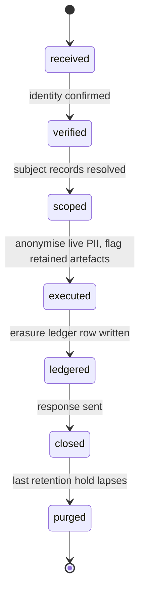
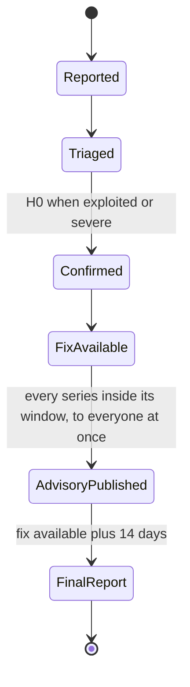

# Security, privacy and compliance features

- **Status:** Draft 0.1
- **Date:** 2026-10-01
- **Scope:** User-visible and operator-visible security, privacy and compliance capabilities of obop: authentication, authorization, isolation, audit, encryption, privacy tooling, platform protections, agent and command security (CLI, API and MCP), supply-chain and CRA duties, and compliance scoping for a free project that hosts nothing for others today except one sample-data sandbox, and plans a paid hosting service (OR-22).

Reading notes. obop is Apache-2.0 and completely free, with no proprietary layer, no paid list and no plans (OR-1, OR-2), so every capability in this spec is open and free. The owner rulings of 2026-10-01 (OR-1 to OR-21, RATIFIED) are cited by number. SpaceCorps is the publisher and operates no hosted obop for other people today, apart from one free sandbox that holds sample data only (OR-10, OR-11, OR-20, D83; the paid hosting service of OR-22 is planned, not offered, and would make SpaceCorps a processor for its customers), so statements about cells, fleets, residency, processors and breach notification are guidance for whoever runs obop (a self-hoster, an accountant with many businesses, a third-party host), not duties of SpaceCorps; the sandbox holds no customer data and creates no processor role, and its data policy (4.6) and hardening profile (4.7) are Proposed (Q34, Q36). "Proposed" marks anything the owner has not ruled (D12, D13, D20 and the T0 list of D25, the dates D26 leaves open, the staging and remaining admission details of D81, the release cadence of D85, the slip order of D86, the grammar and the exemption-list entries of D80, the sandbox details of D83) and every design choice that neither the research nor the register settles; D1, D2, D17, D23, the D24 renames and I-1 to I-4 are RATIFIED in [DECISIONS.md](../DECISIONS.md) (I-1, the renames and the X and L prefixes by OR-14), as are the W1 cut of D86 (OR-15), literal UI parity and the exemption mechanism of D80 (OR-16), the OSI-licence listing rule of D81 (OR-17), the sign-off rule of D82 (OR-18) and the existence of the sandbox of D83 (OR-20). "(target)" and "(estimate)" mark design targets and model outputs, not measurements. Versions are "as of 2026-10-01". Decisions are cited by ID (for example D33). Event names, permission-group names, data classes, entity states and port implementers are spelled as in [CONVENTIONS.md](../CONVENTIONS.md), which fixes the spelling while this spec defines the meaning of the names it owns. `BusinessTx` and `BusinessRouter` are the D24 names (the rename from R18's and R23's `TenantTx` and `TenantRouter` is RATIFIED by the owner on 2026-10-01, OR-14). The `obop` CLI, its grammar and the plugin registry client are specified in [cli.md](cli.md); command names here follow it, and a name marked `*` is not yet named there and follows the CONVENTIONS 2.1 rule `<model>.<action>` (Proposed). In the Odoo parity column, "Community" and "Enterprise" always mean Odoo's editions; obop has one. Nothing here is legal advice; "counsel" marks items for a lawyer.

## 1. Purpose and scope

### 1.1 What this area is

In obop, security is a property of the kernel, not an app. The kernel crates (`obop-security`, `obop-orm`, `obop-events`, `obop-storage`, `obop-http`) and the `base` module enforce; this spec defines what users and operators can see, configure and rely on. Three rules frame it.

1. **Everything here is open and free.** obop is one Apache-2.0 codebase with no proprietary layer, no paid list and no plans (OR-1, OR-2, D2, RATIFIED). No security outcome is withheld: security fixes, data export, the API, the CLI, ledger integrity and the audit log are never gated, because nothing is. Capabilities that earlier drafts put on a paid list are unpromised backlog items (1.3, section 8).
2. **The P0 list is design-time law** (D33, BINDING). Business isolation, one query path, typed elevation, an append-only audit log and the rest cannot be retrofitted, so they ship in the kernel from the first commit.
3. **Agentic first** (OR-4, OR-16, D80, RATIFIED). Every security capability, administration included, is a typed command reachable through the CLI, the REST API and MCP, and the web UI is a client of the same commands and reaches literal parity with them before the first stable release. People, scripts and agents therefore meet one permission, approval and audit path (4.10), and a security feature is not done until it exists on all three surfaces (4.11).

Users: business owners and administrators, security and privacy officers, auditors, accountants, employees, portal users, agents, operators, third-party hosts and outside researchers (section 2).

### 1.2 Boundaries with neighbouring areas

| Neighbour | This spec owns | The neighbour owns |
|---|---|---|
| [platform.md](platform.md) | Security semantics of chatter, attachments, automation and approvals | The apps themselves, the approvals engine, search, import and export UX |
| [integrations.md](integrations.md) | Credential primitives (hashing, expiry, step-up, token lifetimes), the SSRF-hardened egress client and webhook-signing requirements | How integrators obtain, scope and lose credentials, the OAuth app model, rate and abuse policy (4.2, 4.10 there), endpoint design, payload formats, the plugin registry's package mechanics, portability |
| [ai.md](ai.md) | Agents as principals, permission intersection, approval and audit rules | AI features, semantic layer, model routing, the write protocol (dry-run, `plan_id`, approval policy) and MCP |
| [cli.md](cli.md) | The security rules every command obeys on every surface (4.10): scoped tokens, plan binding, audit entries, secrets handling, exposure to agents, plugin install trust | The grammar, flags, output and exit-code contracts, the command catalogue, the plugin registry client and its trust tiers, distribution of the binary |
| [finance.md](finance.md) | Audit log, hash-chain verification hooks, retention holds | Posting rules, DB-enforced ledger integrity (D30), lock dates, statutory exports |
| [people.md](people.md) | Data classes, relationship-based access, read-audit, sensitive-capture defaults | HR workflows, payroll packs |
| [ux.md](ux.md) | What security screens must do | View catalogue, design system, accessibility implementation |
| [../ENGINEERING.md](../ENGINEERING.md) | Required supply-chain and release controls | The pipelines, runners, release calendar |
| [../BUSINESS.md](../BUSINESS.md) | The security and CRA inputs to the risk register | Licensing, governance, trademark, sustainability and the risk register |
| [../LOCALIZATION.md](../LOCALIZATION.md) | The retention-class and legal-basis mechanism | Per-country values in packs |
| [../CONVENTIONS.md](../CONVENTIONS.md) | The meaning of the permission groups, data classes, events and states it owns (its registry rows name this spec as owner) | The spelling of every cross-document name, the event catalogue and the rename map |

### 1.3 Components in scope

All components are kernel capabilities (tier T0, Proposed in D25) unless marked. Wave placement is Proposed where a cell says so: W0 carries the structural P0 items of D33 (isolation, query path, elevation, audit log, egress client, money, registry flags, migrations, dependency gates, password login, sessions, API keys) at the 0.1 preview (2026-12-01); TOTP and passkeys are also P0 but ship in W1 by 0.2 (2027-02-02), before any public release (Proposed; the repository has been public since 2026-10-26, and the G0 checklist of OR-5 and D26 now gates the 0.3 public alpha). The W1 items marked P1 in 6.1 land before the first public release, which D26 (Proposed) puts at the latest at the 0.3 public alpha (2027-04-06); other W1 items follow by 2027-09-30; P2 items precede any external audit.

**W1 capacity.** D86 cuts W1 to the smallest honest loop (the cut is RATIFIED, OR-15) and does not cut the D33 P0 and P1 items. OIDC, the SCIM subset, LDAP bind, envelope encryption, rate limits, the upload pipeline, signed releases and the rest of the P1 list in 6.1 are therefore owed by an owner plus AI agents (D84) on top of the loop. That is a named schedule risk of this area (open question 18), not a cut. The free sandbox of D83 opens at the public beta (0.5) and is an operating duty, not a W1 module: it does not change the cut, and the security work it adds (the data policy of 4.6 and the hardening profile of 4.7, both Proposed) falls on the same owner (open question 22).

| Component | Lives in | Wave | Scope note (all open and free, OR-2) |
|---|---|---|---|
| 4.1 Identity and authentication | `obop-security`, `base` (principal, credential, session, API key); isolated SAML bridge | W0 password, sessions, API keys; W1 the rest | OIDC and the SCIM subset are D33 P1; native SAML and full SCIM are backlog |
| 4.2 Authorization | `obop-security`, `obop-orm`, registry | W0 algebra, fields; W1 classes; W2 approvals; W3 HR scopes | Agents are principals (4.10) |
| 4.3 Business isolation | `obop-orm` (`BusinessTx`, `BusinessRouter`), runtime roles | W0 | Cell and fleet tooling is open operator code; fleet DR is backlog |
| 4.4 Audit and tamper evidence | `base` (`audit_change`, `security_event`) | W0 log; W1 UI, export, read-audit; W2 checkpoints | Local checkpoints in scope; WORM, SIEM connector, tiering and evidence packs are backlog |
| 4.5 Encryption and keys | `obop-storage`, `base` | W1; W2 crypto-shredding | Local and OpenBao keys in scope; KMS, HSM and customer-managed keys are backlog |
| 4.6 Privacy tooling | `base` (no separate module proposed) | W0 flags; W1 DSAR, erasure, consent, retention; W2 residency | Residency is the operator's choice; no hosted pinning exists. The sandbox data policy (D83, OR-20) is Proposed (Q34) |
| 4.7 Platform protections | `obop-http`, egress client, `obop-report`, `obop-wasm-host` (T0, W3) | W0-W1; W2 extension trust for packs; W3 Wasm | The Wasm host moved to W3 with X3 (D86). The sandbox hardening profile (D83, OR-20) is Proposed (Q36) |
| 4.8 Supply chain and CRA | Repository, CI, runbook | W0 baseline; W1 drilled by 2027-06-01; technical file only if counsel finds SpaceCorps a manufacturer (Q5) | Fixes and advisories are never gated or tiered |
| 4.9 Compliance scoping | Scoping statement, not code | n/a | SOC 2 and ISO 27001 are not planned (OR-11) |
| 4.10 Agent and command security | `obop-security`, `obop-http`, the command layer | W1 (W0 keys) | One path for CLI, API and MCP |
| 4.11 CLI, API and MCP surface | The command catalogue ([cli.md](cli.md)) | W0-W1 | Parity before the first stable release |

**Open and free; the unpromised backlog.** Nothing in this area is paid (OR-2), and there is no paid list that could ratchet. The capabilities that earlier drafts put on one are ordinary backlog items (DECISIONS 2.3 and 6): native multi-IdP SAML with JIT provisioning; full SCIM (Bulk, advanced filters, IdP-group-to-permission-group policies); WORM or object-lock checkpoint publication; SIEM streaming as a native connector; legal-hold and multi-year tiering of audit data; auditor evidence packs; cloud-KMS and HSM connectors; customer-managed keys; region-pinning tooling for operators of many businesses; fleet disaster recovery and cross-region failover; the supported air-gap bundle. They are not withheld, not promised and not scheduled; each is built when someone builds it, and section 8 lists them. What this spec asks of the kernel today is only that the seams exist: the key backend is a trait, checkpoints are plain signed values anyone can copy off the host, and `obop audit tail --follow` streams the log to any shipper (Proposed).

## 2. Personas and roles

"Tenant" is a control-plane word (D24). Inside a business the units are business, company and principal.

| Persona | What they do in this area | Default permission group (Proposed) |
|---|---|---|
| Business owner | Sets the MFA policy, reads the security dashboard | `base.admin` |
| Business administrator | Manages principals, permission groups, API keys, IdP links; cannot read payroll or special-category data unless separately granted | `base.admin` |
| Security officer | Session and credential policy, audit log, access reviews | `security.officer` |
| Privacy officer (DPO or delegate) | DSAR, erasure, consent, retention holds | `privacy.officer` |
| Auditor, internal or external | Read-only security and change log and evidence; no business-data write. Ledger evidence is added with `account.read` ([finance.md](finance.md)); HR metadata and the audit log need only `audit.reader`, and HR data itself only explicit grants ([people.md](people.md)) | `audit.reader` |
| External accountant | Ledger access per finance permission groups; MFA required by default. No seat, licence or quota exists (OR-2) | `account.adviser` ([finance.md](finance.md)) |
| HR officer, HR administrator, payroll preparer and approver | `confidential_hr`, `special_category` and `financial` HR data; `special_category` and `financial` need separate grants, and whether `hr.officer` reads `confidential_hr` by default is open (open question 17) | `hr.officer`, `hr.admin`, `hr.special_reader`, `payroll.preparer`, `payroll.approver` ([people.md](people.md)) |
| Line manager | Team data through a reporting-line relationship | `hr.line_manager` (derived from the relationship scope, 4.2) |
| Employee, light user | Own records only (`own` scope) | `base.user`, `hr.self` |
| Portal user, guest | Own documents through portal or capability tokens | `base.portal`, `base.public` |
| Sandbox visitor | Tries a seeded session business on the free hosted sandbox that SpaceCorps opens at the public beta (OR-20); no sign-up and no email address (Q34). The visitor is anonymous and uses only the session business, which is dropped at its time to live | A session-local administrator of that one business, with no reach beyond it (Proposed, Q36) |
| API client, agent | Scoped machine access through the CLI, REST or MCP; permissions are the intersection of delegator and token scopes (4.10) | `base.api_client`, `base.agent` |
| Operator | Runs the installation, holds key custody, no default business-data access | Outside the business (OS, DB) |
| Third-party host | Runs many businesses for other people and carries a host's duties (processor, breach notice, switching). SpaceCorps is not one (OR-11, D83): its sandbox holds sample data only and no business of anyone (OR-20) | Control plane (open fleet tooling, D6), outside the business |

**Default permission groups.** The kernel seeds are `base.user`, `base.portal`, `base.public`, `base.admin`, `base.api_client`, `base.agent`, `security.officer`, `privacy.officer` and `audit.reader`. `base.admin` manages principals and settings but implies no data permission groups (Proposed; Odoo's `group_system` is the comparison point [R02 s3], but what it implies was not researched). Module groups (`sales.user`, `account.manager`, `hr.officer`) are owned by the module specs, which define their grants and limits; the table below is the seed list and carries every group by owning spec, in the spelling of the registry in [CONVENTIONS.md](../CONVENTIONS.md) 4. No permission group implies access to a `special_category` class; that needs an explicit, audited grant. `base.api_client` and `base.agent` carry no permission rows of their own. Cross-app named-action permission rows (Proposed): `export`, separate from read (AZ10), and the UI rows `customize_views`, `share_views`, `import_data` and `manage_branding` named in [ux.md](ux.md); grants of all of them are audited.

**Canonical seed names (Proposed).** This spec owns the kernel seeds, the `<module>.<role>` convention and this list of names; the owning spec defines a module group's grants and limits, and a new name is added here when its spec introduces it, in the same change that adds it to the registry of [CONVENTIONS.md](../CONVENTIONS.md) 4, which fixes the spelling. The rows below carry every name registered there as of 2026-10-01; a module group stays Proposed until this list carries it. Named actions (for example `sales.price_override`, `stock.validate`) and field permissions (`product.cost_viewer`, `timesheet.cost_viewer`) are permissions granted by the rows of a group, not groups; they appear in the notes only where the registry names them. Where a spec already spells a group this spec also uses, the owning spec's spelling stands.

| Permission group | Owning spec | Implied groups and notes |
|---|---|---|
| `base.user`, `base.portal`, `base.public`, `base.api_client`, `base.agent` | This spec; [platform.md](platform.md) 4.4 | None stated; `base.api_client` and `base.agent` carry no permission rows of their own |
| `base.admin` | This spec | Implies no data permission groups (Proposed) |
| `security.officer`, `privacy.officer`, `audit.reader` | This spec | None stated |
| `account.read`, `account.billing`, `account.bookkeeper`, `account.user`, `account.manager` | [finance.md](finance.md) 2 | None stated; grants and limits are in its table |
| `account.adviser` | [finance.md](finance.md) 2 | External accountant: what `account.user` grants on the companies named in the grant, plus export |
| `account.payment_approver` | [finance.md](finance.md) 2 | Releases payment batches and approves bank-detail changes; never held by an agent; cannot create the same payment |
| `hr.self`, `hr.line_manager` | [people.md](people.md) 2 | `hr.line_manager` is derived from the reporting line, never granted by hand |
| `hr.officer`, `hr.admin`, `hr.hrbp`, `hr.special_reader` | [people.md](people.md) 2 | `hr.hrbp` is the HR business partner, `domain` scope on assigned departments; `hr.special_reader` reads `special_category`, every read audited with a purpose; whether `hr.officer` reads `confidential_hr` by default is open (open question 17). Named actions `hr.retro_change` and `hr.correct` are permissions, not groups |
| `recruitment.recruiter`, `recruitment.interviewer` | [people.md](people.md) 2 | None stated; grants and limits are in its table |
| `payroll.preparer`, `payroll.approver` | [people.md](people.md) 2 | The approver differs from the preparer |
| `attendances.kiosk` | [people.md](people.md) 2 | Check-in and check-out only; held by an API client principal registered to the device (Proposed; D28 has no device principal kind) |
| `crm.user`, `crm.team_lead`, `crm.manager`, `sales.user`, `sales.team_lead`, `sales.manager`, `sales.invoicing`, `product.user`, `product.manager`, `pricing.manager`, `subscriptions.user`, `subscriptions.manager`, `rental.user`, `rental.manager`, `commissions.manager`, `commissions.self` | [sales-crm.md](sales-crm.md) 2 | None stated; grants and limits are in its table. Field permission `product.cost_viewer` covers product cost, margin, valuation and manufacturing cost; named actions `sales.price_override` and `sales.unlock_order` |
| `stock.operator`, `stock.manager`, `stock.valuation_user`, `purchase.user`, `purchase.manager`, `mrp.user`, `mrp.manager`, `mrp.operator`, `quality.user`, `quality.manager`, `maintenance.user`, `maintenance.manager`, `delivery.user` | [supply-chain.md](supply-chain.md) 2 | None stated; grants and limits are in its table. The `stock.*`, `purchase.*` and `mrp.*` approvals and overrides are named actions, not groups |
| `pos.cashier`, `pos.supervisor`, `pos.manager`, `pos.admin`, `ecommerce.merchandiser`, `ecommerce.fulfillment`, `ecommerce.manager`, `loyalty.manager`, `website.editor`, `website.publisher`, `website.designer`, `website.admin`, `marketing.user`, `marketing.manager`, `marketing.deliverability_admin`, `livechat.operator` | [retail-commerce-marketing.md](retail-commerce-marketing.md) 2 | None stated; grants and limits are in its table. `pos.cashier` replaces the retired `pos.user` |
| `resource.admin`, `project.user`, `project.manager`, `timesheet.user`, `timesheet.approver`, `timesheet.admin`, `helpdesk.agent`, `helpdesk.lead`, `helpdesk.manager`, `planning.user`, `planning.dispatcher`, `planning.technician`, `appointments.host`, `appointments.manager`, `fleet.manager`, `fleet.driver`, `service_contract.manager` | [services.md](services.md) 2 | None stated; grants and limits are in its table. Field permission `timesheet.cost_viewer` covers employee cost, a different audience from `product.cost_viewer` |
| `customize.designer`, `automation.designer`, `approvals.designer`, `analytics.designer`, `documents.user`, `documents.manager`, `knowledge.editor`, `knowledge.admin`, `contacts.manager`, `mail.account_admin`, `sign.user`, `sign.admin` | [platform.md](platform.md) 2 | None stated; grants and limits are in its table. `mail.account_admin` manages mailbox connections and `api.connection_admin` the other connections |
| `ai.admin`, `ai.user`, `ai.operator`, `ai.auditor`, `ai.hr_feature_owner`, `ai.ap_intake` | [ai.md](ai.md) 2 | `ai.ap_intake` is the service group of the intake agent; an HR AI feature needs `ai.admin` plus `hr.admin`, with `ai.hr_feature_owner` for the switches; an agent's effective permission is the intersection in AZ7 |
| `api.client_admin`, `api.webhook_admin`, `api.connection_admin`, `api.import_operator`, `api.export_owner`, `api.extension_admin` | [integrations.md](integrations.md) 2 | None stated; grants and limits are in its table. `api.export_owner` governs the full-business export job only; per-model `export` stays the AZ10 operation |

Retired: `finance.*` (now `account.*`), `hr.manager`, `hr.user` and `hr.auditor` (now `hr.admin`, `hr.officer` and `audit.reader`, plus `account.read` for ledger evidence); see [CONVENTIONS.md](../CONVENTIONS.md) 8.

## 3. Capability map

Parity column: "Community" and "Enterprise" are Odoo's editions. Waves follow section 1.3.

| Capability | Description | Wave | Odoo parity |
|---|---|---|---|
| AU1 Password login | Argon2id, NIST SP 800-63B-4 policy: 15 characters alone (8 inside MFA), 64+ accepted, no composition rules or rotation, blocklist, throttling [R18 s2] | W0 | Matches Community `auth_password_policy` by name; what that module enforces was not researched (unverified) |
| AU2 TOTP | RFC 6238 second factor, recovery codes (P0 in D33, shipped in W1) | W1 | Matches Community `auth_totp` |
| AU3 Passkeys | WebAuthn (P0 in D33, shipped in W1). Built in D65 without `webauthn-rs` (it needs system OpenSSL): a small verified implementation over `ring`, attestation `none`, ES256, EdDSA and RS256, table `auth_passkey` | W1 | Matches `auth_passkey` (Community master) |
| AU4 Sessions | Opaque, server-side, revocable, idle and absolute timeout, device list, revoke-all | W0 | Partial (`auth_timeout`); beyond |
| AU5 Step-up | Fresh passkey or TOTP for the sensitive actions listed in 4.1 | W1 | Beyond |
| AU6 OIDC | Single sign-on against any OIDC IdP (D33 P1, before the first public release) | W1 | Matches `auth_oauth` |
| AU7 LDAP bind | Authenticate against AD or OpenLDAP | W1 | Matches `auth_ldap` |
| AU8 SAML | Isolated bridge, documented with Keycloak or Authentik. A native multi-IdP service provider with JIT provisioning is an open backlog item, unscheduled | W1 bridge; native: backlog | No SAML module in the Community tree; Enterprise not verified |
| AU9 SCIM 2.0 | Subset: `/Users`, `/Groups`, PATCH, `eq` filter, ETag (D33 P1, before the first public release; W1 capacity: open question 18). Full SCIM (Bulk, advanced filters, IdP-group-to-permission-group policies) is an open backlog item, unscheduled | W1 subset; full: backlog | Beyond (none in Community) |
| AU10 API keys | Hashed, prefix-identifiable, scoped, mandatory expiry (default 90 days, Proposed) | W0 | Matches (Odoo caps at 3 months [R02 s3]); beyond on scopes |
| AU11 OAuth 2.1 provider | Code plus PKCE, client credentials, refresh rotation with reuse detection, Client ID Metadata Documents, audience binding, tokens of one hour or less; OAuth 2.1 and the metadata-document mechanism are still IETF drafts as of 2026-10-01 [R24 s3.4] | W1 | Beyond (Odoo 20 MCP uses a static key [R16 s2.1]) |
| AU12 Capability tokens | `share_grant` tokens for portal and guest links: scoped, expiring, revocable | W1 | Matches `access_token` idea; beyond on expiry, revocation |
| AZ1 Permission and restriction rows | OR of permissions, AND of restrictions, default-deny (D10) | W0 | Matches Community `ir.access` of Odoo 20, where an empty OR already denies [R23 DR-4]; beyond on mandatory scopes and field- and action-level default-deny |
| AZ2 Mandatory scopes | Every permission declares `all`, `own`, `company` or `domain`; implicit TRUE fails lint | W0 | Beyond |
| AZ3 One query path | List, by-id, export, webhook and AI reads share one compiled predicate; non-leaking 404; export is a separate audited permission | W0 | Beyond |
| AZ4 Field-level security | Enforced in projection and query compiler; filter, sort and group on unreadable fields rejected | W0 | Beyond (Odoo field groups do not propagate to related fields [R13 s9.2]) |
| AZ5 Data classes | `obop_cls_*` database roles for the three sensitive classes `confidential_hr`, `special_category` and `financial` | W1 | Beyond |
| AZ6 Typed elevation | `Env<Elevated>`, audited, reason required; break-glass is an elevation that also alerts security officers (Proposed) | W0 | Replaces `sudo()`; beyond |
| AZ7 Agent permission intersection | Effective permission is the delegator's grants intersected with token scopes; tool lists per principal; classes `confidential_hr`, `special_category` and `financial` only when the human also holds them ([ai.md](ai.md)) | W1 | Beyond (Odoo 20 MCP key acts as the user [R16 s2.1]) |
| AZ8 Relationship access | Manager hierarchy and department scopes for HR | W3 | Matches Community intent; beyond on classes |
| AZ9 Separation of duties | Exclusive approval, creator not approver, agents never approve own proposals | W2 | Matches Odoo Enterprise (Studio approval rules [R15 s9]) |
| AZ10 Export permission | Export is a separate named-action permission, audited and rate-limited; step-up for sensitive classes and full-business export | W1 | Beyond |
| IS1 Business isolation | `BusinessTx`, database per business, `FORCE` RLS backstop on `company_id`, runtime role without `BYPASSRLS` | W0 | Matches Odoo's database-per-customer model; beyond on types |
| AD1 Business change log | Field diffs in the same transaction | W0 | Matches Community chatter tracking; beyond |
| AD2 Security event log | Append-only, hash-chained, pseudonymous actor ids | W0 | Beyond (no Community equivalent; OCA `auditlog` is Beta [R18 s6]) |
| AD3 Audit UI and export | Search, filter, export, 13-month default | W1 | Beyond |
| AD4 Read-audit | Logs reads of sensitive classes and exports | W1 | Beyond |
| AD5 Signed checkpoints | Ed25519 checkpoints the operator can copy off the host (`obop audit_checkpoint list*`); automated WORM or transparency-log publication is an open backlog item | W2 | Beyond |
| EK1 Transport and backup security | rustls, PostgreSQL `verify-full`, SCRAM-SHA-256, HSTS; pgBackRest encrypted repository, object lock, monthly restore drill | W0 transport; W1 backups | Matches Odoo deploy guidance; beyond on backups |
| EK2 Field encryption | Envelope scheme, AES-256-GCM or XChaCha20-Poly1305, AAD-bound | W1 | Beyond |
| EK3 Key custody | Local sealed file or OpenBao; cloud-KMS and HSM connectors and customer-managed keys are open backlog items, unscheduled | W1; connectors: backlog | Beyond |
| PV1 Personal-data map | Registry flags, data-subject path, retention class per field | W0 | Beyond (Community `privacy_lookup` is search and erase only) |
| PV2 DSAR export | Machine- and human-readable subject export with deadline clock | W1 | Matches Community `privacy_lookup`; beyond |
| PV3 Erasure | Anonymise in place, erasure ledger, replay after restore | W1 | Beyond |
| PV4 Retention | Classes per country from packs, purge job, record-level hold | W1 (DE) | Matches Community `data_recycle`; beyond |
| PV5 Consent | Purpose-scoped, versioned, timestamped records | W1 | Beyond |
| PV6 Residency | Region attribute set when the business is created, region-local data on the operator's infrastructure; the operator (a self-hoster or a third-party host) chooses the region, and SpaceCorps offers no hosted pinning (D83) | W2 | Beyond |
| PP1 Egress client | One SSRF-hardened outbound client | W0 | Beyond |
| PP2 Injection and upload controls | Typed queries, sandboxed templates, sanitiser, CSP, upload pipeline, CSV neutralisation | W1 | Beyond |
| PP3 Rate limits and quotas | Per IP, account, key and business; concurrency caps (limits and abuse policy: [integrations.md](integrations.md) 4.10) | W1 | Beyond |
| PP4 Extension trust | Capability manifests and the revocation list for packs (X1, X2); the Wasm `ext` role (X3) | W2 packs; W3 Wasm (D86) | Beyond |
| PP5 Plugin install and copy | Verified install by digest, signatures and provenance; the capability digest is the consent; copy mode adds no privilege; revocation list; sideload flag (D81, [cli.md](cli.md) 4) | W1 sideload; W2 index | Beyond |
| CM1 One command path | CLI, REST and MCP commands come from one catalogue and run the same handler under the same compiled predicate; no surface holds its own definition, and there is no direct-database mode (D80, [cli.md](cli.md) 1.3) | W1 | Beyond (Odoo 20 MCP key acts as the user [R16 s2.1]) |
| CM2 Scoped command tokens | Scopes `<model>:<operation>`, mandatory expiry, hashed at rest, shown once; secrets never in argv ([cli.md](cli.md) 2.12); an agent cannot satisfy step-up | W1 | Beyond (Odoo caps keys at 3 months [R02 s3]) |
| CM3 Plan binding | Dry-run returns a `plan_id` bound to a digest of command, arguments, principal chain and touched row versions; single-use, principal-bound, time-limited; `plan_stale` after a change (D18) | W1 | Beyond (Odoo offers an optional preview on Create Records [R16 s5]) |
| CM4 Command audit | An audit entry for every mutating command on every surface: principal chain, surface, client, `command_id`, idempotency key, `plan_id`, arguments hash, outcome | W1 | Beyond |
| CM5 Agent exposure limits | Per-principal command lists; no `money_and_payee` or `destructive` commands for agents in W1; agents never approve, never elevate, and (Proposed, open question 19) do not administer security | W1 | Beyond |
| SC1 Dependency gates | `cargo-deny` (including the Apache-2.0-compatible licence allow-list of D1), `cargo-audit`, frozen pnpm lockfile from the first commit | W0 | n/a |
| SC2 CRA vulnerability handling | SECURITY.md, Art. 14 runbook prepared as if SpaceCorps were the manufacturer (Q5), equal-time advisories | W0 v0; W1 drilled by 2027-06-01 | Beyond (Odoo embargoes for customers [R28 D.4]) |
| SC3 Signed releases and SBOM | cosign, attestations, CycloneDX, `cargo-auditable` | W1 | Beyond |
| SC4 Security-fix window | Two years from the first stable release, to be extended toward five only as users and funding appear (D85, OR-12); fixes are never gated (CRA Annex I Part II(8)) | W2 (1.0, 2028-04-18) | Not compared |
| SC5 Contribution provenance | DCO sign-off on every commit, no CLA; the owner signs off every commit, agents are recorded by a `Co-Authored-By` trailer and never add a `Signed-off-by` line, and the DCO check (not built yet) requires a human `Signed-off-by` (D82, OR-18, RATIFIED); counsel confirms the wording (Q16, CN-02) | W0 | n/a |

## 4. Per-app specification

Entity names from [R23 B.1] are used as written; other names here are Proposed. Event names are Proposed and follow D27 (past tense; `TxEvent` runs in the publisher's transaction, durable events use the outbox).

### 4.1 Identity and authentication

**Purpose.** Establish which principal (user, portal user, guest, API client, agent, system; D28) is acting, by what means and with what assurance.

**MVP and later.** W0: local password, sessions, hashed API keys. W1: TOTP, passkeys, OIDC, LDAP bind, SCIM subset, OAuth 2.1 provider, step-up, recovery, and the command-line sign-in methods of 4.10. Later: an option to require device-bound authenticators for privileged permission groups (open question 1). Unscheduled backlog, open and free: native multi-IdP SAML and full SCIM (section 8).

**Entities.**

| Entity | Purpose | Key fields | States |
|---|---|---|---|
| `principal` | Acting identity | kind, `party_id` (nullable), status | invited, active, suspended, deactivated |
| `credential` | One authentication factor | principal, kind (password, totp, passkey, recovery), secret material (hash or envelope), last used | pending, active, disabled, revoked |
| `session` | Browser session | principal, device, created, last seen, idle and absolute expiry | active, `idle_expired`, `absolute_expired`, revoked |
| `api_key` | Machine credential | principal, hashed secret, prefix, scopes, expiry | active, expired, revoked |
| `idp_connection` | OIDC, LDAP or SAML-bridge link | issuer, client id, secret (envelope), mapping | enabled, disabled |
| `share_grant` | Capability token | token hash, `record_ref`, scope, expiry | active, used, expired, revoked |
| `agent_delegation` | Agent acting for a user | agent, on-behalf-of, scopes, expiry | active, suspended, expired, revoked |

**Rules.** Passwords use `argon2` 0.6.0 with at least the OWASP floor (m=19456 KiB, t=2, p=1); an optional pepper lives outside the database [R18 s2]. Sessions are opaque and stored in PostgreSQL (ASVS separates session management from self-contained tokens); cookies are `Secure`, `SameSite=Lax`; HSTS on; state-changing requests also need a CSRF token (Proposed). OIDC uses `openidconnect` 4.0.1, LDAP `ldap3` 0.12.1. Passkeys use `webauthn-rs` 0.5.5 (MPL-2.0, which the dependency allow-list of D1 admits; its README makes no standards-compliance claim, so conformance tests are ours); NIST allows syncable passkeys at AAL2, not AAL3. No SMS one-time codes [R26 B1]. Sign-in must meet WCAG 2.2 SC 3.3.8 (Accessible Authentication, Level AA; <https://www.w3.org/TR/WCAG22/#accessible-authentication-minimum>): paste, password managers and passkeys work and no screen demands a memory test.

**SAML.** XML signature handling is the riskiest authentication code: `samael` 0.0.22 is pre-1.0 and needs the C library `xmlsec1` [R18 s2]. A separate bridge process terminates SAML and hands obop an OIDC assertion. In W1 it is an off-the-shelf broker such as Keycloak or Authentik, an optional sidecar outside the default install (I-1, RATIFIED, OR-14). An obop-authored Rust bridge on `samael`, kept apart from the request path and with multi-IdP and JIT provisioning, is an open backlog item: unpromised and unscheduled, not withheld. Either way obop never hand-rolls XML-DSig and keeps RSA off network-observable paths (RUSTSEC-2023-0071 was open as of 2026-09-12).

**Step-up (Proposed).** Fresh passkey or TOTP is required to: change credentials, create API keys, export `confidential_hr`, `special_category` or `financial` data or the whole business ([integrations.md](integrations.md)), approve payments above the business threshold, change bank details, set the hard lock date ([finance.md](finance.md)), change permission groups, read the audit log, and manage keys. An agent principal cannot satisfy step-up: a non-interactive caller gets `step_up_required` (CLI exit 12) and a person completes it in a browser ([cli.md](cli.md) 2.11, 4.10).

**Workflows.**

1. Enrol: signed-in user adds a passkey; server stores the credential; `CredentialAdded` is emitted and a notice goes to the user's address.
2. Sign in with OIDC: match verified `iss` plus `sub` to a principal; unknown subjects are refused unless an administrator enabled create-on-first-login with a default permission group (Proposed, off).
3. Deprovision: the IdP sends SCIM PATCH `active=false`; the principal becomes `deactivated` (SCIM `active=true` reactivates it; `suspended` is the separate security hold an administrator or security officer sets); sessions are revoked and API keys and agent delegations suspended in the same transaction.
4. Recover: recovery codes, or administrator reset; resetting a privileged account needs a second administrator (Proposed).

**Flows.** Emits `PrincipalInvited`, `PrincipalDeactivated` and `PrincipalSuspended` (payload `principal_id` and `kind`, any principal kind, agents included; [platform.md](platform.md) 4.4 shares the names and reacts to them), `AgentDelegationRevoked` (named in [ai.md](ai.md) 4.2; `ai` consumes it), `CredentialAdded`, `CredentialRemoved`, `LoginFailed`, `SessionRevoked`, `ApiKeyCreated` and `ApiKeyRevoked` (this spec owns the `api_key` aggregate, so it is the one emitter, [CONVENTIONS.md](../CONVENTIONS.md) 3.1 rule 3; [integrations.md](integrations.md) 4.2 is the integrator-facing surface over the same commands and owns `OAuthConsentGranted` and `OAuthConsentRevoked`). Consumes `PrincipalSuspended` and `PrincipalDeactivated` (sessions, delegations, share grants) and SCIM requests. `mail` consumes credential events for user notices.

**Permissions and sensitive data.** `security.officer` manages policy; secret material and IdP secrets are class `secret` (Proposed) and envelope-encrypted (4.5). **Reports.** MFA coverage by permission group, stale API keys, failed-login trend, SSO health. **Configuration.** Allowed factors, MFA requirement by permission group, session lifetimes (Proposed defaults: idle 60 minutes, absolute 12 hours), IdP links, SCIM token. **Localisation.** Auth screens translate; nothing is country-specific.

**Open and free (OR-2).** Native multi-IdP SAML and full SCIM are unpromised backlog items (section 8), not withheld.

### 4.2 Authorization

**Purpose.** Decide what a principal may do per model, field, action and record, through one algebra (D10).

**MVP and later.** W0: algebra, scopes, field security, elevation, RLS backstop. W1: data classes, export permission. W2: multi-company visibility, approvals and separation of duties, agent approval policies (D18). W3: HR relationship scopes.

**Entities.**

| Entity | Purpose | Key fields | States |
|---|---|---|---|
| `access` | Permission row (has a permission group) or restriction row (none) | model, operations incl. named actions, scope, domain AST | active, inactive |
| `permission_group` | Named bundle of rows | implied permission groups | active |
| `group_membership`, `principal_company` | Who holds which permission group, in which companies | principal, permission group or company | active, revoked |
| `field_access` | Per-field read and write rules | field, permission group, class tag | active |
| `elevation_grant` | Audit record of one elevation, not a standing right | code site, reason, principal | used |

**Rules.**

- Effective access is `OR(permission rows) AND AND(restriction rows)`; an empty OR is FALSE, so no matching permission means denial. Restrictions only narrow (company, soft-delete, embargo, residency) [R23 DR-4].
- `own` needs an owner field, declared per model in the registry (Proposed). An implicit TRUE scope is a lint error.
- A by-id read that fails the predicate returns 404, never 403 [R18 s10].
- Writes use per-operation DTOs with `deny_unknown_fields`; `company_id`, `state`, `user_id` and server-computed fields are not writable through generic calls.
- Unreadable fields are omitted from responses, exports, webhooks and AI output, and a filter, sort or group on one is rejected (closes the inference channel); schema endpoints list only readable fields (Proposed).
- Classes `confidential_hr`, `special_category` and `financial` live in separate tables or columns granted to fixed `obop_cls_*` database roles, selected per request by `SET LOCAL ROLE`. The first five class names come from [R13 s9.3]: `public_directory`, `internal`, `confidential_hr`, `special_category`, `financial`; `secret` is Proposed. These three are the sensitive classes: they get `obop_cls_*` roles and the read-audit of 4.4. The per-class meaning, default readers and handling are the class table below, which this spec owns; [CONVENTIONS.md](../CONVENTIONS.md) 5 fixes the spelling and the map from field type to class, and [people.md](people.md) 4.11 assigns the HR fields. The per-class `agent_readable` flag defaults to false except for `public_directory` and `internal`.
- Elevation is a call to `Env<Elevated>`: typed, audited, with a reason. Elevation sites are listed in the registry and CI tracks their count; a new site needs a security review (Proposed). The Odoo baseline is 433 `.sudo(` calls in `addons/mail` alone (20.0 source, tests excluded) [R02 s3]. Break-glass access to a sensitive class is such an elevation and also alerts security officers; HR reads under it carry a purpose ([people.md](people.md), Proposed).
- Agents: effective permission is the intersection of the user's (or service permission group's) grants and the token's scopes, tool lists are filtered per principal, and nothing bypasses command handlers; classes `confidential_hr`, `special_category` and `financial` reach an agent only when its scope is granted and the human also holds the class ([ai.md](ai.md)) [R16 s5, D18]. The same rule holds whichever surface carries the call (4.10).
- Export is a named-action permission, not implied by read (AZ10); the export path applies the same compiled predicate and field projection as a list.
- **HR relationships.** RLS gives only the coarse gate (company plus class role); hierarchy visibility stays in the application because hierarchy subselect policies are slow and racy under READ COMMITTED [R23 DR-4]. Proposed: a reporting-line closure table maintained in the same transaction, a narrow public read model for the directory (`employee_public` in R13, `hr_employee_public` in [people.md](people.md)), and line managers see team leave dates and status but not reasons or certificates.
- **Four-eyes (Proposed).** Granting `base.admin` or `security.officer` can require a second approver (setting, off by default).

**Data classes (the registry).** A class tags columns. Classes are not permission groups and not retention classes; the `obop_cls_*` roles are database roles. A value from which a protected value can be recomputed carries the strictest class of its inputs (the inference-channel rule of D10).

| Class | Meaning | Default readers | Handling | `agent_readable` |
|---|---|---|---|---|
| `public_directory` | Directory data: name, work contact, department, title, manager | All internal principals | None | true |
| `internal` | Non-public business data about people and work: type, schedule, skills | Manager chain, HR | Audit on change | true |
| `confidential_hr` | Personal employment facts that are not money | Self; `hr.officer` is open (open question 17) | Separate tables behind `obop_cls_*`; read audit | false |
| `special_category` | GDPR Art. 9 data as the pack decides: health, union, diversity, disability, work permit | Self, `hr.special_reader` | Field encryption; purpose on every read; DPIA gate | false |
| `financial` | Money owed to, paid to or held for a named person or counterparty, and anything from which it can be recomputed | Self, payroll groups, finance groups | Separate tables behind `obop_cls_*`; field encryption; read audit; export approval | false |
| `secret` (Proposed, 4.1) | Credentials and key material: API keys, OAuth and IdP secrets, TOTP seeds, PSP and carrier credentials, webhook secrets, BYOK keys | Nobody; write-only | Envelope-encrypted (4.5); absent from exports, logs and errors | false |

The three sensitive classes (`confidential_hr`, `special_category`, `financial`) never go to a non-local AI route without an impact-assessment acknowledgement ([ai.md](ai.md) 4.5), are not indexed by default ([ai.md](ai.md) 4.7) and are excluded from the browser cache ([ux.md](ux.md) 4.13). Cost and margin (`product.cost_viewer`) and employee cost (`timesheet.cost_viewer`) are field permissions, not classes.

**Flows.** Emits `PermissionChanged` (payload `kind`: membership, permission group or access row, plus ids; `ai`, `knowledge`, `ux` and the access cache consume it; `PermissionGroupChanged` is a retired spelling, [CONVENTIONS.md](../CONVENTIONS.md) 8), `ElevationUsed`, `ExportRequested` (payload principal, scope, model; `audit` consumes it), `AccessDenied` (sampled). Consumes registry version bumps for cache invalidation.

**Reports.** Effective-permission explorer ("who can read what"), access review for attestation, separation-of-duties conflicts, elevation usage. **Configuration.** Scope defaults, step-up list, four-eyes setting. **Compliance.** The access review report is the evidence an operator's own SOC 2 or ISO 27001 audit would ask for [R18 s8.2]; SpaceCorps pursues neither (4.9).

**Open and free (OR-2).** Manual mapping of principals to permission groups is in scope. IdP-driven mapping of IdP groups to permission groups belongs to full SCIM, an unpromised backlog item.

### 4.3 Business isolation

**Purpose.** Make cross-business access impossible by construction and cross-company access a tested error (D6).

**Rules.** The cell and fleet rules below are sizing and isolation guidance for whoever runs several businesses (a self-hoster, an accountant, a third-party host); SpaceCorps runs none for others (D83).

- One database per business, at most 250 per cell, PgBouncer per cell. `BusinessRouter` picks the database; no cross-business SQL (D6).
- `BusinessTx` is the only way to obtain a database handle. It begins the transaction, drops to the runtime role (non-owner, no `BYPASSRLS`, `SET LOCAL ROLE`), sets `obop.company_ids` with `set_config(..., true)` and selects the class role. Module visibility plus a CI lint forbid raw pool access [R18 s4].
- RLS is the fixed backstop (D10): a RESTRICTIVE policy `company_id = ANY(nullif(current_setting('obop.company_ids', true), '')::uuid[]) OR company_id IS NULL` plus a PERMISSIVE `true`, `FORCE ROW LEVEL SECURITY`, the lookup wrapped as an InitPlan. An unset context yields no rows.
- Never session-level `SET` behind PgBouncer; run PgBouncer 1.26.0 or later (fixes three CVEs) in transaction mode.
- The runtime refuses to start if its role owns tables or has `BYPASSRLS` (Proposed startup check). PostgreSQL 17 and 18 are supported (D8).
- Referential-integrity checks bypass RLS, so foreign-key and unique errors can leak that a hidden row exists; errors are mapped to generic messages and ids are never treated as capabilities (UUIDv7 embeds a timestamp). Proposed (D89, not built): a refused delete would name only the rows the viewer may list and give one neutral text for every other cause; one bit remains for a `refuse` rule (accepted by the owner, OR-35 a).
- Bulk import stages through non-RLS tables, then `INSERT ... SELECT` under `BusinessTx` (D10; `COPY FROM` fails on RLS tables).
- Inside a business, `Env.companies` is an explicit set validated against `principal_company`; reads span it, writes need exactly one active company [R23 C.3].

**Entities.** `principal_company` lives in the business database. `business`, `cell` and release state live in the control-plane directory, which maps tenant to business to cell.

**Reports and configuration.** An isolation self-test status page and a runtime-role audit; cell assignment and company grants are configuration. **Control plane.** A single-business install needs none of it. The control plane for operators of many businesses (cells, fleet migration, the directory) is open code under Apache-2.0 like everything else (D6, D83); SpaceCorps does not run one for others.

**Tests.** The registry generates an IDOR matrix (every endpoint, every permission group, foreign ids) run nightly, and a cross-business test interleaves requests for two businesses over shared pooled connections and asserts each response contains only its own marker rows (D36).

**Open and free (OR-2).** Fleet disaster recovery and cross-region failover are unpromised backlog items (section 8).

### 4.4 Audit and tamper evidence

**Purpose.** Answer who did what, when, from where, and prove the record was not altered.

**Three layers** [R08 s10, R18 s6]: (1) `audit_change`, field-level old and new values written in the business transaction; (2) `security_event`, append-only (application role has INSERT only, triggers reject UPDATE and DELETE, monthly partitions); (3) the per-journal hash chain on posted ledger entries (D30; the finance spec owns it, this spec requires a verifier job and alerting).

| Entity | Purpose | Key fields | States |
|---|---|---|---|
| `audit_change` | Business change log | record ref, field, old, new, actor ref, transaction id | written (immutable) |
| `security_event` | Security log | sequence, type, actor ref, source IP, user agent, detail, previous hash, hash | written (immutable) |
| `actor_identity` | Pseudonym mapping | actor ref, principal id | present, erased |
| `audit_checkpoint` | Chain anchor | sequence, hash, Ed25519 signature, published-to | computed, signed, published, verified |

**Chain.** `h(n) = H(h(n-1) || canonical(record))`, hashed over the pseudonymous actor ref so erasure of the mapping does not break the chain [R18 s6]. A signed checkpoint every 1,000 events is Proposed. Source IP and user agent are personal data too, so the chain covers only a salted commitment to them; the values sit beside the actor mapping and can be truncated or erased without breaking it (Proposed). Concurrent transactions cannot each read the previous hash without serialising, so one appender orders the events of a business (Proposed; its throughput is measured in the W1 spike, no number claimed). Honest limit: a database superuser can rewrite everything after the last checkpoint that lives outside the database. obop guarantees detection against any checkpoint the operator has copied elsewhere (the CLI prints them, `obop audit_checkpoint list*`); a scheduled job that stores that output off the host is enough. Automated publication to WORM or a transparency log is an unpromised backlog item, not a withheld feature.

**Read-audit (Proposed design).** Reads of classes `confidential_hr`, `special_category` and `financial`, and every export, are logged: by-id reads per record, list reads as query fingerprint, classes touched and row count; a purpose is required for `special_category` reads and break-glass ([people.md](people.md), Proposed). Odoo has no read audit in Community [R13 s9.2].

**Workflows.** Verify recomputes hashes and compares them with the signed checkpoints: the nightly job checks the events since the last verified checkpoint and re-checks closed monthly partitions on a rolling schedule, and `obop audit verify` runs the full chain. On mismatch the system emits `AuditChainBroken`, notifies security officers by mail and webhook, and starts a new segment that references the broken one. Auditor export produces a signed bundle of a date range.

**Flows.** Emits `DataRead` (one per read-audit record), `AuditChainBroken`, `AuditCheckpointSigned`. Audit handlers are `TxEvent` subscribers of every command, so a change and its record commit together; this holds whether the command arrived through the CLI, the REST API or MCP, and the entry names the surface and the principal chain (4.10).

**Retention.** `security_event` 13 months by default (DECISIONS section 6); `audit_change` on ledger-relevant models follows the model's retention class (Proposed). IP addresses and user agents are personal data and carry erasure flags; a truncation period is open question 4.

**Permissions.** `audit.reader` and `security.officer` read; nobody writes. **Reports.** Sign-in anomalies, permission changes, export volume, elevation use, denied-access trends [R18 s12 item 16].

**Open and free (OR-2).** The log, UI, export and local checkpoints are in scope. WORM or object-lock publication, a native SIEM connector, legal-hold tiering of audit data, multi-year tiering and auditor evidence packs are unpromised backlog items (section 8). Any log shipper can already consume `obop audit tail --follow`, an NDJSON stream of what the caller may read ([cli.md](cli.md) 3.7).

### 4.5 Encryption and key management

**Purpose.** Protect secrets and sensitive fields against database, backup and operator exposure, and make erasure by key destruction possible.

**Rules.**

- **Transport:** `rustls` 0.23.45 with `aws-lc-rs`; PostgreSQL `verify-full`; `scram-sha-256` for the runtime role [R18 s5].
- **At rest:** core PostgreSQL has no TDE. Volume encryption is the operator's job; Percona `pg_tde` is a later optional profile (needs Percona Server). Application-level envelope encryption covers the sensitive catalogue.
- **Envelope scheme (W1):** KEK per business from a local sealed file or OpenBao; random DEK per record or field; AES-256-GCM or XChaCha20-Poly1305; AAD binds business, table, column and row id to defeat ciphertext swapping.
- **Catalogue (Proposed):** integration and OAuth tokens, BYOK AI keys, TOTP seeds, IdP secrets, bank account numbers, national IDs, payroll amounts, health notes. Encrypted columns are not searchable; lookups use HMAC blind indexes, and the query compiler rejects other operations on them.
- **Rotation:** two active KEKs with overlap; a throttled job re-wraps DEKs; `KeyRotated` is emitted.
- **Backups:** pgBackRest 2.59.2 repository encryption, S3 object lock, monthly automated restore-and-verify [R18 s9.2].
- **Secrets in configuration:** file (`_FILE`), Kubernetes secrets, OpenBao or a cloud secret manager; none in the database in plaintext, in logs or environment dumps.
- **Crates:** prefer Ed25519 or ES256; avoid `rsa` on network-observable paths.

| Entity | Purpose | Key fields | States |
|---|---|---|---|
| `key_encryption_key` | KEK reference | backend, key id, created | active, retiring, retired, destroyed |
| `data_key` | Wrapped DEK | scope (business, subject, field), KEK id, wrapped key | active, rewrapped, shredded |

**Reports and configuration.** Key inventory and rotation age; encrypted-field catalogue; KEK backend per business. **Flows.** Emits `KeyRotated` (security log, no named consumer). **Crypto-shredding (W2, Proposed).** Destroying a DEK erases the field for every copy, including backups. Granularity is open question 5.

**Open and free (OR-2).** Local sealed-file and OpenBao keys are in scope. Cloud-KMS and HSM connectors and customer-managed keys are unpromised backlog items (section 8). Keys and secrets are never command-line arguments (4.10).

### 4.6 Privacy tooling

**Purpose.** Let a business meet GDPR duties with product features: subject access, erasure, retention, consent, residency.

**Registry-driven.** Each model declares personal-data fields with a category, the path to the data subject (party, employee or principal), a retention class and an erasure strategy (anonymise, delete, retain until expiry). The same metadata drives DSAR, erasure and purge [R18 s12 item 8].

**DSAR.** Deadline is one month from receipt, extendable by two months with notice in month one (Art. 12(3)). Workflow: receive, verify identity, resolve the subject across party, employee and principal records, collect per model, privacy officer reviews, deliver JSON plus a readable PDF, log. Retained artefacts are listed with their legal basis.

**Erasure.**

Erasure is **anonymise in place** when posted documents reference the person: blank the personal fields of the live party record and of every copy that is not itself a retained legal record, keep ledger rows and numbers, record the legal basis (GDPR Art. 17(3)(b) and (e); CCPA 1798.105(d) has parallel exceptions) and the retention expiry, hard-delete when retention lapses. Examples [R18 s8.1]: Germany HGB section 257 books 10 years, vouchers 8, commercial letters 6; UK 6; US IRS 3 to 7, employment tax 4. Packs supply the real values. The buyer's identity on a posted document is part of the retained record (finance INV-17 in [finance.md](finance.md): no anonymising or deleting it before the pack's retention class expires). The immutable e-invoice artefact (raw XML, hash, authority receipt) is that legal record [R09 s8], so it and the archived PDF stay under a `retention_hold`, readable only by finance permission groups and the privacy officer (Proposed), and are anonymised or purged when the period ends. Copies outside the ledger are scrubbed: chatter bodies, non-retained attachments, search indexes, `ai_chunk` embeddings [R16 s14] and stored webhook payloads in the 30-day delivery log ([integrations.md](integrations.md), Proposed). Proposed (D89, not built): `on_delete` would give the erasure planner a declared policy per reference for the records that point at an erased record; D89 does not design the erase command, the finding of all rows of a person or the retention schedule.

**Backups.** PITR restores a whole cluster, so an append-only `erasure_ledger` is replayed after any restore, and the business does not report ready until replay finishes (Proposed) [R18 s8.1]. Special-category fields may also be crypto-shredded.

**Consent.** `consent_record` is an append-only ledger in `base`, reached through a `ConsentPort` in `base-api` so website forms, POS sign-ups, checkout, marketing and recruitment write one ledger (Proposed, settling the ownership question in [retail-commerce-marketing.md](retail-commerce-marketing.md)): subject, purpose, basis, source, text version, channel, time, evidence. A withdrawal is a new row, not an edit. Marketing honours the ledger; a withdrawal emits `ConsentWithdrawn`; marketing mail carries one-click unsubscribe (RFC 8058) [R12 s6.1].

**Residency.** Region is a business attribute set when the business is created by whoever operates the installation; database, object store, backups, logs, traces, mail relay and webhook egress stay region-local, with no cross-region replication of personal data by default [R18 s8.2]. Self-hosters and third-party hosts choose their own region. SpaceCorps hosts no business for others today (D83; its sample-data sandbox holds none, OR-20), so there is no hosted region-pinning product; tooling that helps an operator of many businesses pin regions is an unpromised backlog item. Nothing relies on the EU-US Data Privacy Framework staying valid (its litigation status is unverified).

**Breach handling.** SpaceCorps operates no hosted obop for others today (OR-11, D83) apart from the sample-data sandbox, which holds no customer data (OR-20), so it is no processor for anyone's business data and owes no customer notification today; the hosting service of OR-22 would make it a processor with customer notice duties, an open counsel item (ENGINEERING 11, C10). For the sandbox's own connection data SpaceCorps is the controller (Sandbox data policy, below), and whether a leak of that data is a notifiable breach is a counsel item (open question 12). A business that runs obop is the controller and has 72 hours to its authority (Art. 33). An operator or third-party host that runs obop for others is a processor and notifies the business "without undue delay" (Art. 33(2); the DPA benchmark of 24-48 hours [R28 E.1] is a contract matter for that host, with counsel). obop supplies the tool, in every install: a breach scoping export (`obop audit export*`, 4.11) that lists affected records and subjects from the read-audit and security log. A vulnerability in obop itself follows the CRA runbook of 4.8, not this paragraph.

**HR defaults.** Geo, IP, photo and biometric attendance and sick-leave reasons are off by default, behind a per-country DPIA checklist (biometrics are Art. 9); AI in hiring decisions is off by default (D18). EU AI Act Annex III high-risk obligations (recruitment, CV sorting, worker management, creditworthiness) apply from 2027-12-02, and Annex I product-embedded systems from 2028-08-02, under Regulation (EU) 2026/1744 of 8 July 2026 (the Digital Omnibus on AI; OJ L, 2026/1744, 24.7.2026; in force 2026-07-27), which replaced Art. 113(c) of Regulation (EU) 2024/1689; it is not the separate Digital Omnibus proposal COM(2025) 837 on GDPR, ePrivacy and the Data Act (status not checked). A corrigendum of 2026-09-29 was not read. Whether a given feature is in scope, and the provider and deployer roles, stay with counsel ([ai.md](ai.md) open question 3) [R13 s9].

| Entity | Purpose | Key fields | States |
|---|---|---|---|
| `dsar_request` | Access request | subject, received, due, extended-until, outcome | received, verified, collecting, review, delivered, refused |
| `erasure_request` | Erasure request | subject, scope, legal bases | received, verified, scoped, executed, ledgered, closed, purged (diagram above) |
| `erasure_ledger` | Replay log | subject ref, model, record, action, basis, done | written (immutable) |
| `consent_record` | Consent ledger entry | subject, purpose, basis, source, text version, time, kind (grant or withdrawal) | written (immutable) |
| `retention_policy` | Per class and country | class, country, period, start rule, action | draft, active |
| `retention_hold` | Blocks purge | record or subject, reason, expiry | active, lapsed |

**Reports and configuration.** DSAR deadline board, retention-expiry queue, consent coverage; retention policies, consent purposes, region. **Flows.** Emits `DsarReceived`, `DsarDelivered`, `PartyErased` (the name the sales, website and marketing specs consume; employee and principal data hang off the subject's party), `RetentionExpired`, `ConsentRecorded`, `ConsentWithdrawn`; `search`, `mail`, `documents`, `ai` and the apps holding contact snapshots consume `PartyErased` to scrub copies; webhooks already delivered cannot be recalled, so the ledger records them.

**Open and free (OR-2).** A record-level retention hold is in scope. The "legal hold" of the former paid list, read here as the multi-year, WORM-backed audit variant, is an unpromised backlog item (section 8; open question 6 is closed by OR-2).

#### Sandbox data policy (D83, OR-20)

**Status.** That SpaceCorps runs a free hosted sandbox at the public beta (0.5, 2027-07-06 in the current calendar, which moves if 0.5 moves), ephemeral, with sample data only, abuse controls and auto-reset, is RATIFIED (OR-20, D83). Everything below is the data policy that follows from it, and it is Proposed (Q34 and Q36; Q35 for where it runs). Counsel reviews the terms of use and the privacy notice before the sandbox opens (D83 duty 9). The full list of the duties the sandbox creates is in D83 and is not restated here; this policy covers the data-protection ones, and the controls against abuse are the hardening profile of 4.7.

| Topic | Policy (Proposed) |
|---|---|
| Content | Sample data only, from the seed set shared with the optional local demo (`obop dev up`). The terms of use forbid personal data and production data. Nothing in the sandbox is a customer's data |
| Sign-up | None: no account, no email address and no name are collected, so there is nothing to screen or to erase beyond connection data |
| Connection data | IP address, user agent, request metadata and server logs are processed for abuse control and security only, never for profiling, marketing or analytics, and are kept for days, not months (the period is set in the privacy notice, Q34). Logs carry no request bodies or form contents |
| Cookies and scripts | One strictly necessary session cookie (`Secure`, `SameSite=Lax`, 4.1) and nothing else: no analytics, no advertising, no third-party scripts, fonts or embeds (assets ship in the binary, D37). Counsel confirms that this needs no consent banner |
| Roles | SpaceCorps is the controller for connection data only and a processor for no one: the sandbox holds no customer data and no customer contracts, so the duties of a hosting processor (an Art. 28 contract, a sub-processor list, breach-notice hours) and the Data Act switching duties of a data-processing-service provider do not arise (D83). Whether SpaceCorps needs a processing agreement with its own hosting provider is for counsel |
| Where | One small server in the EU, separate from CI, signing keys and the repository (Q35), so connection data stays in the EU; no cross-region replication (4.6, Residency) |
| Privacy notice | Short, linked from the entry page: who runs the sandbox (SpaceCorps, with provider identification where the law requires it, which depends on Q20), what is processed (connection data, server logs, the session cookie), why, for how long, the hosting provider by name, the rights of the data subject and a contact |
| Minimisation and reset | Each visitor session is a short-lived business cloned from a seeded template database and dropped at its time to live (2 hours idle, 24 hours at most, with a full reset every night; the numbers are a proposal, Q36). Dropping the business drops its audit log, uploads, keys and tokens with it. No backup of a session business exists: recovery is a reseed from the template, so nothing a visitor types outlives the reset |
| If personal data is found | The terms forbid it, but a visitor can type anything. On a report or a finding: drop the session business at once and run the full reset early if needed; remove the matching log lines if they can be identified, otherwise let the log retention expire; write a private incident note (date, kind of data, action taken, no copy of the data); fix the control that let it in. Whether the case is a notifiable breach is a counsel item (open question 12) |
| Requests from data subjects | Answered from the connection-data logs while they exist; after the retention period nothing is held, and the answer says so |
| Not offered | No DPA, no service level, no switching terms and no SOC 2 or ISO/IEC 27001 for the sandbox; no promised availability, persistence or support (D83, 4.9) |

### 4.7 Platform protections

**Purpose.** Close the injection, outbound-request, upload and abuse classes that ERPs attract [R18 s10].

| Risk | Control |
|---|---|
| SSRF (webhooks, import by URL, logo fetch, OIDC and MCP metadata fetch) | One egress client: HTTP and HTTPS only; resolve A and AAAA and require every address public; connect to the validated IP (defeats DNS rebinding); block loopback, RFC 1918, all of 169.254.0.0/16 (cloud metadata), multicast and IPv6 local ranges; redirects off or re-validated per hop; timeouts and size caps. Operators, not business administrators, may allow-list internal hosts such as an Ollama sidecar; [ai.md](ai.md) 4.5 agrees: a private model endpoint is a named egress destination with an explicit CIDR that the operator allow-lists in deployment configuration, and `ai.admin` can then select it as a route |
| SQL and domain injection | Typed query AST with bound parameters; `AssertSqlSafe` only in the one SQL-emitting crate; no raw SQL outside the audited module |
| Template and expression injection | minijinja with autoescape, fuel and recursion limit; CEL is the only stored expression language (D11) with save-time limits (4 KB, AST depth 32), step budget and deadline, delivered by the W1 spike; no `eval` |
| Report rendering | Typst in `obop-report` (Proposed, D20) in a worker with no network and a file view limited to the template bundle and data payload (Proposed); no wkhtmltopdf; a browser renderer, if ever added, is isolated with no network or file access |
| Uploads, imports, exports | Extension allow-list; server-generated names; content-addressed blobs served by id under the parent record's read permission; size and decompressed-size limits; images re-encoded; XML entity expansion off; optional antivirus sidecar outside the default install (I-1); export cells starting `=`, `+`, `-` or `@` prefixed with `'` (common practice, unverified in [R18 s10]) |
| Stored XSS | Server-side sanitiser allow-list; strict CSP, no inline script, no runtime CDN scripts; assets embedded in the binary (D37) |
| Abuse | Rate limits per IP, account, API key and business, concurrency caps on reports, imports and exports, body and pagination caps, cost-weighted search; `tower_governor` 0.8.0 is pre-1.0 so it sits behind a facade; `RateLimit` headers (an IETF draft) plus `Retry-After`; limits and abuse policy are owned by [integrations.md](integrations.md) 4.10 [R21 s5] |
| Webhooks | Outbound: Standard Webhooks signatures, replay window, per-endpoint secret with overlap rotation. Inbound: raw-body signature check, inbox dedupe, state re-fetch [R21 s4] |
| Admin surface | No web database manager; administration through the typed commands (CLI, API and MCP), with the web UI as a client of the same commands (D80); user enumeration and missing rate limiting are in scope, unlike Odoo's "non-qualifying" list [R18 s10] |
| Extensions | Capability manifest diffed per upgrade; Wasm in the `ext` role under cgroups and seccomp or Landlock; fuel, epoch deadline and memory limits, never fuel alone; a pinned wasmtime LTS patched within 7 days, 24 hours for High (the host moved to W3 with X3, so it should start on the LTS then current, v60 about 2027-08-20, by an ADR that amends D11's v48 pin, D86); UI tiers F2 and F3 in opaque-origin sandboxed iframes; the revocation list of the plugin index (the D32 kill switch) [R24 s3.3, D11, D32] |
| Plugins (registry install and copy) | `plugin install` fetches by digest and verifies the publisher's ed25519 signature, the Sigstore identity, the provenance attestation and the revocation list, and runs no script on the user's machine; the plan lists capabilities with a `capability_digest`, and committing the plan consents to exactly that digest, so an update that adds a scope or egress host needs a new plan. `plugin copy` registers the source as business-own code at trust level `private` and adds no privilege: capabilities, egress hosts and the UI tier (F2 or F3) stay as declared, and raising them is a separate audited command needing `api.extension_admin` and step-up (Q25). Sideloading is always allowed and flagged; an unsigned sideload needs `--allow-unsigned`. `plugin install` is a high-risk `commit` effect, so an agent gets a plan and a human confirms it. The gates, tiers and takedown are [cli.md](cli.md) 4; the index operator's duties go to counsel (Q5, Q24) |
| Local shells | Tauri local mode binds loopback or a Unix socket, per-install token, database key in the OS keychain [R18 s9.1] |

**Entities.** None persisted; controls are code and configuration (`egress`, rate-limit and upload settings per business, operator allow-lists). The plugin side persists `package_install` rows and the consumer-side `obop.lock` ([cli.md](cli.md) 4.2).

**Open and free (OR-2).** All of it, with no limits that depend on a plan.

#### Sandbox hardening profile (D83, OR-20)

**Status.** Proposed (Q36; Q35 for the host). This is the threat model and the control set for the free hosted sandbox of D83. The profile is configuration of the ordinary build with no SpaceCorps-only code path (D83); it adds no capability to the product and no invariant to the D33 list (6.1). The data is low in value (sample data only, 4.6); the risks are the abuse of SpaceCorps' address and infrastructure, leakage between visitors and a pivot into SpaceCorps' own systems.

| Threat | Control (Proposed) |
|---|---|
| Reaching other hosts or the host's own network (SSRF through webhooks, import by URL, logo fetch, OIDC or MCP metadata fetch, an AI model route) | Default-deny egress: the one SSRF-hardened egress client (PP1) with an empty allow-list, so no destination is reachable; webhooks and import by URL are off and no AI model route is configured; a host firewall also denies outbound traffic other than what the host itself needs. The SSRF corpus of GP6 runs against the sandbox profile and must refuse every case |
| Sending spam or phishing | Outbound mail goes to a log-only sink that delivers nothing; no relay credentials exist on the host |
| Running code from outside | No plugin install, copy or sideload: the `plugin` commands that add code are refused in the profile |
| Hosting files for others | Small upload limits (size and decompressed size), the extension allow-list and image re-encoding of the upload row above; blobs are served by id under the parent record's read permission and are dropped with the session business |
| Resource exhaustion, cryptomining, storage abuse | Per-address and per-session rate limits and concurrency caps (PP3); per-session resource limits (statement timeout, connection cap, storage and row quota, caps on reports, imports and exports); a cap on sessions per address and in total |
| One visitor reaching another's session | One business and one database per session (D6), reached only through `BusinessRouter` and `BusinessTx`; covered by the IDOR matrix and the cross-business interleaving test of 4.3, plus a cross-session leakage test on the session entry, the template clone and the reset; ids are never capabilities |
| Personal or production data stored | The data policy of 4.6: terms, time to live, nightly reset, purge procedure |
| Pivot into SpaceCorps systems | The host is separate from CI runners, signing keys (release, cosign and plugin-index keys), the repository and the owner's long-lived credentials, and holds none of them (Q35). Admin surfaces are not exposed: no control plane, database port, metrics endpoint or operator command (`obop doctor`, `obop upgrade`) is reachable from the public listener |
| Abuse that outruns the controls | A kill switch: one operator action that stops new sessions and drops every session business, with no deploy needed. The sandbox can be closed at any time and promises no availability (D83). On-call is one human plus agents (D83 duty 8, D84) |
| Known vulnerabilities | The sandbox runs the released build and is patched with each release (4.8); the SBOM and advisories apply as to any install |
| Legal exposure (sanctions, illegal content) | The sanctions approach of 4.9 (Q36, CN-20); the terms let SpaceCorps reset, throttle or close the sandbox at any time (Q34); a takedown is dropping the session business |

How the profile is verified is in 6.1.

### 4.8 Software supply chain, vulnerability handling and the CRA

**Purpose.** Make obop defensible as a free product that other people run: supply-chain gates, coordinated disclosure, contribution provenance, and the clocks of the EU Cyber Resilience Act (CRA), prepared as if SpaceCorps were a manufacturer until counsel says otherwise (D17, Q5). Nothing in this section is a service level; it is engineering practice for a project whose team is the owner plus AI agents (D84).

**Rust gates.** `rust-toolchain.toml` pinned to an exact version (1.99.0 on 2026-10-27; RATIFIED, D23, OR-8: a release is adopted after its waiting period, DECISIONS 1.1), `--locked`, release `overflow-checks = true`; `cargo-deny` 0.20.2 blocks PRs, including the licence allow-list of D1 (permissive and MPL-2.0 dependencies admitted; GPL, AGPL, SSPL, BUSL, ELv2 and other non-OSI licences excluded from anything shipped, a Proposed detail, with GPLv2-only and LGPL cases for counsel); `cargo-audit` 0.22.2 nightly; `cargo-vet` 0.10.2 for request-path crates (P2); `cargo-auditable` 0.7.6 embeds dependency lists; Renovate cooldowns 7 days for crates and JS, 3 days for GitHub Actions pinned by SHA; security updates skip the cooldown but are reviewed by hand (D23). An `unsafe_code = "forbid"` workspace lint for obop crates is Proposed (Hyperswitch precedent [R06 s3.16]).

**pnpm and Vite+ gates** (owner constraint F2). `vite-plus` at an exact version that is at least 7 days old, or its `x.y.1` patch (RATIFIED, D23, OR-8); `vp install --frozen-lockfile` in CI; `voidzero-dev/setup-vp` at an exact release or SHA, never `v1`; in `pnpm-workspace.yaml`: `minimumReleaseAge` 10080 minutes (7 days, strict), `trustPolicy: no-downgrade`, `blockExoticSubdeps`, `strictDepBuilds` with an `allowBuilds` allow-list (`vp pm approve-builds`); `vp pm audit` and `vp pm audit -- signatures` (the second needs pnpm 11.1 or later); a lockfile scanner that reads both YAML documents of `pnpm-lock.yaml` (a scanner that reads one reports zero dependencies without error); CI fails on any lockfile other than `pnpm-lock.yaml`, naming `package-lock.json`, `npm-shrinkwrap.json`, `yarn.lock`, `bun.lock` and `bun.lockb`; no `vp dlx` in CI (I-2). Checked against vite-plus v1.0.0 (source and the installed `vp`, 2026-10-01): `vp pm` is a typed command set, not raw forwarding. `vp pm audit`, `approve-builds`, `publish` (including `--provenance`) and `stage` forward to pnpm; `vp pm sbom` and `vp pm licenses` do not exist; `vp pm audit signatures` is rejected and must be written `vp pm audit -- signatures` (accepted and passed to pnpm; the exact pnpm argv is inferred from the source, not observed). The JavaScript SBOM therefore runs as `pnpm sbom --sbom-format cyclonedx --sbom-spec-version 1.5` through the vp-managed pnpm, invoked as `vp env exec pnpm sbom ...` or inside a `vp run` task. That is the second of the two exceptions to "`vp` only" in OR-9 (RATIFIED, I-2); the first is the nightly exit drill (I-4), and the SBOM exception lapses when `vp` gains an SBOM wrapper. OR-34 added a third, the mobile toolchain (D87); no other exception exists. In particular `pnpm licenses list` is not one (Q33, answered by OR-9): the JavaScript licence check reads the licence fields of the SBOM or goes through `vp`. A W0 smoke test (Proposed; [ENGINEERING.md](../ENGINEERING.md) 2.3 and 5.1) runs `publish`, `stage`, `approve-builds` and `audit -- signatures` before CI depends on them [R07 s1.4, s3.13]. No Node runs on customer servers. Whether obop publishes anything to the npm registry is decided at W2 (OR-19, Q32, open); until the owner rules, the default is no publication (Proposed): the `obop` CLI ships from GitHub releases and crates.io, and the SDKs as versioned tarballs on GitHub releases and OCI artefacts that pnpm installs by URL ([cli.md](cli.md) 7). If the owner rules that obop may publish a package such as an `@obop/*` SDK, it ships from CI with provenance and staged approval (`vp pm publish`, `vp pm stage`), never a long-lived token, and the OIDC path through pnpm is tested before the first publish because the pnpm docs do not describe it [R18 s7.2].

**Build and release.** Reproducible double builds (a release gate for stable series, D36), CycloneDX SBOMs (`cargo-cyclonedx` 0.5.9 emits at most 1.5, so emit 1.5 and merge), GitHub artifact attestations (SLSA v1.0 Build L2, L3 via a reusable workflow), cosign keyless, `gh attestation verify` inside `obop upgrade`, crates.io publishing only through OIDC trusted publishing; artefacts, SBOMs and attestations kept 10 years (Proposed, pending the CRA role, Q5; D36) [R27 B6]. The plugin index signs its snapshots and lists revocations ([cli.md](cli.md) 4.7, 4.9).

**Contribution provenance (D82, OR-18, RATIFIED).** Every commit carries a DCO `Signed-off-by` line and a required CI check will reject any commit without one (not built yet: `ci.yml` has no DCO job on 2026-10-27); there is no CLA and no copyright assignment, and inbound equals outbound Apache-2.0. Source files carry the SPDX identifier `Apache-2.0`; NOTICE holds the attribution. The clean-room attestation (F3) stays in the PR template and the provenance rule of [ENGINEERING.md](../ENGINEERING.md) section 8 is unchanged. Because much of the code is agent-authored (D84), a DCO sign-off is a human certification: the owner signs off every commit (`git commit -s`), an agent never adds a `Signed-off-by` line, so the check always finds a person's, and agent assistance is recorded by a `Co-Authored-By` trailer that names the agent (OR-18). The register reads this as the owner reviewing each agent-authored commit before signing it; that is an interpretation, not the owner's words. Counsel is still asked to confirm that this satisfies the DCO for AI-assisted output (Q16, CN-02); that is a counsel item, not an owner question (Q29 is closed). Changes to a P0 invariant of 6.1, to `obop-security`, to the egress client or to a listed elevation site need the owner's review whoever or whatever wrote them (Proposed). CI and agent sessions use scoped, short-lived credentials, never the owner's long-lived keys, and secrets never appear in command lines (4.10).

**CRA facts** [R17 s7, R18 s7.3]: in force 2024-12-10; Art. 14 reporting since 2026-09-11; main obligations 2027-12-11; support period at least five years, or the expected use time if shorter (Art. 13(8)); security updates free (Annex I Part II(8)) and available for at least 10 years or the rest of the support period, whichever is longer (Art. 13(9)); fines up to EUR 15M or 2.5% of worldwide turnover (Art. 64(2)). What role the CRA gives SpaceCorps is a counsel question (Q5, OR-10): SpaceCorps is the publisher of a free Apache-2.0 project that hosts nothing for others today except the sample-data sandbox (D83, OR-20) and plans a paid hosting service (OR-22), and whether it is a manufacturer, an open-source software steward or neither, whether the sandbox or the hosting service changes that analysis, and what "commercial activity" means when there is no revenue, is not decided. For counsel's input: if SpaceCorps were a steward, Art. 24(3) reporting would start 2027-12-11 and Art. 64(10) exempts stewards from fines, though its wording is narrower than the Commission's summary [R17 s7.1]. (In this register "steward" otherwise names only a foundation that might one day replace SpaceCorps as publisher, OR-10.) Hosting-related questions (whether a hosted service is "remote data processing", or falls under NIS2) concern a host; SpaceCorps hosts only the sample-data sandbox, patched with each release (D83, OR-20), and counsel confirms what that means for them (Q5). An obop-shipped identity provider might touch Annex III Class I ("identity management systems and privileged access management software"); counsel checks it (open question 3). The plugin index operator's CRA and takedown role is a further counsel item (Q24).

**Support window versus the CRA support period.** The promise of this project is the D85 window: a 2-year security-fix window from the first stable release (1.0, target 2028-04-18), to be extended toward five years only as users and funding appear (OR-12). The CRA support period is at least five years, or the expected use time if shorter (Art. 13(8)). Whether that reaches a free project with SpaceCorps as publisher that hosts only the sample-data sandbox is Q5; if it does, the window lengthens by law, not by this spec (D85). The earlier five-year LTS proposal (years 0-2 full support, years 2-5 security and legal-critical fixes, on every fourth release) is withdrawn; "LTS" is not a term of this project. Security fixes are never gated or tiered (Annex I Part II(8); D2, D38).

**Case lifecycle.**

**Runbook clock** [R28 D.4, R27 B7]: H0 is the moment of awareness (R27 and R28 call it T0; H0 follows [ENGINEERING.md](../ENGINEERING.md) and avoids the module-tier label); early warning by H0+24 h; notification by H0+72 h; final report 14 days after a fix for exploited vulnerabilities, or one month after the 72 h notice for severe incidents. Intake (GitHub private advisories, `security@`, nightly scanners, OSV) opens a ticket in a private repository whose Action stamps H0 and sets reminders at +12 h, +24 h, +60 h, +72 h and fix +10 days. ENISA platform submissions (live since 2026-09-11) stay manual: agents can draft the text and the reminders, but a human submits. The research assumed two trained people on a weekend-capable rota [R28 D.4]; the team is one human owner plus agents (D84), so the 24 h and 72 h clocks are best effort for a single person, which is a named key-person risk of this section (open question 20) and a question for counsel if the CRA applies (Q5). Patch targets (Proposed): exploited or critical 7 days, high 30 days, medium in the next release of the series; there is no patch train (D85). Cadence (Proposed, adapting [ENGINEERING.md](../ENGINEERING.md), which reconciles R28's monthly drill with R27's quarterly tabletop): monthly drills until one has run end to end, then a quarterly tabletop; the runbook is drilled by 2027-06-01, before the 0.5 public beta (D17, D26). There is no commercial offer to anchor the schedule on (OR-2). The CRA technical file (2027-11-30) and sign-off (2027-12-10) apply only if counsel finds SpaceCorps to be a manufacturer (D26, Q5).

**Disclosure.** Advisories reach everyone at once (D38): GitHub Security Advisories (GitHub is a CNA), RustSec for crates, OSV and CSAF for machines, registry advisories (what `vp pm audit` reads), and, for a plugin, a revocation entry in the plugin index that the CLI and running servers check ([cli.md](cli.md) 4.7). Advisories cover every series inside its D85 window and are published to everyone at the same moment. R28 also proposes pre-notification to a public, free-to-join packager and host list with a short fixed embargo; D38 says there is no customer-tiered embargo, so that list stays Proposed until the owner rules (open question 7). SpaceCorps hosts only the sample-data sandbox, patched with each release (D83, OR-20), so no asymmetry arises from its own operations; counsel confirms (Q5). Reporters are credited. A monetary bug bounty is unfunded (OR-6) and unpromised; whether one ever exists is open question 13.

**Test pressure** (AI-assisted discovery raises the attack rate [R26 risk T13]): `cargo-fuzz` on the parsers listed in [ENGINEERING.md](../ENGINEERING.md) (R27's first stage is three; 60 seconds per PR, 10 minutes nightly, 1 hour weekly), nightly IDOR matrix, `schemathesis` live fuzz, and a penetration test as a P2 item with no budget or date yet (OR-6; open question 13) [R27 A2, R26 B1]. A CLI/API/MCP parity and permission test runs the IDOR matrix through all three surfaces (4.10).

**Entities and permissions.** The case tracker is a private repository with states as in the diagram, not a product module; no business data is involved. **Open and free (OR-2).** No support response time or service level is promised (D85), and a fix is never withheld or tiered (D2, D38).

### 4.9 Compliance scoping

obop supplies controls and evidence; certificates belong to the operator of a service, not to software. SpaceCorps operates no service for other people's data today (OR-11, D83); its one hosted service is the free sample-data sandbox (OR-20), which holds no customer data and no customer contracts, and the paid hosting service of OR-22 is planned, not offered. SpaceCorps therefore pursues no certification today: no SOC 2 or ISO/IEC 27001 plan exists (the owner decides whether the hosting service needs one), no hosting-provider contract, DPA, SLA or Data Act switching terms are offered yet (they are open counsel items for the hosting service, ENGINEERING 11, C10), and nothing here is a warranty of legal compliance (Apache-2.0 disclaims warranty, D38). The table scopes each regime to a free project that hosts only that sandbox and says what the software provides to whoever carries the duty.

| Regime | Status | What obop provides | Stance |
|---|---|---|---|
| GDPR | Applies to the businesses that use obop (controllers). A host that runs obop for others is a processor; SpaceCorps hosts no business for others today (D83), but would be a processor for the customers of the hosting service of OR-22 | Sections 4.4-4.6, in every install | Features in W1 (Proposed); counsel on any processor documents a host needs |
| GDPR, the sandbox | SpaceCorps is the controller for the sandbox's connection data (IP address, server logs, the session cookie) and for nothing else: sample data only, no sign-up, no email, and no customer data, so no processor role (D83, OR-20) | Sandbox data policy (4.6); hardening profile (4.7) | Proposed (Q34, Q36); counsel reviews the terms and the privacy notice before it opens, and confirms the cookie position |
| CRA | Reporting since 2026-09-11; main duties 2027-12-11; SpaceCorps' role for a free project that hosts only a sample-data sandbox is a counsel question (Q5, OR-10, OR-20) | Section 4.8: the runbook prepared as if SpaceCorps were the manufacturer | Runbook drilled by 2027-06-01 (D17, D26); technical file only if counsel finds SpaceCorps a manufacturer |
| SOC 2 | Relevant to a hosted service only; Type II needs 9-12 months of observation [R18 s8.2] | Access-review, change-management, backup and audit evidence that a host could use | Not planned by SpaceCorps (OR-11) |
| ISO/IEC 27001:2022 | 93 Annex A controls; certificate belongs to the operating organisation | Same evidence | Not planned by SpaceCorps (OR-11) |
| PCI DSS 4.0.1 | Applies to anyone handling card data; obop offers no payment service (OR-2, D83) | Keep PAN out of scope: certified terminals or P2PE, hosted payment fields, tokens only, no PAN in logs; locked-down checkout with script allow-list and CSP [R12 s4.3] | SAQ mapping unverified (open question 9) |
| HIPAA | Security Rule NPRM published 2025-01-06; no final rule as of 2026-07-08 (secondary source) | Encryption, MFA, audit, asset inventory are designed to the NPRM anyway | No HIPAA-readiness claim and no business associate agreement in v1 (Proposed) |
| EU AI Act | High-risk Annex III systems (hiring, CV sorting, worker management, creditworthiness) from 2027-12-02; Annex I product-embedded systems from 2028-08-02; Regulation (EU) 2026/1744 of 8 July 2026, the Digital Omnibus on AI (OJ L, 2026/1744, 24.7.2026; in force 2026-07-27), replaced Art. 113(c) of Regulation (EU) 2024/1689 (not the separate proposal COM(2025) 837; a corrigendum of 2026-09-29 was not read; scope per feature is for counsel) | AI off per module, logging, human oversight (D18) | HR and credit features are AI-optional |
| Data Act | Applies since 2025-09-12; switching charges banned from 2027-01-12. The switching duties fall on providers of data-processing services, that is on hosts | Full export in every install (`obop business export`), never gated (D38) | A host's duty, not a SpaceCorps obligation (OR-11, D83); the sandbox holds no customer data and no customer contracts, so it triggers neither this nor processor duties (OR-20) |
| NIS2 | A host of obop as SaaS may fall in scope by size [R17 s7.2]; SpaceCorps hosts only the sample-data sandbox today, and the hosting service of OR-22 may change that | Incident runbook (4.8) | Counsel for the sandbox (Q34) and for the hosting service (ENGINEERING C10) |
| OWASP ASVS 5.0 | Current verification standard; Level 1 is 70 of 345 requirements | Self-assessment at Level 1 before the first public release, then Level 2 | Report published (Proposed) |
| Sanctions, export | A US OFAC determination (effective 2024-09-12) restricts IT support and cloud services for enterprise management software to persons in Russia, which can reach hosted ERP and paid support even for open-source code (EU provision unverified); public standard-crypto source is generally outside the EAR [R28 E.6]. SpaceCorps sells neither hosting nor support yet (OR-2, OR-11; the hosting service of OR-22 is planned, and its sanctions approach is open), so any exposure today narrows to the sandbox (Q36; BUSINESS CN-20 applies) and to a registry service, if one is ever run (Q24) | Standard algorithms through known crates. Sandbox approach (Proposed, Q36): no accounts exist to screen; block at the edge the jurisdictions counsel names | Counsel, who also decides whether a free sample-data sandbox needs screening at all |

### 4.10 Agent and command security

**Purpose.** Keep the agentic-first promise (OR-4, D80) safe. Every capability is a typed command reachable through the `obop` CLI, the REST API and MCP, and is used by people, scripts, CI and agents; none of the three surfaces may become a way around the permission, approval and audit rules of 4.2 and 4.4. This section states those rules once. The write protocol (dry-run, `plan_id`, effect classes, approval policy) is owned by [ai.md](ai.md) 4.3, the grammar and contracts by [cli.md](cli.md), the OAuth provider by [integrations.md](integrations.md) 4.2; this section owns the security requirements they must meet.

**MVP and later.** W0: hashed, scoped API keys and the audit log. W1: everything below, because D86 puts the OAuth 2.1 provider, API keys, scoped agent tokens and dry-run with `plan_id` in the W1 loop. W2: approve-by-role through the approvals engine, and the MCP stdio bridge. W3: configurable `ai` agents and earned autonomy ([ai.md](ai.md)).

**Rules.** Rules 1, 2, 5, 7 and 9 restate RATIFIED or BINDING records (D10, D18, D28, D33, D80); the detail of the others is Proposed.

1. **One path, three surfaces** (D80). CLI, REST and MCP commands are generated from one catalogue and run the same handler through `BusinessRouter` and `BusinessTx` under the same compiled predicate (D10). The CLI is a thin client of `/api/v1` with no direct-database mode, and `obop api` reaches only the profile's own server, so neither is a bypass ([cli.md](cli.md) 1.3, 2.8). A route, tool or command absent from the catalogue fails the build, and the one-path property test of GP1 also runs through the CLI.
2. **Agents are principals, never parties** (D18, D28). An agent's effective permission is the delegator's (or service group's) grants intersected with its token scopes and declared ceiling, evaluated on every call; delegation depth is one. An agent holds no `Env<Elevated>`, never holds `account.payment_approver`, cannot approve any plan including its own, and cannot satisfy step-up. `base.agent` carries no permission rows of its own.
3. **Scoped, expiring, hashed tokens.** An API key carries scopes `<model>:<operation>` (for example `invoice:create_draft`), a mandatory expiry (default 90 days, Proposed), a visible prefix and a hashed secret, and is shown once (on standard output, or in a file created with mode `0600` by `--secret-out`). Client-credentials access tokens live one hour or less and are refreshed by the client, which is preferred to a long-lived key for CI and agents. Creating a key needs step-up, so a person creates it; `obop agent create` makes the principal, group, expiry and token in one reviewable plan ([cli.md](cli.md) 3.9). Suspending or deactivating a principal suspends its keys and delegations in the same transaction (4.1).
4. **Secrets never in command lines or logs.** Credentials come from `_FILE` variables (`OBOP_AUTH_API_KEY_FILE`, `OBOP_AUTH_CLIENT_SECRET_FILE`), `--*-file` options or standard input, because process lists and shell history leak arguments. Fields of class `secret` can be set only through `--body`, never `--set`. Tokens travel only in the `Authorization` header. `--verbose` redacts headers and secret-class fields. Refresh tokens sit in the OS keychain with a `0600` file fallback ([cli.md](cli.md) 2.12).
5. **Plan binding** (D18). Every mutating command supports a dry-run that runs the handler in a rolled-back transaction and returns a `plan_id` bound to a digest of the command, its canonical arguments, the principal chain and the `row_version` of every touched record. The plan is single-use, principal-bound and time-limited (confirm 15 minutes, approve-by-role 7 days, both Proposed in [ai.md](ai.md)). If a touched record changed, commit returns 409 `plan_stale` (CLI exit 6); if a human must decide, the command returns `approval_required` (exit 10) and the commit later runs as the approving human with the agent recorded as proposer. Commit is idempotent on `plan_id`. A `$batch` is one plan at the maximum risk of its items. Commands that run without a server (`upgrade`, `migrate`) use a `*.plan.json` file bound to the binary digest, the migration head and the verified backup id, and a plugin install plan carries its `capability_digest` ([cli.md](cli.md) 2.7, 4.6).
6. **Idempotency.** Every mutating call carries an `Idempotency-Key`; the CLI generates one per invocation and reuses it on its own retries. The same key with a different payload returns 422 `idempotency_key_reuse` and an in-flight duplicate 409; the first result is stored for at least 24 hours ([ai.md](ai.md) 4.3), so an agent that retries after a dropped connection cannot post twice.
7. **An audit entry for every command** (D33, D80). The entry below is written in the command's transaction, for committed, replayed, refused and stale outcomes alike; denials are sampled as `AccessDenied`; a dry-run changes nothing and leaves only the `command_plan` row and `CommandPlanCreated`. Reads are not logged as commands, except reads of sensitive classes and exports, which go through the read-audit of 4.4. How many read commands, if any, are logged beyond that, and what it costs, is measured in the W1 spike (no number claimed).
8. **Exposure limits** (Proposed detail). Tool and command lists are per principal and deterministic. In W1 agents are not offered `money_and_payee` or `destructive` commands (fail closed, [ai.md](ai.md) 4.3), and, Proposed (open question 19), no security-administration command either: `principal` management, `permission_group grant|revoke`, `api_key create`, `oauth_client` changes, `key_encryption_key rotate` and `business delete`. The agent sees what it may do through `obop whoami`, `obop access check` and `obop agent guide`, and a denied call is indistinguishable from a missing record (exit 13).
9. **Human gates** (D18). `--yes` answers only a local prompt; it never satisfies a server-side approval or step-up. A non-interactive caller gets exit 10 at an approval and exit 12 at a step-up. The one credential issued without an existing principal is the 24-hour bootstrap profile that `obop init` writes; it has local machine and database access anyway, and `logout` discards it (Proposed, [cli.md](cli.md) open question 8).
10. **Untrusted content and abuse.** Payee, bank account and amount taken from a document are untrusted and need a human ([ai.md](ai.md) 4.3); the CLI never executes server-provided content; the client-supplied model id is recorded as asserted, not trusted. Per-principal token buckets apply across surfaces, and the CLI backs off on 429 (exit 75) ([integrations.md](integrations.md) 4.10). A prompt-injection flaw in the agent surface is a security vulnerability under the runbook of 4.8.

**Command audit entry (Proposed).** A `security_event` of type `command` (hash-chained with the rest of the log) that shares its `command_id` with the `audit_change` rows of the same transaction.

| Field | Content |
|---|---|
| `wire_id` | The catalogue id, for example `invoice.post` |
| Entry point and client | `rest` or `mcp`, plus the OAuth client id; the CLI and the web UI reach `rest` and are told apart by client id (`obop-cli` for the first-party CLI); `User-Agent` is recorded as asserted |
| Principal chain | Principal and kind, `on_behalf_of`, and the approving human when a human executes an agent's plan (the agent is recorded as proposer) |
| `command_id`, idempotency key | The UUIDv7 that also tags the `audit_change` rows, and the client key |
| `plan_id` and digest | For a committed or waiting plan |
| Arguments hash | A hash, never the arguments, which may carry classed fields |
| Outcome | `committed`, `replayed`, `refused` (a domain rule), `denied`, `stale`, `awaiting_approval` |
| Trace id, asserted model id | The W3C `traceparent`; the model id an agent client claims (`--agent-model`), untrusted |

**Entities.** Owned elsewhere: `principal` (kind `agent`), `agent_delegation`, `api_key` and `credential` (4.1), `command_plan` ([ai.md](ai.md) 4.3), `idempotency_record` ([integrations.md](integrations.md)), `package_install` ([platform.md](platform.md) 4.18). This section adds only the audit entry above.

**Command-line sign-in.** Humans use the authorization-code flow with PKCE on a loopback redirect (the desktop default; `obop-cli` is a pre-registered first-party public client at trust level `core`) or, on SSH and in containers, the device grant of RFC 8628, a Proposed addition to the OAuth provider ([cli.md](cli.md) open question 4). Scripts use an API key from a file; services, CI and agents use client credentials. `obop logout` revokes the refresh token (RFC 7009).

**Flows.** Emits `CommandPlanCreated`, `CommandPlanCommitted` and `CommandPlanExpired` (owned by [ai.md](ai.md) 4.3), `AccessDenied` (sampled) and the `ApiKey*` events of 4.1. Consumes `PrincipalSuspended`, `PrincipalDeactivated` and `AgentDelegationRevoked` to end tokens and delegations. **Permissions and sensitive data.** Tokens and client secrets are class `secret`; command output passes the same field projection as any read, and bulk output passes the `export` permission of AZ10. **Reports.** Agent inventory with effective permissions (`obop agent list`), stale keys, denied-by-scope trend, plans awaiting approval, commands by client. **Configuration.** Token lifetimes, the agent exposure switches and per-module kill switch, the MCP client allow-list ([ai.md](ai.md) 4.1), rate limits. **Compliance.** The CLI sends no usage data and makes no background network call; `obop diag` writes a redacted local file and uploads nothing ([cli.md](cli.md) 2.13, 3.1).

**Open and free (OR-2).** All of it. No command, scope or token limit depends on a plan.

### 4.11 CLI, API and MCP surface of this area

Parity rule (D80, OR-4, OR-16): every row below exists on the CLI, the REST API and MCP with the same input and output schemas, the D10 permission check and an audit entry, and UI parity is literal: each command gets a UI before the first stable release; no security feature ships as UI-only. The only exceptions are operator-only commands that the owner approves as CLI-only with a written reason (the exemption list). The bootstrap and local commands that [cli.md](cli.md) 1.1 proposes for it (among the rows below, for example `login`, `logout`, `business verify` and `diag`) are proposals until the owner approves them one by one; `doctor` is one of the owner's own examples of an operator-only command, but nothing is exempt until the owner approves it. Every mutating row takes `--dry-run`, `--plan` and `--idempotency-key` (cli 2.2); a read row accepts and ignores `--dry-run`. Grammar is `obop <subject> <action> [<id>] [options]`, the wire id is `<subject>.<action>`, and a name marked `*` is a Proposed name generated from a registry model this spec owns (cli.md 3.7 should adopt it). Waves are Proposed placements (D86); the parity test (D36, D80) fails the build if a row lacks a surface.

| Command | What it does | Kind | Who, and step-up | Wave |
|---|---|---|---|---|
| `obop login`, `logout`, `whoami` | Sign in by loopback PKCE, device grant, key file or client credentials; revoke the refresh token; print principal chain, kind, scopes, expiry and permission groups | R and profile-local | Any principal | W0 login; W1 `whoami` |
| `obop principal invite\|list\|get\|suspend\|deactivate [--kind user\|agent\|api_client]` | Principal lifecycle; a suspended principal loses sessions, keys and delegations at once | M; others R | `base.admin`; four-eyes optional for `base.admin` and `security.officer` | W1 |
| `obop permission_group list\|grant\|revoke` | Permission-group membership | M; `list` R | `base.admin`; step-up | W1 |
| `obop access check <wire-id> [--record id] [--as principal]` | Explains allow or deny from the permission and restriction rows without running anything | R | Any principal for itself; `security.officer` for another | W1 (Proposed) |
| `obop api_key create\|list\|revoke`; `obop oauth_client`, `obop consent_grant list\|revoke` | Scoped, expiring keys; connected clients and consents | M; `list` R | Own keys; `api.client_admin` for others; step-up to create | W1 |
| `obop session list\|revoke*`; `obop credential list\|revoke*` | Devices and factors of a principal | M; `list` R | Own; `security.officer` for others | W1 |
| `obop idp_connection create\|list\|disable*`; `obop share_grant create\|list\|revoke*` | OIDC, LDAP or SAML-bridge links; portal and guest capability tokens | M; `list` R | `security.officer`; `share_grant` by the record's owner | W1 |
| `obop agent create\|list\|suspend\|revoke\|guide` | One plan for principal, group, expiry and token; the inventory with effective permissions; the catalogue rendered for the caller | M; `list`, `guide` R | `ai.operator` within its own ceiling ([ai.md](ai.md) 4.2); step-up for the token | W1 |
| `obop plan list\|show\|commit\|reject\|wait`; `obop approval list\|show\|decide\|delegate` | Command plans and the approvals inbox; decisions only by humans | M; `list`, `show` R | Creator and approvers; an agent never decides | W1 plans; W2 approvals |
| `obop audit tail [--follow]`, `obop audit verify` | Stream what the caller may read; verify the hash chain against signed checkpoints | R | `audit.reader` or `security.officer`; step-up | W1 |
| `obop audit_checkpoint list*`, `obop audit export*` | Print the signed checkpoints to copy off the host; a signed auditor bundle or breach-scoping export filtered by date range, actor, class or subject | R; `export` audited | `audit.reader` or `security.officer`; step-up | W2 checkpoints; W1 export |
| `obop ledger verify` | Recompute the per-journal hash chain ([finance.md](finance.md)) | R | Finance permission groups ([finance.md](finance.md) 2) | W1 |
| `obop key_encryption_key list\|rotate*`; `obop data_key shred*` | Key inventory and rotation age; crypto-shredding (destroying a DEK) | M; `list` R | `security.officer`; step-up; `shred` is destructive, not offered to agents | W1 rotation; W2 shredding |
| `obop dsar_request create\|list\|get\|deliver*`; `obop consent_record create\|list*` | Subject access requests with a deadline clock; the consent ledger | M; others R | `privacy.officer` | W1 |
| `obop erasure_request create\|list\|get\|execute*`; `obop erasure_ledger list*` | Erasure by anonymising in place, and the replay log | M; `list`, `get` R | `privacy.officer`; `execute` is destructive, not offered to agents | W1 |
| `obop retention_policy list\|create*`; `obop retention_hold create\|list\|release*` | Retention classes per country and record-level holds | M; `list` R | `privacy.officer` | W1 |
| `obop business export`, `obop business verify <archive>` | Full export job (NDJSON, attachments, audit log, configuration, manifest) and its offline check; `verify` is local | M (audited); `verify` R | `api.export_owner`; step-up | W1, by 0.5 |
| `obop doctor [--fix]` | Startup and capability checks: runtime role owns nothing and lacks `BYPASSRLS`, PgBouncer transaction mode, egress allow-list, clock, disk | R; `--fix` prints a plan | Operator | W1 |
| `obop plugin search\|info\|install\|copy\|update\|remove\|verify\|audit` | The registry client; verification, capability diff, revocation check ([cli.md](cli.md) 4.3) | M; others R | `api.extension_admin`; `install` is a high-risk `commit` effect | W1 sideload; W2 index |
| `obop status`, `obop version`, `obop self verify`, `obop telemetry preview\|enable\|disable\|status`, `obop diag` | Pins, series and the end of its security-fix window, revoked plugins and advisories; binary verification; opt-in server telemetry (default off); a redacted local diagnostics file | R; `enable`, `disable` M | Operator | W0 to W1 |

## 5. Cross-app golden paths

Each is an acceptance test. Figures are examples unless cited.

**GP1. One path for list, by-id, export and agents.**
Given Ana and Ben hold `sales.user` with scope `own` on `sale_order`; SO-0042 is Ana's, SO-0043 is Ben's.
When Ana lists orders, opens SO-0043 by id, exports CSV, and her agent token lists orders.
Then list, export and agent return only SO-0042, the by-id call returns 404 (not 403), and a property test over random principal, record and operation triples gets identical answers from all four paths.

**GP2. Field security closes the inference channel.**
Given `wage` is class `financial` ([people.md](people.md) 4.11), readable by payroll permission groups such as `payroll.preparer`, and an HR officer (`hr.officer`) without that grant.
When the HR officer filters by `wage` above 4200, sorts by `wage`, then reads a record.
Then filter and sort are rejected with an RFC 9457 problem (`field_not_readable`, Proposed), the read omits `wage`, and a payroll preparer's read of one employee writes a read-audit event naming class and record.

**GP3. Erasure with accounting retention, then a restore.**
Given a German company; Jana Weber, a private customer with three posted 2027 invoices of EUR 119.00 (EUR 100.00 plus 19% VAT); and a draft quote.
When she requests erasure on 2027-09-15 and the cluster is restored to 2027-09-10 on 2027-10-01.
Then her party record and the quote lose personal fields; chatter bodies, non-retained attachments and embeddings are scrubbed; the invoices keep ledger lines and numbers, and the archived invoice artefacts (PDF/A-3b and XML) keep her name and address under `retention_hold` until 2035-12-31 (8 years from the end of 2027; the pack supplies the period; finance INV-17); an `erasure_ledger` row exists; after the restore, replay re-anonymises her before the business reports ready; the purge job deletes the artefacts on 2036-01-01.

**GP4. An agent drafts, a human approves.**
Given agent `ap-intake` delegated by Carla (`account.bookkeeper`) with scopes `invoice:create_draft` and `payment:create_draft`, Dirk holding `account.payment_approver`, bill BILL-2027-0311 for EUR 4,800.00 (480000 minor units), and a supplier whose bank account changed this week.
When the agent runs dry-run then commit with the returned `plan_id`, retries the same idempotency key with EUR 4,900.00, then edits a line and reuses the `plan_id`.
Then dry-run returns the diff, risk tier (bank details changed), required approval (approve-by-role, W2 approval policy engine) and a digest-bound, single-use `plan_id` (time-limited: 15 minutes for confirm, 7 days for approve-by-role, both Proposed in [ai.md](ai.md)); commit as the agent creates only draft effects (draft bill, draft payment) and an approval item the agent cannot approve; the retry with EUR 4,900.00 under the same key fails with 422; the plan reused after the line edit fails with 409 `plan_stale` (digest mismatch); Dirk, not Carla (maker-checker), approves after passkey step-up and the release runs as Dirk with the agent recorded as proposer; the audit row records user, agent, client id, model id, trace id, idempotency key and arguments hash. Through the CLI the same steps end in exit 10 (plan waiting), exit 6 (`plan_stale`) and exit 13 (no scope); GP11 states the cross-surface check.

**GP5. Tampering is detected.**
Given 10,000 `security_event` rows, signed checkpoints every 1,000, the latest at 9,000 copied off-host.
When a database superuser changes the actor of event 4,321.
Then `obop audit verify` (or the rolling nightly re-check of closed partitions) reports the first mismatch at 4,321, `AuditChainBroken` reaches security officers, a new segment starts, and the auditor export shows the break. A rewrite after the newest off-host checkpoint is undetectable, and the docs say so.

**GP6. SSRF.**
Given webhook hosts that resolve to 10.0.0.5, to a public address at validation and then to 169.254.169.254, and one answering 302 to `http://127.0.0.1/`.
When each is saved and used.
Then the first is refused at save and send, the second connects only to the validated address, the redirect is not followed, and each refusal is logged.

**GP7. Deprovisioning through SCIM.**
Given Dana has 2 sessions, 1 API key and 1 agent delegation, and the IdP speaks the SCIM subset.
When the IdP sends PATCH `active=false`.
Then her principal is `deactivated`, sessions are revoked and the key and delegation suspended in one transaction, her next request with the old cookie gets 401 (caches invalidate within 5 seconds (target)), security officers get a notice, and her records remain; deprovisioning is not erasure.

**GP8. The CRA clock.**
Given a reporter emails `security@` on Friday 2027-07-09 (illustrative) about an exploited SQL injection in a report filter, confirmed at 22:40 UTC.
When the case opens.
Then H0 is 22:40; reminders fire at +12 h, +24 h, +60 h and +72 h; the early warning is due Saturday 22:40, the notification Monday 22:40, the final report 14 days after the fix; an agent drafts the submissions and the human owner sends them; the fix lands on `main` and is backported to every series inside its D85 security-fix window, and the advisory goes to everyone at once (the exercise assumes SpaceCorps is a manufacturer, Q5).

**GP9. Supply-chain gates.**
Given PRs that bump a package published 3 days ago, add a transitive dependency with a postinstall script outside `allowBuilds`, or pull a dependency from a git URL.
When CI runs `vp install --frozen-lockfile`.
Then the first waits until the package is 10080 minutes old, the second fails under `strictDepBuilds`, the third under `blockExoticSubdeps`, the lockfile scanner asserts a non-zero dependency count, and any `cargo-deny` advisory or licence violation blocks a Rust PR.

**GP10. The backstop holds when a handler is wrong.**
Given companies DE and FR, a user granted only DE, and a buggy handler running an unfiltered `SELECT` on `journal_line`.
When the request runs through `BusinessTx`, and later a request reaches the same pooled server connection with no context set.
Then the first sees only DE rows, the second none, and the startup check has already proved the runtime role owns nothing and lacks `BYPASSRLS`.

**GP11. One command, three surfaces, one audit trail.**
Given agent `ap-intake` delegated by Carla with scope `invoice:create_draft` only, a seeded business, and the same draft-bill body sent three times with different idempotency keys.
When the agent runs `obop invoice create_draft`, calls `POST /api/v1/invoice/create_draft` and calls the MCP tool `invoice.create_draft`, then runs `obop invoice post <id>`, then `obop api_key create`, then repeats the first call with its original key.
Then the three creates return the same shape and the same computed values (ids and numbers aside) and three drafts exist, each with a command audit entry naming the entry point (`rest` twice with client ids `obop-cli` and the REST client, `mcp` once), the principal chain (`ap-intake` on behalf of Carla), `command_id`, idempotency key and arguments hash; `invoice post` exits 10 with a plan and posts nothing; `api_key create` is not in the agent's tool list and is refused (exit 13 through the CLI); the repeated call returns the first result with `meta.replayed` and writes no second draft; `obop access check invoice.post` run by the agent explains why it may not post; no token, secret or argument value appears in any log line.

**GP12. Contribution provenance.**
Given a pull request with two commits: the first carries `Signed-off-by` by the owner and a `Co-Authored-By` trailer for an agent; the second has no sign-off and also adds a dependency licensed GPL-3.0-only.
When CI runs.
Then the DCO check fails the second commit, `cargo-deny` fails the dependency, the first commit passes, and the pull request cannot merge until both are fixed; no CLA step exists.

**GP13. Install, copy and revoke.**
Given the verified pack `acme.dach-quote-terms` 1.4.2 in the plugin index, a business that installs it and a second that copies it, and a later revocation entry for 1.4.2.
When each runs the plugin command, and an agent tries `obop plugin install` on the first business.
Then the install plan lists the capabilities and a `capability_digest` and nothing runs until the plan is committed; the agent gets exit 10 and a human commits; the copy lands as trust level `private` with the same capabilities, egress hosts and UI tier as declared, and no higher privilege; after the revocation the CLI refuses a new install of 1.4.2, `obop plugin audit` flags the installed one and the copied one (as a copy of a revoked version), and a running server disables the installed version at its next poll (no service level is promised).

## 6. Non-functional requirements

### 6.1 The P0 invariants (D33)

| # | Invariant | Verified by |
|---|---|---|
| 1 | Business-scoped transaction handle `BusinessTx`; transaction-local context; restricted role; `FORCE` RLS; composite foreign keys | Lint on raw pool access; nightly isolation matrix (GP10) |
| 2 | One query path with default-deny; field security in one projection | Property test across list, by-id, export, agent and RLS paths (GP1) |
| 3 | Typed elevation, no raw SQL outside one audited module, no implicit public surface | Elevation-site budget in CI; explicit command allow-list |
| 4 | Append-only, hash-chained audit log; immutable posted entries | Trigger tests; verifier job (GP5) |
| 5 | Argon2id, NIST-aligned policy, TOTP, passkeys, revocable sessions, hashed API keys | Policy tests; session revocation test (GP7) |
| 6 | One SSRF-hardened egress client; isolated report renderer | SSRF corpus (GP6); renderer sandbox test |
| 7 | Integer money; `overflow-checks = true` in release | Proptest; release-mode CI job |
| 8 | Personal-data flags and retention classes in the registry | Registry lint: a model without flags cannot ship (Proposed) |
| 9 | Expand and contract migrations, N and N+1 compatibility | Migration tag check; chain tests (D36) |
| 10 | `cargo-deny`, `cargo-audit`, `--locked`, frozen pnpm lockfile from the first commit | CI gates (GP9) |

Password login, sessions and hashed API keys (item 5) are W0; TOTP and passkeys ship in W1 by 0.2, before any public release (Proposed, section 1.3).

**The sandbox and the P0 list (Proposed, Q36).** The sandbox runs the ordinary build (D83) and adds no invariant to this list; its hardening profile (4.7) is verified by checks that already exist, applied with the sandbox configuration: the SSRF corpus of GP6 with an empty allow-list (item 6), and the IDOR matrix and cross-business interleaving test of 4.3 (items 1 and 2), one session business per visitor. Three checks are specific to the profile: a cross-session leakage test, a mail-sink test (nothing leaves the host) and a reset test (after the time to live and after the nightly reset no session business, upload or token remains). They are conditions for opening the sandbox (the opening rule of D83, go/no-go 2027-06-01, Proposed), not a gate on the public beta, which does not wait for it.

**Command invariants (D18, D80).** Not on the D33 list, but part of the definition of done of every command and tested from the first commands (D36): CLI, REST and MCP return the same `data` for the same input; the D10 permission check and an audit entry run on every surface; every mutating command has a dry-run with a digest-bound `plan_id` and an idempotency key; an agent cannot approve, elevate or satisfy step-up (4.10). The CLI/API/MCP parity test is a W1 exit criterion (DECISIONS 5.2).

P1 (before the first public release; not cut by D86): envelope encryption, signed releases, SBOM, SECURITY.md, OIDC, SCIM subset, LDAP bind, rate limits, upload pipeline, PITR recipe and restore drill, telemetry facade with scrubbing, the test suite of SSRF, IDOR and mass-assignment cases. This is a long list for the owner plus AI agents; see open question 18. P2 (before any external audit, none of which is scheduled or funded, OR-6): `cargo-vet`, the reproducible-build job, SLSA L3, signed local audit checkpoints and a penetration test [R18 s12]. R18's other P2 items are no longer promises: customer-managed keys and automated checkpoint publication are unpromised backlog items (OR-2), SOC 2 and ISO evidence is not planned (OR-11), and a monetary bounty is unfunded.

### 6.2 Integrity, concurrency, audit

- Audit and change records commit with the change or not at all; `security_event` and `erasure_ledger` are never updated or deleted (triggers).
- Permission changes and principal suspension or deactivation take effect on the next request: the session table is authoritative and in-process caches invalidate on `PermissionChanged` through the outbox ladder (D7), (target) within 5 seconds.
- Key rotation and erasure replay are resumable, throttled jobs that never hold business transactions open.
- Retries only on 40001, 40P01 and 55P03 [R22 s6]; erasure and DSAR commands take `command_id` idempotency keys.
- Observability keeps audit separate from telemetry (different retention and integrity); OpenTelemetry sits behind a facade and carries only an opaque business id [R18 s11].

### 6.3 Performance, accessibility, offline

- Argon2id parameters stay at or above the OWASP floor; login cost is capped by throttling, not by lowering parameters. Sign-in p95 (target) under 1 second on the reference box; authorization adds (target) under 5% to a by-id read, to be checked by the restrictive-policy benchmark on 10 million `journal_line` rows (D10).
- The verifier processes a monthly audit partition as a background job without touching the write path; throughput is measured in the W1 spike (no number claimed).
- All security screens meet WCAG 2.2 AA (D35), including no drag-only actions and no memory test at sign-in.
- Offline (Proposed, D13; D37): the edge store ships with `pos` and `obop-edge` in W3, after 1.0. POS shells keep the edge store (at most 15 tables) encrypted with a key in the OS keystore in Tauri, and PWA mode can disable the customer cache ([retail-commerce-marketing.md](retail-commerce-marketing.md); browser-only mode is open question 8); commands carry UUIDv7 `command_id`s and are replayed through normal domain services, so permission checks happen at replay; a device can be revoked server-side and its queued commands are refused. A native app (D87, Proposed) would use a `device` model for the same kind of revocation, ending the refresh-token family of its sign-in and keeping its device outbox encrypted at rest ([mobile.md](mobile.md) 3); whether it is the same model as the POS device record is open ([mobile.md](mobile.md) 15).

## 7. Where obop deliberately differs from Odoo, and why

| Odoo behaviour | obop | Pain or reason |
|---|---|---|
| Record rules default-allow before 19.4; developer docs still describe the old pair [R02 s3, R18 s3.1] | Default-deny algebra, mandatory scopes, implicit TRUE is a lint error (D10) | Confusing split that Odoo itself merged |
| `sudo()` everywhere (433 calls in `addons/mail`, 20.0 source) | Typed, audited `Env<Elevated>` with a reviewed site list | Privilege-bypass code paths (threat row 3 in [R18 s1]) |
| Every public method is RPC-callable | Explicit command allow-list | Implicit attack surface |
| No general audit log in Community; OCA `auditlog` is Beta with optional 180-day vacuum | Built-in hash-chained log, UI and export; existence of an audit log is never gated | Fraud evidence; gating identity features is the norm elsewhere [R26 A1] |
| Advisories reach Odoo Enterprise customers at least 2 weeks early; hall of fame only [R04 s4.12] | Equal-time advisories (D38); a free-to-join pre-notification list is Proposed only | Governance choice obop rejects |
| External API only on the Custom plan; keys capped at 3 months; one transaction per call [R21 s2.1] | API, CLI and MCP free and ungated, because there are no plans (D31, OR-2); scoped expiring keys; OAuth 2.1 | Gated API is the main grievance |
| MCP by static API key (Odoo 20, [R16 s2.1]) | OAuth 2.1 with Client ID Metadata Documents and audience binding [R16 s3.2]; agents are principals with scoped tokens, plan binding and an audit entry per command (4.10) | A static bearer key stands in for the user with no audience, plan or step-up |
| Field groups do not propagate to related fields; no read audit | Projection and compiler enforcement; read-audit | HR data leaks via reports and search [R13 s9.2] |
| Security report lists rate limiting, user enumeration and weak passwords as non-qualifying [R18 s10] | Treated as in scope | Weak defaults become incidents |
| Advanced identity features (SSO, SCIM, audit) gated at mid or top tiers elsewhere [R26 A1] | Nothing is sold or gated (OR-2, D2, RATIFIED): OIDC, TOTP, passkeys, the audit log and export ship in the one Apache-2.0 edition; native SAML and full SCIM are unpromised backlog items, not withheld | One free edition, no paid list |

## 8. Out of scope, non-goals and later

- **Non-goals in v1:** HIPAA-readiness marketing or a business associate agreement; FIPS 140 certified operation; SMS one-time codes; a web database manager; silent impersonation ("login as") by staff; storing card numbers (PAN) anywhere; a SpaceCorps-operated hosted service for other people, apart from the free sample-data sandbox (OR-20) and the paid hosting service planned by OR-22 (not offered yet; the hosting-provider contracts that come with it, DPA, SLA and Data Act switching terms, are open counsel items, ENGINEERING 11, C10); a sandbox that holds real data, persists or carries a service level or support (D83); SOC 2 or ISO/IEC 27001 certification by SpaceCorps (OR-11; open for the hosting service of OR-22); any paid tier, licence key or entitlement check in a security feature (OR-2); a security feature that exists only in the web UI (OR-4).
- **Later: Proposed engineering.** Cedar for approval-style policies and OpenFGA for portal sharing graphs (COULD; Cedar `tpe` is still experimental [R18 s3.2]); a `pg_tde` profile; A2A endpoint security once MCP is stable (D18).
- **Backlog, open and free, unpromised and unscheduled (DECISIONS 2.3 and 6).** Nothing below is withheld and nothing is promised; each is built when someone builds it. Native multi-IdP SAML with JIT provisioning (4.1); full SCIM, that is Bulk, advanced filters and IdP-group-to-permission-group policies (4.1, 4.2); WORM or object-lock checkpoint publication and transparency-log publication (4.4); a native SIEM streaming connector (4.4); legal-hold and multi-year tiering of audit data (4.4, 4.6); auditor evidence packs (4.4); cloud-KMS and HSM connectors (4.5); customer-managed keys (4.5); region-pinning tooling for operators of many businesses (4.6); fleet disaster recovery and cross-region failover (4.3); the supported air-gap bundle. Any of them may be contributed under Apache-2.0 with a DCO sign-off, or shipped as a plugin through the registry.
- **Elsewhere:** webhook payloads and the integrator-facing side of plugins ([integrations.md](integrations.md)); the approvals engine ([platform.md](platform.md)); the command grammar, exit codes and the registry client ([cli.md](cli.md)); country retention values ([../LOCALIZATION.md](../LOCALIZATION.md)); licensing, governance, trademark and the risk register ([../BUSINESS.md](../BUSINESS.md)).

## 9. Open questions

1. **Privileged passkeys.** May privileged permission groups require device-bound authenticators? NIST allows syncable keys only at AAL2.
2. **Argon2id and pepper.** Parameters above the OWASP floor, and pepper location for single-binary installs.
3. **CRA role and scope (counsel; DECISIONS Q5).** What role the CRA gives SpaceCorps as publisher of a free Apache-2.0 project that hosts nothing for others today except the sample-data sandbox: manufacturer, open-source steward (Art. 64(10) wording) or neither, whether the sandbox changes that analysis, and what "commercial activity" means with no revenue; whether the five-year support period of Art. 13(8) reaches it; whether an obop-shipped identity provider is Annex III Class I; the plugin index operator's role (Q24). Hosting as "remote data processing" and NIS2 concern hosts; whether the sandbox falls under either is part of this question (D83, OR-20) [R17 s12]. Until advised the runbook is prepared as if SpaceCorps were the manufacturer.
4. **Audit personal data.** How long IP addresses and user agents stay in `security_event`, given the 13-month default.
5. **Crypto-shredding granularity.** One DEK per subject (precise, costly) or per business (cheap, coarse).
6. **Legal hold.** Closed by OR-2. The record-level retention hold is in scope; the WORM-backed, multi-year audit-tier hold that the former paid list named is an unpromised backlog item.
7. **Pre-notification.** D38 says advisories reach everyone at once, and R28's free-to-join packager and host pre-notification list conflicts in letter with D38 (ENGINEERING.md Q-E5). The hosted-fleet half of this question is moot today (SpaceCorps runs no hosted fleet today; the hosting service of OR-22 would reopen it; the sandbox holds no customer data and is patched with each release, D83, OR-20). Confirm the reading.
8. **Edge store encryption.** Mechanism and key custody for the SQLite edge store on POS tablets.
9. **PCI mapping.** Which SAQ types apply to POS and hosted checkout (unverified [R18 s8.2]).
10. **Read-audit volume.** Storage cost of list-read fingerprints for HR; needs a measured estimate.
11. **SAML bridge.** Keycloak or Authentik as the documented default; SAML hazards were not researched [R18 Confidence and gaps].
12. **Breach notice.** Closed as moot for customer data today: SpaceCorps operates no hosted obop for others, and the sandbox holds no customer data, so it has no customer notice hours or sub-processors (OR-11, OR-20, D83); the hosting service of OR-22 would reopen it. A third-party host sets its own terms with its own counsel (4.6). Open, for counsel, for the sandbox's connection data: SpaceCorps is its controller (4.6, Sandbox data policy), and whether a leak of IP addresses and logs is a notifiable breach, and the purge-and-note procedure for personal data found in a session, go to counsel with the terms and the privacy notice (Q34).
13. **Penetration test and bounty.** Whether one is ever funded, and its cadence and scope. The research estimated EUR 40k a year [R26 B1], which assumed a funded company and is historical since OR-6; nothing is budgeted, and the owner pays for anything done.
14. **Default thresholds.** Session lifetimes, payment approval threshold (EUR 1,000.00), plan lifetimes (15 minutes for confirm, 7 days for approve-by-role, from [ai.md](ai.md)) and checkpoint interval (1,000) are Proposed defaults awaiting a threat-model review.
15. **Event names.** [ARCHITECTURE.md](../ARCHITECTURE.md) 4.3 does not hand-list events: the catalogue is generated from each publishing module's `*-api` crate, and [CONVENTIONS.md](../CONVENTIONS.md) 3.4 and 3.5 fix the working names until it exists. The names this spec emits, by the Flows paragraph that lists them: 4.1 `PrincipalInvited`, `PrincipalDeactivated`, `PrincipalSuspended`, `AgentDelegationRevoked`, `CredentialAdded`, `CredentialRemoved`, `LoginFailed`, `SessionRevoked`, `ApiKeyCreated` and `ApiKeyRevoked`; 4.2 `PermissionChanged`, `ElevationUsed`, `ExportRequested` and `AccessDenied`; 4.4 `DataRead`, `AuditChainBroken` and `AuditCheckpointSigned`; 4.5 `KeyRotated`; 4.6 `DsarReceived`, `DsarDelivered`, `PartyErased`, `RetentionExpired`, `ConsentRecorded` and `ConsentWithdrawn`. The `ApiKey*` pair is emitted here because this spec owns the `api_key` aggregate (CONVENTIONS 3.1 rule 3 and 6); [integrations.md](integrations.md) 4.2 should cite the names, not claim them, and emits `OAuthConsentGranted` and `OAuthConsentRevoked`. Section 4.10 introduces no event of its own: `CommandPlanCreated`, `CommandPlanCommitted` and `CommandPlanExpired` are owned by [ai.md](ai.md) 4.3. Each name becomes final when the emitting `*-api` crate defines it; until then a second spelling of the same event is a defect (Proposed).
16. **TOTP and passkeys in W1.** D33 lists them as P0; this spec ships them in W1 by 0.2 (2027-02-02), before any public release, rather than at the 0.1 preview. Owner to confirm.
17. **Default class reads of `hr.officer`.** Whether `hr.officer` reads `confidential_hr` by default, or each class needs an explicit grant. [people.md](people.md) 4.11 lists `hr.officer` as a default reader of `confidential_hr` and marks it open (its open question 14); both documents require separate grants for `special_category` and `financial`. Owner to settle one default ([CONVENTIONS.md](../CONVENTIONS.md) 9.1); until then neither reading is adopted and every description of it says the question is open.
18. **W1 capacity for identity, privacy and audit items.** D86 does not cut the D33 P0 and P1 items, which include OIDC, the SCIM subset, LDAP bind, envelope encryption, rate limits, the upload pipeline and signed releases; this spec also places DSAR, erasure, consent and retention (PV2 to PV5), the audit UI and read-audit (AD3, AD4) in W1, and those are neither P1 nor listed as protected in DECISIONS 5.3. For an owner plus AI agents (D84) that is a lot beside the loop. Default (Proposed): keep the P0 and P1 items as D86 says; if the W0-exit throughput review (2026-12-31) shows W1 behind, move the W1 placements of PV2, PV3, PV5, AD3 and AD4 to W2 first; PV4's German retention classes may be needed by the German pack and stay until LOCALIZATION says otherwise; trading any P1 item against the date is the owner's call and is not proposed here (Q8).
19. **Security administration commands and agents.** Proposed: in W1 agents are offered no security-administration command (`principal` management, `permission_group grant|revoke`, `api_key create`, `oauth_client` changes, `key_encryption_key rotate`, `business delete`), on top of the `money_and_payee` and `destructive` exclusions of [ai.md](ai.md) 4.3. The alternative is approve-by-role for some of them from W2. Default: not exposed; revisit with the W2 approvals engine. Owner to confirm.
20. **One human on the CRA clock.** The 24 h and 72 h clocks and the weekend rota of [R28 D.4] assume at least two trained people; the team is one human plus agents (D84). Default (Proposed): best effort with agent-drafted submissions and reminders, a named deputy if one appears, and counsel's answer to Q5 (2027-03-15) on whether reporting applies at all.
21. **DCO and agent-authored commits (counsel; DECISIONS Q16, CN-02).** Closed as an owner question by OR-18 (Q29): the owner signs off every commit, agents are recorded by a `Co-Authored-By` trailer and never sign off (4.8). Only counsel's confirmation remains open: that this satisfies the DCO for AI-assisted output. Owner review of security-critical paths (4.8) stays Proposed, and the reading that the owner reviews each agent-authored commit before signing is the register's interpretation of OR-18.
22. **The hosted sandbox: data policy, hardening and sanctions approach (DECISIONS Q34, Q35, Q36).** The existence of the sandbox is RATIFIED (OR-20, D83); the data policy of 4.6 and the hardening profile of 4.7 are Proposed, with the numbers (2 hour idle and 24 hour maximum time to live, nightly reset, EUR 100 per month ceiling, one EU server, go/no-go 2027-06-01) as estimates. For counsel: the terms of use, the privacy notice and provider identification (Q20), whether a strictly necessary session cookie needs no consent banner, whether SpaceCorps needs a processing agreement with its own hosting provider, whether the sandbox falls under the CRA or NIS2 (item 3), and whether a free sample-data sandbox needs sanctions screening (CN-20). The sandbox is an on-call burden for one human plus agents and can be closed at any time (D83).

## 10. Sources

Decision IDs (D1-D89, OR-1 to OR-35, I-1 to I-4, F1-F6) refer to [../DECISIONS.md](../DECISIONS.md); Q-numbers are its owner questions (section 8). The command grammar, the catalogue and the plugin registry client are [cli.md](cli.md). The licence texts are [../../LICENSE](../../LICENSE) (Apache-2.0) and [../../NOTICE](../../NOTICE). Non-research facts: WCAG 2.2 success criterion 3.3.8 (Accessible Authentication, Minimum, Level AA): <https://www.w3.org/TR/WCAG22/#accessible-authentication-minimum> (existence and level confirmed 2026-10-01); Regulation (EU) 2026/1744 of 8 July 2026 (Digital Omnibus on AI; CELEX 32026R1744, <http://data.europa.eu/eli/reg/2026/1744/oj>), identification and dates recorded in the 2026-10-01 reconciliation pass, corrigendum of 2026-09-29 (OJ L 2026/90810) not read; vite-plus v1.0.0 `vp pm` command set, checked against its source and the installed `vp` on 2026-10-01.

| Tag | File |
|---|---|
| R00 | [../research/README.md](../research/README.md) |
| R02 | [../research/02-odoo-architecture.md](../research/02-odoo-architecture.md) |
| R04 | [../research/04-odoo-voice-of-customer.md](../research/04-odoo-voice-of-customer.md) |
| R06 | [../research/06-rust-stack.md](../research/06-rust-stack.md) |
| R07 | [../research/07-vite-plus-frontend.md](../research/07-vite-plus-frontend.md) |
| R08 | [../research/08-metadata-platforms-dynamic-orm.md](../research/08-metadata-platforms-dynamic-orm.md) |
| R09 | [../research/09-accounting-finance-compliance.md](../research/09-accounting-finance-compliance.md) |
| R12 | [../research/12-retail-pos-ecommerce-marketing.md](../research/12-retail-pos-ecommerce-marketing.md) |
| R13 | [../research/13-hr-payroll.md](../research/13-hr-payroll.md) |
| R15 | [../research/15-platform-collaboration-documents.md](../research/15-platform-collaboration-documents.md) |
| R16 | [../research/16-ai-native-erp.md](../research/16-ai-native-erp.md) |
| R17 | [../research/17-oss-licensing-business-models.md](../research/17-oss-licensing-business-models.md) (cited for CRA facts only; its licensing and business-model recommendations are superseded by OR-1, OR-2 and OR-10) |
| R18 | [../research/18-security-compliance-deployment-ops.md](../research/18-security-compliance-deployment-ops.md) |
| R21 | [../research/21-integrations-interoperability-api.md](../research/21-integrations-interoperability-api.md) |
| R22 | [../research/22-data-layer-sync-realtime-performance.md](../research/22-data-layer-sync-realtime-performance.md) |
| R23 | [../research/23-kernel-model-architecture-decisions.md](../research/23-kernel-model-architecture-decisions.md) |
| R24 | [../research/24-extension-platform-sdk.md](../research/24-extension-platform-sdk.md) |
| R26 | [../research/26-business-model-pricing-risk.md](../research/26-business-model-pricing-risk.md) (cited for competitor facts only; its pricing, funding, team and open/paid material is superseded by OR-2 and OR-6) |
| R27 | [../research/27-quality-release-engineering.md](../research/27-quality-release-engineering.md) |
| R28 | [../research/28-docs-community-support-brand.md](../research/28-docs-community-support-brand.md) |
| Rulings | OR-1 to OR-21, "Owner rulings (2026-10-01)" in [../DECISIONS.md](../DECISIONS.md); they outrank every research note |
| CLI | [cli.md](cli.md) (grammar, exit codes, catalogue, plugin registry client) |
| Names | [../CONVENTIONS.md](../CONVENTIONS.md) (spelling of cross-document names; subordinate to the register) |
