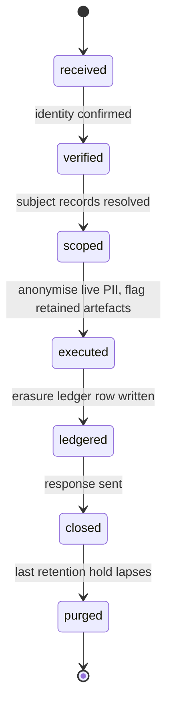
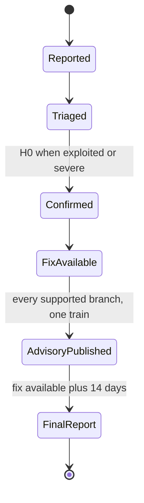

# Security, privacy and compliance features

- **Status:** Draft 0.1
- **Date:** 2026-10-01
- **Scope:** User-visible and operator-visible security, privacy and compliance capabilities of obop: authentication, authorization, isolation, audit, encryption, privacy tooling, platform protections, supply-chain and CRA duties, and compliance scoping.

Reading notes. "Proposed" marks anything the owner still has to ratify (D1, D2, D12, D13, D16, D17, D20, D23, D25, D26 and the interpretations I-1 to I-4 are Proposed in [DECISIONS.md](../DECISIONS.md)) and every design choice that neither the research nor the register settles. "(target)" and "(estimate)" mark design targets and model outputs, not measurements. Versions are "as of 2026-10-01". Decisions are cited by ID (for example D33). Event names, permission-group names, data classes, entity states and port implementers are spelled as in [CONVENTIONS.md](../CONVENTIONS.md), which fixes the spelling while this spec defines the meaning of the names it owns. `BusinessTx` and `BusinessRouter` are the D24 names; the rename from R18's and R23's `TenantTx` and `TenantRouter` is a Proposed naming change. In the Odoo parity column, "Community" and "Enterprise" always mean Odoo's editions, never obop's. Nothing here is legal advice; "counsel" marks items for a lawyer.

## 1. Purpose and scope

### 1.1 What this area is

In obop, security is a property of the kernel, not an app. The kernel crates (`obop-security`, `obop-orm`, `obop-events`, `obop-storage`, `obop-http`) and the `base` module enforce; this spec defines what users and operators can see, configure and rely on. Two rules frame it.

1. **Every security outcome is open.** Paid items sell operator convenience and assurance. Security fixes, data export, the API, ledger integrity and the existence of an audit log are never gated (D2, Proposed; [R26 A2]).
2. **The P0 list is design-time law** (D33, BINDING). Business isolation, one query path, typed elevation, an append-only audit log and the rest cannot be retrofitted, so they ship in the kernel from the first commit.

Users: business owners and administrators, security and privacy officers, auditors, accountants, employees, portal users, operators, hosts and outside researchers (section 2).

### 1.2 Boundaries with neighbouring areas

| Neighbour | This spec owns | The neighbour owns |
|---|---|---|
| [platform.md](platform.md) | Security semantics of chatter, attachments, automation and approvals | The apps themselves, the approvals engine, search, import and export UX |
| [integrations.md](integrations.md) | Credential primitives (hashing, expiry, step-up, token lifetimes), the SSRF-hardened egress client and webhook-signing requirements | How integrators obtain, scope and lose credentials, the OAuth app model, rate and abuse policy (4.2, 4.10 there), endpoint design, payload formats, marketplace mechanics, portability |
| [ai.md](ai.md) | Agents as principals, permission intersection, approval and audit rules | AI features, semantic layer, model routing |
| [finance.md](finance.md) | Audit log, hash-chain verification hooks, retention holds | Posting rules, DB-enforced ledger integrity (D30), lock dates, statutory exports |
| [people.md](people.md) | Data classes, relationship-based access, read-audit, sensitive-capture defaults | HR workflows, payroll packs |
| [ux.md](ux.md) | What security screens must do | View catalogue, design system, accessibility implementation |
| [../ENGINEERING.md](../ENGINEERING.md) | Required supply-chain and release controls | The pipelines, runners, release calendar |
| [../BUSINESS.md](../BUSINESS.md) | The open/paid mapping for security features | Pricing, plans, risk register |
| [../LOCALIZATION.md](../LOCALIZATION.md) | The retention-class and legal-basis mechanism | Per-country values in packs |
| [../CONVENTIONS.md](../CONVENTIONS.md) | The meaning of the permission groups, data classes, events and states it owns (its registry rows name this spec as owner) | The spelling of every cross-document name, the event catalogue and the rename map |

### 1.3 Components in scope

All components are kernel capabilities (tier T0, Proposed in D25) unless marked. Wave placement is Proposed where a cell says so: W0 carries the structural P0 items of D33 (isolation, query path, elevation, audit log, egress client, money, registry flags, migrations, dependency gates, password login, sessions, API keys) at the 0.1 preview (2026-12-01); TOTP and passkeys are also P0 but ship in W1 by 0.2 (2027-02-02), before any public release (Proposed; the repository is private until gate G0, D26). The W1 items marked P1 in 6.1 land before the first public release, which D26 (Proposed) puts at the latest at the 0.3 public alpha (2027-04-06); other W1 items follow by 2027-09-30; P2 items precede audits.

| Component | Lives in | Wave | Open or paid (Proposed, D2) |
|---|---|---|---|
| 4.1 Identity and authentication | `obop-security`, `base` (principal, credential, session, API key); isolated SAML bridge | W0 password, sessions; W1 the rest | Open; native SAML, full SCIM paid |
| 4.2 Authorization | `obop-security`, `obop-orm`, registry | W0 algebra, fields; W1 classes; W2 approvals; W3 HR scopes | Open |
| 4.3 Business isolation | `obop-orm` (`BusinessTx`, `BusinessRouter`), runtime roles | W0 | Open; control plane paid |
| 4.4 Audit and tamper evidence | `base` (`audit_change`, `security_event`) | W0 log; W1 UI, export, read-audit; W2 checkpoints | Open; WORM, SIEM, tiering paid |
| 4.5 Encryption and keys | `obop-storage`, `base` | W1; W2 crypto-shredding | Open; KMS, HSM, customer keys paid |
| 4.6 Privacy tooling | `base` (no separate module proposed) | W0 flags; W1 DSAR, erasure, consent, retention; W2 residency | Open; hosted region pinning paid |
| 4.7 Platform protections | `obop-http`, egress client, `obop-report`, `obop-wasm-host` (T0, W2) | W0-W1; W2 extension trust | Open |
| 4.8 Supply chain and CRA | Repository, CI, runbook | W0 baseline; W1 drilled; W2 technical file | Open; SLAs paid, fixes never |
| 4.9 Compliance scoping | Operator programme, not code | W2 SOC 2 Type I; W3 Type II, ISO 27001 | Assurance services paid |

**Paid in this area (closed list, Proposed, D2 section 6).** Native SAML (multi-IdP, JIT) and full SCIM; WORM or object-lock checkpoint publication, SIEM streaming, legal hold, multi-year audit tiering, auditor evidence packs; cloud-KMS and HSM connectors, customer-managed keys, region pinning (hosted Scale); fleet DR and the multi-business control plane; the supported air-gap bundle; support and SLAs. Everything else here is open, and the list only ever moves from paid to open.

## 2. Personas and roles

"Tenant" is a control-plane word (D24). Inside a business the units are business, company and principal.

| Persona | What they do in this area | Default permission group (Proposed) |
|---|---|---|
| Business owner | Sets the MFA policy, reads the security dashboard | `base.admin` |
| Business administrator | Manages principals, permission groups, API keys, IdP links; cannot read payroll or special-category data unless separately granted | `base.admin` |
| Security officer | Session and credential policy, audit log, access reviews | `security.officer` |
| Privacy officer (DPO or delegate) | DSAR, erasure, consent, retention holds | `privacy.officer` |
| Auditor, internal or external | Read-only security and change log and evidence; no business-data write. Ledger evidence is added with `account.read` ([finance.md](finance.md)); HR metadata and the audit log need only `audit.reader`, and HR data itself only explicit grants ([people.md](people.md)) | `audit.reader` |
| External accountant (free seats, up to 3, D2) | Ledger access per finance permission groups; MFA required by default | `account.adviser` ([finance.md](finance.md)) |
| HR officer, HR administrator, payroll preparer and approver | `confidential_hr`, `special_category` and `financial` HR data; `special_category` and `financial` need separate grants, and whether `hr.officer` reads `confidential_hr` by default is open (open question 17) | `hr.officer`, `hr.admin`, `hr.special_reader`, `payroll.preparer`, `payroll.approver` ([people.md](people.md)) |
| Line manager | Team data through a reporting-line relationship | `hr.line_manager` (derived from the relationship scope, 4.2) |
| Employee, light user | Own records only (`own` scope) | `base.user`, `hr.self` |
| Portal user, guest | Own documents through portal or capability tokens | `base.portal`, `base.public` |
| API client, agent | Scoped machine access; permissions are the intersection of delegator and token scopes | `base.api_client`, `base.agent` |
| Operator | Runs the installation, holds key custody, no default business-data access | Outside the business (OS, DB) |
| Host or partner | Runs many businesses | Control plane (`ee`) |

**Default permission groups.** The kernel seeds are `base.user`, `base.portal`, `base.public`, `base.admin`, `base.api_client`, `base.agent`, `security.officer`, `privacy.officer` and `audit.reader`. `base.admin` manages principals and settings but implies no data permission groups (Proposed; Odoo's `group_system` is the comparison point [R02 s3], but what it implies was not researched). Module groups (`sales.user`, `account.manager`, `hr.officer`) are owned by the module specs, which define their grants and limits; the table below is the seed list and carries every group by owning spec, in the spelling of the registry in [CONVENTIONS.md](../CONVENTIONS.md) 4. No permission group implies access to a `special_category` class; that needs an explicit, audited grant. `base.api_client` and `base.agent` carry no permission rows of their own. Cross-app named-action permission rows (Proposed): `export`, separate from read (AZ10), and the UI rows `customize_views`, `share_views`, `import_data` and `manage_branding` named in [ux.md](ux.md); grants of all of them are audited.

**Canonical seed names (Proposed).** This spec owns the kernel seeds, the `<module>.<role>` convention and this list of names; the owning spec defines a module group's grants and limits, and a new name is added here when its spec introduces it, in the same change that adds it to the registry of [CONVENTIONS.md](../CONVENTIONS.md) 4, which fixes the spelling. The rows below carry every name registered there as of 2026-10-01; a module group stays Proposed until this list carries it. Named actions (for example `sales.price_override`, `stock.validate`) and field permissions (`product.cost_viewer`, `timesheet.cost_viewer`) are permissions granted by the rows of a group, not groups; they appear in the notes only where the registry names them. Where a spec already spells a group this spec also uses, the owning spec's spelling stands.

| Permission group | Owning spec | Implied groups and notes |
|---|---|---|
| `base.user`, `base.portal`, `base.public`, `base.api_client`, `base.agent` | This spec; [platform.md](platform.md) 4.4 | None stated; `base.api_client` and `base.agent` carry no permission rows of their own |
| `base.admin` | This spec | Implies no data permission groups (Proposed) |
| `security.officer`, `privacy.officer`, `audit.reader` | This spec | None stated |
| `account.read`, `account.billing`, `account.bookkeeper`, `account.user`, `account.manager` | [finance.md](finance.md) 2 | None stated; grants and limits are in its table |
| `account.adviser` | [finance.md](finance.md) 2 | External accountant: what `account.user` grants on the companies named on the seat, plus export |
| `account.payment_approver` | [finance.md](finance.md) 2 | Releases payment batches and approves bank-detail changes; never held by an agent; cannot create the same payment |
| `hr.self`, `hr.line_manager` | [people.md](people.md) 2 | `hr.line_manager` is derived from the reporting line, never granted by hand |
| `hr.officer`, `hr.admin`, `hr.hrbp`, `hr.special_reader` | [people.md](people.md) 2 | `hr.hrbp` is the HR business partner, `domain` scope on assigned departments; `hr.special_reader` reads `special_category`, every read audited with a purpose; whether `hr.officer` reads `confidential_hr` by default is open (open question 17). Named actions `hr.retro_change` and `hr.correct` are permissions, not groups |
| `recruitment.recruiter`, `recruitment.interviewer` | [people.md](people.md) 2 | None stated; grants and limits are in its table |
| `payroll.preparer`, `payroll.approver` | [people.md](people.md) 2 | The approver differs from the preparer |
| `attendances.kiosk` | [people.md](people.md) 2 | Check-in and check-out only; held by an API client principal registered to the device (Proposed; D28 has no device principal kind) |
| `crm.user`, `crm.team_lead`, `crm.manager`, `sales.user`, `sales.team_lead`, `sales.manager`, `sales.invoicing`, `product.user`, `product.manager`, `pricing.manager`, `subscriptions.user`, `subscriptions.manager`, `rental.user`, `rental.manager`, `commissions.manager`, `commissions.self` | [sales-crm.md](sales-crm.md) 2 | None stated; grants and limits are in its table. Field permission `product.cost_viewer` covers product cost, margin, valuation and manufacturing cost; named actions `sales.price_override` and `sales.unlock_order` |
| `stock.operator`, `stock.manager`, `stock.valuation_user`, `purchase.user`, `purchase.manager`, `mrp.user`, `mrp.manager`, `mrp.operator`, `quality.user`, `quality.manager`, `maintenance.user`, `maintenance.manager`, `delivery.user` | [supply-chain.md](supply-chain.md) 2 | None stated; grants and limits are in its table. The `stock.*`, `purchase.*` and `mrp.*` approvals and overrides are named actions, not groups |
| `pos.cashier`, `pos.supervisor`, `pos.manager`, `pos.admin`, `ecommerce.merchandiser`, `ecommerce.fulfillment`, `ecommerce.manager`, `loyalty.manager`, `website.editor`, `website.publisher`, `website.designer`, `website.admin`, `marketing.user`, `marketing.manager`, `marketing.deliverability_admin`, `livechat.operator` | [retail-commerce-marketing.md](retail-commerce-marketing.md) 2 | None stated; grants and limits are in its table. `pos.cashier` replaces the retired `pos.user` |
| `resource.admin`, `project.user`, `project.manager`, `timesheet.user`, `timesheet.approver`, `timesheet.admin`, `helpdesk.agent`, `helpdesk.lead`, `helpdesk.manager`, `planning.user`, `planning.dispatcher`, `planning.technician`, `appointments.host`, `appointments.manager`, `fleet.manager`, `fleet.driver`, `service_contract.manager` | [services.md](services.md) 2 | None stated; grants and limits are in its table. Field permission `timesheet.cost_viewer` covers employee cost, a different audience from `product.cost_viewer` |
| `customize.designer`, `automation.designer`, `approvals.designer`, `analytics.designer`, `documents.user`, `documents.manager`, `knowledge.editor`, `knowledge.admin`, `contacts.manager`, `mail.account_admin`, `sign.user`, `sign.admin` | [platform.md](platform.md) 2 | None stated; grants and limits are in its table. `mail.account_admin` manages mailbox connections and `api.connection_admin` the other connections |
| `ai.admin`, `ai.user`, `ai.operator`, `ai.auditor`, `ai.hr_feature_owner`, `ai.ap_intake` | [ai.md](ai.md) 2 | `ai.ap_intake` is the service group of the intake agent; an HR AI feature needs `ai.admin` plus `hr.admin`, with `ai.hr_feature_owner` for the switches; an agent's effective permission is the intersection in AZ7 |
| `api.client_admin`, `api.webhook_admin`, `api.connection_admin`, `api.import_operator`, `api.export_owner`, `api.extension_admin` | [integrations.md](integrations.md) 2 | None stated; grants and limits are in its table. `api.export_owner` governs the full-business export job only; per-model `export` stays the AZ10 operation |

Retired: `finance.*` (now `account.*`), `hr.manager`, `hr.user` and `hr.auditor` (now `hr.admin`, `hr.officer` and `audit.reader`, plus `account.read` for ledger evidence); see [CONVENTIONS.md](../CONVENTIONS.md) 8.

## 3. Capability map

Parity column: "Community" and "Enterprise" are Odoo's editions. Waves follow section 1.3.

| Capability | Description | Wave | Odoo parity |
|---|---|---|---|
| AU1 Password login | Argon2id, NIST SP 800-63B-4 policy: 15 characters alone (8 inside MFA), 64+ accepted, no composition rules or rotation, blocklist, throttling [R18 s2] | W0 | Matches Community `auth_password_policy` by name; what that module enforces was not researched (unverified) |
| AU2 TOTP | RFC 6238 second factor, recovery codes (P0 in D33, shipped in W1) | W1 | Matches Community `auth_totp` |
| AU3 Passkeys | WebAuthn Level 3 (W3C Recommendation 2026-08-25) via `webauthn-rs` (P0 in D33, shipped in W1) | W1 | Matches `auth_passkey` (Community master) |
| AU4 Sessions | Opaque, server-side, revocable, idle and absolute timeout, device list, revoke-all | W0 | Partial (`auth_timeout`); beyond |
| AU5 Step-up | Fresh passkey or TOTP for the sensitive actions listed in 4.1 | W1 | Beyond |
| AU6 OIDC | Single sign-on against any OIDC IdP | W1 | Matches `auth_oauth` |
| AU7 LDAP bind | Authenticate against AD or OpenLDAP | W1 | Matches `auth_ldap` |
| AU8 SAML | Isolated bridge, documented with Keycloak or Authentik; native multi-IdP SP with JIT provisioning in `ee` | W1 bridge; W2 native (paid) | No SAML module in the Community tree; Enterprise not verified |
| AU9 SCIM 2.0 | Subset: `/Users`, `/Groups`, PATCH, `eq` filter, ETag; full (Bulk, advanced filters, IdP-group-to-permission-group policies) paid | W1 | Beyond (none in Community) |
| AU10 API keys | Hashed, prefix-identifiable, scoped, mandatory expiry (default 90 days, Proposed) | W0 | Matches (Odoo caps at 3 months [R02 s3]); beyond on scopes |
| AU11 OAuth 2.1 provider | Code plus PKCE, client credentials, refresh rotation with reuse detection, Client ID Metadata Documents, audience binding, tokens of one hour or less; OAuth 2.1 and the metadata-document mechanism are still IETF drafts as of 2026-10-01 [R24 s3.4] | W1 | Beyond (Odoo 20 MCP uses a static key [R16 s2.1]) |
| AU12 Capability tokens | `share_grant` tokens for portal and guest links: scoped, expiring, revocable | W1 | Matches `access_token` idea; beyond on expiry, revocation |
| AZ1 Permission and restriction rows | OR of permissions, AND of restrictions, default-deny (D10) | W0 | Matches Community `ir.access` of Odoo 20, where an empty OR already denies [R23 DR-4]; beyond on mandatory scopes and field- and action-level default-deny |
| AZ2 Mandatory scopes | Every permission declares `all`, `own`, `company` or `domain`; implicit TRUE fails lint | W0 | Beyond |
| AZ3 One query path | List, by-id, export, webhook and AI reads share one compiled predicate; non-leaking 404; export is a separate audited permission | W0 | Beyond |
| AZ4 Field-level security | Enforced in projection and query compiler; filter, sort and group on unreadable fields rejected | W0 | Beyond (Odoo field groups do not propagate to related fields [R13 s9.2]) |
| AZ5 Data classes | `obop_cls_*` database roles for the three sensitive classes `confidential_hr`, `special_category` and `financial` | W1 | Beyond |
| AZ6 Typed elevation | `Env<Elevated>`, audited, reason required; break-glass is an elevation that also alerts security officers (Proposed) | W0 | Replaces `sudo()`; beyond |
| AZ7 Agent permission intersection | Effective permission is the delegator's grants intersected with token scopes; tool lists per principal; classes `confidential_hr`, `special_category` and `financial` only when the human also holds them ([ai.md](ai.md)) | W1 | Beyond (Odoo 20 MCP key acts as the user [R16 s2.1]) |
| AZ8 Relationship access | Manager hierarchy and department scopes for HR | W3 | Matches Community intent; beyond on classes |
| AZ9 Separation of duties | Exclusive approval, creator not approver, agents never approve own proposals | W2 | Matches Odoo Enterprise (Studio approval rules [R15 s9]) |
| AZ10 Export permission | Export is a separate named-action permission, audited and rate-limited; step-up for sensitive classes and full-business export | W1 | Beyond |
| IS1 Business isolation | `BusinessTx`, database per business, `FORCE` RLS backstop on `company_id`, runtime role without `BYPASSRLS` | W0 | Matches Odoo's database-per-customer model; beyond on types |
| AD1 Business change log | Field diffs in the same transaction | W0 | Matches Community chatter tracking; beyond |
| AD2 Security event log | Append-only, hash-chained, pseudonymous actor ids | W0 | Beyond (no Community equivalent; OCA `auditlog` is Beta [R18 s6]) |
| AD3 Audit UI and export | Search, filter, export, 13-month default | W1 | Beyond |
| AD4 Read-audit | Logs reads of sensitive classes and exports | W1 | Beyond |
| AD5 Signed checkpoints | Ed25519 checkpoints; automated WORM publication paid | W2 | Beyond |
| EK1 Transport and backup security | rustls, PostgreSQL `verify-full`, SCRAM-SHA-256, HSTS; pgBackRest encrypted repository, object lock, monthly restore drill | W0 transport; W1 backups | Matches Odoo deploy guidance; beyond on backups |
| EK2 Field encryption | Envelope scheme, AES-256-GCM or XChaCha20-Poly1305, AAD-bound | W1 | Beyond |
| EK3 Key custody | Local sealed file or OpenBao free; cloud KMS, HSM, customer-managed keys paid | W1 free; W2 paid | Beyond |
| PV1 Personal-data map | Registry flags, data-subject path, retention class per field | W0 | Beyond (Community `privacy_lookup` is search and erase only) |
| PV2 DSAR export | Machine- and human-readable subject export with deadline clock | W1 | Matches Community `privacy_lookup`; beyond |
| PV3 Erasure | Anonymise in place, erasure ledger, replay after restore | W1 | Beyond |
| PV4 Retention | Classes per country from packs, purge job, record-level hold | W1 (DE) | Matches Community `data_recycle`; beyond |
| PV5 Consent | Purpose-scoped, versioned, timestamped records | W1 | Beyond |
| PV6 Residency | Region attribute pinned at provisioning, region-local data; hosted region pinning on Scale is paid (D2) | W2 | Beyond |
| PP1 Egress client | One SSRF-hardened outbound client | W0 | Beyond |
| PP2 Injection and upload controls | Typed queries, sandboxed templates, sanitiser, CSP, upload pipeline, CSV neutralisation | W1 | Beyond |
| PP3 Rate limits and quotas | Per IP, account, key and business; concurrency caps (limits and abuse policy: [integrations.md](integrations.md) 4.10) | W1 | Beyond |
| PP4 Extension trust | Capability manifests, `ext` role, kill switch | W2 | Beyond |
| SC1 Dependency gates | `cargo-deny`, `cargo-audit`, frozen pnpm lockfile from the first commit | W0 | n/a |
| SC2 CRA vulnerability handling | SECURITY.md, Art. 14 runbook, equal-time advisories | W0 v0; W1 drilled | Beyond (Odoo embargoes for customers [R28 D.4]) |
| SC3 Signed releases and SBOM | cosign, attestations, CycloneDX, `cargo-auditable` | W1 | Beyond |
| SC4 Five-year security updates | Never gated (CRA Annex I Part II(8)) | W2 (1.0 LTS) | Beyond |

## 4. Per-app specification

Entity names from [R23 B.1] are used as written; other names here are Proposed. Event names are Proposed and follow D27 (past tense; `TxEvent` runs in the publisher's transaction, durable events use the outbox).

### 4.1 Identity and authentication

**Purpose.** Establish which principal (user, portal user, guest, API client, agent, system; D28) is acting, by what means and with what assurance.

**MVP and later.** W0: local password, sessions, hashed API keys. W1: TOTP, passkeys, OIDC, LDAP bind, SCIM subset, OAuth 2.1 provider, step-up, recovery. Later: native SAML and full SCIM (`ee`); an option to require device-bound authenticators for privileged permission groups (open question 1).

**Entities.**

| Entity | Purpose | Key fields | States |
|---|---|---|---|
| `principal` | Acting identity | kind, `party_id` (nullable), status | invited, active, suspended, deactivated |
| `credential` | One authentication factor | principal, kind (password, totp, passkey, recovery), secret material (hash or envelope), last used | pending, active, disabled, revoked |
| `session` | Browser session | principal, device, created, last seen, idle and absolute expiry | active, `idle_expired`, `absolute_expired`, revoked |
| `api_key` | Machine credential | principal, hashed secret, prefix, scopes, expiry | active, expired, revoked |
| `idp_connection` | OIDC, LDAP or SAML-bridge link | issuer, client id, secret (envelope), mapping | enabled, disabled |
| `share_grant` | Capability token | token hash, `record_ref`, scope, expiry | active, used, expired, revoked |
| `agent_delegation` | Agent acting for a user | agent, on-behalf-of, scopes, expiry | active, suspended, expired, revoked |

**Rules.** Passwords use `argon2` 0.6.0 with at least the OWASP floor (m=19456 KiB, t=2, p=1); an optional pepper lives outside the database [R18 s2]. Sessions are opaque and stored in PostgreSQL (ASVS separates session management from self-contained tokens); cookies are `Secure`, `SameSite=Lax`; HSTS on; state-changing requests also need a CSRF token (Proposed). OIDC uses `openidconnect` 4.0.1, LDAP `ldap3` 0.12.1. Passkeys use `webauthn-rs` 0.5.5 (MPL-2.0; its README makes no standards-compliance claim, so conformance tests are ours); NIST allows syncable passkeys at AAL2, not AAL3. No SMS one-time codes [R26 B1]. Sign-in must meet WCAG 2.2 SC 3.3.8 (Accessible Authentication, Level AA; <https://www.w3.org/TR/WCAG22/#accessible-authentication-minimum>): paste, password managers and passkeys work and no screen demands a memory test.

**SAML.** XML signature handling is the riskiest authentication code: `samael` 0.0.22 is pre-1.0 and needs the C library `xmlsec1` [R18 s2]. A separate bridge process terminates SAML and hands obop an OIDC assertion. It is either an off-the-shelf broker such as Keycloak or Authentik, an optional sidecar outside the default install (I-1, Proposed), or, in `ee`, an obop-authored Rust process on `samael` kept apart from the request path. Native SAML in `ee` is the supported second form, with multi-IdP and JIT provisioning; obop never hand-rolls XML-DSig and keeps RSA off network-observable paths (RUSTSEC-2023-0071 was open as of 2026-09-12).

**Step-up (Proposed).** Fresh passkey or TOTP is required to: change credentials, create API keys, export `confidential_hr`, `special_category` or `financial` data or the whole business ([integrations.md](integrations.md)), approve payments above the business threshold, change bank details, set the hard lock date ([finance.md](finance.md)), change permission groups, read the audit log, and manage keys.

**Workflows.**

1. Enrol: signed-in user adds a passkey; server stores the credential; `CredentialAdded` is emitted and a notice goes to the user's address.
2. Sign in with OIDC: match verified `iss` plus `sub` to a principal; unknown subjects are refused unless an administrator enabled create-on-first-login with a default permission group (Proposed, off).
3. Deprovision: the IdP sends SCIM PATCH `active=false`; the principal becomes `deactivated` (SCIM `active=true` reactivates it; `suspended` is the separate security hold an administrator or security officer sets); sessions are revoked and API keys and agent delegations suspended in the same transaction.
4. Recover: recovery codes, or administrator reset; resetting a privileged account needs a second administrator (Proposed).

**Flows.** Emits `PrincipalInvited`, `PrincipalDeactivated` and `PrincipalSuspended` (payload `principal_id` and `kind`, any principal kind, agents included; [platform.md](platform.md) 4.4 shares the names and reacts to them), `AgentDelegationRevoked` (named in [ai.md](ai.md) 4.2; `ai` consumes it), `CredentialAdded`, `CredentialRemoved`, `LoginFailed`, `SessionRevoked`, `ApiKeyCreated` and `ApiKeyRevoked` (this spec owns the `api_key` aggregate, so it is the one emitter, [CONVENTIONS.md](../CONVENTIONS.md) 3.1 rule 3; [integrations.md](integrations.md) 4.2 is the integrator-facing surface over the same commands and owns `OAuthConsentGranted` and `OAuthConsentRevoked`). Consumes `PrincipalSuspended` and `PrincipalDeactivated` (sessions, delegations, share grants) and SCIM requests. `mail` consumes credential events for user notices.

**Permissions and sensitive data.** `security.officer` manages policy; secret material and IdP secrets are class `secret` (Proposed) and envelope-encrypted (4.5). **Reports.** MFA coverage by permission group, stale API keys, failed-login trend, SSO health. **Configuration.** Allowed factors, MFA requirement by permission group, session lifetimes (Proposed defaults: idle 60 minutes, absolute 12 hours), IdP links, SCIM token. **Localisation.** Auth screens translate; nothing is country-specific.

**Open or paid (Proposed, D2).** Open except native SAML and full SCIM.

### 4.2 Authorization

**Purpose.** Decide what a principal may do per model, field, action and record, through one algebra (D10).

**MVP and later.** W0: algebra, scopes, field security, elevation, RLS backstop. W1: data classes, export permission. W2: multi-company visibility, approvals and separation of duties, agent approval policies (D18). W3: HR relationship scopes.

**Entities.**

| Entity | Purpose | Key fields | States |
|---|---|---|---|
| `access` | Permission row (has a permission group) or restriction row (none) | model, operations incl. named actions, scope, domain AST | active, inactive |
| `permission_group` | Named bundle of rows | implied permission groups | active |
| `group_membership`, `principal_company` | Who holds which permission group, in which companies | principal, permission group or company | active, revoked |
| `field_access` | Per-field read and write rules | field, permission group, class tag | active |
| `elevation_grant` | Audit record of one elevation, not a standing right | code site, reason, principal | used |

**Rules.**

- Effective access is `OR(permission rows) AND AND(restriction rows)`; an empty OR is FALSE, so no matching permission means denial. Restrictions only narrow (company, soft-delete, embargo, residency) [R23 DR-4].
- `own` needs an owner field, declared per model in the registry (Proposed). An implicit TRUE scope is a lint error.
- A by-id read that fails the predicate returns 404, never 403 [R18 s10].
- Writes use per-operation DTOs with `deny_unknown_fields`; `company_id`, `state`, `user_id` and server-computed fields are not writable through generic calls.
- Unreadable fields are omitted from responses, exports, webhooks and AI output, and a filter, sort or group on one is rejected (closes the inference channel); schema endpoints list only readable fields (Proposed).
- Classes `confidential_hr`, `special_category` and `financial` live in separate tables or columns granted to fixed `obop_cls_*` database roles, selected per request by `SET LOCAL ROLE`. The first five class names come from [R13 s9.3]: `public_directory`, `internal`, `confidential_hr`, `special_category`, `financial`; `secret` is Proposed. These three are the sensitive classes: they get `obop_cls_*` roles and the read-audit of 4.4. The per-class meaning, default readers and handling are the class table below, which this spec owns; [CONVENTIONS.md](../CONVENTIONS.md) 5 fixes the spelling and the map from field type to class, and [people.md](people.md) 4.11 assigns the HR fields. The per-class `agent_readable` flag defaults to false except for `public_directory` and `internal`.
- Elevation is a call to `Env<Elevated>`: typed, audited, with a reason. Elevation sites are listed in the registry and CI tracks their count; a new site needs a security review (Proposed). The Odoo baseline is 433 `.sudo(` calls in `addons/mail` alone (20.0 source, tests excluded) [R02 s3]. Break-glass access to a sensitive class is such an elevation and also alerts security officers; HR reads under it carry a purpose ([people.md](people.md), Proposed).
- Agents: effective permission is the intersection of the user's (or service permission group's) grants and the token's scopes, tool lists are filtered per principal, and nothing bypasses command handlers; classes `confidential_hr`, `special_category` and `financial` reach an agent only when its scope is granted and the human also holds the class ([ai.md](ai.md)) [R16 s5, D18].
- Export is a named-action permission, not implied by read (AZ10); the export path applies the same compiled predicate and field projection as a list.
- **HR relationships.** RLS gives only the coarse gate (company plus class role); hierarchy visibility stays in the application because hierarchy subselect policies are slow and racy under READ COMMITTED [R23 DR-4]. Proposed: a reporting-line closure table maintained in the same transaction, a narrow public read model for the directory (`employee_public` in R13, `hr_employee_public` in [people.md](people.md)), and line managers see team leave dates and status but not reasons or certificates.
- **Four-eyes (Proposed).** Granting `base.admin` or `security.officer` can require a second approver (setting, off by default).

**Data classes (the registry).** A class tags columns. Classes are not permission groups and not retention classes; the `obop_cls_*` roles are database roles. A value from which a protected value can be recomputed carries the strictest class of its inputs (the inference-channel rule of D10).

| Class | Meaning | Default readers | Handling | `agent_readable` |
|---|---|---|---|---|
| `public_directory` | Directory data: name, work contact, department, title, manager | All internal principals | None | true |
| `internal` | Non-public business data about people and work: type, schedule, skills | Manager chain, HR | Audit on change | true |
| `confidential_hr` | Personal employment facts that are not money | Self; `hr.officer` is open (open question 17) | Separate tables behind `obop_cls_*`; read audit | false |
| `special_category` | GDPR Art. 9 data as the pack decides: health, union, diversity, disability, work permit | Self, `hr.special_reader` | Field encryption; purpose on every read; DPIA gate | false |
| `financial` | Money owed to, paid to or held for a named person or counterparty, and anything from which it can be recomputed | Self, payroll groups, finance groups | Separate tables behind `obop_cls_*`; field encryption; read audit; export approval | false |
| `secret` (Proposed, 4.1) | Credentials and key material: API keys, OAuth and IdP secrets, TOTP seeds, PSP and carrier credentials, webhook secrets, BYOK keys | Nobody; write-only | Envelope-encrypted (4.5); absent from exports, logs and errors | false |

The three sensitive classes (`confidential_hr`, `special_category`, `financial`) never go to a non-local AI route without an impact-assessment acknowledgement ([ai.md](ai.md) 4.5), are not indexed by default ([ai.md](ai.md) 4.7) and are excluded from the browser cache ([ux.md](ux.md) 4.13). Cost and margin (`product.cost_viewer`) and employee cost (`timesheet.cost_viewer`) are field permissions, not classes.

**Flows.** Emits `PermissionChanged` (payload `kind`: membership, permission group or access row, plus ids; `ai`, `knowledge`, `ux` and the access cache consume it; `PermissionGroupChanged` is a retired spelling, [CONVENTIONS.md](../CONVENTIONS.md) 8), `ElevationUsed`, `ExportRequested` (payload principal, scope, model; `audit` consumes it), `AccessDenied` (sampled). Consumes registry version bumps for cache invalidation.

**Reports.** Effective-permission explorer ("who can read what"), access review for attestation, separation-of-duties conflicts, elevation usage. **Configuration.** Scope defaults, step-up list, four-eyes setting. **Compliance.** The access review report is SOC 2 and ISO 27001 evidence [R18 s8.2].

**Open or paid.** Open; IdP-driven mapping of IdP groups to permission groups (full SCIM) is paid, manual mapping is open.

### 4.3 Business isolation

**Purpose.** Make cross-business access impossible by construction and cross-company access a tested error (D6).

**Rules.**

- One database per business, at most 250 per cell, PgBouncer per cell. `BusinessRouter` picks the database; no cross-business SQL (D6).
- `BusinessTx` is the only way to obtain a database handle. It begins the transaction, drops to the runtime role (non-owner, no `BYPASSRLS`, `SET LOCAL ROLE`), sets `obop.company_ids` with `set_config(..., true)` and selects the class role. Module visibility plus a CI lint forbid raw pool access [R18 s4].
- RLS is the fixed backstop (D10): a RESTRICTIVE policy `company_id = ANY(nullif(current_setting('obop.company_ids', true), '')::uuid[]) OR company_id IS NULL` plus a PERMISSIVE `true`, `FORCE ROW LEVEL SECURITY`, the lookup wrapped as an InitPlan. An unset context yields no rows.
- Never session-level `SET` behind PgBouncer; run PgBouncer 1.26.0 or later (fixes three CVEs) in transaction mode.
- The runtime refuses to start if its role owns tables or has `BYPASSRLS` (Proposed startup check). PostgreSQL 17 and 18 are supported (D8).
- Referential-integrity checks bypass RLS, so foreign-key and unique errors can leak that a hidden row exists; errors are mapped to generic messages and ids are never treated as capabilities (UUIDv7 embeds a timestamp).
- Bulk import stages through non-RLS tables, then `INSERT ... SELECT` under `BusinessTx` (D10; `COPY FROM` fails on RLS tables).
- Inside a business, `Env.companies` is an explicit set validated against `principal_company`; reads span it, writes need exactly one active company [R23 C.3].

**Entities.** `principal_company` lives in the business database. `business`, `cell` and release state live in the control-plane directory, which maps tenant to business to cell.

**Reports and configuration.** An isolation self-test status page and a runtime-role audit; cell assignment and company grants are configuration. **Control plane.** A single-business install needs none of it; the multi-business control plane is `ee` (paid, partner-hosting licence).

**Tests.** The registry generates an IDOR matrix (every endpoint, every permission group, foreign ids) run nightly, and a cross-business test interleaves requests for two businesses over shared pooled connections and asserts each response contains only its own marker rows (D36).

**Open or paid.** Open; fleet control plane paid.

### 4.4 Audit and tamper evidence

**Purpose.** Answer who did what, when, from where, and prove the record was not altered.

**Three layers** [R08 s10, R18 s6]: (1) `audit_change`, field-level old and new values written in the business transaction; (2) `security_event`, append-only (application role has INSERT only, triggers reject UPDATE and DELETE, monthly partitions); (3) the per-journal hash chain on posted ledger entries (D30; the finance spec owns it, this spec requires a verifier job and alerting).

| Entity | Purpose | Key fields | States |
|---|---|---|---|
| `audit_change` | Business change log | record ref, field, old, new, actor ref, transaction id | written (immutable) |
| `security_event` | Security log | sequence, type, actor ref, source IP, user agent, detail, previous hash, hash | written (immutable) |
| `actor_identity` | Pseudonym mapping | actor ref, principal id | present, erased |
| `audit_checkpoint` | Chain anchor | sequence, hash, Ed25519 signature, published-to | computed, signed, published, verified |

**Chain.** `h(n) = H(h(n-1) || canonical(record))`, hashed over the pseudonymous actor ref so erasure of the mapping does not break the chain [R18 s6]. A signed checkpoint every 1,000 events is Proposed. Source IP and user agent are personal data too, so the chain covers only a salted commitment to them; the values sit beside the actor mapping and can be truncated or erased without breaking it (Proposed). Concurrent transactions cannot each read the previous hash without serialising, so one appender orders the events of a business (Proposed; its throughput is measured in the W1 spike, no number claimed). Honest limit: a database superuser can rewrite everything after the last checkpoint that lives outside the database. The open edition guarantees detection against any checkpoint the operator has copied elsewhere (the CLI prints them); automated publication to WORM or a transparency log is the paid convenience.

**Read-audit (Proposed design).** Reads of classes `confidential_hr`, `special_category` and `financial`, and every export, are logged: by-id reads per record, list reads as query fingerprint, classes touched and row count; a purpose is required for `special_category` reads and break-glass ([people.md](people.md), Proposed). Odoo has no read audit in Community [R13 s9.2].

**Workflows.** Verify recomputes hashes and compares them with the signed checkpoints: the nightly job checks the events since the last verified checkpoint and re-checks closed monthly partitions on a rolling schedule, and `obop audit verify` runs the full chain. On mismatch the system emits `AuditChainBroken`, notifies security officers by mail and webhook, and starts a new segment that references the broken one. Auditor export produces a signed bundle of a date range.

**Flows.** Emits `DataRead` (one per read-audit record), `AuditChainBroken`, `AuditCheckpointSigned`. Audit handlers are `TxEvent` subscribers of every command, so a change and its record commit together.

**Retention.** `security_event` 13 months by default (D2 section 6); `audit_change` on ledger-relevant models follows the model's retention class (Proposed). IP addresses and user agents are personal data and carry erasure flags; a truncation period is open question 4.

**Permissions.** `audit.reader` and `security.officer` read; nobody writes. **Reports.** Sign-in anomalies, permission changes, export volume, elevation use, denied-access trends [R18 s12 item 16].

**Open or paid.** Log, UI, export, local checkpoints open. WORM or object-lock publication, SIEM streaming, legal hold on audit tiers, multi-year tiering, auditor evidence packs paid (D2).

### 4.5 Encryption and key management

**Purpose.** Protect secrets and sensitive fields against database, backup and operator exposure, and make erasure by key destruction possible.

**Rules.**

- **Transport:** `rustls` 0.23.45 with `aws-lc-rs`; PostgreSQL `verify-full`; `scram-sha-256` for the runtime role [R18 s5].
- **At rest:** core PostgreSQL has no TDE. Volume encryption is the operator's job; Percona `pg_tde` is a later optional profile (needs Percona Server). Application-level envelope encryption covers the sensitive catalogue.
- **Envelope scheme (W1):** KEK per business from a local sealed file or OpenBao; random DEK per record or field; AES-256-GCM or XChaCha20-Poly1305; AAD binds business, table, column and row id to defeat ciphertext swapping.
- **Catalogue (Proposed):** integration and OAuth tokens, BYOK AI keys, TOTP seeds, IdP secrets, bank account numbers, national IDs, payroll amounts, health notes. Encrypted columns are not searchable; lookups use HMAC blind indexes, and the query compiler rejects other operations on them.
- **Rotation:** two active KEKs with overlap; a throttled job re-wraps DEKs; `KeyRotated` is emitted.
- **Backups:** pgBackRest 2.59.2 repository encryption, S3 object lock, monthly automated restore-and-verify [R18 s9.2].
- **Secrets in configuration:** file (`_FILE`), Kubernetes secrets, OpenBao or a cloud secret manager; none in the database in plaintext, in logs or environment dumps.
- **Crates:** prefer Ed25519 or ES256; avoid `rsa` on network-observable paths.

| Entity | Purpose | Key fields | States |
|---|---|---|---|
| `key_encryption_key` | KEK reference | backend, key id, created | active, retiring, retired, destroyed |
| `data_key` | Wrapped DEK | scope (business, subject, field), KEK id, wrapped key | active, rewrapped, shredded |

**Reports and configuration.** Key inventory and rotation age; encrypted-field catalogue; KEK backend per business. **Flows.** Emits `KeyRotated` (security log, no named consumer). **Crypto-shredding (W2, Proposed).** Destroying a DEK erases the field for every copy, including backups. Granularity is open question 5.

**Open or paid.** Open with local or OpenBao keys. Cloud-KMS and HSM connectors, customer-managed keys, region pinning on hosted Scale are paid (D2).

### 4.6 Privacy tooling

**Purpose.** Let a business meet GDPR duties with product features: subject access, erasure, retention, consent, residency.

**Registry-driven.** Each model declares personal-data fields with a category, the path to the data subject (party, employee or principal), a retention class and an erasure strategy (anonymise, delete, retain until expiry). The same metadata drives DSAR, erasure and purge [R18 s12 item 8].

**DSAR.** Deadline is one month from receipt, extendable by two months with notice in month one (Art. 12(3)). Workflow: receive, verify identity, resolve the subject across party, employee and principal records, collect per model, privacy officer reviews, deliver JSON plus a readable PDF, log. Retained artefacts are listed with their legal basis.

**Erasure.**

Erasure is **anonymise in place** when posted documents reference the person: blank the personal fields of the live party record and of every copy that is not itself a retained legal record, keep ledger rows and numbers, record the legal basis (GDPR Art. 17(3)(b) and (e); CCPA 1798.105(d) has parallel exceptions) and the retention expiry, hard-delete when retention lapses. Examples [R18 s8.1]: Germany HGB section 257 books 10 years, vouchers 8, commercial letters 6; UK 6; US IRS 3 to 7, employment tax 4. Packs supply the real values. The buyer's identity on a posted document is part of the retained record (finance INV-17 in [finance.md](finance.md): no anonymising or deleting it before the pack's retention class expires). The immutable e-invoice artefact (raw XML, hash, authority receipt) is that legal record [R09 s8], so it and the archived PDF stay under a `retention_hold`, readable only by finance permission groups and the privacy officer (Proposed), and are anonymised or purged when the period ends. Copies outside the ledger are scrubbed: chatter bodies, non-retained attachments, search indexes, `ai_chunk` embeddings [R16 s14] and stored webhook payloads in the 30-day delivery log ([integrations.md](integrations.md), Proposed).

**Backups.** PITR restores a whole cluster, so an append-only `erasure_ledger` is replayed after any restore, and the business does not report ready until replay finishes (Proposed) [R18 s8.1]. Special-category fields may also be crypto-shredded.

**Consent.** `consent_record` is an append-only ledger in `base`, reached through a `ConsentPort` in `base-api` so website forms, POS sign-ups, checkout, marketing and recruitment write one ledger (Proposed, settling the ownership question in [retail-commerce-marketing.md](retail-commerce-marketing.md)): subject, purpose, basis, source, text version, channel, time, evidence. A withdrawal is a new row, not an edit. Marketing honours the ledger; a withdrawal emits `ConsentWithdrawn`; marketing mail carries one-click unsubscribe (RFC 8058) [R12 s6.1].

**Residency.** Region is a business attribute pinned at provisioning; database, object store, backups, logs, traces, mail relay and webhook egress stay region-local, with no cross-region replication of personal data by default [R18 s8.2]. Hosted region pinning on the Scale plan is paid (D2); self-hosters choose their own region. Nothing relies on the EU-US Data Privacy Framework staying valid (its litigation status is unverified).

**Hosted breaches.** Hosted obop is a processor and notifies the business "without undue delay" (Art. 33; the DPA benchmark is 24-48 hours, counsel to fix [R28 E.1]); the business has 72 hours to its authority. A breach export lists affected records and subjects from the read-audit and security log.

**HR defaults.** Geo, IP, photo and biometric attendance and sick-leave reasons are off by default, behind a per-country DPIA checklist (biometrics are Art. 9); AI in hiring decisions is off by default (D18). EU AI Act Annex III high-risk obligations (recruitment, CV sorting, worker management, creditworthiness) apply from 2027-12-02, and Annex I product-embedded systems from 2028-08-02, under Regulation (EU) 2026/1744 of 8 July 2026 (the Digital Omnibus on AI; OJ L, 2026/1744, 24.7.2026; in force 2026-07-27), which replaced Art. 113(c) of Regulation (EU) 2024/1689; it is not the separate Digital Omnibus proposal COM(2025) 837 on GDPR, ePrivacy and the Data Act (status not checked). A corrigendum of 2026-09-29 was not read. Whether a given feature is in scope, and the provider and deployer roles, stay with counsel ([ai.md](ai.md) open question 3) [R13 s9].

| Entity | Purpose | Key fields | States |
|---|---|---|---|
| `dsar_request` | Access request | subject, received, due, extended-until, outcome | received, verified, collecting, review, delivered, refused |
| `erasure_request` | Erasure request | subject, scope, legal bases | received, verified, scoped, executed, ledgered, closed, purged (diagram above) |
| `erasure_ledger` | Replay log | subject ref, model, record, action, basis, done | written (immutable) |
| `consent_record` | Consent ledger entry | subject, purpose, basis, source, text version, time, kind (grant or withdrawal) | written (immutable) |
| `retention_policy` | Per class and country | class, country, period, start rule, action | draft, active |
| `retention_hold` | Blocks purge | record or subject, reason, expiry | active, lapsed |

**Reports and configuration.** DSAR deadline board, retention-expiry queue, consent coverage; retention policies, consent purposes, region. **Flows.** Emits `DsarReceived`, `DsarDelivered`, `PartyErased` (the name the sales, website and marketing specs consume; employee and principal data hang off the subject's party), `RetentionExpired`, `ConsentRecorded`, `ConsentWithdrawn`; `search`, `mail`, `documents`, `ai` and the apps holding contact snapshots consume `PartyErased` to scrub copies; webhooks already delivered cannot be recalled, so the ledger records them.

**Open or paid.** Open, except hosted region pinning (paid, D2). A record-level retention hold is open; the "legal hold" of D2's paid list is read here as the multi-year, WORM-backed audit variant (open question 6).

### 4.7 Platform protections

**Purpose.** Close the injection, outbound-request, upload and abuse classes that ERPs attract [R18 s10].

| Risk | Control |
|---|---|
| SSRF (webhooks, import by URL, logo fetch, OIDC and MCP metadata fetch) | One egress client: HTTP and HTTPS only; resolve A and AAAA and require every address public; connect to the validated IP (defeats DNS rebinding); block loopback, RFC 1918, all of 169.254.0.0/16 (cloud metadata), multicast and IPv6 local ranges; redirects off or re-validated per hop; timeouts and size caps. Operators, not business administrators, may allow-list internal hosts such as an Ollama sidecar; [ai.md](ai.md) 4.5 agrees: a private model endpoint is a named egress destination with an explicit CIDR that the operator allow-lists in deployment configuration, and `ai.admin` can then select it as a route |
| SQL and domain injection | Typed query AST with bound parameters; `AssertSqlSafe` only in the one SQL-emitting crate; no raw SQL outside the audited module |
| Template and expression injection | minijinja with autoescape, fuel and recursion limit; CEL is the only stored expression language (D11) with save-time limits (4 KB, AST depth 32), step budget and deadline, delivered by the W1 spike; no `eval` |
| Report rendering | Typst in `obop-report` (Proposed, D20) in a worker with no network and a file view limited to the template bundle and data payload (Proposed); no wkhtmltopdf; a browser renderer, if ever added, is isolated with no network or file access |
| Uploads, imports, exports | Extension allow-list; server-generated names; content-addressed blobs served by id under the parent record's read permission; size and decompressed-size limits; images re-encoded; XML entity expansion off; optional antivirus sidecar outside the default install (I-1, Proposed); export cells starting `=`, `+`, `-` or `@` prefixed with `'` (common practice, unverified in [R18 s10]) |
| Stored XSS | Server-side sanitiser allow-list; strict CSP, no inline script, no runtime CDN scripts; assets embedded in the binary (D37) |
| Abuse | Rate limits per IP, account, API key and business, concurrency caps on reports, imports and exports, body and pagination caps, cost-weighted search; `tower_governor` 0.8.0 is pre-1.0 so it sits behind a facade; `RateLimit` headers (an IETF draft) plus `Retry-After`; limits and abuse policy are owned by [integrations.md](integrations.md) 4.10 [R21 s5] |
| Webhooks | Outbound: Standard Webhooks signatures, replay window, per-endpoint secret with overlap rotation. Inbound: raw-body signature check, inbox dedupe, state re-fetch [R21 s4] |
| Admin surface | No web database manager; administration by CLI; user enumeration and missing rate limiting are in scope, unlike Odoo's "non-qualifying" list [R18 s10] |
| Extensions | Capability manifest diffed per upgrade; Wasm in the `ext` role under cgroups and seccomp or Landlock; fuel, epoch deadline and memory limits, never fuel alone; wasmtime v48 LTS patched within 7 days, 24 hours for High; UI tiers F2 and F3 in opaque-origin sandboxed iframes; registry kill switch [R24 s3.3, D11, D32] |
| Local shells | Tauri local mode binds loopback or a Unix socket, per-install token, database key in the OS keychain [R18 s9.1] |

**Entities.** None persisted; controls are code and configuration (`egress`, rate-limit and upload settings per business, operator allow-lists).

**Open or paid.** All open.

### 4.8 Software supply chain, vulnerability handling and the CRA

**Purpose.** Make obop defensible as a product that is sold: supply-chain gates, coordinated disclosure, and the EU Cyber Resilience Act (CRA) clocks as a feature.

**Rust gates.** `rust-toolchain.toml` pinned to 1.98.1 as of 2026-10-01 (Proposed, D23; Q10), `--locked`, release `overflow-checks = true`; `cargo-deny` 0.20.2 blocks PRs; `cargo-audit` 0.22.2 nightly; `cargo-vet` 0.10.2 for request-path crates (P2); `cargo-auditable` 0.7.6 embeds dependency lists; Renovate cooldowns 7 days for crates and JS, 3 days for GitHub Actions pinned by SHA; security updates skip the cooldown but are reviewed by hand (D23). An `unsafe_code = "forbid"` workspace lint for obop crates is Proposed (Hyperswitch precedent [R06 s3.16]).

**pnpm and Vite+ gates** (owner constraint F2). `vite-plus` at an exact version that is at least 7 days old (Proposed, D23); `vp install --frozen-lockfile` in CI; `voidzero-dev/setup-vp` at an exact release or SHA, never `v1`; in `pnpm-workspace.yaml`: `minimumReleaseAge` 10080 minutes (7 days, strict), `trustPolicy: no-downgrade`, `blockExoticSubdeps`, `strictDepBuilds` with an `allowBuilds` allow-list (`vp pm approve-builds`); `vp pm audit` and `vp pm audit -- signatures` (the second needs pnpm 11.1 or later); a lockfile scanner that reads both YAML documents of `pnpm-lock.yaml` (a scanner that reads one reports zero dependencies without error); CI fails on any lockfile other than `pnpm-lock.yaml`, naming `package-lock.json`, `npm-shrinkwrap.json`, `yarn.lock`, `bun.lock` and `bun.lockb`; no `vp dlx` in CI (I-2). Checked against vite-plus v1.0.0 (source and the installed `vp`, 2026-10-01): `vp pm` is a typed command set, not raw forwarding. `vp pm audit`, `approve-builds`, `publish` (including `--provenance`) and `stage` forward to pnpm; `vp pm sbom` and `vp pm licenses` do not exist; `vp pm audit signatures` is rejected and must be written `vp pm audit -- signatures` (accepted and passed to pnpm; the exact pnpm argv is inferred from the source, not observed). JavaScript SBOMs and licence scans therefore run as `pnpm sbom --sbom-format cyclonedx --sbom-spec-version 1.5` and `pnpm licenses list --recursive` through the vp-managed pnpm, invoked as `vp env exec pnpm sbom ...` or inside a `vp run` task. Whether that counts as "`vp` only" is the owner's ruling (Q10; [ENGINEERING.md](../ENGINEERING.md) Q-E2) and stays open; direct pnpm is allowed only where `vp` has no wrapper (I-2, Proposed). A W0 smoke test (Proposed; [ENGINEERING.md](../ENGINEERING.md) 2.3 and 5.1) runs `publish`, `stage`, `approve-builds` and `audit -- signatures` before CI depends on them [R07 s1.4, s3.13]. No Node runs on customer servers. obop publishes no JavaScript packages at first; a future `@obop/*` SDK ships from CI with provenance and staged approval (`vp pm publish`, `vp pm stage`), never a long-lived token; the OIDC path through pnpm is tested before the first publish because the pnpm docs do not describe it [R18 s7.2].

**Build and release.** Reproducible double builds (a blocker for LTS), CycloneDX SBOMs (`cargo-cyclonedx` 0.5.9 emits at most 1.5, so emit 1.5 and merge), GitHub artifact attestations (SLSA v1.0 Build L2, L3 via a reusable workflow), cosign keyless, `gh attestation verify` inside `obop upgrade`, crates.io publishing only through OIDC trusted publishing; artefacts, SBOMs and attestations kept 10 years (D36) [R27 B6].

**CRA facts** [R17 s7, R18 s7.3]: in force 2024-12-10; Art. 14 reporting since 2026-09-11; main obligations 2027-12-11; support period at least five years, or the expected use time if shorter (Art. 13(8)); security updates free (Annex I Part II(8)) and available for at least 10 years or the rest of the support period, whichever is longer (Art. 13(9)); fines up to EUR 15M or 2.5% of worldwide turnover (Art. 64(2)). The company is the manufacturer and the non-profit the steward (D17, Proposed; counsel); stewards' Art. 24(3) reporting starts 2027-12-11 and Art. 64(10) exempts them from fines, though its wording is narrower than the Commission's summary [R17 s7.1]. An obop-shipped identity provider might touch Annex III Class I ("identity management systems and privileged access management software"); counsel checks it (open question 3). The five-year support period maps to the LTS policy (D16, Proposed): years 0-2 full support, years 2-5 security and legal-critical fixes, delivered to every edition at the same time.

**Case lifecycle.**

**Runbook clock** [R28 D.4, R27 B7]: H0 is the moment of awareness (R27 and R28 call it T0; H0 follows [ENGINEERING.md](../ENGINEERING.md) and avoids the module-tier label); early warning by H0+24 h; notification by H0+72 h; final report 14 days after a fix for exploited vulnerabilities, or one month after the 72 h notice for severe incidents. Intake (GitHub private advisories, `security@`, nightly scanners, OSV) opens a ticket in a private repository whose Action stamps H0 and sets reminders at +12 h, +24 h, +60 h, +72 h and fix +10 days. ENISA platform submissions (live since 2026-09-11) stay manual, with two trained people on a weekend-capable rota. Patch targets: exploited or critical 7 days, high 30 days, medium next patch train. Cadence (Proposed, as in [ENGINEERING.md](../ENGINEERING.md), reconciling R28's monthly drill with R27's quarterly tabletop): monthly drills until the first commercial offer, then a quarterly tabletop; drilled by 2027-06-01 (D26); technical file 2027-11-30 and sign-off by 2027-12-10.

**Disclosure.** Advisories reach everyone at once (D38): GitHub Security Advisories (GitHub is a CNA), RustSec for crates, OSV and CSAF for machines, registry advisories (what `vp pm audit` reads). R28 also proposes pre-notification to a public, free-to-join packager and host list with a short fixed embargo; D38 says there is no customer-tiered embargo, so that list stays Proposed until the owner rules (open question 7). The hosted fleet is patched before publication as operations; that asymmetry is stated openly (open question 7). Reporters are credited; a bug bounty is a P2 item.

**Test pressure** (AI-assisted discovery raises the attack rate [R26 risk T13]): `cargo-fuzz` on the parsers listed in [ENGINEERING.md](../ENGINEERING.md) (R27's first stage is three; 60 seconds per PR, 10 minutes nightly, 1 hour weekly), nightly IDOR matrix, `schemathesis` live fuzz, annual penetration test [R27 A2, R26 B1].

**Entities and permissions.** The case tracker is a private repository with states as in the diagram, not a product module; no business data is involved. **Open or paid.** All open. Support response times are paid; the availability of a fix is never a paid feature (D2).

### 4.9 Compliance scoping

obop supplies controls and evidence; certificates belong to the operator of a service, not to software.

| Regime | Status | What obop provides | Stance |
|---|---|---|---|
| GDPR | Applies to businesses using obop; hosted obop is a processor | Sections 4.4-4.6; Art. 28 DPA, sub-processor list, deletion certificate at exit (D38) | Features in W1 (Proposed); counsel on the DPA |
| CRA | Reporting since 2026-09-11; main duties 2027-12-11 | Section 4.8 | Live before the first commercial offer (D17, D26) |
| SOC 2 | Relevant to the hosted service only; Type II needs 9-12 months of observation [R18 s8.2] | Access-review, change-management, backup and audit evidence | Evidence from M12, Type I at M18, Type II with ISO 27001 at M30; (estimate) EUR 50k, EUR 80k, plus EUR 40k a year for penetration tests [R26 B1] |
| ISO/IEC 27001:2022 | 93 Annex A controls; certificate belongs to the operating organisation | Same evidence | W3 (2029-04, D26) |
| PCI DSS 4.0.1 | Applies to anyone handling card data | Keep PAN out of scope: certified terminals or P2PE, hosted payment fields, tokens only, no PAN in logs; locked-down checkout with script allow-list and CSP [R12 s4.3] | SAQ mapping unverified (open question 9) |
| HIPAA | Security Rule NPRM published 2025-01-06; no final rule as of 2026-07-08 (secondary source) | Encryption, MFA, audit, asset inventory are designed to the NPRM anyway | No HIPAA-readiness claim and no business associate agreement in v1 (Proposed) |
| EU AI Act | High-risk Annex III systems (hiring, CV sorting, worker management, creditworthiness) from 2027-12-02; Annex I product-embedded systems from 2028-08-02; Regulation (EU) 2026/1744 of 8 July 2026, the Digital Omnibus on AI (OJ L, 2026/1744, 24.7.2026; in force 2026-07-27), replaced Art. 113(c) of Regulation (EU) 2024/1689 (not the separate proposal COM(2025) 837; a corrigendum of 2026-09-29 was not read; scope per feature is for counsel) | AI off per module, logging, human oversight (D18) | HR and credit features are AI-optional |
| Data Act | Applies since 2025-09-12; switching charges banned from 2027-01-12 | Full export in every edition; switching terms (D38) | Open |
| NIS2 | Hosted SaaS may fall in scope by size [R17 s7.2] | Incident runbook | Counsel |
| OWASP ASVS 5.0 | Current verification standard; Level 1 is 70 of 345 requirements | Self-assessment at Level 1 before the first public release, then Level 2 | Report published (Proposed) |
| Sanctions, export | A US OFAC determination (effective 2024-09-12) restricts IT support and cloud services for enterprise management software to persons in Russia, which can reach hosted ERP and paid support even for open-source code (EU provision unverified); public standard-crypto source is generally outside the EAR [R28 E.6] | Standard algorithms through known crates | Counsel |

## 5. Cross-app golden paths

Each is an acceptance test. Figures are examples unless cited.

**GP1. One path for list, by-id, export and agents.**
Given Ana and Ben hold `sales.user` with scope `own` on `sale_order`; SO-0042 is Ana's, SO-0043 is Ben's.
When Ana lists orders, opens SO-0043 by id, exports CSV, and her agent token lists orders.
Then list, export and agent return only SO-0042, the by-id call returns 404 (not 403), and a property test over random principal, record and operation triples gets identical answers from all four paths.

**GP2. Field security closes the inference channel.**
Given `wage` is class `financial` ([people.md](people.md) 4.11), readable by payroll permission groups such as `payroll.preparer`, and an HR officer (`hr.officer`) without that grant.
When the HR officer filters by `wage` above 4200, sorts by `wage`, then reads a record.
Then filter and sort are rejected with an RFC 9457 problem (`field_not_readable`, Proposed), the read omits `wage`, and a payroll preparer's read of one employee writes a read-audit event naming class and record.

**GP3. Erasure with accounting retention, then a restore.**
Given a German company; Jana Weber, a private customer with three posted 2027 invoices of EUR 119.00 (EUR 100.00 plus 19% VAT); and a draft quote.
When she requests erasure on 2027-09-15 and the cluster is restored to 2027-09-10 on 2027-10-01.
Then her party record and the quote lose personal fields; chatter bodies, non-retained attachments and embeddings are scrubbed; the invoices keep ledger lines and numbers, and the archived invoice artefacts (PDF/A-3b and XML) keep her name and address under `retention_hold` until 2035-12-31 (8 years from the end of 2027; the pack supplies the period; finance INV-17); an `erasure_ledger` row exists; after the restore, replay re-anonymises her before the business reports ready; the purge job deletes the artefacts on 2036-01-01.

**GP4. An agent drafts, a human approves.**
Given agent `ap-intake` delegated by Carla (`account.bookkeeper`) with scopes `invoice:create_draft` and `payment:create_draft`, Dirk holding `account.payment_approver`, bill BILL-2027-0311 for EUR 4,800.00 (480000 minor units), and a supplier whose bank account changed this week.
When the agent runs dry-run then commit with the returned `plan_id`, retries the same idempotency key with EUR 4,900.00, then edits a line and reuses the `plan_id`.
Then dry-run returns the diff, risk tier (bank details changed), required approval (approve-by-role, W2 approval policy engine) and a digest-bound, single-use `plan_id` (time-limited: 15 minutes for confirm, 7 days for approve-by-role, both Proposed in [ai.md](ai.md)); commit as the agent creates only draft effects (draft bill, draft payment) and an approval item the agent cannot approve; the retry with EUR 4,900.00 under the same key fails with 422; the plan reused after the line edit fails with 409 `plan_stale` (digest mismatch); Dirk, not Carla (maker-checker), approves after passkey step-up and the release runs as Dirk with the agent recorded as proposer; the audit row records user, agent, client id, model id, trace id, idempotency key and arguments hash.

**GP5. Tampering is detected.**
Given 10,000 `security_event` rows, signed checkpoints every 1,000, the latest at 9,000 copied off-host.
When a database superuser changes the actor of event 4,321.
Then `obop audit verify` (or the rolling nightly re-check of closed partitions) reports the first mismatch at 4,321, `AuditChainBroken` reaches security officers, a new segment starts, and the auditor export shows the break. A rewrite after the newest off-host checkpoint is undetectable, and the docs say so.

**GP6. SSRF.**
Given webhook hosts that resolve to 10.0.0.5, to a public address at validation and then to 169.254.169.254, and one answering 302 to `http://127.0.0.1/`.
When each is saved and used.
Then the first is refused at save and send, the second connects only to the validated address, the redirect is not followed, and each refusal is logged.

**GP7. Deprovisioning through SCIM.**
Given Dana has 2 sessions, 1 API key and 1 agent delegation, and the IdP speaks the SCIM subset.
When the IdP sends PATCH `active=false`.
Then her principal is `deactivated`, sessions are revoked and the key and delegation suspended in one transaction, her next request with the old cookie gets 401 (caches invalidate within 5 seconds (target)), security officers get a notice, and her records remain; deprovisioning is not erasure.

**GP8. The CRA clock.**
Given a reporter emails `security@` on Friday 2027-07-09 (illustrative) about an exploited SQL injection in a report filter, confirmed at 22:40 UTC.
When the case opens.
Then H0 is 22:40; reminders fire at +12 h, +24 h, +60 h and +72 h; the early warning is due Saturday 22:40, the notification Monday 22:40, the final report 14 days after the fix; the fix lands on every supported branch in one train and the advisory goes to everyone at once.

**GP9. Supply-chain gates.**
Given PRs that bump a package published 3 days ago, add a transitive dependency with a postinstall script outside `allowBuilds`, or pull a dependency from a git URL.
When CI runs `vp install --frozen-lockfile`.
Then the first waits until the package is 10080 minutes old, the second fails under `strictDepBuilds`, the third under `blockExoticSubdeps`, the lockfile scanner asserts a non-zero dependency count, and any `cargo-deny` advisory or licence violation blocks a Rust PR.

**GP10. The backstop holds when a handler is wrong.**
Given companies DE and FR, a user granted only DE, and a buggy handler running an unfiltered `SELECT` on `journal_line`.
When the request runs through `BusinessTx`, and later a request reaches the same pooled server connection with no context set.
Then the first sees only DE rows, the second none, and the startup check has already proved the runtime role owns nothing and lacks `BYPASSRLS`.

## 6. Non-functional requirements

### 6.1 The P0 invariants (D33)

| # | Invariant | Verified by |
|---|---|---|
| 1 | Business-scoped transaction handle `BusinessTx`; transaction-local context; restricted role; `FORCE` RLS; composite foreign keys | Lint on raw pool access; nightly isolation matrix (GP10) |
| 2 | One query path with default-deny; field security in one projection | Property test across list, by-id, export, agent and RLS paths (GP1) |
| 3 | Typed elevation, no raw SQL outside one audited module, no implicit public surface | Elevation-site budget in CI; explicit command allow-list |
| 4 | Append-only, hash-chained audit log; immutable posted entries | Trigger tests; verifier job (GP5) |
| 5 | Argon2id, NIST-aligned policy, TOTP, passkeys, revocable sessions, hashed API keys | Policy tests; session revocation test (GP7) |
| 6 | One SSRF-hardened egress client; isolated report renderer | SSRF corpus (GP6); renderer sandbox test |
| 7 | Integer money; `overflow-checks = true` in release | Proptest; release-mode CI job |
| 8 | Personal-data flags and retention classes in the registry | Registry lint: a model without flags cannot ship (Proposed) |
| 9 | Expand and contract migrations, N and N+1 compatibility | Migration tag check; chain tests (D36) |
| 10 | `cargo-deny`, `cargo-audit`, `--locked`, frozen pnpm lockfile from the first commit | CI gates (GP9) |

Password login, sessions and hashed API keys (item 5) are W0; TOTP and passkeys ship in W1 by 0.2, before any public release (Proposed, section 1.3).

P1 (before the first public release): envelope encryption, signed releases, SBOM, SECURITY.md, OIDC, SCIM subset, LDAP bind, rate limits, upload pipeline, PITR recipe and restore drill, telemetry facade with scrubbing, the test suite of SSRF, IDOR and mass-assignment cases. P2 (before audits): `cargo-vet`, reproducible-build job, SLSA L3, customer-managed keys, checkpoint publication, SOC 2 and ISO evidence, penetration test and bounty [R18 s12].

### 6.2 Integrity, concurrency, audit

- Audit and change records commit with the change or not at all; `security_event` and `erasure_ledger` are never updated or deleted (triggers).
- Permission changes and principal suspension or deactivation take effect on the next request: the session table is authoritative and in-process caches invalidate on `PermissionChanged` through the outbox ladder (D7), (target) within 5 seconds.
- Key rotation and erasure replay are resumable, throttled jobs that never hold business transactions open.
- Retries only on 40001, 40P01 and 55P03 [R22 s6]; erasure and DSAR commands take `command_id` idempotency keys.
- Observability keeps audit separate from telemetry (different retention and integrity); OpenTelemetry sits behind a facade and carries only an opaque business id [R18 s11].

### 6.3 Performance, accessibility, offline

- Argon2id parameters stay at or above the OWASP floor; login cost is capped by throttling, not by lowering parameters. Sign-in p95 (target) under 1 second on the reference box; authorization adds (target) under 5% to a by-id read, to be checked by the restrictive-policy benchmark on 10 million `journal_line` rows (D10).
- The verifier processes a monthly audit partition as a background job without touching the write path; throughput is measured in the W1 spike (no number claimed).
- All security screens meet WCAG 2.2 AA (D35), including no drag-only actions and no memory test at sign-in.
- Offline (Proposed, D13; D37): POS shells keep the edge store (at most 15 tables) encrypted with a key in the OS keystore in Tauri, and PWA mode can disable the customer cache ([retail-commerce-marketing.md](retail-commerce-marketing.md); browser-only mode is open question 8); commands carry UUIDv7 `command_id`s and are replayed through normal domain services, so permission checks happen at replay; a device can be revoked server-side and its queued commands are refused.

## 7. Where obop deliberately differs from Odoo, and why

| Odoo behaviour | obop | Pain or reason |
|---|---|---|
| Record rules default-allow before 19.4; developer docs still describe the old pair [R02 s3, R18 s3.1] | Default-deny algebra, mandatory scopes, implicit TRUE is a lint error (D10) | Confusing split that Odoo itself merged |
| `sudo()` everywhere (433 calls in `addons/mail`, 20.0 source) | Typed, audited `Env<Elevated>` with a reviewed site list | Privilege-bypass code paths (threat row 3 in [R18 s1]) |
| Every public method is RPC-callable | Explicit command allow-list | Implicit attack surface |
| No general audit log in Community; OCA `auditlog` is Beta with optional 180-day vacuum | Built-in hash-chained log, UI and export; existence of an audit log is never gated | Fraud evidence; gating identity features is the norm elsewhere [R26 A1] |
| Advisories reach Odoo Enterprise customers at least 2 weeks early; hall of fame only [R04 s4.12] | Equal-time advisories (D38); a free-to-join pre-notification list is Proposed only | Governance choice obop rejects |
| External API only on the Custom plan; keys capped at 3 months; one transaction per call [R21 s2.1] | API free on every plan (D31); scoped expiring keys; OAuth 2.1 | Gated API is the main grievance |
| MCP by static API key (Odoo 20, [R16 s2.1]) | OAuth 2.1 with Client ID Metadata Documents and audience binding [R16 s3.2] | A static bearer key stands in for the user with no audience or step-up |
| Field groups do not propagate to related fields; no read audit | Projection and compiler enforcement; read-audit | HR data leaks via reports and search [R13 s9.2] |
| Security report lists rate limiting, user enumeration and weak passwords as non-qualifying [R18 s10] | Treated as in scope | Weak defaults become incidents |
| Advanced identity features (SSO, SCIM, audit) gated at mid or top tiers elsewhere [R26 A1] | OIDC, TOTP, passkeys, audit log and export can never be sold (D2, Proposed) | One-edition promise |

## 8. Out of scope, non-goals and later

- **Non-goals in v1:** HIPAA-readiness marketing or a business associate agreement; FIPS 140 certified operation; SMS one-time codes; a web database manager; silent impersonation ("login as") by staff; storing card numbers (PAN) anywhere.
- **Later:** Cedar for approval-style policies and OpenFGA for portal sharing graphs (COULD; Cedar `tpe` is still experimental [R18 s3.2]); a `pg_tde` profile; customer-managed keys, HSM and SIEM streaming (paid); transparency-log publication; A2A endpoint security once MCP is stable (D18).
- **Elsewhere:** webhook payloads and marketplace review ([integrations.md](integrations.md)); the approvals engine ([platform.md](platform.md)); country retention values ([../LOCALIZATION.md](../LOCALIZATION.md)); pricing ([../BUSINESS.md](../BUSINESS.md)).

## 9. Open questions

1. **Privileged passkeys.** May privileged permission groups require device-bound authenticators? NIST allows syncable keys only at AAL2.
2. **Argon2id and pepper.** Parameters above the OWASP floor, and pepper location for single-binary installs.
3. **CRA role and scope (counsel).** Manufacturer versus steward (Art. 64(10) wording); hosting as "remote data processing" or NIS2; whether an obop-shipped identity provider is Annex III Class I [R17 s12].
4. **Audit personal data.** How long IP addresses and user agents stay in `security_event`, given the 13-month default.
5. **Crypto-shredding granularity.** One DEK per subject (precise, costly) or per business (cheap, coarse).
6. **Legal hold.** D2 lists it as paid without a definition. This spec treats a record-level retention hold as open and the WORM-backed audit-tier hold as paid. Owner to confirm.
7. **Hosted patch-first and pre-notification.** D38 says advisories reach everyone at once; patching the hosted fleet earlier is treated as operations, and R28's free-to-join packager and host pre-notification list conflicts in letter with D38 (ENGINEERING.md Q-E5). Confirm both readings.
8. **Edge store encryption.** Mechanism and key custody for the SQLite edge store on POS tablets.
9. **PCI mapping.** Which SAQ types apply to POS and hosted checkout (unverified [R18 s8.2]).
10. **Read-audit volume.** Storage cost of list-read fingerprints for HR; needs a measured estimate.
11. **SAML bridge.** Keycloak or Authentik as the documented default; SAML hazards were not researched [R18 Confidence and gaps].
12. **Breach notice.** Contractual hours for hosted obop (24-48 hour benchmark) and sub-processor terms (counsel).
13. **Penetration test and bounty.** Cadence and scope (EUR 40k a year is an estimate [R26 B1]).
14. **Default thresholds.** Session lifetimes, payment approval threshold (EUR 1,000.00), plan lifetimes (15 minutes for confirm, 7 days for approve-by-role, from [ai.md](ai.md)) and checkpoint interval (1,000) are Proposed defaults awaiting a threat-model review.
15. **Event names.** [ARCHITECTURE.md](../ARCHITECTURE.md) 4.3 does not hand-list events: the catalogue is generated from each publishing module's `*-api` crate, and [CONVENTIONS.md](../CONVENTIONS.md) 3.4 and 3.5 fix the working names until it exists. The names this spec emits, by the Flows paragraph that lists them: 4.1 `PrincipalInvited`, `PrincipalDeactivated`, `PrincipalSuspended`, `AgentDelegationRevoked`, `CredentialAdded`, `CredentialRemoved`, `LoginFailed`, `SessionRevoked`, `ApiKeyCreated` and `ApiKeyRevoked`; 4.2 `PermissionChanged`, `ElevationUsed`, `ExportRequested` and `AccessDenied`; 4.4 `DataRead`, `AuditChainBroken` and `AuditCheckpointSigned`; 4.5 `KeyRotated`; 4.6 `DsarReceived`, `DsarDelivered`, `PartyErased`, `RetentionExpired`, `ConsentRecorded` and `ConsentWithdrawn`. The `ApiKey*` pair is emitted here because this spec owns the `api_key` aggregate (CONVENTIONS 3.1 rule 3 and 6); [integrations.md](integrations.md) 4.2 should cite the names, not claim them, and emits `OAuthConsentGranted` and `OAuthConsentRevoked`. Each name becomes final when the emitting `*-api` crate defines it; until then a second spelling of the same event is a defect (Proposed).
16. **TOTP and passkeys in W1.** D33 lists them as P0; this spec ships them in W1 by 0.2 (2027-02-02), before any public release, rather than at the 0.1 preview. Owner to confirm.
17. **Default class reads of `hr.officer`.** Whether `hr.officer` reads `confidential_hr` by default, or each class needs an explicit grant. [people.md](people.md) 4.11 lists `hr.officer` as a default reader of `confidential_hr` and marks it open (its open question 14); both documents require separate grants for `special_category` and `financial`. Owner to settle one default ([CONVENTIONS.md](../CONVENTIONS.md) 9.1); until then neither reading is adopted and every description of it says the question is open.

## 10. Sources

Decision IDs (D1-D39, I-1 to I-4, F1-F4) refer to [../DECISIONS.md](../DECISIONS.md); Q-numbers are its owner questions (section 8). Non-research facts: WCAG 2.2 success criterion 3.3.8 (Accessible Authentication, Minimum, Level AA): <https://www.w3.org/TR/WCAG22/#accessible-authentication-minimum> (existence and level confirmed 2026-10-01); Regulation (EU) 2026/1744 of 8 July 2026 (Digital Omnibus on AI; CELEX 32026R1744, <http://data.europa.eu/eli/reg/2026/1744/oj>), identification and dates recorded in the 2026-10-01 reconciliation pass, corrigendum of 2026-09-29 (OJ L 2026/90810) not read; vite-plus v1.0.0 `vp pm` command set, checked against its source and the installed `vp` on 2026-10-01.

| Tag | File |
|---|---|
| R00 | [../research/README.md](../research/README.md) |
| R02 | [../research/02-odoo-architecture.md](../research/02-odoo-architecture.md) |
| R04 | [../research/04-odoo-voice-of-customer.md](../research/04-odoo-voice-of-customer.md) |
| R06 | [../research/06-rust-stack.md](../research/06-rust-stack.md) |
| R07 | [../research/07-vite-plus-frontend.md](../research/07-vite-plus-frontend.md) |
| R08 | [../research/08-metadata-platforms-dynamic-orm.md](../research/08-metadata-platforms-dynamic-orm.md) |
| R09 | [../research/09-accounting-finance-compliance.md](../research/09-accounting-finance-compliance.md) |
| R12 | [../research/12-retail-pos-ecommerce-marketing.md](../research/12-retail-pos-ecommerce-marketing.md) |
| R13 | [../research/13-hr-payroll.md](../research/13-hr-payroll.md) |
| R15 | [../research/15-platform-collaboration-documents.md](../research/15-platform-collaboration-documents.md) |
| R16 | [../research/16-ai-native-erp.md](../research/16-ai-native-erp.md) |
| R17 | [../research/17-oss-licensing-business-models.md](../research/17-oss-licensing-business-models.md) |
| R18 | [../research/18-security-compliance-deployment-ops.md](../research/18-security-compliance-deployment-ops.md) |
| R21 | [../research/21-integrations-interoperability-api.md](../research/21-integrations-interoperability-api.md) |
| R22 | [../research/22-data-layer-sync-realtime-performance.md](../research/22-data-layer-sync-realtime-performance.md) |
| R23 | [../research/23-kernel-model-architecture-decisions.md](../research/23-kernel-model-architecture-decisions.md) |
| R24 | [../research/24-extension-platform-sdk.md](../research/24-extension-platform-sdk.md) |
| R26 | [../research/26-business-model-pricing-risk.md](../research/26-business-model-pricing-risk.md) |
| R27 | [../research/27-quality-release-engineering.md](../research/27-quality-release-engineering.md) |
| R28 | [../research/28-docs-community-support-brand.md](../research/28-docs-community-support-brand.md) |
| Names | [../CONVENTIONS.md](../CONVENTIONS.md) (spelling of cross-document names; subordinate to the register) |
