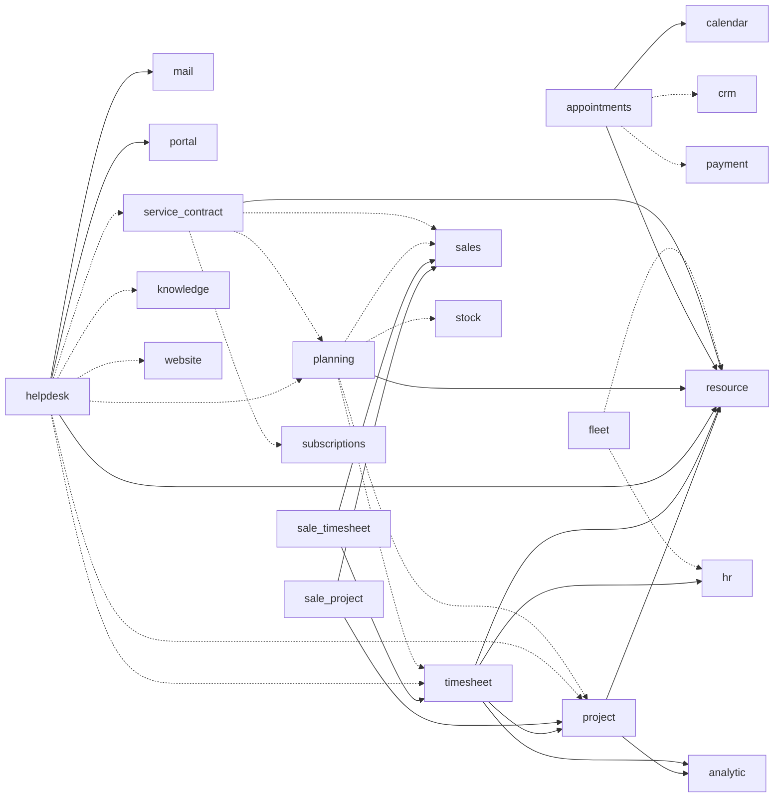
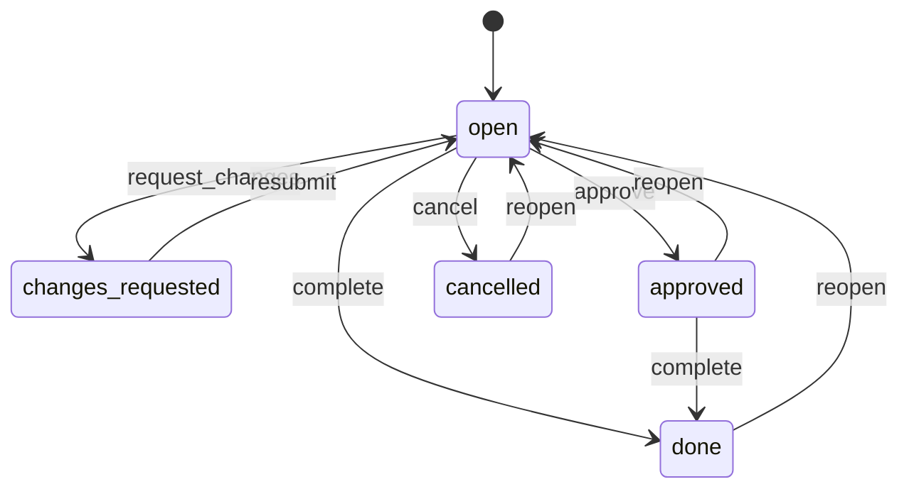
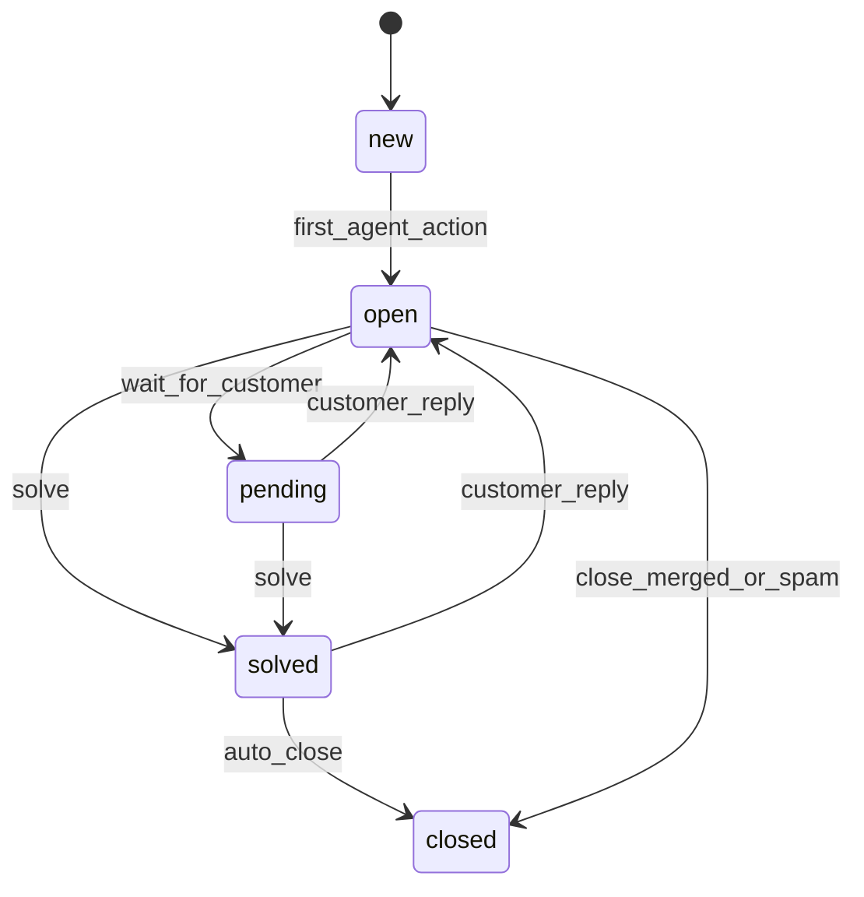
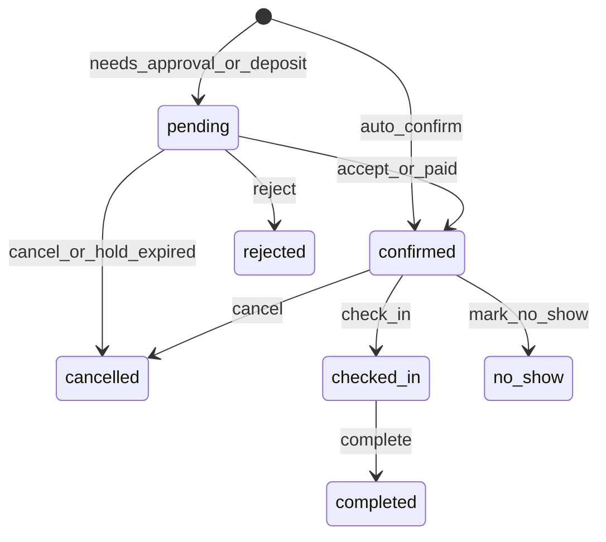

# Services: projects, timesheets, helpdesk, field service, planning, appointments, fleet

**Status:** Draft 0.1  
**Date:** 2026-10-01  
**Scope:** Product specification of obop's services area: the shared resource-calendar foundation, Project, Timesheets with the time-to-invoice bridges, Helpdesk with its SLA engine, Planning with field work, Appointments, service contracts and Fleet.

> **Reading notes.** Tiers, waves and open/paid status follow D25, D26 and D2, all Proposed, so every wave below is Proposed until the owner ratifies it ([DECISIONS](../DECISIONS.md)). "Community" and "Enterprise" always name Odoo's editions (obop says "open edition" and `ee`, D24); "Odoo 20" is the September 2026 release (release commit 2026-09-17); an Odoo app's Enterprise status is inferred from its absence in the public Community tree [R14 s2]. Nothing is built, so every number about obop is a (target) or an (estimate), never a measurement (D21). Nothing is legal advice; "counsel" marks items for a lawyer.

## 1. Purpose and scope

The services area is where a business sells time, expertise and visits rather than goods: consultants billing hours, support desks answering against a promised response time, technicians visiting customer sites, professionals taking bookings. Odoo keeps the revenue-critical parts (Helpdesk, Planning, Field Service, Appointments, Gantt, timesheet grid and approval) in Enterprise [R14 s2; R01 s3.1, s3.8]; obop ships them in the open edition (D2, DECISIONS section 6).

Three ideas hold the area together.

1. **One clock.** A `resource` foundation (calendars, working intervals, leaves, public holidays) answers every "when": SLA deadlines, task scheduling, expected timesheet hours, capacity, booking availability [R14 MUST 3].
2. **One time table.** A timesheet entry is an analytic line, so cost, billing and profitability share one ledger [R14 MUST 1; R23 B.1].
3. **One join point.** Services never invoice directly. Timesheets, milestones and visits contribute delivered quantity to the sale line through `QtyContributionPort`; invoicing reads the sale line [R23 D.4; R11 s7].

Primary users are 5-50 person services firms (the first ICP, Proposed D4) and the after-sales teams of light-trade businesses. R20 rates the agency persona's fit with the loop High, as it does distributors [R20 s3.1]; Project plus billable Timesheets is the "services variant" added to the seven-app loop [R20 s9.2; D25].

### 1.1 Modules

"Open" means AGPL with no `ee` part (D1, D2, Proposed).

| Module | Contents | Tier | Wave | Status |
|---|---|---|---|---|
| `resource` | Calendars, working intervals, leaves, resources (people, materials, vehicles, rooms), working-time arithmetic | T0 foundation (listed in D25, Proposed; DECISIONS Q8) | Proposed W2 | Open |
| `project` | Projects, tasks, stages, dependencies with lag, milestones, templates, scheduling engine | T1 | W2 | Open |
| `timesheet` | Time on analytic lines, timer, grid, submission and approval; needs the employee core of `hr` (4.3) | T1 | W2 | Open |
| `sale_project`, `sale_timesheet` | Bridges: service policy matrix, project/task creation, delivered quantity from time and milestones | T1 | W2 (W1 only if the loop is on schedule at 0.5) | Open |
| Gantt and map views | View types in the UI registry | T0 | W3 ("gantt follows `project`") | Open |
| `helpdesk` | Teams, tickets, SLA engine, channels, CSAT, macros | T2 | W3 | Open |
| `planning` with field work | Shifts, scheduling roles, open shifts, auto-plan, sites, equipment, worksheets, visits | T2 | W3; design starts no earlier than 2028-07-01 | Open |
| `appointments` | Booking types, hosts, resources, slot engine, booking page | T2 | W3 | Open |
| `service_contract` | Entitlements, allowances, covered sites and equipment, visit plans | Not listed, so T3 by the D25 default | Proposed W3, beside `planning` | Open |
| `fleet` | Vehicles, contracts, services, odometer, driver assignments | T3 | W4+ or community | Open |

Each T2 app enters in demand order and needs a design partner (D25). Consumed but not owned here: `calendar` (T1, W2), the approvals engine (T0, W2, inside `automation`), `knowledge`, `subscriptions`, `livechat`, `website`, `sign` (T2, W3).

### 1.2 Boundaries

| Neighbour | It owns | This spec owns |
|---|---|---|
| [Sales and CRM](sales-crm.md) | Sale orders and lines, pricing, `subscriptions`, leads | Service fields on products, the two bridges, quantity contributions |
| [Finance](finance.md) | Invoices, e-invoicing, the analytic ledger | Timesheet cost entries, the time annex on invoices |
| [People](people.md) | Employees, hourly cost, time off, expenses | Timesheet entries; leaves flow into `resource` |
| [Supply chain](supply-chain.md) | Stock, internal equipment maintenance, repairs | Van-stock use via ports; customer-site equipment |
| [Platform](platform.md) | Chatter, mail gateway, `calendar` and sync, knowledge, sign, approvals, automation | Service requirements on them (4.6) |
| [Retail, commerce, marketing](retail-commerce-marketing.md) | POS restaurant tables | Capacity-aware booking resources are reusable there [R12] |

### 1.3 Module graph

Solid arrows are required dependencies on the other module's `*-api` crate; dotted arrows are optional ports (`Option<Arc<dyn Port>>`, no bridge module, D27). Column names follow [CONVENTIONS](../CONVENTIONS.md) section 2.1 and [ARCHITECTURE](../ARCHITECTURE.md) 5.2. A column that one module adds to another module's entity (`sale_order_line_id` on tasks, milestones and entries, `ticket_id` on entries, `sla_policy_id` on service contracts, `service_contract_id` on service equipment) is bridge storage added when both modules are installed, not part of the owner's base schema ("a bridge crate exists only to add storage or UI", [R23 D.2]). The tables write it as `<module_id>__<field>`, the prefix naming the module that adds it: the bridge where one exists (`sale_project__sale_order_line_id` on `task`, `sale_timesheet__sale_order_line_id` on `timesheet_entry`), otherwise the module that holds the optional edge in the graph below (`helpdesk__ticket_id` on `timesheet_entry`, `helpdesk__sla_policy_id` on `service_contract`, `service_contract__service_contract_id` on `service_equipment`; the field name is the `service_contract_id` of the CONVENTIONS rename map, section 8). A column on a module's own entity takes no prefix, even when it points into a module reached only by a dotted arrow (`project_id` and `task_id` on `planning_shift`, `task_id` on `field_material_line`, `sale_order_line_id` on both, `service_contract_id` and `service_equipment_id` on `ticket`, `subscription_id` on `service_contract`): it is a nullable column of the owner's table, read and checked through the other module's port, and its database foreign key exists only while both modules are installed (Proposed).

Helpdesk's other after-sales ports (credit note, return, repair, lead) are omitted for legibility.

## 2. Personas and roles

| Persona | Jobs to be done | Default permission groups |
|---|---|---|
| Consultant or employee | Log time fast; see tasks and expected hours | `timesheet.user`, `project.user` |
| Project manager | Plan, assign, approve time, protect margin | `project.manager`, `timesheet.approver` |
| Agency owner, finance clerk | Utilisation, margin, invoicing delivered work | `project.manager`, `timesheet.cost_viewer` |
| Support agent, lead | Answer within the promise; balance queues | `helpdesk.agent`, `helpdesk.lead` |
| Dispatcher | Fill open shifts, assign jobs, publish | `planning.dispatcher` |
| Field technician | Visits, work record, parts, signature, offline | `planning.technician` |
| Service host | Offer bookable slots, keep calendars in sync | `appointments.host` |
| Fleet manager, driver | Vehicles, costs, services, odometer | `fleet.manager`, `fleet.driver` |
| Contract manager | Sell and renew entitlements | `service_contract.manager` |
| Customer | Follow tasks, tickets, billed time; rate; book | `base.portal` or share grants; no service permission group |

Permission groups bundle permission rows under the D10 algebra: default-deny, every row declares a scope (`all`, `own`, `company`, `domain`), restriction rows only narrow. Group names follow the `<module>.<role>` form of [CONVENTIONS](../CONVENTIONS.md) section 4, which registers the services groups below; they stay Proposed until the seed list of [security-privacy](security-privacy.md) 2 carries them. (Entities such as `appointment_host` in 4.6 are tables, not groups.)

| Permission group | Scope | Grants | Sensitive access |
|---|---|---|---|
| `resource.admin` | company | Calendars, holiday sets, assignments | - |
| `project.user` / `project.manager` | domain (member, or internal privacy) / company | Visible tasks / all projects, templates, billing setup | Prices for managers only |
| `timesheet.cost_viewer` (field permission) | company | Employee cost snapshots and margins | Salary-derived values, class `financial` (a value from which wage can be recomputed takes wage's class, D10; [CONVENTIONS](../CONVENTIONS.md) section 5; [R13 s9]) |
| `timesheet.user` / `.approver` / `.admin` | own / domain (projects they manage, their reports) / company | Enter; approve or refuse; lock dates and reversals | Hours only |
| `helpdesk.agent` / `.lead` / `.manager` | domain (own teams) / domain (teams they lead) / company | Work tickets; assign and watch SLAs; policies and reports | Requester data, message bodies |
| `planning.user` / `planning.dispatcher` | own / domain or company | Own shifts, claim, swap / create, assign, publish | - |
| `planning.technician` | domain: assigned visits | Execute visits, add parts, capture signature | Site access notes inside the visit window |
| `appointments.host` / `.manager` | own / company | Own types and bookings / all | Booker answers |
| `fleet.driver` / `fleet.manager` | domain (assigned vehicle) / company | Odometer, fuel / everything | Driver history |
| `service_contract.manager` | company | Contracts, allowances | - |

External people get `share_grant` capability tokens scoped to a record and an action [R23 B.1]: project collaborator (`read`, `edit`, `advanced_edit`), ticket requester or follower, booking owner.

## 3. Capability map

Waves are Proposed (D25, D26). Parity values: matches Community, matches Enterprise, beyond, deliberately skipped.

| Capability | Description | Wave | Odoo parity |
|---|---|---|---|
| Working calendars, leaves, arithmetic | Weekly, two-week, flexible schedules; zones; pack holidays; pure library with explain trace | W2 | Matches Community |
| Projects, tasks, stage versus state | Kanban stages, sub-tasks, privacy modes, email-in; fixed state enum, derived `waiting`, event log | W2 | Matches Community; beyond |
| Dependencies with lag | Blocks, relates, duplicates, precedes with signed lag, cycle check | W2 | Beyond (Community has blocked-by only) |
| Auto and manual scheduling | Headless engine honouring calendars; critical path | W2 engine, W3 UI | Beyond |
| Gantt with baselines | Drag or form scheduling, dependencies, baselines | W3 | Matches Enterprise Gantt; beyond on lag; baselines are an OpenProject feature, not found in the Odoo research [R14 s3.2] |
| Milestones, updates, templates, recurrence, collaborators | Billing-linked checkpoints, status posts, date-shifting templates, portal sharing | W2 | Matches Community |
| Burndown and time in stage | From event tables incl. estimate revisions | W2 | Matches Community; beyond |
| Sprints and cycles | Optional iteration mode | W4+ | Beyond (Odoo has none); later |
| Timesheet entry, timer, grid, approval | Analytic line; keyboard matrix; suggestions; period submission via the approvals engine | W2 | Matches Community; grid, timer, approval match Enterprise |
| Service policy matrix, employee rate card | Four policies by four tracking modes; employee to sale line | W2 | Matches Community |
| Time-to-invoice with billed-time lock | Approved time only; billed entries immutable | W2 | Beyond |
| Ticketing, assignment, macros, merge | Teams, stage/state, strategies, duplicate merge | W3 | Matches Enterprise |
| SLA engine | First response, next response, resolution, reach-stage; pause; warnings | W3 | Matches Enterprise; beyond (reproducible) |
| Helpdesk channels | Email alias, web form, portal, API, `livechat` hand-off; WhatsApp and social as connectors | W3, connectors W4 | Matches Enterprise |
| CSAT, help center, after-sales actions | 3-point rating; knowledge links; credit note, return, repair, field job, lead | W3 | Matches Enterprise |
| Shifts, open shifts, auto-plan | Roles, publish, recurrence, swap, unassign; exclusive resources enforced by a database constraint | W3 | Matches Enterprise; beyond on exclusivity |
| Field jobs | Sites, equipment, worksheets, parts, signature, warranty | W3 | Matches Enterprise (merged into Planning in Odoo 20) |
| Map and routing | Map view; `RoutingProvider` trait; no bundled vendor | W3 | Matches Enterprise; vendor lock deliberately skipped |
| Offline visit execution | Queued commands for allow-listed visit actions | W3+ (Proposed D13) | Beyond Odoo 19; Odoo 20 queues writes |
| Appointment types and scheduling types | Collective, round-robin, resource with capacity; buffers, notice; deposit, CRM lead, reminders, reschedule, feedback | W3 | Matches Enterprise on the Odoo list [R14 s8.1]; collective and round-robin follow Cal.diy [R14 s8.2] |
| Calendar-aware booking | Busy-time reads, conflict detection, idempotent writes | W3 (sync W2) | Matches Enterprise; beyond on conflicts |
| Service contracts | Entitlement, prepaid allowance, visit plan | Proposed W3 | Beyond (OCA `contract` is the precedent) |
| Fleet | Vehicles, contracts, services, odometer, assignments | W4+ | Matches Community |

## 4. Per-app specification

Conventions for every table: `id` is an application-generated UUIDv7 (D9; the event and log tables here may switch to `bigint` plus a public uuid if the D9 `IdType` spike reads out that way on 2026-11-27); `company_id` NOT NULL (D28); rows carry `row_version` and audit stamps. Durations are integer minutes unless stated; hours and days are `NUMERIC(24,6)`, unit prices `NUMERIC(24,8)`, totals and costs `bigint` minor units with a currency (D9). State machines are registry data [R23 B.2]. Event names follow [CONVENTIONS](../CONVENTIONS.md) section 3 and stay Proposed until the catalogue generated from the registry replaces it (D29). Foreign keys are `<entity>_id` with the full entity name (CONVENTIONS section 2.1), so `resource_calendar_id`, never `calendar_id`; a column that a bridge or an optional module adds to another module's entity carries the `<module_id>__` prefix, and a module's columns on its own entities do not (1.3). In flow tables, T is a TxEvent in the publisher's transaction, D a durable event through the outbox, P a port call (D27); external I/O happens only in durable handlers.

### 4.1 Resource

**Purpose.** One working-time model for everything schedulable. Odoo's `resource` is the most reused service primitive [R14 s7].

**Capabilities.** *W2:* weekly calendars with a two-week pattern and a flexible-hours flag; IANA zone per calendar and resource; global leaves (holidays from country packs) and resource leaves (time off through a bridge); effective-dated calendar assignment; the arithmetic API. *Later:* rotations, skills.

| Entity | Purpose | Key fields |
|---|---|---|
| `resource_calendar` | Named weekly schedule | name, tz, hours_per_day, week_pattern, flexible |
| `resource_work_interval` | One working interval | resource_calendar_id, weekday, start_minute, end_minute, week_type |
| `resource` | Something schedulable; an employee points at it (`employee.resource_id`, [people](people.md)), never the reverse | kind (person, material, vehicle, room), party_id (optional), capacity, exclusive |
| `resource_calendar_assignment` | Calendar over time | resource_id, resource_calendar_id, valid_during (`EXCLUDE` on overlap, D8) |
| `resource_leave` | Non-working period | resource_calendar_id (global) or resource_id, during (tstzrange), kind (public_holiday, time_off, closure), source_ref |

**Arithmetic (crate `obop-resource`, Proposed).** `add_working_duration`, `working_minutes_between`, `next_working_instant`, `is_working`; zones via `jiff` (D29); each call returns the segments it used, so SLA and schedule results are explainable.

**Workflows.** (1) An admin builds "Standard 40h" with two working-interval rows per weekday. (2) A country pack loads public holidays as global leaves. (3) `hr` approves time off and emits `LeaveApproved`; an `auto_install` bridge `hr_resource` writes the `resource_leave` row through `ResourceLeavePort`, and `LeaveCancelled` removes it. (4) Consumers call the arithmetic API, so SLA, scheduling and booking read one availability source.

| Direction | Name | Kind | With |
|---|---|---|---|
| Emits | `ResourceCalendarChanged` | D | helpdesk recomputes open SLAs; project reschedules automatic tasks (bulk work, so outside the publisher's transaction) |
| Emits | `LeaveRecorded`, `LeaveRemoved` | D | planning conflict flags; appointments availability; helpdesk assignment; project rescheduling; timesheet expected hours |
| Consumes | `LeaveApproved`, `LeaveCancelled` | D | `hr`, via the bridge |

**Permissions.** A leave's reason can reveal health data [R13 s9], so schedulers see only "unavailable", through a narrow read model like `hr_employee_public` [R13 s3.1]. **Reports.** Capacity against allocation. **Configuration.** Company default calendar, holiday sets per country and region. **Localization.** Holidays are effective-dated pack data, not code. **Open vs paid.** Open.

### 4.2 Project

**Purpose.** Plan and track internal and customer work with the scheduling behaviour OpenProject offers free and Odoo gates [R14 s3; R14 SHOULD 9].

**Capabilities.** *W2:* projects with privacy (`invited`, `internal`, `portal`); tasks with sub-tasks, priority 0-3, assignees and per-project stages; the full dependency model and headless scheduling engine; milestones; status updates; templates that shift all dates from a new start; recurring tasks; collaborators; email-in; burndown; profitability. *W3:* Gantt with baselines and critical path. *Later:* sprints, intake triage [R14 COULD 17], other relation types, portfolio view.

| Entity | Purpose | Key fields | States |
|---|---|---|---|
| `project` | Container | party_id, manager_id, analytic_account_id, resource_calendar_id, privacy, sale_timesheet__pricing_type, sale_project__default_sale_order_line_id, is_template | planned, active, done, archived |
| `task` | Unit of work (kind `task`, or `field_job` from `planning`) | project_id, parent_id, priority, task_stage_id, state, open_blockers, allocated_minutes, planned_start/end, scheduling_mode, milestone_id, sale_project__sale_order_line_id | `open`, `changes_requested`, `approved`, `done`, `cancelled` |
| `task_stage` | User column | sequence, fold, state_on_enter, templates | - |
| `task_dependency` | Edge | predecessor_id, successor_id, type (blocks, precedes, relates, duplicates), lag_working_days (signed) | - |
| `milestone` | Checkpoint | deadline, reached_at, sale_project__sale_order_line_id, sale_project__quantity_percentage | pending, reached |
| `project_update` | Status post | status (on_track, at_risk, off_track, on_hold, done), text | - |
| `task_event` | Append-only log | task_id, kind (state, stage, assignee, estimate, schedule), from, to, at, actor | - |
| `project_baseline` | Frozen plan | project_id, taken_at, dates per task | - |

**State machine.** `state` is stored; `stage` is a user column. `waiting` is derived, not stored: it applies while `state` is `open` or `changes_requested` and `open_blockers` > 0, which avoids write cascades when a predecessor closes (Proposed; R14 MUST 4 asks for automatic waiting). A stage may set `state_on_enter` (none, `done`, `cancelled`), also Proposed.

Guards (Proposed): `complete` fails while blockers are open unless a manager forces it (audited); review states can be disabled per project; closing a parent with open sub-tasks is refused by default.

**Scheduling engine (crate `obop-schedule`, Proposed).** A pure function over tasks, dependencies, calendars and leaves, with an explain trace, like the pricing crate [R11 s4.3]. *Lag* counts working days between the predecessor's last working day and the successor's first: lag 0 starts the next working day, lag 2 the third, lag -1 the predecessor's last day. *Automatic* tasks take the earliest feasible day; *manual* tasks never move and raise a violation instead. Cycles are rejected with the path (`petgraph`, [R14 s8.4]). A template instantiates from per-task offsets.

**Workflows.** (1) Create a project from a template; the engine lays tasks out from the chosen start. (2) Add tasks and dependencies; `ScheduleProject` recomputes automatic tasks and the critical path. (3) Assignees move cards; each change appends to `task_event`. (4) The manager posts a weekly update; collaborators see it. (5) Reached milestones push delivered quantity (4.3). (6) Closing a recurring task creates the next one, copying name, description, project, assignees, customer and tags but not timesheets, milestones, activities or sub-tasks [R14 s3.1].

| Direction | Name | Kind | With |
|---|---|---|---|
| Emits | `TaskStateChanged` | T | Updates successors' `open_blockers`; stops a running timer on close |
| Emits | `MilestoneReached` | T | `sale_project` sets the milestone's contribution (4.3) |
| Emits | `TaskClosed`, `TaskScheduleChanged` | D | Webhooks, rating email, planning conflicts |
| Consumes | `SaleOrderConfirmed` | T | Via `sale_project` (4.3) |
| Consumes | `ResourceCalendarChanged`, `LeaveRecorded`, `LeaveRemoved` | D | Reschedule automatic tasks around calendar changes and assignees' leave |
| Consumes | Create-task calls from helpdesk | P | Ticket to task |

**Permissions.** Prices and margins are field-protected; the query compiler rejects filter, sort and group-by on unreadable fields (D10). **Reports.** Burndown from `task_event` and estimate revisions (Odoo's burndown appears not to re-snapshot estimates; inferred, [R14 s3.1]), cumulative flow, time in stage, workload, profitability (expected, to invoice, invoiced; revenue against cost) via the semantic layer [R23 B.3]. **Configuration.** Per-project features, stage sets, calendar. **Localization.** Calendars and holidays only. **Open vs paid.** Open.

### 4.3 Timesheets and the time-to-invoice bridges

**Purpose.** Capture time once, bill it correctly, cost it, and never let billed time change silently.

**Capabilities.** *W2:* entry in hours or days; one-click timer (one running per employee); weekly keyboard grid [R19 s6, s7]; suggested rows; submission and approval through the approvals engine; cost snapshot from the employee's hourly cost; the service policy matrix; employee rate card; delivered quantity from approved time. *Later:* minimum-increment rounding, billing-target dashboard (in Odoo 20, [R14 s4.3]), time budgets, calendar-based suggestions, offline entry (a queued-write candidate under Proposed D13, [R19 s11]).

| Entity | Purpose | Key fields | States |
|---|---|---|---|
| `timesheet_entry` | 1:1 extension of `analytic_line` (same id) | employee_id, project_id, task_id or helpdesk__ticket_id (at most one), date, unit_amount, sale_timesheet__sale_order_line_id, sale_timesheet__is_sale_line_overridden, cost_rate, amount_minor, timesheet_submission_id, correction_of_id | `draft`, `submitted`, `approved`, `refused` |
| `timesheet_submission` | Approval subject: one employee, one period | employee_id, period, approver_id | open, submitted, approved, refused |
| `timesheet_timer` | Running timer | employee_id, started_at, target | one running per employee (partial unique index) |
| `project_billing_rate` | Rate-card row | project_id, employee_id, sale_order_line_id, unit_price_override, cost_override | - |
| Service product fields | Added to service products by `sale_project` ([sales-crm](sales-crm.md)) | sale_project__service_policy, sale_project__service_tracking, sale_project__project_template_id, sale_project__task_template_id, sale_project__unit | - |

The analytic line (owned by [finance](finance.md) 4.8) holds date, account, amounts and currency, so time cost sits beside vendor bills. The extension row shares its id and is inseparable from it (foreign key plus deferred constraint, Proposed); finance 4.8 gives every `analytic_line` a `source_ref` so reports can tell timesheet entries from invoice and bill lines, and allows a module-owned 1:1 extension row (Proposed there; closes open question 3).

**Employee dependency.** `timesheet` is W2 but `hr` is W3 (D25), apart from an employee core (employee, version, department, job, calendar) that D25 lists in W2 (Proposed; DECISIONS Q8). [People](people.md) proposes the same; this spec assumes it (R23 D.3 draws the edge as optional, `hr?`, but every entry has an employee). The hourly cost sits in the effective-dated employee version in class `financial` (a value from which wage can be recomputed takes wage's class) and is read through `EmployeePort`; a `cost_rate(employee, date)` lookup is a Proposed addition to that port.

**Service policy matrix** [R14 s4.2; R14 MUST 2]:

| `sale_project__service_policy` | Invoiced on | Delivered quantity comes from |
|---|---|---|
| `ordered_prepaid` | Ordered quantity, at confirmation | Does not drive invoicing; prepaid hours are tracked by logged time ([R14 s4.2]: "timesheet to track prepaid hours") or typed by hand, and show as consumed |
| `delivered_manual` | Delivered quantity | Typed on the sale line |
| `delivered_timesheet` | Delivered quantity | Approved entries mapped to the line |
| `delivered_milestones` | Delivered quantity | Reached milestones: `quantity_percentage` x ordered quantity |

| `sale_project__service_tracking` | On `SaleOrderConfirmed`, `sale_project` creates |
|---|---|
| `none` | Nothing |
| `task_global_project` | One task in the product's shared project |
| `task_in_project` | One project per order and project template, shared by the order's lines (from `project_template_id`), and one task per line (from `task_template_id`) |
| `project_only` | A project with no task, created and shared like the `task_in_project` project |

The project grouping follows Odoo 20's `sale_project` source (one project per order and template, read on 2026-10-01); it is not in R14. Creation is idempotent, keyed on (sale line, kind), so a replayed event creates nothing twice [R23 D.2, rule R3]. Cancelling an order never deletes a project; it detaches billing.

**Sale line for an entry**, by the project's `sale_timesheet__pricing_type` (Proposed order; [R14 s4.4] gives a looser one): `task_rate` (the task's line, else the project default), `fixed_rate` (the project default), `employee_rate` (the rate-card row, else the default). An explicit choice sets `sale_timesheet__is_sale_line_overridden`, so recomputation never overwrites it [R14 s4.1].

**Validation.** `SubmitTimesheet` moves the period's draft entries to `submitted`; the manager approves or refuses (`refused` returns to `draft` with a comment). "Bill approved time only" is on by default when approval is enabled (Proposed); Enterprise's grid appears to restrict delivered quantity to validated entries (inferred, [R14 s4.1]).

**Workflows.** (1) Sell a `delivered_timesheet` / `task_in_project` product; confirmation creates project and task with `sale_project__sale_order_line_id` set. (2) Employees log time; the line follows the rule above. (3) The manager approves the week. (4) `sale_timesheet` sets the entry's contribution; the line becomes "to invoice". (5) Finance invoices; the invoice carries a billed-time annex (Typst, Proposed D20). (6) On `InvoicePosted` the contributing entries lock; corrections are new entries with `correction_of_id`, possibly negative, approved like any other.

| Direction | Name | Kind | With |
|---|---|---|---|
| Emits | `TimesheetEntryRecorded`, `TimesheetChanged` | T | `sale_timesheet` calls `QtyContributionPort::set(('timesheet', id), line, qty)` |
| Emits | `TimesheetSubmitted`, `TimesheetApproved`, `TimesheetRefused` | D | Chatter, inbox, webhooks |
| Consumes | `InvoicePosted` | T | Locks contributing entries (handler in `sale_timesheet`, which knows the invoice-line sources) |
| Consumes | `MilestoneReached`, `SaleOrderConfirmed`, `SaleOrderCancelled` | T | `sale_project` sets contributions, creates, detaches |
| Consumes | `LeaveRecorded`, `LeaveRemoved` | D | Expected hours per day in the grid; available hours in utilisation |

**Permissions.** `cost_rate` and `amount_minor` derive from salary, are class `financial` and are additionally field-protected (`timesheet.cost_viewer`); a group-by on cost by an unauthorised user is rejected. No activity tracking, screen capture or geolocation in core; sensitive capture stays off by default [R13 MUST 17]. An entry an agent proposes stays `draft` until the employee submits it (D18); every state change is a typed command on the generated API (D31). **Reports.** Utilisation (billable against available hours from the employee's calendar), time by project, task and customer, work in progress (delivered, not invoiced), budget against actual. **Configuration.** Unit and day length, approval mode, "bill approved time only", timesheet lock date, back-entry window. **Compliance.** Working-time recording duties differ by country and are not in the research (counsel); entries are employee personal data under retention and anonymise-in-place rules [R18 s8.1]. **Open vs paid.** Open; timesheet-only users count as light users, free within fair use (D2, [R26 A3]).

### 4.4 Helpdesk

**Purpose.** Answer customers through any channel against a measurable promise, and feed after-sales work into the business.

**Capabilities.** *W3:* teams (private, internal, public) with inbound aliases; tickets with priority, type, tags and a stage/state pair; the SLA engine; assignment strategies; macros and canned replies; merge and split; CSAT; help-center links; after-sales actions; ticket time and prepaid support; portal view. Chat hand-off from `livechat` (W3) creates a ticket ([retail-commerce-marketing](retail-commerce-marketing.md)). *Later:* WhatsApp and social connectors (W4, X3/X4 packages); phone via provider APIs [R21 s6.6]; optional AI assistance (D18).

| Entity | Purpose | Key fields | States |
|---|---|---|---|
| `helpdesk_team` | Queue owner | visibility, aliases, assignment_strategy, resource_calendar_id, timesheet_project_id | - |
| `ticket` | A request | number, helpdesk_team_id, requester_party_id, requester_email, channel, priority, ticket_type_id, ticket_stage_id, state, pending_reason, pending_until, assignee_id, service_contract_id, service_equipment_id, first_response_at, resolution_kind | `new`, `open`, `pending`, `solved`, `closed` |
| `ticket_stage` | Per-team column | sequence, fold, state_on_enter, pauses_sla, rating_template_id | - |
| `ticket_event` | Append-only log | ticket_id, kind (state, stage, assignee, priority, public_message, internal_note), at, actor | - |
| `sla_policy` | Rule set | helpdesk_team_id, sequence, criteria (Domain AST, Proposed D12), resource_calendar_id | active, archived |
| `sla_target` | One goal | sla_policy_id, metric, duration_minutes (working), ticket_stage_id, warning_pct | - |
| `applied_sla` | Target on a ticket | ticket_id, sla_target_id, started_at, next_deadline, paused_at, calendar_version, hit_at | `active`, `hit`, `missed`, `active_with_misses`, `cancelled` |
| `ticket_rating` | CSAT | ticket_id, agent_id, score (1-3), comment | - |
| `ticket_link` | Relation | kind (duplicate_of, related, merged_into), from, to | - |

**State machine.** The state set is Proposed from Zammad and Chatwoot precedent [R14 s5.2]. `pending` carries a reason (customer, third party, reminder) and pauses the SLA by default.

**SLA engine (crate `obop-sla`, Proposed).** Chatwoot's status set is the model; Chatwoot, Zendesk, Freshdesk and Odoo gate SLAs, obop does not [R14 MUST 5].
- *Attachment:* at creation and when priority, tags, team or service contract change, the first policy (by `sequence`) whose criteria match applies, per metric.
- *Clock:* `first_response` and `resolution` start at creation; `next_response` starts at each customer message that follows an agent reply and stops at the next public agent reply. Internal notes stop nothing.
- *Pause:* intervals come from `ticket_event` (state `pending`, or a stage with `pauses_sla`).
- *Deadline:* a pure function of (target, start, pauses, calendar version, leaves) via `obop-resource`; a priority change recomputes from the original start.
- *Sweep:* a scheduled durable job claims rows near their deadline (`FOR UPDATE SKIP LOCKED`), emitting `SlaWarningRaised` at `warning_pct` and `SlaBreached` at the deadline, with no NOTIFY in the business transaction (D7).
- *Change control:* `ResourceCalendarChanged` recomputes non-terminal rows only; terminal rows never change.
- *Proof:* a nightly job recomputes every row from the event log and fails loudly on mismatch.

**Workflows.**
1. Mail reaches the team alias; the gateway threads by `References`/`Message-ID`, then by a ticket number in the subject [R14 MUST 6]; else a ticket is created and SLAs attach.
2. Assignment: manual, `round_robin` (cursor row locked), `least_open` or `skill_tag`; agents on leave are skipped using `resource` leaves, so helpdesk needs no HR dependency.
3. The agent replies (first response stamped), sets `pending`, or applies a macro.
4. `solve` sends the CSAT request; a customer reply within the configured window reopens, otherwise auto-close.
5. After-sales buttons call optional ports (credit note, return, repair, field job, lead); a button is hidden if its module is absent.
6. Help center: `knowledge` articles link to a team and publish to the portal of a public team; agents search them from the reply box and can seed one from a solved ticket (optional `KnowledgeSearchPort`, Proposed).
7. Merge moves messages and followers to the surviving ticket; both SLAs settle.

| Direction | Name | Kind | With |
|---|---|---|---|
| Emits | `TicketCreated`, `TicketReplied`, `TicketAssigned`, `TicketStateChanged` | T | SLA maintenance, timers |
| Emits | `SlaWarningRaised`, `SlaBreached`, `SlaTargetMet`, `TicketSolved`, `TicketRated`, `TicketMerged` | D | Notifications, webhooks, reports |
| Consumes | Inbound mail by alias | P | `mail` gateway |
| Consumes | `FormSubmitted` | D | Web-form ticket creation: a form mapped to a team creates a ticket and attaches SLAs (`website`, [retail-commerce-marketing](retail-commerce-marketing.md) 4.4) |
| Consumes | `ResourceCalendarChanged`, `LeaveRecorded`, `LeaveRemoved` | D | SLA recompute; assignment |
| Consumes | `PartyErased` | D | Anonymise contact snapshots (requester name and email) in place (ARCHITECTURE 4.3; Proposed) |

**Permissions.** Agents see their teams' tickets; internal notes never reach the portal; on a public team a portal user sees only tickets they follow [R14 s9]. Messages and attachments are personal data and may hold special-category data; erasure anonymises in place [R18 s8.1]. AI features are optional, switchable per module, and draft only (D18). **Reports.** SLA attainment and time to first response by team, policy, priority; backlog ageing; CSAT; volume by channel; reopen rate. **Configuration.** Stages, calendars, auto-close days, rating window, alias loop thresholds, web-form spam limits (rate limit; optional challenge via a connector). **Compliance.** Portal, web form and CSAT page sit inside the WCAG 2.2 AA commitment (D38). Mailboxes are OAuth-only; EWS is default-disabled from 2026-10-01 and permanently off from 2027-04-01 (D39, [R21 s6.5]). **Open vs paid.** Open.

### 4.5 Planning and field work

**Purpose.** Schedule people and things against demand, and run on-site work from request to invoice.

**Design choice (Proposed).** Odoo 20 discontinued Field Service and merged it into Planning: an intervention is a shift with customer, sales order, worksheet and sign-in [R14 s6.1]. The task-versus-shift question is DEFERRED (DECISIONS section 2.3, ruling 18). Proposal:

| Option | Model | Strength | Weakness |
|---|---|---|---|
| A (Odoo 20) | Job is a shift | One object for single-visit work | Multi-visit jobs, billing and SLA sit on a time slot |
| B (OCA-like) | Job is a task only | Billing and timesheets natural | No capacity planning |
| **C (proposed)** | Job is a `task` of kind `field_job`; each visit is a `planning_shift` linked 1:N | Lifecycle and billing on the task; capacity and execution on the visit; quick-create makes both from one form | Two objects to keep consistent |

Rules for C: a `field_job` requires a site; worksheet, sign-in and customer signature belong to the visit; the task's planned dates derive from its visits once any exist; planning works without projects (`task_id` optional). Ratification is due before `planning` design starts (2028-07-01).

**Capabilities.** *W3:* scheduling roles (labels on shifts and resources, not permission groups), resources (person, material, vehicle), shifts and open shifts, publish state, templates and recurrence to a horizon, timeline by resource, role or project, auto-plan (role plus availability, calendars and leaves respected, higher-priority shifts first) [R14 s7], swap or unassign, overload flags, open shifts from a scheduling role on a service product, field jobs with sites, equipment, worksheets, parts, warranty, map. *W3+:* queued offline visits (Proposed D13). *Later:* territories, skills, VROOM optimisation, customer ETA messages.

| Entity | Purpose | Key fields | States |
|---|---|---|---|
| `planning_role` | Scheduling label | name | - |
| `planning_shift` | Slot of a resource; a visit when linked to a job | resource_id (null = open), planning_role_id, during, allocation (hours or percent), project_id, task_id, sale_order_line_id, priority, recurrence_id, sign_in_at/out_at, geo (opt-in), worksheet_response_id | `draft`, `published`, `in_progress`, `done`, `cancelled` |
| `shift_swap_request` | Swap or unassign | planning_shift_id, kind, requester, taker | pending, accepted, declined |
| `service_site` | Customer location | party_id, address_id, access_notes, contact_party_id, geo, resource_calendar_id | active, archived |
| `service_equipment` | Installed asset | service_site_id, product_variant_id, serial_or_lot, installed_on, warranty_until, parent_id, service_contract__service_contract_id | active, retired |
| `worksheet_template` | Versioned JSON-schema form | name, schema, version | active, archived |
| `worksheet_response` | Filled form | planning_shift_id, template_version, data, attachments | draft, submitted |
| `field_material_line` | Part used | task_id, planning_shift_id, product_id, qty, van_location_id, sale_order_line_id, billable | - |

Sites and equipment are first-class because the strongest open evidence (OCA `field-service`) shows a job is more than a task with an address [R14 s6.2]. Customer-site equipment stays apart from the company's maintenance equipment (open question 7).

**Resource rules.** Exclusive resources get `EXCLUDE USING gist` over (resource, during) for published shifts; people are allocation-based (over 100% is flagged, not blocked). Swap and unassign are mutually exclusive settings, as in Odoo [R14 s7].

**Visit lifecycle.** `draft` to `published` (notifies) to `in_progress` (sign-in) to `done` (worksheet submitted, signature captured); `cancelled` from draft or published. Completion creates the technician's time entry from actuals (client timestamps kept beside server receipt time) and settles parts.

**Workflows.**
1. A ticket action, sale line or dispatcher creates a job; site and equipment are prefilled; warranty status is computed from `warranty_until`.
2. The dispatcher creates an open shift and runs auto-plan or assigns by hand; conflicts show.
3. Publish; the technician sees a day list and map.
4. On site: sign in (location only if the company opted in), fill the worksheet, add parts from van stock, capture the customer's drawn signature (a simple signature with timestamp evidence, never claimed as advanced or qualified, D39), complete.
5. Billing: labour by `delivered_timesheet`, parts as sale lines on the order (the sale line stays the join point); warranty work is flagged, priced at zero and costed to the analytic account.
6. The customer report (Typst, Proposed D20) is emailed and stored on the job.

| Direction | Name | Kind | With |
|---|---|---|---|
| Emits | `ShiftPublished`, `OpenShiftClaimed`, `ShiftSwapRequested` | D | Notifications |
| Emits | `VisitStarted`, `VisitCompleted`, `VisitCancelled` | T+D | T: time entry and parts in the same transaction; D: report, ticket update |
| Consumes | `SaleOrderConfirmed` | D | Open shifts for products bound to a scheduling role (bridge, Proposed) |
| Consumes | `TaskScheduleChanged`, `LeaveRecorded`, `LeaveRemoved` | D | Conflict flags |
| Ports | `DemandPort` (van stock), `RoutingProvider`, optional sale-line creation | P | stock, map |

**Permissions.** `planning.technician` sees assigned visits and no prices. Site access notes may hold door codes and show only inside the visit window (Proposed). Geolocation is off by default, with company opt-in and notice [R13 MUST 17]. **Reports.** Utilisation, planned against actual hours, open shifts, first-time-fix rate, travel time. **Configuration.** Recurrence horizon (Odoo generates six months ahead, [R14 s7]), auto-plan rules, routing provider, tile source, geolocation opt-in. **Routing and maps.** `RoutingProvider` is a trait with no bundled vendor; OSRM, Valhalla or VROOM are optional sidecars outside the default install (Proposed I-1), and without one travel time comes from straight-line distance. OSM public tiles are unsuitable for production [R14 s6.3], so the tile source is a setting; MapLibre GL JS is the client library. FullCalendar Premium is excluded on licence [R00 s3.3], so the resource timeline is first-party; the Gantt renderer is a time-boxed spike (SVAR, DHTMLX Community or custom, [R07 s3.3]) within the React 19 and Vite+ toolchain (D15), driven through `vp`. **Compliance.** Geolocation and premises photos are personal data (counsel); technician rest-period rules are not modelled. **Open vs paid.** Open. A hosted routing or tile service is not on the closed paid list (DECISIONS section 6), so the default is bring-your-own keys.

### 4.6 Appointments

**Purpose.** Let customers book people and resources, keep calendars honest, and turn bookings into leads and payments.

**Capabilities.** *W3:* appointment types (duration, buffers, slot interval, notice, horizon, limits); scheduling types `collective`, `round_robin`, `resource` (capacity, guest count); availability from `resource` calendars minus leaves and busy time; questions; auto-confirm or approval; deposit through `payment`; CRM lead; reminders; token-link reschedule and cancel; feedback; public booking page. *Later:* group seats beyond capacity, waitlists, routing forms. Cal.com is not embedded: it closed its source on 2026-04-14 [R14 s8.2].

| Entity | Purpose | Key fields | States |
|---|---|---|---|
| `appointment_type` | Bookable offer | duration, buffers, slot_interval, min_notice, horizon, scheduling_type, confirm_mode, cancel_window, deposit_product_id, create_lead | draft, published, archived |
| `appointment_host` | Host or resource on a type | appointment_type_id, principal_id or resource_id, is_fixed, priority, weight | - |
| `booking` | Reservation | appointment_type_id, start, end, booker_party_id, guests, answers, ical_uid, ical_sequence, idempotency_key, reschedule_of_id, payment_id, lead_id, needs_attention (flag) | `pending`, `confirmed`, `checked_in`, `completed`, `no_show`, `cancelled`, `rejected` |
| `booking_slot` | Held host time | booking_id, appointment_host_id, during (`EXCLUDE` for exclusive hosts) | - |
| `booking_reference` | External event link | booking_id, provider, external_id | - |

The entity set follows Cal.diy's `EventType`, `Host`, `Booking` and `BookingReference` [R14 s8.2], with `resource` calendars replacing its schedules.

**Slot engine (crate `obop-booking`, Proposed).** `available_slots(type, range, busy, now)` is pure: working intervals minus leaves, minus busy intervals, minus held bookings with buffers, minus the notice window, aligned to `slot_interval`, filtered by capacity, with DST-correct `jiff` math in the host's and booker's zones.

**Requirements on `calendar` (platform spec)** [R14 s8.3; R15 s5]: store `iCalUID` and `SEQUENCE` for idempotent updates; Google watch channels are per calendar, bodiless, never auto-renewed and may be dropped, so renew explicitly and treat push as a hint; use `syncToken` sync and wipe-and-resync on HTTP 410; Graph subscriptions for Outlook mail, events and contacts last at most 10,080 minutes (7 days; 1,440 minutes with resource data) and need renewal; a reconciliation sweep is the correctness mechanism. Appointments need the free/busy query with a staleness bound and on-demand refresh, an idempotent `write_event`, and `CalendarEventChanged` (emitted by `calendar`) to trigger conflict detection.

**Double-booking defence, in order.** (1) An advisory lock per host or resource, then a re-check in the same transaction; (2) `EXCLUDE` on `booking_slot` for exclusive hosts; (3) a staleness guard on external busy data that fails closed (slots hidden, host alerted) when a refresh fails; (4) post-confirm conflict detection that flags `needs_attention` instead of cancelling. The remaining window is stated, not hidden: an event created elsewhere is visible only after sync.

**Workflows.** (1) The host publishes a type; the page lists slots in the booker's zone. (2) The booker picks a slot and answers questions, sending an idempotency key. (3) If a deposit is due the booking is `pending` with a hold (Proposed 15 minutes); `PaymentTransactionDone` confirms it, expiry frees the slot. (4) Confirmation writes the booking first, then the external event through a retried durable job. (5) Reminders fire; the booker reschedules or cancels by token link inside the cancel window. (6) The host marks the outcome; feedback is requested.

| Direction | Name | Kind | With |
|---|---|---|---|
| Emits | `BookingRequested`, `BookingConfirmed`, `BookingRescheduled`, `BookingCancelled`, `BookingNoShow`, `BookingCompleted` | D | Reminders, lead, webhooks, POS tables |
| Consumes | `PaymentTransactionDone` | D | Confirm a held booking |
| Consumes | `CalendarEventChanged`, `CalendarEventCancelled`, `LeaveRecorded`, `LeaveRemoved` | D | Conflict detection; freed slots |
| Consumes | `PartyErased` | D | Anonymise booker contact snapshots in place (ARCHITECTURE 4.3; Proposed) |

**Permissions.** Booker name, contact and answers are personal data; a question can be marked special-category, which hides it from non-hosts and shortens retention. Tokens are `share_grant`s. **Reports.** Bookings by type and host, no-show rate, lead conversion. **Configuration.** Sweep interval (Proposed 10 minutes), hold length, staleness limit, retention. **Compliance.** The booking page is a portal surface under WCAG 2.2 AA (D38); the EAA (Directive (EU) 2019/882) applies from 2025-06-28 to services provided to consumers, with an exemption for microenterprises providing services [Directive (EU) 2019/882 Arts. 31(2), 4(5); R28 E.5] (counsel confirms scope). Whether the consumer withdrawal function (since 2026-06-19, [R00 s3.7]) governs paid bookings is open question 9. **Open vs paid.** Open; SMS reminders use bring-your-own gateway keys.

### 4.7 Fleet

**Purpose.** An asset-with-logs record of vehicles, contracts, services and drivers; Odoo's model is small [R14 s9].

**Delivery (Proposed).** Fleet is T3 (W4+ or community). Its model is data, fields, views, reminders and rules, so it can ship as an X1 declarative pack [R24 s3.1; D11, D32], a useful test that the extension API suffices for a real app.

| Entity | Purpose | Key fields | States |
|---|---|---|---|
| `vehicle` | The asset | plate, vin, model, category, fuel, acquired_on, value_minor, odometer_unit, resource_id (optional) | `planned`, `active`, `in_service`, `retired` |
| `vehicle_assignment` | Driver history | vehicle_id, driver, valid_during (`EXCLUDE` on overlap) | - |
| `vehicle_contract` | Lease, insurance | vendor_party_id, kind, starts_on, ends_on, recurring_cost_minor | draft, active, expiring, expired |
| `vehicle_service_log` | Service event | service_type, date, odometer, cost_minor, bill_ref | - |
| `vehicle_odometer` | Reading | vehicle_id, date, value | - |

**Workflows.** (1) Register a vehicle and assign a driver. (2) Attach contracts; an automation rule raises `VehicleContractExpiring` 30 days ahead (Proposed default, taken from the `delay_alert_contract` default in Odoo 20's `fleet` source, read 2026-10-01; configurable). (3) Drivers log odometer and fuel; a schedule by date or distance raises `VehicleServiceDue`. (4) Bill lines carry a vehicle dimension on the analytic ledger. (5) A vehicle linked to a `resource` of kind vehicle can be booked onto field shifts.

**Flows.** Emits `VehicleContractExpiring`, `VehicleServiceDue`, `OdometerRecorded` (D); consumes none by event. **Permissions.** Drivers see only their vehicle; assignment history is personal data; no telematics or location tracking. **Reports.** Cost per vehicle and per distance, contract calendar, service compliance. **Configuration.** Service types, reminder lead times, odometer unit. **Localization.** Company-car taxation and inspection intervals are country rules for packs (counsel). **Open vs paid.** Open.

### 4.8 Service contracts (Proposed)

**Purpose.** One entitlement tying a customer, covered sites and equipment, an SLA, an hours allowance and recurring visits, read by helpdesk, planning and timesheets. Odoo Community has nothing comparable; OCA `contract` is the open precedent [R14 s9; R11 s1]. Billing stays in `subscriptions` ([sales-crm](sales-crm.md)); `ordered_prepaid` sale lines carry prepaid hours.

| Entity | Purpose | Key fields | States |
|---|---|---|---|
| `service_contract` | Entitlement | party_id, starts_on, ends_on, helpdesk__sla_policy_id, prepaid_sale_order_line_id, overage_sale_order_line_id, subscription_id (optional), renewal_mode | `draft`, `active`, `expiring`, `expired`, `terminated` |
| `service_contract_scope` | What is covered | service_contract_id, service_site_id or service_equipment_id | - |
| `service_contract_visit_plan` | Recurring maintenance | service_contract_id, every N months, planning_role_id, duration | active, paused |

Transitions: `draft` to `active` on activation; `active` to `expiring` by an automation rule N days before the end; then `expired`, `terminated`, or back to `active` on renewal. Allowance is derived: granted hours come from the prepaid line, consumed hours from contributions to it. An entry that crosses the allowance splits into (entry, prepaid line) for the remainder and (entry, overage line) for the excess; the key is (line, source) [R23 D.2 R3].

**Workflow.** Sell a contract product; confirmation activates the contract; tickets on covered equipment inherit the SLA; the visit plan generates open shifts to the horizon. **Flows.** Emits `ServiceContractActivated`, `ServiceContractExpiring`, `ServiceContractAllowanceExhausted` (D); consumes `SubscriptionChanged` and `SubscriptionStatusChanged` (renewal, cancellation). **Permissions.** `service_contract.manager`. **Reports.** Allowance burn, expiring contracts, coverage gaps. **Configuration.** Overage policy (bill or block), expiry of unused hours. **Localization.** Consumer-contract terms are country-specific (counsel). **Open vs paid.** Open.

## 5. Cross-app golden paths

Each scenario doubles as an acceptance test. Dates and holidays are fixtures; totals use per-group rounding (D9).

**GP-1 Sales order to project to timesheet to invoice (time and material).**
*Given* Company A (EUR, 19% VAT) and order S1 with two `delivered_timesheet` / `task_in_project` lines: L1 senior 20 h x 150.00 = 3,000.00, L2 junior 20 h x 90.00 = 1,800.00 (4,800.00 net, 912.00 VAT, 5,712.00 total); `employee_rate` with Ben to L1 and Ana to L2; hourly costs Ana 55.00, Ben 70.00; "bill approved time only" on.
*When* S1 is confirmed and, in the week of Monday 2028-05-08, Ana logs 4.0 + 4.5 + 4.0 = 12.5 h and Ben 5.0 + 3.0 = 8.0 h,
*Then* a project and tasks exist with `sale_project__sale_order_line_id` set; L1 and L2 show delivered 0.0 until the manager approves on Friday; afterwards L1 is 8.0 and L2 12.5, both "to invoice". The invoice has 8.0 x 150.00 = 1,200.00 and 12.5 x 90.00 = 1,125.00: 2,325.00 net, 441.75 VAT, 2,766.75 total. Cost is 687.50 + 560.00 = 1,247.50, margin 1,077.50 (46.3%). *And when* the invoice is posted and Ana edits her 4.5 h entry, *then* the command fails with `timesheet_entry_billed`; she adds a 0.5 h correction, and once approved L2 shows 13.0 delivered, 12.5 invoiced and 0.5 h (45.00 net) to invoice.

**GP-2 Fixed price with milestones.**
*Given* order S2 with one `delivered_milestones` / `project_only` line "Website redesign" 1 x 10,000.00 and milestones M1 30%, M2 70%.
*When* M1 is reached and invoiced, *then* delivered is 0.30 and the invoice is 3,000.00 net (570.00 VAT, 3,570.00); un-reaching M1 is refused (`milestone_invoiced`). *When* M2 is reached, *then* 7,000.00 net is to invoice and invoices total 10,000.00 net.

**GP-3 Ticket with a paused SLA.**
*Given* a team calendar Monday-Friday 09:00-17:00 Europe/Berlin without holidays, policy "Gold" (first response 120 min, resolution 480 min) and auto-close after 7 days.
*When* a ticket is created Friday 2027-03-12 16:00,
*Then* the first-response deadline is Monday 2027-03-15 10:00 (60 min Friday, 60 min Monday) and the resolution deadline Monday 16:00. An agent reply at Monday 09:40 makes first response `hit`. Setting `pending` at Monday 10:00 (120 working minutes used) and a customer reply Tuesday 11:00 resumes the clock with 360 minutes left: deadline Tuesday 17:00. Solving Tuesday 15:30 makes resolution `hit` with 90 minutes to spare; the CSAT request is sent and the ticket closes after 7 days without a reply. Without an agent reply by Monday 10:00, `SlaBreached` fires and first response becomes `missed`.

**GP-4 Ticket to field job to invoice, offline (W3+, Proposed D13).**
*Given* equipment HP-900 (serial 7731) with `warranty_until` 2028-06-30 at site "Werk 2", ticket T-2041, technician Kai (scheduling role HVAC) with sensor S-12 (48.00) in his van, labour at 85.00/h.
*When* the agent creates a field job, the dispatcher publishes a visit on Tuesday 2028-10-10 08:00-10:00, and Kai, without coverage, signs in at 08:10, fills the worksheet, adds S-12, gets the customer's signature at 09:50 and completes at 09:55 (queued commands); meanwhile the dispatcher moves the shift end to 11:00; the phone syncs at 10:20 and retries twice,
*Then* the server keeps the planning change and Kai's actuals (server wins on planning fields, technician on technician fields), emits `VisitCompleted` once (unique `command_id`), creates a 1.75 h time entry and one stock move of S-12 from the van. The warranty has expired: labour 1.75 x 85.00 = 148.75 plus part 48.00 is 196.75 net, 37.38 VAT, 234.13 total. The report is emailed and the ticket updated.

**GP-5 Booking race and calendar conflict.**
*Given* host Lena (Monday-Friday 09:00-17:00, Google calendar linked) and type "Intro call": 30 min, buffer after 10 min, slot interval 30 min, notice 4 h.
*When* bookers A and B request Wednesday 2028-11-08 10:00 in the same second,
*Then* A is `confirmed` and B gets a 409 problem response (`slot_unavailable`) listing 11:00, 11:30 and 12:00. *When* Lena creates a Google event 10:15-10:45 that morning, push is dropped and the 10-minute sweep finds it, *then* A's booking is flagged `needs_attention`, Lena gets a task and nothing is cancelled automatically. If her calendar data is stale and a refresh fails, her slots are hidden.

**GP-6 Prepaid support contract with overage.**
*Given* product "Support 20 h" (`ordered_prepaid`, 80.00/h), a contract for 2028 with Gold SLA and an overage line at 95.00/h.
*When* the order is confirmed, *then* the invoice is 1,600.00 net (304.00 VAT, 1,904.00) and the allowance 20.0 h. After 6.5 h on covered tickets, 13.5 h remain. *When* further entries total 15.0 h, *then* the last one crosses the allowance: it contributes its remainder to the prepaid line and the excess to the overage line (1.5 h in total), `ServiceContractAllowanceExhausted` fires, and the overage invoice is 142.50 net (27.08 VAT, 169.58).

**GP-7 Dependency with lag.**
*Given* a Monday-Friday calendar with one holiday on Thursday 2027-05-06, task A (5 working days from Monday 2027-05-03) and task B (10 working days) with A precedes B, lag 2, both automatic.
*Then* A ends Monday 05-10; B starts Thursday 05-13 and ends Wednesday 05-26. *When* A grows to 6 days, *then* A ends Tuesday 05-11 and B runs Friday 05-14 to Thursday 05-27. With B manual its dates stay and a violation is reported. *When* B is made a predecessor of A, *then* the command fails with `dependency_cycle` and the path A, B, A.

## 6. Non-functional requirements

**Data-integrity invariants** (each gets a property test, extending the harness D36 sets up for ledger and stock):
1. A `timesheet_entry` and its analytic line are created, changed and removed together.
2. Billed time is immutable; corrections are new entries. A per-employee per-day total above 24 h is refused (Proposed).
3. Dependencies are acyclic (checked in the transaction under a per-project lock); `open_blockers` equals the count of unresolved blockers (an invariant job checks it, as for stock quants [R10]).
4. Every `applied_sla` status equals its recomputation from `ticket_event`, policy and calendar version.
5. An exclusive resource has no overlapping published shifts or held bookings (`EXCLUDE`, `btree_gist`, PostgreSQL 17 compatible, D8; availability of the extension on managed PostgreSQL is unverified, D34).
6. Employee and project share a company; cross-company time waits for intercompany (W3, D28).
7. Money and quantities are decimals and integers; floats are banned (D9).
8. Share tokens are stored hashed, expire and carry one scope [R23 B.1].

**Concurrency and audit.** READ COMMITTED with atomic updates and row locks on hot rows; retry on 40001, 40P01, 55P03 [R22 s6]. Round-robin assignment locks its cursor row, booking creation locks the host, the SLA sweep uses `SKIP LOCKED` with leases, timer commands carry a `command_id`. Rate-card and cost changes, approvals, SLA policy edits and forced completions go to the hash-chained audit log (D33); `task_event` and `ticket_event` are append-only.

**Accessibility.** WCAG 2.2 AA is a release gate (D35). Every drag has a non-drag path (SC 2.5.7, [R19 s8]): a task treegrid is the accessible primary form of Gantt and timeline views, with "Move by N days" dialogs ([ux](ux.md)); kanban cards get a "Move to..." menu. The timesheet grid is a keyboard matrix; charts have data-table fallbacks; the map has a list alternative; booking and CSAT pages are keyboard-first.

**Offline.** 1.0 targets a read cache of visited views (D13, Proposed). Field-visit commands (sign-in, worksheet, parts, signature, complete) and timesheet entry are the first candidates for the queued-write allow-list from W3, with attachments uploaded through resumable presigned URLs and per-field conflict policy [R22 s7.2]. The POS edge store already uses the 15-table limit (D37), so visits need their own schema or a higher limit (open question 6).

**Performance (all targets; none measured; no multiple over Odoo is claimed, D21).**

| Area | Target |
|---|---|
| Timesheet cell echo / server round trip | 50 ms / p95 300 ms ([R19 s12] budgets) |
| Gantt | 2,000 visible tasks scroll at 60 fps on a mid-range laptop |
| Auto-schedule | 5,000 tasks recomputed in under 1 s server-side |
| SLA sweep | `SlaBreached` within 60 s of the deadline with 10,000 open tickets per business |
| Slot query | p95 under 300 ms for 20 hosts x 30 days from cached busy data |
| Booking page | LCP 2.5 s or better (external threshold, [R19 s12]) |

**Privacy.** Requesters, bookers, employees' time, drivers and customer premises are personal data; each field carries a flag that drives retention and anonymise-in-place erasure (D33, [R18 s8.1]).

## 7. Where obop deliberately differs from Odoo

The last column names an [R04] pain rank only where one applies.

| Area | Odoo | obop | Related pain |
|---|---|---|---|
| Edition line | Helpdesk, Planning, Field Service, Appointments, Gantt, timesheet grid and approval are Enterprise | All open, no `ee` part | Open-core surprises (2) |
| Dependencies | Blocked-by only; Gantt is Enterprise | Lag, finish-to-start, auto and manual modes in the free core | Open-core (2) |
| History | Fixed states plus JSON `duration_tracking` | Append-only event tables feed burndown, flow and SLA pauses | None recorded |
| SLA | A stage-based tag, Enterprise | A tested engine, free, reproducible from the event log | Open-core (2) |
| Billing of time | Delivered quantity reads timesheets; validation is a hook | Approved-only setting, billed-time lock, correction entries | None recorded |
| Field work | Odoo 20: the shift is the job; worksheets as property fields | Task plus visits (Proposed), sites and equipment first-class, worksheets as versioned data in packs | Customisation debt (3) |
| Booking | Enterprise app; Cal.com, open-core for five years, closed its production source on 2026-04-14 [R14 s8.2] | First-party engine with stated race windows and conflict detection | Open-core (2) |
| Light users | EUR 7.90 Light User tier (price by quote, unit unverified, DECISIONS ruling 21) [R00 s3.5] | Timesheet-only and portal users free within fair use (D2, Proposed) | Pricing (2) |
| Customisation | Worksheets in 19.0 need Studio, a Custom-plan feature; Odoo 20 moves them to property fields [R14 s6.1; R04 s2] | SLA policies, worksheets, automations are registry data in packs, exportable as a package (D32) | Pricing (2) |
| API | External API gated to the Custom plan | Typed commands, MCP and webhooks on every plan (D31) | API and docs (10) |
| Skipped | ActivityWatch in timesheets; Mapbox routing; Planning-Payroll link (removed in Odoo 20); IAP-credit AI | Monitoring off; provider-neutral routing; no payroll link; bring-your-own-key AI (D18) | - |

## 8. Out of scope, non-goals and later

- **Elsewhere:** repairs and internal equipment maintenance (supply-chain; a helpdesk button calls `repair` when present); subscriptions and rental (sales-crm); payroll and time off (people); the calendar sync engine and knowledge (platform).
- **Non-goals:** screen or activity tracking, GPS tracking of staff or vehicles, telematics, a PBX or softphone stack (CTI through provider APIs, [R15 s13; R21 s6.6]), embedding Cal.com, a bundled routing vendor, per-country working-time law in core.
- **Later:** sprints, intake triage, other relation types, resource levelling, portfolio views, skills, territories, VROOM optimisation, WhatsApp and social channels (W4), waitlists, group seats, timesheet rounding, billing-target dashboards, projects from CRM opportunities (an Odoo 20 feature, [R14 s3.1]).

## 9. Open questions

1. **D25 gaps.** D25 lists `resource` as a T0 module in W2 (Proposed); it is ratified with DECISIONS Q8. `service_contract` is not listed and defaults to T3: set its wave.
2. **Employee core in W2.** `timesheet` is W2 but most of `hr` is W3; D25 lists an `hr` employee core in W2 as Proposed, ratified with DECISIONS Q8. Confirm, and add `cost_rate(employee, date)` to `EmployeePort` (people.md 4.1 already provides it as this spec proposes).
3. **Analytic ledger (closed).** finance.md 4.8 owns `analytic_line`, gives every line a `source_ref` and allows a module-owned 1:1 extension row (Proposed there). The number is kept because other documents cite it.
4. **Leave path (closed).** [People](people.md) 4.2 already routes project, planning and helpdesk through the `hr_resource` bridge and `resource_leave`, the same path as 4.1 here, so one availability source serves all. The number is kept because people.md cites it.
5. **Field work model.** Ratify option C (task plus visits) before 2028-07-01.
6. **Edge store.** The POS store in retail-commerce-marketing.md already lists 15 tables (D37). Field visits need a separate edge schema or a higher limit; which?
7. **Equipment.** `service_equipment` (customer sites) and `maintenance_equipment` (the company's own assets, [supply-chain](supply-chain.md) 4.6) stay separate tables, and neither is a bare `equipment` ([CONVENTIONS](../CONVENTIONS.md) section 6). Open: whether a link between them is needed.
8. **Cross-company staffing.** Company groups will want one company's employees on another's projects before intercompany ships (W3). Is a W2 workaround acceptable?
9. **Consumer law.** Does the withdrawal function apply to paid bookings and deposits (counsel)?
10. **Routing.** Ship only the trait and straight-line fallback, or document a default sidecar profile? A hosted service would amend the paid list.
11. **Gantt placement and renderer.** ux.md asks whether a basic Gantt ships with `project` in W2 for the services variant; D25 says W3. The SVAR, DHTMLX or custom spike is still open.
12. **Defaults for design partners.** "Bill approved time only" only when approval is on; first matching SLA policy per metric; finish-to-start with lag as the only W3 relation; a hard 24 h daily timesheet cap or a warning.
13. **Odoo 20 detail.** Odoo 20 docs for Helpdesk, Timesheets and Appointments were not read line by line, and project profitability conflicts between release notes and docs [R14 gaps]; verify before publishing parity claims.
14. **Invoicing sources.** `timesheet` is not an `InvoiceableSource` implementer: billable time reaches invoicing only through the sale line (`QtyContributionPort` via `sale_timesheet`, [R23 D.4]) and `sales` is the implementer ([ARCHITECTURE](../ARCHITECTURE.md) 4.3; [CONVENTIONS](../CONVENTIONS.md) 7.1), so there is no time-only invoice without an order. Whether to add time-only invoicing stays an owner question (ARCHITECTURE 16.3 item 7; finance open question 18; DECISIONS Q8). Confirm, or specify it.

## 10. Sources

Decision IDs (D1-D39), register sections and vocabulary come from [DECISIONS.md](../DECISIONS.md). Names of events, permission groups, data classes and entities follow [CONVENTIONS.md](../CONVENTIONS.md).

| Tag | File |
|---|---|
| R00 | [research/README.md](../research/README.md) |
| R01 | [research/01-odoo-app-catalog.md](../research/01-odoo-app-catalog.md) |
| R04 | [research/04-odoo-voice-of-customer.md](../research/04-odoo-voice-of-customer.md) |
| R07 | [research/07-vite-plus-frontend.md](../research/07-vite-plus-frontend.md) |
| R10 | [research/10-supply-chain-manufacturing.md](../research/10-supply-chain-manufacturing.md) |
| R11 | [research/11-crm-sales-subscriptions.md](../research/11-crm-sales-subscriptions.md) |
| R12 | [research/12-retail-pos-ecommerce-marketing.md](../research/12-retail-pos-ecommerce-marketing.md) |
| R13 | [research/13-hr-payroll.md](../research/13-hr-payroll.md) |
| R14 | [research/14-services-project-helpdesk-field.md](../research/14-services-project-helpdesk-field.md) |
| R15 | [research/15-platform-collaboration-documents.md](../research/15-platform-collaboration-documents.md) |
| R18 | [research/18-security-compliance-deployment-ops.md](../research/18-security-compliance-deployment-ops.md) |
| R19 | [research/19-ux-design-system.md](../research/19-ux-design-system.md) |
| R20 | [research/20-market-personas-mvp-gtm.md](../research/20-market-personas-mvp-gtm.md) |
| R21 | [research/21-integrations-interoperability-api.md](../research/21-integrations-interoperability-api.md) |
| R22 | [research/22-data-layer-sync-realtime-performance.md](../research/22-data-layer-sync-realtime-performance.md) |
| R23 | [research/23-kernel-model-architecture-decisions.md](../research/23-kernel-model-architecture-decisions.md) |
| R24 | [research/24-extension-platform-sdk.md](../research/24-extension-platform-sdk.md) |
| R26 | [research/26-business-model-pricing-risk.md](../research/26-business-model-pricing-risk.md) |
| R28 | [research/28-docs-community-support-brand.md](../research/28-docs-community-support-brand.md) |
