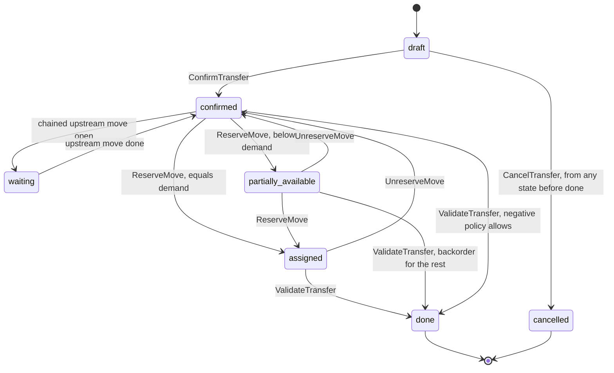
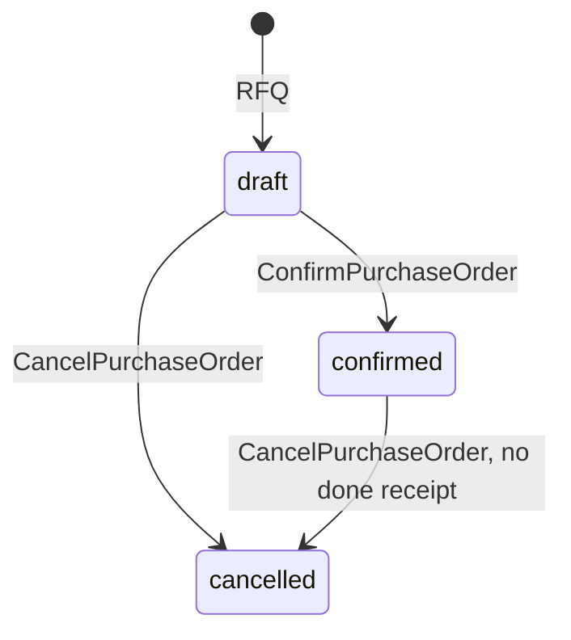
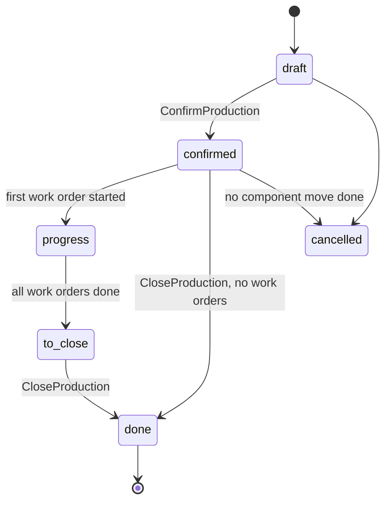

# Supply chain: inventory, purchase, manufacturing, quality, maintenance, barcode, repairs

- **Status:** Draft 0.1
- **Date:** 2026-10-01
- **Scope:** Functional and data-integrity specification of obop's supply-chain apps (inventory, purchase, manufacturing, quality, PLM, maintenance, barcode, repairs, shipping carriers): first-wave scope, hard-problem solutions, the CLI, API and MCP surface of each flow, acceptance scenarios. Everything here is Apache-2.0 and completely free to use and self-host (OR-1, OR-2).

**Reading conventions.** Decisions are cited by ID and defined in [DECISIONS.md](../DECISIONS.md); "OR-n" is an owner ruling of 2026-10-01 (RATIFIED). Relied on here as ruled: Apache-2.0 and free with no paid layer (OR-1, OR-2; D1, D2), agentic first with CLI, API and MCP parity, and literal UI parity before the first stable release (OR-4, OR-16; D80), Germany first (OR-7; the country part of D4) and the W1 cut (OR-13, OR-15; the shape and the in and out calls of D86, RATIFIED), which takes `purchase` and `purchase_stock` out of W1 and keeps W1 stock to one warehouse; their landing in W2 and the move of the stock extensions from W2 to W3 are Proposed placements. Still Proposed, so read each such citation as "Proposed (Dn)": tier and wave placements (D25; the slip order and landing waves of D86), the customer profile (the ICP part of D4), offline scope (D13) and Typst documents (D20). "Proposed" also marks a choice this document makes that neither the research nor the register settles; section 9.2 lists them. (target) and (estimate) mark design values; nothing is measured, and little of it is built, as of 2026-10-01. Event, port, permission-group, data-class and state names follow [CONVENTIONS.md](../CONVENTIONS.md); command grammar, flags, output and exit codes are those of [cli.md](cli.md), and section 4.10 lists this area's commands. The ports `DemandPort`, `QtyContributionPort`, `PostingPort` and `InvoiceableSource`, the events `TransferDone`, `PosSessionClosed`, `SaleOrderConfirmed` and `InvoicePosted`, the command `ValidateTransfer` and the extension point `BeforeInvoicePost` come from [R23 D.2-D.4]; every other event, command, port, module and table name here is Proposed. Odoo 20 is the September 2026 release (release commit 2026-09-17) [R10 s1].

## 1. Purpose and scope

### 1.1 What this area is

The supply-chain area turns commitments (sales, purchase, manufacturing and repair orders) into physical movements, keeps an exact record of what is where and what it is worth, and feeds the ledger. Odoo's behaviour is deepest here and its defects best documented: duplicate quants, float quantities, editable history, and quality, PLM, MPS, barcode UI and carrier connectors kept proprietary [R10 s1, s3]. In W1 (the D86 loop) the customer is a 5-50 person firm with one warehouse that sells from stock (D4, [R20 s9.2]; the ICP is Proposed): it keys receipts in by hand, delivers against sales orders and gets its vendor bills through finance. Purchase orders arrive in W2, lots, serials, routes and more than one warehouse in W3, and makers in W3 after the stock extensions; each T2 app needs a design partner (D25).

### 1.2 Apps and modules

| App or module | Scope | Tier | Wave | Licence |
|---|---|---|---|---|
| `stock` | One warehouse, locations, transfers (receipts keyed in by hand), moves, quants, reservation, counts, scrap, the arithmetic forecast report | T1 | W1 | Open |
| `stock` reordering | Reordering rules and the `buy` action that drafts RFQs; they travel with `purchase_stock` because `buy` is their only action in this area (Proposed consequence of the cut; OQ-19) | T1 | W2 | Open |
| `stock` extensions | Lots, serials, expiry, routes and rule editing, multi-step, multi-warehouse, packages, putaway, removal strategies beyond FIFO (D25 names "lots, serials and routes" and placed them in W2; the OR-13 cut moved them to W3; the rest of the list is Proposed) | T1 | W3 | Open |
| `stock_account` | Valuation entries, FIFO and AVCO, manual revaluation, per-transfer and at-invoicing posting (W1); periodic posting (W2); standard cost, landed costs and replay (W3) (Proposed split) | T1 | W1, later items W2-W3 | Open |
| `sale_stock` | Bridge: deliveries from sales orders | T1 | W1 | Open |
| `purchase_stock` | Bridge: receipts from purchase orders, the `buy` action, vendor returns; `dropship` arrives with routes in W3 | T1 | W2 | Open |
| `purchase` | RFQ, PO, vendor prices, bill control, three-way match; approvals and the vendor portal later in W2; blanket orders W3 (Proposed placements; out of W1 by the OR-13 cut, confirmed in OR-15, D86) | T1 | W2 | Open |
| `delivery` | Carrier trait, rate rules, shipments, connectors | T1 | W3 | Open |
| `mrp` | BoM, work centers, routings, MO, by-products, subcontracting, Shop Floor | T2 | W3 | Open |
| `quality`, `maintenance` | Ship with `mrp` (D25) | T2 | W3 | Open |
| Barcode | Barcode fields on product and location exist from W1; nomenclature, scan-to-add and scan screens W3 (Proposed; scan-to-add was W2 before the cut); depth and WMS W4 (D25) | T2 | W3-W4 | Open |
| PLM, `repair` | Not T1 or T2 (D25) | T3 | W4+ or community | Open |
| MPS, MRP planning run | Unlisted, so T3 by the D25 default; placement Proposed | T3 | W4+ | Open |

Every row is Apache-2.0 and completely free to use and to self-host (OR-1, OR-2). There is no paid list, plan, operated service or ratchet in this area. The capabilities Odoo keeps proprietary (quality, PLM, MPS, the barcode screens, carrier connectors) are ordinary backlog items here: not withheld and not promised. From W2 on the list is an ordered backlog, and no app is built without a design partner (DECISIONS 5.1).

### 1.3 Boundaries with neighbouring areas

| Neighbour | This area owns | Neighbour owns | Contract |
|---|---|---|---|
| Sales ([sales-crm.md](sales-crm.md)) | Delivery moves, reservations, returns | Order, pricing, invoicing policy | `sale_stock`: `DemandPort`, `QtyContributionPort` |
| Finance ([finance.md](finance.md)) | Valuation entries | Journals, bills, closing, lock dates, payment release | `PostingPort` by account role. In W1, before `purchase`, a vendor bill is a plain finance bill; a bill line may name the validated receipt line it bills (Proposed, section 4.1.9; OQ-18) |
| Retail ([retail-commerce-marketing.md](retail-commerce-marketing.md)) | Availability, `StockLevelChanged` | POS sessions, channel sync, the pending POS quantity | `pos_stock` raises one transfer per session at close; published availability subtracts the pending POS quantity until then (Proposed; answers retail open question 7) |
| Services ([services.md](services.md)) | Repair orders, spare-part moves, van locations (internal `stock_location`), `maintenance_equipment` (the company's own assets) | Helpdesk actions, fleet, field service, customer-site `service_equipment` | Helpdesk creates repairs and returns; field jobs use `DemandPort` for van stock |
| AI ([ai.md](ai.md)) | Replenishment rules and draft RFQs | `Forecaster` trait and baselines | Forecasts feed draft purchase proposals under a safety-stock policy, never orders (Proposed) |
| Platform ([platform.md](platform.md)) | Domain rules | Chatter, approvals, automation, import | Approval requests |
| Integrations ([integrations.md](integrations.md)) | `CarrierProvider` trait | API, webhooks, the plugin registry client | Connectors are plugins, that is packages (D32), listed in the free registry or copied into the business's own instance (D81); no payments, fees or commission (OR-2, OR-3) |
| CLI and MCP ([cli.md](cli.md), [ai.md](ai.md)) | The meaning of each command of this area: inputs, effects, errors, permissions (section 4.10) | Grammar, global flags, output and exit-code contracts, the generated catalogue, the parity test, the agent write protocol | One catalogue entry per command, reachable through CLI, REST and MCP (D80) |

### 1.4 Design stance

1. Keep Odoo's three layers, transfer to move to move line, with a quant projection: they carry reservation, lots, packages, ownership and chaining [R10 MUST 1].
2. The done record is a ledger: immutable moves, explicit valuation entries, corrections as new rows (D30).
3. Valuation is independent of accounting; posting is a per-company policy [R10 MUST 5, SHOULD 9].
4. Routes, rules, states and check types are data (D28, D29); stock works without accounting and sales without stock (D27, [R01 s2.1]); the standalone Odoo 20 modes for shipping or valuing without the stock app are dispositioned in section 8.
5. Command first (OR-4, D80). Every flow in this area is a typed command in the registry-generated catalogue, reachable through the `obop` CLI, the REST API and MCP with one schema, one permission check and one dry-run plan; the web UI is a client of the same commands and holds no stock logic. A capability of this area is done when its commands exist on all three surfaces (section 4.10). Agents use the same commands as people, and can draft but cannot validate, post or approve (D18).

## 2. Personas and roles

| Job role | Does | Default permission group | User type |
|---|---|---|---|
| Warehouse operator | Receives, picks, counts; scans from W3 | `stock.operator` | Light (Proposed) |
| Warehouse manager | Configures warehouses and rules, approves adjustments, overrides | `stock.manager` | Full |
| Buyer, purchasing manager (from W2) | RFQs and POs; approvals (later in W2), blanket orders (W3) | `purchase.user`, `purchase.manager` | Full |
| Production planner | BoMs, MOs, schedule | `mrp.user`, `mrp.manager` | Full |
| Shop-floor worker | Work orders on a tablet | `mrp.operator` | Light (Proposed) |
| Quality and maintenance staff | Checks, alerts; requests, equipment | `quality.user`, `quality.manager`, `maintenance.user`, `maintenance.manager` | Full |
| Logistics coordinator | Shipments, labels, carriers | `delivery.user` | Full |
| Cost accountant | Valuation, revaluation, landed costs | `product.cost_viewer` (field permission), `stock.valuation_user` | Full |
| Vendor; carrier | RFQ confirmation on the portal (later in W2); tracking webhooks (W3) | Portal principal; API client | n/a |
| AI agent | Drafts receipts, count sheets and (from W2) RFQs; cannot validate, confirm or post without a human; uses the same typed commands as people (D80) | Delegated scopes (D18) | n/a |

"User type" names a task-scoped or full UI and permission profile (Proposed); it has no pricing meaning, because nothing is priced, metered or counted per seat (OR-2). In W1 there is no buyer in this area: vendor bills are entered in finance, and receipts are keyed in by the warehouse operator or manager.

Permission rows follow the D10 algebra: each names a model, an action and a scope, and an implicit TRUE is a lint error. Example: `stock.operator` may `validate` a `stock_transfer` with scope `domain` "the picking type's warehouse is one of the user's warehouses". In a 5-person business one person holds several permission groups. The same rows answer on CLI, REST and MCP; an agent's effective permission is the intersection of its delegator's grants and its token scopes (D18), and `obop access check <wire-id>` explains an allow or a deny ([cli.md](cli.md) 2.11).

## 3. Capability map

Wave values are Proposed (D25, D26), except the W1 in and out calls, which are RATIFIED (OR-15). W1 is the D86 cut (OR-13, OR-15): basic stock only (one warehouse), so `purchase` and `purchase_stock` are out of W1 and land in W2, and the stock extensions land in W3 (Proposed landings). Every capability below is first a set of typed commands on CLI, API and MCP and only then a screen (OR-4, D80); section 4.10 lists them. "Odoo C" matches Odoo Community; "Odoo E" matches Odoo Enterprise (Odoo's own edition names, as the public tree shows them [R10 s1]); "Beyond" means obop goes further.

| # | Capability | Description | Wave | Odoo parity |
|---|---|---|---|---|
| 1 | Products, UoM, packaging | Storable flag, tracking, exact base-UoM quantities, per-UoM rounding | W1 | Odoo C; beyond on exact decimals [R10 s3.3] |
| 2 | Warehouse, locations, transfers | One warehouse, location tree, receipt (keyed in by hand in W1), delivery, internal, backorder, return, scrap | W1 | Odoo C |
| 3 | Quants, reservation, immutable done moves | Unique key, atomic reservation (by date W2), corrections as new moves | W1 | Beyond: no duplicate quants, silent steal or unlock |
| 4 | Counts and adjustments | Sessions, variance, adjustment moves; scheduled counts W2 | W1 | Odoo C |
| 5 | Reordering rules | Min, max, multiple, lead days; `buy` action (needs `purchase_stock`); the arithmetic forecast stays a W1 report | W2 | Odoo C |
| 6 | Valuation FIFO, AVCO | Immutable entries, explicit FIFO consumption | W1 | Odoo C; beyond on explicit layers |
| 7 | Posting modes | Per-transfer and at-invoicing W1; periodic W2 | W1 | Odoo C for at-invoicing (Odoo 19 model); per-transfer as in Odoo 18 and ERPNext [R10 s3.7] |
| 8 | Standard cost | Fixed cost, price-difference account | W3 | Odoo C |
| 9 | Lots, serials, expiry, FEFO | Tracking, expiry alerts, FEFO removal | W3 | Odoo C |
| 10 | Genealogy and recall | Stored forward and backward edges; through MOs with `mrp` | W3 | Beyond |
| 11 | Routes, rules, multi-step, multi-warehouse | Pull, push, MTO, transit | W3 | Odoo C |
| 12 | Packages, putaway, removal strategies | FIFO W1; LIFO, FEFO, closest and packages W3; least packages, capacity W4 | W1-W4 | Odoo C |
| 13 | Dropshipping, owner and consignment | Supplier to customer without stock; owner in the quant key from W1 | W3 | Odoo C |
| 14 | Landed costs | Five split methods; MO and subcontract receipts | W3 | Odoo C; beyond on MO targets |
| 15 | Valuation replay | Backdated changes as adjustment entries | W3 | Beyond |
| 16 | Batch and wave picking, lot valuation | Grouped picking; cost per lot | W4 | Odoo C |
| 17 | Statistical forecasting | `Forecaster` trait and baselines owned by `ai` (W3, [ai.md](ai.md)); stock consumes them for draft purchase proposals with intervals | W3 in `ai`; the stock consumer is Proposed | Beyond [R16 s8] |
| 18 | RFQ, PO, vendor prices | Tiers, lead times, RFQ merge, vendor returns | W2 (was W1) | Odoo C |
| 19 | Bill control, three-way match | Ordered, received, billed; tolerance; payment hold | W2 (was W1) | Odoo C; beyond on payment hold |
| 20 | PO approval, vendor portal | Approvals engine with CEL conditions; RFQ confirmation | W2, after rows 18-19; needs the W2 approvals engine and `portal` | Portal Odoo C; one engine beyond [R15] |
| 21 | Blanket orders, alternatives | Agreements, call-offs, comparison | W3 | Odoo C |
| 22 | Vendor OTIF and quality rate | On-time-in-full, quality rate | W3 | Odoo 20 quality rate; OTIF beyond |
| 23 | BoM, kits, by-products | Normal, phantom, cost share, validity periods | W3 | Odoo C |
| 24 | Work centers, routings, work orders | Time logs, loss reasons | W3 | Odoo C |
| 25 | MO, backorder, unbuild, scrap, costing | Always flexible consumption; expected and real cost; optional WIP | W3 | Odoo C (Odoo 20) |
| 26 | Subcontracting | Per-vendor location, hidden MO | W3 | Odoo C |
| 27 | Shop Floor | Tablet work-order screen | W3 | Odoo E |
| 28 | MPS and MRP run | Suggestions, not orders | W4+ | MPS Odoo E; MRP run beyond |
| 29 | Quality | Control points, checks, alerts | W3 | Odoo E |
| 30 | PLM | ECO, BoM revisions | W4+ | Odoo E |
| 31 | Maintenance, downtime link | Preventive, MTBF, MTTR; requests block work centers | W3 | Odoo C; link Odoo E |
| 32 | Repairs | Parts as moves, service lines | W4+ | Odoo C |
| 33 | Barcode | Barcode fields from W1; nomenclature and scan-to-add, then scan screens and the edge command outbox, all W3 (D13); depth W4 | W3-W4 | Engine Odoo C; screens Odoo E (verified, section 4.7) |
| 34 | Carriers | Rate rules, connectors, signed tracking webhooks | W3 | Rules Odoo C; connectors Odoo E (none in the 20.0 public tree [R10 s1]) |
| 35 | Not built | IoT box, unlock of done transfers, duplicate-quant merge; WMS slotting, labour, yard, 3PL billing | n/a | Deliberately skipped or out of scope |

## 4. Per-app specification

### 4.1 Inventory (`stock`, `stock_account`)

**Purpose.** Record where goods are, move them under explicit documents, reserve, count and value them, and feed the ledger.

**Capabilities.** W1 MVP (D86: basic stock, which is `stock`, `sale_stock` and `stock_account` only): one warehouse with a location tree; receipt (keyed in by hand, since no purchase order exists yet), delivery from sales orders through `sale_stock`, internal transfer, backorder, return, scrap; unique quants; reservation at confirmation or manual; counts and adjustments; FIFO removal; AVCO and FIFO valuation, manual revaluation; per-transfer and at-invoicing posting; an arithmetic forecast report; delivery slips and picking lists (Typst, D20); barcode fields on product and location. Each of these is a typed command on CLI, API and MCP (section 4.10), and the W1 UI is list, form and kanban views over those commands. The schema carries the full quant key (lot, package, owner) from W1 so later waves add no keys (D28); the lot, package and trace tables stay dormant until W3. Later waves are in section 3: W2 reordering rules with the `buy` action (they travel with `purchase_stock`), periodic posting, scheduled counts, by-date reservation; W3 lots, serials, expiry, routes, multi-step, multi-warehouse, packages, putaway, removal strategies beyond FIFO, standard cost, landed costs, replay; W4 wave picking, lot valuation.

#### 4.1.1 Core entities

| Entity | Purpose | Key fields | States |
|---|---|---|---|
| `stock_warehouse` | Site | company, code, address, reception steps (1-3), delivery steps (ship, pick-ship, pick-pack-ship); W1 fixes one step in and ship only, more steps are W3 | active, archived |
| `stock_location` | Tree node | parent (`ltree` path [R22 s4]; contrib extension, availability on managed PostgreSQL unverified, D34), usage (supplier, view, internal, customer, inventory_loss, production, transit), valued flag, `allow_negative`, owner party, barcode | active |
| `stock_picking_type` | Operation template | code, default locations, reservation method (at_confirm, manual, by_date), lot policy, backorder policy, quality enforcement | active |
| `stock_transfer` | Document | number, type, party, dates, policy (direct or one), `backorder_of_id`, origin reference | see 4.1.3 |
| `stock_move` | Movement of one product | demand (move UoM) and `demand_base`, reserved and done base, locations, procure method (MTS, MTO, MTS-else-MTO), rule, `origin_returned_move_id` | see 4.1.3 |
| `stock_move_link` | Chain edge | `orig_move_id`, `dest_move_id`, base quantity | n/a |
| `stock_move_line` | Detail and audit ledger | move, product, lot, package, result package, owner, locations, quantity, picked, done date | open, done |
| `stock_quant` | On-hand per key | `UNIQUE NULLS NOT DISTINCT` on company, product, location, lot, package, owner; quantity, reserved, `in_date` | n/a |
| `stock_lot` | Lot or serial | product, name, expiration, use, removal and alert dates, properties | active |
| `stock_package` | Container | type, parent, location, SSCC barcode | active |
| `stock_route`, `stock_rule` | Procurement as data | action (pull, push, pull_push, buy, manufacture, dropship), procure method, locations, picking type, delay | active |
| `stock_reorder_rule` | Replenishment | product, location, min, max, multiple, trigger, lead days, snoozed until | active, snoozed |
| `stock_valuation_entry` | Immutable value row | product, lot, move line, direction, qty, `value_minor` bigint, effective_at, source kind, method snapshot, provisional | immutable |
| `stock_fifo_layer`, `stock_fifo_consumption` | Mutable remaining projection; explicit consumption | entry, remaining qty and value; out entry, in entry, qty, value | n/a |
| `stock_cost_state` | Running totals | company, product, lot, quantity, value, `dirty_from`, method | n/a |
| `stock_landed_cost`, `stock_revaluation` | Added costs; manual cost change | bill lines, transfers, split method; product, delta, reason | draft, posted, cancelled |
| `stock_inventory_count` | Count session | filters, expected snapshot, counted lines, variance | draft, counting, applied |
| `stock_trace_edge` | Genealogy written at validation (W3) | parent lot, child lot, via transfer or MO, quantity | immutable |

Waves of the entities above (Proposed, after the OR-13 cut): everything is W1 except `stock_reorder_rule` (W2, with `purchase_stock`), `stock_landed_cost` (W3), `stock_trace_edge` (W3) and the editing of `stock_route` and `stock_rule` (W3). `stock_lot` and `stock_package` tables exist from W1 as dormant models, like the dormant `branch` of D28, so the quant key is final; they are not exposed through the catalogue and no screen uses them until W3. `stock_revaluation` (manual cost change) is W1. `stock_reference` names a chain of moves (Odoo's procurement group). `uom` and `product_uom` (packaging as a per-product UoM with barcode) belong to `product` [R23 B.1]. Quantities are `NUMERIC(24,6)` in base UoM, valuation is `value_minor bigint`, unit costs `NUMERIC(24,8)` (D9, [R23 DR-5]); UoM rounding is per UoM, applied at entry, conversion rounds half-up. Odoo uses floats and one global "Product Unit" precision [R10 s3.3].

#### 4.1.2 Hard problems and solutions

| Problem | obop solution | Enforced in |
|---|---|---|
| Unique quant key (Odoo tolerates duplicates and merges later [R10 s3.2]) | One `UNIQUE NULLS NOT DISTINCT` key; every change through one upsert | PostgreSQL (D30) |
| Reservation (Odoo frees other moves' reservations on a forced done move [R10 s3.1]) | Conditional atomic update; no silent steal; explicit override event | Rust plus CHECK |
| Concurrency (Odoo: REPEATABLE READ, up to 5 attempts [R10 s3.2]) | READ COMMITTED, atomic statements, deterministic lock order, retry on 40001, 40P01, 55P03 [R22 s6] | Rust plus PostgreSQL |
| Immutable done moves (Odoo can unlock and replay by mutation [R10 s3.6, s6.1]) | Trigger blocks edits; corrections are new moves plus adjustment entries | PostgreSQL (D30) |
| Negative stock | Policy per company, warehouse, location; provisional entries settled later | CHECK plus Rust |
| Valuation | Immutable entries; locked `stock_cost_state`; replay writes adjustments | PostgreSQL (D30) |

**Reservation algorithm** (`ReserveMove`):

1. `needed = demand_base - reserved`. By-date reservation considers only moves whose reserve-from date has passed.
2. A chained move (MTO, or with `stock_move_link` origins) reserves exactly what its upstream moves delivered, on the quants at the intermediate location with the lots and packages they moved, not general availability [R10 s3.5].
3. Otherwise select candidate quants in the source subtree with free quantity, excluding other owners and expired lots, ordered by removal strategy (FIFO: `in_date`, the only strategy in W1; FEFO: lot removal date, and the others from W3). Lock them `FOR UPDATE SKIP LOCKED` in that order; reserving less is acceptable here [R10 MUST 4].
4. For each candidate take `min(free, needed)` (whole packagings if the move UoM is a packaging with full-packaging reservation) and run the conditional update below. Zero rows means another transaction took it; try the next candidate.
5. Insert or extend the unpicked `stock_move_line`, set the move `partially_available` or `assigned`, emit `MoveReserved`.

Unreserved demand is retried by a `ReservationSweep` job, woken in-process when `TransferDone` commits, in order of priority, expected date, id. A later move never takes an earlier reservation (Proposed).

```sql
-- illustrative, Proposed
UPDATE stock_quant
   SET reserved_quantity = reserved_quantity + $n
 WHERE id = $quant_id AND quantity - reserved_quantity >= $n
RETURNING quantity, reserved_quantity;

INSERT INTO stock_quant AS q (id, company_id, product_id, location_id, lot_id, package_id, owner_id, quantity, in_date)
VALUES ($1, $2, $3, $4, $5, $6, $7, $8, $9)
ON CONFLICT ON CONSTRAINT stock_quant_key
DO UPDATE SET quantity = q.quantity + EXCLUDED.quantity, in_date = LEAST(q.in_date, EXCLUDED.in_date);
```

Constraints: `CHECK (reserved_quantity >= 0 AND reserved_quantity <= GREATEST(quantity, 0))`, and `quantity >= 0` unless the location's resolved negative policy allows it (constraint trigger). Source-side validation lowers `quantity` and `reserved_quantity` in one statement, so the CHECK fails only when the line consumes stock reserved by another move or would take quantity below zero where forbidden; the API returns the RFC 9457 problem types `stock_reserved_by_other` and `insufficient_stock` respectively. With `stock.override_reservation` and `steal=true` (an audited `Env<Elevated>`, D10) the victim moves return to `confirmed` and emit `ReservationLost`.

**Lock order.** A validating transaction locks (1) `stock_cost_state` rows by (product, lot); (2) quants by key, processing move lines in sorted order, never user order; (3) progress rows by natural key; (4) any gapless counter last [R22 s6]. The `stock_cost_state` row is created with the product profile, because a locking read never sees a row another transaction is inserting [R10 s3.2]. A row lock is preferred to an advisory lock to spare the shared lock table [R22 s1.2] (Proposed).

**Transaction boundary.** `ValidateTransfer` is one command and one transaction (rule R1 of [R23 D.2]) covering lines, quants, valuation entries, progress contributions and the posting request; it is idempotent on `command_id` (D9). Backorders re-point unpicked reserved lines to the new move in the same transaction, so reservation survives.

**Valuation.** An entry is immutable; a move's current value is the sum of its entries. The value source of an incoming move follows Odoo's hierarchy [R10 s3.6]: manual revaluation, posted vendor bill, production cost, order price, return at original cost, inter-company source (W3), standard cost (W3). Odoo 19.0 has the same list without the inter-company step; extra costs such as landed costs are added on top of any non-manual source [R10 s3.6]. In W1 there is no purchase order, so "order price" is replaced by the unit cost the operator enters on the receipt line (default: the product's cost), and a posted vendor bill is a value source only when its line names the receipt line it bills (Proposed, section 4.1.9; OQ-18); otherwise the accountant corrects value with a manual revaluation. Landed costs (W3) link a vendor-bill line to validated receipts, split equally or by quantity, current cost, weight or volume [R10 s3.8], apply to FIFO and AVCO products only [R10 s3.8], and add adjustment entries: the in-stock share raises stock value and the consumed share goes to COGS (section 5.7; this split is Proposed, R10 does not say Odoo does it).

| Method | Outbound entry | Rounding |
|---|---|---|
| FIFO | Consumes layers oldest first; each consumption is a `stock_fifo_consumption` row | The last unit of a layer takes the remainder |
| AVCO | `round(total_value * qty / total_qty)` | The entry that empties stock takes the whole remaining value [R23 DR-5] |
| Standard (W3) | Fixed cost; receipt difference to a price-difference account | n/a |

LIFO is a removal strategy only, never a valuation method [R10 s3.6]. `stock_fifo_layer` is the only mutable valuation table and is rebuildable from the consumption rows. A foreign-currency receipt is valued at the rate stored on it (D9); later rate differences on the bill are exchange differences in finance, not revaluation (Proposed). When a bill arrives at a different price, adjustment entries split the delta: under FIFO by layer between remaining stock and consumed units (a COGS catch-up, as Odoo 20 does retroactively [R10 s1]); under AVCO the consumed share is `max(0, min(receipt_qty, receipt_qty - on_hand))` of the receipt (Proposed).

**Backdating and replay.** Entries carry `effective_at`. In W1 a valued move may be dated earlier than now only if no later valued entry exists for that product and lot; otherwise it is rejected with a pointer to replay (Proposed). W3 adds replay: the write marks `dirty_from` on `stock_cost_state`; a locked job recomputes from that date and writes `replay_adjustment` entries for each changed outbound entry, never editing history. Postings land in the open period unless the backdated period is open (lock dates are finance's).

**Negative stock.** Resolution order: location, warehouse, company (default off). An allowed negative needs the picking type flag plus `stock.override_negative`. The outbound is a `provisional` entry at the last known cost. The next incoming move settles the shortfall first, writing the difference as a COGS adjustment. Negative quants appear in an exception report and emit `NegativeStockCreated`.

#### 4.1.3 State machines

Lifecycles are registry data run only by command handlers (D28). Stock documents extend the kernel's `draft`, `confirmed`, `cancelled` with `done`, as ledger documents extend it with `posted` (Proposed, [R23 B.2]). The diagram shows move states; the transfer state is derived from them, below.



The transfer state is derived from its non-cancelled moves and stored by the handler in the same transaction ([R23 B.2] principle 4):

| Transfer state | Rule |
|---|---|
| draft; done; cancelled | All moves draft; all done; all cancelled |
| waiting | No move ready and at least one waiting on an upstream move |
| confirmed | Demand confirmed, reservation incomplete |
| ready | Policy `direct`: at least one move has reserved quantity. Policy `one`: all moves assigned |

#### 4.1.4 Main workflows

Each workflow is a sequence of typed commands (section 4.10); a person, a script or an agent runs the same steps.

**Receipt keyed in by hand (W1).**

1. The operator or manager creates a receipt from the supplier location (`stock_transfer create`), adds lines with quantity and unit cost, and confirms it (`stock_transfer confirm`); it is ready at once.
2. The operator enters received quantities (lot or serial in W3).
3. `ValidateTransfer` adds to the destination quant, writes valuation entries at the entered unit cost in company currency, and posts per policy.
4. A short receipt asks for a backorder or closes the line (the `backorder` input of the command).
5. The vendor bill is entered or received in finance (no purchase order in W1); a bill line may name the receipt line it bills (section 4.1.9).

**Receipt against a PO (W2, with `purchase_stock`).**

1. `PurchaseOrderConfirmed` makes a receipt with moves from the supplier location; it is ready at once.
2. The operator enters received quantities (lot or serial in W3).
3. `ValidateTransfer` adds to the destination quant, writes valuation entries at PO price in company currency, sets `qty_received` through `QtyContributionPort`, and posts per policy.
4. A short receipt asks for a backorder or closes the line.

**Delivery (W1).**

1. `sale_stock` raises demand; a delivery is created and reserved per its picking type.
2. The operator picks and validates (W3: chained pick, pack, ship moves).
3. Validation sets delivered quantity; COGS follows the posting mode.

**Reordering (W2, with `purchase_stock`).** In W1 the arithmetic forecast is a report that shows what is short; no rule runs and no RFQ is created until `purchase` ships (Proposed; OQ-19).

1. A scheduler tick (leaderless `schedule_fire`, [R22 s6]) walks active rules in chunks of 1,000, each chunk under a savepoint and retried without the failed rules, as Odoo does [R10 s2.4]; obop adds a savepoint per rule and a failure log (step 4; the R10 s6.3 design).
2. Forecast is on hand plus confirmed incoming minus confirmed outgoing within the lead horizon. If below min, `qty_to_order = max - forecast`, rounded up to the multiple.
3. The `buy` action extends an open draft RFQ for the same vendor and currency, or creates one.
4. A rule that cannot run (no vendor) writes a `replenishment_failure` row and a buyer activity; other rules continue.

**Count (W1).**

1. Create a session by location or product filter (`stock_inventory_count create`); expected quantities are snapshotted for blind counting when it starts (`start`).
2. Count; variance is shown, then apply: it creates adjustment moves to and from `inventory_loss`, valued at current cost; above a threshold an approval is required (W2, [R15]).

**Return and scrap (W1).** A return is a reverse transfer linked by `origin_returned_move_id`, valued at the original cost. Scrap moves stock to a scrap location with a reason.

#### 4.1.5 Automatic flows

| Direction | Event or port | Counterpart | Mechanism |
|---|---|---|---|
| Consumed by a bridge | `SaleOrderConfirmed` | `sale_stock` calls `DemandPort::raise` | TxEvent |
| Consumed by a bridge (W2) | `PurchaseOrderConfirmed` | `purchase_stock` creates receipt moves; in W1 receipts are keyed in by hand (section 4.1.4) | TxEvent |
| Consumed by a bridge (W3) | `PosSessionClosed` | `pos_stock` raises one transfer | TxEvent |
| Consumed by a bridge | `SaleOrderCancelled` | `sale_stock` cancels the order's open deliveries through `CancelTransfer`; a delivery with a done move is not cancelled and is corrected by a return | TxEvent |
| Consumed by `stock` (W3) | `ReturnRequested`, `WithdrawalRequested` (emitted by `ecommerce`, [retail-commerce-marketing.md](retail-commerce-marketing.md)) | Creates a return transfer linked by `origin_returned_move_id` (section 4.1.4), valued at the original cost; `invoicing` consumes the same events for the credit note | Durable event |
| Emits | `TransferConfirmed`, `MoveReserved`, `ReservationLost`, `NegativeStockCreated` | Quality, chatter, activities | TxEvent |
| Emits | `TransferDone` | `sale_stock`, `purchase_stock` from W2 (`QtyContributionPort`); `stock_account` (`PostingPort`); sweep | TxEvent |
| Runs | `BeforeTransferValidate` (an extension point, not an event) | Quality adds guards | Extension point |
| Emits | `StockLevelChanged` (coalesced), `TransferDone` | `ecommerce` (availability), `pos`, `mrp`, channel pushers and channel sync, website cache tags, webhooks, analytics, AI index | Durable event |
| Emits (W2) | `ReplenishmentFailed` (Proposed; listed in the supply-chain line of [CONVENTIONS.md](../CONVENTIONS.md) 3.5) | The buyer activity through `mail`; webhooks, analytics; no other named consumer | Durable event |
| Offers | `DemandPort` | `sale_stock`, `pos_stock`, `mrp`, `repair`, `planning` (van stock) | Port |
| Offers | `StockMovePort` (create, confirm, reserve, cancel), `StockQueryPort` (availability, forecast) | `sale_stock`, `pos_stock`, `mrp`, `repair`, `quality` (hold moves) | Port |

Rule actions are an extension point: `stock` owns `pull`, `push`, `pull_push`; `purchase_stock` registers `buy` (W2) and `dropship` (W3); `mrp` registers `manufacture` and `subcontract`. In W1 the warehouse generates its rules (one-step reception and delivery) and routes are not user-editable; `buy` appears with `purchase_stock` in W2, and route and rule editing arrives in W3 (D25, D86). Bridges depend on `*-api` crates only (D27). The first six rows are specified here; the last four are specified in the spec named in their row and are listed because every bridge appears in the module table of each spec it touches ([CONVENTIONS.md](../CONVENTIONS.md) 7.2):

| Module | Depends on | Responsibility | Wave |
|---|---|---|---|
| `sale_stock` | sales-api, stock-api | `DemandPort::raise` on confirmation, cancel and quantity propagation, `QtyContributionPort`, returns | W1 |
| `purchase_stock` | purchase-api, stock-api | Receipts, `buy` (and `dropship` from W3), received quantity, vendor returns | W2 (was W1) |
| `stock_account` | stock-api, account-api | Valuation entries, `PostingPort`, COGS at `BeforeInvoicePost`, revaluation; landed costs from W3 | W1 |
| `mrp_account` | mrp-api, stock-api, account-api | Production cost entries, optional WIP | W3 |
| `sale_mrp`, `purchase_mrp` | sales-api or purchase-api, mrp-api | Kits and MTO; subcontract orders | W3 |
| `pos_stock` | pos-api, stock-api | One consolidated transfer per session at close through `DemandPort`; pending POS quantity in published availability (section 1.3). Specified in [retail-commerce-marketing.md](retail-commerce-marketing.md) | W3 |
| `rental_stock` | rental-api, stock-api | Pickup wizard raises a transfer, return wizard receives stock. Specified in [sales-crm.md](sales-crm.md) (Proposed) | Per its spec |
| `subscription_stock` | subscriptions-api, stock-api | Goods delivered with each subscription invoice. Specified in [sales-crm.md](sales-crm.md) (Proposed) | Per its spec |
| `sale_payment` | sales-api, payment-api | Confirms the order at `prepayment_percent` when `PaymentTransactionDone` arrives; no stock edge. Specified in [sales-crm.md](sales-crm.md) (Proposed; whether `payment` publishes a hub port instead is open there) | Per its spec |

#### 4.1.6 Permissions and sensitive data

Default-deny per model, field and action (D10). Actions: `stock.validate`, `stock.unreserve`, `stock.adjust`, `stock.revalue`, `stock.override_negative`, `stock.override_reservation`, `stock.unreserve_others`. Product cost, margin, valuation entries, landed costs and revaluations are covered by one field permission, `product.cost_viewer`, enforced in the projection and query compiler (D10), so an operator cannot filter or sort by cost. It is a field permission and not a data class: the data class `financial` ([security-privacy.md](security-privacy.md) 4.2) is for money owed to, paid to or held for a named person or counterparty, such as wages, bank accounts and payslips, with separate tables or columns, read-audit and step-up ([people.md](people.md); Proposed, [CONVENTIONS.md](../CONVENTIONS.md) section 5). Employee cost is a different audience and is not granted by `product.cost_viewer`; it stays with `timesheet.cost_viewer` and is owned by [services.md](services.md). OQ-17 records the remaining step. Serials and lots linked to a natural person are personal data (the `personal_data` flag, no data class): erasure anonymises `party` and the transfer address snapshot in place, and the immutability trigger lets the erasure job blank only columns flagged personal (Proposed, [R18 s8.1]). Every check above applies identically to a command sent through the CLI, REST or MCP, and an unreadable cost field cannot be requested with `--fields`, filtered or sorted on any of them (D10, D80).

#### 4.1.7 Reports and dashboards

Stock on hand by location (and by lot and package from W3); forecast by date; inventory at date (from done lines and entries, not snapshots); valuation; FIFO ageing; turnover; replenishment failures (W2); negative-stock exceptions; count variance. In the semantic layer base-UoM quantity is additive across locations, not time, and value needs a currency [R23 B.3]. The availability view uses exclusive buckets (invariant I9); channel sync reads it [R10 s3.1, R12 s4.4]. In W1 each report is a read command (`stock_quant list`, `aggregate` and `forecast`, `stock_valuation_entry aggregate`, section 4.10); the semantic layer (`analytics`) is W3 (DECISIONS 5.3), and `aggregate` keeps agent and script reads possible until then ([cli.md](cli.md) 3.4). Agents (D18) may propose replenishment (from W2) and flag count anomalies as drafts and never validate. Documents are Typst (D20): delivery slip, picking list, receipt, lot and package labels.

#### 4.1.8 Configuration

| Setting | Scope | Default |
|---|---|---|
| Posting mode | Company | `perpetual_at_invoicing` (Proposed) |
| Allow negative stock | Company, warehouse, location | Off |
| Cost method | Product profile (per company) | AVCO (Proposed) |
| Reservation method; removal strategy | Picking type; company, category | At confirmation; FIFO (the only strategy in W1) |
| Stock lock date | Company | None (Proposed) |
| Expired lots reservable (W3) | Company | No |
| Reception and delivery steps | Warehouse | 1 and ship only (fixed in W1; a setting from W3) |
| Lead times (delivery in W1; vendor and purchase security from W2) | Product, vendor, company | 0 days |

#### 4.1.9 Posting modes

Account roles, not account ids, are requested through `PostingPort`: `stock_valuation`, `grni`, `cogs`, `stock_variation`, `inventory_loss`, `price_difference`, `production_cost`, `work_center_absorption`, `landed_cost_clearing` (role names are Proposed; the registry is `account_role` in [finance.md](finance.md) 4.1.1, with the names listed in [CONVENTIONS.md](../CONVENTIONS.md) section 6). The company posting mode is `perpetual_at_invoicing` (default), `perpetual_per_transfer` or `periodic`, as named in finance.md [R10 s6.4]. One journal entry per validated transfer or MO, never per line [R10 SHOULD 9]. Tax is omitted.

| Event | Per transfer (W1) | At invoicing (W1, default) | Periodic (W2) |
|---|---|---|---|
| Receipt validated | Dr stock valuation, Cr GRNI | Nothing | Nothing |
| Vendor bill | Dr GRNI (and variance), Cr payable | Dr stock valuation, Cr payable | Dr expense, Cr payable |
| Delivery validated | Dr COGS, Cr stock valuation | Nothing | Nothing |
| Customer invoice | Revenue only | Revenue plus COGS lines from `BeforeInvoicePost` | Revenue only |
| Adjustment | Dr or Cr stock valuation against `inventory_loss` | Same | At closing |
| Period end | Reconciliation report | Closing entry and accruals | Dr stock valuation, Cr `stock_variation` |

At-invoicing and its closing entry follow Odoo 19; Odoo 20 posts accruals straight to the valuation account, read only from release notes [R10 s3.7]. The ledger side is in [finance.md](finance.md).

**Vendor bills before `purchase` (W1, Proposed; OQ-18).** With no purchase order, a vendor bill is a plain finance bill and cannot be matched to a receipt by order line. The receipt is valued at the unit cost entered on its line. A bill line may name the validated receipt line it bills; `stock_account` then treats the posted bill as the value source and writes the price-difference adjustment entries of section 4.1.2. Under per-transfer mode that bill line also clears GRNI for that receipt. A bill line that names no receipt posts to the bill's own account: under per-transfer mode GRNI stays open until the accountant reconciles it, under at-invoicing the stock valuation account and the sum of valuation entries can differ, and the period-end reconciliation report lists the difference. From W2 the purchase order carries the link and the three-way match replaces the manual reference.

#### 4.1.10 Localization and compliance

The FDA FSMA 204 compliance date is proposed for 2028-07-20 and no final rule was found as of 2026-10-01 [R10 s3.9]; lot genealogy from W3 makes a 24-hour record export possible without claiming conformance. Packs may add delivery-note numbering and e-transport documents (Greece moved digital delivery notes to 2027-01-01, single secondary source [R09 s5.2]; Odoo has Italian and Argentine stock bridges [R01 s4]); none was identified for Germany. A pack could restrict valuation methods through policy data of the kind R09 s8 uses for integrity profiles (gapless scope, lock defaults, retention); that use is Proposed and which countries restrict what was not researched. Products reserve `hs_code` and `country_of_origin` fields (names Proposed) for Intrastat, which R09 s1.2 lists in Odoo's reporting scope, and for customs documents; there is no customs engine. Gapless delivery-note numbers, where a pack requires them, use a counter row at validation (D30). UoM and location names are translatable (D34).

**Open and free.** Apache-2.0; nothing in `stock` is gated or withheld (OR-1, OR-2).

### 4.2 Purchase (`purchase`, `purchase_stock`)

**Purpose.** Buy goods and services: request prices, commit, receive, match bills.

**Wave.** Out of W1 (RATIFIED, OR-15); W2 and first back in the slip order of DECISIONS 5.3 (Proposed, D86). In W1 a vendor bill is a plain finance bill ([finance.md](finance.md)) and receipts are keyed in by hand (section 4.1.4), which keeps W1 the smallest honest loop (OR-13, OR-15).

**Capabilities.** W2: RFQ to PO, vendor price tiers with validity and lead time, reorder-driven RFQs (with the reordering rules of 4.1.4), receipt link, bill control (received or ordered), three-way match, vendor returns, PDFs. Later in W2, once the approvals engine and `portal` exist: approvals and the vendor portal. W3: blanket orders, tenders, alternatives comparison, OTIF and quality rate. Each is a set of typed commands on CLI, API and MCP (section 4.10).

| Entity | Purpose | Key fields | States |
|---|---|---|---|
| `purchase_order` | Header | vendor party, currency, dates, terms, fiscal position, incoterm, `sent_at`, `locked`, totals minor | draft, confirmed, cancelled; progress: `approval_state`, `receipt_status`, `bill_status` |
| `purchase_order_line` | Line | product, qty, UoM, price NUMERIC(24,8), discount, taxes, planned date | n/a |
| `purchase_vendor_price` | Vendor pricelist | vendor, product, min qty, price, currency, validity (no overlap: `EXCLUDE` on 17, `WITHOUT OVERLAPS` on 18, D8), lead days | active |
| `purchase_agreement` | Blanket order or tender | vendor, type, quantity and price commitments | draft, open, closed |
| `purchase_line_qty_contribution` | Derived quantities | line, source reference, kind (received, billed), qty; unique on line and source | n/a |
| `purchase_bill_match` | Match result | bill line, PO line, quantity, price delta | matched, within_tolerance, exception |



The RFQ is a draft with `sent_at`; "to approve" is `approval_state` on the draft, not a fourth lifecycle value (D28). Received and billed quantities are stored-computed from `purchase_line_qty_contribution`, never hand-written. `purchase` therefore implements `QtyContributionPort` for purchase lines beside `sales` for sale lines; [ARCHITECTURE.md](../ARCHITECTURE.md) 4.3 lists `purchase` for purchase lines and R23 names only `sales`, so the purchase side stays Proposed until D27 is amended.

**Workflow.**

1. The buyer, a reorder rule or an agent (D18) creates a draft RFQ; price and lead time come from the best `purchase_vendor_price` for quantity, date and currency.
2. Send by email with a Typst PDF (later in W2: the vendor confirms on the portal).
3. Confirm: approval check (later in W2, with the approvals engine), number assigned, receipt created by `purchase_stock`.
4. Receipt validation updates received quantity.
5. `invoicing` creates the bill through `InvoiceableSource`, which `purchase` would implement for received or ordered quantity (Proposed; the port is called by `invoicing`, [CONVENTIONS.md](../CONVENTIONS.md) 7.1), or the bill arrives as an inbound e-invoice; a PO reference on it auto-matches (Proposed). Inbound e-invoices are a W1 finance feature, so until this module ships they stay unmatched bills in finance.
6. Three-way match compares ordered, received and billed quantity and PO and bill price against tolerances (default 0, Proposed). An exception never blocks the ledger: it sets `payment_hold` on the bill through an `invoicing-api` command and raises an approval item (Proposed; `payment_hold` is an `invoice` field that [finance.md](finance.md) adds, and payment release is there too).

Bill control defaults to received quantity for goods and ordered quantity for services.

**Flows.** Emits `PurchaseOrderConfirmed`, `PurchaseOrderCancelled`, `PurchaseLineQtyChanged`; durable `PurchaseOrderConfirmed` to email and webhook. Consumes `TransferDone` (via `purchase_stock`), `InvoicePosted` for vendor bills, and replenishment demand through the `buy` action. The commands are in section 4.10.

**Permissions.** `purchase.confirm` and `purchase.approve` are separate actions; cost and valuation stay with `product.cost_viewer`; agents draft, never confirm (D18): an agent's `purchase_order confirm` returns a plan that a human commits ([cli.md](cli.md) 2.7).

**Reports.** Spend by vendor and category; open PO ageing; OTIF; actual against vendor lead time; price variance; vendor quality rate (W3).

**Configuration.** RFQ merge; approval rules (CEL conditions, D11); tolerances; default bill control; security lead days.

**Localization.** VAT, reverse charge and fiscal positions belong to finance and tax packs; inbound EN 16931 e-invoices are received by `edi` [R09 s5]. **Open and free.** Apache-2.0; nothing in `purchase` is gated or withheld (OR-1, OR-2).

### 4.3 Manufacturing (`mrp`)

**Purpose.** Plan and execute production from a bill of materials, with cost and lot genealogy. W3, after a design partner is signed (D25), and after the lot, serial and route extensions of `stock` that lot-tracked production needs (also W3, Proposed order). All MOs are flexible, as in Odoo 20 [R10 s1].

**Capabilities.** W3 MVP: BoM (normal, kit, subcontract) with validity periods; by-products with cost share; work centers with hourly cost and calendars; routings; MO with component, finished and by-product moves; work orders with time logs and loss reasons; backorder MOs; unbuild; scrap; expected and real cost; optional WIP; subcontracting; lot-tracked production and genealogy; Shop Floor tablet screen after the core, same wave (Proposed). Later: W4 OEE dashboards; W4+ MPS, MRP run.

| Entity | Purpose | Key fields | States |
|---|---|---|---|
| `mrp_bom`, `mrp_bom_line` | Recipe; component | product, quantity, UoM, type (normal, phantom, subcontract), vendors, `valid_during` (temporal), revision; component, qty, operation | active, archived |
| `mrp_bom_byproduct` | By-product | product, qty, `cost_share_pct` (sum at most 100) | n/a |
| `mrp_operation`, `mrp_work_center` | Routing step; resource | work center, fixed and per-cycle minutes; calendar, capacity, efficiency, cost per hour minor, OEE target | active, blocked |
| `mrp_production` | MO | product, qty, BoM revision snapshot, lot to produce, schedule, backorder of, subcontract flag | see below |
| `mrp_work_order`, `mrp_work_order_time_log` | Operation run; time | operation, work center, expected and real minutes; user, start, end, loss reason | blocked, ready, progress, done, cancelled |
| `mrp_unbuild` | Disassembly | MO, qty, lot | draft, done |

Component, finished and by-product moves are ordinary `stock_move` rows with `production_id` and a role.



Derived beside the state: reservation state and component availability (available, expected, late, unavailable) [R10 s2.2]. An MO with consumed components is closed with the quantity produced, the remainder going to a backorder, or reversed by unbuild.

**Workflow.**

1. Create by hand or by a `manufacture` rule; the BoM is chosen by product, date and applicability, and the MO stores the revision used.
2. Confirm: phantom BoMs expand; component, finished and by-product moves and work orders are created; dates come from work-center calendars built on the shared `resource` calendar foundation [R14 s7] (the work-center binding is Proposed); shortages raise demand.
3. Components are reserved (FEFO for expiring lots).
4. Operators log time and record consumption; actual may differ from the BoM and the variance is reported.
5. Produce: record quantity and output lots or serials; partial production creates a backorder MO.
6. `CloseProduction` validates all moves and writes valuation entries in one transaction.
7. Unbuild reverses a done MO at the original consumption cost.

**Cost.** Finished value is consumed component value (actual FIFO or AVCO value) plus work-order minutes times work-center rate; each by-product takes `cost_share_pct` of the total and the main product the remainder. One entry per MO: components Dr `production_cost`, Cr stock valuation; labour Dr `production_cost`, Cr `work_center_absorption`; outputs Dr stock valuation, Cr `production_cost`. Optional WIP accrues on an open MO and reverses at close [R10 s3.10].

**Subcontracting.** A subcontract BoM lists vendors. Confirming a PO line creates a hidden MO. Components are resupplied to a per-vendor internal location owned by the company (no value change); receipt consumes them there, and the finished value is their cost plus the PO service price [R10 s3.10].

**Flows.** Emits `ProductionConfirmed`, `ProductionStarted`, `ProductionDone`, `ProductionCancelled`, `WorkOrderStarted`, `WorkOrderDone`, `UnbuildDone`. Consumes `TransferDone` (availability), `EquipmentDowntimeStarted` (schedule). `sale_mrp` adds kits and MTO; `mrp_account` posts production cost.

**Permissions and sensitive data.** Actions `mrp.confirm`, `mrp.close`, `mrp.unbuild`. BoM composition and routings are trade secrets [R18 s1]; operators see only the component list of assigned MOs (Proposed). Costs are restricted to `product.cost_viewer` as in section 4.1.6.

**Reports.** MO cost (expected against real); work-center load; yield and scrap; component availability; lot trace; schedule (Gantt follows `project`, D25). **Configuration.** Work-center calendar, backflush, WIP mode, scrap location. **Localization.** Transformation events and lot codes would support FSMA 204-style records if a final rule lands [R10 s3.9]; no claim. **Open and free.** Apache-2.0, Shop Floor included; Odoo keeps Shop Floor and MPS proprietary [R10 s1], obop withholds nothing.

### 4.4 Quality (`quality`)

**Purpose.** Inspect at receipt, in process and at the end, and hold failed lots.

**Capabilities.** W3 MVP: control points by picking type, product, category or work-order operation; frequency all, random (percent), periodic, on demand; check types instructions, photo, pass-fail, measure (norm with tolerance from and to) [R10 s4]; alerts; failure location; vendor quality rate.

| Entity | Key fields | States |
|---|---|---|
| `quality_point` | trigger, scope, check type, frequency, norm and tolerance, instructions | active |
| `quality_check` | point, source reference, lot, result, measured value, photo | todo, pass, fail (final) |
| `quality_alert` | check, product, lot, vendor, action | new, confirmed, action_proposed, solved, cancelled (Proposed) |

**Workflow.**

1. A point on picking type Receipts creates a check on `TransferConfirmed`; the inspector records the result.
2. A failed check moves the lot to the failure location (a quality-hold location), opens an alert, and may propose scrap or a vendor return.
3. The picking type's enforcement, hard or soft (default soft, Proposed), decides whether `BeforeTransferValidate` rejects a transfer with open checks.

**Flows.** Consumes `TransferConfirmed`, `WorkOrderStarted`, `ProductionConfirmed`; emits `QualityCheckFailed`, `QualityAlertCreated`, `QualityAlertSolved`. **Permissions.** `quality.user`, `quality.manager`; recorded results are immutable. **Reports.** Pass rate; alerts by vendor and lot; vendor quality rate (failed over received quantity in a period, Proposed). **Configuration.** Enforcement, failure location. **Localization.** None identified. **Open and free.** Apache-2.0; Odoo offers quality in Enterprise only, obop withholds nothing.

### 4.5 PLM (engineering change)

**Purpose.** Change a BoM under approval.

**Capabilities.** First wave: none; W4+ or community (T3). `mrp_eco` with type (BoM, product), stages, approvals through the generic approvals engine, effective date, new BoM revision. `valid_during` and the MO's stored revision exist from W3, so PLM adds process, not schema.

| Entity | Key fields | States |
|---|---|---|
| `mrp_eco` | type, product, old and new BoM revision, effective date, approval request | draft, in_progress, approval, done, cancelled |

**Workflow.**

1. The author opens an ECO and edits a draft BoM revision.
2. Approvers decide through the approvals engine; authors cannot approve their own ECO.
3. Applying closes the old `valid_during` and opens the new; running MOs keep their stored revision. A version bump is optional, as in Odoo 20 [R10 s1].

**Flows.** Emits `EcoApplied`; consumes `ProductionConfirmed`. **Reports.** ECOs by stage, open changes per product. **Configuration.** Approval rules. **Localization.** None. **Open and free.** Apache-2.0; Odoo offers PLM in Enterprise only, obop withholds nothing.

### 4.6 Maintenance (`maintenance`)

**Purpose.** Keep equipment running.

**Capabilities.** W3 MVP: equipment with category, serial, vendor, warranty, assignment; teams; corrective and preventive requests with user-defined stages and recurrence; MTBF, MTTR and estimated next failure [R10 s2.1]; spare parts as stock moves; a request that blocks a work center creates an unavailable interval the MO scheduler respects (Odoo Enterprise `mrp_maintenance`). Later: meter-based triggers. Definitions (Proposed): MTBF is the mean days between completions of consecutive corrective requests; MTTR is the mean request-to-close time of corrective requests.

| Entity | Key fields | States |
|---|---|---|
| `maintenance_equipment` | category, serial, vendor, warranty end, work center, location | active, scrapped |
| `maintenance_request` | type, equipment, team, scheduled date, duration, recurrence, blocks work center | user-defined stages with a done flag |

**Workflow.**

1. A corrective request is created from the equipment or a quality alert; a preventive request by its recurrence.
2. The technician moves it through the stages; parts used are consumption moves from stock.
3. On completion a preventive request regenerates from the completion date or a fixed cadence (setting, Proposed).
4. A request flagged to block a work center opens an unavailable interval for its duration.

**Flows.** Emits `MaintenanceRequestCreated`, `MaintenanceRequestDone`, `EquipmentDowntimeStarted`, `EquipmentDowntimeEnded`; optionally consumes `QualityAlertCreated`. **Permissions.** `maintenance.user`, `maintenance.manager`. **Reports.** Open requests, MTBF, MTTR, downtime by work center. **Configuration.** Stages, teams, cadence mode. **Localization.** None. **Open and free.** Apache-2.0.

### 4.7 Barcode

**Purpose.** Identify things by scanning.

**Capabilities.** W1: barcode fields on product, packaging UoM and location are ordinary fields, so a code can be typed or pasted into search; the lot and package fields come with lots and packages in W3. W3 (Proposed; the OR-13 cut moved scan-to-add here from W2): a nomenclature engine with rules by type; EAN and GS1-128 parsing; scan-to-add in ordinary forms through a keyboard wedge; then purpose-built scan screens (receive, pick, deliver, internal, count, lookup; R19 lists a scan screen as a v1 view, not metadata-rendered [R19 s6]) and the edge command outbox (D13). Resolving a code is a read command (`barcode resolve <code>`, section 4.10), so a script or an agent can use the same engine as a scanner. W4 (D25): GS1 depth, batch and wave screens, pack-and-ship, ZPL labels through the device bridge [R15 s14].

| Entity | Key fields |
|---|---|
| `barcode_nomenclature` | name, kind (EAN, GS1) |
| `barcode_rule` | nomenclature, sequence, pattern or application identifier, type (product, lot, serial, expiry, quantity, package, location) |

GS1 parsing uses application identifiers 00 (SSCC), 01 (GTIN), 10 (lot), 17 (expiry, YYMMDD) and 21 (serial), with FNC1 (`\x1D`) ending variable-length fields, as in Odoo's rule table; the GS1 General Specifications were not read [R10 s3.9]. Input is normalised to NFKC so full-width digits parse [R19 s9]. Camera scanning uses the browser `BarcodeDetector`, else the `barcode-detector` 3.2.2 ponyfill (as of 2026-10-01, [R19 s10]); code rendering uses `rxing` [R15 s14]. Hardware beyond a keyboard wedge needs the native shell and bridge (D37).

**Workflow.**

1. The operator scans a code; the engine resolves it to a typed entity.
2. The active screen applies it: add a line, set lot, set quantity. An ambiguous code prompts.
3. A lot that does not exist is created when the picking type allows it.

**Flows.** Emits nothing of its own; it drives `ValidateTransfer`, count and reservation commands. **Offline.** The edge command outbox queues allow-listed commands (scan line, set picked quantity, count line) with UUIDv7 ids; `ValidateTransfer` needs connectivity, since central stock cannot be offline; conflicts go to reject-and-review [R19 s11, R12 s3.2]. **Permissions.** Operators are light users (Proposed) with the same action rights as the manual screen. **Reports.** Scan outcomes (resolved, ambiguous, unknown code) and lots created by scan. **Configuration.** Nomenclature per company; lot creation per picking type. **Localization.** EAN and GS1 prefixes are data. **Open and free.** Apache-2.0, scan screens included. In Odoo 20 the barcode engine (`barcodes`, `barcodes_gs1_nomenclature`, LGPL-3) is Community; the Barcode app (`stock_barcode`, OEEL-1) is Enterprise-only: the editions page shows Community crossed and Enterprise ticked, Community `stock` only carries an upgrade toggle, and the module is absent from the public tree (verified) [odoo.com/page/editions; odoo/odoo 20.0; R10 s1].

### 4.8 Repairs (`repair`)

**Purpose.** Repair customer or company goods.

**Capabilities.** First wave: none; W4+ or community (T3). `repair_order` with product, lot or serial, warranty flag, parts lines (add, remove, recycle) as ordinary moves, service lines, availability (available, expected, late), link to sale order, invoice and return receipt; customer-owned units use the quant owner and are not valued (owner-held stock is excluded from valuation in Odoo [R10 s4]; applying it to repairs is Proposed) [R10 s2.1, R14 s9].

| Entity | Key fields | States |
|---|---|---|
| `repair_order` | product, lot, owner, warranty flag, schedule, sale order link | draft, confirmed, done, cancelled (Odoo 20 removed "Under Repair" [R10 s1]) |
| `repair_line` | type (part add, remove, recycle; service), product, qty, price | n/a |

**Workflow.**

1. Helpdesk after-sales or a sales order creates the repair order.
2. Confirming raises parts demand through `DemandPort` and reserves parts.
3. Done validates the part moves (removed parts to a recycle or scrap location) and bills parts and service through the sale order.

**Flows.** Emits `RepairOrderConfirmed`, `RepairOrderDone`. **Permissions.** `stock.manager` or a dedicated repair group (Proposed; left open here). **Reports.** Repairs by product, warranty share, parts cost. **Configuration.** Default locations. **Localization.** None researched. **Open and free.** Apache-2.0.

### 4.9 Shipping and carriers (`delivery`)

**Purpose.** Price, label and track shipments.

**Capabilities.** W3 MVP: `delivery_carrier` with fixed or rule-based prices (weight, volume, quantity, price), free-over amount, margin; shipments with packages, labels, tracking. The `CarrierProvider` trait has `rate`, `create_label`, `cancel`, `track`, `manifest`, `pickup` [R21 s6.4, R10 SHOULD 14]. Later: pickups and manifests per carrier, ZPL labels (W4).

| Entity | Key fields | States |
|---|---|---|
| `delivery_carrier`, `delivery_price_rule` | provider kind (fixed, rule-based, connector), account, margin, free-over amount; variable, operator, base price, factor | active |
| `stock_shipment` | transfer, carrier, service, tracking reference, label blob, cost minor, packages | draft, label_created, in_transit, delivered, voided, exception |

Connectors are plugins, that is packages (D32): they are listed in the free plugin registry (which lists only plugins with an OSI-approved licence, OR-17), installed version-pinned or copied as source into the business's own instance with the `obop plugin` commands ([cli.md](cli.md) 4), and the registry handles no payments, fees or commission (OR-2, OR-3, D81). Carrier and aggregator accounts belong to the business, which pays the provider directly on the provider's own terms; obop resells no label credit and operates no carrier gateway (OR-2, OR-11). First adapters (Proposed): Sendcloud (its full-support origins include Germany) and EasyPost, then Shippo; DHL Express via MyDHL (REST, v3.3.2 of 2026-09-06, as of 2026-10-01); UPS over OAuth REST. A direct FedEx integration is not promised: Odoo blocked new FedEx setups from 2025-10-21 during FedEx's validation, and its docs are inconsistent since a May 2026 rewrite [R10 s4]. No Rust crate exists for EasyPost or Sendcloud [R21 s6.4]; adapters are Wasm components (X3, which ships in W3 with `delivery`, D86) over host-mediated HTTP, with a first-party native X5 crate as fallback (D11; third-party in-process Rust is unsupported; Proposed). The Karrio sidecar is optional, never default (I-1).

**Workflow.**

1. Choose the carrier at the order or at packing and request a rate.
2. Print the label (Typst PDF; ZPL in W4) and ship.
3. Tracking arrives by signed webhook, with polling fallback, and updates the shipment.
4. A voided label cancels the shipment and refunds the rate where the carrier allows.

**Flows.** Emits `ShipmentLabelCreated`, `ShipmentTrackingUpdated`, `ShipmentDelivered`, all durable (Proposed names; registered in the delivery row of [CONVENTIONS.md](../CONVENTIONS.md) 3.4, wave W3). Named consumers of `ShipmentTrackingUpdated` and `ShipmentDelivered`: `ecommerce` (shopper notification and order tracking, [retail-commerce-marketing.md](retail-commerce-marketing.md) 4.3), channel pushers (tracking out [R12 s4.4]) and `mail` (customer email); `ShipmentLabelCreated` has no named consumer beyond webhooks and analytics. Under the both-sides rule of CONVENTIONS 3.7, the retail spec is to list the two consumed events. **Permissions.** Carrier credentials sit in the secret store, visible only to `delivery.user` administrators. **Reports.** Shipping cost per order and carrier, shipments in exception, delivery time by carrier and service. **Configuration.** Carrier accounts, default package, label format. **Localization.** Carrier regions apply. **Open and free.** Apache-2.0; Odoo's 20.0 public tree has no carrier connector [R10 s1], and obop's adapters are open plugins.

### 4.10 CLI, API and MCP surface

OR-4 makes the command the unit of delivery. Every capability of this area is a typed command, defined once in the registry-generated catalogue and reachable through the `obop` CLI, the REST API and MCP with the same input and output schemas, the same D10 permission check, a dry-run with a digest-bound `plan_id` for mutating commands, and an idempotency key (D80, D18). The web UI is a client of these commands and holds no stock, purchase or manufacturing logic.

**Parity rule.** A capability of this area is done when its commands exist on all three surfaces, its reference documentation is generated from the registry, it writes an audit entry and the CLI/API/MCP parity test passes for it; the UI reaches literal parity with the commands before the first stable release (OR-16; D80, D36), and no command below is proposed for the exemption list. Whether the same gate binds the W3 apps, which ship after 1.0, is OQ-21. Grammar, global flags, the JSON envelope and exit codes are those of [cli.md](cli.md) 2: `obop <subject> <action> [<id>] [options]`, wire id `<subject>.<action>`. Subjects are the model ids of 4.1.1 and 4.2 verbatim. Every model also gets the generated commands `list`, `get`, `create`, `update`, `delete` and `aggregate`, which the tables omit; `delete` exists only where the state machine allows it, and done or posted rows are never deleted (D30). The tables list the actions beyond CRUD. Command and wire-id names are Proposed; where [cli.md](cli.md) marks one with an asterisk, such as `stock_transfer.validate`, this section now names it.

**W1: basic stock.**

| Flow | Command (wire id) | Effect | Permission | Notes |
|---|---|---|---|---|
| Create or edit a transfer: receipt, delivery, internal, scrap | `obop stock_transfer create\|update --body @transfer.json` (`stock_transfer.create`) | draft | `stock.operator` | A scrap is a transfer of the scrap picking type with a reason. A W1 receipt line carries quantity and unit cost. Deliveries normally come from `sale_stock` |
| Confirm | `obop stock_transfer confirm <id>` (`ConfirmTransfer`) | commit | `stock.operator` | Moves `draft` to `confirmed` |
| Reserve, release | `obop stock_move reserve\|unreserve <id>` (`ReserveMove`, `UnreserveMove`) | draft (reversible, no ledger effect; Proposed class) | `stock.operator`; release needs `stock.unreserve`, another user's reservation `stock.unreserve_others` | `--steal` needs `stock.override_reservation` (an audited elevation, D10) and is not exposed to agents |
| Record picked quantities | `obop stock_move_line update <id> --set quantity=5 --set picked=true` | draft | `stock.operator` | Lot or serial from W3 |
| Validate | `obop stock_transfer validate <id> [--backorder create\|none]` (`ValidateTransfer`) | commit | `stock.validate` | One transaction, idempotent on the idempotency key (`command_id`, D9). A short transfer without `--backorder` fails `validation_failed` (exit 5) instead of prompting. `insufficient_stock` and `stock_reserved_by_other` exit 7 (a domain rule says no, [cli.md](cli.md) 2.4). Negative stock needs `stock.override_negative`, not exposed to agents |
| Cancel | `obop stock_transfer cancel <id>` (`CancelTransfer`) | commit | `stock.operator` | Refused once a move is done; a done delivery is corrected by a return |
| Return | `obop stock_transfer return <id>` | draft | `stock.operator` | Creates a draft reverse transfer linked by `origin_returned_move_id`, valued at the original cost (Proposed action name) |
| Count | `obop stock_inventory_count create\|start\|apply <id>`; `obop stock_inventory_count_line update` | draft; `apply` commit | `stock.adjust` to apply | `start` snapshots the expected quantities for a blind count; `apply` writes the adjustment moves; above a threshold an approval is required from W2 |
| Revalue | `obop stock_revaluation create\|post` | draft; `post` commit | `stock.revalue` | A manual cost change; reading it needs `product.cost_viewer` |
| Read stock and value | `obop stock_quant list\|aggregate`; `obop stock_quant forecast --product <id> [--at <date>]`; `obop stock_valuation_entry list\|aggregate`; `obop stock_move_line list` | read | `stock.operator`; valuation needs `product.cost_viewer` | `forecast` is a typed read over `StockQueryPort` (Proposed). `aggregate` serves agent and script reads until `analytics` (W3) |
| Configure | Generated CRUD on `stock_warehouse`, `stock_location`, `stock_picking_type`; `stock_route` and `stock_rule` read-only in W1 | draft or commit | `stock.manager` | |
| Opening balances | `obop data import <file> --model <model>` with a dry-run, through staging (section 6, [cli.md](cli.md) 3.4) | commit | import right | Never a direct quant write |

Delivery slips and picking lists are rendered by the report engine (Typst, D20) from the same records; the rendering commands belong to the platform layer ([platform.md](platform.md)) and are not restated here.

**W2: purchase and replenishment.**

| Flow | Command (wire id) | Effect | Permission | Notes |
|---|---|---|---|---|
| Vendor prices | `obop purchase_vendor_price create\|update\|list` | draft | `purchase.user` | |
| RFQ to PO | `obop purchase_order create\|update`; `send`; `confirm` (`ConfirmPurchaseOrder`); `cancel` (`CancelPurchaseOrder`) | draft; `send` external; `confirm`, `cancel` commit | `purchase.user`; `purchase.confirm` | An agent drafts an RFQ freely; `confirm` returns a plan that a human commits |
| Reorder | `obop stock_reorder_rule create\|update\|snooze`; `obop stock_reorder_rule run` (runs with `--dry-run` to show what would be drafted); `obop replenishment_failure list` | draft; `run` draft | `stock.manager` | The `buy` action extends or creates draft RFQs (section 4.1.4) |
| Three-way match | `obop purchase_bill_match list\|get` | read | `purchase.user` | A mismatch sets `payment_hold` through finance and raises an approval item, decided with `obop approval decide` ([cli.md](cli.md) 3.9); payment release is a finance command |
| Approve a PO (later in W2) | `obop approval decide` on the PO's approval item | commit | `purchase.approve` | Human principals only; an agent never approves (D18) |
| Vendor return | `obop stock_transfer return <id>` on a receipt | draft | `stock.operator` | Same command as a customer return |

**W3 and later.** Same grammar; names Proposed and specified when each app is built.

| App (wave) | Commands beyond CRUD | Notes |
|---|---|---|
| `stock` extensions (W3) | `stock_lot trace <id> --forward\|--backward`; `stock_landed_cost post` (`stock.revalue`); route and rule editing by CRUD | Replay runs as a job (`obop job wait`, [cli.md](cli.md) 3.8); `dropship` is a route action, not a command |
| `mrp` (W3) | `mrp_production confirm\|close\|cancel` (`ConfirmProduction`, `CloseProduction`; `mrp.confirm`, `mrp.close`); `mrp_work_order start\|finish`; `mrp_unbuild create\|validate` (`mrp.unbuild`) | Costs read only with `product.cost_viewer` |
| `quality`, `maintenance` (W3) | `quality_check pass\|fail` (a recorded result is immutable); `quality_alert` state actions; `maintenance_request` stage changes by `update` | |
| `delivery` (W3) | `stock_shipment rate\|create_label\|void\|track`; `delivery_carrier` CRUD | External effect; credentials come from the secret store and are never passed as arguments ([cli.md](cli.md) 2.12) |
| Barcode (W3) | `barcode resolve <code>` (read); `barcode_nomenclature` and `barcode_rule` CRUD | The scan screens call `barcode resolve`, so a script or an agent uses the same engine |
| PLM, `repair` (W4+ or community) | `mrp_eco` and `repair_order` state actions | Follow the same pattern when built |

**UI.** The W1 UI for this area is list, form and kanban views (a transfer board by state, quants and valuation lists, the count form) plus search and the report viewer (DECISIONS 5.3). Each view action is bound to a catalogue command, so the UI shows and does only what the commands expose. Pivot and graph views come later (slip order 5 of DECISIONS 5.3), scan screens in W3 (4.7), the Gantt with `project` (D25).

**Agents.** An agent sees these commands as MCP tools and CLI subcommands, filtered by its permissions. It creates drafts freely; every `commit`-effect command (confirm, validate, cancel, apply a count, post a revaluation) returns a plan and exit 10 until a human commits it, and `--steal` and the negative-stock override are not exposed to it ([ai.md](ai.md) 4.3, D18). Proposed: the W1 golden paths of section 5 are also run through CLI, REST and MCP and must give identical results, as part of the parity test ([cli.md](cli.md) 6); the general CLI transcripts live in [cli.md](cli.md) 8.

## 5. Cross-app golden paths

Fixture dates and names are illustrative; tax is omitted; money is EUR. These are acceptance tests. The order-to-cash chain is in [sales-crm.md](sales-crm.md) and [R23 D.4]; these add the supply-chain side. W1 paths are 5.2 to 5.5; 5.1 crosses `purchase` and therefore belongs to W2 after the OR-13 cut.

### 5.1 Reorder to receipt to three-way match (W2)

In W1 the same goods are received by hand (5.2); this path needs `purchase`, `purchase_stock` and the reordering rules, all W2.

- **Given** Widget W (storable, FIFO), 8 on hand, nothing incoming, reorder rule min 10, max 30, multiple 5; vendor V1 prices 10.00 from 1 unit and 9.50 from 20 units, lead 3 days.
- **When** the scheduler runs, **Then** forecast is 8, `qty_to_order` is 30 - 8 = 22 rounded up to 25, and a draft RFQ has one line of 25 at 9.50 = 237.50.
- **When** the buyer confirms, **Then** a receipt for 25 exists and the next scheduler run creates nothing (forecast 33).
- **When** the operator validates 15 and asks for a backorder, **Then** on hand is 23, a valuation entry of 142.50 exists, the PO line shows received 15, and a backorder for 10 exists.
- **When** a bill for 20 is entered, **Then** the match shows 5 over received, the bill posts but goes on payment hold with an approval item; a bill proposed from the PO carries 15 x 9.50 = 142.50 and matches.

### 5.2 FIFO valuation with a late bill (W1)

W1 has no purchase order: the receipts are keyed in by hand with the unit cost the operator enters, and each vendor bill is a finance bill whose line names the receipt line it bills (section 4.1.9; OQ-18). From W2 the purchase order carries that link.

- **Given** Widget W, FIFO, per-transfer mode, receipts R1 of 10 at 10.00 on D1 and R2 of 10 at 12.00 on D3, entered by hand.
- **Then** entries are Dr stock valuation 100.00 / Cr GRNI 100.00, then 120.00 / 120.00; quantity 20, value 220.00.
- **When** 15 are delivered on D5, **Then** consumption is 10 x 10.00 + 5 x 12.00 = 160.00; Dr COGS 160.00 / Cr stock valuation 160.00; stock 5, value 60.00.
- **When** the bill for R2 arrives at 12.50 (125.00) with its line naming R2, **Then** the delta is 5.00: 2.50 on the 5 units in stock and 2.50 on the 5 consumed. The bill entry is Dr GRNI 120.00, Dr stock valuation 2.50, Dr COGS 2.50 / Cr payable 125.00; stock 5, value 62.50.
- **When** the last 5 are delivered, **Then** COGS is 62.50 and total COGS 225.00, equal to purchases of 100.00 + 125.00.
- Under at-invoicing the same events give the same valuation state after the late bill: bills debit stock valuation (100.00, 125.00); the invoice adds COGS 160.00; the late bill adds a 2.50 catch-up; the stock account holds 100.00 + 125.00 - 160.00 - 2.50 = 62.50 = 5 x 12.50.

| First 15 units | FIFO | AVCO | Standard 11.00 (W3) |
|---|---|---|---|
| COGS | 160.00 | 165.00 (220.00 / 20 x 15) | 165.00 |
| Remaining 5 units | 60.00 | 55.00 | 55.00 |
| Price difference | none | none | net 0 (-10.00, then +10.00) |

In every method COGS plus remaining stock equals 220.00.

### 5.3 Concurrent reservation (W1)

- **Given** 5 units in one quant and two confirmed sales orders of 5 each, reservation at confirmation.
- **When** both confirm concurrently, **Then** exactly one delivery is ready with 5 reserved and the other is confirmed with 0; the quant key has one row; reserved 5 equals the sum of open line quantities.
- **When** a receipt of 5 (keyed in by hand in W1) is validated, **Then** the sweep makes the second delivery ready; quant quantity 10, reserved 10; no `ReservationLost` was emitted.
- **When** an operator without override delivers a third order of 2 while all is reserved, **Then** it fails with `stock_reserved_by_other` (exit 7 on the CLI).
- **Surface.** The two confirmations are `obop sale_order confirm <id>` run concurrently; `obop stock_transfer list --filter state=ready` then returns exactly one delivery. REST and MCP give the same result.

### 5.4 Immutable done moves and returns (W1)

- **Given** a done delivery of 5 units valued 60.00.
- **When** anyone edits the done quantity through the CLI, REST, MCP or SQL, **Then** the API returns 422 (exit 7 on the CLI) and the trigger rejects the write.
- **When** the customer returns 1 unit, **Then** a return transfer from the done move is valued at the original 12.00 (Dr stock valuation 12.00 / Cr COGS 12.00) and delivered quantity on the sale line is 4.

### 5.5 Negative stock (W1)

- **Given** AVCO, 3 units at 11.00 (33.00), negative stock off, a delivery of 5 picked.
- **When** validated, **Then** it fails with `insufficient_stock` and nothing changes.
- **When** the location allows negative and the user holds `stock.override_negative`, **Then** validation succeeds, the quant is -2, the outbound entry is 5 x 11.00 = 55.00 with 22.00 provisional, and the exception report lists it.
- **When** 10 arrive at 12.00, **Then** value is 98.00 before settlement; a COGS adjustment of 2.00 (Dr COGS / Cr stock valuation) leaves 8 units at 96.00 = 8 x 12.00.

### 5.6 Lot-tracked manufacturing (W3)

- **Given** BoM "Strawberry Jam 250 g" for 100 jars of jam: 30 kg strawberries, 20 kg sugar, 100 empty jars, 100 lids, one operation at a 60.00 per hour work center (2.0 h planned), by-product 4 kg pulp at 5% cost share. Strawberries (FIFO cost, FEFO removal): lot S1 20 kg at 3.00 (expires first), lot S2 40 kg at 3.50. Sugar lot SU1 25 kg at 1.20. Empty jars 0.30 each, lids 0.05 each (untracked).
- **When** the MO is confirmed, **Then** components are reserved: 20 kg S1, 10 kg S2, 20 kg SU1.
- **When** 2.5 h are logged, 100 jars are produced as lot JAM1 (expiry +12 months) and 4 kg as PULP1, and the MO is closed, **Then** components cost 20 x 3.00 + 10 x 3.50 + 20 x 1.20 + 30.00 + 5.00 = 154.00, labour 150.00, total 304.00; pulp takes 5% = 15.20 (3.80 per kg); jam 288.80 (2.888 each).
- **Then** one entry: Dr production cost 154.00 and 150.00; Cr stock valuation 154.00; Cr work-center absorption 150.00; Dr stock valuation 288.80 and 15.20; Cr production cost 304.00; production cost nets to zero.
- **When** 40 jars are delivered, **Then** COGS is 40 x 2.888 = 115.52.
- **Then** a forward trace from lot S2 returns JAM1, PULP1 and the customer delivery, and a backward trace from JAM1 returns S1, S2 and SU1, each in under 2 s on 1,000,000 move lines (target).

### 5.7 Landed cost (W3)

- **Given** a receipt of A, 100 at 10.00 (1,000.00), and B, 50 at 20.00 (1,000.00); 60 of A already delivered (FIFO).
- **When** freight 50.00 and duty 30.00 are split by current cost, **Then** A and B each receive 40.00.
- **Then** for A, 24.00 goes to COGS (60 sold) and 16.00 to stock (40 left, unit cost 10.40); for B 40.00 goes to stock (unit cost 20.80). Entry: Dr stock valuation 56.00, Dr COGS 24.00 / Cr landed-cost clearing 80.00. Split by quantity would give A 53.33 and B 26.67.

### 5.8 Dropship (W3)

- **Given** a sale of 10 at 15.00, route dropship, vendor cost 9.00.
- **When** the order is confirmed, **Then** a PO of 90.00 is created with the customer as delivery address. **When** the dropship transfer (supplier to customer) is validated, **Then** no quant exists, delivered quantity is 10, and per-transfer mode posts Dr COGS 90.00 / Cr GRNI 90.00; the bill clears GRNI; the invoice books revenue 150.00.

### 5.9 Subcontracting (W3)

- **Given** 100 sheets at 2.00 and a subcontract BoM for 100 frames at a service price of 5.00 each.
- **When** the sheets are shipped to the vendor location and 100 frames are received, **Then** components of 200.00 are consumed and frames are valued 700.00 (7.00 each): Dr stock valuation (frames) 700.00 / Cr stock valuation (components) 200.00 / Cr GRNI 500.00.

### 5.10 GS1 scan receive (W3)

- **Given** a receipt expecting GTIN 09506000134352 with `use_create_lots`.
- **When** the operator scans `01095060001343521727123110LOT42`, **Then** the engine resolves GTIN 09506000134352 (check digit valid), expiry 2027-12-31 and lot LOT42; the lot is created with that expiry and the line quantity rises by one unit.

### 5.11 Quality hold (W3)

- **Given** a point "Incoming inspection" (pass-fail, all) on Receipts of product X with hard enforcement, and a receipt of 100.
- **When** validation is attempted with the check open, **Then** `BeforeTransferValidate` rejects it. **When** the inspector fails the check, **Then** the lot moves to the quality-hold location, an alert opens, on hand is 100 and available is 0.

## 6. Non-functional requirements

**Data-integrity invariants** (checked by a job and by property tests [R27 A2, R10 s6.1]):

| # | Invariant | Enforced by |
|---|---|---|
| I1 | One quant row per key | Unique constraint |
| I2 | Reserved is between 0 and quantity | CHECK |
| I3 | Reserved equals the sum of open move-line quantities | Job, proptest |
| I4 | Quantity equals the sum of done line deltas | Job, proptest |
| I5 | Done moves and lines never change | Trigger (D30) |
| I6 | `stock_cost_state` equals the sum of entries; FIFO remaining equals on-hand | Job |
| I7 | A serial exists in at most one place (from W3, with serials) | Partial unique index on a denormalised flag (Proposed) |
| I8 | Quantity is conserved along move chains and per MO within UoM rounding | Proptest |
| I9 | On hand = available + reserved + quality hold + safety buffer; incoming outside the sum ([R10 s3.1]) | Report test |
| I10 | By-product cost shares sum to at most 100 | CHECK |
| I11 | Gapless legal delivery numbers where a pack requires them | Counter row (D30) |

**Concurrency.** As in section 4.1.2; user edits use `row_version` and conflict responses [R22 s6, R08]. `ON CONFLICT` on a `NULLS NOT DISTINCT` key is a W0 spike item (OQ-7).

**Audit.** Moves are the ledger; configuration writes `audit_change` and overrides write `security_event` (D33); every command of section 4.10 writes an audit entry whichever surface called it (D80).

**Accessibility.** WCAG 2.2 AA is a release gate (D35, [R19 s8]). Every drag has a non-drag path: kanban "Move to", work-order rescheduling by field. State is text plus icon, never colour alone; scan screens use 48 px targets and announce results through an ARIA live region; printed labels carry human-readable text.

**Offline.** W1-W2 target Odoo 19 parity: a read cache of visited views and a degraded-feature list (D13). From W3 an edge command outbox serves warehouse scanning; validation stays online.

**Performance** (target, on the SMB shape of [R22 s10]; no multiple over Odoo is claimed, D21):

| Operation | Target |
|---|---|
| Validate a 50-line transfer | p95 under 400 ms |
| Validate a 5,000-line adjustment | under 30 s |
| Replenishment run over 10,000 active rules | under 2 min |
| Lot trace over 1,000,000 move lines | under 2 s |
| Opening-balance import of 100,000 lines through staging | under 5 min |

Imports stage through non-RLS tables [R22 s1.3]. `stock_move_line` and `stock_valuation_entry` are append-heavy; partitioning and the `IdType` key choice wait for the 2026-11-27 spike (D9, [R22 s1.2]).

**Testing.** Proptest invariants I1-I10; a generated IDOR matrix including warehouse restrictions; an N-1 migration chain with a stock fixture database; the section 5 golden paths as acceptance tests (D36); and the CLI/API/MCP parity test for every command of section 4.10 as a per-feature gate, with literal UI parity before 1.0 (OR-16; D36, D80). The W1 exit criteria for this area follow DECISIONS 5.2 (Proposed detail under OR-13): correctness measures a very small team controls, not customer or revenue counts. Here that means I1-I10 green, the W1 golden paths (5.2 to 5.5) green, and the parity test green for `stock`, `sale_stock` and `stock_account`.

## 7. Where obop deliberately differs from Odoo, and why

Pain ranks are those of [R04 s4].

| Odoo behaviour | obop | Pain |
|---|---|---|
| Duplicate quants merged later [R10 s3.2]; quant corruption issue in 13.0 [R22 s3.1] | Unique key, single upsert | Performance (rank 7) and data trust (unranked) |
| Done transfers editable; replay by mutation | Immutable done, adjustment entries | Upgrades (rank 1); audit trust is unranked |
| A forced done move frees others' reservations | Explicit override and event | Trust |
| Valuation tied to accounting; model changed in 19 and again in 20 [R10 s1] | Entries independent of posting | Upgrades (rank 1) |
| Quality, PLM, MPS, barcode UI, carrier connectors proprietary [R10 s1] | All Apache-2.0 and free, no proprietary layer (OR-1, OR-2) | Open-core surprises (rank 2) |
| Warehouse operations driven mainly from screens and server actions, with an external API that is plan-gated and whose RPC is to be removed in 2028 [D31 rationale; R21] | Every operation is a typed command on CLI, REST and MCP, free and ungated, with dry-run plans and idempotency keys (D31, D80) | Open-core surprises (rank 2) |
| Customization by inheritance | Routes, rules, states, check types as data; custom fields as properties | Customization debt (rank 3) |
| Users report difficulty with inventories above about 20k items (a review-site summary of 118 reviews, not a measurement) [R04 s3] | Set-based SQL, section 6 targets | Performance (rank 7) |
| Row-by-row ORM import [R22 s8] | Staged `COPY`, dry-run, `module.name` ids (D22) | Migration |
| Direct carrier dependence (FedEx) | Aggregator first | Not ranked in R04 |

obop keeps what is sound: three layers, chaining, routes as data, scheduler batches, flexible MOs.

## 8. Out of scope, non-goals and later

- Full WMS: slotting, labour management, yard, task interleaving, 3PL billing [R10 s4]. Batch and wave picking are W4.
- Finite-capacity scheduling. Statistical forecasting belongs to `ai` ([ai.md](ai.md), W3: `Forecaster` trait, `augurs` baselines); TimesFM 3.0 weights are non-commercial and excluded (D18, [R16 s8]). Forecasts show intervals and never auto-order without a safety-stock policy.
- EPCIS and SSCC event export [R10 COULD 21], a customs engine, dangerous goods.
- Odoo 20's standalone modes "Ship orders without Inventory" and "Valuation without Inventory" [R01 s2.1, s8 item 5; R10 s1]: not planned (Proposed). The separability the research asks for is met by optional ports (D27): `sale` runs without `stock` (service lines need no delivery), `stock` runs without `stock_account`, and `stock_account` depends on `stock`, so valuation always rests on stock moves. `delivery` depends on `stock` because `stock_shipment` points at a `stock_transfer`. A lightweight shipment record on a sale order, or stock on hand and valuation without the full app, is a W4+ option at the earliest (OQ-16).
- Any paid or operated service in this area: no hosted carrier-label, EDI or marketplace gateway, no resale of carrier or label credit, no paid connector or verified-plugin fee, and no support or service level beyond the D85 promise (OR-2, OR-3, OR-11, D83). Aggregators and carriers bill the business directly on their own terms.
- The IoT box; the device bridge replaces it (D37). POS stock and channel sync are in [retail-commerce-marketing.md](retail-commerce-marketing.md); fleet and field service in [services.md](services.md).
- Hash-chaining the stock ledger: no regime researched requires it (OQ-13).

## 9. Open questions

### 9.1 Questions

| # | Question | Needed from |
|---|---|---|
| OQ-1 | Default posting mode: at-invoicing (Odoo 19 target, assumed by the sales and finance specs) or per-transfer (simpler audit); periodic in W2? | Owner, accountant |
| OQ-2 | Backdating rule for valued moves in W1 (section 4.1.2) | Owner |
| OQ-3 | Barcode timing: R20 s9.3 puts barcode out of the MVP (phase 3, month 20 or later), R19 s6 lists a scan screen in its v1 view catalogue, D25 puts depth in W4; the OR-13 cut moved scan-to-add from W2 to W3, next to the scan screens. Confirm W3 for the nomenclature engine, scan-to-add and the screens | Owner |
| OQ-4 | Standard cost: the cut places it in W3 (it was W2). Does any design partner need it earlier? | Owner, design partners |
| OQ-5 | Are in-transit goods valued? Proposed yes | Accountant |
| OQ-6 | May a company enable negative stock without approval? | Owner |
| OQ-7 | Does `ON CONFLICT ON CONSTRAINT` detect NULL-key conflicts on PostgreSQL 17 and 18? The INSERT docs require a non-deferrable arbiter and do not mention `NULLS NOT DISTINCT`, so the quant key must not be deferrable | W0 spike |
| OQ-8 | Serial uniqueness scope: per product and company, or wider | Design partners |
| OQ-9 | Quality enforcement default, soft or hard | Design partner |
| OQ-10 | Licence terms for embedding the GS1 application-identifier table | Counsel |
| OQ-11 | FSMA 204 final rule and EU equivalents; which pack carries traceability exports | Localization owner |
| OQ-12 | Valuation-method restrictions by country | Pack owners |
| OQ-13 | Hash chain over the stock ledger | Security |
| OQ-14 | Meter-based maintenance triggers; which carrier first (Sendcloud or EasyPost); FedEx programme terms | Design partners, owner |
| OQ-15 | Which manufacturing design partner unlocks W3 (D25) | Owner |
| OQ-16 | Confirm that Odoo 20's "Ship orders without Inventory" and "Valuation without Inventory" stay not planned (section 8), or add a lightweight standalone shipment record or stock-on-hand mode, and in which wave; R01 s8 item 5 rates the decoupling a MUST | Owner |
| OQ-17 | Record the single rule for cost data in the data-class rules of [security-privacy.md](security-privacy.md) 4.2 (Proposed, [CONVENTIONS.md](../CONVENTIONS.md) sections 4, 5 and 9.2): product cost, valuation, landed cost and margin are the field permission `product.cost_viewer` and no data class; wage, cost rate and timesheet cost snapshots are `financial`, with `timesheet.cost_viewer` as the extra field permission ([services.md](services.md)); [sales-crm.md](sales-crm.md) and [services.md](services.md) use the same names | Security |
| OQ-18 | How does a W1 vendor bill reach a receipt that was keyed in by hand, now that `purchase` is W2 (sections 4.1.2 and 4.1.9)? The proposal is an optional reference from a bill line to a validated receipt line, with manual revaluation as the fallback. The alternative is manual revaluation only until W2. Finance owns the bill line | Owner, accountant, [finance.md](finance.md) |
| OQ-19 | Reordering rules move to W2 with the `buy` action because `buy` is their only action in this area (section 4.1.4). Keep that, or ship rules in W1 as a low-stock report and activity with no RFQ? | Owner |
| OQ-20 | Lots and serials are W3 after the cut, so a design partner that sells serial-tracked or expiring goods is not served by W1 or W2. Pull lots and serials alone forward if such a partner signs, and at the cost of which W2 item? (D86 states the slip order for W1 only) | Owner, design partners |
| OQ-21 | OR-16 makes UI parity literal: every command of every shipped module gets a UI before the first stable release (1.0, 2028-04-18), except owner-approved operator-only commands. The W3 apps of this area (`mrp`, `quality`, `maintenance`, `delivery`, the barcode scan screens) ship after 1.0. Does the gate also bind modules that ship after 1.0 (each needs its UI before it is called stable), or only the modules shipped by 1.0? The ruling does not say and no default is assumed here | Owner |

### 9.2 Proposed choices made in this document

- **Posting and valuation:** default `perpetual_at_invoicing` with per-transfer also in W1, periodic in W2, standard cost in W3; AVCO default; mutable `stock_fifo_layer`; cost-state lock before quant locks; W1 backdating limit, W3 replay; foreign-currency and AVCO catch-up rules; provisional negative-stock entries; the operator-entered unit cost on a W1 receipt and the optional bill-line reference to a receipt line (OQ-18).
- **Reservation:** no silent steal and its two actions; packaging floor; backorder re-pointing; sweep ordering.
- **Model:** `done` extends the kernel lifecycle; transfer state derivation; `approval_state`; `stock_move_link`, `stock_trace_edge`; valued in-transit goods; serial partial unique index; cost fields restricted to `product.cost_viewer`; erasure whitelist.
- **Waves:** the shape of W1 (basic stock) is ratified by OR-13, and its in and out calls, including purchase orders out of W1, by OR-15; the slip order and the landing waves are Proposed (D86). W2 for `purchase`, `purchase_stock`, reordering rules with `buy`, periodic posting, and (later in W2, with the approvals engine and `portal`) PO approvals and the vendor portal; W3 for lots, serials, expiry, routes and rule editing, multi-step, multi-warehouse, packages, putaway, removal strategies beyond FIFO, dropship, standard cost, landed costs, replay (all moved from W2 by the cut), blanket orders, Shop Floor, and barcode (nomenclature, scan-to-add and scan screens, moved from W2); MPS and MRP run in W4+. Within W3 the stock extensions come before `mrp`.
- **Other:** no standalone "ship without Inventory" or "valuation without Inventory" mode (`delivery` depends on `stock`), default-0 match tolerances, `payment_hold`, PO-reference auto-match, soft quality enforcement, alert states, MTBF and MTTR definitions, Sendcloud and EasyPost first as Wasm components, `purchase` as an implementer of `QtyContributionPort` and `InvoiceableSource`, all event, port, table, group and action names, the command and wire-id names, effect classes and the position of section 4.10 (including the `stock_quant forecast` and `stock_transfer return` actions and the `--backorder` input) that no command is proposed for the UI exemption list (OR-16), and the section 6 targets.

## 10. Sources

Research tags map to files relative to this document; decision IDs (D-, Q-) and owner rulings (OR-1 to OR-21) map to [DECISIONS.md](../DECISIONS.md); names follow [CONVENTIONS.md](../CONVENTIONS.md); commands follow [cli.md](cli.md).

| Tag | File |
|---|---|
| Rulings | OR-1 to OR-21, "Owner rulings (2026-10-01)" in [DECISIONS.md](../DECISIONS.md) |
| CLI | [cli.md](cli.md) (grammar, output and exit codes, agent protocol, plugin registry client) |
| Licence files | [LICENSE](../../LICENSE) (Apache-2.0) and [NOTICE](../../NOTICE) |
| Conventions | [CONVENTIONS.md](../CONVENTIONS.md) |
| R01 | [01-odoo-app-catalog.md](../research/01-odoo-app-catalog.md) |
| R04 | [04-odoo-voice-of-customer.md](../research/04-odoo-voice-of-customer.md) |
| R08 | [08-metadata-platforms-dynamic-orm.md](../research/08-metadata-platforms-dynamic-orm.md) |
| R09 | [09-accounting-finance-compliance.md](../research/09-accounting-finance-compliance.md) |
| R10 | [10-supply-chain-manufacturing.md](../research/10-supply-chain-manufacturing.md) |
| R12 | [12-retail-pos-ecommerce-marketing.md](../research/12-retail-pos-ecommerce-marketing.md) |
| R14 | [14-services-project-helpdesk-field.md](../research/14-services-project-helpdesk-field.md) |
| R15 | [15-platform-collaboration-documents.md](../research/15-platform-collaboration-documents.md) |
| R16 | [16-ai-native-erp.md](../research/16-ai-native-erp.md) |
| R18 | [18-security-compliance-deployment-ops.md](../research/18-security-compliance-deployment-ops.md) |
| R19 | [19-ux-design-system.md](../research/19-ux-design-system.md) |
| R20 | [20-market-personas-mvp-gtm.md](../research/20-market-personas-mvp-gtm.md) |
| R21 | [21-integrations-interoperability-api.md](../research/21-integrations-interoperability-api.md) |
| R22 | [22-data-layer-sync-realtime-performance.md](../research/22-data-layer-sync-realtime-performance.md) |
| R23 | [23-kernel-model-architecture-decisions.md](../research/23-kernel-model-architecture-decisions.md) |
| R27 | [27-quality-release-engineering.md](../research/27-quality-release-engineering.md) |
