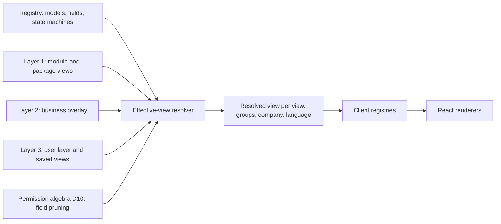
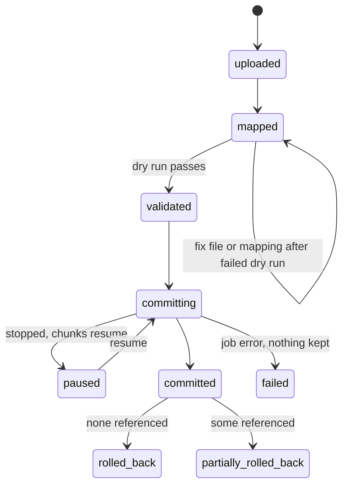

# UX, design system and metadata-driven UI

- **Status:** Draft 0.1
- **Date:** 2026-10-01
- **Scope:** How every obop screen is described (versioned JSON views), rendered (React registries), operated (keyboard, search, editing, undo), themed (design tokens), made accessible (WCAG 2.2 AA gate), localised, used on phones, tablets and offline, and populated and tried on day one (setup, sample data, import, the hosted sandbox). Every screen is a client of typed commands that the `obop` CLI, the REST API and MCP expose equally (OR-4, D80); section 4.15 lists the command surface of this area.

**Conventions.** Decisions are cited by ID ([DECISIONS.md](../DECISIONS.md)); "OR-n" is an owner ruling of 2026-10-01 (RATIFIED), cited where a sentence rests on one; names shared with other documents (events, permission groups, data classes, entities, states) are spelled as in [CONVENTIONS.md](../CONVENTIONS.md); register items F1 to F6 are owner constraints, unrelated to the F0 to F3 UI tiers (D11). Commands, files and exit codes follow [cli.md](cli.md); a wire id marked `*` is a working name of this document under the rule `<model>.<action>` (CONVENTIONS 2.1) and is Proposed. "Proposed (Dn)" means this document relies on a record that is still Proposed; "Proposed" alone marks a choice the research and register leave open. "(target)" is a goal, "(estimate)" a model output; nothing is measured because the UI described here is not built to this specification. Versions are as of 2026-10-01. "Odoo Community" and "Odoo Enterprise" name Odoo's editions; obop has one edition, open and free under Apache-2.0, with no `ee` tree (OR-1, OR-2). The wave windows and dates are RATIFIED (OR-13, D26) and the W1 cut is D86 (RATIFIED, OR-13, OR-15); individual placements of UI items, including the T0 list of D25, are Proposed and collected in Open question 15. D4 (ICP and T0 list), D12 to D14, D20 and D25 are Proposed in the register, as are the parts of D26, D80, D81, D85 and D86 that it marks Proposed, so every citation of them below is written "Proposed (Dn)"; the other records cited are BINDING or RATIFIED and carry no label. Nothing here is legal advice.

## 1. Purpose and scope

### 1.1 What this area is

UX is the contract between the runtime registry, the single source of truth for models, fields, state machines and access (D29), and the person at the screen: how screens are described, rendered, operated, themed, made accessible, localised and populated. It owns no business data. It ships as frontend packages plus registry data in each business database (views, overlays, saved views, preferences), and every other spec in `docs/spec/` describes its screens with the view types defined here.

Users are every principal that touches a screen, implementers who customise without code, extension authors (F0 to F3) and whoever signs the accessibility statement. Agents (D18) use the typed command surface through the CLI and MCP; their plans reach humans in the Inbox (4.4).

**Agentic first (OR-4, D80).** The UI is a client of the typed commands. Every button, menu entry, palette command, bulk action and import step calls one entry of the command catalogue, the same entry that `obop`, the REST API and MCP call, so a screen can show and do only what the catalogue exposes. The UI holds no business logic: posting, numbering, tax, access and constraints live behind commands, and what the browser computes (layout, `visible` and `readonly` expressions carried by the view, previews of totals from the shared Rust engines) is presentation that the server revalidates (6.1). The UI is not part of a feature's own definition of done, but it reaches parity with the commands before the first stable release: a UI parity test gates 1.0 (D80, OR-16: literal parity before 1.0). Section 4.15 lists the commands of this area and the binding rule.

### 1.2 Boundaries with neighbouring areas

| Neighbour | Owns | UX owns |
|---|---|---|
| [platform.md](platform.md) | Registry, chatter, documents, approvals engine, import engine and per-model rules, search engine | Inbox, import wizard, search bar, report viewer surfaces |
| [finance.md](finance.md) | Report definitions, reconciliation rules, lock dates | Report viewer and reconciliation split view contracts |
| [sales-crm.md](sales-crm.md), [supply-chain.md](supply-chain.md), [services.md](services.md), [people.md](people.md) | Models and workflows | The view types their views are built from |
| [retail-commerce-marketing.md](retail-commerce-marketing.md) | POS, storefront, checkout internals | Tokens, WCAG gate, scan input, offline contract |
| [security-privacy.md](security-privacy.md) | Permission algebra, audit, step-up | UI consequences: field pruning, 404, cache exclusions |
| [integrations.md](integrations.md), [ai.md](ai.md) | API, foreign-source importer back ends, the plugin registry's rules (no payments, OR-3; only OSI-approved licences are listed, OR-17); agents, approval policy | Import screens, extension UI tiers, plugin manager screens (Open question 17); palette and Inbox that AI reuses |
| [cli.md](cli.md) | Command catalogue, grammar, output and exit contracts, the CLI, REST and MCP surfaces, the plugin registry client, the parity matrix (`parity.json`, `ui-bindings.json`) | How views, actions and palette commands bind to catalogue commands; the UI column of the parity matrix (4.15) |
| [LOCALIZATION.md](../LOCALIZATION.md) | Country packs, legal content | Formats, RTL and CJK rendering, pack-aware wizard |
| [ENGINEERING.md](../ENGINEERING.md), [ARCHITECTURE.md](../ARCHITECTURE.md) | CI and release; stack and topology | The gates defined here; stack referenced, not re-argued |

### 1.3 Fixed frontend stack

Fixed by the owner's Vite+ and pnpm constraint (F2), D15 and D35; not re-argued here. The web UI is React on Vite+, driven through `vp` with pnpm, and is a client of the typed commands (OR-4, D80). Engineering detail is in [ARCHITECTURE.md](../ARCHITECTURE.md); see also [CLAUDE.md](../../CLAUDE.md).

| Concern | Choice (as of 2026-10-01) |
|---|---|
| Framework | React 19 (19.3.0, 2026-09-09) and TypeScript 7 (stable release 2026-07-08), TSX only; React Compiler via `@rolldown/plugin-babel`; no `baseUrl` (D15) [R00 s3.3; R07 s3.2] |
| Toolchain | Vite+ through the `vp` CLI only, with two ratified exceptions (OR-9), neither of which builds the UI that ships (the nightly exit drill and `pnpm sbom`), and a third for the mobile toolchain (OR-34), which builds the native app of D87 and not the web UI; `vite-plus` 1.0.0 (2026-09-28, MIT) bundling Vite 8.3.1, Rolldown 1.2.11, Vitest 5.0.1, Oxlint 1.85.0, Oxfmt 0.70.0, tsdown 0.23.0; eligible under the ratified pin policy (OR-8, D23) from 2026-10-05. pnpm only; CI runs `vp install --frozen-lockfile` |
| Data, tables, primitives | TanStack Query, Router, Table 9.2.4 and Virtual (Start excluded while a release candidate); React Aria Components 1.21.1; Tailwind 4.3.3 logical utilities; ECharts 6.1.0; Tiptap 3.31 core; Lingui 6.8 (D15, D34) [R00 s3.3] |
| Tests | Vitest Browser Mode, Playwright 1.63, `@axe-core/playwright` 4.13.0; visual baselines from one pinned container [R27 A2] |
| Contracts | Rust owns them: OpenAPI 3.1 (utoipa 6.0.0), meta-model types (ts-rs 12.0.1 or specta), JSON Schema (schemars 1.2.2); generated files are committed and diff-gated [R19 s5.1; R07 s3.7] |

The CI licence allow-list excludes AG Grid Enterprise, Handsontable, FullCalendar Premium, Univer Pro, BlockNote XL and HyperFormula (commercial or copyleft-only) [R00 s3.3; D15; D39], and admits only dependencies that are compatible with Apache-2.0 (D1).

### 1.4 Components, tier and wave (all open and free)

Everything in this table is open and free under Apache-2.0 (OR-1, OR-2): there is no paid column, no `ee` row and no plan that gates a UI capability. Proposed (D25) does not list frontend packages; T0 follows its definition ("present in every business") and is Proposed. The W1 UI is thin (D86 call 12, RATIFIED, OR-15): shell, list, form, kanban, search, report viewer and reconciliation split view, which the loop needs (D86 criteria (b) and (c)). Three markers are used in this table and in section 3. "W1" alone is that list, plus what rests on a binding record and not on a placement of this document: the view system those views are built from, the WCAG 2.2 AA gate and the logical-CSS rule (D35), the en and de locales (D34, D86 call 21) and the command bindings (OR-4, D80). "W1 stretch" marks every other UI item this document places in W1: it is Proposed, it is not in D86 call 12, DECISIONS 5.3 or ROADMAP 6.2, it is built only if capacity allows, and it slips to W2 first, in the order of Open question 15 (where it must still exist before the 1.0 parity gate). "Reduced" is kept only where the scope really is cut, as in "W1 stretch, reduced". The commands behind every screen are W1 whatever the wave of the screen (OR-4, 4.15), so slipping a screen slips no command. Every other placement below is Proposed and is collected in Open question 15 with the order in which items return.

| Component | Tier | Wave |
|---|---|---|
| UI runtime, shell, view system, registries, URL state, record cache, and the command client generated from the catalogue (`@obop/rpc`, 4.2) | T0 | W1 |
| Core view types: list, form, kanban | T0 | W1 (D86 call 12) |
| Pivot, graph, calendar | T0 | W2 (D86 slip item 5) |
| Activity, hierarchy, settings view types (Proposed) | T0 | W2, Proposed |
| Search (facets, filters, group-by) | T0 | W1 (D86 call 12) |
| Saved views, command palette | T0 | W1 stretch, Proposed; the palette's non-navigation commands and saved-view sharing beyond personal go first (Open question 15) |
| Report viewer, reconciliation split view (types T0, content from `account`, T1) | T0, T1 | W1 (D35, D86) |
| Notification centre and Inbox (`mail`); approvals lane | T0 | Inbox W1 stretch, reduced (mentions, activities, alerts, plain plan confirm), Proposed; approvals lane W2 (D18) |
| Design system: tokens as CSS variables; density, light and dark; the DTCG compiler | T0 | CSS variables for the core views W1 (D35); density, light and dark W1 stretch; the DTCG compiler W1 stretch and first to go (Open question 15) |
| Business branding settings, theme and branding packs (`kind="theme"` plugins) | T0 | W3 (DECISIONS 5.1, slip item 1) |
| Setup wizard, sample data, import and export screens | T0 (`base`) | W1 stretch, reduced, Proposed; the CLI path of [cli.md](cli.md) 8.1 and the import and export commands are the W1 path. The importers keep their waves: CSV 0.3 and Odoo 0.6 in W1 (D86 call 13, RATIFIED, OR-15); QuickBooks W2, Xero and ERPNext W3, Proposed (D26 ruling 31, slip order of DECISIONS 5.3) |
| Sandbox mode of the shell: sample-data banner with reset countdown, data notice, disabled-action explanations, reset page (4.14) | T0 | With the hosted sandbox at the public beta (0.5; D83, OR-20); the sandbox is RATIFIED, its terms and limits are Proposed (Q34 to Q36), whether it opens with 0.5 or later is Q35, and it is outside the protected core of DECISIONS 5.3 and the UI slip order of Open question 15 |
| Read cache, offline shell, degraded-feature list | T0 | W2; required by 1.0, 2028-04-18, Proposed (D13) |
| Plugin manager screens (search, info, install plan, copy, update, remove, verify, audit; required by 1.0, OR-16; Open question 17) | T0 | W2 with registry stage 1 (D81 staging, Proposed) |
| Web UI parity work: every catalogue command has a UI path or an exemption-list entry (4.15) | T0 | W2; gates 1.0 (D80, OR-16: literal parity before 1.0) |
| Timesheet grid, gallery (Proposed) | T0, T1 | W3, Proposed (they follow `timesheet` and `documents`, D86) |
| View overlays and F0 patches, layout editor, form builder; F1 loader and UI SDK; F2 host | T0 | W3 (DECISIONS 5.1, slip item 1) |
| Gantt, map, cohort; F3 iframes; POS screen, queued writes | T0, T2 | W3, Proposed (D25, D86) |
| Dashboard container and default dashboards per app (a minimal W2 container is Open question 10) | T2 | W3, Proposed (D25) |
| Spreadsheet view | none | not scheduled (COULD) |

There is no white-label licence, reseller console or partner programme (OR-2). Anyone may rebrand a fork, subject only to the trademark policy (Q26, Proposed).

## 2. Personas and roles

Group names follow the registry in [CONVENTIONS.md](../CONVENTIONS.md) section 4; the kernel seed list is in [security-privacy.md](security-privacy.md) 2. A permission group is a named bundle of permission rows (D24). No persona is a licence category: obop counts no seats and charges nothing (OR-2), so an external accountant or a light user is only a permission scope.

| Persona | Needs from the UI | Default groups (Proposed) | Main surfaces |
|---|---|---|---|
| Owner or manager | Approve, see cash and pipeline, trust numbers | `base.user`, manager groups | Inbox, reports, saved views; dashboard from W3 |
| Accountant, internal | Keyboard entry, batch reconciliation, period close | `account.bookkeeper`, `account.user`, `account.manager` | Editable grid, split view, reports, import |
| External accountant | Read, adjust, export; MFA by default | `account.adviser` | Reports, grid, export |
| Sales representative | Pipeline, quotes, phone use | `sales.user` | Kanban, form; calendar from W2 |
| Warehouse operator | Scan, confirm, tablet, bad Wi-Fi | `stock.operator` ([supply-chain.md](supply-chain.md)) | Scan input, touch density, offline banner |
| Cashier (W3) | Fast touch checkout, offline capture | `pos.cashier` | POS screen |
| Administrator or implementer | Setup, import, customise, install plugins, script the same work with the CLI; brand (W3) | `base.admin`, `customize.designer` ([platform.md](platform.md)) | Wizard, settings, plugin manager (W2), view editor (W3), the `obop` CLI |
| Agent (a principal, D18) | Run any permitted catalogue command through the CLI or MCP; have its writes reviewed by a human | `base.agent`, with the delegator's grants intersected with token scopes ([ai.md](ai.md) 4.2) | CLI and MCP; the Inbox shows its plans |
| Light user (Proposed) | A few tasks: timesheet, expense, approve | task-scoped groups | Inbox and permitted apps only |
| Portal user (from W2, `portal`) | Own documents, pay, sign | `base.portal` | Portal pages (WCAG 2.2 AA, D38) |
| Assistive-technology user | Everything above without pointer or sight | same as role | Every surface |

UI permission rows (the capability rows of [CONVENTIONS.md](../CONVENTIONS.md) section 4; Proposed): `customize_views` (publish overlays; bundled with schema rights in `customize.designer`, as [platform.md](platform.md) 4.14 states), `share_views` (shared and system scopes), `import_data` (plus create or write on each target model), `manage_branding`. Export is the separate named-action permission AZ10 of [security-privacy.md](security-privacy.md), not a UI row defined here. All are audited.

## 3. Capability map

The last column compares with Odoo Community, Odoo Enterprise, "beyond" (obop does more) or "deliberately skipped"; "command parity" always means the D80 rule that CLI, API, MCP and UI expose the same commands (4.15). Wave shows its basis: a decision ID or "Proposed". W1 is the thin UI of D86 (1.4) and what binding records require; "W1 stretch" is a Proposed addition that slips to W2 first (1.4, Open question 15); the other placements are Proposed (D25, D86).

| ID | Capability | Description | Wave | Odoo parity |
|---|---|---|---|---|
| C01 | Virtualised list and grid | Keyset-paged, grouped, keyboard grid | W1 (D35, D86) | Beyond: Odoo pages 80 rows, count capped at 10,000 [R19 s2.3] |
| C02 | Inline, multi and bulk edit; Excel paste | Cells, "apply to N", TSV paste | Cell edit in the form and list W1 (D86 call 12); multi edit, bulk edit and Excel paste W1 stretch, Proposed | Matches Community for edit; paste beyond |
| C03 | Form and kanban | Slots, smart buttons; "Move to" twin | W1 (D86 call 12; the twin is D35) | Matches Community; non-drag path beyond |
| C04 | Pivot, graph, calendar, activity, hierarchy, settings | Drill-through, treegrid | Pivot, graph, calendar W2 (D86 slip item 5); activity, hierarchy, settings W2, Proposed | Matches Community |
| C05 | Report viewer | Comparisons, every number drillable | W1 (D35, D86) | Matches Enterprise |
| C06 | Reconciliation split view | Suggestions, batch validate | W1 (D35, D86) | Matches Enterprise |
| C07 | Inbox and notification channels | Triage; in-app, email, Web Push | Inbox screen W1 stretch, reduced (notifications and outbound email are `mail` and command work, D86 call 3); push W2; digests and quiet hours W2 and SMS W3 (Proposed; not placed by D25 or D26, placement proposed in [platform.md](platform.md) 4.6) | Matches Community; triage beyond |
| C08 | Approvals lane, agent proposals | Digest-bound diff | W2 (D18); W1 offers only a plain confirm of the dry-run diff in the Inbox (Proposed, [ai.md](ai.md) 1.4) | Matches Enterprise (Approvals); agents beyond |
| C09 | Dashboard, timesheet grid, gallery | Widgets; weekly matrix; cards | Grid and gallery W3 (Proposed, with `timesheet` and `documents`); dashboard W3, Proposed (D25) | Dashboard matches Community (different mechanism); grid matches Enterprise |
| C10 | Gantt, map, cohort | Lag, tiles, retention | W3, Proposed (D25) | Matches Enterprise |
| C11 | Versioned JSON views, named slots | Stable node ids, structured patches | W1 (D35) | Beyond; XPath inheritance deliberately skipped |
| C12 | Expression nodes | CEL plus compiled form | W1, Proposed (D12); CEL only if the D11 limits spike passes (DECISIONS 5.3 call 16) | Deliberately skipped: Python strings in XML |
| C13 | Overlay, reset, report, editor | Layers over immutable defaults | Overlays, F0 patches, reset and editor W3 (DECISIONS 5.1, slip item 1); customisation report W2, Proposed ([cli.md](cli.md) 3.6) | Editor matches Enterprise (Studio); report beyond |
| C14 | Saved views, four scopes | URL-addressable | W1 stretch, Proposed (the four scopes are D35; D86 call 12 lists search only); sharing beyond personal goes first | Beyond |
| C15 | Palette and search grammar | Records, navigation, commands | Palette and omni-bar grammar W1 stretch, Proposed, with the non-navigation commands first to go; the facet search bar is W1 (D86 call 12) | Matches Community; grammar beyond |
| C16 | Keyboard model | Remappable, IME-safe | Keyboard operation of the core views W1 (WCAG gate, D35); the shortcut registry, remapping and the `?` sheet W1 stretch, Proposed | Beyond; Alt+letter defaults deliberately skipped |
| C17 | Undo | Session, toast, reversal, rollback | W1 stretch, Proposed; reversal of posted documents and import rollback are commands and keep their waves | Beyond: Odoo imports are irreversible [R19 s2.5] |
| C18 | Tokens, density, dark mode, branding | DTCG 2025.10 as CSS variables | CSS variables for the core views W1 (D35); density, dark mode and the DTCG compiler W1 stretch, Proposed; branding W3 (DECISIONS 5.1) | Beyond: Odoo dark theme is a compiled bundle [R19 s2.4] |
| C19 | WCAG 2.2 AA gate and statement | React Aria, axe, screen-reader passes | W1 (D35) | Beyond: no Odoo conformance statement found |
| C20 | i18n, RTL, CJK | PO plus ICU MessageFormat 1 | W1 (D34) for en and de; the other target locales as reviewed community translations, Proposed (D86 call 21) | Matches Community; CI fixtures beyond |
| C21 | Responsive, touch, barcode input | Container queries; wedge then camera | Responsive layouts and touch density W1 stretch, Proposed; scan input W2 (Proposed); screens W3; depth W4, Proposed (D25) | Matches Odoo Community for scan input; Odoo scan screens (the Barcode app) are Enterprise (verified [R10 s1; odoo.com/page/editions]) |
| C22 | Offline read cache; queued writes | Degraded-feature list; edge store | Read cache W2, by 1.0, Proposed (D13, D86); queued W3+ | Cache matches Odoo 19; queued matches Odoo 20 |
| C23 | Setup wizard, sample data, checklist | Pack-aware, resumable; each step a catalogue command | W1 stretch, reduced, Proposed; the steps are commands and the CLI path of [cli.md](cli.md) 8.1 is the W1 path | Matches Community onboarding; beyond |
| C24 | Import with dry run and rollback; importers | CSV, Excel, Odoo, QuickBooks, Xero, ERPNext | Import screens W1 stretch, Proposed; the import commands and importers W1 (D35, D86 call 13, RATIFIED, OR-15): CSV 0.3, Odoo 0.6; QuickBooks W2; Xero and ERPNext W3, Proposed (D26 ruling 31, slip order of DECISIONS 5.3) | Beyond |
| C25 | Extension UI tiers F0 to F3 | Slots, ESM, remote-dom, iframe | Slots exist in W1 views; F0 patches, F1 loader and UI SDK, F2 and F3 W3 (DECISIONS 5.1, slip item 1) | Beyond: Odoo patches at runtime |
| C26 | Commands only; UI command bindings | Every action, menu entry, palette command, bulk action and import step names a catalogue command; `ui-bindings.json` feeds the parity matrix | Bindings W1; UI command parity by 1.0 (D80, OR-16: literal parity before 1.0) | Beyond: one catalogue for UI, CLI, REST and MCP, where Odoo gates its API to the Custom plan (D31) |
| C27 | Copy as command (Proposed) | Any action or filter shown in its CLI, REST and MCP forms, with `--dry-run` | W2, Proposed | Beyond |
| C28 | Sandbox mode (hosted sandbox) | Persistent sample-data banner with reset countdown; no sign-up; data notice; blocked actions explained; reset page | With the hosted sandbox at the public beta (D83, OR-20); the sandbox is RATIFIED, the screen details Proposed (Q34, Q36) | Not compared: no research finding on Odoo's hosted try-out |

## 4. Per-app specification

These components are cross-cutting, so entities, events and permissions shared by 4.3 to 4.14 are consolidated in 4.2, and the commands of the area in 4.15; later subsections state only what is specific to them. Everything in this area is open and free (OR-2).

### 4.1 UX principles

1. **URL-addressable.** Every list, filter, group and record state round-trips through the URL; a user without access gets 404 (D10) [R19 s14; R18 s10].
2. **Keyboard first, mouse friendly.** Every path in section 5 completes without a pointer; shortcuts are discoverable and remappable.
3. **Context survives.** Records open in a side panel by default; filters and scroll survive back-navigation.
4. **Saved means scoped** (four scopes, resettable) and **customise without forking** (overlays over immutable defaults).
5. **Every drag has a non-drag twin** (WCAG 2.5.7).
6. **Undo for drafts, reversal for posted** (D30).
7. **Numbers are sacred.** No floats; tabular, locale-correct, drillable; mixed currencies never summed silently.
8. **Fast is a feature.** Optimistic UI, virtualisation, budgets gated in CI; **one search box** for records, navigation and commands.
9. **Progressive density.** Compact, comfortable, touch from one definition.
10. **Errors are local and announced; offline is honest; accessibility is structural** (primitives plus lint and axe gates).
11. **Nothing is gated.** Every UX capability is free and open; no screen, view type, shortcut or theme is sold, licensed per seat or withheld (OR-2; D35).
12. **A client of typed commands.** Every action a screen offers calls one catalogue command, the same one `obop` and MCP call; views contain no business logic and expose nothing absent from the command catalogue; a UI parity test gates 1.0 (OR-4, D80, OR-16: literal parity before 1.0).

### 4.2 Runtime, shell and area-wide contracts

**Architecture.** Registries for view types, field renderers, actions, commands and services. A framework-neutral metadata layer (`@obop/meta`, `@obop/rpc`, `@obop/domain`, `@obop/i18n-core` import no React) keeps a renderer swap cheap; React lives in `@obop/ui-kit`, `ui-views` and `ui-widgets`; apps are `backoffice`, `storefront` and `pos-shell` [R07 s3.11, s3.13]. Modules compose at build time through a Vite+ plugin reading each module's `frontend/` folder; nothing patches another module at runtime [R02 s8]. `vp build` embeds the result in the single binary; customer servers never run Node (D37). The UI calls commands through `@obop/rpc`, a client generated from the same command catalogue as the CLI, REST and MCP (D80, [cli.md](cli.md) 5.3); it has no hand-written endpoints, and `RegistryVersionChanged` refreshes it as it refreshes the CLI's cached command tree.

**Shell.** Searchable app switcher with recents, menus, control panel (breadcrumbs, search, view switcher, pager), status strip (connection, active company, user). The control panel renders from the cached view definition before data arrives [R19 s2.1]. Menus show only permitted entries, so a light user sees a short list.

**State.** TanStack Query keeps a normalised record cache keyed by (model, id, field set); the URL holds action, view type, domain or saved-view id, group-by, sort, record id and cursor [R07 s3.4]. One WebSocket per tab resumes from `(xid8, event_id)` (D7); change events invalidate cache keys, and an open record with unsaved edits shows a stale banner instead of reloading. From W2 the active company set travels explicitly with each request, and a record outside it offers "switch to company X" when permitted instead of a bare access error [R02 s9]; W1 has one company and no selector (D28).

| Entity | Purpose | Key fields | States |
|---|---|---|---|
| `view_definition` | Base and package views | UUIDv7 key (D9) plus external id (`module.name`, D22), model, type, `schema`, arch JSON, origin | immutable per module version |
| `view_override` | Patches by node id or slot (W3) | target, ops, scope (business, company, permission group) | active, reset |
| `saved_view` | Query plus presentation | action, type, scope (personal, shared, system, locked), owner, domain AST, group-by, order, columns, options | active, reset |
| `action`, `menu` | Navigation | kind (view, url, command, report, custom screen; the counterparts of Odoo's window, URL, server, report and client actions [R02 s4]), model, view modes, default domain, groups, optional parent action for embedded tabs (W2, Proposed) | none |
| `command_definition` | Palette commands and hotkeys as data (the name [platform.md](platform.md) 4.15 uses) | label, availability, CEL condition, hotkeys | active |
| `user_preference` | Per principal | UI language, format locale, time zone, density, theme, shortcuts; references the principal's `notification_preference` rows ([platform.md](platform.md) 4.6) | none |

This document owns `view_definition`, `view_override`, `saved_view`, `command_definition` and `user_preference`; [platform.md](platform.md) 4.14 and 4.15 point here for view layers, `saved_view` and `command_definition`. Inbox state is not a separate entity: it is the `inbox_state` field of the `notification` row of [platform.md](platform.md) 4.6 (unread, read, snoozed, done), with `snoozed_until` and a `lane` (mention, activity, alert) as in [CONVENTIONS.md](../CONVENTIONS.md) section 6, while approval tasks (`approval_task`, platform.md 4.12) and agent proposals (`command_plan`) appear in the Inbox through their own records. The import engine entities belong to [platform.md](platform.md) 4.16 and the foreign-source importers to [integrations.md](integrations.md) 4.8. Brand settings (4.9), the `external_ref` ledger and setup progress (4.14) are described where used.

**Events (names as in [CONVENTIONS.md](../CONVENTIONS.md) 3.4 and 3.6, which stay Proposed until the catalogue generated from the `*-api` crates, ARCHITECTURE.md 4.3, replaces that table).** Consumed by the client as invalidations over the realtime channel (D7; invalidations rather than record bodies is Proposed in ARCHITECTURE.md 12): the realtime frames `RecordChanged` and `JobProgressed` (messages, not outbox events), and the events `RegistryVersionChanged` (defined in ARCHITECTURE.md 5.1; platform.md 4.14 only triggers it), `PermissionChanged` (emitted by [security-privacy.md](security-privacy.md) 4.2; invalidate and re-resolve views), `NotificationCreated` (platform.md 4.6), `ApprovalRequested`, `ApprovalTaskDecided`, `ApprovalDecided` (platform.md 4.12), `ImportRunCommitted`, `ImportRunRolledBack` (platform.md 4.16), `ExportReady` (an export job finished and its archive can be downloaded; emitted from `export_job`, [integrations.md](integrations.md) 4.9) and `PackActivated` (reload formats and labels; emitted by base apps management on pack install and at each effective date of a pack version, [platform.md](platform.md) 4.18, Proposed as resolved in CONVENTIONS 3.7). Emitted by UX commands as durable events (kind D, [CONVENTIONS.md](../CONVENTIONS.md) 3.2; no in-transaction handler needs atomicity, and none has a named consumer, 3.5): `SavedViewSaved`, `ViewOverridePublished`, `ViewOverrideReset` (both `ViewOverride` events arrive with overlays in W3), `PreferenceChanged`, `SetupStepCompleted`.

**Permissions and sensitive data.**
- Unreadable fields never reach the client: resolved views omit their nodes, and the query compiler rejects filter, sort or group on them (D10).
- Saved views and links never widen access; recipients see results under their own permissions, and an inaccessible record answers 404, not 403 [R18 s10].
- URL state can leak through referrers and logs: `Referrer-Policy: same-origin` and log redaction of view-state parameters (Proposed).
- A screen never offers an action the caller's permissions deny: the resolver omits a node whose `command` the principal may not run, using the compiler behind `obop access check` ([cli.md](cli.md) 2.11), and the server rechecks on every call (D10, D80).
- Overlay, sharing, import and export actions are audited (D33). Export controls appear only for principals holding the named export permission (AZ10) and ask for step-up when sensitive classes or the whole business are exported ([security-privacy.md](security-privacy.md)).

**Extension UI tiers.**

| Tier | Who | Isolation | Accessibility duty |
|---|---|---|---|
| F0 patches (W3), slots, built-in widgets | Anyone | n/a | Host |
| F1 prebuilt ESM on `@obop/ui-sdk` (W3) | First-party and business-own code only (D11). Copied plugin source is business-own code, but its UI stays F2 or F3 until an operator promotes it (D81; Q25, Proposed) | None | Author, CI-checked |
| F2 remote-dom (W3) | Registry plugins (community, verified), sideloaded packages | Opaque-origin sandbox plus Worker; host element allow-list | Host renders real DOM; author supplies labels |
| F3 sandboxed iframe (W3, after F2) | Registry plugins, remote apps | Separate origin, manifest CSP | Author: WCAG 2.2 AA statement, axe in CI, iframe `title`; host owns focus entry and exit |

Tokens reach F1 as CSS variables, F2 as token-named style props and F3 through the init handshake. The SDK ships its own overlay primitives because portals fail in remote renderers. `@obop/ui-sdk` is semver and reaches plugin projects as release tarballs installed with `vp add <url>` (Q32 is open and decided at W2, OR-19; until the owner rules, the default is that obop publishes nothing to a public JavaScript package registry). The host supports the current and previous major of the SDK contract, and a deprecated major keeps working for the D85 window: 12 months before 1.0 (RATIFIED, OR-12) and, Proposed, the same after 1.0 (Q28) [R24 s4].

**Open.** All of 4.1 to 4.15 is open and free under Apache-2.0 (OR-1, OR-2). Nothing in the UI is gated or sold, business branding included, and there is no white-label licence.

### 4.3 View definitions: AST, slots, expressions, layers

**MVP and later.** W1: AST, registries, resolver, first-party and X1 pack views, custom fields in the `custom` slot (via `customize`, W1). W2: the customisation report ([cli.md](cli.md) 3.6; platform.md). W3 (DECISIONS 5.1, slip item 1): business overlays and F0 patches with publish and reset, the form, list and kanban layout editor, and the form builder with conditional visibility (Proposed) [R19 s5.5].

**Rules.** Views are data in the business database, validated in Rust, with generated, diff-gated TypeScript types [R19 s5.1]. The server resolves the effective view per request; the client never sees XML or XPath. Registries are keyed by view type and by (field type, widget); extensions register entries and never patch core.



Illustrative AST, adapted from [R19 s5.2] to obop vocabulary (model and command names follow [sales-crm.md](sales-crm.md); other field and action names are placeholders):

```jsonc
{
  "id": "sales.order_form", "schema": 1, "model": "sale_order", "type": "form",
  "nodes": {
    "actions": { "slot": "header.actions", "children": [
      { "id": "btn_confirm", "kind": "action", "command": "sale_order.confirm", "primary": true,
        "visible": { "cel": "state == 'draft'" } } ] },
    "stats": { "slot": "smart_buttons", "children": [
      { "id": "sb_invoices", "kind": "smart_button", "value": "invoice_count",
        "opens": { "action": "invoicing.invoice_list", "domain": [["order_id","=","$id"]] } } ] },
    "main": { "slot": "sheet.main", "children": [
      { "id": "f_party", "kind": "field", "field": "party_id", "widget": "relation" },
      { "id": "f_terms", "kind": "field", "field": "payment_term_id",
        "readonly": { "cel": "state != 'draft'" } } ] },
    "lines": { "slot": "sheet.lines", "children": [
      { "id": "f_lines", "kind": "field", "field": "line_ids",
        "view": { "type": "list", "editable": "bottom", "columns": ["product_id","qty","price_unit","tax_ids"] } } ] },
    "chat": { "slot": "side.chatter", "features": ["messages","notes","activities","followers"] }
  }
}
```

**Node rules.**
- Every node has a stable `id`; ids and slot names are a public contract under the D85 deprecation window: 12 months before 1.0 (RATIFIED, OR-12) and, Proposed, the same after 1.0 (Q28).
- `visible`, `readonly`, `required` and `decoration` are expression nodes. Domains are a JSON AST in Odoo's syntax compiled to SQL (D22); everything else stores CEL source plus a type-checked compiled form, run by one Rust evaluator on the server and in Wasm on the client under conformance tests (Proposed (D12); 4 KB and depth 32 limits, D11). R19 proposed JSON AST for all; D12 supersedes it if ratified. Expression nodes are a tagged union `{cel}` or `{ast}` (Proposed), so either D12 outcome changes evaluators, not the view schema.
- `opens` and `command` are typed references, never script strings. A `command` is a wire id of the command catalogue (`<model>.<action>`, CONVENTIONS 2.1); package install and `vp build` validation reject an id the catalogue lacks, so a view cannot expose anything the CLI, API and MCP do not (D80, 4.15); to-many sub-views are inline definitions; `html` nodes are sanitised server-side and packs cannot inject script.

**Slots** (declared per view type; patches may target only declared slots and nodes flagged `extensible`).

| View | Slots |
|---|---|
| Form | `header.actions`, `header.status`, `banner`, `smart_buttons`, `sheet.title`, `sheet.main`, `sheet.tabs.<id>`, `sheet.lines`, `side.chatter`, `footer.totals` |
| List | `toolbar.actions`, `toolbar.bulk`, `columns`, `row.decorations`, `row.actions`, `footer.aggregates`, `empty_state` |
| Kanban | `column.header`, `card.title`, `card.body`, `card.footer`, `card.actions`, `quick_create` |
| Report, Calendar, Inbox | `filters`, `lines`, `columns`, `footer.notes`; `event.title`, `event.popover`; `item.summary`, `item.detail`, `item.actions` |

**Patches** are structured (`insert_before`, `insert_after`, `insert_into`, `replace`, `set_props`, `remove`, `move`), addressed by node id or slot, and validated at package install and overlay publish. A patch whose target vanished after an upgrade is skipped, flagged in the customisation report and never breaks the screen (Proposed).

**Layers (D32).** (1) Module and package views, immutable per version. (2) Business overlay (`view_override`) by `customize.designer`, scoped to the business, a company or a permission group; it arrives with F0 patches in W3, so until then the resolver applies layers 1 and 3 only. (3) User layer: columns, order, density, saved views. Resolution applies them in order and caches per (view, permission groups, company scope, language); payloads are ETag-cached.

**Customisation.** Custom fields (typed or properties tier, D29) appear in a `custom` slot, in search, import and the API. Customised views show a badge and a one-click reset [R19 s5.5]; the customisation report lists each overlay with its upgrade risk [R04 Implications 13]; a business's customisation exports as a package (D32; `obop customize export --as-package`, W1). Stored overlays migrate forward with each `schema` integer, and a schema version is removed only at the first release of a series (`N.0`, Proposed (D85)) after the deprecation window has passed: 12 months before 1.0 (RATIFIED, OR-12) and, Proposed, the same after 1.0 (Q28).

### 4.4 View catalogue and behaviour contract

Every view type registers: arch JSON Schema, a typed data spec [R02 s4], renderer, controller (selection, bulk, keyboard, undo), capabilities (search, bulk edit, export, drill-through, print), the ARIA Authoring Practices pattern it follows, whether it caches offline, and its command bindings: the wire ids its actions, bulk actions and edits may call (4.15). A type without an accessible pattern cannot register. Waves follow 1.4.

| View | Wave | Behaviour contract |
|---|---|---|
| List and editable grid | W1 | `role="grid"`, one tab stop, roving focus, `aria-rowcount` and `aria-rowindex`. Keyset pages of 200 to 500 rows (target); sticky group headers with lazy children and per-group aggregates; footer aggregates; column chooser, resize, pin, reorder saved in the view; row `decoration` never by colour alone. Count beyond the cap reads "10,000+" (configurable, Proposed). Editing in 4.7. Read-only reports use a plain table, hierarchies a treegrid [R19 s7] |
| Form | W1 | Slots per 4.3; primary action plus overflow; statusbar; smart buttons open a filtered action. Locked documents are read-only with a banner naming the reason (posted, period locked, approval pending). Dirty guard; single save with `row_version` (4.7) |
| Kanban | W1 | Columns by any selection or relation; progress and sums computed server-side; quick create; fold; multi-select; stage-age flag from a per-stage threshold [R11 s5.1]. Drag rewrites the grouped field through a command. Twin: card menu "Move to" or select-then-arrow; focus stays on the card and a live region announces column and position. `@dnd-kit/react` 0.5.0 behind a facade, pinned exactly [R07 s3.3] |
| Pivot | W2 (D86 slip item 5) | One semantic query (measures, dimensions, grain, target currency, rate type) compiled under the caller's access [R23 B.3]. Until the `analytics` layer lands (W3, slip item 2), pivot and graph read `<model> aggregate` ([cli.md](cli.md) 3.4) under the caller's access (Proposed). Expand, collapse, flip; cell click drills through to the source list; CSV and XLSX export; size cap with warning |
| Graph | W2 | Bar, line, pie, stacked on ECharts; data-table toggle and generated text summary; never colour alone; click drills through |
| Calendar | W2 | Day, week, month; create by click, drag or "New event at"; reschedule by drag or dialog; recurrence edits this, following or all; zone shown. FullCalendar 7 core behind a facade is the R07 candidate; its WCAG 2.2 fitness is unverified and it must pass 4.10 or be replaced |
| Activity matrix | W2, Proposed | Records by activity type with overdue, today, planned states; owned by `mail` |
| Hierarchy | W2, Proposed (in W1 a hierarchy is a list with a parent column) | Treegrid: Right expands, Left collapses. Chart of accounts, bill of materials, org chart; drag re-parenting has a "Move under" twin; cycles rejected server-side |
| Report viewer | W1 | Declarative lines and columns, collapsible, "as of" and comparison selectors, posted-only toggle, lock-date banner, generated-at stamp. Every number carries a drill descriptor (model, domain, grouping; tax lines add the rule-pack version, D38) opening a URL-addressable source list. Accounting format, tabular figures; export via Typst, Proposed (D20), and XLSX. The viewer calls `report.run` ([finance.md](finance.md) 4.13; the id is Proposed there), and `obop report run` returns the same figures |
| Reconciliation split view | W1 | Statement lines left, candidate items and detail right. Each suggestion states its reason ("exact amount plus reference", "same party, partial"). Accept, search counterpart, split, write off via a model, batch validate. Partial sums never exceed the residual in either currency; exchange differences flagged system-generated [R09 s9]. Accepting and validating call `bank_statement_line.reconcile*` ([cli.md](cli.md) 3.5), so `obop` and MCP reconcile the same way. Frame shared with the document review split view in [ai.md](ai.md) |
| Inbox | W1 stretch, reduced (Proposed); approvals W2 | List plus detail; lanes: mentions, activities, alerts, approvals, agent proposals (in W1 an agent plan shows as a single confirm action on its dry-run diff, without policy rules or approve-by-role, Proposed, [ai.md](ai.md) 1.4). Snooze, done, inline approve or reject with reason. An approval shows the dry-run diff bound to the plan digest; if records changed since, the button reads "Plan outdated, re-run dry run". Separation of duties is enforced server-side and disabled buttons say why |
| Dashboard | W3, Proposed (D25) | Grid of widgets: saved views, KPI tiles from registry measures, text; each a headed landmark with drill-through; private or shared. Proposed (D25) lists "dashboards" as a T2 W3 app and [platform.md](platform.md) 4.17 schedules `dashboard` in W3; a minimal container in W2 is Open question 10. Odoo Community ships ten-plus prebuilt dashboards per app [R15 s10]; the counterpart is default dashboards per app (for example pipeline, cash position, stock, open tickets), Proposed as X1 pack content (ARCHITECTURE.md 9.1) that arrives with the container. Until then each app ships system-scope saved views and pivot or graph presets (4.6), Proposed |
| Settings | W2, Proposed (W1 configuration screens are ordinary form and list views of the configuration models, platform.md 4.18) | Searchable, per app; each setting states effect and prerequisites, including "requires module X" |
| Timesheet grid | W3 (Proposed; follows `timesheet`, D86) | Rows task, columns days; keyboard matrix; durations `1:30`, `1.5`, `90m`; totals against expected hours from the resource calendar; submit and approve |
| Gallery | W3 (Proposed) | Card grid for products and documents; alt text required where public |
| Gantt, resource timeline | W3 | Task DAG with dependency types including precedes or follows with lag in working days, manual or automatic scheduling, server-side critical path [R14 Implications 9]. A treegrid of tasks is the accessible primary representation and the canvas a projection; moves and dependencies have a dialog path ("Move by N days"); undo. Library spike: SVAR React Gantt 2.7.3, DHTMLX Community or custom [R07 s3.3] |
| Map, cohort | W3 | Map: clustered records with a result list beside it as the accessible alternative; MapLibre GL JS with the tile source a setting, since public OSM tiles are unsuitable for production ([services.md](services.md); [R14 s6.3]). Cohort: retention matrix by measure and interval, cells drill through |
| Spreadsheet | Not scheduled | Univer core (Apache-2.0) behind a host interface; Univer Pro excluded. o-spreadsheet (LGPL-3) is Odoo-authored code and is OWL-coupled, so adopting it as a dependency needs an F3 clean-room ruling first [R15 s10] |
| POS and scan screens | W3; scan depth W4 | Purpose-built, not metadata-rendered; touch density, offline banner, large numeric pad; Tauri 2 shell with PWA baseline (D37) |
| Portal, website | separate | Rust-rendered blocks plus Vite islands, Proposed (D14); tokens and the WCAG gate apply |

### 4.5 Field renderers and widgets

**Contract.** A renderer registers under (field type, widget) and implements `read`, `edit`, `cell` (compact grid editor), `filter` (operators by type), `aggregate`, `format` and `parse` (locale-aware), `validate`, `exportValue`, `importParse` and `a11yName`; a type without `cell` or `filter` cannot appear in lists or search [R19 s5.4]. Field security applies before a renderer is reached (D10).

**Catalogue.** Text (char, text, email, phone, link, rich text via Tiptap, server-sanitised); numbers (integer, decimal, percentage, duration, quantity with unit, monetary as amount plus currency in one field); time (plain date for accounting, date-time as instant plus IANA zone, range); choice (boolean, selection, state badge, rating, colour); relations (to-one with avatar and inline create, to-many tags, line lists, polymorphic reference, user-defined properties); composite (address from per-country layout data, full name); files (file, image, signature, PDF, barcode); JSON, geolocation, progress, gauge. Odoo ships 68 widget directories (75 in 20.0) [R19 s2.3].

**Money and quantity (D9 bans floats).**
1. Money crosses the API as integer minor units plus a currency code, and unit prices, quantities and rates as decimal strings ([integrations.md](integrations.md) 4.1, Proposed shape). The client never does floating-point arithmetic on money or quantities; arithmetic uses the shared Rust decimal module in Wasm [R07 s3.8], pending a spike on bundle size and start-up cost.
2. Ledger views use the currency's exponent as data and `Intl.NumberFormat` with `currencySign: "accounting"` [R19 s9].
3. Footers and pivots sum within one currency; mixed currencies show per-currency subtotals or require a target currency and rate type [R23 B.3].
4. Input accepts `.` and `,`; the numpad decimal key inserts the locale separator; ambiguous group-versus-decimal input shows the parsed value before commit; full-width digits are NFKC-normalised.
5. Form totals are previewed locally with the server's rounding profile (`per_line` or `per_group`, D9); the server is authoritative, and any minor-unit difference shows a diff banner (Proposed).

**Explain popover.** Values with a trace (price rule, lead score, tax breakdown, an AI answer's structured query) share one widget [R11 s4.3; R16 s6].

### 4.6 Search, saved views, command palette, shortcuts

**MVP and later.** W1 ships the facet search bar (D86 call 12); saved views, the palette with the omni-bar grammar and the shortcut registry are W1 stretch (Proposed, 1.4, Open question 15). W1 search is Postgres full-text, `pg_trgm`, `unaccent` and ICU collations; CJK through PGroonga or `pg_bigm` where installed (W3), else `ILIKE` (D34; [platform.md](platform.md)). Later: `tantivy` when measured need arises [R15 s15].

**Search model.** Facet chips; filter groups (OR within, AND between); a domain tree editor emitting the JSON AST, the same AST that `--where` takes on the CLI and that REST and MCP accept ([cli.md](cli.md) 2.6), so a search can be run as `obop <model> list --where ...` and the reverse; multi-level group-by with date granularities; relative ranges with resolved-date tooltips, as in Odoo 20 [R19 s2.3]. An optional category side panel for list and kanban (Odoo's search panel; a relation or selection field with counts computed server-side under the caller's access, so a count never reveals an inaccessible record) is Proposed for W2.

**Omni-bar grammar (Proposed), after Stripe's dashboard search [R19 s3]:** `customer:"Acme GmbH"` (field), `-status:paid` (negation), `total:>1000` and `date:2027-01..2027-03` (comparison, range), `is:overdue` (named filter); prefixes `/` navigation, `@` people, `#` channels (W3, with `discuss`), `?` knowledge (W3) are familiar to Odoo users [R19 s2.1]. The grammar compiles to the domain AST through each field's `filter` operators; errors show inline. Results group by model, menus and commands and come from the same permission-compiled path as lists (D10), never from a side index without access checks. Commands are metadata: availability (global, selection, record, edit), CEL condition, hotkeys as data [R19 s3]; a palette command is navigation, a presentation toggle (density, theme, in-context translation) or a binding to one catalogue command (4.15), and never changes business data by another path. Ctrl or Cmd + K opens the palette; Ctrl or Cmd + Enter opens a result in a new tab.

**Saved view scopes (Proposed rules).**

| Scope | Created by | Seen by | Edited by |
|---|---|---|---|
| Personal | Anyone | Owner | Owner |
| Shared | `share_views` | Chosen users, groups or the business | Owner, `share_views` |
| System | Module or `customize.designer` | All with access to the action | Administrators |
| Locked | Owner | As shared | Owner or `base.admin`; others "save a copy" |

A saved view stores filters, grouping, sort, columns, view type and options; the user default beats the system default; links preserve live state, as in Odoo 20 [R19 s2.3].

**Shortcuts.** A registry (data, not code) declares scope, command and remappability. The modifier is Ctrl, or Cmd on macOS. Odoo's Alt+letter defaults are not adopted because they collide with browser, OS and screen-reader keys [R19 s2.5]. Single-key shortcuts exist only in triage contexts (Inbox, reconciliation list, a focused kanban) with a global off switch, and the one global two-key sequence (G then I) follows the same switch and is remappable (WCAG 2.1.4 requires turn-off, remapping or active-on-focus; defaults Proposed). Defaults: `?` sheet; Ctrl or Cmd + Enter commits the form, wizard or batch; Esc cancels; Ctrl or Cmd + Z undoes; Ctrl or Cmd + D fills down inside a focused grid only, because browsers use it to bookmark a page (the Excel and Sheets convention, which R19 s7 tags as a guess); G then I opens the Inbox; J, K, E, H in the Inbox; Enter accepts the top suggestion in reconciliation; holding the modifier overlays hints. Every handler ignores events while `event.isComposing` is true (4.11).

### 4.7 Editing: inline, bulk, undo, concurrency

Cell editing in the form and the list, form saving and conflict handling ship in W1 (D86 call 12). Multi edit, bulk edit with "Apply to N records", Excel paste and the undo scopes are W1 stretch (Proposed, 1.4, Open question 15): the commands behind them (`update`, `batch run`, reversals, `import_run rollback`) are W1, and a slipped screen leaves the CLI, API and MCP path intact. Offline edits are not in W1 (4.13).

**Grid [R19 s7].** Enter or F2 edits; Esc cancels; typing starts an edit; Enter commits and moves down (setting: right); Tab commits and moves right, wrapping to the next row; Enter on the last row creates a line; Shift + Space selects a row. TSV paste from Excel shows a per-cell validation preview and rejects before anything commits; number and duration cells accept `=`, `+=`, `-=`, `*=`, `/=` (Odoo 19 and 20).

**Form saving (Proposed).** One `update` command sends changed fields with `row_version` and a client `command_id` (D9), so a double click cannot post twice. It is the same `update` as `obop <model> update` ([cli.md](cli.md) 3.4), with `row_version` as `If-Match` and the `command_id` as the idempotency key. Existing drafts autosave when focus leaves the form (setting, default on); new records need Create. Errors appear at the field and in a summary that takes focus.

**Bulk edit.** Select N rows, edit one cell, confirm "Apply to N records" with permission-skipped rows shown. It runs as one atomic `$batch` (D31; `obop batch run --file ops.json --atomic`, [cli.md](cli.md) 2.8); on any failure nothing applies and per-row errors are listed, with an explicit "apply to valid rows only" (Proposed).

**Undo scopes (Proposed).**

| Scope | Behaviour |
|---|---|
| Editing session | Client undo and redo of unsaved and saved-draft edits (step limit 50 is a proposal); saved-draft undo sends inverse commands with new `command_id`s; never on posted or locked records |
| Archive, delete | Archive is reversible indefinitely. Drafts delete to a trash with 30-day retention, as Odoo Documents does [R15 s6]; where law requires erasure, anonymise in place (D33). A 10-second Undo toast [R19 s4] is duplicated in the record history, so nothing depends on a timer |
| Bulk edit | "N updated, Undo" restores before-images for rows unchanged since (`row_version`) and reports the rest |
| Posted documents | No edit; "Reverse" or "Credit note" creates a reversal (D30) |
| Imports | Run rollback until posted or referenced (4.14; `obop import_run rollback <id>`) |

**Conflicts.** Optimistic `row_version`. On 409 the dialog names who changed what and when, lists differing fields and offers keep mine, take theirs or per-field merge [R22 s6]. Presence and co-editing of forms are out of scope; collaborative text is documents and knowledge only (D39).

### 4.8 Notification centre and Inbox

The in-app inbox is the source of truth; email and Web Push are delivery channels [R19 s4]. W1: notifications, email delivery and the `obop notification` commands (`mail` reduced, D86 call 3); the Inbox screen with mentions, activities, alerts, snooze and triage is W1 stretch (Proposed, 1.4). W2: Web Push (VAPID, RFC 8030, 8291, 8292), approvals lane and agent proposals with the approval policy engine (D18) [R15 s12]. Proposed, placed by [platform.md](platform.md) 4.6 and not by D25 or D26: digests and quiet hours in W2, SMS through a connector in W3. That section owns the `notification` entity and its delivery channels, so this one follows its placement and carries it only as a Proposed label.

**States.** One `notification` row per recipient and channel carries both the `delivery_status` (pending, sent, failed, with a `failure_reason` per channel [R15 s2]) and the `inbox_state` (unread, read, snoozed, done, with `snoozed_until`) ([platform.md](platform.md) 4.6; [CONVENTIONS.md](../CONVENTIONS.md) section 6). An approval item shows the `approval_request` state: pending, approved, executed, rejected, cancelled, expired or superseded (digest changed) ([platform.md](platform.md) 4.12).

**Workflow.** (1) An event creates notifications per the `notification_preference` matrix (event type by channel; [platform.md](platform.md) 4.6). (2) The badge updates over the WebSocket. (3) J and K move, Enter opens, E marks done, H snoozes (later today, tomorrow, next week, a date). (4) An approval shows diff and risk; Approve and Reject take a reason; payments above the business threshold and bank-detail changes require a fresh passkey or TOTP step-up ([security-privacy.md](security-privacy.md) 4.1, Proposed there). A plan made on the CLI or by an agent (exit 10, [cli.md](cli.md) 2.7) is the same `command_plan` and appears in the same lane; a human commits it from the Inbox or with `obop plan commit <id>` (W1), or decides it with `obop approval decide` (W2), and the committed plan runs as that human.

**Privacy and limits.** Email and push carry a link and minimal metadata unless the business opts in to content (Proposed), because mail leaves the trust boundary. iOS push needs a Home Screen web app and a tap-initiated prompt, so the UI explains this [R19 s4]. Agents cannot approve their own proposals. **Configuration:** default matrix per business, quiet hours and digests (W2, Proposed), retention of done items (90 days, Proposed). **Reports:** unread by lane, approval age, failed deliveries.

### 4.9 Design system and theming

One component set and one token pipeline serve back office, portal, POS and extensions; accessibility lives in the primitives (React Aria Components).

**Tokens.** The Design Tokens Format Module 2025.10 of the W3C Design Tokens Community Group (DTCG), the first stable edition (2025-10-28), a Final Community Group Report and not a W3C Standard [R19 s5.6; R24 s10]. Tiers: primitive (OKLCH ramps, spacing), semantic (`--surface`, `--text-muted`, `--border-focus`, `--money-negative`), component (`--grid-row-height`). A DTCG-compatible compiler (Style Dictionary 5.5.5 or Terrazzo 2.7.1, choice Proposed) emits CSS custom properties as a `vp run` task. The root element carries `data-theme`, `data-density`, `dir` and `lang`; switching is an attribute change, never a second bundle. `light-dark()` is not widely available until about 2026-11-13 (estimate) and Vite 8's default target is Chrome 111, Firefox 114, Safari 16.4, so tokens compile with fallbacks for that floor (Proposed) and CSS anchor positioning stays unused [R19 s5.6].

**Density.** Compact for accountants (checkbox and row-action hit areas keep 24 by 24 CSS px, WCAG 2.5.8), comfortable by default, touch for POS, warehouse and phones (48 px targets) [R19 s10]. Theme follows `prefers-color-scheme`; forced colors and reduced motion are honoured.

**Waves (Proposed, Open question 15).** W1 needs only hand-written CSS variables for the core views, with logical CSS (D35). The DTCG compiler, density switching and dark mode are W1 stretch, and the compiler is the first of them to slip; branding is W3.

**Business branding (W3, DECISIONS 5.1).** Logo (light and dark), favicon, one accent hue expanded to an OKLCH ramp, default density, login message. An automatic WCAG 2.2 AA contrast check blocks failing combinations in light and dark; no custom CSS or fonts in the back office [R24 s10]. Portal, website and checkout use `kind="theme"` packages, which are plugins of the free registry (`obop plugin install`): tokens plus block templates, sanitised CSS, storefront on a separate origin from admin [R24 s10]. Until W3 the only brand input is the company logo on documents, owned by `base` and `obop-report`. There is no white-label licence, reseller console or paid rebranding (OR-2); anyone may rebrand a fork, subject only to the trademark policy (Q26, Proposed).

**Other rules.** System font stack; any bundled font is self-hosted (Proposed). SVG icons with accessible names or `aria-hidden`. Logical CSS only; a CI check bans physical margins and paddings because Oxlint cannot [D35; R07 s3.5]. Visual regression with `toMatchScreenshot` takes baselines from one pinned container only [R27 A2]. It is not a release gate at first: the research started it at a team of about 12, a trigger that assumed a hiring plan the owner has ruled out (OR-6), so when it becomes a gate is Open question 18.

### 4.10 Accessibility: WCAG 2.2 AA as a release gate

**Scope.** Back office, portal, storefront, checkout, POS. The European Accessibility Act has applied to services since 2025-06-28 (microenterprise services exempt); the storefront, checkout, portal, website builder and POS front end are in scope when merchants sell to consumers, so defaults meet WCAG 2.2 AA and the consumer withdrawal function ships (D38) [R28 E.5, E.7]. The duty under the Act rests on whoever offers a service to consumers, which is a merchant or a host and not SpaceCorps, since SpaceCorps hosts nothing for others today apart from the free sample-data sandbox (D83, OR-20), which sells nothing and holds no customer data (the hosting service planned by OR-22 would make SpaceCorps a host too); the defaults are what obop can offer, and whether the Act reaches a free project whose only hosted service is that sandbox (and, once offered, the hosting service of OR-22) is for counsel.

| SC | Level | obop rule |
|---|---|---|
| 2.4.11 Focus Not Obscured | AA | Sticky headers, chatter and panels never fully cover a focused control; `scroll-padding` from tokens |
| 2.5.7 Dragging Movements | AA | Every drag has a single-pointer alternative (https://www.w3.org/WAI/WCAG22/Understanding/dragging-movements.html) |
| 2.5.8 Target Size | AA | 24 by 24 CSS px, including compact rows; 48 px in touch density |
| 3.3.7 Redundant Entry | A | Never re-ask known data within a flow |
| 3.3.8 Accessible Authentication | AA | Password managers, paste and passkeys work; no cognitive-test CAPTCHA |
| 3.2.6 Consistent Help | A | Help in the same place on every screen |
| 2.1.4 Character Key Shortcuts | A | Single-key shortcuts can be disabled or remapped (https://www.w3.org/WAI/WCAG22/Understanding/character-key-shortcuts.html) |
| 4.1.3 Status Messages | AA | Toasts, autosave and "N records updated" use `role="status"` with `aria-atomic`; `role="alert"` only for errors |

Also 4.5:1 text and 3:1 non-text contrast, 320 px reflow, text-spacing override and forced colors (standard WCAG 2.x criteria, not re-fetched) [R19 s8].

**Gates** (release blockers; wiring in [ENGINEERING.md](../ENGINEERING.md)): (1) `vp check` runs Oxlint with `jsx-a11y` rules; (2) `vp test` component tests and `vp run e2e` Playwright with axe cover every view type and every golden path in section 5; (3) manual NVDA and VoiceOver passes on five flows (sign-in, list, form, grid entry, reconciliation) before each release, since automation covers only part of the criteria [R19 s8]; (4) canvas grids are banned for primary lists [R07 s3.3]; (5) a VPAT-style statement for back office, portal and storefront, mapped to EN 301 549; ETSI lists V4.1.1 (2026-09-02) but its content was not read, so the mapping is pending [R19 s8].

**Extensions.** F3 publishers declare a WCAG 2.2 AA statement in `obop.toml` and pass axe in CI through `obop plugin test`, while `obop plugin lint` checks that the statement exists ([cli.md](cli.md) 3.10; Proposed) [R24 s4]. F2 and F3 plugins are W3. Registry `help` strings feed tooltips and the `?` link to the docs page of the installed version [R28 B.3].

### 4.11 Internationalisation, RTL, CJK, locale formats

**MVP (W1).** PO catalogues with an ICU MessageFormat 1 subset: Lingui 6.8 in TypeScript, a PO parser and `icu` 2.3.1 in Rust, same golden fixtures in both; Weblate; en and de are the W1 commitment, and the other target locales arrive as community translations that pass review (Proposed, D86 call 21, an amendment of D34's W1 reading); D34 names 12 target locales at first pack stable (R25 proposes de, fr, pl, en, nl, es, it, pt, sv, da, nb, fi, which R25 tags as a guess, and R28 proposes a different launch set; see [LOCALIZATION.md](../LOCALIZATION.md)). Machine translation is a suggestion and banned for statutory labels, which come from the pack's authority vocabulary ([LOCALIZATION.md](../LOCALIZATION.md)). MessageFormat 2 is reviewed in 2027-H2.

**Three locale axes (Proposed):** UI language (user), format locale (user, defaults to UI language) and document language (party or document), so an invoice can show in English and print in German.

| Topic | Rule |
|---|---|
| Direction | `dir` on `<html>`; logical properties; `dir="auto"` and `<bdi>` for user strings; invoice numbers, SKUs, phones isolated as LTR runs; directional icons mirrored by rule, time axes never [R19 s9] |
| Dates | Accounting dates are plain dates; events are instants plus IANA zone; `Temporal` is not Baseline, so `temporal-polyfill` 1.0.5 or Rust formatting |
| Numbers, phone, address | CLDR 48.2 (49 in beta); `libphonenumber-js` 1.13.14 and Rust `phonenumber` 0.3.10; per-country address format data including CJK order (no maintained Rust address crate verified) |
| CJK input | Ignore Enter and shortcuts while `event.isComposing`; also guard `keyCode === 229` for Safari before 27, where `compositionend` precedes the confirming keydown (WebKit 165004, fixed in Safari 27 per MDN data); test with real IMEs in Chrome, Firefox, Safari [R19 s7] |
| CJK data | NFKC in numeric and barcode fields; family-name-first display; optional reading field; `Intl.Segmenter` for word search |
| Search | Capability-detected: `pg_trgm`, `unaccent`, ICU; PGroonga for CJK (D34) |
| Data translation | Per-language values with import and export; in-context translation mode from the palette [R19 s9]; PDFs embed CJK and Arabic fonts (a guess in [R25 C4]; whether Typst shapes bidirectional and complex scripts correctly is unresearched, [LOCALIZATION.md](../LOCALIZATION.md)) |
| CI | RTL fixtures (ar, he, fa) and CJK fixtures (ja, ko, zh) in every UI snapshot test (D34); none of the 12 target locales is RTL or CJK, so these are fixtures until a market needs them |

### 4.12 Responsive layouts, phones, tablets, scanning, hardware

W1 stretch (Proposed, 1.4): responsive layouts, touch density. W2: scan input widget with the barcode nomenclature (Proposed; [supply-chain.md](supply-chain.md)). W3: POS shell (Tauri 2.12.1 plus a Rust hardware agent, PWA baseline, D37) and the warehouse edge command outbox, Proposed (D13). W4: barcode and WMS depth, Proposed (D25).

**Layout.** Container queries (widely available 2025-08-14) adapt one view definition to side panel, full page or tablet split; `any-pointer: coarse` raises targets [R19 s10]. Phone: lists become cards; forms become one column with a sticky action bar (primary action plus overflow), compact statusbar, bottom-sheet pickers, pull to refresh; chatter moves below; swipe-down opens the palette (Odoo 20). Tablet: list left, record right.

**Scanning.** (1) Keyboard wedge first: most scanners type a burst ending in Enter; only fields or screens that declare scan mode capture bursts by inter-key timing, so ordinary typing is never hijacked [R19 s10]. (2) Camera: `BarcodeDetector` where present (not Baseline: Chrome Android 83+, desktop Chrome on ChromeOS and macOS only, Safari behind a flag, no Firefox), otherwise the `barcode-detector` 3.2.2 ponyfill on `zxing-wasm` 3.1.3 [R19 s10]. (3) GS1-128 parsing by application identifier (00 SSCC, 01 GTIN, 10 lot, 17 expiry, 21 serial; FNC1 is `\x1D`) in the shared Rust-to-Wasm module [R10 s3.9; R07 s3.8]. (4) Feedback is visual and haptic, never sound alone; unknown codes and denied camera permission fall back to manual entry.

**Hardware.** WebHID, WebUSB and Web Serial are not Baseline, Safari has none, and Chrome 142 prompts for Local Network Access. The POS shell therefore reaches printers, scales, drawers and terminals only through the Rust hardware agent (D37); other surfaces use browser APIs opportunistically [R12 s3.3, s3.4]. The POS tablet follows Odoo's "continue with limited functionality" pattern [R19 s10]; internals are in [retail-commerce-marketing.md](retail-commerce-marketing.md).

### 4.13 Offline and PWA contract

Basis: Proposed (D13) targets Odoo 19 parity at 1.0, the first stable release, for the apps that ship by then: a read cache of visited views and a published degraded-feature list. The thin W1 UI does not include the cache, so it is a W2 deliverable that must exist by 1.0 (Proposed, D86). POS order capture with post-reconnect invoicing ships with `pos` and `obop-edge` in W3, after 1.0, unless the owner pulls a slice into W2 (Q11, open); queued writes follow in W3+. No Electric, PowerSync or Zero. The edge store is fixed-schema SQLite, at most 15 tables, never a projection of the server schema (D37).

| Feature | By 1.0, 2028-04-18 (read cache built in W2, Proposed) | W3 and later |
|---|---|---|
| Visited views and records | Readable, marked as saved data | Same |
| Create, edit, validate | Disabled with a reason | Queued for allow-listed models (timesheets, stock counts, expenses, notes); reject-and-review for stock and ledger, last-writer-wins for notes [R19 s11] |
| POS orders | n/a until `pos` ships in W3 (Proposed (D25)); D13 places order capture with `pos` in W3 (Q11 open) | UUIDv7 ids and per-device counters, idempotent replay |
| Card terminals, cloud fiscal signing, online orders, central stock | Unavailable, stated in the banner | Unchanged [R12 s3.2] |

**States.** `online`, `degraded`, `offline`, `syncing`, shown in words and icon in the status strip; a banner links the degraded-feature list; a "N changes pending" counter appears from W3. Nothing drops silently, and users are told not to clear site data before sync completes.

**Storage.** IndexedDB or OPFS with a quota and LRU purge (Odoo caps at 2 GB; obop sets its own cap, Proposed). Background Sync is not Baseline, so sync runs while the app is open; Safari storage is best-effort unless `navigator.storage.persist()` is granted [R19 s11]. Shell caching: `vite-plugin-pwa` 1.3.0 with Workbox 7.4.1. Sign-out, session revocation and account switch purge the cache. Fields in sensitive classes (`confidential_hr`, `special_category`, `financial`) are excluded from the browser cache by default (Proposed). A per-view "data caching" switch can disable caching, as in Odoo 20 [R22 s2]. A native app (D87, Proposed) would be a separate client family: its offline store is an encrypted SQLite command outbox on the device ([mobile.md](mobile.md) 3), not this PWA contract.

### 4.14 Onboarding, setup, sample data, import

The learning curve is the most common complaint in Software Advice reviews of Odoo [R04 s4.8]. Target: a compliant first invoice within 15 minutes of starting (target; R20 s8 calls it a hypothesis to earn), tested with the 3 to 5 design partners signed in W0, Proposed (D26).

**Setup wizard** (W1 stretch, reduced, Proposed; the CLI path below is the W1 path; resumable, each step skippable, state in `setup_progress`; sample data off by default) [R19 s13]. The wizard is a client of commands, and every step is a catalogue command (`obop pack install`, `obop principal invite` and the company and module commands of `base`), so an agent or a script runs the same path from an empty machine (the golden path (a) of [cli.md](cli.md) 8.1):
1. Country and locale: lists packs with their gate status (draft, preview, stable, certified; D34) and never calls an unfinished pack ready; loads chart, taxes, formats and currency from the signed, effective-dated pack. A country without a pack gets a generic configuration with a warning (Proposed).
2. Legal entity and company identity (D28). 3. Fiscal year. 4. Apps to enable; starting with invoicing alone is fine (the e-invoicing on-ramp, Proposed (D4)). 5. Invite users with permission-group templates. 6. Sample data toggle.

A setup checklist (configuration linter, Proposed) stays on the home screen until complete: missing tax mappings, bank account, numbering, e-invoice identifiers [R04 Implications 11].

**Sample data (Proposed).** Empty views show ghost rows labelled "sample" that are never persisted (Odoo's `sample_server` pattern [R19 s13]). Opt-in sample records exist only as drafts in non-ledger apps (contacts, products, leads, draft quotes), tagged with a sample-run id and removable in one action. Nothing in sample data may reach a posted state, since posted entries are immutable (D30). Users who want to try accounting use a separate demo business and not their own ledger: the free hosted sandbox from the public beta (D83, OR-20) or a local demo (`obop dev up`, Proposed; a seeded local instance, SQLite by default, D44). Both hold sample data only, and SpaceCorps hosts nothing else for others today (OR-11, D83; the hosting service of OR-22 is planned, not offered).

**Hosted sandbox (the sandbox is RATIFIED, OR-20, D83; the screen behaviour below is Proposed, Q34 and Q36).** SpaceCorps runs one free sandbox from the public beta (0.5, 2027-07-06 in the current calendar; whether it opens with 0.5 or later is Q35). Each visit is a short-lived business of sample data that is dropped and reset automatically (time to live, Proposed: 2 hours idle or 24 hours at most, Q36), needs no sign-up and must not hold personal or production data. It is the ordinary UI: the sandbox adds no business command and no screen-only capability (OR-4), the server enforces every restriction and the shell only explains it. The duties behind it are listed in D83. In sandbox mode the shell shows:
1. **A persistent banner** on every screen, "Sample data, resets automatically", with a countdown to the end of the session. It cannot be dismissed. The countdown is text, and assistive technology hears it only at coarse steps (for example at 10 minutes and 1 minute left; WCAG 4.1.3, see 4.10), never every second. Before an idle reset a prompt offers "Keep working" (WCAG 2.2.1 Timing Adjustable).
2. **A data notice**, "Do not enter personal or production data", linking the terms of use (and the privacy notice, Q34), on the first screen of a session and reachable from the banner. There is no sign-up form and no email prompt.
3. **Blocked actions explain themselves.** Send email, connect mailbox, install plugin and large upload (and the webhook and URL-import actions that the egress block of Q36 also closes) stay visible but disabled, each with a reason in words (for example "Not available in the sandbox: outgoing mail is not delivered") that keyboard and screen-reader users can reach, not only a tooltip. A sandbox limit is a deployment restriction and not a permission, so the control is shown with its reason and is not omitted as in 4.2; the server refuses the command anyway (D80), so a stale tab, a script or an agent is refused with a stated reason and never fails silently.
4. **A reset page.** When the session business has been dropped (idle limit, maximum age, nightly reset), the next request or realtime frame lands on "Your session was reset", which says what happened, that the sample data starts fresh and that nothing was kept, and offers "Start a new sample business". It is neither the generic not-found page of 4.1 nor a raw error.

The banner, notice and reset page are covered by the accessibility gate (4.10). The sandbox and the local demo share one seed set (D83), and the sandbox mode moves with the sandbox's opening and not with the UI slip order of Open question 15.

**Import pipeline** (the engine entities `import_run`, `import_mapping` and `import_row` and the run states are owned by [platform.md](platform.md) 4.16; foreign-source adapters, the `external_ref` ledger, the accounting diff and the posting step are in [integrations.md](integrations.md) 4.8; the dry-run outcome is the `dry_run_result` field (ok, failed) of the run and `posted` is a flag that the accounting importers' posting step sets, so neither is a run state; this section draws the screens and the user-visible state path) [R19 s13; R21 s9; D35].



1. **Upload** CSV, XLSX or ODS, with downloadable templates per model (`obop data import <file> --model m`).
2. **Map:** saved mappings, then exact name, then type-compatible fuzzy match; an `id` column is the external id (`module.name`), so re-imports update instead of duplicating (D22).
3. **Dry run** in a transaction with per-row, per-cell errors and a downloadable error file; large files stage through non-RLS tables because `COPY` into RLS tables is rejected (D10; [R22 s8]).
4. **Commit** as a tracked run: the run id is on every created or updated record, updates revert from `audit_change` rows tagged with it (platform.md 4.16; forced capture of every changed field is Proposed, with a cause reference added in [security-privacy.md](security-privacy.md) 4.4, and a separate `import_change` table is the fallback, integrations.md open question 12; see Open question 14), chunks resume, progress arrives via `JobProgressed`.
5. **Rollback** by run id: all-or-nothing by default, refused while a created record is posted or referenced, with the blockers listed; "unreferenced only" is the explicit alternative and ends in `partially_rolled_back`. Records that were posted are never deleted: corrections are reversal documents (D30).
6. **Report:** created, updated, skipped, rejected.

| Source | Wave | Notes |
|---|---|---|
| CSV, Excel | W1, 0.3 | Templates; import-compatible exports carry external ids [R21 s10] |
| Odoo | W1, 0.6 (D86 call 13; slips to W2 only after slip items 1 to 13, item 14) | Export files with external ids, or live JSON-2 (Odoo 19 and 20); a legacy-RPC reader for Odoo 14 to 18 is proposed by R21 but D22 lists only JSON-2 and exports, so it waits on [integrations.md](integrations.md) open question 3; `external_ref` identity ledger; opening balances as dated journal entries plus a trial-balance diff; open balances rather than history by default (Proposed) [R21 s9.2; R19 s13]; CI round-trip test (D22) |
| QuickBooks | W2 (D26 ruling 31, slip item 7) | API or report exports; Intuit specifics were not retrievable, so the mapping spec is a gap [R19 s13] |
| Xero, ERPNext | W3 (slip item 4) | Xero's API is metered; the free Starter tier suffices for a one-shot migration [R21 s9.3] |

**Permissions.** Import needs `import_data` plus create or write on each target model, checked per row. Uploaded files may hold personal data, so they are stored and encrypted like attachments and deleted a configurable period after commit (Proposed). **Configuration:** maximum file size, per-model rights, retention. **Localisation:** parsing follows the file's declared locale, defaulting to the user's format locale. **Open:** free and Apache-2.0; no import, export or importer is gated or metered by obop (OR-2).

### 4.15 CLI, API and MCP surface

**Purpose.** State how screens bind to commands and list the commands this area uses, in the grammar of [cli.md](cli.md). UX adds no business command of its own: it stores views, saved views, preferences and setup progress, and it owns the binding of screens to the catalogue (OR-4, D80).

**Parity rule for the UI (D80, OR-16; the mechanics beyond the ruling are Proposed, [cli.md](cli.md) 1.1 and 6).**
1. **One catalogue.** A view node, action, menu entry, palette command, bulk action or import step may name only a wire id (`<model>.<action>`) that the command catalogue contains. The resolver and the package validator reject anything else (4.3), so a screen cannot do or show what the CLI, API and MCP cannot.
2. **A binding per command.** Each catalogue entry carries a UI binding, written as the view's external id and node id (for example `sales.order_form#btn_confirm`), or an owner-approved exemption-list entry with a reason (OR-16; `obop schema <wire-id>` prints both). The web build emits `ui-bindings.json` through a `vp run` task, `parity.json` joins it to the CLI, REST and MCP columns, and `obop dev parity` prints the matrix.
3. **Same command, same guarantees.** The UI calls the command the CLI and MCP call, with the same permission check, dry-run and `plan_id`, idempotency key and audit entry. The browser computes only presentation (6.1).
4. **Timing.** UI coverage of the matrix is tracked from W1. A feature's own definition of done is CLI, API and MCP; the UI reaches literal parity, bar owner-approved exemption-list entries (OR-16), before the first stable release, and the UI parity test is a gate of 1.0 (D80, OR-16). The Wave column of the table below is the wave of the command on the CLI, API and MCP, which never trails its screen (OR-4); the screens are placed in 1.4 and 3, where several are W1 stretch or W2.
5. **Visibility follows the caller.** A screen hides a node whose command the principal may not run, and an agent's MCP tool list follows the same compiler ([cli.md](cli.md) 5.1).
6. **No screen without a command, no command needs a screen to be used.** An agent or a script can do everything in the table below from a shell or over MCP; the human-only steps are step-up and approval by role ([cli.md](cli.md) 2.11 and 5.5).

| Function | CLI form (wire id) | Kind | Wave |
|---|---|---|---|
| Read for list, form, kanban, calendar and the search bar | `obop <model> list\|get` with `--where`, `--filter`, `--fields`, `--sort`, `--limit`; `obop <model> aggregate` for pivot and graph | R | W1 |
| Edit, inline and multi edit, Excel paste, "Move to" | `obop <model> create\|update\|delete`, `obop <model> <action> [<id>]` (for example `lead.update`, `invoice.post`) | M | W1 |
| Bulk edit "Apply to N records" | `obop batch run --file ops.json --atomic` | M | W1 |
| Dry run, plan review, "Plan outdated" | `--dry-run`, `--plan <id>`; `obop plan list\|show\|commit\|reject\|wait` (`command_plan`) | M; `list`, `show` R | W1 |
| Approvals lane | `obop approval list\|show\|decide\|delegate` | M; `list`, `show` R | W2 |
| Inbox: read, snooze, done | `obop notification list\|get\|update` (`inbox_state`, `snoozed_until`; [platform.md](platform.md) 4.6) | M; `list`, `get` R | W1 |
| Effective view of a principal | `obop view list\|get` | R | W1 |
| Saved views | `obop saved_view list\|get\|create\|update\|delete`; `saved_view.share*`, `saved_view.reset*` | M; `list`, `get` R | W1 |
| Business overlays and F0 patches | `obop view_override create\|reset` | M | W3 |
| Customisation | `obop custom_field create\|list\|hide\|drop` (W1); `obop customize export --as-package <dir>` (W1); `obop customize report` (W2) | M; `list`, `report` R | W1, W2 |
| Palette entries and navigation | `obop command_definition list\|get`; `obop action list\|get`; `obop menu list` | R | W1 |
| Preferences | `obop user_preference get\|update`; `obop notification_preference get\|update` | R; M | W1 |
| Report viewer | `obop report run` (`report.run`, [finance.md](finance.md) 4.13); `obop audit_file export*` | R | W1 |
| Reconciliation | `obop bank_statement import*`; `obop bank_statement_line reconcile*`; `obop journal_entry post\|reverse*` | M | W1 |
| Setup wizard (inside an existing business; `obop init` or `obop business create` provisions it, [cli.md](cli.md) 3.1 and 3.2) | `obop pack list\|status\|install\|verify`; the company and module-install commands of `base`; `obop principal invite`; `obop setup_progress get\|update`; sample data `obop sample_run create*\|remove*` | M | W1 (the wizard screen is W1 stretch, reduced) |
| Import | `obop data import <file> --model m` (upload, map, dry run, commit); `obop import_run get\|rollback <id>`; `obop import_mapping list\|create\|update\|delete` | M | W1: CSV 0.3, Odoo 0.6 |
| Export | `obop data export <model>`; `obop business export` | R; M | W1 |
| Plugin manager | `obop plugin search\|info\|install\|copy\|update\|remove\|verify\|audit` (`plugin.install`, `plugin.copy`) | R; M | W2 |
| What the UI binds | `obop schema <wire-id>`, `obop catalogue list`, `obop dev parity` | R | W0 to W1 |

**No screen by design (the exemption list, OR-16).** Bootstrap commands (`init`, `up`, `serve`, `migrate`, `upgrade`, `self`) and local commands (`version`, `config`, `diag`, `plugin new\|lint\|test\|package\|dev\|fork\|diff\|publish\|publisher` and the rest of [cli.md](cli.md) 1.1) are the CLI-only entries that cli.md 1.1 proposes for the exemption list. A command is exempt only when the owner approves its entry with a written reason (OR-16, D80); until then an entry is a proposal and the command needs a UI path like any other. Literal parity applies to everything else, including the operator and plugin commands that have REST and MCP forms: plugin search, install, copy, update and verify screens are required by 1.0 (Open question 17), and `backup`, `doctor`, `upgrade` and `pack verify` are the examples the owner named for CLI-only exemption, each needing an approved entry to skip a screen.

**Plugin manager wording (OR-17, D38, D81).** The registry lists only plugins with an OSI-approved licence, so the plugin screens show each plugin's SPDX licence and never list a closed plugin; a sideloaded package is shown as sideloaded, not as listed. The `verified` badge means a verified publisher plus automated gates (signatures, SBOM, capability manifest) and `community` means automated gates only, labelled unreviewed; neither is an audit. Labels, tooltips, the install plan and the copy screen (which shows the provenance it will record: source, version, digest, licence) therefore state what was checked and never imply a warranty, a security review or a compliance claim (D38).

**Copy as command (Proposed, W2).** Every list, filter and action menu offers "Copy as command", which shows the CLI, REST and MCP forms of the current query or action (the `surfaces` of the catalogue entry) with `--dry-run` for mutations, so a person can hand a task to a script or an agent.

## 5. Cross-app golden paths

Acceptance tests: each runs with axe and must pass before its wave exits. A path whose screen is W1 stretch (1.4) moves to W2 with it; its *Commands* line is a W1 test either way. Amounts use English formatting unless a locale is stated. A path with a business outcome also carries a *Commands* line: the same end state must be reachable through those commands, and the parity test replays the path through the UI, the CLI and MCP and compares the resulting records (GP-9; [cli.md](cli.md) 6). GP-5 and GP-7 test client behaviour only and have no commands line. The ids and amounts in the command lines are illustrative.

**GP-1. Keyboard-first invoice entry with Excel paste (W1; the paste step is W1 stretch).**
- *Given* the German pack, a EUR company, user format locale `de-DE`, and an empty draft customer invoice in compact density,
- *when* the user pastes four tab-separated rows (`Beratung` 8 at 95,00; `Reisekosten` 1 at 120,50; `Lizenz` with quantity `abc` at 49,00; `Support` 2 at 60,00; all 19 % VAT) and accepts the preview with Ctrl or Cmd + Enter,
- *then* the preview lists 3 valid rows and 1 rejected cell ("Quantity must be a number") and commits nothing until accepted; net is 1.000,50, VAT 190,10 (`per_group`, half-up assumed) and total 1.190,60, with no diff banner because the local preview equals the server total; a live region says "3 lines added, 1 rejected"; the explicit Post action assigns the legal number and makes the grid read-only (D30).
- *Commands:* the paste is a UI gesture that sends only the valid rows as one `update`; `obop invoice create_draft`, `obop invoice update` (or `obop batch run --atomic`) and `obop invoice post <id>` reach the same lines and totals.

**GP-2. Reconciliation by keyboard (W1, `de-DE`).**
- *Given* open invoices RE-2027-0042 (1.190,60) and RE-2027-0050 (2.000,00) for one customer and a statement with +1.190,60 "RE-2027-0042", -350,00 "Büromaterial Müller" and +500,00 "Teilzahlung",
- *when* an accountant works only by keyboard: Enter on line 1 (suggestion "exact amount plus reference"), a new entry for line 2, Enter on line 3 ("same customer, partial"), then Ctrl or Cmd + Enter,
- *then* the batch commits as one command with one `command_id` (pressing twice creates no duplicate); RE-2027-0042 shows paid and RE-2027-0050 a residual of 1.500,00; a live region says "3 of 3 lines validated"; un-reconciling later creates reversals.
- *Commands:* `obop bank_statement_line reconcile*` per line, or the three lines in one `obop batch run --atomic` under one idempotency key, give the same result.

**GP-3. CSV import with dry run and rollback (commands W1; the import screens are W1 stretch).**
- *Given* a CSV of 1,200 contacts whose headers (`Firma`, `E-Mail`) differ from field labels, 37 rows lacking the required country,
- *when* the administrator maps columns (saved as "Kontakte CSV"), dry-runs, commits valid rows, then rolls back after 12 new contacts were used on draft quotes,
- *then* the dry run reports 1,163 valid and 37 errors with row numbers and persists nothing; commit creates 1,163 contacts tagged with the run id; rollback is refused and lists the 12; "unreferenced only" removes 1,151 and keeps 12, ending in `partially_rolled_back`; the audit log shows the run.
- *Commands:* `obop data import contacts.csv --model party --dry-run`, the same without `--dry-run`, then `obop import_run rollback <id>` (the "unreferenced only" choice is an option of the same command).

**GP-4. Approving an agent proposal (W2).**
- *Given* a policy "vendor bills over 2,500.00 or with changed bank details need an `account.payment_approver`" (configurable) and an agent acting for Nora that drafted a 4,800.00 bill whose supplier bank account differs from the stored one (dry-run plan digest `9f2c`),
- *when* Marco, who holds `account.payment_approver`, opens the Inbox (G then I), selects the item (J, K) and approves with the reason "Bank change confirmed by phone",
- *then* the item reads "requested by agent for Nora" with the diff bound to digest `9f2c`; a passkey step-up precedes approval; Nora and the agent see Approve disabled with "Separation of duties"; approval applies the plan with digest `9f2c` only and the bill stays a draft until a human posts it; if the draft changed after that dry run the request is `superseded` and the button reads "Plan outdated, re-run dry run".
- *Commands:* `obop plan show <id>`, then `obop plan commit <id>` (W1) or `obop approval decide` (W2); the agent's own `obop invoice post` exits 10 with the same plan ([cli.md](cli.md) 8.4).

**GP-5. Offline (A by 1.0 with the read cache built in W2, B in W3).**
- *Given* (A) a warehouse tablet in touch density that visited delivery DO-0017 and two other transfers today, *when* Wi-Fi drops for 7 minutes, *then* a banner says "Offline, showing data saved at 10:41"; visited records are readable; Edit and Validate are disabled with reasons; nothing is queued; the degraded-feature list opens from the banner; on reconnect the banner clears and open records refresh.
- *Given* (B) a POS shell with the same drop, *when* three cash orders of 24.90, 31.50 and 30.00 (total 86.40) are captured, *then* card payment is disabled with a reason; on reconnect all three sync and a duplicate upload yields 3 orders, not 6; the invoice requested for order 2 is generated after reconnect and gets its legal number at posting.

**GP-6. Kanban without dragging (W1).**
- *Given* a CRM pipeline with New (4 cards), Qualified (2) and Won (1),
- *when* a keyboard user focuses "Acme, 12,000.00", opens its menu and chooses "Move to Qualified",
- *then* counts become 3, 3, 1; focus stays on the card in its new column; a live region says "Acme moved to Qualified, position 3 of 3"; the same works with single clicks; axe reports no violations.
- *Commands:* the card menu and a drag both call the `lead` update of the grouped field (`obop lead update <id>`).

**GP-7. RTL and CJK input (W1).**
- *Given* (fixture locales: none of the 12 target locales is RTL or CJK) a business with Arabic UI and format locale showing invoice `INV/2027/0042`, and a `ja` user editing a product-name cell with an IME,
- *when* the list renders and the user presses Enter to confirm a conversion,
- *then* `dir="rtl"` is on `<html>`; numeric columns align by logical properties; the invoice number is an isolated LTR run; the first Enter (composing) does not commit the cell, the second does; the ar, he, fa, ja, ko and zh snapshot fixtures pass.

**GP-8. Saved view across permissions (W1 stretch; the commands are W1).**
- *Given* Anna (Sales), whose permission rows restrict quotes to her own, and a manager,
- *when* Anna saves "Open quotes over 5,000 by salesperson" as personal, the manager promotes it to shared for the Sales group, and both open it,
- *then* Anna sees 14 quotes and the manager 31, each under their own permissions; a shared link to a quote outside Anna's scope shows the generic not-found page with no record detail; the URL reproduces filters and grouping.
- *Commands:* `obop saved_view create`, `saved_view.share*`, and `obop sale_order list` under each principal's token return the 14 and 31 quotes that each sees.

**GP-9. One action, four surfaces (CLI, API and MCP in W1; the UI at the 1.0 parity gate).**
- *Given* four identical draft customer invoices, Sven, who may post them under a `confirm` policy, and the form view `sales.invoice_form` whose Post button is bound to `invoice.post`,
- *when* the post is requested once on each surface: the form's Post button, `obop invoice post <id>`, `POST /api/v1/invoice/<id>/post` and the MCP tool `invoice.post`,
- *then* each surface first returns a plan with the same diff (state draft to posted) and risk, commits only after the same confirmation, and ends in a posted invoice with its legal number, hash-chain link and one audit entry naming the principal chain; repeating a request with the same idempotency key returns the first result (`meta.replayed` on the CLI); a principal without the scope gets the same denial everywhere (exit 13 on the CLI); `obop schema invoice.post` lists the binding `sales.invoice_form#post`, and the parity matrix shows the command present on all four surfaces; a view that names a wire id absent from the catalogue fails package install or `vp build`.

## 6. Non-functional requirements

### 6.1 Integrity, concurrency, audit

1. The UI never computes authoritative money; previews use shared engines and the server wins.
2. Posted and locked documents have no edit path in any view type; corrections are reversal documents (D30).
3. Every mutation is one typed command with a `command_id`, so double submits are idempotent (D9, D27), and it is the same command the CLI, API and MCP call (D80).
4. Constraints compile from field metadata and the server revalidates; mixed-currency sums never appear without a target currency and rate type; a drilled-through tax or payroll figure shows its rule-pack version and inputs (D38).
5. Saves use optimistic `row_version` (4.7); realtime events invalidate caches but never overwrite dirty edits; bulk operations are atomic `$batch` calls by default (D31).
6. Overlay publication, sharing, import and export are audited; record history shows who changed what [R19 s4]; reads of sensitive classes and exports are read-audited ([security-privacy.md](security-privacy.md)).
7. The UI holds no business logic: posting, numbering, tax, access and constraints live behind commands, and a view that names a command missing from the catalogue is rejected at package install or `vp build` (4.3, 4.15; D80).

### 6.2 Accessibility and offline

The gates in 4.10 block releases, and GP-1, GP-2, GP-6 and GP-7 double as screen-reader scripts. The degraded-feature list (4.13) is published with each release, and tests fail when a feature silently works or fails differently offline.

### 6.3 Performance budgets (targets, to be validated; not measurements)

External thresholds: Core Web Vitals INP at most 200 ms, LCP at most 2.5 s, CLS at most 0.1 at the 75th percentile (https://web.dev/articles/vitals) [R19 s12]. Comparators: Odoo pages 80 rows; Airtable previews 1,000 of more than 5,000 visible records.

| Area | Budget (target) |
|---|---|
| Shell JavaScript | 250 kB gzip to interactive; each module or view lazy-loaded at 100 kB or less |
| View definition | 20 kB or less per view, ETag-cached, prefetched on menu hover |
| List | 100 DOM rows or fewer in the render window; a 100,000-row list scrolls at 60 fps on the reference laptop; keyset pages of 200 to 500; count capped and labelled |
| Interaction | Cell edit echo within 50 ms; optimistic commit visible within 100 ms; server round trip p95 within 300 ms |
| Navigation | List to side-panel record within 150 ms from cache |
| Gate | A 100k-row Playwright test and Lighthouse and INP checks as `vp run` tasks (names Proposed), nightly on a dedicated machine with a plus or minus 10 % alarm because shared runners are noisy [R27 A2], if the runner plan funds one (CI stays on GitHub-hosted runners, OR-29; the project is self-funded, OR-6), otherwise on the best available runner with a wider alarm band (Proposed); field INP collection is opt-in, Proposed (D85; `obop telemetry preview` shows the payload, [cli.md](cli.md) 3.1) |

Whether the Wasm modules fit the per-view budget is unknown until the R07 spike (Open question 7), and "reference laptop" is undefined (Open question 4). Jumping to an arbitrary position beyond the count cap is unsupported with keyset pages; users narrow by search, sort, filter and group (Proposed; Open question 5).

### 6.4 Client security and compatibility

Strict CSP with nonces and no inline script; server-side sanitising of stored HTML [R18 s10]; F2 and F3 iframes use `sandbox="allow-scripts"` without `allow-same-origin` [R24 s4]; no third-party code in the main realm (D11); `Referrer-Policy: same-origin`. The browser floor is Vite 8's default target (Chrome 111, Edge 111, Firefox 114, Safari 16.4, iOS 16.4), Proposed; each release runs the UI suite on floor and current browsers.

## 7. Where obop deliberately differs from Odoo, and why

Pain ranks are from the voice-of-customer study [R04 s1]: 1 upgrades, 2 open-core surprises, 3 customisation debt, 6 module quality, 7 performance, 8 UX and learning curve.

| # | Odoo | obop | Pain |
|---|---|---|---|
| 1 | Gantt, map, cohort, grid, Studio, report drill-through, reconciliation widget, approvals are Odoo Enterprise behaviours [R19 s1] | All in the one free Apache-2.0 edition (OR-1, OR-2; D35); placement by wave in 1.4 | 2 |
| 2 | XPath inheritance breaks when the base view changes [R19 s2.5; R02 s4] | Slots, stable node ids, structured patches, overlays, customisation report | 1, 3 |
| 3 | Python expressions in XML evaluated in the browser; a possible server round trip on every field change for onchange [R19 s2.2; R02 s2.3] | CEL plus compiled form, Proposed (D12), domains as JSON AST, one evaluator, no `eval`; shared engines preview totals and the server stays authoritative | 3, 7 |
| 4 | 80-row pager, count capped at 10,000 [R19 s2.3]; no range select or paste (inferred from source, [R19 s2.5]) | Virtualised keyset grid, range select, TSV paste | 7 |
| 5 | Imports are permanent [R19 s2.5] | Dry run and run-level rollback | 1, 8 |
| 6 | Accessibility "not a priority" in 2018, no conformance statement found [R19 s2.5] | WCAG 2.2 AA gate and statement | 8 |
| 7 | Alt+letter shortcuts collide with browser, OS, screen readers [R19 s2.5] | Ctrl or Cmd combinations, remappable, single-key opt-in | 8 |
| 8 | Owl 3.0.0-alpha.49 beside legacy JS [R02 s0; R04 s4.8] | One architecture, no runtime patching | 8 |
| 9 | Odoo 20 queues offline writes [R22 s2] | Odoo 19 parity at 1.0 (the first stable release), queued writes W3+, Proposed (D13), explicit degraded list | n/a (scope) |
| 10 | Steep learning curve, consultant-led setup [R04 s4.8] | Wizard, checklist, importers, in-product help | 8 |
| 11 | Studio is Custom-plan only and edits XPath XML [R15 s11] | A free overlay editor (W3); customisations export as packages | 2, 3 |
| 12 | Extensions monkey-patch at runtime [R02 s8] | F0 to F3; no third-party UI in the main realm (D11); plugins come from a free, open registry (OR-3) | 6 |
| 13 | Odoo gates its API to the Custom plan, removes RPC in 2028 and has no atomic multi-step call (D31; R21) | One command catalogue: the UI, CLI, REST and MCP are clients of the same typed commands, atomic `$batch`, nothing UI-only (OR-4, D80) | 2 |

## 8. Out of scope, non-goals and later

- Native apps other than React Native (Expo) apps, which OR-34 allows as obop clients ([mobile.md](mobile.md); the first is Mileage). Proposed (D87): first-party apps only, only where a PWA cannot serve, the PWA stays the default client, and Tauri mobile is not pursued (its maturity is unverified [R07 s3.9]).
- Local-first sync engines or CRDTs for business data, Proposed (D13); Yjs only for documents (D39).
- Queued writes, Gantt, map, cohort (W3+); spreadsheet view (not scheduled).
- Canvas and commercial grids, FullCalendar Premium resource views (D15); custom CSS and fonts in the back office.
- A visual report or PDF template designer (templates use minijinja feeding Typst, Proposed (D20); [platform.md](platform.md)); the website visual builder and storefront internals, Proposed (D14) ([retail-commerce-marketing.md](retail-commerce-marketing.md)).
- Importing Odoo XML views, Studio customisations or any Odoo Enterprise asset (clean-room rule); the importer moves data, not UI.
- Voice interfaces; presence and co-editing of forms.
- A UI-only capability: nothing ships as a screen without a catalogue command behind it (D80).
- Any paid, per-seat, white-label or commercial UI feature, and any payment inside the plugin registry's UI (OR-2, OR-3).
- User research: none has been done; needs are inferred from product behaviour [R19 Confidence]. A research plan with the W0 design partners is required before the W1 exit.

## 9. Open questions

1. **Single-key shortcut defaults:** which contexts default on? Needs sessions with bookkeepers and screen-reader users.
2. **Calendar and Gantt libraries:** FullCalendar 7 core, SVAR, DHTMLX Community or custom; WCAG 2.2 and ERP-scale behaviour are unverified [R07 s3.3]. Time-boxed spike before the calendar view starts (W2); the Gantt library waits for `project` (W3, D86).
3. **Map tiles:** the tile source is a setting, but the default provider, its cost and the privacy of sending coordinates to it are undecided; self-hosted tiles?
4. **Reference laptop and browser floor:** define the budget hardware; confirm Vite 8's default floor as obop's.
5. **Scrolling beyond the count cap:** accept "narrow your query", or add a bounded random-access mode?
6. **Proposed (D12), owner question Q9 by 2026-12-31, and Proposed (D13), Q11 by 2027-09-30:** the tagged-union node limits the cost of either D12 outcome; offline parity at 1.0 is Odoo 19 or Odoo 20.
7. **Wasm evaluator and decimal module:** bundle size and start-up cost against the budget [R07 s3.8].
8. **QuickBooks source:** API, report export or both (the importer is W2); Intuit documentation was not retrievable.
9. **Sample data on the ledger:** the owner chose a free hosted sandbox at the public beta beside the local demo business (`obop dev up`) (D83, OR-20; Q27 is closed), so trials do not depend on draft-only samples in a user's own business. Still open: does the one seed set that the sandbox and the local demo share (D83) include posted entries, so that a visitor sees figures in reports and reconciliation? *Default (Proposed):* yes, in those two demo businesses only, never in a user's own business, where sample data stays draft-only (D30).
10. **Dashboard and Gantt placement:** this document follows the T2 W3 "dashboards" of Proposed (D25) and platform.md 4.17. Owner questions: does a minimal dashboard container ship earlier, in W2, so owners have a home screen when the loop lands; and are default dashboards per app (pipeline, cash position, stock, open tickets) a committed X1 pack deliverable with it? The earlier Gantt question is settled by D86: the services variant and `project` are W3, so a basic Gantt can arrive only with them.
11. **Address formats:** no maintained Rust crate verified; data source and licence undecided [R19 s9].
12. **EN 301 549 V4.1.1** content, statement template and owner; **IME and iOS Home Screen behaviour** need hands-on tests [R19 Confidence].
13. **Permission rows** `customize_views`, `share_views`, `import_data` and `manage_branding` are named in [security-privacy.md](security-privacy.md) 2 and registered as capability rows in [CONVENTIONS.md](../CONVENTIONS.md) section 4 (Proposed). Still open: which permission groups hold them by default, to be set with `customize.designer` in [platform.md](platform.md), which already expects `customize_views` from this document.
14. **Names shared with sibling specs.** Settled by [CONVENTIONS.md](../CONVENTIONS.md) sections 3.4, 6 and 8: (a) the run is `import_run` with `ImportRunCommitted` and `ImportRunRolledBack`, in the nine states of the diagram in 4.14, with the dry-run outcome as the `dry_run_result` field (ok, failed) and `posted` as a flag; (b) the Inbox reads `inbox_state`, `snoozed_until` and `lane` on the `notification` row, and the matrix is `notification_preference`; (c) events are listed in CONVENTIONS 3.4 until the catalogue generated from the `*-api` crates (ARCHITECTURE.md 4.3) exists. Still open and Proposed: forcing `audit_change` capture of every changed field on an import run, with a cause reference in security-privacy.md 4.4, against keeping a separate `import_change` table (integrations.md open question 12); until it is answered the rollback in 4.7 and 4.14 assumes `audit_change`.
15. **Thin W1 UI against capacity (D86 call 12, RATIFIED by OR-15; the slip order, Q8).** D86 names the W1 UI as shell, list, form, kanban, search, report viewer and reconciliation split view, and moves pivot, graph and calendar to W2 and gantt, map and cohort to W3. This document adds to W1, marked "W1 stretch" (1.4) and Proposed: the reduced Inbox, saved views, the palette with its grammar and shortcut registry, multi and bulk edit with Excel paste, undo, responsive layouts and touch density, the setup wizard, the import screens, and density, dark mode and the DTCG compiler. It keeps in plain W1 only what a binding record requires and not a placement of its own: the view system, the WCAG gate and logical CSS (D35), en and de (D34, D86 call 21) and the command bindings (D80); and to W2: the activity, hierarchy and settings view types, the offline read cache, the plugin manager and the UI parity work. [ROADMAP.md](../ROADMAP.md) 4.5, as D86 cites it, found that three items alone used 78% to 96% of W1 capacity at 6 to 10 FTE, and the team is now one human plus agents (D84). Which UI items slip first? A proposal after the slip order of DECISIONS 5.3: the DTCG compiler pipeline (hand-written CSS variables suffice first), then the palette's non-navigation commands, then saved-view sharing beyond personal, then the setup wizard (the CLI path of [cli.md](cli.md) 8.1 remains), then the Inbox beyond plain plan confirms; this document extends the proposal to the rest of the stretch set, then shortcut remapping, undo, Excel paste with multi and bulk edit, density switching and dark mode, the import screens (the import commands remain) and, last, responsive layouts and touch density. The report viewer and reconciliation split view stay, since they are the accounting loop, and so do the command bindings and the WCAG gate. Items return in the reverse order and land in W2, where each must exist, or be on the exemption list (OR-16), before the 1.0 parity gate. The whole stretch set is proposed to go before item 1 of the DECISIONS 5.3 slip order, because none of it is in the loop while the thin UI is protected there. This UI order exists only in this document: DECISIONS 5.3 and [ROADMAP.md](../ROADMAP.md) 6.2 do not list it. If the owner adopts it with Q8, it should be added to both so that one slip order governs CLI, API, MCP and UI; until then DECISIONS 5.3 governs and every "W1 stretch" label is a Proposed placement.
16. **o-spreadsheet and the clean-room rule (F3).** Using Odoo's own LGPL-3 spreadsheet library as a dependency is not copying Enterprise code, but it is Odoo-authored code that is coupled to OWL; a counsel or owner ruling is needed before it is considered, otherwise Univer core is the default. Because the project is Apache-2.0, an LGPL-3 dependency is also a dependency-licence case for counsel (D1; [BUSINESS.md](../BUSINESS.md) CN-08).
17. **Plugin manager screens and UI exemptions (closed by OR-16, Q30; the W2 placement stays Proposed, D81).** Literal parity, adopted by OR-16, needs a UI path by 1.0 for every plugin command that has REST and MCP forms: `plugin search`, `info`, `install`, `copy`, `update`, `remove`, `verify` and `audit`, whereas `fork`, `diff`, `publish`, `publisher`, `new`, `lint`, `test`, `package` and `dev` are CLI-only entries that [cli.md](cli.md) 1.1 proposes for the exemption list. *Adopted default:* a thin plugin manager in W2 with registry stage 1 that covers all eight commands before 1.0 (list, info, the install plan with its capability diff, copy, update, remove, verify, audit). Operator commands (for example `backup`, `doctor`, `upgrade`, `pack verify` and `diag`) stay candidates for exemption, each needing an entry that the owner approves with a written reason (OR-16); the Proposed timing is the initial list before the UI parity work starts in W2 (2027-10-01).
18. **Capacity for human-run gates.** The accessibility gate (4.10) needs manual NVDA and VoiceOver passes on five flows before each release, IME behaviour needs tests on real devices, and visual regression needs baseline upkeep, while the team is one human plus agents (D84). Agents can run the automated gates but cannot certify assistive-technology behaviour. *Default:* the owner or a volunteer tester is the named human for the five-flow pass before each release, as [ENGINEERING.md](../ENGINEERING.md) 1.8 states; IME and iOS checks run per release, not per change; visual regression becomes a gate only after the W1 UI stops moving (Proposed).

## 10. Sources

Decision IDs (D1 to D87), owner rulings (OR-1 to OR-34) and owner questions (Q1 to Q56) refer to [DECISIONS.md](../DECISIONS.md); the spellings of shared names are those of [CONVENTIONS.md](../CONVENTIONS.md). Research tags map to the files below; "s" numbers are section numbers inside each file, and "Implications n" refers to the numbered list in its "Implications for obop" section.

| Tag | File |
|---|---|
| R00 | [research/README.md](../research/README.md) |
| R02 | [research/02-odoo-architecture.md](../research/02-odoo-architecture.md) |
| R04 | [research/04-odoo-voice-of-customer.md](../research/04-odoo-voice-of-customer.md) |
| R07 | [research/07-vite-plus-frontend.md](../research/07-vite-plus-frontend.md) |
| R09 | [research/09-accounting-finance-compliance.md](../research/09-accounting-finance-compliance.md) |
| R10 | [research/10-supply-chain-manufacturing.md](../research/10-supply-chain-manufacturing.md) |
| R11 | [research/11-crm-sales-subscriptions.md](../research/11-crm-sales-subscriptions.md) |
| R12 | [research/12-retail-pos-ecommerce-marketing.md](../research/12-retail-pos-ecommerce-marketing.md) |
| R14 | [research/14-services-project-helpdesk-field.md](../research/14-services-project-helpdesk-field.md) |
| R15 | [research/15-platform-collaboration-documents.md](../research/15-platform-collaboration-documents.md) |
| R16 | [research/16-ai-native-erp.md](../research/16-ai-native-erp.md) |
| R18 | [research/18-security-compliance-deployment-ops.md](../research/18-security-compliance-deployment-ops.md) |
| R19 | [research/19-ux-design-system.md](../research/19-ux-design-system.md) |
| R20 | [research/20-market-personas-mvp-gtm.md](../research/20-market-personas-mvp-gtm.md) |
| R21 | [research/21-integrations-interoperability-api.md](../research/21-integrations-interoperability-api.md) |
| R22 | [research/22-data-layer-sync-realtime-performance.md](../research/22-data-layer-sync-realtime-performance.md) |
| R23 | [research/23-kernel-model-architecture-decisions.md](../research/23-kernel-model-architecture-decisions.md) |
| R24 | [research/24-extension-platform-sdk.md](../research/24-extension-platform-sdk.md) |
| R25 | [research/25-localization-operating-model.md](../research/25-localization-operating-model.md) |
| R27 | [research/27-quality-release-engineering.md](../research/27-quality-release-engineering.md) |
| R28 | [research/28-docs-community-support-brand.md](../research/28-docs-community-support-brand.md) |
| Rulings | OR-1 to OR-21, "Owner rulings (2026-10-01)" in [DECISIONS.md](../DECISIONS.md); they outrank every research note |
| CLI | [cli.md](cli.md): command grammar, catalogue, parity matrix, plugin registry client |

The inline WCAG 2.2 Understanding and web.dev URLs are cited as verified in [R19 s8] and [R19 s12].
